# 서울 페르소나 데이터 개념 Map

기존 원본 확보 작업 C-01~C-03은 완료됐다. 아래 C-04~C-08은 시간별 활동 엔진의 개념 단위이며, 2026-10-30 계획 검토에서 나온 미결 사항을 사용자 위임으로 [DR-12~DR-20](decisions.md)에 확정해 반영했다(상태 confirmed). 구현하거나 검증을 통과했다는 뜻은 아니다. 구현체 Map(Phase 5, [02_impl_map.md](02_impl_map.md))은 2026-10-31에 작성했고(draft), 구현 순서 Map(Phase 6, [03_build_order.md](03_build_order.md))도 같은 날 작성했다(draft). 사용자의 구현 시작 지시 전에는 코드를 작성하지 않는다.


## C-01 원본 확보

- 목적: 지정된 데이터셋의 정확하고 완전한 스냅샷을 읽어야 서울 부분집합을 재현할 수 있다.
- 책임: 고정된 원본의 파일 목록, 크기와 해시를 확인하고 조각을 읽는다. 원본을 수정하거나 다른 데이터셋을 추가하지 않는다.
- 입력/출력: 데이터셋 ID와 고정 커밋 → 해시가 검증된 9개 원본 조각을 순차 제공.
- 의존: 선행 없음; 후행 C-02, C-03.
- 분류/미해결 질문: SELF / 없음. 관련 결정 [DR-02](decisions.md#dr-02--원본-버전과-저장-형식), [DR-03](decisions.md#dr-03--처리와-검증).
- 완료 기준: ① 고정 커밋의 9개 조각이 확인된다. ② 각 조각의 크기와 SHA-256이 공식 메타데이터와 같다. ③ 전체 원본 행이 1,000,000건이다.
- 테스트 접점: 공식 메타데이터와 읽은 각 파일의 크기·해시, Parquet 행 수 비교(통합).
- 리스크: 네트워크 단절, 원본 서버 제한 또는 불일치. 실패 시 결과 확정을 중단한다.

## C-02 서울 선택 및 보존

- 목적: 서울의 모든 페르소나를 원본 속성을 잃지 않고 사용할 수 있어야 한다.
- 책임: `province == '서울'`을 적용하고 원본 열·타입·행 순서를 보존한다. 행을 합성하거나 지리값을 고치지 않는다.
- 입력/출력: C-01 조각의 전체 행 → 서울 행만 포함한 Parquet.
- 의존: 선행 C-01; 후행 C-03.
- 분류/미해결 질문: SELF / 없음. 관련 결정 [DR-01](decisions.md#dr-01--서울-판별과-보존-범위), [DR-02](decisions.md#dr-02--원본-버전과-저장-형식).
- 완료 기준: ① 모든 서울 행이 한 번씩 포함된다. ② 서울 외 행은 없다. ③ 원본 26개 컬럼과 타입 및 값이 보존된다. ④ 원본 순서가 유지된다.
- 테스트 접점: 입력의 서울 필터 배치와 결과 행 그룹의 직렬화 해시 비교, 서울 행 수·지역값 확인(단위/통합).
- 리스크: 서울 판별값과 지역별 행 수에 대한 추정 오류; 지역명은 정규화하지 않는다.

## C-03 결과 검증 및 인계

- 목적: 사용자가 완전한 서울 데이터 파일과 출처 및 사용 조건을 확인하고 바로 이용할 수 있어야 한다.
- 책임: 결과 파일을 다시 읽어 검증하고 최종 경로와 출처/라이선스/지역 분포를 기록한다. 검증 실패 파일을 완성본으로 노출하거나 외부에 공개하지 않는다.
- 입력/출력: C-01 메타데이터와 C-02 임시 결과 → 검증된 Parquet, 메타데이터, 안내 문서.
- 의존: 선행 C-01, C-02.
- 분류/미해결 질문: SELF / 없음. 관련 결정 [DR-03](decisions.md#dr-03--처리와-검증).
- 완료 기준: ① 결과 전체가 재독 가능하며 배치 내용이 입력 필터와 일치한다. ② 모든 `province`가 서울이고 UUID가 비어 있지 않고 유일하다. ③ 행 수와 지역 분포가 기록된다. ④ 출처·고정 버전·CC BY 4.0·합성 데이터임이 기록된다.
- 테스트 접점: 독립적 결과 재독 및 행 그룹 해시 비교(통합), 데이터 파일/메타데이터 열람(E2E).
- 리스크: 부분 쓰기, 손상, 기록 누락. 검증 전에는 임시 이름을 사용한다.

## 순서와 검증 대응

1. C-01 원본 스냅샷과 네트워크 경계를 먼저 확인한다.
2. C-02에서 조각 단위로 입력→필터→결과의 수직 경로를 실행한다.
3. C-03에서 전 결과를 재독하고 조건과 출처를 검증한다.

각 번호가 붙은 완료 기준은 위 테스트 접점과 [구현 테스트 명세](02_impl_map.md#테스트-명세)에서 검증한다.

## 활동 엔진의 조사 결과와 사용자 결정

### 조사 결과 (서울 185,228행 전수, 2026-10-30)

- 원본: [NVIDIA Nemotron-Personas-Korea](https://huggingface.co/datasets/nvidia/Nemotron-Personas-Korea), 100만 건, 26개 필드, CC BY 4.0. 개인은 실존 인물이 아닌 합성 페르소나다. 기존 서울 추출본은 리비전 `ada0f5b53a38bb5a30cce09358adde883c1ab63a`의 `province == '서울'` 185,228건이고 `district`는 25개 구다(최소 중구 2,539명, 최대 송파구 12,479명). 구별 거주 인원과 파일 해시는 `data/nemotron-personas-korea/metadata.json`에 기록되어 있다.
- 구조: 원본에는 10분 간격의 행동 이력, 정확한 현재 위치, 활동 시작·종료 시각, 구간별 이동 경로가 구조화되어 있지 않다. `uuid`가 인물 ID, `district`가 거주 구이고, 7개 페르소나 서술과 6개 속성 서술(모두 13개)에 활동 및 시간 단서가 들어간다. 나머지 12개는 구조화 필드(인구통계·지리)이며 일과의 근거로도 쓴다([DR-14](decisions.md#dr-14--구조화-필드의-사용과-근거-우선순위)). `age`만 int64, 나머지 필드는 string이다.
- 목록 필드: `hobbies_and_interests_list`와 `skills_and_expertise_list`는 Parquet의 리스트 타입이 아니라 리스트처럼 표시된 **문자열**이다. 서울 전 185,228행에서 Python `ast.literal_eval`로 문자열 목록으로 파싱됐다(실패 0, 취미 3~6개, 기술 3~5개). 입력 검증과 파싱 실패 처리는 여전히 필요하다. 취미 목록은 821,207건 중 고유 문자열이 236,628개이고 그중 73.8%가 1회만 나온다.
- 시간·빈도 단서: 단어의 **포함 여부**이며 행동·시각이 실제로 추출 가능하다는 뜻이 아니다. 13개 서술 필드를 합쳐 인물 단위로 센 값이고 탐지식은 표 아래 코드 블록에 있다.

| 탐지식 | 인물 수 | 비율 |
|---|---|---|
| `daily` | 67,611 | 36.5% |
| `weekly` | 172,296 | 93.0% |
| `daypart6` | 126,359 | 68.2% |
| `daypart5` (밤 제외) | 111,013 | 59.9% |
| `clock` | 3,512 | 1.9% |
| `clock_strict` (시간대어+N시) | 2,699 | 1.5% |
| `clock_korean` (한글 숫자 시각) | 125 | 0.07% |

```text
daily         = 매일|하루마다
weekly        = 주말|일주일|매주|주\s*\d+\s*(?:회|번)
daypart6      = 아침|오전|오후|저녁|밤|새벽
daypart5      = 아침|오전|오후|저녁|새벽
clock         = (?<!\d)(?:[01]?\d|2[0-3])\s*(?:시(?!간|대|장|즌|중)|:\s*[0-5]\d)
clock_strict  = (?:새벽|아침|오전|낮|오후|저녁|밤|매일)\s*(?:[01]?\d|2[0-3])\s*시(?!간|대|장|즌|중|절)
clock_korean  = (?:[한두세네]|다섯|여섯|일곱|여덟|아홉|열한|열두|열)\s*시(?=[에쯤경면부까가는를이께,\.\s]|정각|무렵|반|전|$)
```

- 탐지식의 한계: `clock`은 비시각을 포함한다. 방송명 '6시 내고향', 'KBS 뉴스 9 시청', '톱10 시절'이 걸리며 무작위 40건 중 10건 안팎이 그렇다. `daypart6`의 '밤'은 밤(栗) 같은 단어도 포함한다. 한글 숫자 시각은 0.07%라 누락의 영향은 작다. 추출 품질 자체는 추출기를 만든 뒤 [DR-20](decisions.md#dr-20--품질-합격선과-보관)의 표본 검수로 잰다.
- 필드별 현재 습관과 희망: '매일|하루마다' 문장 중 희망·가치 마커가 걸린 비율은 `hobbies_and_interests` 2.1%, `sports_persona` 5.4%, `arts_persona` 8.6%, `family_persona` 10.4%, `professional_persona` 28.3%, `career_goals_and_ambitions` 31.8%다. 마커 목록은 거친 값이며, 마커에 걸리지 않은 career_goals 표본 12문장도 대부분 '~에 집중합니다' 같은 가치 진술이었다. 이 차이가 [DR-15](decisions.md#dr-15--시간-신호-해석과-추출-방식)의 필드 Tier 구분 근거다.
- 장소 단서: 구 이름(25개 전체 이름)이 서술에 나오는 인물은 174,795명(94.4%)이며 거의 모두 본인 거주 구다. 본인 구가 아닌 구를 언급한 인물은 689명(0.4%)뿐이다. 서울 랜드마크 단어(한강·북한산·석촌호수·경복궁 등 29개)는 93,470명(50.5%, 참고치)에 나온다. 취미 목록의 장소형 토큰은 고유 635개이며 상위 100개가 언급의 96.2%, 상위 200개가 99.0%를 덮는다.
- 서울 밖 단서: 단어 목록 기준 거친 하한값으로 `travel_persona`에 서울 밖 지명이 있는 인물이 99,293명(53.6%), 전 필드 합산 120,214명(64.9%, 해외 12.3% 포함)이다. 상위 지명은 강원도·제주·경주·부여·양양·가평이다.
- 구조화 필드: 무직 67,302명(36.3%), 65세 이상 22.2%, 직업 고유값 1,748종, 현역 789명이다. 고용자 117,926명 중 34.2%(40,303명)는 서술에 출근·퇴근·야근·교대 단어가 없고, 무직의 9.6%(6,483명)는 있다.
- 재현: 위 수치는 2026-10-30에 서울 원본(`seoul.parquet`, 해시는 `metadata.json`)으로 다시 계산했다. 초기 조사에서 제시된 `daily`·`daypart6`·`clock` 값은 같은 탐지식으로 완전히 일치함을 확인했다.

### 사용자 결정 (DR-04~DR-11)

- 외부 데이터 없이 서울 페르소나를 사용한 시뮬레이션([DR-04](decisions.md#dr-04--활동-엔진의-용도와-데이터-범위), [DR-06](decisions.md#dr-06--지리적-범위)); 10분마다 현재 활동 구 기준으로 전체 인물의 상태 프레임 생성([DR-05](decisions.md#dr-05--활동-출력-방식), [DR-07](decisions.md#dr-07--지역별-프레임의-의미), [DR-08](decisions.md#dr-08--시뮬레이션-프레임-간격)); 빈 활동은 가정으로 생성([DR-09](decisions.md#dr-09--원문에-없는-시간대의-활동)); 서울 밖 활동 단서는 생략하되 원문 보존([DR-10](decisions.md#dr-10--서울-외-활동의-처리)); 이동 전반은 출발 구, 후반은 도착 구에 귀속([DR-11](decisions.md#dr-11--이동-중-지역-귀속)).

### 검토 후 확정 (DR-12~DR-20, 사용자 위임)

2026-10-30 계획 검토에서 나온 6건과 C-04~C-08의 미결 질문을 사용자 위임('전부 해결해')으로 추천안에 따라 확정했다. 되돌리려면 해당 DR에 취소선을 긋고 신규 DR을 추가한다. 특히 DR-12는 DR-10의 범위 명문화이고 DR-13은 DR-04의 해석을 지리 상수까지 명문화한 결정이다.

| DR | 내용 | 반영 단위 |
|---|---|---|
| [DR-12](decisions.md#dr-12--서울-밖-활동의-범위와-판정) | 서울 밖 활동의 범위(출퇴근·해외 포함)와 판정 5단계, 생략 비율 보고 | C-04, C-06, C-08 |
| [DR-13](decisions.md#dr-13--장소-해석과-지리-상수) | 지리 상수(장소 사전·서울 밖 사전·구 인접표) 허용, 구 결정과 이동 길이 규칙 | C-04, C-06 |
| [DR-14](decisions.md#dr-14--구조화-필드의-사용과-근거-우선순위) | 구조화 필드 사용, 근거 우선순위, 충돌 기록 | C-05 |
| [DR-15](decisions.md#dr-15--시간-신호-해석과-추출-방식) | 요일 뼈대, 필드 Tier, 모달리티, 시각 등급 A~D, 규칙 기반 추출 | C-04, C-05, C-08 |
| [DR-16](decisions.md#dr-16--활동-분류-체계) | 15개 활동 대분류와 원문 라벨 | C-04, C-05, C-07 |
| [DR-17](decisions.md#dr-17--프레임과-시간-규약-및-결정성) | KST 144시각, 순간 상태, [start, end), MOVE 규칙, 결정성 | C-05, C-06, C-07 |
| [DR-18](decisions.md#dr-18--저장과-조회-방식) | 세그먼트 정본과 프레임 파생, 청크 스트리밍 | C-07 |
| [DR-19](decisions.md#dr-19--기본-일과-템플릿) | 기본 일과 템플릿과 구 배치 확률(설계 상수) | C-05, C-06 |
| [DR-20](decisions.md#dr-20--품질-합격선과-보관) | 품질 합격선, 표본 검수, 보고 지표, 보관 | C-08 |

## 활동 엔진 관계도

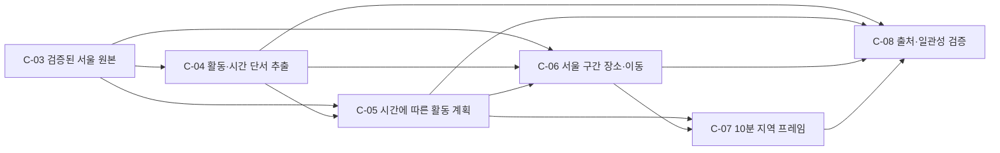

화살표는 각 단위의 입력 제공 관계다. C-03→C-05는 구조화 필드([DR-14](decisions.md#dr-14--구조화-필드의-사용과-근거-우선순위)), C-03→C-06은 거주 구, C-04→C-06은 장소 단서이며 C-05→C-07은 세그먼트 정본이다.

## C-04 — 활동과 시간 단서 추출

- 목적: 자유 서술에 흩어진 활동, 시간·빈도·장소 단서를 인물별로 분리해야 특정 인물의 시뮬레이션이 원문과 연결된다.
- 책임: 원본을 보존하고 서술을 문장 단위로 나눠 활동 후보, 시각·요일·빈도·장소 단서와 출처 필드/원문 범위를 추출한다. 각 단서에 모달리티([DR-15](decisions.md#dr-15--시간-신호-해석과-추출-방식)), 시각 신뢰 등급 A~D([DR-15](decisions.md#dr-15--시간-신호-해석과-추출-방식)), 장소 판정 `place_scope`([DR-12](decisions.md#dr-12--서울-밖-활동의-범위와-판정))를 붙이고 활동 후보를 15개 대분류([DR-16](decisions.md#dr-16--활동-분류-체계))로 사상한다. 서로 다른 필드의 중복과 모순을 기록한다. 희망사항·부정문을 현재 행동으로 단정하거나 없는 시각을 원문에 있다고 표시하지 않는다. 하지 않는 것: 계획 생성(C-05), 구 배치와 이동(C-06), 실제 행동이라는 주장.
- 입력/출력: C-03의 서울 페르소나 1건 → `uuid`, 거주 구, 후보 활동 목록(대분류와 원문 라벨), 각 단서의 원문 참조(필드·문자 범위)·모달리티·시각 등급·`place_scope`, 제외 목록(서울 밖·비현재형·방송명 등 사유 포함), 중복·모순 표시. 구조화 필드는 C-05가 C-03에서 직접 읽는다.
- 의존: 선행 C-03; 후행 C-05, C-06, C-08.
- 분류/미해결 질문: ASK → 확정(사용자 위임). 관련 결정 [DR-12](decisions.md#dr-12--서울-밖-활동의-범위와-판정), [DR-13](decisions.md#dr-13--장소-해석과-지리-상수), [DR-15](decisions.md#dr-15--시간-신호-해석과-추출-방식), [DR-16](decisions.md#dr-16--활동-분류-체계), [DR-20](decisions.md#dr-20--품질-합격선과-보관), 그리고 [DR-04](decisions.md#dr-04--활동-엔진의-용도와-데이터-범위), [DR-06](decisions.md#dr-06--지리적-범위), [DR-09](decisions.md#dr-09--원문에-없는-시간대의-활동), [DR-10](decisions.md#dr-10--서울-외-활동의-처리). 남은 SELF 구현 세부(정규식·마커·키워드의 구체 문구, 문장 분리 방식)는 구현체 Map의 [SELF 결정 기록](02_impl_map.md#self-결정-기록)과 [규칙 데이터](02a_rule_data.md)에 규칙 버전과 함께 기록했고, 그 묶음 결정이 [DR-21](decisions.md#dr-21--활동-엔진-구현-세부-결정)이다.
- 완료 기준: ① 모든 서울 UUID를 누락 없이 처리한다. ② 각 원문 기반 후보의 활동 및 시각·요일·빈도·장소 단서와 출처(필드·원문 범위)를 구분해 보존한다. ③ 모든 단서에 모달리티가 붙고 현재 습관만 일과 근거가 되며, 중복·모순은 원래 의미를 잃지 않고 표시한다. ④ 모든 장소 단서에 `place_scope`가 붙고 `OUTSIDE_SEOUL` 활동은 시뮬레이션에서 제외하되 원문과 제외 사유를 남긴다. ⑤ 시각 단서에는 신뢰 등급이 붙고 방송명 등 비시각 숫자는 시각 단서로 쓰이지 않는다. ⑥ 활동 후보는 15개 대분류로 사상되고 원문 라벨이 보존된다.
- 테스트 접점: E04-1 전체 입력과 결과의 UUID 비교; E04-2 ‘매일 오후’·명시 시각·시간 없는 활동의 근거 대조; E04-3 현재·과거·희망·부정·가정 문장의 모달리티와 반복·모순 피처; E04-4 서울 구·서울 밖·미상 지명 피처와 제외 사유; E04-5 시각 등급 A~D와 '6시 내고향' 같은 비시각 피처; E04-6 대분류 사상(매체 키워드 우선 규칙 포함)과 원문 라벨 보존. 단위와 원본→추출 통합 경계. 각 번호는 각각 완료 기준 ①~⑥에 대응한다.
- 리스크/불확실성: 정규식 오탐·미탐(`clock`의 비시각 포함), 모달리티 오분류, 서로 다른 필드의 동일 활동 판별, 사전에 없는 지명(`UNRESOLVED`)의 비율. 판별 불가 장소는 서울의 특정 장소로 사실인 것처럼 만들지 않는다.

## C-05 — 인물별 활동 계획과 시간 상태

- 목적: 매 프레임 독립 추첨은 활동이 매 10분 바뀌는 불연속을 만들기 때문에 인물의 활동과 지속시간을 연결할 계획이 필요하다.
- 책임: 구조화 필드([DR-14](decisions.md#dr-14--구조화-필드의-사용과-근거-우선순위))와 C-04의 현재 습관 단서를 반영해 평일/주말 구조의 활동 구간(세그먼트)을 만들고, 남는 시간은 명시된 기본 템플릿([DR-19](decisions.md#dr-19--기본-일과-템플릿))으로 채운다. 같은 활동의 시작·종료·빈도와 날짜 간 연속(자정 넘김)을 유지한다. 모든 시간·지속시간에 출처 라벨(`text`/`structured`/`assumption`)을 붙인다. 실제 행동이나 실측 확률을 주장하지 않는다. 하지 않는 것: 활동 장소(구) 결정(C-06).
- 입력/출력: C-03의 구조화 필드, C-04의 단서, 시뮬레이션 시작/종료일·시드·규칙 버전 → 인물별 날짜 단위 활동 세그먼트(대분류, 시작·끝, 출처 라벨, 근거 참조, `conflict` 플래그).
- 의존: 선행 C-03, C-04; 후행 C-06, C-07, C-08.
- 분류/미해결 질문: ASK → 확정(사용자 위임). 관련 결정 [DR-14](decisions.md#dr-14--구조화-필드의-사용과-근거-우선순위), [DR-15](decisions.md#dr-15--시간-신호-해석과-추출-방식), [DR-17](decisions.md#dr-17--프레임과-시간-규약-및-결정성), [DR-19](decisions.md#dr-19--기본-일과-템플릿), [DR-09](decisions.md#dr-09--원문에-없는-시간대의-활동). 템플릿 수치는 설계 상수이며 규칙 버전으로 외부화한다(스키마는 Phase 5의 SELF 결정).
- 완료 기준: ① 모든 인물에 대해 지정된 기간이 [start, end) 세그먼트로 겹침이나 누락 없이 하나의 주활동으로 채워지고 모든 경계는 10분의 배수다. ② 원문의 현재 습관 시각·빈도·요일 단서를 [DR-14](decisions.md#dr-14--구조화-필드의-사용과-근거-우선순위)의 우선순위대로 반영하되 미충족·모순은 숨기지 않는다. ③ 모든 시간·지속시간에 출처 라벨이 붙고 생성 부분은 근거와 구분된다. ④ 구조화 필드로 템플릿(주간 근무, 무직 65세 미만, 무직 65세 이상, 교대·야간, 현역)이 선택되고 서술과의 충돌은 `conflict`로 기록된다. ⑤ 평일/주말 구조와 주 단위 빈도(주 N회)가 반영되고 자정을 넘는 구간이 날짜 경계에서 이어진다. ⑥ 계획은 (원본 행, 규칙 버전, 시드, uuid, 날짜)의 순수 함수라 처리 순서·분할·병렬도와 무관하게 같다.
- 테스트 접점: E05-1 기간 시작·종료·자정 경계·10분 눈금의 단위 테스트; E05-2 시각/빈도/요일 우선순위와 모순 피처 대조; E05-3 출처 라벨 검사; E05-4 템플릿 선택(무직·65세 이상·교대·현역)과 `conflict`; E05-5 평일/주말·주 N회·자정 이어짐; E05-6 같은 실행의 재현 및 분할·다른 작업 순서의 결과 비교. C-04→C-05 통합도 포함하며 각 번호는 각각 ①~⑥에 대응한다.
- 리스크/불확실성: 시간 단서가 없거나 충돌할 수 있다. 템플릿 값은 설계 상수일 뿐 현실 분포가 아니다. 직업 1,748종을 근무 유형 2개로 묶는 규칙의 오분류가 있을 수 있고, 학업 중인 무직(대학생 등)은 구분할 수 없다.

## C-06 — 활동 구와 이동

- 목적: 지역별 프레임을 현재 활동 구 기준으로 만들려면 거주 구와 매 시점의 구를 구분하고 이동 중 귀속 규칙이 필요하다.
- 책임: 서울 25개 구 안에서 활동 장소(구)와 이동 구간을 생성한다. 활동 문장의 구 이름과 장소 사전([DR-13](decisions.md#dr-13--장소-해석과-지리-상수))으로 해석하고, 근거가 없으면 설계 규칙([DR-19](decisions.md#dr-19--기본-일과-템플릿)의 구 배치 확률)을 적용한다. 장소가 바뀌면 MOVE 세그먼트를 두고, 구가 바뀌는 MOVE는 20분 이상이며 [시작, 중점)은 출발 구, [중점, 끝)은 도착 구다([DR-11](decisions.md#dr-11--이동-중-지역-귀속), [DR-17](decisions.md#dr-17--프레임과-시간-규약-및-결정성)). 서울 밖 활동은 만들지 않고 모든 인물을 서울의 한 구에 유지한다([DR-10](decisions.md#dr-10--서울-외-활동의-처리), [DR-12](decisions.md#dr-12--서울-밖-활동의-범위와-판정)). 지도 없이 실제 경로·거리·교통시간을 주장하지 않는다.
- 입력/출력: C-05 세그먼트, C-03의 거주 구, C-04의 장소 단서(`place_scope` 포함), 지리 상수(장소 사전·구 인접표) → 각 세그먼트의 구, MOVE 세그먼트(출발·도착 구, 길이), 구·장소·이동의 출처 라벨.
- 의존: 선행 C-03, C-04, C-05; 후행 C-07, C-08.
- 분류/미해결 질문: ASK → 확정(사용자 위임). 관련 결정 [DR-07](decisions.md#dr-07--지역별-프레임의-의미), [DR-10](decisions.md#dr-10--서울-외-활동의-처리), [DR-11](decisions.md#dr-11--이동-중-지역-귀속), [DR-12](decisions.md#dr-12--서울-밖-활동의-범위와-판정), [DR-13](decisions.md#dr-13--장소-해석과-지리-상수), [DR-17](decisions.md#dr-17--프레임과-시간-규약-및-결정성), [DR-19](decisions.md#dr-19--기본-일과-템플릿). 지리 상수 3종의 실제 항목과 인접 판정 기준은 데이터로 만들고 불변식으로 검사한다(절차와 불변식은 구현체 Map [I-06-a](02_impl_map.md#i-06-a--지리-상수-3종)에 기록했고, 실제 데이터 작성은 구현 단계에서 한다).
- 완료 기준: ① 모든 인물의 모든 시점이 정확히 하나의 서울 구에 귀속된다. ② 구가 바뀌는 활동 사이에는 MOVE가 있고, 구가 바뀌는 MOVE는 20분 이상·10분 배수이며 전반=출발 구·후반=도착 구(중점은 후반)가 유지된다. ③ 구·장소·이동시간의 출처(`text`/`dictionary`/`assumption`)가 구별된다. ④ 서울 밖 확정 단서는 생략되고 `UNRESOLVED` 장소를 서울의 특정 장소로 위장하지 않는다. ⑤ 사전 적용 규칙(후보 집합이 거주 구를 포함하면 거주 구, 아니면 인접표 최소 홉, 동률은 시드)과 근거 없는 활동의 구 배치 규칙이 결정적으로 적용된다.
- 테스트 접점: E06-1 25개 구 멤버십 및 인물별 유일성 검사; E06-2 같은 구 이동, 다른 구 이동, 중점·종료 시각, 자정에 걸친 이동과 20분 최소 길이 피처; E06-3 구·장소·이동 출처 검사; E06-4 서울 밖 및 미상 장소 피처; E06-5 다구 후보 지명·거주 구 포함·동률 처리와 구 인접표 불변식(25개 노드, 대칭, 연결). C-05→C-06 통합도 포함하며 각 번호는 각각 ①~⑤에 대응한다.
- 리스크/불확실성: 사전과 인접표는 수작업이라 오류가 날 수 있다. 원본 `district`는 거주지이지 직장/현재 위치가 아니고 구 배치 확률은 설계 상수라 지역 분포가 그 값에 민감하다. 실제 이동시간은 검증할 수 없다.

## C-07 — 지역별 10분 프레임

- 목적: 같은 시각에 각 지역에 있는 모든 인물과 행동을 한 번에 읽고, 프레임을 시간 순서로 재생할 수 있어야 한다.
- 책임: 세그먼트 정본에서 10분 눈금(KST 00:00–23:50)의 순간 상태를 계산해 시각·구·인물 ID·활동·상태 종류·근거 참조를 프레임으로 조직한다([DR-17](decisions.md#dr-17--프레임과-시간-규약-및-결정성), [DR-18](decisions.md#dr-18--저장과-조회-방식)). 프레임은 파생물이며 시각 1개(185,228행) 단위 청크로 스트리밍한다. 원본 서술 전체를 매 행마다 복사하지 않는다. 사용자에게 프레임을 제공하는 별도 UI는 이 요청의 범위가 아니다.
- 입력/출력: C-05/C-06의 세그먼트 → 각 `timestamp × 현재 구`의 인물 상태 목록(빈 구 포함)과 실행 메타데이터. 프레임 행: `ts`, `district`, `uuid`, `activity_code`, `activity_detail`, `state_kind`(`ACTIVITY`/`MOVE_OUT`/`MOVE_IN`), `segment_id`.
- 의존: 선행 C-05, C-06; 후행 C-08.
- 분류/미해결 질문: ASK → 확정(사용자 위임). 관련 결정 [DR-05](decisions.md#dr-05--활동-출력-방식), [DR-07](decisions.md#dr-07--지역별-프레임의-의미), [DR-08](decisions.md#dr-08--시뮬레이션-프레임-간격), [DR-17](decisions.md#dr-17--프레임과-시간-규약-및-결정성), [DR-18](decisions.md#dr-18--저장과-조회-방식). 세그먼트 수·디스크 크기·처리 시간은 첫 수직 슬라이스에서 측정한다.
- 완료 기준: ① 하루 144개 시각 각각에서 서울 구별 프레임 합계는 185,228명이다. ② 매 시각 각 UUID가 한 구에 정확히 한 번 존재한다. ③ 각 프레임 행은 세그먼트 정본의 그 시점(`start ≤ t < end`) 상태와 일치하고 `segment_id`로 근거를 조회할 수 있다. ④ 연속 재생, 분할 처리, 다른 처리 순서의 결과가 같다. ⑤ 전체 프레임을 메모리에 동시에 보유하지 않고 시각 청크 단위로 생성·기록한다.
- 테스트 접점: E07-1 하루 144개 시각과 구별 합계 확인; E07-2 UUID 중복·누락과 빈 구 검사; E07-3 세그먼트 경계(시작·끝·중점)의 상태와 근거 조회; E07-4 프레임 전체 재생 및 분할 처리의 결과 해시 대조; E07-5 청크 처리 중 최대 보유 행 수 측정. C-06→C-07 통합과 사용자 조회 E2E를 포함하며 각 번호는 각각 ①~⑤에 대응한다.
- 리스크/불확실성: 서울 전원 기준 26,672,832개 인물 상태/일, 186,709,824개/7일이다. JSON 중복, 지나치게 많은 작은 파일, 메모리 내 전체 프레임 보유는 비용이 커질 수 있어 세그먼트 정본과 청크 스트리밍으로 피한다.

## C-08 — 출처, 재현성, 품질 검증

- 목적: 합성된 행동을 실제 관측값처럼 읽지 않고, 결과를 설명·재생하며 오류를 발견할 수 있어야 한다.
- 책임: 원본 리비전·해시, 규칙 버전, 실행 기간, 시간대, 시드, 가정 및 제외 사유를 연결한다. 총인원·활동·이동·재현성 검사와 [DR-20](decisions.md#dr-20--품질-합격선과-보관)의 표본 검수·합격선 판정을 수행하고 보고 지표 5종(근거 있는 시간 비율, 서울 밖 생략 비율, 가정 비율, 모달리티 제외 비율, `UNRESOLVED` 비율)을 계산한다. 데이터에 없는 현실 정확도는 보증하지 않는다.
- 입력/출력: C-04~C-07의 결과·실행 설정 → 검증 리포트, 원문/가정 근거 조회, 재현 정보, 표본 비교표.
- 의존: 선행 C-04~C-07; 후행 사용자 검토.
- 분류/미해결 질문: ASK → 확정(사용자 위임). 관련 결정 [DR-04](decisions.md#dr-04--활동-엔진의-용도와-데이터-범위), [DR-09](decisions.md#dr-09--원문에-없는-시간대의-활동), [DR-10](decisions.md#dr-10--서울-외-활동의-처리), [DR-11](decisions.md#dr-11--이동-중-지역-귀속), [DR-12](decisions.md#dr-12--서울-밖-활동의-범위와-판정), [DR-15](decisions.md#dr-15--시간-신호-해석과-추출-방식), [DR-20](decisions.md#dr-20--품질-합격선과-보관). 합격선 수치는 초기값이며 첫 검수 결과로 DR을 통해 조정한다.
- 완료 기준: ① 활동·시각·지역 각각의 출처(`text`/`structured`/`dictionary`/`assumption`)가 구분된다. ② 실행에 필요한 리비전·해시·규칙 버전·시드·시간대·기간이 남는다. ③ 프레임 유일성·인원 보존·세그먼트 겹침/공백·이동·활동 충돌을 검사하고 실패를 보고한다. ④ [DR-20](decisions.md#dr-20--품질-합격선과-보관)의 표본 비교표가 만들어지고 합격선 충족 여부가 보고된다. ⑤ 보고 지표 5종이 계산·보고된다. ⑥ 기록된 실행 설정으로 재생하면 같은 결과 해시가 나온다.
- 테스트 접점: E08-1 각 속성의 출처 조회; E08-2 실행 메타데이터의 필수 항목 검사; E08-3 중복 UUID·누락·중첩·공백·이동 규칙 오류 삽입; E08-4 표본 원문과 결과의 비교표 생성 및 합격선 계산; E08-5 작은 입력에서 손으로 센 지표와 대조; E08-6 기록된 설정으로 재생해 해시 비교. 통합 및 E2E이며 각 번호는 각각 ①~⑥에 대응한다.
- 리스크/불확실성: 재현성이 현실성을 보장하지 않는다. 원본 역시 합성 자료이므로 특정 개인이나 집단의 실제 행동과 빈도라고 해석하면 안 된다. 근거 있는 시간 비율은 낮을 것으로 예상된다(서술에 시각이 있는 인물이 1.5~1.9%).

## 활동 엔진 확정 흐름

1. 서울 원본에서 UUID·거주 구·구조화 필드와 서술 필드를 읽는다. 목록처럼 생긴 문자열은 안전하게 파싱하고 원문을 별도로 보존한다.
2. 서술을 문장으로 나눠 활동명, 시각·요일·빈도, 장소 표현을 분리하고 모달리티와 시각 등급을 붙인다. 활동 후보는 15개 대분류로 사상한다. `매주`, `가끔`, `대여섯 번`, `오후`, `6시` 등은 각각 원문 근거와 함께 기록하며 중복이나 해석 불가는 남긴다([DR-15](decisions.md#dr-15--시간-신호-해석과-추출-방식), [DR-16](decisions.md#dr-16--활동-분류-체계)).
3. 장소를 판정한다. `OUTSIDE_SEOUL`은 제외하고 사유를 남기며, 서울 지명은 장소 사전으로 구를 해석하고, 미상은 장소를 비워 둔다([DR-12](decisions.md#dr-12--서울-밖-활동의-범위와-판정), [DR-13](decisions.md#dr-13--장소-해석과-지리-상수)).
4. 구조화 필드로 일과 템플릿을 고르고([DR-14](decisions.md#dr-14--구조화-필드의-사용과-근거-우선순위), [DR-19](decisions.md#dr-19--기본-일과-템플릿)) 평일/주말 뼈대에 현재 습관 단서를 우선순위대로 배치한다. 남는 시간은 템플릿으로 채우고 활동·시각마다 출처 라벨(`text`/`structured`/`assumption`)을 붙인다.
5. 장소가 바뀔 때마다 MOVE 세그먼트를 만들고 구를 배정한다. 구가 바뀌는 MOVE는 20분 이상이며 전반은 출발 구, 후반은 도착 구다([DR-13](decisions.md#dr-13--장소-해석과-지리-상수), [DR-17](decisions.md#dr-17--프레임과-시간-규약-및-결정성)). 지도·실제 경계 통과·실제 교통시간은 제공하지 않는다.
6. 세그먼트(정본)에서 10분 눈금의 순간 상태를 계산해 시각 청크 단위로 프레임을 출력한다([DR-17](decisions.md#dr-17--프레임과-시간-규약-및-결정성), [DR-18](decisions.md#dr-18--저장과-조회-방식)). 활동은 끝날 때에만 다음 활동으로 전환하며 프레임마다 새로 뽑지 않는다.
7. 매 시각 25개 구 전체의 UUID 합집합이 입력과 같고 교집합이 비어 있는지, 세그먼트 겹침·공백·이동·출처·재현 조건이 맞는지 검사하고 표본 검수와 보고 지표를 낸다([DR-20](decisions.md#dr-20--품질-합격선과-보관)).

### 프레임 해석 예시 — 생성 결과를 설명하기 위한 가상 예시

공개 원본의 UUID `89eca80b88284888ad94c84f56777680`은 `district=서울-양천구`(73세 남성, 무직)다. `hobbies_and_interests`에 "친구들과 함께 경복궁이나 창덕궁 같은 고궁을 거닐며"와 "오후에는 거실 소파에서… 짧은 낮잠"이 서술돼 있다. 아래의 날짜·정확한 시각·이동 40분(비인접 구 사이의 설계값)은 원문 관측값이 아니라 생성 가정이다.

| 시각 | 현재 구 | 상태 | 활동 | 근거 |
|---|---|---|---|---|
| 14:10 | 서울-종로구 | ACTIVITY | CULTURE(고궁 산책) | 활동·장소는 원문(‘경복궁·창덕궁’ → 장소 사전 종로구); 시각은 가정 |
| 14:20 | 서울-종로구 | MOVE_OUT | MOVE | 14:20–15:00 이동 40분은 가정; 전반부는 출발 구 |
| 14:30 | 서울-종로구 | MOVE_OUT | MOVE | 〃 |
| 14:40 | 서울-양천구 | MOVE_IN | MOVE | 중점(14:40)은 후반부 → 도착 구([DR-11](decisions.md#dr-11--이동-중-지역-귀속), [DR-17](decisions.md#dr-17--프레임과-시간-규약-및-결정성)) |
| 14:50 | 서울-양천구 | MOVE_IN | MOVE | 〃 |
| 15:00 | 서울-양천구 | ACTIVITY | REST(낮잠) | 활동·‘오후’·집(거실)은 원문; 정확한 시각은 가정 |

하루 144개 시각 × 25개 구는 **3,600개의 논리적 지역 프레임**이며, 그 전체에는 26,672,832개 인물 상태가 들어간다. 정본은 세그먼트이고 프레임은 거기서 계산하는 파생물이다. 물리 파일을 매 프레임·매 구마다 만들지 않으며, 저장 방식과 측정 계획은 [DR-18](decisions.md#dr-18--저장과-조회-방식)에 있다.

## 활동 엔진 의존성 순서

1. 선행 데이터: 활동 대분류 키워드 규칙([DR-16](decisions.md#dr-16--활동-분류-체계))과 지리 상수 3종(장소 사전·서울 밖 사전·구 인접표, [DR-13](decisions.md#dr-13--장소-해석과-지리-상수))을 만들고 불변식(25개 구, 대칭·연결, 중복 토큰 없음)을 검사한다.
2. C-04의 추출 정확도를 표본 검수([DR-20](decisions.md#dr-20--품질-합격선과-보관))로 먼저 검증한다(리스크 우선).
3. C-05~C-07을 소수 인물(예: 100명)로 관통하는 수직 슬라이스로 만들어 세그먼트 수·저장 크기·처리 시간을 측정한다([DR-18](decisions.md#dr-18--저장과-조회-방식)).
4. C-08의 인원 보존·충돌·재현성 검사와 보고 지표를 붙인 뒤 서울 전원 규모로 확장한다.
5. 구현 테스트 명세는 구현체 Map([활동 엔진 테스트 추적표](02_impl_map.md#활동-엔진-테스트-추적표): E04-1~E08-6 대응)에 있고, 구현 세부(SELF) 결정은 [DR-21](decisions.md#dr-21--활동-엔진-구현-세부-결정)에, 구현 순서(SELF) 결정은 [DR-22](decisions.md#dr-22--활동-엔진-구현-순서와-진행-규칙)에 모았고, 구현은 [구현 순서 Map](03_build_order.md)의 T-03부터 사용자의 시작 지시 뒤에 한다. 이 Map은 구현이나 테스트 통과를 뜻하지 않는다.

## C-09 — 명동 관련 서울 페르소나 추출

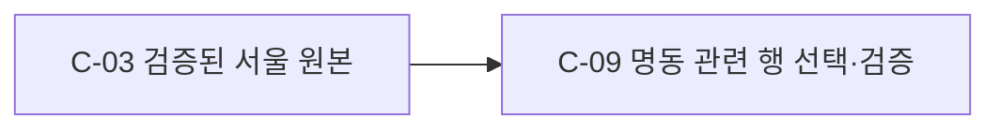

- 목적: 서울 원본에서 명동에 관한 서술을 직접 확인할 수 있는 인물 행을 따로 제공해, 후속 분석에서 관련 행을 즉시 읽을 수 있게 한다.
- 책임 범위: 원본 26개 열과 행 순서를 보존하며 지명·시설·상호명 언급에 근거해 선택한다. 다른 구 거주자도 포함한다. 명동 실거주 여부를 추정하거나 원본을 변경하지 않는다.
- 입력/출력: `data/nemotron-personas-korea/seoul.parquet` 및 그 메타데이터 → 독립 디렉터리의 명동 관련 원본 행 Parquet, 같은 값의 열람용 CSV, 출처·판정 메타데이터.
- 의존: 선행 C-03(T-02 완료). 활동 엔진 C-04~C-08의 미구현 여부와는 독립적이다.
- 분류/미해결 질문: ASK 항목은 사용자 확정: 지명 언급 범위 [DR-23](decisions.md#dr-23--명동-관련-행의-선택-범위), 상호 포함 [DR-27](decisions.md#dr-27--장소가-불확실한-명동-상호명). 내부 처리 [DR-28](decisions.md#dr-28--명동-추출-방식과-산출물). 미해결 질문 없음.
- 완료 기준: ① 원본 서울 185,228건의 문자열 필드를 전수 검사하고 명동 지명·시설·상호 언급 행을 각각 한 번 포함한다. ② `광명동`, `광명동굴`과 사람 이름만의 일치는 제외한다. ③ 결과의 26개 열, 타입, 값과 행 순서가 원본과 같고 원본은 수정되지 않는다. ④ 상호만의 언급은 소재지 미확정으로 구분하고 출처·라이선스와 열람용 CSV를 제공한다.
- 테스트 접점: E09-1 고정 원본과 결과 UUID를 별도 정규식으로 전수 대조해 ①을 검사한다. E09-2 실제 광명동굴·인명 사례 및 네 상호명 전용 행을 대조해 ②를 검사한다. E09-3 Parquet 재독 후 원본에서 선택한 전체 행과 스키마·순서를 비교해 ③을 검사한다. E09-4 CSV 전체 재독 및 상호 전용 UUID와 출처 메타데이터를 검사해 ④를 검증한다. 단위 경계 및 원본→결과 통합/E2E 검증이며 실제 데이터가 픽스처다.
- 리스크/불확실성: 명동 상호가 실제 명동에 있는지는 확인할 수 없다. `명동`을 언급하지 않은 다른 명동 장소는 자동 추정하지 않는다. 기존 원본의 합성 페르소나는 실제 인물이 아니다.

## 명동 지면 고도 작업의 관계도와 범위

이 작업은 기존 서울 페르소나·활동 엔진 및 C-09 명동 페르소나 추출과 독립적이다. 사용자 선택은 [DR-24](decisions.md#dr-24--명동-지형-자료의-종류와-범위), [DR-25](decisions.md#dr-25--고도행정동-경계-자료의-출처와-조건)에, 저장 결정은 [DR-26](decisions.md#dr-26--지형-자료의-저장과-검증)에 있다.

상태: C-10~C-12 완료(2026-10-31). 원본과 경계를 확인했고 57×57 격자 중 유효 1,462셀 전체를 원본 값 및 독립적 도형 교차 검사와 대조했다. 이 상태는 다른 트랙의 완료를 뜻하지 않는다.

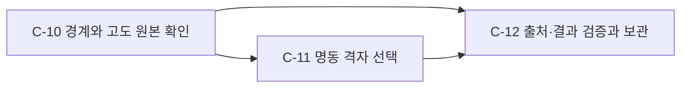

## C-10 — 명동 경계 및 지면 고도 원본 확인

- 목적: 명동 행정동 전체를 정확히 식별하고, 선택한 공개 지면 고도 모델의 변경 여부와 위치를 확인해야 다른 지역이나 다른 버전을 저장하지 않는다.
- 책임 범위: 고정된 행정동 경계 원본에서 정확한 코드·이름을 찾아 유효성을 확인하고, 고도 원본의 버전·격자·출처를 확인한다. 고도값을 새로 만들거나 도로·건물 자료를 얻지 않는다.
- 입력/출력: 코드 `1114055000`, 고정 경계 원본 및 GEDTM30 v1.2 원본 → 유효한 WGS84 경계와 식별된 지면 고도 격자.
- 의존 관계: 선행 없음; 후행 C-11, C-12.
- 분류/미해결 질문: ASK → 사용자 확정([DR-24](decisions.md#dr-24--명동-지형-자료의-종류와-범위), [DR-25](decisions.md#dr-25--고도행정동-경계-자료의-출처와-조건)); 미해결 질문 없음.
- 완료 판정 기준: ① 고정 커밋의 경계 원본 해시가 기록값과 일치한다. ② 행정동 코드·이름이 유일하게 일치하고 유효한 면 도형이다. ③ GEDTM30 v1.2의 식별값·좌표계·1초각 격자 및 결측값을 확인한다.
- 테스트 접점: E10-1 경계 바이트의 SHA-256 정상·불일치; E10-2 실제 명동 코드·이름·유효 도형과 누락·중복·무효 도형; E10-3 실제 원본 ETag·EPSG:4326·1초각·단일 Float32 밴드·결측값 확인. 단위·원본 통합 검증.
- 리스크 / 불확실성: 외부 서버 변경·차단·통신 오류; 경계는 2026-10-01 시점 가공 자료이며 공식 측량 경계를 보증하지 않는다.

## C-11 — 명동 전체의 지면 고도 격자 선택

- 목적: 세계 지형 자료에서 명동 행정동에 해당하는 원본 값을 보존해야 명동의 지형을 바로 사용할 수 있다.
- 책임 범위: 행정동과 교차하는 모든 원본 픽셀을 선택하고 그 밖의 픽셀은 결측 처리한다. 고도값을 보간하거나 가짜 고해상도를 만들지 않는다.
- 입력/출력: C-10의 경계 도형과 원본 격자 → 좌표계·원본 격자 정렬·고도값을 보존한 명동 GeoTIFF.
- 의존 관계: 선행 C-10; 후행 C-12.
- 분류/미해결 질문: ASK → 사용자 확정(지면 고도와 전체 행정동, [DR-24](decisions.md#dr-24--명동-지형-자료의-종류와-범위)); 계산 및 저장은 SELF([DR-26](decisions.md#dr-26--지형-자료의-저장과-검증)); 미해결 질문 없음.
- 완료 판정 기준: ① 경계에 닿는 픽셀이 모두 포함되고 그 밖은 결측이다. ② 포함된 원본 고도값과 격자 위치는 변하지 않는다. ③ 영역 내 고도 결측이나 비유한 값이 있으면 성공으로 처리하지 않는다. ④ 좌표계·높이 단위·수직 기준을 식별할 수 있다.
- 테스트 접점: E11-1 작은 합성 격자에서 경계 교차·외부 셀 확인; E11-2 실제 원본과 출력의 셀별 값·좌표 비교; E11-3 내부 결측·범위 밖 입력 실패 확인; E11-4 저장 파일의 CRS·격자와 메타데이터의 단위·수직 기준 확인. 단위·원본 통합 검증.
- 리스크 / 불확실성: 한 픽셀은 약 30m이고 경계 교차 픽셀 일부는 행정동 밖까지 걸친다. 모델은 2006~2015년 원천에 기반한 지면 추정치라 현재의 측량 결과가 아니다.

## C-12 — 결과 검증, 출처 기록 및 보관

- 목적: 사용자가 저장 파일을 열고 출처와 한계를 확인하며 파일 손상과 불완전한 결과를 구분할 수 있어야 한다.
- 책임 범위: 결과를 재독하여 고도·마스크·경계·해시를 확인하고 출처·라이선스·좌표·기간을 기록한 뒤 검증된 파일만 확정한다. 외부 배포나 기존 결과 덮어쓰기는 하지 않는다.
- 입력/출력: C-10 원본 메타데이터와 C-11 결과 → GeoTIFF·명동 경계 GeoJSON·메타데이터·README의 로컬 디렉터리.
- 의존 관계: 선행 C-10, C-11; 후행 사용자 열람.
- 분류/미해결 질문: 저장·검증은 SELF([DR-26](decisions.md#dr-26--지형-자료의-저장과-검증)); 출처와 이용 조건은 ASK → 확정([DR-25](decisions.md#dr-25--고도행정동-경계-자료의-출처와-조건)). 미해결 질문 없음.
- 완료 판정 기준: ① GeoTIFF와 경계 파일이 열리고 그 내용이 선택 결과와 일치한다. ② 원본·버전·좌표계·수직 기준·범위·라이선스·한계를 기록한다. ③ 결과 SHA-256과 픽셀 통계가 파일 재독값과 일치한다. ④ 검증 실패나 기존 출력 존재 시 최종 산출물을 덮어쓰지 않는다.
- 테스트 접점: E12-1 파일 재독과 경계·고도 비교; E12-2 메타데이터 필수 필드와 README 출처·라이선스 확인; E12-3 파일 해시와 픽셀 통계 재계산; E12-4 실패 및 기존 디렉터리 충돌 확인. 통합·E2E 검증.
- 리스크 / 불확실성: 부분 다운로드·부분 쓰기·출처 누락. 임시 디렉터리에서 검증 후 확정한다.

### 지형 작업 순서와 검증 대응

1. C-10에서 경계 원본 및 원격 격자의 접근성과 자료 식별을 먼저 확인한다.
2. C-11에서 실제 명동 영역으로 원본→선택 격자 수직 경로를 실행한다.
3. C-12에서 독립적인 파일 재독·원본 격자 대조 및 출처 검사를 통과한 뒤 결과를 확정한다. E10~E12 각 번호는 해당 단위 완료 기준의 번호와 1:1 대응하며 [구현 명세](02_impl_map.md#명동-지면-고도-구현-명세)와 [작업 순서](03_build_order.md#독립-명동-지면-고도-작업)에서 수행한다.

## C-90 — 명동 지면 고도의 대화형 3D 시각화

상태: 완료(2026-10-31). 원본의 3,249셀 값·마스크와 표시 데이터, 유효 1,462셀 및 인접 2,793쌍을 대조했다. 브라우저에서 회전·확대·고도 조회와 320px 표시를 확인했다.

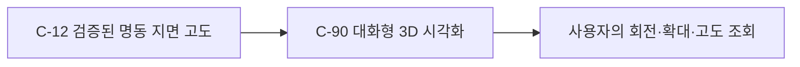

- 목적: 사용자가 저장된 명동 행정동 지면의 높낮이와 공간적 형태를 3차원으로 직접 살펴볼 수 있어야 한다.
- 책임 범위: 검증된 고도 격자를 3D 면으로 표시하고 회전·확대·고도 조회를 제공한다. 원본을 수정하거나 건물·도로·다른 고도를 추정하지 않는다.
- 입력/출력: C-12 GeoTIFF 및 메타데이터 → 대화에 삽입할 수 있는 회전 가능한 3D 시각화.
- 의존 관계: 선행 C-12; 후행 사용자 탐색.
- 분류/미해결 질문: ASK → 사용자가 기존 명동 고도의 3D 시각화를 요청해 확정. 원본값·동일 단위·결측 마스크 보존은 SELF([DR-90](decisions.md#dr-90--명동-고도의-대화형-3d-표현)); 미해결 질문 없음.
- 완료 판정 기준: ① 입력 해시와 유효 셀 수가 메타데이터와 같다. ② 유효 셀만 원본 높이와 위치로 표시한다. ③ 수평·수직 단위와 1× 수직 비율, 약 30m 해상도 및 출처가 식별된다. ④ 사용자가 회전·확대하고 셀의 고도를 확인할 수 있다.
- 테스트 접점: E90-1 파일 SHA-256·격자 수 검사; E90-2 셀 원본 값·좌표·결측 여부 대조; E90-3 축·배율·출처 확인; E90-4 브라우저 렌더링과 회전·확대·고도 조회 확인. 각각 완료 기준 ①~④와 대응한다.
- 리스크 / 불확실성: 30m 원본은 건물·도로 형태를 담지 않고 모델 추정치다. 행정동 경계에 닿는 셀은 경계 밖 일부를 포함한다. 브라우저의 WebGL 또는 외부 시각화 라이브러리 사용 가능 여부에 영향을 받는다.

### C-90 구현 순서와 검증

C-12 원본과 해시를 확인한 뒤 유효 셀을 동일한 높이·위치의 3D 면으로 내보내고 브라우저에서 렌더링·상호작용을 검사한다. 세부 계약은 [구현체 Map](02_impl_map.md#i-90-a--명동-3d-시각화-c-90), 순서는 [T-90](03_build_order.md#독립-명동-3d-시각화)이다.

## 온톨로지 기반 정방향 기록과 목표 역산 — C-100~C-105

이 절은 2026-10-31 요청한 **알고리즘 설계**의 개념 Map이다. Phase 1의 책임 분해와 Phase 2~3의 ASK 분류·사용자 답변을 반영해 확정했다([DR-100~DR-104](decisions.md#dr-100--역산-엔진과-온톨로지의-연결-범위)). 코드 구현이나 명동 연결 검증을 완료했다는 뜻은 아니다. 기존 활동 엔진과 데이터 수집의 결정은 그대로 유지한다.

- ASK 확정: 범용 엔진 + 명동 어댑터, 조절 가능한 외부 변수만 탐색, 핵심 지표의 허용오차 충족 후 최소 변경량.
- SELF 확정: 동일 모델·동일 조건의 재현, 엄격한 목표 판정, 기존 조건에서 변경량 0인 해 처리, 불가능 증명과 탐색 미발견 구분.
- 실행 시 필수 입력: 명동 스키마/전이 규칙, 실제 KPI·기간·목표값·허용오차, 변수 범위·거리 척도·가중치, 시나리오와 자원 예산. 도메인 값은 범용 설계에서 추정하지 않는다.
- 현재 확인된 환경: Python 3.13.1, NumPy 2.4.6, SciPy 1.17.1, PyArrow 24.0.0. 작업 중 [페르소나 반응 온톨로지 초안](01a_persona_ontology.md)의 v0.2와 후속 v0.3을 확인했고 §7.4의 개념 계약을 [알고리즘 명세 §12](02b_inverse_algorithm.md#12-명동-어댑터의-연결-조건)에 대응시켰다(DR-107~108). 최종 스키마·수치·실행 가능한 전이 코드는 아직 확인되지 않았다.

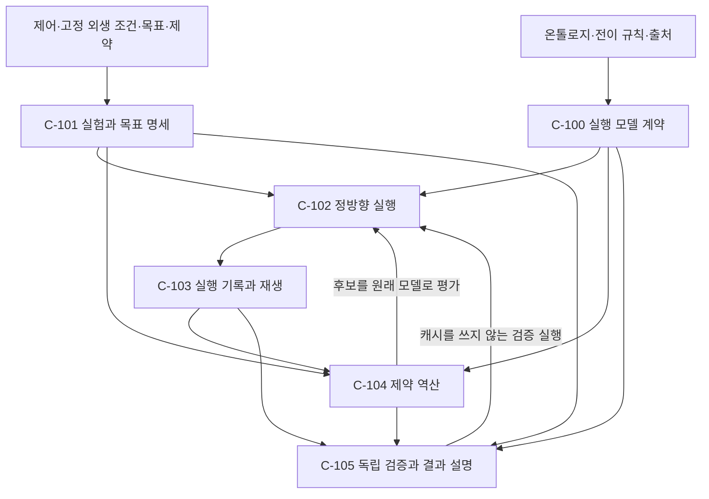

화살표는 호출 또는 데이터 제공이다. C-104→C-102와 C-105→C-102는 런타임 반복 호출이며 구현 의존성의 순환이 아니다. C-102는 C-104나 C-105를 알지 않는다.

### C-100 — 온톨로지와 실행 규칙의 연결

- 목적: 개체·속성·관계 그래프를 수치 변화가 정의된 모델과 연결해야 외부 변수의 영향과 목표의 달성 여부를 계산할 수 있다.
- 책임 범위: 의미 관계와 실행 의존 관계를 구분하고 상태·제어·고정 외생 값·관측값·전이 규칙·지연·출처를 식별한다. 관계가 있다는 이유로 인과 방향·계수·실측 신뢰도를 만들어 넣지 않는다. 모델 계수를 목표에 맞춰 추정하거나 변경하지 않는다.
- 입력 / 출력: 온톨로지 스냅샷, 어댑터, 버전이 있는 전이 규칙 → 검증된 실행 모델 계약과 의존 관계 또는 구조화된 준비 오류.
- 의존 관계: 선행은 제공받을 온톨로지·규칙; 후행 C-101, C-102, C-104, C-105. 명동에서는 C-04~C-08의 설계와 원본 출처를 참조할 수 있으나 이미 실행 가능하다고 가정하지 않는다.
- 분류: ASK 확정([DR-100](decisions.md#dr-100--역산-엔진과-온톨로지의-연결-범위)); 입력 검증은 SELF([DR-103~104](decisions.md#dr-103--역산-설계의-재현성과-판정-원칙)).
- 미해결 질문: 범용 계약에는 없음. 실제 명동 온톨로지 초안 경로는 확인했다. 최종 스키마·수치·실행 가능한 전이 함수는 실행 전 제공돼야 하며, 이 설계가 초안의 Q-R1~Q-R7을 대신 결정하지 않는다.
- 완료 판정 기준: ① 모든 실행 값에 안정 ID·타입·단위·역할이 있다. ② 모든 상태 변화에 버전과 출처가 있는 규칙이 있다. ③ 시간 지연과 동시 갱신 순서가 명시되며 미지원 순간 순환은 거절된다. ④ 의미 관계가 자동으로 인과 규칙이 되지 않는다. ⑤ 모델·어댑터·입력 해시가 고정되고 누락은 준비 오류로 드러난다.
- 테스트 접점: E100-1 타입/단위/역할 충돌(단위); E100-2 규칙 누락(단위); E100-3 지연 피드백·순간 순환(단위); E100-4 비인과 관계만 있는 합성 그래프(단위); E100-5 모델 변경/어댑터 누락(통합). 번호별로 완료 기준과 1:1 대응한다.
- 리스크 / 불확실성: 숨은 상호작용, 불완전한 의존 목록, 새로 만들어진 관계를 인과 사실로 오해하는 문제. 의존 관계가 불완전하면 그래프 가지치기를 하지 않는다.

### C-101 — 실험 조건과 고정 목표의 계약

- 목적: 무엇을 바꿀 수 있고 무엇을 그대로 둬야 하는지, 어떤 결과를 어느 정확도로 맞추는지를 고정해야 역산 결과가 의미를 가진다.
- 책임 범위: 기준 제어, 허용 제어 경로, 초기 상태, 고정 외생 시나리오, 난수 실현값, KPI의 집계 정의·목표·허용오차, 변경량과 하드 제약을 검증한다. KPI·거리 척도·시나리오를 임의로 선택하지 않는다.
- 입력 / 출력: C-100 계약, 명시적 실험/역산 요청, 선택적으로 목표를 가져올 과거 실행 → 변경 불가능한 정규화 요청과 해시 또는 입력 오류.
- 의존 관계: 선행 C-100, 목표 출처가 있을 때 C-103; 후행 C-102, C-104, C-105.
- 분류: ASK 확정([DR-101](decisions.md#dr-101--역산에서-변경할-수-있는-값), [DR-102](decisions.md#dr-102--목표-일치와-해의-선택-기준)); 구체 값은 [DR-104](decisions.md#dr-104--도메인별-수치는-명시적-실행-입력으로-분리)의 실행 입력이다.
- 미해결 질문: 범용 계약에는 없음. 실제 실행의 KPI·값·기간·범위·척도·예산은 아직 제공되지 않았다.
- 완료 판정 기준: ① 제어만 탐색 변수이고 외생 조건·모델 계수·초기 상태·난수는 고정된다. ② 각 목표에 KPI 버전·시간 범위·단위·비음수 허용오차가 있다. ③ 변경량은 단위 정규화·양의 가중치·0 변경 비용을 만족한다. ④ 값 범위·정수/범주·변화율·연동 제약을 표현한다. ⑤ 목표의 원래 실행과 현재 평가 조건을 따로 참조하며 입력 누락/충돌을 거절한다.
- 테스트 접점: E101-1 금지 변수 변경(단위); E101-2 다른 단위/창/허용오차(단위); E101-3 거리 척도와 범주 비용(단위); E101-4 연동·정수·경계 제약(단위); E101-5 저장 결과의 목표화와 다른 외생 조건(통합).
- 리스크 / 불확실성: 전체 상태 재현과 지표 재현의 혼동, 원시 단위 때문에 왜곡된 최소 변경량, 과거 목표를 현재 시나리오와 혼동하는 문제.

### C-102 — 고정 조건의 정방향 실행

- 목적: 각 후보가 실제로 어떤 상태 경로와 결과를 만드는지 동일한 모델로 계산하고 재생할 수 있어야 한다.
- 책임 범위: 입력 검증, 시간순 상태 전이, 개체·규칙별 안정된 난수 조회, KPI와 상태 제약 계산, 기록 이벤트 생성. 목표값에 맞게 결과를 덮어쓰거나 실행 도중 모델을 보정하지 않는다.
- 입력 / 출력: C-100 모델, C-101 요청, 합법적인 제어 경로, 시나리오 1개 → 시간별 상태·규칙 실행·KPI·제약 잔차·오류 이벤트.
- 의존 관계: 선행 C-100, C-101; 후행 C-103, C-104, C-105. C-103의 기록 인터페이스에 이벤트를 전달한다.
- 분류: SELF([DR-103](decisions.md#dr-103--역산-설계의-재현성과-판정-원칙)).
- 미해결 질문: 없음. 도메인 동역학은 어댑터가 제공하는 명시적 입력이다.
- 완료 판정 기준: ① 같은 입력·모델·환경에서 동일 결과와 계산 추적을 낸다. ② 지연/동시 갱신과 시간 경계를 지킨다. ③ 제어를 바꿔도 다른 변수·난수 키·원본이 오염되지 않는다. ④ KPI와 중간 상태 제약이 직접 재계산과 일치한다. ⑤ NaN·발산·예산 초과·규칙 실패를 결과와 구분한다.
- 테스트 접점: E102-1 실행 순서와 반복 재생(단위); E102-2 지연 피드백·경계 시각(단위); E102-3 공통 난수와 불변 입력(통합); E102-4 해석적으로 푸는 합성 경로(단위); E102-5 실패 주입(단위).
- 리스크 / 불확실성: 분기마다 달라지는 순차 난수 소비, 개체 순서 의존, 미선언 전역 상태와 부작용, 대규모 인물 상태 기록 비용.

### C-103 — 실험 장부와 재생 가능한 상세 기록

- 목적: 어떤 조건·규칙·중간 변화로 결과가 생성됐는지 보존해야 정방향 실험을 역산의 근거와 검증에 재사용할 수 있다.
- 책임 범위: 입력 스냅샷, 모델·코드·환경·난수 식별자, 기준/개입/실패 실행, 중간 상태와 규칙 참조, 최종 KPI, 후보 평가·탐색 이력, 산출물 해시를 보존한다. 기록된 의존 경로를 실제 세계의 인과 기여도로 해석하지 않는다.
- 입력 / 출력: C-102의 이벤트 스트림, 요청/모델 스냅샷, C-104의 후보 이력 → 불변 실행 패키지와 조회/재생 인터페이스.
- 의존 관계: 선행 C-100/101의 스냅샷, C-102 실행; 후행 C-101(목표화), C-104(과거 후보), C-105(설명/감사).
- 분류: 사용자 원 요청의 상세 기록 요구 + SELF 재현 계약([DR-103](decisions.md#dr-103--역산-설계의-재현성과-판정-원칙)).
- 미해결 질문: 없음. 저장 예산은 실행자가 명시하며 부족할 때 기록을 몰래 줄이지 않는다.
- 완료 판정 기준: ① 모든 후보와 실패에 실행 조건·원인·연결 ID가 남는다. ② 상태 변화와 규칙 입력/출력·출처를 추적할 수 있다. ③ 해시와 manifest로 손상·부분 실행을 식별한다. ④ 캐시는 모델·초기 상태·시나리오·제어·난수·KPI 버전이 모두 같을 때만 재사용한다. ⑤ 저장 기록에서 독립 재생한 KPI와 추적이 일치한다.
- 테스트 접점: E103-1 정상/실패 장부(단위); E103-2 중간 상태 재구성(통합); E103-3 중단·파일 손상(단위); E103-4 조건 변경별 캐시 무효화(단위); E103-5 패키지 재생(통합).
- 리스크 / 불확실성: 큰 로그, 스냅샷 누락, 모델 버전 혼합, 상세 출처와 수치 영향의 혼동.

### C-104 — 제약을 지키는 목표 역산

- 목적: 목표에 도달하는 제어 조합들 가운데 기준 제어로부터 변경량이 작은 후보를 찾는다. 비선형·다해·무해 상황에서도 판정의 의미를 유지한다.
- 책임 범위: 보수적 의존 분석, 저장 후보 재평가, 목표 달성 탐색, 달성 후보 내 변경량 최적화, 예산과 중단 처리, 대안·미달량 보존. 외생 조건·목표·규칙 계수를 탐색 변수가 되게 하지 않는다.
- 입력 / 출력: C-100 모델, C-101 고정 요청, C-103의 호환 기록 → 후보별 제어·KPI 오차·제약·변경량·탐색 상태 및 검증 대상.
- 의존 관계: 선행 C-100~C-103; 후행 C-105; 후보 평가는 C-102를 호출한다.
- 분류: ASK의 결과인 목표/변수 계약([DR-101~102](decisions.md#dr-101--역산에서-변경할-수-있는-값)); 반복 탐색·캐시 등은 SELF.
- 미해결 질문: 없음. 계산 예산과 실행 입력 없이 실제 최적 변경량을 계산했다고 주장하지 않는다.
- 완료 판정 기준: ① 제어만 합법적 범위에서 바꾼다. ② 목표 미달 후보가 비용이 싸다는 이유로 성공이 되지 않는다. ③ 이미 통과한 기준 제어는 변경량 0으로 반환한다. ④ 다해·불연속·상호작용에서도 후보를 원래 함수로 평가하고 대안/잔차를 보존한다. ⑤ 탐색 미발견·하드 제약 실패·증명된 불가능·평가 오류를 구분하며 최소성 보장 수준을 명시한다. ⑥ 평가 횟수·시간·저장 예산을 지키고 재시작에서 조건을 바꾸지 않는다.
- 테스트 접점: E104-1 제어 마스크/경계(단위); E104-2 목표 우선순위(단위); E104-3 무변경 해(단위); E104-4 다해·임계값·상호작용 합성 모델(단위/통합); E104-5 유한 전수 무해와 연속 탐색 미발견(단위); E104-6 중단·예산·호환 재시작(통합).
- 리스크 / 불확실성: 고차원·평평한 반응·지역 최소·지연·시뮬레이션 비용. 휴리스틱의 전역 최소나 연속 영역의 불가능을 보장하지 않는다.

### C-105 — 후보 검증과 변경안의 설명

- 목적: 탐색기가 제안한 변경안을 원래 시뮬레이터에서 재실행하고, 목표 달성 범위와 실제 변경 내역을 함께 전달한다.
- 책임 범위: 캐시를 쓰지 않는 재실행, 명시된 추가 시나리오 검증, 제어 전후·목표/실제/오차·제약·기록 경로·보장 범위를 보고한다. 한정된 시나리오의 통과를 미래 성공확률이나 현실 인과 보장으로 표시하지 않는다.
- 입력 / 출력: C-104의 후보, C-100/101의 고정 조건, C-103 기록 → 검증된 변경안 또는 검증 실패/미완료 결과.
- 의존 관계: 선행 C-100, C-101, C-103, C-104; 재검증 실행은 C-102를 호출한다.
- 분류: SELF([DR-103](decisions.md#dr-103--역산-설계의-재현성과-판정-원칙)).
- 미해결 질문: 없음. 확률 보장이 필요해지면 별도 요구와 표본 설계를 ASK로 추가한다.
- 완료 판정 기준: ① 모든 성공 후보에 원본 모델 재실행과 지표별 판정이 있다. ② 추가 시나리오가 있으면 별도 결과와 실패 원인을 보존한다. ③ 변경 전후·단위·척도·거리·제약·최소성 수준을 읽을 수 있다. ④ 중간 경로 설명이 실제 추적과 연결되고 상호작용을 임의 분해하지 않는다. ⑤ 실패/검증 예산 부족을 성공으로 반환하지 않는다.
- 테스트 접점: E105-1 원본 재실행과 변조 탐지(통합); E105-2 추가 시나리오 실패(통합); E105-3 보고서 수치/단위/보장 라벨(단위); E105-4 경로 근거 대조(통합); E105-5 검증 중단(통합). 핵심 E2E는 저장된 정방향 결과를 고정 목표로 만들고 외생 충격 후 제어를 역산해 재실행하는 흐름이다.
- 리스크 / 불확실성: 탐색 시나리오 과적합, 재생 불가능한 환경, 모델의 현실 타당성 미검증. 이 설계의 성공은 명시된 모델·조건 안의 성공이다.

### C-100~C-105 구현 순서 초안과 검증

1. C-100·C-101의 계약 검증과 C-103의 최소 기록 경계를 먼저 만든다. 모델 부재·비실행 관계·순환·단위 충돌을 초기에 드러낸다.
2. 합성 모델로 C-102→C-103의 실행·기록·재생을 관통한다. 난수/시간/기록 결정성이 가장 앞선 위험이다.
3. 해석적 해가 있는 작은 모델로 C-104→C-105를 연결해 목표 충족과 최소 변경량의 우선순위를 검증한다.
4. 혼합 변수·다해·무해·예산 중단·추가 시나리오·상호작용을 확인한다.
5. 실제 온톨로지와 전이 규칙이 제공되면 명동 어댑터의 대응을 검증한다. 합성 모델 통과를 명동 통과로 대체하지 않는다.

각 E번호는 위의 같은 번호 완료 기준과 1:1로 대응한다. 경계별 통합과 E2E의 구체적 Given/When/Then은 [구현체 Map](02_impl_map.md#온톨로지-기반-정방향역산-구현체-map), 수식과 알고리즘 계약은 [역산 알고리즘 명세](02b_inverse_algorithm.md), 수행 순서는 [구현 순서 Map](03_build_order.md#온톨로지-기반-정방향역산-구현-순서)에 둔다.

## 명동 스무딩 지형 관계도

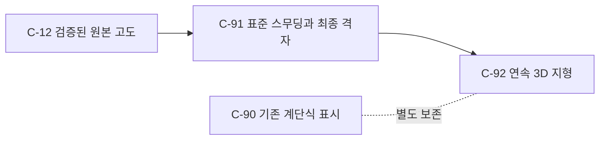

## C-91 — 표준 스무딩과 최종 격자 확정

상태: 완료(2026-10-31). 최종 유효 1,462셀의 스무딩 고도는 독립 SciPy 계산과 전수 일치했으며 원본 해시와 결측 마스크를 보존했다.

- 목적: 저장된 명동 지면 고도의 거친 변화를 사용자가 선택한 강도로 줄이고, 그 결과를 이후 사용할 최종 지형 데이터로 보관한다.
- 책임 범위: 유효한 원본 값만 사용하여 1격자 가우시안 스무딩을 적용하고 입력의 격자·좌표·결측을 유지한다. 원본을 덮어쓰거나 측량값을 새로 생성하지 않는다.
- 입력/출력: C-12 원본 GeoTIFF·메타데이터 → 최종 스무딩 GeoTIFF, 원본·처리·출처·변경 통계 메타데이터와 README.
- 의존 관계: 선행 C-12; 후행 C-92.
- 분류/미해결 질문: ASK → 사용자가 표준 강도 확정([DR-94](decisions.md#dr-94--명동-지형-스무딩-강도)); 경계 정규화 및 원본 보존은 SELF([DR-95](decisions.md#dr-95--스무딩-정본의-보존과-경계)). 미해결 질문 없음.
- 완료 판정 기준: ① 입력 파일 해시·좌표·격자·유효 마스크가 검증된다. ② 유효 셀에 선택된 강도가 적용되고 결측 및 원본 파일은 유지된다. ③ 최종 GeoTIFF는 재독 가능하며 좌표·크기·NoData·결과 통계가 일치한다. ④ 방법·강도·원본과 결과 해시·이용 조건·변경 통계가 남는다.
- 테스트 접점: E91-1 원본 해시·형태·유효 셀 검사; E91-2 상수·고립 봉우리·결측 인접 픽스처와 원본 불변 검사; E91-3 출력 재독 및 독립적인 SciPy 정규화 가우시안 결과 대조; E91-4 메타데이터·해시·README 대조. 각 번호는 완료 판정의 번호와 대응한다.
- 리스크 / 불확실성: 스무딩은 관측된 지형의 정확도를 개선한다는 보장이 없으며 작은 봉우리·골짜리와 경사를 낮춘다. 원본의 약 30m 해상도는 높아지지 않는다.

## C-92 — 최종 스무딩 지형의 연속 3D 표시

상태: 완료(2026-10-31). 1,462셀·공유 모서리 1,594개·삼각형 5,848개의 연결 관계와 실제 브라우저 회전·확대·고도 조회·320px 표시를 확인했다.

- 목적: 사용자가 확정된 지면의 높낮이를 틈 없이 이어진 3D 지형으로 확인할 수 있어야 한다.
- 책임 범위: C-91 격자 중심의 최종값과 공유 모서리 보간을 이용해 유효 셀 안에만 연속 면을 만들고 회전·확대·고도 조회를 제공한다. 기존 계단식 시각화와 원본 데이터를 바꾸거나 결측 영역을 채우지 않는다.
- 입력/출력: C-91 최종 GeoTIFF와 메타데이터 → 대화 내 표시용 연속 3D 시각화.
- 의존 관계: 선행 C-91, 기존 표시 C-90 참고; 후행 사용자 탐색.
- 분류/미해결 질문: ASK → 부드럽게 이어진 지형을 요청한 사용자 의도([DR-96](decisions.md#dr-96--연속-3d-표면의-표시-규칙)); 격자 간 표시용 선형 보간 및 화면 조작은 SELF. 미해결 질문 없음.
- 완료 판정 기준: ① 시각화 입력은 최종 격자·마스크와 동일하다. ② 인접 유효 셀은 같은 모서리를 공유하며 결측 셀은 면이 없다. ③ 격자 중심은 최종 고도를 유지하고 보간·수직 배율·단위·출처가 표시된다. ④ 브라우저에서 3D 회전·확대·고도 조회와 작은 화면 표시가 동작한다.
- 테스트 접점: E92-1 래스터와 내장 값·마스크 전수 비교; E92-2 공유 모서리·셀별 삼각형·결측 처리 검사; E92-3 중심 높이·고도 범위·표시 문구 검사; E92-4 실제 브라우저의 3D 그림·회전·확대·툴팁·320px 표시 확인. 각 번호는 완료 판정 번호와 대응한다.
- 리스크 / 불확실성: 모서리와 셀 중간의 높이는 표시용 보간치다. 사용한 추정 고도는 원래 해상도보다 상세한 측량이 아니다.

### 명동 스무딩 구현 순서와 검증

C-91을 먼저 구현·검증하고 최종 GeoTIFF를 확정한 후 C-92가 그 파일만 읽어 연속 3D 면을 만든다. 세부 계약은 [구현체 Map](02_impl_map.md#명동-최종-스무딩-지형-구현-명세), 순서는 [T-91~T-92](03_build_order.md#독립-명동-최종-스무딩-지형-작업)이다.

## 명동 증강 65,000명 — C-130~C-133

상태: done. 사용자 결정 [DR-29~31](decisions.md#dr-29--페르소나-증강의-인물-정체성), 통계·정수 보정·온톨로지 계약 [DR-130~136](decisions.md#dr-130--증강에-반영할-통계와-모집단-경계), 근거 [조사 기록](04_persona_augmentation_research.md). 65,000행, 원본 26열·부모 514명·통계·해시의 전수 검증을 통과했다. 활동 엔진 구현은 이 작업의 범위가 아니다.

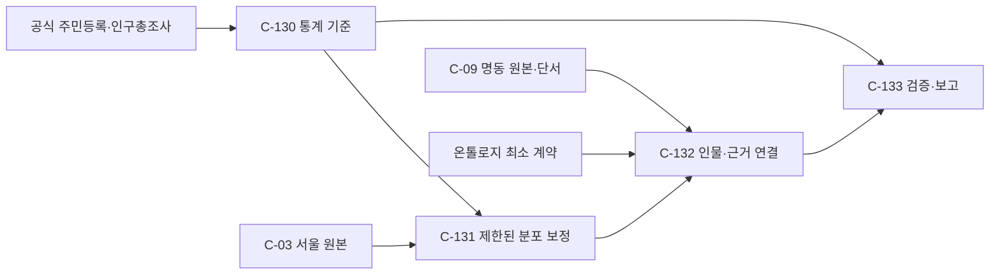

### C-130 공식 통계의 모집단과 기준
- 목적: 공적 기준의 각 셀과 원본의 모집단을 같은 단위로 비교해, 통계의 시점·범위 차이를 숨기지 않는다.
- 책임 범위: 통계 원표를 정규화하고 출처·해시·조회 조건·누락 및 명동 행정동 맥락을 보존한다. 하지 않는 것: 원표에 없는 수치 복원이나 일과 생성.
- 입력/출력: MOIS 서울 구별 인구·1인세대 및 명동 동별 인구, KOSIS 서울 혼인상태 원표 → 버전이 있는 통계 JSON.
- 의존 관계: 선행 없음; 후행 C-131·C-133. 분류: ASK DR-30 확정, 세부 SELF DR-130.
- 미해결 질문: 없음. 통계의 모집단·시점 차이는 결과의 명시적 한계다.
- 완료 판정 기준: ① 25구×2성×17연령 셀 완비 ② 19~99세 인구 및 1인세대 합계 원표 일치 ③ 성·연령별 혼인 총계와 세 상태 합 일치, 공개된 구별 혼인 셀 추가 ④ 명동 동 통계를 서울 모집단 목표와 구분 ⑤ 출처·조회조건·해시 기록.
- 테스트 접점: 파서 단위, 공식 원표 재합산 통합 검증. 리스크: 셀 억제, 기준연도·집계 단위 차이.

### C-131 원본 지원 범위 안의 복합 분포 보정
- 목적: 514명의 편향된 중구·성별 구성을 그대로 복제하지 않으면서 사회통계에 가까운 65,000명의 기존 인물 풀을 찾는다.
- 책임 범위: 구×성×연령 목표·희소 셀 이동 및 혼인·혼자거주 대리 목표를 최적화해 고유한 출처 인물을 정한다. 하지 않는 것: 원본 속성이나 문장 재작성, 없거나 억제된 수치 생성.
- 입력/출력: C-130 통계, 서울 원본의 인구·가구·혼인 속성 → 중복 없는 선택 출처 UUID와 목표/실현/오차.
- 의존 관계: C-03·C-130 선행, C-132·C-133 후행. 분류: SELF DR-131.
- 미해결 질문: 없음. 불가능한 목표는 측정된 오차로 남긴다.
- 완료 판정 기준: ① 합계 65,000 ② 동일 구·성 내 최근접 연령으로만 희소 보정하고 전부 기록 ③ 각 구·성·연령 선택 수가 보정된 목표와 일치 ④ 서울 및 공개된 구별 혼인·대리 목표와 실현·차이 및 최적화 상태 기록 ⑤ 출처 UUID 중복 없음 ⑥ 같은 입력·버전·시드는 같은 선택.
- 테스트 접점: 빈·부족·모순 입력 및 최적화 독립 단위 테스트, 실제 인구 전체 통합 검사. 리스크: 표본의 희소 조합 및 다른 조사 정의.

### C-132 출처 연결과 온톨로지 최소 계약
- 목적: 새 가상 인물을 부모의 명동 맥락과 연결하면서 원본 텍스트·인구 속성의 의미와 온톨로지 입력을 유지한다.
- 책임 범위: 부모별 126/127 자손, 새 ID, 출처 UUID, 원문 필드·토큰·문자범위·문장과 불확실성 라벨을 기록한다. 하지 않는 것: 부모 맥락을 새 인물의 확정 사실로 간주하거나 특성 프로필 생성.
- 입력/출력: C-131 UUID, C-09 514행·근거, 서울 원본 → 65,000행 Parquet.
- 의존 관계: C-09·C-131·온톨로지 §7.1 선행, C-133 후행. 분류: ASK DR-31, SELF DR-132.
- 미해결 질문: 온톨로지 특성의 최종 스키마는 외부 작업에서 미확정이다. 이 작업은 §7.1 최소 계약을 채운다.
- 완료 판정 기준: ① 원본 26개 열 타입·값 보존 ② synthetic_id 65,000개 유일 ③ 부모 514명 각각 126 또는 127개, 236명만 127개 ④ 필드·토큰·오프셋·문장이 부모 원문과 일치 ⑤ 모든 단서는 미확정 방문 목적 후보로 라벨 ⑥ 상호 전용 근거의 위치 불확실성 유지.
- 테스트 접점: 유니코드 오프셋·부모 할당 단위, 514 부모 및 서울 65,000 출처 전수 통합 검사. 리스크: 단서를 직접 행동으로 오독하거나 서술 자체의 원천 오류.

### C-133 재독 검증과 인계
- 목적: 결과의 재생 가능성, 정확도 및 적용되지 않은 통계의 경계를 사용자가 확인한다.
- 책임 범위: 파일 재독, 전수 무결성·분포·통계 대비 오차·해시·README 생성. 하지 않는 것: 실제 사람이나 방문객 집단의 현실 대표성 보장.
- 입력/출력: C-130~132 결과 → 검증된 Parquet, 진단 JSON, 설명서.
- 의존 관계: C-130~132 선행; 후행 온톨로지 R-02. 분류: SELF.
- 미해결 질문: 없음. 미보정 특성 및 원문 신뢰도는 한계로 공시한다.
- 완료 판정 기준: ① 65,000행 재독 및 참조 무결성 통과 ② 공식 목표·실현 수치·오차 및 부족·원표 조건 보관 ③ 원본·출력·통계·온톨로지 계약의 해시 기록 ④ 해당 테스트와 전체 실행 검증 통과 ⑤ 사용자 열람과 재실행 방법 제공.
- 테스트 접점: 합성 픽스처 E2E, 실데이터 전수 검증 및 저장 재독. 리스크: 파일 크기 및 원본 자체의 의미상 충돌.

**구현 순서·대응 검사:** C-130→C-131→C-132→C-133. 각 완료 기준 ①~에 대해 각각 정규화·배분·부모 연결·전수 검사 테스트에서 같은 순서의 불변식을 검증한다. 세부 시그니처와 테스트는 [I-130~133](02_impl_map.md#명동-증강-구현-명세) 및 [T-130~133](03_build_order.md#명동-증강-구현-순서)이다.

## 명동 건물·도로 및 주변 지형 3D 지도 관계도

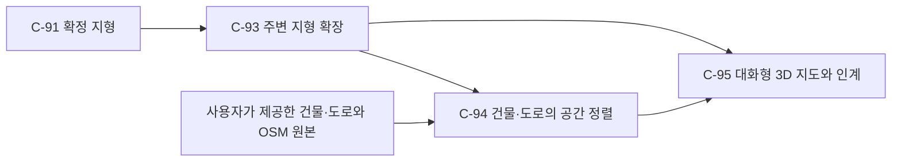

## C-93 — 주변 지면의 확보 및 기존 지형 보존

상태: 완료(2026-10-31). 확정 지형 1,462셀을 보존하고 주변 1,787셀을 더했으며 3,249셀 전체가 독립 가우시안 계산과 일치했다.

- 목적: 기존 행정동 지형 밖의 제공 건물도 실제 고도 격자 위에 올릴 수 있어야 한다.
- 책임 범위: 기존 확정 지형의 외접 직사각형을 같은 고도 원본으로 채우고 주변을 스무딩하되 기존 유효 셀의 확정값을 보존한다. 바다·건물 고도를 추정하거나 기존 파일을 수정하지 않는다.
- 입력/출력: C-91 최종 지형·고정 GEDTM30 원본 → 전체 57×57 셀이 유효한 확장 지형과 출처·처리 메타데이터.
- 의존 관계: 선행 C-91; 후행 C-94, C-95.
- 분류/미해결 질문: ASK → 사용자 확정([DR-98](decisions.md#dr-98--주변-지형-확장과-기존-확정-지형-보존)); 경계 스무딩은 SELF([DR-99](decisions.md#dr-99--확장-격자와-제공-공간자료의-정렬)); 미해결 질문 없음.
- 완료 판정 기준: ① 원본 리비전·ETag·좌표·격자가 검증된다. ② 기존 1,462개 확정 셀은 값·위치가 동일하다. ③ 주변에 결측 없이 선택한 스무딩 방법이 적용된다. ④ 출처·영역·처리·해시·원본 보존이 확인된다.
- 테스트 접점: E93-1 실제 원본과 메타데이터/ETag 검증; E93-2 이전 확정 파일과 격자·값 전수 비교; E93-3 확장 영역의 독립 가우시안 계산 대조 및 결측 검사; E93-4 파일 재독·해시·출처 기록 확인. 각 번호는 해당 완료 기준과 1:1 대응한다.
- 리스크 / 불확실성: 원본은 약 30m 추정 DTM이며 확장 구간은 추가 스무딩 결과다. 주변 영역이 생겼어도 원본보다 정밀해지는 것은 아니다.

## C-94 — 제공 건물과 도로의 지형 정렬

상태: 완료(2026-10-31). 건물 713항목은 원본 관계·중복을 정리해 709개 객체로 전부 추적되고, 도로 347개와 11,426개 선분 끝점이 지형에 정렬됐다.

- 목적: 제공된 건물과 도로를 같은 좌표·높이 기준으로 지형 위에 배치해야 도시 형태가 공간적으로 맞는다.
- 책임 범위: 제공 좌표식을 보존하고 건물 윤곽을 실제 OSM 관계로 복구하며, 중복된 같은 윤곽은 한 번만 그린다. 각 건물의 높이·하부 높이를 원본대로 쓰고 발자국 아래 지형과 정렬한다. 도로는 제공 중심선을 지형 위에 투영한다. 제공되지 않은 실측 높이나 실제 도로 단면을 만들지 않는다.
- 입력/출력: 제공 `myeongdong_data.json`, `osm_raw.json`, C-93 확장 지형 → 검증된 건물·도로·지형의 3D 표현 데이터.
- 의존 관계: 선행 C-93, 사용자 제공 파일; 후행 C-95.
- 분류/미해결 질문: ASK → 건물 높이 전부와 도로 포함을 사용자 확정([DR-97](decisions.md#dr-97--제공-건물과-도로의-지도-반영)); 동일 좌표 정렬·관계 복구·중복 제거는 SELF([DR-99](decisions.md#dr-99--확장-격자와-제공-공간자료의-정렬)). 미해결 질문 없음.
- 완료 판정 기준: ① 사용자 제공 713개 건물 항목을 원본 기반의 두 조각 결합·반복 외곽 제거 외에 누락하지 않고 원 높이를 보존한다. ② 건물 위치는 제공 좌표계와 일치하며 건물 하단은 발자국 아래 지면에 정렬된다. ③ 도로 347개는 지형 범위에서 잘린 중심선으로 나타나며 선의 높이는 지형에서 계산된다. ④ 원자료·관계 복구·중복·범위 밖 도로 절단과 높이 추정 한계를 기록한다.
- 테스트 접점: E94-1 입력 ID·높이와 복구된 원본 관계·중복의 전수 추적; E94-2 좌표 변환·발자국 아래 지면과 밑면 비교; E94-3 모든 도로 ID·영역 절단·선의 고도 대조; E94-4 원본 및 결과 해시·출처·처리 이력 확인. 각 번호는 해당 완료 기준과 1:1 대응한다.
- 리스크 / 불확실성: 건물 높이와 이름 다수는 제공자가 추정하거나 연결한 정보다. 지하 경로도 평면상의 중심선으로 지형 위에 투영되므로 실제 도로의 수직 위치를 뜻하지 않는다.

## C-95 — 대화형 3D 지도와 파일 인계

상태: 완료(2026-10-31). 같은 로컬 파일의 정적 서버 미리보기와 대화 미리보기에서 렌더링·회전·확대·건물 선택·작은 화면을 확인했다. `file://` 직접 열기는 앱의 브라우저 보안 정책에 막혀 자동 검증하지 못했으며 이 한계는 README에도 기록했다.

- 목적: 사용자가 확장 지형과 건물을 한 화면에서 탐색하고 재사용할 수 있어야 한다.
- 책임 범위: 단일 3D 장면에서 지형·건물·도로를 보여주고 회전·확대·건물 선택을 제공하며 파일과 이용 조건을 인계한다. 서버 공개·실제 건물 사진·추가 건물 생성은 하지 않는다.
- 입력/출력: C-93·C-94의 검증된 지리 자료 → 로컬에서 열리는 3D 지도, 처리 기록 및 대화 내 미리보기.
- 의존 관계: 선행 C-93, C-94; 후행 사용자 탐색.
- 분류/미해결 질문: ASK → 사용자의 3D 지도 요청과 건물·도로 선택으로 확정([DR-97](decisions.md#dr-97--제공-건물과-도로의-지도-반영), [DR-98](decisions.md#dr-98--주변-지형-확장과-기존-확정-지형-보존)); 화면 내부 구현은 SELF. 미해결 질문 없음.
- 완료 판정 기준: ① 지형·모든 정리된 건물·모든 제공 도로가 하나의 지리 기준으로 표시된다. ② 건물 선택 시 제공 이름과 높이를 볼 수 있고 회전·확대가 동작한다. ③ 원본 조건·이용 출처 및 건물 추정값·도로 투영의 한계를 확인할 수 있다. ④ 로컬 파일과 대화 미리보기가 실제 브라우저에서 동작하며 작은 화면에 맞는다.
- 테스트 접점: E95-1 렌더링 데이터 건물·도로·지형 수 및 좌표 대조; E95-2 브라우저 조작·건물 선택·높이 확인; E95-3 출처·설명 문구와 라이선스 확인; E95-4 로컬 브라우저 및 폭 320px 렌더·반응형 확인. 각 번호는 해당 완료 기준과 1:1 대응한다.
- 리스크 / 불확실성: 그래픽 가속이나 외부 라이브러리 로딩에 따라 화면이 달라질 수 있다. 건물 지붕과 도로는 제공 데이터로 만든 단순 모델이며 정밀 측량 성과가 아니다.

### 3D 지도 작업 순서와 검증

C-93의 고도 원본 연결을 먼저 검증하고 확장 격자를 저장한다. C-94에서 제공 건물·도로와 지형을 결합한 다음 C-95의 지도 표시와 조작을 검증한다. 상세는 [구현체 Map](02_impl_map.md#명동-건물과-주변-지형-3d-지도-구현-명세), 순서는 [T-93~T-95](03_build_order.md#독립-명동-건물지형-3d-지도-작업)다.

## 명동 실사 텍스처 지도 관계도

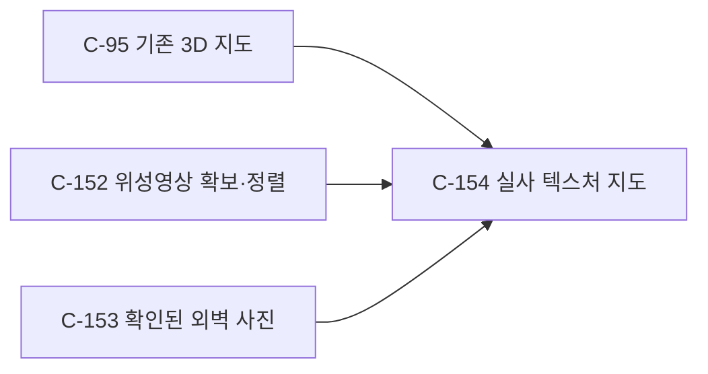

### C-152 — 실제 위성영상 확보와 지붕 정렬

상태: 완료. 실제 Sentinel-2B 10m 원본의 148×183 픽셀 창과 RGB를 저장하고 25개 위치의 독립 보간·좌표·마스크·해시를 검증했다.

- 목적: 각 건물 지붕에 해당 위치에서 관측된 위성영상 색상을 표시한다.
- 책임 범위: 명동 지도 영역의 공개 Sentinel-2 RGB를 확보하고 지리 좌표를 지도에 맞춘다. 원본 해상도 이상의 지붕 세부를 만들어내거나 외벽을 추측하지 않는다.
- 입력/출력: Sentinel-2 L2A RGB COG와 C-95 경위도 범위 → 지도 범위의 RGB GeoTIFF, 표시 이미지, 촬영·좌표·원본·해시 정보.
- 의존 관계: 선행 C-95; 후행 C-154. C-153과 병렬이다.
- 분류/미해결 질문: ASK 사용자가 로그인 없는 10m 영상을 선택했다([DR-152](decisions.md#dr-152--건물-지붕의-실제-위성영상-선택)); 처리 방식은 SELF([DR-155](decisions.md#dr-155--위성영상과-실사-외벽의-공간-표현)). 미해결 질문 없음.
- 완료 판정 기준: ① 식별 가능한 실제 원본의 촬영일·센서·10m 해상도가 기록된다. ② 모든 건물을 덮는 범위의 RGB가 좌표 변환되어 결측 없이 저장된다. ③ 출력 이미지의 경위도와 원본 픽셀 위치가 일치한다. ④ 해상도·촬영일·출처와 변경 내역이 결과에 기록된다.
- 테스트 접점: E152-1 원본 STAC 및 픽셀 크기 확인, E152-2 지리 범위·재투영 유효성, E152-3 독립 좌표·원본 보간값과 출력 대조, E152-4 파일 재독·메타데이터와 크레딧 검증. 지붕 UV의 실제 적용은 E154-1에서 검사한다.
- 리스크/불확실성: 10m 픽셀은 작은 건물이나 인접 시설을 함께 담고 원 영상의 위치 오차와 촬영 각도 차이가 있다.

### C-153 — 실제 외벽 사진의 확인과 대응

상태: 완료. 네 건물과 각 사진의 저자·라이선스·촬영 시점·해시 및 14개 지정 벽면의 방향을 대조했다.

- 목적: 확인된 건물의 외벽에서 실제로 촬영한 모습을 볼 수 있어야 한다.
- 책임 범위: 사진의 대상·날짜·작성자·이용 조건을 확인하고 해당 건물의 선택된 벽면에만 쓴다. 사진이 없는 건물을 다른 건물 사진으로 채우거나 실측 3D 외관을 발명하지 않는다.
- 입력/출력: 네 건물에 대한 Wikimedia Commons 사진과 C-95 건물 ID·윤곽 → 건물별 사진·출처·적용할 면과 근사 투영 기록.
- 의존 관계: 선행 C-95; 후행 C-154. C-152와 병렬이다.
- 분류/미해결 질문: ASK 사용자가 실제 사진 활용과 사진이 확인된 건물만 적용을 선택했다([DR-153](decisions.md#dr-153--건물-외벽에-실제-사진-활용), [DR-154](decisions.md#dr-154--확인된-외벽-사진만-적용)); 정합의 내부 계산은 SELF([DR-155](decisions.md#dr-155--위성영상과-실사-외벽의-공간-표현)). 미해결 질문 없음.
- 완료 판정 기준: ① 각 사진의 대상 건물·라이선스·저자가 식별된다. ② 동일 건물의 대응 면에만 사진이 적용된다. ③ 확인되지 않은 면은 단색으로 남는다. ④ 촬영 시기와 근사 투영·라이선스가 명시된다.
- 테스트 접점: E153-1 사진별 원문·저작권 메타데이터 검토, E153-2 대상 ID와 면·카메라 방향 대조, E153-3 전체 건물에 대한 사진 적용 범위 검사, E153-4 사용자 설명과 파일별 해시 확인.
- 리스크/불확실성: 원본은 거리·고도·기하가 다른 사진이며 건물의 평면 압출 모형은 사진과 형태가 일치하지 않을 수 있다. 두 사진의 카메라 방향은 주변 도로·건물 배치로 추정한다.

### C-154 — 사진과 기존 지도를 결합·인계

상태: 완료. 로컬 정적 서버와 대화 미리보기에서 이미지 5개, 건물 709개, 도로 347개, 실사 건물 4개·벽면 14개, 선택·회전·320px 표시 및 출처를 확인했다. 앱 브라우저의 `file://` 직접 열기는 보안 정책으로 자동 검증하지 못했다.

- 목적: 지형과 기존 건물 위에서 실제 위성 지붕과 확인된 외벽을 함께 탐색한다.
- 책임 범위: 기존 709개 건물·347개 도로·지형과 조작을 유지하며 C-152·C-153을 표시하고 수정 가능한 로컬 결과를 보관한다. 외부에 게시하거나 데이터 없이 전 건물 실사라고 주장하지 않는다.
- 입력/출력: C-95 지도, C-152 영상, C-153 사진 → 로컬 3D 지도와 데이터·이용 설명, 가능하면 대화 미리보기.
- 의존 관계: 선행 C-95, C-152, C-153; 후행 사용자 탐색.
- 분류/미해결 질문: ASK 사용자가 범위와 비실사 외벽 처리를 확정했다([DR-152~154](decisions.md#dr-152--건물-지붕의-실제-위성영상-선택)); UI 내부는 SELF. 미해결 질문 없음.
- 완료 판정 기준: ① 지붕·외벽 사진과 기존 건물·지형·도로가 함께 표시된다. ② 회전·확대·건물 선택과 작은 화면이 동작한다. ③ 영상의 10m 한계·사진 사용 범위·출처가 보인다. ④ 이전 확정 결과와 원본이 보존되고 새 결과가 로컬에서 재현된다.
- 테스트 접점: E154-1 장면 개수·사진 UV 및 이미지 로딩 확인, E154-2 브라우저 조작·320px 확인, E154-3 출처·한계 표시 확인, E154-4 이전 파일 해시·결과 재독 확인.
- 리스크/불확실성: 사용자 브라우저의 WebGL 지원, 10m 영상의 위치·해상도와 외벽 사진 원근·촬영시점 차이.

구현 순서: C-152·C-153의 실제 자료와 지리 계약을 먼저 검증하고 C-154로 결합한다. 상세는 [구현체 Map](02_impl_map.md#명동-실사-텍스처-지도-구현-명세) 및 [작업 순서](03_build_order.md#명동-실사-텍스처-작업)다.

## 명동 상권 유동인구 자료 반영 — C-140~C-142

상태: done. 첨부 자료와 기존 65,000명을 [DR-140~143](decisions.md#dr-140--명동-상권-유동인구의-역할과-범위)으로 연결하고 23기간의 연령 가중치·10분 상대 프로필을 전수 검증했다. 상권 추정치는 행정동 경계·실제 방문자·인/㎡와 동일하지 않다. 병행 중인 온톨로지에 [자료 계약](05_myeongdong_traffic.md)을 참조하는 절을 추가한다.

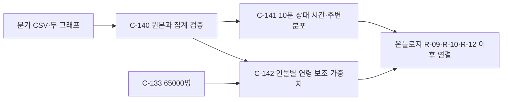

### C-140 — 상권 원자료와 그래프 정합성
- 목적: 사용자가 제공한 추정치와 이미지의 연도·상권·단위·집계 방법을 확인해 서로 다른 모집단을 혼동하지 않는다.
- 책임 범위: 원본 22분기와 이미지·해시, 성별·연령·시각·요일별 주변합 오차, 2025 그래프 대조. 하지 않는 것: 거주인구 또는 고유 방문자라고 주장하기.
- 입력/출력: CSV·두 이미지 → 검증된 분기별 수치 및 2025 합산. 선행 없음, 후행 C-141·C-142. 분류: SELF(DR-140).
- 미해결 질문: 통계의 정확한 일 단위 환산·고유 방문 인원은 제공되지 않음. 이 작업은 절대 수로 환산하지 않는다.
- 완료 기준: ① 정확히 22개의 2021Q1~2026Q2와 상권 코드 보존 ② 각 주변합과 총계 차이를 값 그대로 기록 ③ 2025 연령 그래프와 원표 비율 반올림 일치 ④ 시간 그래프의 구간값/시간 수 일치 ⑤ 원본과 이미지 해시 보존.
- 테스트 접점: 파서의 잘못된 열·기간·수치, 원본 전수 합산·그래프 대조 통합. 리스크: 원표 반올림, 시기별 제공 방법 변경.

### C-141 — 10분 상대 시간 프로필
- 목적: 관측의 시간대 형태를 10분 프레임 기반 온톨로지 입력·검증에 사용할 수 있게 한다.
- 책임 범위: 분기별 6개 시간대·요일·성별·연령의 개별 주변분포와, 구간 내 균등 가정의 144개 슬롯을 만든다. 하지 않는 것: 교차분포, 절대 방문 수·도착률·인/㎡ 추정.
- 입력/출력: C-140 → 기간당 144슬롯, 시간·요일·성·연령 참고값. 의존: C-140 선행; 후행 R-09·R-10·R-12의 관측 보조 자료. 분류 SELF(DR-141).
- 미해결 질문: 실제 10분·연령×시간·요일×시간 데이터, 절대 환산과 면적은 제공되지 않는다.
- 완료 기준: ① 각 기간 144개 슬롯 및 하루 [0,1440) 완비 ② 구간별 슬롯 합이 원본 시간대 비율을 재현 ③ 각 기간 슬롯 비중 합 1, 평균 상대강도 1 ④ 균등 가정과 집계 단위 한계가 데이터·설명서에 표시.
- 테스트 접점: 경계(06/11/14/17/21/24시) 단위와 전 분기 재집계 통합. 리스크: 시간구간 내부의 실제 변화가 사라진다.

### C-142 — 인물 연령 보조 가중치와 인계
- 목적: 서울 거주자 합성 인구의 기존 구성은 유지하면서 명동 상권 연령 주변분포를 인물 ID와 연결한다.
- 책임 범위: 각 인물의 연령별 2025·분기 상대 가중치와 미지원 19세 라벨을 출력, 20세 이상 가중합·참조 무결성·해시를 검증한다. 하지 않는 것: 개인 확률, 연령×시간 교차분포나 실제 대표 인원 창작.
- 입력/출력: C-140·65,000명 → synthetic_id 65,000개와 기간별 상대 가중치, 설명·진단. 선행 C-140·C-133; 후행 R-09 및 R-12 검증. 분류 SELF(DR-142).
- 미해결 질문: 19세 전용 유동인구와 100세 이상 제외 수치는 없음. 기존 출신지 분포와 상권 방문 원천지역의 차이도 보정하지 못함.
- 완료 기준: ① synthetic_id가 기존 65,000명과 정확히 1:1 ② 만 19세 값은 모두 null·구분 라벨 ③ 20~99세의 가중 연령 비율은 각 기간 상권 20대 이상 비율 일치 ④ 가중치는 상대값이며 실제 방문 확률·선택 후 분포가 아님을 표시 ⑤ 자료·코드·원본 해시와 재현 방법 제공.
- 테스트 접점: 극단적인 연령 셀·결측·영 분모 단위, 전 인물 join·23개 기간 가중합 재계산 통합·E2E. 리스크: 방문자·서울 거주자 모집단 차이, 선택 후 분포의 추가 변화.

구현 순서는 C-140 → C-141 → C-142이며 모든 완료 기준은 [구현 명세](02_impl_map.md#명동-유동인구-반영-구현-명세)의 대응 테스트와 [작업 순서](03_build_order.md#명동-유동인구-반영-순서)에서 검사한다.

## 페르소나 반응 온톨로지 — C-201~C-216

상태: 개념 확정(2026-10-31, [DR-200](decisions.md#dr-200--페르소나-반응-온톨로지의-구조-확정)~[DR-211](decisions.md#dr-211--반응-온톨로지의-self-결정-모음)). 구현하지 않았다. 구현은 자료 준비·후처리 Python([02c](02c_reaction_impl_map.md))과 런타임 Rust([02d](02d_rust_engine.md))로 나누고 정의 파일 `ontology/v1/`은 한 벌을 함께 읽는다([DR-214](decisions.md#dr-214--반응-온톨로지의-pythonrust-분담), [DR-215](decisions.md#dr-215--온톨로지-정의-한-벌-공유와-rust-코드-위치)). 틱 시뮬레이션의 시간 해상도·규모·시야는 [DR-220](decisions.md#dr-220--틱-시뮬레이션의-시간-해상도와-규모)·[DR-221](decisions.md#dr-221--시야가-알아차림과-관찰을-정한다)로 갱신했다([01b](01b_frame_simulation.md)). 사람 특성과 외부 변수를 공통 차원으로만 연결하고, 하나의 반응 함수로 방문·이동·휴식·구매와 상점의 반응을 만든다. 명동 변수 16개를 세 단계(개인 반응 → 인물 간 혼잡·대기 → 월 단위 상점 반응)로 반영한다([DR-201](decisions.md#dr-201--반응-온톨로지의-범위와-단계)). 차원·환경 클래스·결정 맥락·지표의 정의와 근거, SELF 결정(S-R1~S-R30), 병렬 작업과의 계약은 설계 부속서 [01a_persona_ontology.md](01a_persona_ontology.md)에 있고, 이 절은 개념 단위와 완료 기준의 정본이다. 01a와 다른 Map에 쓰인 가번호 R-nn은 C-2nn과 같다(예: R-09 = C-209).

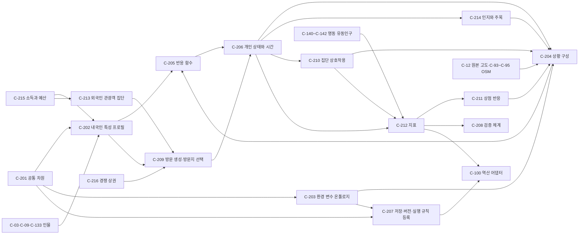

### C-201 — 공통 차원 (R-01)

- 목적: 사람 특성과 환경 변수가 만나는 유일한 접점이다. 없으면 특성×변수 조합마다 규칙이 필요해 새 상황에서 반응이 나오지 않는다.
- 책임 범위: 차원 목록(D-CLIMB·D-FALL·D-STEP·D-WALK·D-TIME·D-MONEY·D-WAY·D-SENSE·D-CROWD·D-SAFE·D-HEAT, 업종별 관심 A-*; [01a §3.2](01a_persona_ontology.md#32-공통-차원))과 차원별 단위·노출 집계 규칙·비용 곡선·한계 유형·언어 기준점·도입 단계를 정의하고 버전을 붙인다. 하지 않는 것: 인물별 값(C-202·C-213), 환경 요소별 요구 계산(C-203), 선택(C-205).
- 입력 / 출력: 범위(DR-201)와 수치 출처(DR-203) → 버전이 붙은 차원 정의.
- 의존 관계: 선행 없음; 후행 C-202, C-203, C-205, C-207, C-213.
- 분류: ASK → 확정([DR-201](decisions.md#dr-201--반응-온톨로지의-범위와-단계), [DR-203](decisions.md#dr-203--반응-모델-수치의-출처와-재현-기준)). 정의 형식은 SELF([DR-211](decisions.md#dr-211--반응-온톨로지의-self-결정-모음)의 S-R2·S-R3).
- 미해결 질문: 언어 기준점('완만한'·'가파른')의 값, D-HEAT 포함 여부, 업종별 관심 하위 차원의 최종 목록. 구현체 Map에서 출처와 함께 정한다.
- 완료 판정 기준: ① 모든 차원이 단위·집계 규칙·비용 곡선·한계 유형·언어 기준점·도입 단계를 갖는다. ② 차원마다 사람 쪽 능력과 환경 쪽 요구(또는 이득)를 같은 단위로 표현한 예가 각각 하나 이상 있다. ③ 같은 물리적 효과를 두 차원이 이중으로 세지 않는다(오르막은 CLIMB, 내리막은 FALL, 줄 대기는 TIME, 광고·소음 자극은 SENSE, 표지 언어는 WAY). ④ 모든 수치에 출처 라벨이 붙는다. ⑤ 반응 결과에 차원 정의의 버전이 기록된다.
- 테스트 접점: E201-1 필수 필드가 빠진 정의 픽스처의 적재 실패(단위); E201-2 차원별 사람·환경 양쪽 예시의 존재 검사(단위); E201-3 '무엇을 세는가' 정의 대조와 같은 노출을 두 차원에 넣는 픽스처의 실패(단위); E201-4 출처 라벨이 없는 수치의 적재 실패(단위); E201-5 반응 기록의 차원 버전 확인(통합). 번호별로 완료 기준과 1:1 대응한다.
- 리스크 / 불확실성: 차원이 많으면 원문 근거 없이 기본값만 갖는 차원이 생기고, 적으면 표현력이 부족하다. 기준점 수치의 근거가 약할 수 있다.

### C-202 — 내국인 특성 프로필 (R-02)

- 목적: 같은 나이라도 원문에 따라 다르게 반응하려면 내국인마다 차원별 능력·민감도·관심·성향과 방문에 필요한 값(예산, 친숙도, 가용 시간, 목적, 출발지)을 근거와 함께 가져야 한다.
- 책임 범위: 구조화 필드로 기본값을 정하고 원문의 현재형 단서로 조정하며, C-215의 추정 소득으로 예산·가격 민감도를 만들고, 값마다 불확실성·근거·출처 라벨(`structured`/`text`/`statistics`/`assumption`)을 붙이고, 구조화 필드와 원문의 충돌을 기록한다. 근거 사전은 혼합 방식으로 만든다(DR-204). 하지 않는 것: 상황 판단(C-205), 원본 수정, 원문에 없는 건강 상태를 사실처럼 만들기, 외국인 프로필(C-213).
- 입력 / 출력: 페르소나 1행(원본 26개 열, 증강이면 [01a §7.1](01a_persona_ontology.md#71-명동-인물-증강dr-31)의 출처 열 포함) + 차원 정의(C-201) + 근거 사전 + 추정 소득(C-215) → 인물 프로필(차원별 편안 상한·한계·민감도, 관심, 성향(주목 성향 포함), 예산, 친숙도, 가용 시간 창, 방문 목적 후보, 출발지, 기본 동반·장비, 근거 목록, 충돌 표시).
- 의존 관계: 선행 C-201, C-215, C-03·C-09·C-133; 후행 C-205, C-206, C-207, C-208, C-209, C-214.
- 분류: ASK → 확정([DR-204](decisions.md#dr-204--원문-특성-추출-방식) 추출 방식, DR-203 수치 출처). 근거 우선순위·나이 처리·가용 시간 창은 SELF(DR-211의 S-R5·S-R11·S-R18).
- 미해결 질문: 나이별 기본값의 문헌 값, 근거 사전의 초기 항목(DR-204의 LLM 표본 제안 뒤 확정, 제안은 이 세션의 Haiku 하위 에이전트가 함, DR-217).
- 완료 판정 기준: ① 대상 인물 전원에 프로필이 생긴다(누락 0). ② 모든 값이 근거 또는 `assumption` 라벨을 갖는다. ③ 과거·희망·부정 문장은 근거로 쓰지 않는다(C-04 모달리티 재사용). ④ 필드 문맥을 구분한다(`family_persona`의 '북적이는 집안'은 혼잡 민감도의 근거가 아니다). ⑤ 원문의 등급 표현이 해당 차원의 편안 상한·한계로 반영되고 습관 단어보다 우선한다. ⑥ 구조화 필드와 원문의 충돌을 숨기지 않고 표시한다. ⑦ 예산·친숙도·주목 성향·가용 시간 창·방문 목적 후보·출발지가 전원에 있다.
- 테스트 접점: E202-1 입력과 프로필의 UUID 집합 대조(통합); E202-2 값별 라벨 존재 검사(통합); E202-3 현재·과거·희망·부정 골든 문장 픽스처(단위); E202-4 필드 문맥 픽스처(단위); E202-5 등급 표현과 습관 단어가 함께 있는 문장 픽스처(단위); E202-6 구조화 필드-원문 충돌 픽스처(단위); E202-7 필수 필드 전원 존재 검사(통합). 번호별로 완료 기준과 1:1 대응하며, 표본 200명의 정밀도·재현율은 C-208에서 잰다.
- 리스크 / 불확실성: 표현이 다양해 규칙의 재현율이 낮을 수 있다. '건강' 같은 넓은 단어의 오탐. 원문 단서가 없는 인물은 나이 기본값에 수렴해 나이 효과가 과대하게 보일 수 있다.

### C-203 — 환경 변수 온톨로지 (R-03)

- 목적: 외부 변수를 사람과 무관하게 한 번만 정의하면 모든 인물에게 반응이 생기도록, 변수를 차원별 요구·이득으로 번역하는 표준 형식이 필요하다.
- 책임 범위: 환경 요소 클래스 계층([01a §3.4](01a_persona_ontology.md#34-환경-변수-정의): 보행 구간·계단·수직 이동 설비·휴식 시설·상점·음식점·노점·행사·숙박·교통 접근·경쟁 상권·노면·기상·시나리오 입력), 클래스별 속성(이름·형식·단위·유효 범위·역할 u/w/x, 모형 구성별 u/x), 요구 함수, 제공(이득 차원), 파생량(유효 면적 등), 알아차림 입력(시계성·광고 자극도), 허용·차단(행동 유형)을 정의하고 상속으로 기본 함수를 물려준다. 하지 않는 것: 실제 위치의 인스턴스 만들기(C-204), 개인 판단(C-205), 변경량 척도·가중치(역산 요청의 몫, [DR-104](decisions.md#dr-104--도메인별-수치는-명시적-실행-입력으로-분리)), 역산 탐색.
- 입력 / 출력: 차원 정의(C-201), 수치 출처(DR-203) → 버전이 붙은 클래스 정의 집합.
- 의존 관계: 선행 C-201; 후행 C-204, C-205, C-207, C-210, C-214, C-216.
- 분류: ASK → 확정(DR-201 변수 범위, DR-203 수치, [DR-207](decisions.md#dr-207--상점-반응의-범위와-결정-주체) 모형 구성). 클래스 생성 기준·역할 표시는 SELF(DR-211의 S-R4·S-R16·S-R29·S-R30).
- 미해결 질문: 경사→요구 함수와 낙상 위험 함수의 계수, 구간 단위 보행 폭·광고 자극도의 가정 표 값([DR-202](decisions.md#dr-202--공간시설-자료와-경사-계산)). 상점 단위 속성(가격 수준·처리 용량·시계성 등)은 사용자가 줄 상점 자료에서 읽는다([DR-212](decisions.md#dr-212--상점-자료는-사용자가-제공), 오기 전에는 OSM과 가정 값).
- 완료 판정 기준: ① 모든 속성에 형식·단위·유효 범위가 있다. ② 모든 클래스가 하나 이상의 차원에 요구 또는 이득을 정의하거나, 파생량·알아차림에 기여하거나, 행동을 허용·차단한다. ③ 하위 클래스는 재정의하지 않은 함수를 상위에서 물려받는다. ④ 같은 속성 값은 같은 요구를 낸다. ⑤ 유효 범위 밖 속성 값은 오류로 보고한다. ⑥ 모든 속성에 역할(u/w/x 또는 모형 구성별 u/x)이 있고, 변수 1~16([01a §7.5](01a_persona_ontology.md#75-명동-변수-16개의-반영-설계))이 모두 속성 또는 시나리오 입력으로 선언된다.
- 테스트 접점: E203-1 형식·단위·범위가 빠진 속성의 적재 실패(단위); E203-2 효과가 없는 클래스 정의의 적재 실패(단위); E203-3 상속 픽스처(단위); E203-4 같은 값의 반복 계산 동일성과 경사·가격·광고 자극도에 대한 요구 단조성(단위); E203-5 유효 범위 밖 값의 오류(단위); E203-6 역할 누락 실패와 변수 1~16 선언 대조(단위). 번호별로 완료 기준과 1:1 대응하며, 홀드아웃 클래스는 C-208에서 검사한다.
- 리스크 / 불확실성: 요구 함수 수치의 근거 부족. 클래스를 남발하면 일반화가 깨진다.

### C-204 — 상황 구성 (R-04)

- 목적: 반응은 대안 사이의 비교이므로, 결정 맥락마다 가능한 대안과 각 대안이 겪게 할 환경 노출이 있어야 회피·구매·휴식·다른 상권으로 가기 같은 반응이 나온다.
- 책임 범위: 환경 원자료(원본 지면 고도, 제공 OSM 보행망·시설, 사용자 상점 자료(DR-212), 시간표, 가정 표, 시나리오 파일)를 C-203 인스턴스로 바꾸고, (위치, 시각, 결정 맥락, 목적) 질의에 대해 대안 목록과 노출·추가 시간·비용을 만든다. 다섯 결정 맥락(방문지 선택·행선지·경로·휴식·구매)의 대안 생성 규칙을 갖는다. 행선지에는 고려 집합이 비었거나 작은 방문객이 도착하자마자 떠나지 않도록 둘러보며 찾기(EXPLORE, 02d S-E25)가 대안으로 더해진다([DR-233](decisions.md#dr-233--반응-온톨로지-구현체-map의-사용자-확인-항목-확정), 02c U-9 승인). 방문지 선택에는 경쟁 상권 외부 대안(C-216)을 넣고, 행선지 대안은 고려 집합(C-214) 안에서 만든다. 경사는 구간 양 끝 고도 차로 계산하고 원본·스무딩 결과를 함께 기록한다(DR-202). 하지 않는 것: 개인 선호로 대안 거르기(C-205), 실제 교통시간 주장, 30m 고도에서 길·창구·건물·수용 인원을 추정하기.
- 입력 / 출력: 환경 원자료 + 질의 → 상황{결정 맥락, 대안[], 노출[], Δt, Δ원}.
- 의존 관계: 선행 C-203, C-206, C-214, C-216, C-10~C-12(원본 지면 고도), C-93~C-95(제공 OSM), (2단계) C-210, (3단계) C-211; 후행 C-205, C-208, C-209.
- 분류: ASK → 확정(DR-202). 대안 생성 규칙은 SELF(DR-211의 S-R6·S-R13).
- 미해결 질문: OSM 범위 확장은 남쪽만이 아니라 북서·북쪽까지 확정([DR-233](decisions.md#dr-233--반응-온톨로지-구현체-map의-사용자-확인-항목-확정)), 내려받기는 출처·크기를 알리고 허락을 받은 뒤(DR-202 ②), 우회 경로 후보 수 k.
- 완료 판정 기준: ① 같은 질의는 같은 상황을 만든다. ② 모든 대안의 노출이 C-203 인스턴스와 노출량으로 표현된다. ③ 맥락별 필수 대안(진행·감속·연기·포기, 떠나기, 구매 안 함, 안 감)이 항상 있다. ④ 공간 자료 없이 시나리오 파일만으로도 상황을 만들 수 있다. ⑤ 구간의 경사·계단에 원자료 출처와 해상도 한계, 원본·스무딩 경사가 함께 기록된다. ⑥ 다섯 결정 맥락 각각의 대안 생성 규칙이 있고, 행선지 대안은 고려 집합 안에서만 만든다.
- 테스트 접점: E204-1 같은 질의의 반복 동일성(단위); E204-2 노출 형식 검사(단위); E204-3 맥락별 필수 대안 존재(단위); E204-4 시나리오 파일만으로 상황 생성(단위); E204-5 실제 명동 자료로 구간 경사·출처·해상도 기록 확인(통합); E204-6 다섯 맥락의 대안 생성과 영업시간 밖·고려 집합 밖 장소의 제외(단위). 번호별로 완료 기준과 1:1 대응한다.
- 리스크 / 불확실성: 30m 격자 경사의 잡음과 과소·과대 추정, 계단·폭·층·광고 정보 누락, 보행망 범위 밖의 경사 지대, ODbL 이용 조건.

### C-205 — 반응 함수 (R-05)

- 목적: 모든 인물·결정 맥락·행위자에 하나의 함수를 적용해야 사례별 규칙 없이 반응이 나온다.
- 책임 범위: [01a §3.6](01a_persona_ontology.md#36-반응-함수)의 1~9단계(요구 집계, 유효 능력, 부담 위치, 비용, 효용, 불가 대안 제거, 확률과 선택, 조절, 설명). 출력은 대안별 확률·선택·설명이다(DR-205). 하지 않는 것: 상태 저장(C-206), 나이·성별·국적·변수 이름·결정 맥락 이름에 따른 분기.
- 입력 / 출력: (프로필, 상태, 상황, 난수 키) → 반응{대안별 확률, 선택, 조절값, 상태 변화량, 설명}.
- 의존 관계: 선행 C-201~C-204; 후행 C-206, C-208, C-209, C-211(같은 함수를 씀), C-212, C-100.
- 분류: ASK → 확정([DR-205](decisions.md#dr-205--반응-출력-형태)). 수식·난수·맥락 공용은 SELF(DR-211의 S-R1·S-R7·S-R12·S-R13).
- 미해결 질문: 비용 곡선 φ의 모양과 선택 무작위성 τ의 기본값(DR-203).
- 완료 판정 기준: ① 같은 입력과 난수 키는 처리 순서와 무관하게 같은 출력을 낸다. ② 함수 코드가 차원 ID 외의 사람·환경·맥락 개념 이름을 참조하지 않는다. ③ 단조성: 한 대안의 요구가 커지면 그 대안의 확률은 커지지 않고, 능력이 커지면 작아지지 않으며, 목적 가치가 커지면 포기 확률은 커지지 않고, 한 대안의 가격이 내려가면 그 대안의 확률은 작아지지 않는다. ④ 경성 한계를 넘는 대안의 확률은 0이다. ⑤ 설명의 기여 항 합이 효용 차이와 같다. ⑥ 가능한 대안이 하나뿐이면 그 대안을 고르고 부담은 상태 변화로 나타난다. ⑦ 한 결정의 대안별 확률은 난수 키와 무관하다.
- 테스트 접점: E205-1 같은 입력·난수 키로 처리 순서를 섞어도 같은 출력(단위); E205-2 함수 코드의 정적 검사(단위); E205-3 무작위 입력의 단조성 속성 테스트(단위); E205-4 경성 한계 초과 대안의 확률 0(단위); E205-5 설명 기여 합과 효용 차이의 일치(단위); E205-6 대안이 하나인 상황(단위); E205-7 난수 키를 바꾼 확률 비교(단위). 번호별로 완료 기준과 1:1 대응한다.
- 리스크 / 불확실성: 비용 곡선 모양과 τ에 결과가 민감하다.

### C-206 — 개인 상태와 시간 (R-06)

- 목적: 동적으로 반응하려면 이전 반응의 결과(피로·지연·충족·지출·알아차림·목적 진행)가 다음 반응의 입력이 되어야 한다.
- 책임 범위: 개인 상태 변수(위치, 활동, 피로, 남은 시간, 충족도, 지출 누계, 인지 집합, 동반·장비, 목적과 마감)와 갱신·회복 규칙(휴식 시설에서 회복률이 큼), 재평가 시점, ~~60초 단계~~ 0.5초 틱([DR-220](decisions.md#dr-220--틱-시뮬레이션의-시간-해상도와-규모))과 10분 프레임 집계, 개체 생성·소멸 기록, 활동 엔진과의 교환 형식을 정의한다. 인지 집합의 갱신 규칙은 C-214가 정한다. 하지 않는 것: 일과 생성(C-05), 구 귀속(C-06), 집단 상태 계산(C-210).
- 입력 / 출력: 초기 상태와 반응의 연속 → 상태 궤적과 10분 프레임. 엔진 연결 시 (목적, 시각, 출발, 도착) → (소요 시간, 포기 여부, 도착 시 상태).
- 의존 관계: 선행 C-205, C-209(생성), C-214(인지 갱신); 후행 C-204, C-210, C-212, C-214.
- 분류: ASK → 확정(DR-201: 활동 엔진 연결은 범위 밖, 교환 형식만 둔다). 갱신 규칙은 SELF(DR-211의 S-R8·S-R21), 시간 단계는 ~~SELF(S-R15)~~ ASK 확정([DR-220](decisions.md#dr-220--틱-시뮬레이션의-시간-해상도와-규모)).
- 미해결 질문: 피로·회복·충족도 수치(DR-203).
- 완료 판정 기준: ① 상태 변화는 반응 결과와 등록된 규칙으로만 정해진다(숨은 상태 없음). ② 같은 길을 연속으로 두 번 가면 두 번째의 회피 쪽 확률이 첫 번째보다 작지 않다. ③ 앉아 쉬기는 서서 쉬기보다 피로를 더 줄이고 시간을 쓴다. ④ 환경 변화(비 시작, 영업 종료, 행사 시작)가 재평가를 일으킨다. ⑤ 10분 프레임은 [DR-17](decisions.md#dr-17--프레임과-시간-규약-및-결정성)의 시각 규약을 지킨다. ⑥ 개체 생성·소멸은 규칙으로만 일어나고 기록된다.
- 테스트 접점: E206-1 등록되지 않은 상태 쓰기의 거절(단위); E206-2 같은 길을 두 번 가는 시나리오(통합); E206-3 앉아 쉬기와 서서 쉬기의 회복 비교(단위); E206-4 비 시작·영업 종료·행사 시작의 재평가(단위); E206-5 10분 프레임 시각 규약(단위); E206-6 생성·소멸 기록(통합). 번호별로 완료 기준과 1:1 대응한다.
- 리스크 / 불확실성: 피로·회복·충족 수치의 근거 부족, 미시와 거시 시간 해상도의 불일치.

### C-207 — 저장·버전·실행 규칙 등록 (R-07)

- 목적: 정의와 인물 프로필을 사람이 검토하고 고칠 수 있게 저장하고, 역산 엔진이 실행 의존 관계를 알 수 있게 모든 실행 규칙을 등록해야 어느 정의로 어떤 결과가 나왔는지 재현할 수 있다.
- 책임 범위: 정의(TBox, YAML)와 값(ABox, Parquet)의 저장 형식(DR-206), 안정 ID와 타입, 값의 역할(02b의 x·u·w·θ·ε·y) 표시와 모형 구성별 역할 선언, 실행 규칙 등록부(규칙마다 읽는 값·쓰는 값·시간 지연·단위·근거 종류), 참조 무결성과 금지 간선 검사, 같은 단계 순환 검사, 버전 해시, 조회(인물 → 프로필과 근거 사슬), 내보내기. 하지 않는 것: 반응 계산, 역산 탐색, 그래프 탐색 화면(DR-206에서 범위 밖).
- 입력 / 출력: 정의 파일·프로필·규칙·모형 구성 → 검증된 의미 그래프와 실행 의존 그래프, 버전 해시; 조회 결과.
- 의존 관계: 선행 C-201~C-203과 실행 규칙을 갖는 C-205·C-206·C-209~C-211·C-213~C-216; 후행 C-205(읽기), C-100(역산 어댑터), 사용자 검토.
- 분류: ASK → 확정([DR-206](decisions.md#dr-206--반응-온톨로지의-저장-기술)). 무결성 규칙·근거 라벨·역할 배타성은 SELF(DR-211의 S-R9·S-R22·S-R29).
- 미해결 질문: 없음.
- 완료 판정 기준: ① 금지 간선을 정의에 쓰면 적재가 실패한다. ② 모든 참조가 해석된다. ③ 반응 결과에 정의 버전 해시가 남는다. ④ 인물 하나의 근거 사슬(원문 범위 → 특성 → 차원)을 조회할 수 있다. ⑤ 서울 전원(185,228명) 프로필을 메모리 3GB 안에서 다룬다. ⑥ 모든 실행 규칙이 읽기·쓰기·지연·단위·근거 종류를 선언하고, 같은 단계 순환이 없음을 검사한다. ⑦ 모든 실행 값에 안정 ID·타입·단위·역할이 있고, 한 모형 구성에서 같은 속성이 u와 x를 겸하지 않는다.
- 테스트 접점: E207-1 금지 간선 픽스처의 적재 실패(단위); E207-2 끊긴 참조의 적재 실패(단위); E207-3 반응 기록의 정의 버전 해시(통합); E207-4 인물 하나의 근거 사슬 조회(통합); E207-5 서울 전원 프로필의 메모리 측정(통합, 느린 테스트); E207-6 선언이 빠진 규칙과 같은 단계 순환의 거절(단위); E207-7 안정 ID·타입·단위·역할 검사와 u·x 중복 선언의 거절(단위). 번호별로 완료 기준과 1:1 대응하며, E207-6·E207-7은 C-100의 E100-1·E100-3과 같은 형식으로 맞춘다.
- 리스크 / 불확실성: 대규모 처리의 메모리(이 PC는 메모리 부족으로 다운된 이력이 있다). 규칙의 읽기·쓰기 목록이 불완전하면 역산 엔진이 가지치기를 하지 못한다.

### C-208 — 검증 체계 (R-08)

- 목적: 실제 행동 기록이 없으므로([DR-04](decisions.md#dr-04--활동-엔진의-용도와-데이터-범위)) "일반화된다"와 "원문과 일관된다"를 다른 방법으로 증명해야 한다.
- 책임 범위: 단조성·불변성 속성 테스트, 사용자가 승인한 기대 방향 표(골든 시나리오와 변수 16개 × 지표의 기대 방향), 홀드아웃 클래스 테스트(코드 수정 없이 새 변수 선언만으로 반응), 원문 일관성 검사, 표본 200명 사람 검토, 명동 유동인구(05)와의 형태 비교. 하지 않는 것: 실제 인구의 행동 비율 주장(DR-203).
- 입력 / 출력: C-202·C-204~C-206·C-209~C-216의 산출물과 기대 방향 표 → 합격·불합격 보고서.
- 의존 관계: 선행 C-202, C-204~C-206, C-209~C-216; 후행 없음(매 단계 실행).
- 분류: ASK → 확정(DR-203: 재현 기준, 기대 방향 표는 Claude 초안·사용자 승인). 검증 방식은 SELF(DR-211의 S-R10).
- 미해결 질문: 원문 일관성 검사의 합격 기준치, 기대 방향 표의 사용자 승인.
- 완료 판정 기준: ① 속성 테스트가 전부 통과한다. ② 골든 시나리오와 변수 × 지표 기대 방향 표의 방향과 100% 일치한다(방향이 정해지지 않은 칸은 제외하고 그렇게 표시). ③ 홀드아웃 클래스 2종 이상이 코드 수정 없이 의도된 방향의 반응을 낸다. ④ 원문에 등급 표현이 있는 인물이 같은 나이의 기본값 인물과 의도된 방향으로 다르게 반응하는 비율이 기준치 이상이다. ⑤ 보고서에 정의 버전·난수 규약·반복 수·데이터 해시가 남는다.
- 테스트 접점: E208-1 속성 테스트 묶음 실행(단위); E208-2 기대 방향 표 대조(E2E: 인물 → 프로필 → 방문지 선택 → 하루 진행 → 지표); E208-3 홀드아웃 클래스 2종의 선언 실행(통합); E208-4 등급 표현 인물과 기본값 인물의 비교(통합); E208-5 보고서 필수 항목 검사(단위). 번호별로 완료 기준과 1:1 대응한다.
- 리스크 / 불확실성: 기대 방향 표가 설계자의 편향을 담을 수 있고, 원문과의 일관성은 현실성과 다를 수 있다. 집단 지표는 상호작용 때문에 개인 단조성이 그대로 성립하지 않는다.

### C-209 — 방문 생성·방문지 선택과 접근 (R-09)

- 목적: 누가 언제 어떤 수단으로 명동 또는 경쟁 상권에 가는지가 정해져야 배차 간격·영업시간·할인·가격·행사·벤치·소득·경쟁 상권·방문 수요·외국인 유입이 유입량과 방문객 구성에 미치는 영향을 계산할 수 있다.
- 책임 범위: 하루 유형(평일·주말·행사일)별로 내국인(C-202)과 외국인 관광객(C-213)마다 가용 시간 창 안에서 방문지 선택 상황(명동의 시간 슬롯 × 수단, 경쟁 상권 외부 대안, 안 감)을 C-204로 만들고, 접근 시간(기본 이동 시간 + 배차 대기 + 출구 보행)과 기대 이득·부담을 계산하며, C-205로 결정한 뒤 명동을 고른 인물을 출구·숙소에서 생성한다. ~~방문 수요·외국인 유입 배율을 인물 가중치에 반영한다.~~ 방문 수요·외국인 유입 배율은 몸의 수로 반영한다(1몸 = 1사람, 필요한 몸이 인물 수를 넘으면 인물 복제, [DR-220](decisions.md#dr-220--틱-시뮬레이션의-시간-해상도와-규모) ③). 명동 유동인구 자료는 입력 도착률로 쓰지 않는다. 하지 않는 것: 명동 밖 하루 일과의 생성(C-05), 실제 교통 경로 탐색, 경쟁 상권 내부의 진행.
- 입력 / 출력: 인물 프로필(C-202, C-213), 하루 유형, 환경(영업시간·할인·가격·행사·휴식 시설·배차), 경쟁 상권 대안(C-216), 기대 혼잡 → 도착 목록(인물, 시각, 출구·숙소, 수단, 목적, ~~가중치~~ 복제 번호), 경쟁 상권을 고른 인물과 안 간 인물·사유.
- 의존 관계: 선행 C-202, C-203, C-204, C-205, C-213, C-216, (2단계) C-210의 직전 반복 결과; 후행 C-206, C-212.
- 분류: ASK → 확정(DR-201, DR-203, [DR-208](decisions.md#dr-208--외국인-관광객-집단), [DR-210](decisions.md#dr-210--경쟁-상권의-범위와-표현)). 가용 시간 창·접근 시간은 SELF(DR-211의 S-R18·S-R19), 배율 처리는 ~~SELF(S-R23)~~ DR-220 ③.
- 미해결 질문: 시뮬레이션 인원과 실제 방문 규모의 비율(대표 비율, 근거가 없으면 DR-220 ④대로 시나리오 사이 상대 비교로만 읽음)과 방문 기본 성향의 근거(DR-203), 05 자료로 방문 기본 성향을 보정할지.
- 완료 판정 기준: ① 모든 인물에 하루 유형별 방문지 선택과 그 근거가 남는다. ② 도착 시각은 그 인물의 가용 시간 창 안에 있다. ③ 접근 시간은 기본 이동 시간 + 배차 대기 + 출구 보행으로 분해되어 기록된다. ④ 배차 간격이 늘면 개인의 명동 방문 확률은 늘지 않는다(다른 조건 동일). ⑤ 방문 수요·외국인 유입 배율은 개인 확률을 바꾸지 않고 ~~가중치만~~ 몸의 수만 바꾼다(DR-220). ⑥ 개체는 경계 안의 출구·숙소에서만 생성된다. ⑦ 방문지 선택에는 정해진 경쟁 상권 대안이 모두 있다.
- 테스트 접점: E209-1 합성 인구의 하루 유형별 결정·근거 존재(통합); E209-2 가용 시간 창 경계(단위); E209-3 접근 시간 분해 기록(단위); E209-4 배차 간격 단조성(단위); E209-5 배율 불변성(단위); E209-6 생성 지점이 경계 안 출구·숙소인지 검사(단위); E209-7 경쟁 상권 대안 존재(단위). 번호별로 완료 기준과 1:1 대응한다.
- 리스크 / 불확실성: 방문 기본 성향과 대표 비율의 근거가 없으면 유입 규모의 절대값은 의미가 없다. 명동 단서가 없는 목적(지나가는 길 등)은 목적 후보에서 빠질 수 있다. 경쟁 상권의 매력이 가정이면 점유율의 절대값은 의미가 없다.

### C-210 — 집단 상호작용 (R-10)

- 목적: 보행자 전용 시간·보행 폭·노점·행사·방문 수요·외국인 유입의 효과는 여러 사람이 공간과 줄을 나눠 쓰면서 생기므로, 인물 위치로 밀도와 대기를 계산해 다음 결정에 되돌려야 한다.
- 책임 범위: ~~60초마다~~ 틱(0.5초, [DR-220](decisions.md#dr-220--틱-시뮬레이션의-시간-해상도와-규모))마다 구간 유효 면적(폭·노점·차량 시간대 반영), 구간 밀도(~~내·외국인 가중치 합~~ 내·외국인 몸의 수, DR-220 ③), 밀도에 따른 보행 속도, 장소별 대기열과 예상 대기 시간을 계산하고, 동시 갱신 규약으로 다음 틱의 D-CROWD·D-TIME 입력을 만든다. 경로·행선지·대기 판단에는 이 값 중 그 에이전트가 본 값(본 밀도·줄·영업 여부, 신선도 기한이 지나면 시간대 사전 기대)을 쓴다([DR-221](decisions.md#dr-221--시야가-알아차림과-관찰을-정한다) ②). 시야 판정 자체는 틱 시뮬레이션의 지각([01b §3.4](01b_frame_simulation.md#34-지각--시야-알아차림-시선))이 맡는다. 하지 않는 것: 개인 선택(C-205), 같은 단계 안의 순환 계산, 차량 교통 자체의 시뮬레이션.
- 입력 / 출력: 틱 t의 개체 위치·도착(C-206), 구간·장소 속성(C-203, C-211의 처리 용량) → 틱 t의 밀도·속도·대기(각 에이전트가 본 만큼 다음 결정의 입력)와 구간·장소별 기록.
- 의존 관계: 선행 C-203, C-206, (3단계) C-211; 후행 C-204, C-209(다음 반복의 기대 혼잡), C-212.
- 분류: ASK → 확정(DR-201 도입 시기, DR-203 밀도-속도·서비스 수준 기준의 출처). 갱신 규약은 SELF(DR-211의 S-R14), 틱·배율 처리는 DR-220, 판단 입력(본 값)은 DR-221 ②.
- 미해결 질문: 구간 폭·처리 용량 가정 표 값(DR-202), ~~인원 가중치(DR-203)~~ 대표 비율(DR-220 ④), 본 값의 신선도 기한(01b).
- 완료 판정 기준: ① 밀도·대기는 틱 t의 위치만 읽고 다음 틱 결정에만 쓰인다(처리 순서 무관). ② 유효 폭이 넓어지면 같은 인원에서 그 구간의 밀도는 낮아지고 속도는 낮아지지 않는다. ③ 노점이 늘면 그 구간의 유효 면적이 줄어든다. ④ 차량 통행 시간대에만 차로 몫이 빠지고 D-SAFE 요구가 생긴다. ⑤ 대기열은 음수가 되지 않고, 도착이 처리 용량 이하이면 늘지 않는다. ⑥ 같은 단계 순환이 없다. ⑦ 경로·행선지·대기 판단에 들어가는 혼잡·줄·영업 여부는 그 에이전트가 본 값이고, 신선도 기한이 지나면 시간대 사전 기대로 돌아간다(DR-221 ②).
- 테스트 접점: E210-1 처리 순서를 섞은 동일성(단위); E210-2 폭 변화의 밀도·속도 단조성(단위); E210-3 노점 수 변화의 유효 면적(단위); E210-4 차량 통행 시간대 경계(단위); E210-5 대기열 보존(단위); E210-6 C-207 등록부의 같은 단계 순환 검사(단위); E210-7 혼잡을 보지 못한 에이전트의 판단 입력이 실제 밀도 변화와 무관하고 기한 뒤 사전 기대로 돌아가는지(단위). 번호별로 완료 기준과 1:1 대응하며, 1단계(외생 혼잡)와 2단계 결과의 비교는 통합 테스트로 함께 돌린다.
- 리스크 / 불확실성: ~~60초 단계에서 짧은 구간의 밀도가 거칠게 계산된다.~~ 0.5초 틱은 계산량이 크다(동시 약 2,000명, DR-220 ②). 대표 비율이 가정이면 혼잡의 절대값은 해석할 수 없다. 계산량이 인원 × 틱 수에 비례한다.

### C-211 — 상점 반응 (R-11)

- 목적: 임대료 지원(#7)과 인건비(#14)의 효과는 상점의 유지·가격·영업시간·인력·업종 변화로 나타나므로, 상점을 행위자로 두고 월 단위로 반응하게 해야 방문객 쪽 결과와 이어진다.
- 책임 범위: 상점 행위자의 능력(재무 여력), 차원(비용 부담 = (임대료 × (1 − 지원율) + 인건비 지수 × 인력 × 기준 임금) ÷ 매출, 수요 부족), 대안(유지, 가격 조정, 영업시간 조정, 인력 조정, 업종 전환, 폐업)을 정의하고, 월 매출(Y-26)과 비용으로 같은 반응 함수(C-205)를 적용해 다음 달 환경 인스턴스를 만든다. 두 모형 구성("정책 실험", "상점 적응")에서 제어로 고정된 속성은 대안에서 뺀다. 하지 않는 것: 실제 상권의 재무 예측, 노점상·건물주 같은 다른 공급 주체, 경쟁 상권의 반응.
- 입력 / 출력: 월별 상점 매출, 상점 재무 속성, 임대료 지원율·인건비 지수, 모형 구성 → 다음 달 상점 상태(영업 여부, 가격, 영업시간, 처리 용량, 업종)와 반응 기록.
- 의존 관계: 선행 C-205, C-212; 후행 C-204(다음 달 상황), C-210(처리 용량), C-212(Y-18·Y-19·Y-25).
- 분류: ASK → 확정(DR-207). 월 집계 방식·역할 배타성은 SELF(DR-211의 S-R17·S-R29).
- 미해결 질문: 상점 재무 값(사용자 상점 자료에 있으면 그 값, 없으면 가정, DR-212)과 기준 임금, 업종 전환 후보 목록.
- 완료 판정 기준: ① 모든 상점이 매월 하나의 반응과 근거를 남긴다. ② 지원율이 오르거나 인건비가 내리면 다른 조건이 같을 때 그 상점의 폐업 확률은 오르지 않는다. ③ 폐업한 상점은 다음 달 대안에서 빠진다. ④ 월 매출은 하루 유형별 결과와 일수로 재현할 수 있다. ⑤ 모형 구성에서 제어로 고정된 속성은 상점 반응으로 바뀌지 않는다. ⑥ 결과에 '가정 기반' 표시와 계수 출처가 남는다.
- 테스트 접점: E211-1 3개월 합성 실행의 상점별 월 반응 기록(통합); E211-2 지원율·인건비 단조성(단위); E211-3 폐업 반영(단위); E211-4 월 매출 재현(단위); E211-5 정책 실험 구성의 제어 고정(단위); E211-6 표시·출처 검사(단위). 번호별로 완료 기준과 1:1 대응한다.
- 리스크 / 불확실성: 상점 경제의 근거 자료가 없어 결과의 의미가 방향 비교에 그친다. 인력 감축 → 대기 증가 → 매출 감소 같은 월 단위 되먹임이 진동할 수 있다.

### C-212 — 지표 (R-12)

- 목적: 변수의 효과를 비교하고 역산 엔진이 목표를 맞추려면 "살펴볼 변화"가 버전이 붙은 계산 가능한 지표여야 한다.
- 책임 범위: [01a §3.13](01a_persona_ontology.md#313-지표)의 지표 Y-01~Y-27의 정의(대상 집합·집계 구간·집계식·단위·분모·연령대와 내·외국인 구분), 계산(한 결정 확률의 기댓값, 여러 단계의 공통 난수 반복 평균과 표준오차), 05 자료와 같은 정의의 내국인 재실 집계, 버전과 해시. 하지 않는 것: 목표값·허용오차·KPI 선택(역산 요청의 몫, DR-104), 지표의 현실 정확도 주장.
- 입력 / 출력: C-205·C-206·C-209~C-211·C-214의 기록 → 지표 값과 반복 수·표준오차.
- 의존 관계: 선행 C-205, C-206, C-209, C-210, C-211, C-214, C-140~C-142(비교 기준); 후행 C-208, C-211(월 매출), C-100·C-101.
- 분류: ASK → 확정(DR-201: Y-20~Y-27 채택, DR-203: 기준 밀도·서비스 수준의 출처). 정의 형식·계산 방식은 SELF(DR-211의 S-R20).
- 미해결 질문: 혼잡 구간의 기준 밀도, 야간 체류의 기준 시각.
- 완료 판정 기준: ① 모든 지표에 대상 집합·집계 구간·집계식·단위·분모·버전이 있다. ② 같은 기록과 버전은 같은 지표 값을 낸다. ③ 반복 평균 지표에는 반복 수와 표준오차가 붙는다. ④ 단계가 아직 도입되지 않은 지표(예: 1단계의 Y-15)는 값 대신 '미지원'을 낸다. ⑤ 변수 16개의 "살펴볼 변화"가 모두 하나 이상의 지표에 대응된다. ⑥ 내국인 재실 인원의 10분 시간 형태와 연령 주변분포를 05 자료와 같은 정의로 낸다.
- 테스트 접점: E212-1 지표 정의 필수 필드 검사(단위); E212-2 손으로 계산한 소형 기록과의 대조와 반복 동일성(단위); E212-3 반복 수·표준오차 필드 검사(단위); E212-4 미도입 단계 지표의 '미지원'(단위); E212-5 변수×지표 대응표 검사(단위); E212-6 05 정의(상권 범위·10분 슬롯·연령대) 대조(통합). 번호별로 완료 기준과 1:1 대응한다.
- 리스크 / 불확실성: 반복 수가 적으면 시나리오 차이가 잡음에 묻힌다. 지표 정의의 작은 차이(평균 대 최대)가 역산 결과를 바꾼다.

### C-213 — 외국인 관광객 집단 (R-13)

- 목적: 원본 페르소나와 명동 유동인구 자료에는 외국인 관광객이 없으므로, 따로 만들어야 외국인 유입(#11)의 혼잡·매출·밀어내기·업종 구성 효과를 계산할 수 있다.
- 책임 범위: 관광 통계(국적·연령·여행 목적·체류 일수·지출·동행)로 합성 관광객을 만들고, 내국인과 같은 프로필 형식(차원별 능력·민감도·관심·예산·친숙도·가용 시간)을 채우며, 숙소·도착 역·관광버스 정차지를 출발 지점으로 정한다. 유입 배율(#11)은 ~~인원 가중치로~~ 몸의 수로 반영한다(DR-220 ③). 통계가 늦어지면 2단계 혼잡에는 외생 인원으로 먼저 시작한다(DR-208). 하지 않는 것: 실제 개인 관광객의 행동 추정, 원문 서술 생성, 국적에 따른 반응 규칙.
- 입력 / 출력: 관광 통계 표, 숙소 위치(OSM 호텔 31곳 등), 유입 배율 → 관광객 프로필 집합(값마다 `statistics` 또는 `assumption` 라벨).
- 의존 관계: 선행 C-201, C-215(지출·예산); 후행 C-205, C-209, C-210, C-212, C-214.
- 분류: ASK → 확정(DR-208). 프로필 형식 공유와 국적 처리는 SELF(DR-211의 S-R27).
- 미해결 질문: 관광 통계의 출처와 이용 조건(조사 뒤 확인, DR-208).
- 완료 판정 기준: ① 모든 관광객 프로필이 내국인과 같은 필드를 갖고 값마다 출처 라벨이 있다. ② 생성된 집단의 국적·연령·체류 일수 분포가 기준 통계와 허용오차 안에서 맞는다(통계 확보 시). ③ 국적·나이는 기본값 분포에만 쓰이고 반응 함수에 나오지 않는다. ④ 유입 배율은 개인 확률을 바꾸지 않고 ~~가중치만~~ 몸의 수만 바꾼다(DR-220). ⑤ 모든 관광객이 출발 지점과 가용 시간 창을 갖는다.
- 테스트 접점: E213-1 프로필 필드·라벨 검사(단위); E213-2 국적·연령·체류 일수 분포 대조(통합, 통계 확보 후); E213-3 반응 코드의 국적 분기 정적 검사(단위); E213-4 유입 배율 불변성(단위); E213-5 출발 지점·가용 시간 창 존재(단위). 번호별로 완료 기준과 1:1 대응한다.
- 리스크 / 불확실성: 통계가 명동 방문객이 아니라 방한 관광객 전체 기준일 수 있다. 서술이 없어 개인차가 작다. 국적별 기본값이 고정관념으로 읽힐 수 있어 근거와 범위를 함께 남겨야 한다.

### C-214 — 인지와 주목 (R-14)

- 목적: 시계성과 옥외 광고(#16)는 사람이 상점을 알아차리는지를 바꾸므로, 사람이 평가하는 장소를 "알고 있거나 알아차린 곳"으로 한정하는 고려 집합이 있어야 그 효과가 계산된다.
- 책임 범위: 인물별 고려 집합(목적·관심으로 이미 아는 장소 + 지나가며 알아차린 장소)을 관리하고, ~~구간을 지날 때 보이는 상점마다 알아차림 확률 = f(상점 시계성, 구간 광고 자극도, 주목 성향, 구간 밀도)로 정해 난수 키로 판정하며,~~ 시야 안(거리·각, 건물에 가리지 않음)에 있는 상점마다 틱 위험률로 알아차림을 난수 키로 판정하고(시선 가까이일수록 큼), 시선이 중립인 보통 통과 한 번의 기대 확률이 알아차림 함수 f(상점 시계성, 구간 광고 자극도, 주목 성향, 구간 밀도)와 같도록 환산하며([DR-221](decisions.md#dr-221--시야가-알아차림과-관찰을-정한다) ①), 광고의 지각된 끌림 가산과 D-SENSE 부하를 노출로 넘긴다. 하지 않는 것: 선택(C-205), 광고 내용의 의미 해석.
- 입력 / 출력: 경로 노출(C-206)과 틱마다의 시야 판정([01b §3.4](01b_frame_simulation.md#34-지각--시야-알아차림-시선)), 상점·구간 속성(C-203), 프로필(C-202, C-213) → 갱신된 인지 집합(개인 상태), 노출 목록의 D-SENSE와 지각된 끌림.
- 의존 관계: 선행 C-203, C-206; 후행 C-204(행선지 대안), C-206, C-212(Y-23·Y-24).
- 분류: ASK → 확정(DR-212 상점 시계성은 사용자 자료, DR-202 구간 광고 자극도의 가정 표, DR-203 계수). 고려 집합과 광고의 세 경로는 SELF(DR-211의 S-R25·S-R26). 판정 단위(시야 안 틱 위험률)는 DR-221 ①.
- 미해결 질문: 알아차림 함수의 계수, 혼잡이 주목을 줄이는 정도.
- 완료 판정 기준: ① 행선지 대안은 고려 집합 안에서만 생긴다(떠나기와 둘러보며 찾기 EXPLORE 제외, U-9 승인 [DR-233](decisions.md#dr-233--반응-온톨로지-구현체-map의-사용자-확인-항목-확정)). ② 시계성이나 광고 자극도가 오르면 개인의 알아차림 확률은 내려가지 않는다. ③ 광고 자극도가 오르면 그 구간의 D-SENSE 요구가 내려가지 않는다. ④ 알아차림은 난수 키로만 정해지고 기록된다. ⑤ 목적·관심으로 이미 아는 장소는 노출 없이도 고려 집합에 있다. ⑥ 시야 밖(거리·각 밖이거나 건물에 가린) 상점은 알아차리지 않고, 시선이 중립인 보통 통과 한 번에 걸친 틱 위험률의 누적 확률이 알아차림 함수 값과 같다(DR-221 ①).
- 테스트 접점: E214-1 행선지 대안과 고려 집합의 포함 관계(단위); E214-2 알아차림 단조성(단위); E214-3 D-SENSE 단조성(단위); E214-4 난수 키 재현과 기록(단위); E214-5 기존 지식 장소(단위); E214-6 시야 밖 상점과 틱 위험률 환산(단위). 번호별로 완료 기준과 1:1 대응하며, 광고 강도별 합성 실행은 C-208의 통합 테스트로 돌린다.
- 리스크 / 불확실성: 알아차림 계수의 근거가 없다. 고려 집합이 너무 작으면 방문이 경직되고 너무 크면 시계성 효과가 사라진다.

### C-215 — 소득과 예산 (R-15)

- 목적: 원본에 소득이 없으므로, 소득 수준(#12)의 효과와 방문객 평균 소득(Y-20)을 계산하려면 인물마다 추정 소득을 두고 예산·가격 민감도를 그 함수로 만들어야 한다.
- 책임 범위: 직업·연령·교육·성별(내국인)과 통계 지출(외국인)로 추정 소득(관광객은 여행 예산)을 정하고 근거 라벨을 붙이며, 소득 시나리오(#12)를 분위 순서를 유지하는 분포 이동으로 반영하고, 예산 한계·가격 민감도를 소득의 단조 함수로 만든다. 하지 않는 것: 실제 개인 소득 주장, 원문에 없는 재산·부채 생성.
- 입력 / 출력: 페르소나 구조화 필드, 소득·지출 통계 표, 소득 시나리오 → 인물별 추정 소득·예산·가격 민감도.
- 의존 관계: 선행 C-03·C-133(내국인), 관광 통계(C-213의 자료); 후행 C-202, C-205(D-MONEY), C-212(Y-20), C-213.
- 분류: ASK → 확정([DR-209](decisions.md#dr-209--방문객-평균-소득의-뜻과-소득-추정)). 분포 이동 방식은 SELF(DR-211의 S-R28).
- 미해결 질문: 소득 통계의 출처와 이용 조건(조사 뒤 확인, DR-209), 무직 인물(서울 36.3%)의 가구 기준 예산 처리. → 사용자 지시로 통계 우선([DR-227](decisions.md#dr-227--방문객-예산은-실제-통계에-의거한다)). 근로소득과 방문 예산은 공식 통계로 채웠고([DR-228](decisions.md#dr-228--소득예산관광객-지출의-통계-채택)·[DR-230](decisions.md#dr-230--방문-예산의-통계-채택)), 소득 없는 인물의 소득 대리값(개인 단위 통계 없음)과 limit의 분포는 추가 자료 대기([07](07_budget_statistics_research.md), 02c U-13·U-15).
- 완료 판정 기준: ① 모든 인물에 추정 소득과 라벨이 있다. ② 같은 직업·연령 조합의 추정 소득 분포가 기준 통계와 맞는다(통계 확보 시). ③ 소득 시나리오는 분위 순서를 유지한다. ④ 소득이 오르면 예산 한계는 내려가지 않고 가격 민감도는 올라가지 않는다. ⑤ 무직·학생 같은 경우의 처리 규칙이 기록된다.
- 테스트 접점: E215-1 추정 소득·라벨 전원 존재(통합); E215-2 직업·연령 조합 분포 대조(통합, 통계 확보 후); E215-3 분위 보존(단위); E215-4 예산·가격 민감도 단조성(단위); E215-5 무직·학생 픽스처(단위). 번호별로 완료 기준과 1:1 대응한다.
- 리스크 / 불확실성: 직업 문자열 1,748종의 소득 매핑 오류, 무직의 개인 소득과 가구 소득 구분, 통계와 합성 인물의 정의 차이.

### C-216 — 경쟁 상권 (R-16)

- 목적: 경쟁 상권과의 거리(#13)는 사람이 명동 대신 다른 상권을 고를 가능성을 바꾸므로, 방문지 선택에 경쟁 상권 대안이 있어야 그 효과와 명동의 점유율(Y-22)이 계산된다.
- 책임 범위: 경쟁 상권 8곳(남대문, 동대문, 인사동, 홍대, 강남역, 성수, 이태원, 잠실)의 요약 속성(업종별 매력, 가격 수준, 혼잡 수준, 출발지별 접근 시간)을 정의하고 방문지 선택 상황에 외부 대안으로 넣는다. 거리 시나리오(#13)를 접근 시간 변화(또는 상권 추가)로 반영한다. 하지 않는 것: 경쟁 상권 내부의 시뮬레이션, 경쟁 상권의 반응.
- 입력 / 출력: 상권 목록과 속성, 출발 구·숙소 → 방문지 선택 상황의 외부 대안 목록.
- 의존 관계: 선행 C-203; 후행 C-204, C-209, C-212(Y-22).
- 분류: ASK → 확정(DR-210). 외부 대안 방식은 SELF(DR-211의 S-R24).
- 미해결 질문: 매력도 자료의 출처와 이용 조건(조사 뒤 확인, 없으면 가정 라벨, DR-210).
- 완료 판정 기준: ① 방문지 선택에는 정해진 경쟁 상권 대안이 모두 있다. ② 한 경쟁 상권의 접근 시간이 늘면 그 상권을 고를 개인 확률은 늘지 않고 명동을 고를 확률은 줄지 않는다. ③ 출발지마다 모든 경쟁 상권의 접근 시간이 정의된다. ④ 경쟁 상권 속성마다 출처 라벨이 있다.
- 테스트 접점: E216-1 대안 존재(단위); E216-2 접근 시간 단조성(단위); E216-3 출발지별 정의 검사(단위); E216-4 라벨 검사(단위). 번호별로 완료 기준과 1:1 대응한다.
- 리스크 / 불확실성: 경쟁 상권의 매력이 가정이면 점유율의 절대값은 의미가 없고 비교만 가능하다. 경쟁 상권이 반응하지 않는다는 가정은 장기 효과를 과장할 수 있다.

### C-201~C-216 구현 순서 초안과 검증

1. **1단계 — 개인 반응**: C-201 → C-203 → C-205를 합성 프로필과 시나리오 파일로 먼저 관통한다(C-208의 홀드아웃 클래스로 일반화를 가장 먼저 확인한다). 이어서 C-215 → C-202(명동 514명 → 증강 65,000명) → C-204·C-214·C-216 → C-206 → C-213 → C-209 → C-212. 혼잡은 외생 값이다.
2. **2단계 — 집단 상호작용**: C-210을 붙이고 혼잡·대기 지표(Y-01~Y-04·Y-15)를 연다.
3. **3단계 — 상점 반응**: C-211을 붙이고 상점 지표(Y-18·Y-19·Y-25)를 연다.
4. C-207은 1단계부터 함께 만들고(역산 어댑터 C-100의 준비 검사), C-208은 매 단계 계속 돌린다.

시작 전후에 사용자와 함께해야 하는 일: 상점 자료 제공(DR-212), 남쪽 OSM 범위 확장의 내려받기 승인(DR-202), 관광·소득·상권 통계 출처와 이용 조건의 확인(DR-203·DR-208·DR-209·DR-210), 근거 사전 후보의 검토(DR-204·DR-217), 기대 방향 표 승인(DR-203). E201-1~E216-4의 각 번호는 해당 단위의 완료 기준과 1:1로 대응한다. 구현체 Map(Phase 5)은 [02c](02c_reaction_impl_map.md)(Python: 정의·자료 준비·후처리)와 [02d](02d_rust_engine.md)(Rust: 런타임)로 나눠 쓴다(DR-214). 구현 순서 Map(Phase 6)은 아직 작성하지 않았다.

## 틱 시뮬레이션과 Rust 런타임 — C-220~C-228

상태: 개념 확정(2026-10-31, [DR-220](decisions.md#dr-220--틱-시뮬레이션의-시간-해상도와-규모)~[DR-225](decisions.md#dr-225--엔진-구현-언어와-범위), [DR-214](decisions.md#dr-214--반응-온톨로지의-pythonrust-분담)·[DR-215](decisions.md#dr-215--온톨로지-정의-한-벌-공유와-rust-코드-위치)). 단위 카탈로그(목적·책임·입출력·의존·분류·미해결 질문·완료 기준·테스트 접점·리스크)의 정본은 [01b §4](01b_frame_simulation.md#4-phase-1--개념-단위)이고, 이 절은 관계도와 대응표다. 런타임은 Rust([02d](02d_rust_engine.md), 폴더 `sim/`)가, C-220의 경로 그래프·장소·출발 지점 자료 준비는 Python([02c](02c_reaction_impl_map.md))이 맡는다. 두 쪽 사이는 Parquet·YAML 계약이다. 구현 순서는 [03a](03a_rust_engine_build_order.md)다.

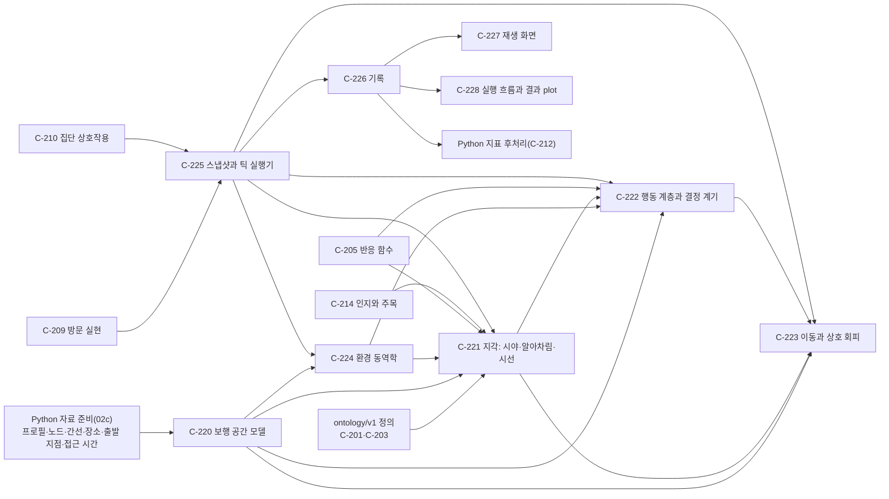

| 단위 | 이름 | 목적(한 줄) | 완료 기준 / 테스트 접점 | 구현 |
|---|---|---|---|---|
| C-220 | 보행 공간 모델 | 위치를 가질 지도: 경로 그래프, 보행 공간, 가림, 장소·출발 지점 | ①~⑦ / E220-1~E220-7 | Python(그래프·장소·출발 지점) + Rust(0.5m 보행 격자·보도 띠·횡단 구역) |
| C-221 | 지각: 시야·알아차림·시선 | 시야 안에서만 알아차리고, 시선은 반응 함수(LOOK)로 정한다 | ①~⑦ / E221-1~E221-7 | Rust |
| C-222 | 행동 계층과 결정 계기 | 언제 결정하고 결정 사이에 어떤 계획을 따르는가 | ①~⑦ / E222-1~E222-7 | Rust |
| C-223 | 이동과 상호 회피 | 시야 기반 회피, 겹침 없는 속도, 줄 | ①~⑦ / E223-1~E223-7 | Rust |
| C-224 | 환경 동역학 | 영업·노점·행사·차량 시간·조도의 틱별 상태와 사건 | ①~⑤ / E224-1~E224-5 | Rust |
| C-225 | 스냅샷과 틱 실행기 | 순수 함수 step, 고정 단계 순서, 체크포인트 재개 | ①~⑥ / E225-1~E225-6 | Rust |
| C-226 | 기록 | 렌더 프레임·사건·결정·10분 집계·체크포인트 | ①~⑥ / E226-1~E226-6 | Rust(쓰기), Python(후처리 읽기) |
| C-227 | 재생 화면 | 3D 지도 자료 위의 재생 | ①~⑥ / E227-1~E227-6 | 별도 작업(DR-223) |
| C-228 | 실행 흐름과 결과 plot | 한 명령으로 입력 검사부터 SVG·HTML 보고서까지 | ①~⑥ / E228-1~E228-6 | Rust |

실제 명동 자료로 끝까지 돌리려면 02c의 Python 산출물(프로필·공간·장소 Parquet)이 먼저 있어야 한다. 그 전까지 Rust는 계약 형식의 합성 고정 자료로 검증한다.

## 명동 변수 근거 조사 — C-240~C-242

2026-10-31 사용자가 요청한 10개 변수(2·3·4·6·9·11·12·14·15·16)를 조사한다. 결과는 [조사 보고서](06_myeongdong_variable_research.md)에 기록하며, 시뮬레이션 입력을 변경하는 작업은 포함하지 않는다. 자료의 원래 공간·시점·집계 기준을 유지하고, 근거가 없는 값은 미확인으로 둔다([DR-240](decisions.md#dr-240--명동-변수-자료-조사의-경계)). 기존 상권·행정동·지도 범위가 다름을 숨기지 않는다.

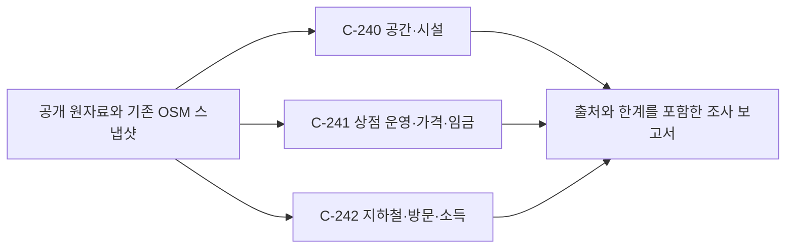

### C-240 — 공간·시설 근거

- 목적: 길과 시설의 크기·분포를 실제 보행 환경의 근거로 확인한다.
- 책임: 보행 폭·노점·벤치·옥외 매체의 공개값과 범위를 확인한다. 실제 유효 폭이나 시각 자극도를 새로 추정하지 않는다.
- 입력/출력: 기존 OSM·경계 파일 및 공개 기관 자료 → 지표별 수치 또는 미확인, 시점·범위·출처·한계.
- 의존: 기존 지도와 행정동 경계; 후행은 보고서와 요청된 지표의 검토.
- 분류/미해결 질문: SELF. 실제 구간별 유효 폭·현장 벤치 전수·광고 자극도는 미확인으로 기록한다. 시뮬레이션 적용 여부는 이번 조사에서 결정하지 않는다.
- 완료 기준과 테스트 접점: ① 각 4개 항목을 보고서에 빠짐없이 둔다(E240-1: 항목 대조). ② 수치마다 출처·시점·범위를 둔다(E240-2: 원자료 대조). ③ 벤치의 OSM 집계와 행정동 교차를 재계산한다(E240-3: 원본 노드·경계 대조). ④ 총도로 폭, 지도에 등록된 개수, 광고 설치 수를 각각 유효 폭·실제 전수·시각 자극도와 구분한다(E240-4: 한계 문구 검토).
- 리스크/불확실성: OSM 누락, 출처 시점 차이, 기관별 지역 경계 차이. 관련 결정: [DR-240](decisions.md#dr-240--명동-변수-자료-조사의-경계).

### C-241 — 상점 운영·가격·인건비 근거

- 목적: 실제 점포의 영업 및 비용 사례와 공적 임금 기준을 확인한다.
- 책임: 영업시간·인건비·상품 가격의 실제 사례와 기준을 찾는다. 사례를 상권 평균으로 바꾸거나 상점 자료를 덮어쓰지 않는다.
- 입력/출력: 상점·채용 자료 및 공공 임금 통계 → 상호와 지표별 사례·기준·출처·시점.
- 의존: 외부 공개 자료; 후행은 보고서와 요청된 지표의 검토.
- 분류/미해결 질문: SELF. 상권 전수 영업시간·실제 임금 분포·업종별 상품 가격은 미확인으로 둔다.
- 완료 기준과 테스트 접점: ① 3개 항목에 사례 또는 미확인 표시(E241-1: 항목 대조). ② 영업시간·가격은 특정 점포 사례로 식별(E241-2: 상호·출처 대조). ③ 최저임금은 법적 기준으로 명시하고 실제 평균과 구분(E241-3: 노동부 자료 대조). ④ 시뮬레이션 입력을 자동 갱신하지 않음(E241-4: 변경 파일 검토).
- 리스크/불확실성: 운영시간과 채용 조건의 변경, 대표성 부족, 법정 기준과 사업주 총비용의 차이. 관련 결정: [DR-240](decisions.md#dr-240--명동-변수-자료-조사의-경계).

### C-242 — 교통·방문·소득 근거

- 목적: 방문 시점과 외국인 수요를 해석하되 유입·체류·소득의 서로 다른 뜻을 보존한다.
- 책임: 역 시간표의 배차 사례와 외국인 방문 통계 및 소득 자료의 가용성을 확인한다. 기간 합계나 지출을 일별 신규 유입이나 개인 소득으로 바꾸지 않는다.
- 입력/출력: 역 시간표·관광 통계·서울시 소득 자료 → 수치 또는 미확인, 기간·대상·집계 한계.
- 의존: 외부 공개 자료; 후행은 보고서와 요청된 지표의 검토.
- 분류/미해결 질문: SELF. 단위 시간당 신규 도착, 명동 방문객 개인 평균 소득은 미확인으로 기록한다.
- 완료 기준과 테스트 접점: ① 3개 항목을 보고서에 둔다(E242-1: 항목 대조). ② 배차 간격 사례를 방향·요일·시각과 원 시간표로 확인한다(E242-2). ③ 외국인 방문 수의 기간·집계 한계를 명시한다(E242-3). ④ 소득과 여행 지출의 차이 및 서울시 관련 자료의 최신화 중단을 기록한다(E242-4).
- 리스크/불확실성: 열차 시간표 변경, 방문 통계의 중복·공간 범위 불명, 대상의 이질성. 관련 결정: [DR-240](decisions.md#dr-240--명동-변수-자료-조사의-경계).

구현·검증 순서: C-240, C-241, C-242는 독립적으로 출처를 확인한 뒤 보고서에서 합친다. 사용자 시나리오 E2E 접점은 요청된 10개 번호가 빠짐없이 있고 모든 수치의 대상·단위·시점·출처 또는 미확인이 보이는지 점검하는 것이다.

## 첨부 명동 화면 내재화와 Rust 연결 준비 (C-250~C-253)

범위·결정: [DR-241](decisions.md#dr-241--첨부-화면의-내재화와-엔진-연결-준비), [DR-242](decisions.md#dr-242--화면-내재화의-구현-세부-결정). C-227의 실제 재생 완성이 아니라 그 선행 작업이다.

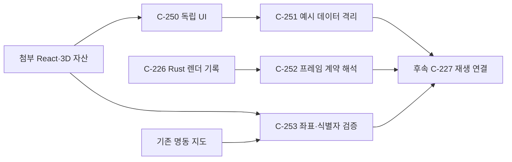

### C-250 — 독립 UI 이식

- 목적: 제공된 화면을 원본 위치나 Figma 실행 환경에 의존하지 않고 엔진 프로젝트 안에서 실행 가능한 UI로 보존한다.
- 책임: React 화면·자산·잠금 버전 이식, 일반 Vite 실행 및 로컬 글꼴. 실제 엔진 호출·배포는 하지 않는다.
- 입력/출력: 첨부 프로젝트 → `apps/myeongdong-ui/`의 독립 개발·정적 빌드.
- 의존: 첨부 파일, C-251. 후행 C-227.
- 분류: ASK 범위는 DR-241로 확정; SELF 구현은 DR-242.
- 미해결: 원본 GLB·상권 자료의 상세 출처와 향후 배포권은 제공된 파일만으로 확인되지 않는다. 배포는 범위 밖이다.
- 완료 기준: ① 필수 원본 자산을 복사하고 무결성을 확인한다. ② Figma 전용 설정 없이 독립 빌드된다. ③ 3D 지도와 기존 조작이 표시된다. ④ 외부 글꼴 없이 로컬에서 표시된다.
- 테스트 접점: 소스/자산 해시, TypeScript·Vite 빌드, 로컬 브라우저 로드·선택·조작·네트워크 확인(E250-1~4).
- 리스크: Figma 의존 제거에 따른 회귀, 잠금 의존성 설치 환경, GLB의 출처 정보 누락.

### C-251 — 미리보기 데이터와 실제 결과 경계

- 목적: 무작위 보행과 가공된 매출·유동인구를 엔진 결과로 오인하지 않으면서 후속 교체가 가능하게 한다.
- 책임: 예시 보행·시나리오·지표 코드를 별도 preview 모듈로 옮기고 명확한 화면 표시를 둔다. 실제 지표 추정·엔진 시나리오 변환은 하지 않는다.
- 입력/출력: 기존 화면의 예시 데이터와 사용자 선택 → 명시된 미리보기 화면.
- 의존: C-250. 후행 C-227·C-252.
- 분류: SELF, DR-242. 사용자에게 보이는 상태는 DR-241의 연결 준비 범위에 따른다.
- 미해결: 16개 선택지와 엔진 파라미터의 단위·적용 대상·관측 결과 매핑은 추후 실제 연결 시 검증한다. 특히 UI 16번 기본값은 '낮음', 엔진 프리셋 기본값은 '기준'이다. 원본의 860px 이하 조건 패널 숨김도 후속 모바일 편집에서 해결해야 한다.
- 완료 기준: ① 보행 생성·갱신과 지표 예시가 preview 모듈로 격리된다. ② 화면에 미연결·예시 상태가 보인다. ③ 건물 선택과 선택지 변경이 유지된다. ④ 원본의 계산값을 실측값으로 표현하지 않는다.
- 테스트 접점: 브라우저 표시·선택·변경, 소스 경계 검사(E251-1~4).
- 리스크: 예시 지표가 실제 값으로 오해될 가능성, 건물 단위와 엔진 장소 단위 불일치.

### C-252 — 엔진 렌더 프레임 계약 준비

- 목적: 후속 UI가 Rust 엔진이 내보낸 실제 10분 묶음을 재계산 없이 신뢰성 있게 읽을 수 있도록 한다.
- 책임: `mdsim-frames-v1` 머리말·레코드를 엄격히 검증하고 요청 프레임만 해석한다. 파일 전송, 실행, 지표·화면 재생은 하지 않는다.
- 입력/출력: `ArrayBuffer | Uint8Array` → 검증된 머리말과 인덱스, 요청 틱의 위치·상태.
- 의존: C-226·DR-229의 현재 Rust 기록 형식. 후행 C-227.
- 분류: SELF, DR-242; 기존 기록 계약을 변경하지 않는다.
- 미해결: 실제 서비스의 파일 접근 방식, 엔진 실행·재생 UI, Parquet 지표와 사건 제공 방식은 추후 연결 범위이다.
- 완료 기준: ① 실제 Rust 합성 프레임의 값이 일치한다. ② 잘린 파일·지원하지 않는 형식·비일관 머리말을 거부한다. ③ 음수 좌표·각도·상태·플래그를 손실 없이 해석한다. ④ 빈 프레임과 범위 밖 요청을 처리한다. ⑤ 전체 인물 레코드를 한꺼번에 객체화하지 않는다.
- 테스트 접점: 계약 단위 테스트와 실제 Rust 산출물 통합 테스트(E252-1~5).
- 리스크: 형식 버전 변경, 헤더 변조·잘린 파일, 대용량 메모리.

### C-253 — 지도 공간·식별자 연결 조사

- 목적: 서로 다른 좌표계와 건물 범위를 확인해 후속 재생에서 보행자가 잘못된 건물 위에 놓이는 오류를 막는다.
- 책임: GLB와 정본 지도의 공통 건물 ID와 평면 중심을 비교하고 재현 가능한 결과·한계를 기록한다. 검증되지 않은 변환을 실제 화면에 적용하지 않는다.
- 입력/출력: 첨부 GLB 노드와 정본 지도 건물 외곽 → 공통 ID 수·중심 변환 적합 통계·해시.
- 의존: C-250, 기존 3D 지도 C-95와 엔진 좌표 C-220. 후행 C-227.
- 분류: SELF, DR-242; 후속 실제 지도 사용 여부 변경은 ASK.
- 미해결: 고도·건물 외곽 전체·통행 가능 공간과 변환 외삽 검증, 모델과 상권 자료의 원천·라이선스.
- 완료 기준: ① 양쪽 ID 집합·중심 오차가 재현된다. ② 좌표가 동일하지 않음을 탐지한다. ③ 정본과 GLB의 지면 표현 차이를 기록한다. ④ 결과를 실제 위치 연결 완료로 주장하지 않는다.
- 테스트 접점: 좌표 감사 스크립트의 실제 데이터 실행 및 알려진 공통 ID 검증(E253-1~4).
- 리스크: 중심점 일치가 외곽·지형·모든 에이전트 위치의 정확성을 보장하지 않는다.

구현 순서: C-250 → C-251, C-252와 C-253 → 독립 빌드·브라우저 E2E. 구현·검증의 순서는 [03_build_order.md](03_build_order.md#첨부-명동-ui-내재화-순서-t-250t-253), 상세 계약은 [02_impl_map.md](02_impl_map.md#첨부-명동-ui-구현체-i-250-ai-253-a)다.

## 명동 입력의 5,044명 직접 재생 (C-260~C-264)

결정 [DR-260~261](decisions.md#dr-260--실제-명동-입력의-5044명-직접-재생). 정식 방문 확률·원문 추출·실측 검증이 아닌 직접 투입 실험이다.

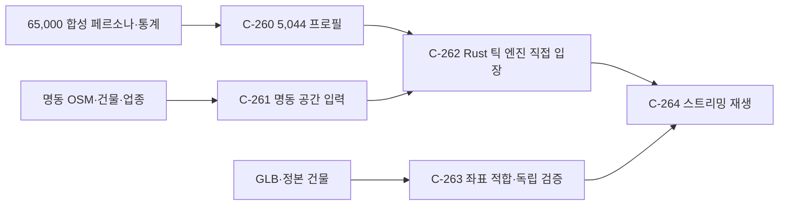

### C-260 — 5,044개 구조화 프로필
- 목적: 명동 맥락 합성 원본의 서로 다른 5,044건을 실제 엔진 입력으로 옮긴다.
- 책임: 결정적 표본 선택, 나이·직업 기반 능력 및 통계 예산, 기본 관심·시간 창, 출처·가정 기록. 원문 행동 특성 추출·실측 방문 추론은 하지 않는다.
- 입력/출력: `personas.parquet`, 02c 기준·소득 원표 → `profiles.parquet`와 선택 근거.
- 의존: C-202·C-215의 확정 기본값; 후행 C-262.
- 분류: ASK DR-260, SELF DR-261. 미해결: 정식 원문 추출기·외국인 방문 프로필.
- 완료 기준: ① 5,044 고유 ID, 중복·원본 이탈 없음. ② 나이 기반 능력·통계 예산을 문서대로 산출한다. ③ 가정 라벨과 원본 해시를 보존한다. ④ Rust 계약 검사 통과.
- 테스트 접점: 원본 표 대조·결정성·경계 사례 단위/통합(E260-1~4). 리스크: 합성 주민은 실제 방문객 표본이 아니고 텍스트 특성이 아직 미반영.

### C-261 — 명동 도로·건물·장소
- 목적: 시뮬레이션에서 쓰는 보행 공간과 출입구·장소가 실제 명동 지도 자료를 따르게 한다.
- 책임: OSM 지상 보행 way와 출입구, 정본 건물, 일치하는 UI 업종 장소 변환. 지하망·비매칭 상점·정식 상점 대응표 확정은 하지 않는다.
- 입력/출력: OSM·경계·지형·3D 지도·업종 JSON → 노드·간선·건물·장소·출입구 번들.
- 의존: C-95·C-202·C-204, 후행 C-262. 분류 ASK DR-260, SELF DR-261.
- 미해결: 원본 OSM의 남쪽 빈 구간·지하망·상점별 세부 자료와 전용 본 입력 파이프라인.
- 완료 기준: ① 도로와 건물 좌표는 실제 원본에 추적된다. ② 모든 간선·장소·출입구 참조가 유효하다. ③ 제외·가정과 공통 건물 수를 기록한다. ④ Rust 공간 생성과 입력 검사를 통과한다.
- 테스트 접점: 입력 지리·참조 단위 테스트, Rust validate(E261-1~4). 리스크: 지도는 측량이 아니고 표본 없는 곳은 누락된다.

### C-262 — Rust 직접 입장 실행
- 목적: 5,044명의 실제 엔진 프레임을 사용자가 볼 수 있게 계산한다.
- 책임: 각각 한 번 출입구에 배치, 0.5초 틱과 1초 프레임 실행, 진행·완료·오류와 기록. 방문 여부 확률 추정은 하지 않는다.
- 입력/출력: C-260·261 번들 → 실행 manifest, 10분 프레임·사건·결정.
- 의존: C-260·261, Rust C-225·226. 후행 C-264. 분류 ASK DR-260, SELF DR-261.
- 미해결: 혼잡·줄 검증 실패와 보류된 회피 검사는 기존 엔진 수정 작업에 남는다.
- 완료 기준: ① 고유 프로필 5,044건이 1회씩 실제 Rust에 입장한다. ② 각 조각과 manifest가 계약·해시에 맞는다. ③ 완료 전 진행과 실패를 구분한다. ④ 직접 입장과 기준값 가정을 보존한다.
- 테스트 접점: 소규모 입력 및 전체 5,044 실행의 body ID·계약·해시 통합(E262-1~4). 리스크: 대규모 메모리·시간, 기존 물리 검증 실패.

### C-263 — GLB와 엔진 평면 정합
- 목적: 엔진 좌표를 사용자 3D 모델에 정확한 위치로 보여 준다.
- 책임: 공통 ID 기반 변환 적합·독립 외곽점과 입력 해시 검사. 평면 지면을 실제 고도로 표현한다고 주장하지 않는다.
- 입력/출력: 정본 지도·사용자 GLB → 축별 변환과 정합 오차.
- 의존: C-253; 후행 C-264. 분류 SELF DR-261. 미해결: 공통 건물 밖·지하·세밀한 보도 형상은 검증되지 않음.
- 완료 기준: ① 공통 건물·외곽점 수와 p95·최대 오차를 기록한다. ② 해시 변경이나 최대 오차 >0.2m는 표시를 중단한다. ③ 독립 점이 정본 외곽에 맞는다. ④ 높이 한계를 표시한다.
- 테스트 접점: 전체 외곽점 감사와 잘못된 입력 거부(E263-1~4). 리스크: 외곽점 정합이 도로 폭 정확성까지 보장하지 않는다.

### C-264 — 실제 프레임 재생 화면
- 목적: 사용자가 연결된 엔진의 사람 위치와 시간을 직접 확인한다.
- 책임: 상태 및 10분 프레임 요청, 재생/정지/이동/배속, 시간·입장 및 현재 인원·가정 표시. 예시 예측과 임의 보행을 실제 결과로 사용하지 않는다.
- 입력/출력: C-262의 상태·프레임 + C-263 변환 → 명동 3D 실험 재생.
- 의존: C-262·263·C-250; 후행 사용자. 분류 ASK DR-260, SELF DR-261·262.
- 미해결: 시나리오 편집·장소별 매출·정식 지표·모바일 조건 편집은 별도 작업.
- 완료 기준: ① 실제 프레임의 위치·현재 인원과 화면이 일치한다. ② 재생·정지·시간 이동·배속이 작동한다. ③ 생성 중·완료·오류 및 합성·직접입장 가정이 보인다. ④ 고장 시 모의 보행으로 위장하지 않는다. ⑤ 320px과 데스크톱에서 조작 가능하다.
- 테스트 접점: 프레임 소스 단위·Rust 출력 통합·브라우저 E2E(E264-1~5). 리스크: 큰 조각의 메모리, GPU 성능, 분리된 좌표계.

구현·검증 순서와 세부 사양은 [구현체 Map](02_impl_map.md#명동-5044명-재생-구현체-i-260-ai-264-a)과 [구현 순서](03_build_order.md#명동-5044명-재생-순서-t-260t-264)에 둔다.

## 화면에서 엔진 직접 실행 (C-270~C-273)

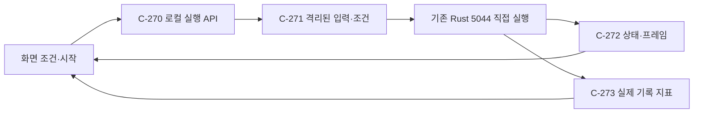

### C-270 — 로컬 실행 요청
- 목적: 브라우저의 새 실행 요청을 실제 Rust 프로세스에 전달하고 사용자가 진행과 오류를 확인한다.
- 책임: 유효한 조건만 받아 단일 실행을 시작·조회하고 로컬 접근을 제한한다. 원격 공개, 임의 명령, 중복 동시 실행은 하지 않는다.
- 입력/출력: 보행 전용 여부·할인율 → 고유 실행 ID, 준비/계산/완료/실패 상태와 결과 경로.
- 의존: C-271·262·272; 분류 ASK DR-270, SELF DR-271. 미해결: 배포용 원격 API·다중 사용자 인증.
- 완료 기준: ① 요청이 실제 Rust를 시작한다. ② 중복·잘못된 요청과 서비스 실패가 구분된다. ③ 진행·완료·실패가 화면에 보인다. ④ 기존 실행을 덮어쓰지 않는다.
- 테스트 접점: HTTP 경계 및 소규모 실제 프로세스, 브라우저 실행 E270-1~4. 리스크: 로컬 서비스 중단, 자원 경쟁.

### C-271 — 격리된 실행 입력과 조건
- 목적: 표시된 조건이 실제로 엔진 입력에 반영되고 그 결과의 출처를 추적한다.
- 책임: 원본 사본·새 시나리오·할인 Parquet·manifest 해시 생성. 유효하지 않은 조건과 미지원 수요 변경은 수행하지 않는다.
- 입력/출력: DR-260 원본 번들 + DR-271 조건 → 별도 번들·시나리오·해시.
- 의존: C-260·261, 후행 C-270. 분류 SELF DR-271. 미해결: 건물 단위 정책 선택과 나머지 14개 조건.
- 완료 기준: ① 기본·변경 입력이 원본과 분리된다. ② 보행 전용이 지정 구간의 엔진 시나리오에 들어간다. ③ 할인은 161개 대리 장소와 manifest 해시에 반영된다. ④ Rust 번들·시나리오 검사를 통과한다.
- 테스트 접점: 임시 번들 및 Rust validate(E271-1~4). 리스크: 원본 업종이 건물 대리값, 효과 크기 미검증.

### C-272 — 실시간 실행 상태와 프레임 재생
- 목적: 화면 요청으로 생성되는 10분 결과를 완료 전부터 실제 계산 진행에 맞춰 볼 수 있다.
- 책임: 준비·계산·완료·실패와 조건을 표시하고 조각이 완성되면 새 실행에 전환한다. 계산 중 바뀐 조건은 초안으로 유지하고 사용자가 버튼을 눌렀을 때만 다음 계산을 시작한다(DR-286). 이전 화면을 새 실행인 것처럼 보이지 않는다.
- 입력/출력: C-270 실행 상태 + C-262 프레임 → 진행 표시와 재생.
- 의존: C-270·262·264; 분류 SELF DR-271, ASK DR-286. 미해결: 현재 인물 상태를 보존하면서 조건을 틱 단위로 주입하는 모드.
- 완료 기준: ① 실행 상태가 실제 프로세스에 대응한다. ② 완성된 조각만 재생한다. ③ 이전 실행의 프레임·지표와 섞이지 않는다. ④ 실패를 모의 결과로 대체하지 않는다. ⑤ 계산 중 조건 변경은 보존되고 자동 실행되지 않는다.
- 테스트 접점: 상태 폴링·프레임 전환 단위/통합 및 브라우저 E272-1~4. 리스크: 비동기 요청 순서·프로세스 중단.

### C-273 — 엔진 기록 결과와 건물 표시
- 목적: 사용자가 화면의 결과가 엔진이 실제 기록한 수치인지 확인한다.
- 책임: 해시 검사한 사건·10분 지표를 요약하고 매칭된 건물의 3시간 방문·구매액을 표시한다. 실측·월 매출·매칭되지 않은 건물 수치는 만들지 않는다.
- 입력/출력: Rust manifest·metrics·events·장소 ID → 전체 및 건물별 기록 요약.
- 의존: C-262·270; 분류 SELF DR-271. 미해결: 현장 매출·실제 방문객·미매칭 건물.
- 완료 기준: ① 10분 지표와 사건 합계가 일치한다. ② 매칭 건물만 실제 사건 값이 나온다. ③ 실험·3시간 범위와 물리 한계가 표시된다. ④ 해시 오류·미완료는 수치 없이 알린다.
- 테스트 접점: 실제 기록 fixture 통합과 건물 선택 E273-1~4. 리스크: 기존 대기열 관련 검증 실패와 원문 특성 미추출.

## 원본 변수와 건물별 지정 (C-280~C-282)

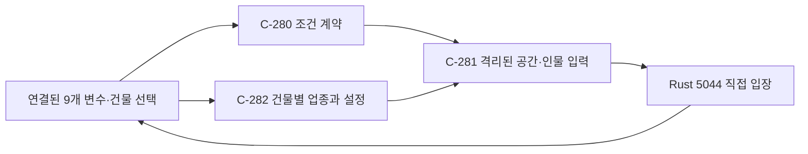

### C-280 — 원본 변수 조작 계약
- 목적: 원본 변수 중 실제 엔진에 반영되는 항목을 사용자가 조작한다.
- 책임: 연결된 9개 선택지와 수동 실행. 미연결 7개는 DR-284에 따라 숨긴다.
- 입력/출력: 사용자 선택 → 유효한 초안, 실행 버튼 → 엔진 요청.
- 의존: C-270·272, 후행 C-281. 분류 ASK DR-280·284·286, SELF DR-281. 미해결: 월 모형 및 직접 입장과 충돌하는 수요 변수.
- 완료 기준: ① 연결된 9개 이름·선택지가 보인다. ② 실행 버튼을 눌렀을 때 선택값이 실제 입력에 전달된다. ③ 7개 미연결 항목은 화면에 없다. ④ 값 변경만으로 계산하지 않는다.
- 테스트 접점: 설정·초안 단위, 브라우저 E280-1~4. 리스크: 기본 노점이 가정임을 혼동할 수 있다.

### C-286 — 수동 실행과 편집 초안
- 목적: 조건 여러 개를 편집할 때 의도하지 않은 계산과 중복 실행을 막는다.
- 책임: 모든 전체·건물 설정의 초안 유지, 실행 전 표시, 명시적 실행 및 중복 요청 방지. 기존 엔진 프로세스 취소는 하지 않는다.
- 입력/출력: 설정 편집과 버튼 클릭, 기존 실행 상태 → 초안·실행 표시와 클릭당 최대 한 번의 엔진 요청.
- 의존: C-270·272·280·282; 분류 ASK DR-286, 구현은 SELF. 미해결: 없음.
- 완료 기준: ① 값만 바꿀 때 요청이 없다. ② 클릭 시 최신 초안을 한 번 전송한다. ③ 실행 중 편집은 초안으로 남고 완료 후 자동 실행되지 않는다. ④ 실행 상태 변경이 초안을 덮어쓰지 않는다. ⑤ 적용된 결과와 초안의 차이를 표시한다.
- 테스트 접점: 옵션 비교·중복 요청 단위 테스트와 모의 엔진 API 브라우저 E286-1~5. 리스크: 비동기 폴링과 실행 전환 중 초안 소실.

### C-281 — 변수별 공간·상점·인물 적용
- 목적: 사용자가 고른 값이 Rust 계산에 실제 들어가고 실행별 입력으로 추적된다.
- 책임: 02c 설계대로 도로 폭·노점·벤치·할인·시간·소득·가격·광고와 보행 전용 시간 적용. 방문 수 확률과 월 상점 계산은 하지 않는다.
- 입력/출력: 기준 번들·지원 옵션 → 새 도로·장소·프로필·시나리오 및 SHA-256.
- 의존: C-260·261·271; 분류 SELF DR-281. 미해결: 현장 노점·가격·광고 보정.
- 완료 기준: ① 각 지원 변수가 해당 Rust 입력 값을 바꾼다. ② 기준 노점·벤치 가정이 기록된다. ③ 원본과 5,044명은 유지된다. ④ 수정 번들이 Rust 계약을 통과한다.
- 테스트 접점: 옵션별 번들 단위, Rust validate·실행 통합 E281-1~4. 리스크: 결과 효과는 선택 시간과 환경에 따라 0일 수 있다.

### C-282 — 건물별 업종과 속성
- 목적: 건물을 선택해 종류와 상점 조건을 달리 설정하고 엔진에 반영한다.
- 책임: 건물별 업종·할인·가격·영업시간 저장과 장소 대리값, 엔진 적용 가능성·의료/GLB 한계 표시. 측량되지 않은 먼 건물의 엔진 결과를 만들지 않는다.
- 입력/출력: GLB 건물 ID·선택값 → 개별 대리 장소 또는 엔진 미반영 표시.
- 의존: C-263·270·281; 분류 ASK DR-280·282. 미해결: 의료 모형, GLB 전용 외곽과 원거리 보행망.
- 완료 기준: ① 건물마다 서로 다른 업종을 지정할 수 있다. ② 적용 가능한 건물은 Rust 장소 행에 정확한 업종·값이 들어간다. ③ 의료·미검증/미반영 건물을 구분한다. ④ 여러 건물 설정이 새 실행과 화면에 유지된다.
- 테스트 접점: ID·좌표·개별 장소 단위, Rust 통합·브라우저 E282-1~4. 리스크: 대리 상점과 GLB 전용 중심은 실제 상점·측량이 아니다.

## 가설 검증과 시연 (C-290~C-292)


### C-290 — 비교 가능한 실제 실행
- 목적: 조건 외의 차이가 결과를 오염시키지 않도록 실행 기반을 고정한다.
- 책임 범위: 동일한 5,044명·3시간·엔진·시드의 실행 쌍, 출처·해시·실행 상태 기록. 엔진 로직과 기존 사용자 실행 수정은 하지 않는다.
- 입력 / 출력: 기준 자료·고정 Rust 실행 파일·시드·조건 → 격리된 번들과 검증된 실행 기록.
- 의존 관계: C-260·261·270; 후행 C-291·292. 분류 ASK(사용자 요청)·SELF(DR-290 고정 실행 파일). 미해결 질문: 없음.
- 완료 판정 기준: ① 각 쌍의 인물·시드·실행 파일이 같다. ② 프로필 5,044명 전원이 한 번씩 입장한다. ③ 입력·프레임·바이너리 해시와 기록이 검증된다. ④ 기존 사용자 자료와 실행을 보존한다.
- 테스트 접점: 번들 변환 단위·Rust `verify`·실행 결과 해시 통합. 리스크: 개발 중 엔진 버전과 다를 수 있어 정확한 출처를 표시한다.

### C-291 — 가설과 대조·재검증
- 목적: 시연하기 좋은 차이를 찾되 우연한 변화를 효과로 과장하지 않는다.
- 책임 범위: 사전 가설, 단일 설정 차이, 주요 결과 지표, 모든 후보 결과와 실패 기록, 다른 시드 재검증. 실측 인과 효과나 보장된 예측 주장은 하지 않는다.
- 입력 / 출력: C-290 기준과 후보 기록 → 각 쌍의 지표·차이·방향·재검증 결과와 한계.
- 의존 관계: C-290, 후행 C-292. 분류 ASK(사용자가 반복 시험 위임)·SELF(DR-291 후보·재검증). 미해결 질문: 성공 사례는 실제 계산 후 결정.
- 완료 판정 기준: ① 각 후보는 기준 대비 한 UI 변수만 다르다. ② 선택 기준과 지표를 사전에 기록한다. ③ 선택 사례는 별도 시드에서 방향을 확인한다. ④ 효과가 없거나 방향이 다르면 그 결과도 보고한다. ⑤ 실제 사건과 지표의 합계가 일치한다.
- 테스트 접점: 후보 계약 단위, 해시·사건 대조, 두 시드 비교 통합. 리스크: 적은 사건·시드 수·엔진 한계로 결과 변동 가능.

### C-292 — 시연용 결과 탐색
- 목적: 사용자가 기준과 조건 변경의 결과를 비교하고 실제 재생을 직접 보여준다.
- 책임 범위: 가설·설정·차이·제한 표시, 기준과 변화 실행의 기존 3D 화면 열기, 실행 전용 수동 버튼 정책 유지. 실측 매출이나 새 자동 계산은 제공하지 않는다.
- 입력 / 출력: C-291 검증 결과와 실행 ID → 시연 페이지·재생 링크·검증 보고서.
- 의존 관계: C-291·272·286. 분류 ASK(시연 요청), 배치 SELF. 미해결 질문: 실제 추천 사례는 테스트 후 결정.
- 완료 판정 기준: ① 각 추천 사례의 기준과 변경값·지표·시드 결과를 표시한다. ② 기준·변화 재생을 열 수 있다. ③ 가정·물리 한계·엔진 버전을 알린다. ④ 시연 열기만으로 계산하지 않는다. ⑤ 데스크톱과 320px에서 조작 가능하다.
- 테스트 접점: JSON↔시연 DOM, 링크 실행 ID·기록 일치, 브라우저 검증. 리스크: 오래된 실행 파일과 최신 개발 소스 혼동.

## 시연 영상 (C-293~C-294)

### C-293 — 실제 시연 장면 수집
- 목적: 사용자가 실제 UI와 검증된 엔진 결과를 조작하는 모습을 볼 수 있다.
- 책임 범위: 시연 페이지와 비교 기록을 브라우저로 열고 시간 순서의 탭 화면을 캡처한다. 다른 앱 화면·민감한 사용자 정보는 캡처하지 않으며 새 계산은 시작하지 않는다.
- 입력 / 출력: C-292의 검증된 로컬 시연과 실제 재생 → 순서·시각·출처가 기록된 화면 프레임과 장면 명세.
- 의존 관계: C-292; 후행 C-294. 분류 ASK(사용자 명시 요청)·SELF(탭 캡처 방식 DR-295). 미해결 질문: 없음.
- 완료 판정 기준: ① 기준·변경 기록을 실제 UI에서 연다. ② 움직이는 재생 화면을 연속 프레임으로 담는다. ③ 실험 값과 선택한 장면을 기록한다. ④ 기존 사용자 탭과 실행을 훼손하지 않는다.
- 테스트 접점: 브라우저 조작과 연속 프레임 간 변화 및 기록 ID 대조. 리스크: 화면 캡처 속도·WebGL 로딩.

### C-294 — 영상 편집과 검증
- 목적: 비교와 한계를 짧고 이해하기 쉬운 완성 영상으로 전달한다.
- 책임 범위: 장면 컷 편집, 정확한 한국어 자막, 무음 MP4 인코딩·재생 검증. 음성·배경음과 실측 효과나 미검증 인과 주장은 넣지 않는다(DR-296).
- 입력 / 출력: C-293 프레임·C-291 수치 → 자막이 포함된 무음 로컬 MP4 및 장면 명세.
- 의존 관계: C-293·291; 분류 ASK(영상 요청)·SELF(편집 수단). 미해결 질문: 없음.
- 완료 판정 기준: ① 실제 화면의 변화·조작이 들어간다. ② 자막 수치가 보고서와 일치한다. ③ 시뮬레이션 결과와 두 시드를 표시하고 사용자가 제외한 표현은 넣지 않는다(DR-297). ④ MP4 영상 트랙·오디오 없음과 장면별 화면을 확인한다. ⑤ 사용자가 파일을 열 수 있다.
- 테스트 접점: ffprobe, 추출 프레임 시각 검사·장면 경계 대조. 리스크: 한국어 서체 또는 인코딩 실패.

## 최종 소스 배포 (C-300~C-302)

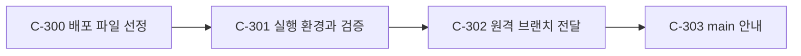

### C-300 — 배포 파일 선정

- 목적: 작업 폴더에서 소스·필수 자산과 생성 산출물을 구별해야 저장소에서 프로젝트를 이해하고 다룰 수 있다.
- 책임 범위: 코드, 잠금 파일, 테스트 코드와 기존 Map을 선별한다. 모든 데이터·지도·글꼴·바이너리 픽스처는 업로드에서 제외한다. 로컬 원본 삭제 및 기존 원격 파일 교체는 하지 않는다.
- 입력 / 출력: 현재 작업 폴더와 원격 `main` → 파일 목록·무시 규칙·출처 기록.
- 의존 관계: 선행 없음; 후행 C-301·C-302. 분류: ASK(사용자 업로드·데이터 제외 지시로 확정), SELF(상세 선정). 미해결 질문: 없음.
- 완료 판정과 테스트: 코드·잠금 파일·Map 경로 존재 확인; 데이터·환경·빌드 파일 제외 확인; 비밀 값 및 파일 크기 검사. 각각 선정 목록과 패턴 검사로 검증한다.
- 테스트 접점: 선정 디렉터리의 파일 목록. 리스크: 데이터가 없으므로 화면 빌드·실행과 일부 테스트에 별도 자료가 필요하다. [DR-300](decisions.md#dr-300--공개-저장소에-최종-소스-전달), [DR-303](decisions.md#dr-303--모든-데이터-제외와-main-안내).

### C-301 — 실행 환경과 검증

- 목적: 다른 컴퓨터에서 실행 조건과 누락된 자료를 알 수 있어야 소스가 전달된다.
- 책임 범위: 메모리 보호 실행 파일의 경로를 설정하도록 하고 시작·검증 방법과 재현 한계를 문서화한다. 보호 기능이나 계산 모델은 바꾸지 않는다.
- 입력 / 출력: 선정 파일과 실행 환경 → 설정 가능한 서버, 설치·실행 설명과 검증 결과.
- 의존 관계: C-300 선행; C-302 후행. 분류: SELF(DR-302). 미해결 질문: 없음.
- 완료 판정과 테스트: 지정 보호 경로로 서버 상태가 정상인지 확인; 로컬 원본 데이터로 UI 타입 검사·테스트·빌드 통과; 로컬 원본으로 Python 입력 생성 및 Rust 번들 검증 통과. 각각 CLI/health 확인, UI 명령과 Python/Rust 경계 테스트로 검증한다. 이 결과는 데이터가 없는 새 체크아웃의 실행 성공을 뜻하지 않는다.
- 테스트 접점: CLI 및 `/api/health`, UI 스크립트, Python→Rust 입력 계약. 리스크: 다른 컴퓨터에 memguard와 Cargo 의존성을 별도 설치해야 하며 소득 변경은 원본 페르소나 데이터가 필요하다. [DR-302](decisions.md#dr-302--메모리-보호-경로의-설정-가능화).

### C-302 — 원격 브랜치 전달

- 목적: 선정된 결과를 지정 GitHub 저장소에서 확인할 수 있어야 요청이 완료된다.
- 책임 범위: `main`의 현재 트리를 부모로 삼는 별도 브랜치에 파일을 추가하고 원격 결과를 확인한다. 기존 브랜치를 덮어쓰거나 강제로 갱신하지 않는다.
- 입력 / 출력: 검증된 파일과 원격 `main` → 원격 브랜치·커밋 링크.
- 의존 관계: C-301 선행, 후행 없음. 분류: ASK(사용자가 지정한 저장소로 업로드를 요청), SELF(안전한 브랜치 선택). 미해결 질문: 없음.
- 완료 판정과 테스트: 지정 저장소에 브랜치가 생겼는지 확인; 원격 트리의 필수 파일과 기존 `main` 파일 확인; 커밋 부모가 확인한 `main`인지 확인. 각각 GitHub 읽기 API의 ref·tree·commit 응답으로 검증한다.
- 테스트 접점: GitHub ref·tree·commit. 리스크: 저장소 보호 규칙으로 `main` 병합에는 별도 절차가 필요하다. [DR-300](decisions.md#dr-300--공개-저장소에-최종-소스-전달).

### C-303 — main 브랜치 안내

- 목적: 저장소 첫 화면에서 소스가 다른 브랜치에 있다는 사실과 전환 방법을 알 수 있어야 한다.
- 책임 범위: `main`에 짧은 README를 추가한다. 소스 브랜치의 데이터나 기존 main 파일을 변경하지 않는다.
- 입력 / 출력: C-302의 확인된 소스 브랜치 → `main` README와 링크.
- 의존 관계: C-302 선행; 후행 없음. 분류: ASK(사용자의 명시 지시); 미해결 질문: 없음.
- 완료 판정과 테스트: README가 정확한 브랜치와 `git switch` 방법을 표시; main의 기존 파일 유지; main에서 README를 다시 조회. 각각 PR diff 및 병합 후 GitHub 파일 조회로 확인한다.
- 테스트 접점: main의 README와 PR diff. 리스크: 저장소의 보호 규칙이 PR 병합을 제한할 수 있다. [DR-303](decisions.md#dr-303--모든-데이터-제외와-main-안내).

## 사례별 대조 영상과 Manim (C-310~C-312)

```mermaid
flowchart LR
  C291[검증된 두 시드 기록] --> C310[사례별 화면 녹화]
  C291 --> C311[Manim 수치 시각화]
  C310 --> C312[순서 편집과 자막]
  C311 --> C312
```

### C-310 — 사례별 기준·변경 녹화
- 목적: 네 조건 각각의 기준과 변경을 기존 실제 재생 화면에서 직접 볼 수 있게 한다.
- 책임 범위: 건물 업종·할인·소득·보행전용 각각의 첫 시드 기준·변경 저장 기록을 연속 캡처한다. 새 계산과 다른 앱 캡처는 하지 않는다.
- 입력 / 출력: C-291의 짝지어진 실행 ID → 8개 실제 UI 재생 장면 및 프레임·실행 ID 기록.
- 의존 관계: C-291·C-293 선행, C-312 후행. 분류: ASK(사용자 지시)·SELF(촬영 방식). 미해결 질문: 없음.
- 완료 판정 및 테스트: 모든 사례의 기준·변경 URL과 화면에 표시된 기록이 보고서와 일치; 연속 프레임에서 재생 변화 확인; 사용자 탭 보존. 테스트 접점은 실제 브라우저 화면·manifest.
- 리스크: 동적 결과의 프레임 로딩과 재생 속도. [DR-310](decisions.md#dr-310--각-사례의-화면-대조와-manim-시각화).

### C-311 — Manim 비교 시각화
- 목적: 네 대조의 두 시드 수치와 지표의 의미를 읽기 쉽게 표시한다.
- 책임 범위: Manim으로 실제 기록의 수치를 그려 애니메이션으로 표현한다. 새 결과를 추정하지 않는다.
- 입력 / 출력: C-291의 JSON → 네 개의 무음 Manim 애니메이션과 렌더 설정.
- 의존 관계: C-291 선행, C-312 후행. 분류: ASK(Manim 사용자 지시)·SELF(격리 환경·서체). 미해결 질문: 없음.
- 완료 판정 및 테스트: Manim 버전과 렌더 출력 확인; 각 시드·단위·숫자와 원 기록 대조; 막대가 0부터 같은 척도로 그려짐; 한글과 주의 문구의 시각 검사. 테스트 접점은 JSON→장면 구성과 MP4 추출 프레임.
- 리스크: Manim과 한글 폰트 설치·렌더 자원. DR-310.

### C-312 — 편집·검증·전달
- 목적: 사용자가 원한 각 사례별 대조와 수치 시각화를 하나의 영상으로 시연한다.
- 책임 범위: 장면을 사례별 기준→변경→Manim 순으로 잇고 한글 자막을 넣어 무음 MP4를 만든다.
- 입력 / 출력: C-310·C-311 결과 → 실제 영상이 재생 가능한 로컬 MP4.
- 의존 관계: C-310·C-311 선행. 분류: ASK(사용자 요청)·SELF(편집 명세). 미해결 질문: 없음.
- 완료 판정 및 테스트: 네 사례의 8개 화면과 4개 Manim 장면 및 정확한 자막; 오디오 트랙 없음; 컷 경계·프레임·전체 디코딩 정상; 원본 영상은 보존. 테스트 접점은 ffprobe·추출 프레임·기록과의 대조.
- 리스크: 영상별 프레임 속도·크기 정규화 실패. DR-296·DR-297·DR-310.

## C-400 — 소스의 main 병합

```mermaid
flowchart LR
  C302[검증된 소스 브랜치] --> C400[README 조정과 PR]
  C303[기존 main 안내] --> C400
```

- 목적: 사용자가 `main`에서 소스 전체를 볼 수 있어야 한다.
- 책임 범위: 최신 main과 소스 이력을 보존하고 README 충돌을 해결하여 보호 규칙에 맞는 PR을 병합한다. 데이터 추가·기존 파일 삭제·강제 푸시는 하지 않는다.
- 입력 / 출력: main과 소스 브랜치 → main의 소스 트리, 정확한 README, 병합된 PR.
- 의존 관계: C-302·C-303 선행; 후행 없음. 분류: ASK(사용자의 명시적 병합 요청으로 확정), SELF(충돌 해결). 미해결 질문: 없음.
- 완료 판정과 테스트: 소스 파일이 이전 소스 커밋과 일치; README에 main 소스·기존 브랜치 안내·데이터 제외·실행 한계가 있음; 기존 main 파일 유지와 데이터 부재; PR 병합 후 main의 트리 확인. 각각 Git blob·README·제외 경로·GitHub PR/ref 조회로 검증한다.
- 테스트 접점: Git merge 결과 트리와 GitHub main; 위험: main 보호 규칙이나 동시 변경이 병합을 막을 수 있다. [DR-400](decisions.md#dr-400--소스-브랜치를-main에-병합).

## Changelog

- 2026-10-31: 사용자 지시에 따른 main 병합 C-400 추가.

- 2026-10-31: 최종 소스 공개 배포 경계 C-300~302 추가.

- 2026-10-31: 실제 명동 지도와 구조화 합성 페르소나 5,044명 직접 투입·재생 C-260~C-264 추가.

- 2026-10-31: C-250~C-253 이식·프레임 계약·공통 건물 좌표·브라우저 검증 결과와 미연결·모바일·16번 기본값 한계를 기록했다.
- 2026-10-31: DR-241·242에 따라 C-250~C-253과 검증 경계를 추가했다.

- 2026-10-31: DR-217(근거 사전 후보는 이 세션의 Haiku 하위 에이전트가 만듦)을 C-202 미해결 질문과 사용자 확인 항목에 반영했다. 완료 기준은 바꾸지 않았다.
- 2026-10-31: 명동 변수 조사 C-240~C-242와 완료 기준·검증 접점을 추가했다. 기존 시뮬레이션 입력과 결정은 바꾸지 않는다.

- 2026-10-31: 틱 시뮬레이션과 Rust 런타임 C-220~C-228 절을 추가했다(단위 카탈로그 정본은 01b, DR-220~DR-225·DR-214·DR-215). 기존 절은 바꾸지 않았다.
- 2026-10-31: DR-214·DR-215(Python·Rust 분담, `ontology/v1` 한 벌 공유)와 DR-220·DR-221(0.5초 틱, 몸의 수, 본 값 판단, 시야 안 틱 위험률)을 C-201~C-216 절에 반영했다. C-206·C-209·C-210·C-213·C-214의 문구를 바꾸고, 완료 기준 C-210 ⑦·C-214 ⑥과 테스트 접점 E210-7·E214-6을 추가했다.
- 2026-10-31: DR-212(상점 자료는 사용자가 제공)를 C-203·C-204·C-211·C-214와 구현 순서 초안의 사용자 확인 항목에 반영했다. 완료 기준은 바꾸지 않았다.
- 2026-10-31: 실사 텍스처 C-152~154의 위성 원본·사진 출처·UV·브라우저 검증 완료. `file://` 직접 검증 제한 기록.

- 2026-10-31: 페르소나 반응 온톨로지 C-201~C-216(01a 설계안 v0.4의 R-01~R-16)을 DR-200~DR-211에 따라 편입하고, 완료 기준과 1:1로 대응하는 테스트 접점 E201~E216을 추가했다(버전 2.1). 구현하지 않았다.
- 2026-10-31: 사용자 선택에 따른 Sentinel-2 위성 지붕·확인된 네 건물 외벽 사진 및 인계의 C-152~154와 완료기준·검증 접점을 추가했다.

- 2026-10-31: C-140~142 22분기 원표·2025 이미지 대조, 3,312개 10분 슬롯과 기존 인물 65,000개에 대한 연령 가중치를 구축·검증했다.
- 2026-10-31: 명동 상권 유동인구의 10분 상대 프로필·인물 연령 가중치·온톨로지 연결 작업 계획 추가.

- 2026-10-31: C-130~133 구현·검증 완료. 공개 구별 혼인 셀 추가 후 65,000행을 재생성하고 모든 원본 열·출처·근거·분포와 해시를 전수 검사했다.
- 2026-10-31: 명동 65,000명 증강의 통계·온톨로지 계약·구현 및 검증 계획 추가.

- 2026-10-31: 사용자 결정 DR-100~104에 따라 정방향 기록·목표 역산 C-100~C-105의 개념 Map을 추가했다. 알고리즘 설계이며 기존 작업과 구현 상태는 유지한다.

- 2026-10-31: 기존 지면 고도의 대화형 3D 시각화 C-90과 검증 기준 추가.
- 2026-10-31: C-90 원본 격자 대조와 브라우저 상호작용 검증 완료.
- 2026-10-31: 사용자 선택에 따른 명동 최종 스무딩 격자 C-91과 연속 3D 표시 C-92 추가.
- 2026-10-31: C-91 최종 격자와 C-92 연속 메시의 독립 대조 및 브라우저 검증 완료.
- 2026-10-31: 사용자 선택에 따른 주변 지형 확장 C-93, 건물·도로 정렬 C-94, 3D 지도 C-95 및 검증 대응 추가.
- 2026-10-31: C-93~C-95 원본·공간·3D 렌더링 검증 및 로컬 정적 서버·대화 미리보기 인계 완료. 앱의 `file://` 직접 열기 보안 차단을 기록했다.
- 2026-10-30: 최초 개념 Map 작성.
- 2026-10-30: 원본 및 결과 검증을 마쳐 완료.
- 2026-10-31: 별도 사용자 요청에 따른 명동 추출 C-09 추가. 기존 활동 엔진은 구현하지 않는다.
- 2026-10-31: 사용자가 선택한 명동 행정동 지면 고도 작업의 C-10~C-12, 경계·완료 기준·테스트 대응 추가.
- 2026-10-31: 명동 지면 고도 작업 C-10~C-12의 단위·실제 원본 통합·E2E 검증 및 산출물 보관 완료.
- 2026-10-31: C-09의 실제 원본·출력 경계 검증(E09-1~E09-4)을 마쳤다.
- 2026-10-30: 사용자 결정 DR-04~DR-11과 서울 전체 텍스트 구조 조사에 근거한 활동 엔진 C-04~C-08 개념 초안 추가. 기존 C-01~C-03 완료 상태는 유지.
- 2026-10-30: 활동 엔진 계획 검토(서울 원본 전수 대조)의 6건과 미결 질문을 사용자 위임으로 DR-12~DR-20에 확정하고 반영했다. C-04~C-08의 분류를 확정으로 바꾸고 완료 기준(단위당 5~6개)·테스트 접점(E04~E08)·예시를 갱신했다. 관계도에 빠졌던 간선(C-03→C-05, C-03→C-06, C-04→C-06, C-05→C-07)을 추가했다. 조사 수치를 보강했고(주말·빈도어 93.0%, 엄격 시각 1.5%, 서울 밖·장소·구조화 필드 수치) 탐지식을 본문에 기록했다. 상태 draft → confirmed. 구현·검증 완료가 아니며 구현체 Map(Phase 5)은 작성 전이다.
- 2026-10-31: 구현체 Map(Phase 5) 작성에 맞춰 도입부, C-04·C-06의 '후속' 문구, 의존성 순서 5의 문구만 갱신하고 DR-21 참조를 추가했다(개념·완료 기준은 바꾸지 않음).
- 2026-10-31: 구현 순서 Map(Phase 6) 작성에 맞춰 도입부와 의존성 순서 5의 문구만 갱신하고 DR-22 참조를 추가했다(개념·완료 기준은 바꾸지 않음).
- 2026-10-31: C-215 미해결 질문에 사용자 지시([DR-227](decisions.md#dr-227--방문객-예산은-실제-통계에-의거한다))에 따른 통계 우선 방침과 원자료 승인 대기([07](07_budget_statistics_research.md), 02c U-13)를 덧붙였다(개념·완료 기준은 바꾸지 않음).
- 2026-10-31: C-215 미해결 질문의 통계 상태를 DR-228(근로소득 통계 채택, 비소득자·방문 예산 비율은 추가 자료 대기)에 맞춰 고쳤다(개념·완료 기준은 바꾸지 않음).
- 2026-10-31: C-215 미해결 질문의 통계 상태를 DR-230(방문 예산 통계 채택)에 맞춰 다시 고쳤다(개념·완료 기준은 바꾸지 않음).
- 2026-10-31: 02c U-9(EXPLORE)·U-12(OSM 범위) 승인에 맞춰 C-204 책임 범위, C-214 완료 기준 ①, C-204 미해결 질문의 문구를 고쳤다([DR-233](decisions.md#dr-233--반응-온톨로지-구현체-map의-사용자-확인-항목-확정)). 개념과 완료 판정 기준의 번호는 바꾸지 않았다.
- 2026-10-31: 사용자 후속 지시에 따른 사례별 대조와 Manim 시각화 C-310~312 계획 추가.
