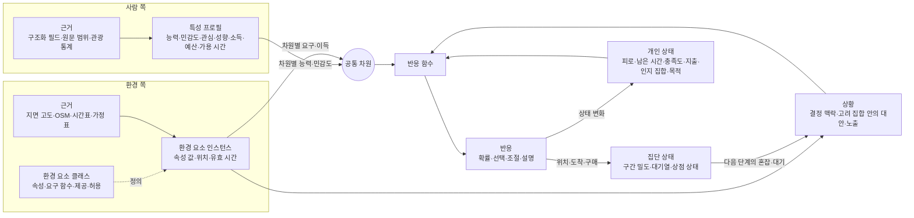
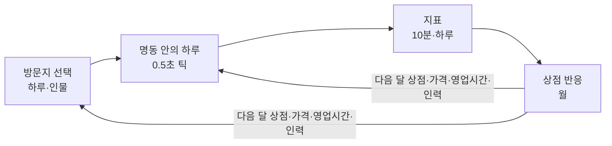

# 페르소나 반응 온톨로지 — 구조 설계 초안

사람의 특성과 외부 변수를 어떻게 정의하고 연결해야 처음 보는 상황에서도 반응이 나오는지를 정한다. 2026-10-31 사용자 요청에 따라 Codex가 제안한 명동 변수 후보 10개(보행자 전용 시간, 보행 폭, 노점, 벤치, 할인율, 영업시간, 임대료 지원, 행사, 배차 간격, 방문 수요)와 사용자가 추가한 6개(외국인 관광객 유입량, 방문객 평균 소득, 경쟁 상권과의 거리, 인건비 조정, 상품 및 서비스 가격, 시계성 및 옥외 광고 자극도), 모두 16개를 이 구조 안에서 다룬다(§7.5).

이 문서는 설계 부속서다. 2026-10-31 사용자가 질문 Q-R1~Q-R10을 추천안대로 확정해 [DR-200~DR-211](decisions.md#dr-200--페르소나-반응-온톨로지의-구조-확정)로 기록했고, 개념 단위 R-01~R-16은 [개념 Map C-201~C-216](01_concept_map.md#페르소나-반응-온톨로지--c-201c-216)으로 옮겼다. 가번호는 그대로 대응한다: R-nn = C-2nn, Q-Rn = DR-20n(Q-R10 = DR-210), SELF 결정 S-R1~S-R30 = DR-211. 개념 단위의 완료 기준과 테스트 접점의 정본은 개념 Map이고, 이 문서는 구조·차원·클래스·결정 맥락·지표의 정의와 근거(§3), SELF 결정(§5), 질문과 결정 경위(§6), 병렬 작업과의 계약(§7)을 담는다. 지표 ID `Y-nn`은 이 문서의 것을 그대로 쓴다. 코드는 아직 없다. 구현은 자료 준비·후처리 Python([02c](02c_reaction_impl_map.md))과 런타임 Rust([02d](02d_rust_engine.md))로 나눈다([DR-214](decisions.md#dr-214--반응-온톨로지의-pythonrust-분담), [DR-215](decisions.md#dr-215--온톨로지-정의-한-벌-공유와-rust-코드-위치)). 틱 시뮬레이션(시야·이동·재생)의 설계는 [01b](01b_frame_simulation.md)에 있다.

## 0. 요약

- 사람 특성과 외부 변수를 서로 직접 잇지 않는다. 둘 다 **공통 차원**(오르막 부하, 낙상 위험, 단차, 보행 거리, 시간, 금전, 혼잡, 차량 위험, 길찾기·언어 부담, 감각 자극, 업종별 관심)에 사상한다.
- 사람 쪽은 차원마다 **능력(편안 상한, 한계)·민감도·관심**을 갖고, 환경 쪽은 차원마다 **요구(또는 이득)**를 낸다.
- 반응은 **하나의 범용 함수**에서 나온다. 결정 맥락(방문지 선택, 행선지, 경로, 휴식, 구매)이 달라도 함수는 같고 대안만 다르다. 회피·구매·오래 머물기·다른 상권으로 가기는 모두 "그 대안의 효용이 다른 대안보다 높아진 결과"다.
- 사람이 평가하는 장소는 이미 아는 곳과 지나가며 알아차린 곳(**고려 집합**)으로 한정한다. 시계성과 옥외 광고는 이 알아차림, 지각된 끌림, 감각 부담을 통해서만 작용한다.
- 인물은 두 집단이다. 서울 거주 내국인(원문 기반)과 외국인 관광객(통계 기반 합성). 프로필 형식과 반응 함수는 같다.
- 인물끼리의 영향(혼잡·대기)은 시간 단계마다 인물들의 위치로 계산해 다음 단계의 요구로 되돌린다. 상점의 반응(임대료·인건비에 따른 가격·영업시간·인력·폐업)은 월 단위의 바깥 고리에서 같은 함수로 계산한다.
- 특성 N개와 변수 M개를 N×M개의 규칙이 아니라 **N+M개의 사상**으로 연결한다. 새 변수 유형은 차원에 대한 요구 함수를 선언하면 모든 인물에게 반응이 생긴다.
- 변수 16개는 세 단계로 들어온다. 1단계(개인 반응): 경사·벤치·할인율·영업시간·배차 간격·소득·경쟁 상권·가격·시계성과 광고, 노점·행사의 끌림, 외국인 관광객의 개인 반응. 2단계(인물 간 상호작용): 보행자 전용 시간·보행 폭·노점·행사의 혼잡, 방문 수요, 외국인 유입의 혼잡. 3단계(상점 반응): 임대료 지원·인건비.
- 같은 구조가 병렬 작업의 계약이 된다. 인물 증강은 인물 쪽 입력(§7.1)을, 역산 엔진은 값의 역할 구분과 실행 규칙(§7.4)을, 명동 유동인구 자료는 비교 기준의 쓰임(§7.6)을 여기서 받는다.

## 1. Codex 진행 상황 검토 (2026-10-31 01:48~02:55 실행 기록 기준)

Codex 실행 기록(`~/.codex/sessions/2026/10/30~31/`)과 현재 Map에서 확인한 내용이다.

| 작업 | 상태 | 이 설계와의 관계 |
|---|---|---|
| 온톨로지 세션(01:50) | 프로젝트를 파악하고 문서를 쓰기 전에 사용자가 중단. **산출물 없음** | 아래 검토 대상 |
| 명동 지면 고도 C-10~C-12 | GEDTM30 v1.2 30m 격자 저장·검증 완료 | 경사의 원자료(R-04) |
| 명동 고도 3D 시각화와 스무딩 C-90~C-92, DR-90~DR-96 | 표준 스무딩 격자를 "최종 지형"으로 저장, 연속 3D 표면 | 스무딩은 경사를 낮춘다(§1.2, [Q-R2](#q-r2--공간과-시설-자료)) |
| 명동 3D 지도 C-93~C-95, DR-97~DR-99·DR-150 | 사용자가 제공한 OSM 기반 건물 713개·도로 347개(`myeongdong_data.json`)와 OSM 원자료(`osm_raw.json`, ODbL)를 지형과 정렬 | 보행망·상점·계단·출구·벤치·숙소의 원자료(§1.3, Q-R2) |
| 명동 인물 증강 C-130~C-133, DR-29~DR-31·DR-130~DR-136 | 514명 → 6.5만 명. 서울 페르소나를 사회통계에 맞춰 고르고 명동 단서를 연결. DR-132에서 이 문서 §7.1 계약대로 출처 열을 정했고 DR-135에서 이 문서의 스냅샷을 보관 | 내국인 쪽 입력(R-02, R-09). 계약은 §7.1 |
| 명동 상권 유동인구 C-140~C-142, DR-140~DR-143, [05](05_myeongdong_traffic.md) | 사용자가 제공한 서울시 상권분석서비스 길단위인구(명동거리, 내국인)를 10분 상대 시간 형태와 6.5만 명 연령 보조 가중치로 정리. DR-143에서 이 문서에 §7.6을 추가(v0.3.1) | 내국인 재실 인원의 비교 기준(R-09, R-12). 외국인은 없음. §7.6 |
| 역산 엔진 C-100~C-105, DR-100~DR-107, [02b](02b_inverse_algorithm.md) | 범용 정방향·역산 엔진 + 명동 어댑터. **DR-107에서 이 문서 v0.2의 §7.4를 어댑터 입력으로 고정(SHA-256 기록)했다. v0.3부터 §7.4가 바뀌어 다시 맞춰야 한다** | 값의 역할 구분과 실행 규칙(R-03·R-05·R-07·R-10). 계약은 §7.4 |
| 명동 변수 16개 | Codex 답변의 10개 + 사용자 추가 6개 | §3.10~§3.17, §7.5 |

### 1.1 온톨로지 세션의 방향 검토

Codex는 모델을 "페르소나의 특성 / 외부 상황 / 판단 규칙 / 행동과 상태 변화"로 나누고, 나이와 회피 사이에 보행 능력·현재 피로·목적지의 중요도·우회로 유무를 두는 안을 검토했다. 사용자의 정정("이건 예시일뿐이고, 이런 특징을 정의해두고 일반화해서 반응하는 걸 원해") 뒤에는 "능력·욕구·선호와 외부 상황의 요구·영향을 공통 개념으로 정의하고 그 조합에서 반응이 나오게 한다"로 정리했다.

- **맞는 점**: 나이를 행동에 직접 잇지 않고 매개 변수를 둔 것, 목적의 중요도와 우회로를 넣어 반응을 대안 사이의 비교로 본 것, 상태 변화를 포함한 것.
- **보완할 점 1 — "판단 규칙" 덩어리**: 판단 규칙을 독립 단위로 두면 사례가 늘 때마다 규칙("60대+급경사→회피")이 쌓인다. 규칙은 하나의 범용 비교 함수여야 하고, 사례별 지식은 규칙이 아니라 **차원 사상**(사람→차원, 변수→차원)에 들어가야 한다.
- **보완할 점 2 — 매개 변수의 어휘**: "보행 능력"처럼 예시마다 매개 변수를 새로 만들면 일반화가 안 된다. 매개 변수는 사람 쪽과 환경 쪽이 **같은 단위로 공유하는 고정 어휘**(공통 차원)여야 한다.
- **보완할 점 3 — 반응의 종류**: 원문에는 회피(대안 선택)뿐 아니라 강도 조절("보폭을 조절하며 천천히")과 감수("숨을 헐떡이면서도")가 함께 나온다(§2). 반응 출력은 선택·조절·상태 변화를 구분해야 한다.

### 1.2 명동 지형 자료의 한계 (이 용도에 한해)

지형 작업 자체는 요청 범위(지면 고도만, 행정동 전체)대로 끝났다. 다만 "급경사 회피"를 재현하는 데는 다음이 부족하다.

1. 30m 격자의 경사는 **지형 경사**이지 **길의 경사**가 아니다. 등고선을 따라 난 길은 지형이 가팔라도 완만하다.
2. 계단이 없다. 계단은 유모차·휠체어에는 통과 불가, 노인에게는 낙상 위험이라 경사와 다른 차원이다(제공된 OSM에는 계단 21개가 있다, §1.3).
3. 지형 자료만으로는 대안 경로가 없다. 회피는 다른 길이 있어야 나온다(제공된 OSM 도로로 보완 가능, §1.3).
4. 두 격자 모두 그대로 쓰기 어렵다. "최종 지형"으로 저장된 스무딩 격자(`data/myeongdong-terrain/final/terrain_smoothed.tif`)는 최고 고도가 193.5m에서 179.6m로, 셀 최대 14.2m 낮아져 경사를 낮춘다(C-91도 이 위험을 적었다). 반대로 원본 격자의 셀 경사(중앙 차분)는 상권 핵심부(제공 OSM 범위)에서도 중앙값 11.3%, 90분위 23.1%로 나왔다. 상가 거리의 경사로 보기에는 높아서 지형 모델의 잡음이 섞였을 가능성이 크다(검증 필요). 셀 경사 대신 보행 구간 양 끝의 고도 차 ÷ 구간 길이로 계산하고, 원본·스무딩 결과를 함께 기록해 비교하는 것을 추천한다([Q-R2](#q-r2--공간과-시설-자료)).
5. 제공된 OSM 범위(위도 37.5595~37.5665, 경도 126.981~126.9895)는 상권 핵심부만 덮는다. 범위 안의 고도는 19.9~62.5m다. 남산 쪽 급경사 지대는 범위 밖이다(경사 계산이 가능한 셀 기준 최고 167.6m, 셀 경사 최대 83.2%). 경사 예시를 남산 쪽에서 재현하려면 보행망 범위를 남쪽으로 넓혀야 한다(Q-R2).

4·5의 수치는 원본 GeoTIFF를 세션 임시 폴더의 `slope_bbox.py`로 계산한 값이다(경사 계산이 가능한 행정동 셀 1,273개).

### 1.3 제공된 OSM 자료로 확인한 것

`data/myeongdong-3d-map/source/osm_raw.json`(OpenStreetMap contributors, ODbL 1.0)과 `myeongdong_data.json`(사용자 제공, DR-97)을 집계했다.

| 항목 | 수 | 이 설계에서의 쓰임 |
|---|---:|---|
| 상점(`shop`) | 375 (의류 100, 화장품 50, 뷰티 45, 편의점 43 …) | 상점 인스턴스, 쇼핑 관심의 하위 범주 |
| 음식·음료(음식점 796, 카페 95, 바 32, 패스트푸드 16) | 939 | 음식점 인스턴스 |
| 상점·음식점 중 층 정보(`level`)가 있는 것 | 63 / 1,313 | 시계성(1층 여부)의 근거가 대부분 없다 → 가정 |
| 상점·음식점 중 영업시간이 있는 것 | 47 / 1,313 | 영업시간 기준값이 대부분 없다 → 업종별 가정 |
| 상점·음식점 중 영어·일본어·중국어 이름이 있는 것 | 252 / 1,313 | 길찾기·언어 부담(D-WAY)의 대리 지표 |
| 제공 도로 347개 중 보도·보행자 전용·계단 | 75 · 34 · 21 | 보행망, D-STEP |
| 지하철 출구 | 20 | 방문 도착 지점 |
| 호텔(+게스트하우스 4, 호스텔 1) | 31 | 외국인 관광객 출발 지점 후보 |
| 벤치 | 13 | 벤치(#4)의 기준값 |
| 환전소·관광 안내소 | 10 · 4 | 외국인 관련 시설 |
| 도로 폭 | 유형별 고정값(3.5·6.5·8·12·18·26m) | 실측이 아니다 → 보행 폭(#2)은 가정 |
| 건물 높이 출처 | 휴리스틱 461, OSM 층수 180, OSM 높이 72 | 시계성 계산에 쓰면 근거 등급을 표시 |
| 옥외 광고 태그(`advertising`) | 0 | 광고 자극도(#16)의 근거가 없다 → 가정·조사 |

## 2. 데이터에서 확인한 것

서술 필드 11개(`professional_persona` 등)를 이어 붙여 단어를 찾은 결과다. **단순 문자열 탐지**라 과거·희망·부정 문장과 다른 뜻(예: '경사(慶事)', 집안의 '북적임')을 포함하는 상한치다. 스크립트는 세션 임시 폴더의 `cue_coverage.py`였고, 서울 전체는 1,600행 배치로 읽어 8초, 최대 메모리 328MB였다.

| 단서 묶음 | 명동 514명 | 서울 185,228명 | 서울 60~69세 | 서울 70세 이상 |
|---|---:|---:|---:|---:|
| 관절·통증(무릎·관절·허리·통증·디스크) | 9.3% | 7.9% | 13.4% | 22.3% |
| 보조기구(지팡이·휠체어·보행기·보청기) | 0.4% | 0.3% | 0.2% | 0.6% |
| 등산(등산·산행·둘레길) | 31.5% | 22.7% | 34.7% | 20.0% |
| 걷기·산책 | 62.6% | 69.7% | 74.9% | 80.7% |
| 경사·계단 직접 언급 | 3.7% | 4.0% | 4.5% | 4.6% |
| 손주 돌봄 | 11.5% | 12.3% | 20.2% | 57.6% |
| 혼잡 단어(붐비·북적·인파·시끄러) | 25.1% | 19.7% | 18.5% | 17.7% |
| 조용함 선호(조용한·한적·고즈넉) | 41.1% | 54.4% | 47.5% | 35.4% |

설계에 주는 함의:

1. **나이만으로는 경사 반응을 정할 수 없다.** 서울 60대의 34.7%(명동 514명 중 60대는 51.1%)가 등산을 언급하고, 13.4%는 관절·통증을 언급한다. 같은 60대 안에서 근거가 반대 방향으로 갈린다.
2. **경사·계단을 직접 말하는 인물은 4%뿐이다.** 대부분은 등산·산책·관절 같은 간접 근거로 오르막 능력을 추정해야 한다. 근거를 차원 값으로 모으는 구조가 필요한 이유다.
3. **원문이 등급이 있는 능력을 직접 말한다.** 예: "가파른 등산길은 힘겨워하며, 동네 어귀의 완만한 언덕을 오르내리며"(75세). 편안한 수준과 한계를 따로 말하므로 능력을 (편안 상한, 한계) 두 값으로 두면 원문을 그대로 옮길 수 있다(S-R2).
4. **세 종류의 반응이 원문에 이미 있다.** 대안 선택("무리한 등산보다는 완만한 경사를 따라 걷는 산책"), 강도 조절("무릎 상태에 맞춰 보폭을 조절하며"), 목적에 의한 감수("가파른 언덕길에서 숨을 헐떡이면서도 … 손주들의 보폭에 맞춰").
5. **필드와 문맥을 구분해야 한다.** `family_persona`의 '북적이는 집안'은 혼잡 선호의 근거가 아니다. 활동 엔진 C-04의 필드·모달리티 처리 방식을 재사용한다.
6. **자극은 끌림만이 아니다.** 조용함 선호 단서가 서울 인물의 54.4%(상한치)에 있다. 옥외 광고 자극(#16)이 일부 인물에게는 부담이 될 수 있다는 근거다(D-SENSE, S-R25).

(인용은 NVIDIA Nemotron-Personas-Korea, CC BY 4.0의 합성 페르소나 원문 일부다.)

## 3. 구조

### 3.1 층과 연결 규칙



| 층 | 내용 | 바뀌는 시점 |
|---|---|---|
| 근거 | 구조화 필드 값, 원문의 필드·문자 범위, 관광·소득 통계, 환경 원자료(고도 셀, 경로 구간, 시설, 시간표, 가정 표) | 원본이 바뀔 때 |
| 특성 프로필 | 인물마다 차원별 능력·민감도, 관심, 성향(주목 성향 포함), 추정 소득·예산, 친숙도, 가용 시간 창, 방문 목적 후보, 출발지 | 근거 사전·규칙 버전이 바뀔 때 |
| 공통 차원 | 단위·집계 규칙·비용 곡선·언어 기준점을 가진 고정 어휘 | 드묾(ASK 수준) |
| 환경 요소 | 클래스(계층·요구 함수)와 인스턴스(값·위치·유효 시간), 경쟁 상권(외부 대안) | 새 변수 유형·새 지역·시나리오 |
| 상황 | 한 시점·한 위치·한 결정 맥락에서 고려 집합 안의 대안과 각 대안의 노출 | 매 결정 시점 |
| 개인 상태 | 피로, 남은 시간, 충족도, 지출 누계, 인지 집합, 동반·장비, 현재 목적과 마감 | 매 반응 후 |
| 집단 상태 | 구간별 밀도, 장소별 대기열(2단계), 상점 영업·가격·영업시간·인력·비용(3단계, 월) | 매 시간 단계, 상점은 매월 |

연결 규칙(스키마로 강제한다, S-R9):

1. 사람 특성은 항상 **어떤 차원에서의** 능력·민감도로만 정의한다. '무릎 통증'은 그 자체로 특성 노드가 아니라 근거이고, 효과는 'D-CLIMB 능력↓, D-FALL 민감도↑' 같은 차원 값의 변화다.
2. 환경 변수는 항상 **어떤 차원에 얼마의 요구(또는 이득)**를 주는가로만 정의한다. '급경사'는 이름이 아니라 보행 구간의 `grade_pct` 값이고, 오르막이면 D-CLIMB에, 내리막이면 D-FALL에 요구를 준다.
3. **금지 간선**: 사람 특성↔환경 변수, 사람 특성→행동, 나이·성별·국적→행동. "60대→회피", "급경사→회피", "할인→구매", "외국인→화장품 구매"는 스키마에서 표현할 수 없다.
4. 환경→행동 간선은 **허용/차단**(엘리베이터는 '수단 전환'을 허용, 벤치는 '앉아 쉬기'를 허용, 계단은 바퀴 이동을 차단)만 있다. 선호 판단은 반응 함수만 한다.
5. 행동은 대안 비교의 결과다. 대안이 하나뿐이면 회피는 없고, 부담은 감수와 상태 악화(피로 증가)로 나타난다.
6. 인물 사이의 영향은 직접 간선이 아니라 **집단 상태**를 거친다. 한 사람의 이동은 다음 시간 단계의 밀도·대기로만 다른 사람의 요구가 된다. 외국인 유입이 내국인의 방문을 줄이는 효과도 이 경로로만 생긴다.
7. 시계성·광고는 사람을 직접 움직이지 않는다. 지나가는 사람의 알아차림(고려 집합에 들어갈 기회), 지각된 끌림, 감각 부하로만 작용한다(S-R25).

### 3.2 공통 차원

차원은 "몸·마음·지갑·일정이 감당해야 하는 것의 종류"다. 각 차원은 **단위, 노출 집계 규칙, 비용 곡선, 한계 유형(경성/연성), 언어 기준점**(원문 표현→값)을 가진다. 집계 규칙을 차원이 소유하므로(S-R3) 새 변수의 조합에서도 결과가 클래스 구현에 좌우되지 않는다. 이득 차원(`A-*`)도 같은 허브로 다룬다.

| ID | 차원 | 요구 단위 | 집계 | 한계 | 환경 쪽 예 (#는 §7.5 변수) | 사람 쪽 근거 예 | 단계 |
|---|---|---|---|---|---|---|---|
| D-CLIMB | 오르막 부하 | 오르막 경사 % | 일정 길이 이상 구간의 최대 | 연성 | 오르막 보행 구간, 계단 오르기 | 나이(기본값), 등산·산책 습관, 무릎·심폐 단서, "가파른 길은 힘겨움" | 1 |
| D-FALL | 균형·낙상 위험 | 위험 지수 0~1 | 최대 | 연성 | 내리막 경사, 젖은·언 노면, 계단 내려가기 | 나이, 관절·보조기구 단서 | 1 |
| D-STEP | 단차 | 단 높이 cm | 최대 | 바퀴는 경성, 보행은 연성 | 계단, 턱 | 유모차·휠체어·캐리어(동반·장비 상태) | 1 |
| D-WALK | 보행 거리 | m | 합 | 연성 | 경로 길이. 휴식 시설(#4)은 피로 회복으로 작용 | 걷기 습관, 현재 피로 | 1 |
| D-TIME | 시간 | 분 | 합 | 마감·가용 시간 창 끝은 경성 | 우회·감속의 추가 시간, 배차 대기(#9), 경쟁 상권 접근 시간(#13), 줄 대기(2단계) | 목적의 마감, 가용 시간 창, 시간 엄수 성향 | 1 |
| D-MONEY | 금전 | 원 | 합 | 예산은 경성 | 가격(#15) × (1 − 할인율(#5)), 노점(#3), 교통 요금 | 추정 소득에서 만든 예산·가격 민감도(R-15, #12), 절약 단서 | 1 |
| D-WAY | 길찾기·언어 부담 | 난이도 지수 0~1 | 최대 | 연성 | 복잡한 골목·지하 연결, 외국어 표기가 없는 표지·상호, 처음 가는 곳 | 친숙도(내국인: 명동 단서·거주 구, 외국인: 한국어 능력·방문 횟수) | 1 |
| D-SENSE | 감각 자극 부하 | 자극 지수 0~1 | 노출 시간 가중 평균 | 연성 | 옥외 광고 자극도(#16), 행사 음향(#8), 혼잡 소음 | 조용함 선호·소음 민감 단서(서울 54.4%, 상한치), 나이 | 1 |
| D-CROWD | 혼잡 | 인/㎡ | 노출 시간 가중 평균 | 연성 | 구간 밀도. 1단계는 시간대별 외생 값, 2단계는 인물 위치로 계산(#1·#2·#3·#8·#10·#11) | "북적이는 유명 관광지 대신 … 한적한 곳", "명동 거리의 인파 속에서" | 1·2 |
| D-SAFE | 차량 혼재 위험 | 위험 지수 0~1 | 최대 | 연성 | 차량이 다니는 시간대의 보행 구간(#1) | 나이, 안전·조심 단서, 동반 아동 | 2 |
| D-HEAT | 온열 | 체감온도 ℃ | 최대 | 연성 | 폭염·한파(외생) | 더위·추위 단서, 나이 | 선택 |
| A-FOOD·A-BEAUTY·A-FASHION·A-SOUVENIR·A-CULTURE·A-FAITH·A-NATURE | 업종별 관심(이득) | 제공 강도 0~1 | 합, 충족도만큼 감소(S-R21) | — | 음식점·노점(#3), 상점(#5·#6·#15), 행사(#8), 성당, 전망. 쇼핑 하위 범주는 OSM 업종(의류·화장품·뷰티 등)에 맞춘다 | 음식·쇼핑·예술·종교·자연 단서, 관광객은 통계의 쇼핑 품목 | 1 |

언어 기준점의 예: D-CLIMB의 '완만한' = a%, '가파른' = b%. a·b와 다른 계수의 출처는 [Q-R3](#q-r3--수치의-출처와-재현의-기준)에서 정한다.

### 3.3 사람 특성 정의

인물은 두 집단이다. 내국인은 원문과 구조화 필드에서(R-02), 외국인 관광객은 통계에서(R-13) 같은 형식의 프로필을 만든다(S-R27).

| 종류 | 뜻 | 형식 | 근거 예 → 값 |
|---|---|---|---|
| 능력 | 차원별로 편하게 감당하는 상한과 넘으면 안 되는 한계 | (편안 상한, 한계, 불확실성), 차원 단위 | "완만한 언덕은 오르내림, 가파른 등산길은 힘겨움" → D-CLIMB (완만, 가파름) |
| 민감도 | 같은 부담을 얼마나 싫어하는가 | w ≥ 0 | "북적이는 유명 관광지 대신 … 한적한 곳" → D-CROWD w↑, 조용함 선호 → D-SENSE w↑ |
| 관심 | 업종별 이득 차원에 끌리는 정도 | a ≥ 0 | "명동의 북적이는 거리 음식을 구경" → A-FOOD a↑, D-CROWD w↓ |
| 추정 소득·예산·가격 민감도 | 소득과 한 번 방문의 지출 한계, 가격을 싫어하는 정도 | 소득(원), D-MONEY의 (편안 상한, 한계)와 w | 원본에 소득이 없다. 직업·연령·교육·성별로 추정(R-15, `statistics` 또는 `assumption`), 절약·가성비 단서로 조정 |
| 친숙도 | 길찾기·언어 부담을 감당하는 능력 | D-WAY의 (편안 상한, 한계) | 내국인: 명동 단서가 있거나 거주 구가 가까우면 ↑. 외국인: 한국어 능력·방문 횟수(통계) |
| 성향 | 선택 방식 전반 | 무리 감수 정도, 시간 엄수, 탐색, 주목 성향, 선택 무작위성 τ | "무리하지 않는 선에서" → 무리 감수↓, "고집스러운 면모" → 무리 감수↑, 구경·새 가게 찾기 단서 → 주목·탐색↑ |
| 가용 시간 창 | 명동에 있을 수 있는 시간대 | 하루 유형별 [시작, 끝) 목록 | 내국인: 고용·연령·현역·자녀로 [DR-19](decisions.md#dr-19--기본-일과-템플릿) 기본 일과 템플릿 선택(S-R18). 외국인: 여행 일정 |
| 방문 목적 후보 | 방문 결정에서 목적의 종류와 가치 | 목적 유형 + 가치 + 근거 | 내국인: 증강의 명동 단서(§7.1)와 관심. 외국인: 통계의 여행 목적·활동 |
| 출발지 | 접근 시간 계산 | 거주 구 또는 숙소 | `district`, 관광객은 숙소·도착 역 |
| 기본 동반·장비 | 상황별 상태의 기본값 | 여부 또는 확률 | 손주 돌봄 → 손주 동반 가능, 영유아 자녀 → 유모차 가능, 관광객의 이동일 → 캐리어 |
| 근거 | 위 값마다의 출처 | 필드·문자 범위·통계 표·규칙 ID·출처 라벨(`structured`/`text`/`statistics`/`assumption`) | `sports_persona`[a:b], `text` |

- 능력과 민감도는 다르다. 체력이 좋은 사람도 혼잡을 싫어할 수 있다.
- 값은 **구조화 필드 기본값 → 원문 근거로 조정** 순서로 만든다. 우선순위는 원문 현재형의 등급 표현 > 원문 현재형 습관 > 구조화 필드 기본값 > 가정이다(S-R5). '가파른 등산길은 힘겨워하며'에 '등산'이 들어 있어도 등급 표현이 습관 단어보다 우선한다.
- 나이·성별·국적은 기본값 분포의 입력일 뿐 반응 함수에 나오지 않는다(S-R11, S-R27). 나이로 질병을, 국적으로 취향을 사실처럼 만들어 넣지 않는다.

### 3.4 환경 변수 정의

클래스는 **요구를 계산하는 방식이 다를 때만** 만든다(S-R4). 크기 차이는 속성 값이다. '급경사'는 클래스가 아니라 보행 구간의 `grade_pct`가 큰 인스턴스다. 하위 클래스는 재정의하지 않은 함수를 상위에서 물려받는다. 속성마다 역산 엔진이 쓰는 **역할**을 표시한다: `u`(조절 가능한 제어), `w`(조절 불가능한 외생 조건), `x`(규칙이 바꾸는 상태). 가격·영업시간·처리 용량처럼 사용자가 정할 수도 있고 상점이 정할 수도 있는 속성은 **모형 구성마다** u 또는 x 중 하나로 선언한다(S-R29). 형식은 연속·정수·범주·일정(시각 구간 목록) 중 하나다. 변경량 척도와 가중치는 온톨로지에 두지 않고 역산 요청이 준다([DR-104](decisions.md#dr-104--도메인별-수치는-명시적-실행-입력으로-분리), S-R16).

```
환경 요소
├─ 보행 구간         grade_pct, length_m, surface(w), effective_width_m(u, #2), vehicle_hours(u, #1), ad_intensity(u, #16)
│   │                요구: D-CLIMB·D-FALL·D-WALK, 차량 통행 시간에는 D-SAFE와 유효 면적 감소, 광고는 D-SENSE
│   └─ 계단           steps, riser_cm, direction — 요구: D-STEP·D-CLIMB(오를 때)·D-FALL(내려갈 때)
├─ 수직 이동 설비     엘리베이터·에스컬레이터 — 허용: 수단 전환, 요구: D-TIME(대기)
├─ 휴식 시설(#4)      seats(u) — 허용: 앉아 쉬기(피로 회복률이 서서 쉬기보다 큼)
├─ 장소
│   ├─ 상점           category, price_level_krw(#15), discount_pct(u, #5), open_hours(#6), visibility(u, #16), service_rate
│   │                 제공: A-<업종>, 요구: D-MONEY·D-WAY(외국어 표기 여부), 줄 대기(2단계)
│   ├─ 음식점         상점과 같은 형식 — 제공: A-FOOD
│   ├─ 노점(#3)       count(u), footprint_m2, 놓인 구간 — 제공: A-FOOD·A-SOUVENIR, 그 구간의 유효 면적 감소
│   ├─ 행사(#8)       schedule(u), category, capacity — 제공: A-CULTURE, 행사 시간 집객과 D-SENSE
│   ├─ 숙박           위치 — 외국인 관광객의 출발·귀환 지점
│   └─ 성당·전망 등    — 제공: A-FAITH·A-NATURE
├─ 교통 접근(#9)      역·출구 위치, headway_min(u, 시간대별), fare — 요구: D-TIME(배차 대기)·D-MONEY
├─ 경쟁 상권(#13)     외부 대안. access_min(w, 출발지별), 업종별 매력, 가격 수준, 혼잡 수준 — 내부는 시뮬레이션하지 않음(S-R24)
├─ 노면 상태·기상     (w) — D-FALL·D-HEAT
└─ 시나리오 입력      demand_multiplier(w, #10), foreign_inflow_multiplier(w, #11), income_multiplier(w, #12), 하루 유형(평일·주말·행사일)
```

상점의 재무(임대료와 지원율 #7, 인건비 지수 #14, 인력)는 방문객이 겪는 환경이 아니라 상점 행위자의 속성이다(§3.12).

정의 형식의 예(값과 함수 이름은 형식 설명용):

```yaml
- class: 보행구간
  attributes:
    grade_pct:         {type: continuous, unit: "%", valid_range: [-40, 40], role: u}  # 경사로 공사로 바꿀 수 있다
    length_m:          {type: continuous, unit: m,   valid_range: [0, 2000], role: w}
    effective_width_m: {type: continuous, unit: m,   valid_range: [0.5, 30], role: u}  # 변수 2
    vehicle_hours:     {type: schedule,   unit: "시각 구간", role: u}                  # 변수 1
    ad_intensity:      {type: continuous, unit: "0~1", valid_range: [0, 1], role: u}  # 변수 16
    surface:           {type: categorical, values: [dry, wet, ice], role: w}           # 기상이 정한다
  press:
    D-CLIMB: max(grade_pct, 0)
    D-FALL:  fall_risk(max(-grade_pct, 0), surface)
    D-WALK:  length_m
    D-SAFE:  vehicle_risk(vehicle_hours, t)
    D-SENSE: ad_intensity
  derived:
    effective_area_m2: length_m * effective_width_m - 노점_점유(구간) - 차로_몫(vehicle_hours, t)  # 2단계 밀도 계산의 분모
  affords: [PROCEED, PACE]

- class: 상점
  parent: 장소
  attributes:
    category:        {type: categorical, values: [의류, 화장품, 뷰티, 편의점, 기념품, …], role: w}
    price_level_krw: {type: continuous, unit: 원, valid_range: [0, 10000000], role: "u 또는 x (모형 구성)"}  # 변수 15
    discount_pct:    {type: continuous, unit: "%", valid_range: [0, 90], role: u}                         # 변수 5
    open_hours:      {type: schedule, role: "u 또는 x (모형 구성)"}                                        # 변수 6
    visibility:      {type: continuous, unit: "0~1", valid_range: [0, 1], role: u}                        # 변수 16
    service_rate:    {type: continuous, unit: "인/분", valid_range: [0, 100], role: "u 또는 x (모형 구성)"}
  offers:
    A-<category>: base_offer(category)
  press:
    D-MONEY: price_level_krw * (1 - discount_pct / 100)
    D-WAY:   language_burden(외국어 표기 여부)
  awareness:
    notice_prob: notice(visibility, 구간 ad_intensity, 통행자 주목 성향, 구간 밀도)  # R-14
```

인스턴스는 속성 값, 위치(구간 ID), **유효 시간**(14~16시 비, 영업시간, 행사 일정, 시간대별 배차)을 가진다. 그래서 같은 장소도 시각에 따라 다른 요구와 이득을 낸다.

### 3.5 상황, 결정 맥락, 대안

- 상황 = {시각, 위치, 결정 맥락, 목적(가치·마감), 대안 목록}.
- 대안 = {행동 유형, 노출 목록[(인스턴스, 노출량)], 추가 시간, 추가 비용, 목적 달성 확률}.
- 모든 결정 맥락이 §3.6의 같은 함수를 쓴다. 맥락이 정하는 것은 **대안 목록과 노출뿐**이다(S-R13).

| 맥락 | 언제 묻나 | 대안 | 주로 쓰는 차원 | 반영 변수 |
|---|---|---|---|---|
| 방문지 선택 VISIT | 하루 유형마다 가용 시간 창 안에서 | 명동의 시간 슬롯 × 수단(지하철·버스·택시·도보), 경쟁 상권(외부 대안), 오늘 안 감 | 기대 이득(A-*), D-TIME(접근·배차 대기), D-MONEY(요금·기대 가격), 기대 부담(D-WALK·D-CROWD·D-WAY, 휴식 시설 반영) | #4·#5·#6·#8·#9·#10·#11·#12·#13·#15 |
| 행선지 NEXT | 활동이 끝날 때 | 고려 집합 안의 장소(상점·음식점·노점·행사·휴식 시설), 떠나기 | A-*(충족도 반영), 이동 부담, D-TIME(대기), D-WAY, 남은 가용 시간 | #3·#5·#6·#8·#15·#16 |
| 경로 ROUTE | 이동 시작·분기점 | 경로 후보 k개, 감속·휴식, 수단 전환 | D-CLIMB·D-FALL·D-STEP·D-WALK·D-CROWD·D-SAFE·D-SENSE·D-WAY·D-TIME | #1·#2·#3·#16, 경사 |
| 휴식 REST | 피로가 편안 상한 근처이거나 휴식 시설 앞 | 앉아 쉬기(벤치), 카페(유료), 계속, 떠나기 | 피로 회복, D-MONEY, D-TIME | #4 |
| 구매 PURCHASE | 상점·음식점·노점에 들렀을 때 | 금액대별 구매, 구매 안 함 | A-*, D-MONEY(가격 × (1 − 할인율), 소득 기반 예산 한계), D-TIME(대기) | #3·#5·#12·#15 |

- 행선지 대안은 **고려 집합 안에서만** 만든다(R-14, S-R26). 시계성과 광고는 이 집합에 들어가는 기회를 바꾼다.
- 행동 유형은 맥락별 닫힌 어휘다. 경로: 진행(PROCEED), 우회(DETOUR), 감속·휴식(PACE), 수단 전환(SWITCH_MODE), 연기(DEFER), 포기(ABANDON), 목적지 변경(RETARGET). 방문지 선택: 명동 방문(VISIT_NOW, 시간 슬롯·수단), 경쟁 상권으로(GO_ELSEWHERE, 상권), 나중에(VISIT_LATER), 안 감(SKIP). 행선지: 장소로 가기(GO_TO), 떠나기(LEAVE). 휴식: 앉아 쉬기(REST_SEAT), 유료 휴식(REST_PAID), 계속(CONTINUE). 구매: 구매(BUY, 금액대), 구매 안 함(NO_BUY). 2026-10-31 틱 시뮬레이션이 행선지에 관람(WATCH)과 둘러보며 찾기(EXPLORE, 02d S-E25, [02c](02c_reaction_impl_map.md) U-9 사용자 승인, [DR-233](decisions.md#dr-233--반응-온톨로지-구현체-map의-사용자-확인-항목-확정))를, 시선 맥락 LOOK(앞길 PATH·발밑 FOOTING·대상 LOOK_AT, 01b §3.4(6))을 더했다. 정의 파일은 `ontology/v1/contexts.yaml`이다.
- 진행·감속·연기·포기, 떠나기, 구매 안 함, 안 감은 항상 포함한다. 우회는 공간 자료가 있을 때 경로 후보 k개, 수단 전환은 환경이 허용할 때만, 경쟁 상권은 정해진 목록 전체가 들어간다(S-R6, S-R24). 대안 생성은 개인 선호로 대안을 미리 거르지 않는다.

### 3.6 반응 함수

모든 인물·모든 결정 맥락에 같은 함수를 쓴다. 함수 안에는 차원 ID 외의 사람·환경 개념 이름이 나오지 않는다.

```
react(프로필, 상태, 상황, 난수 키) → 반응{대안별 확률, 선택, 조절값, 상태 변화량, 설명}

1. 대안 o마다 차원별 요구 P_d(o) = 차원 d의 집계 규칙으로 노출을 모은 값
2. 유효 능력: 상태가 편안 상한 c_d와 한계 l_d를 바꾼다 (피로 → CLIMB·WALK↓, 유모차·캐리어 → STEP 한계 0, 지출 누계 → 남은 예산)
3. 부담 위치 x_d = (P_d − c_d) / (l_d − c_d)
     x ≤ 0 편안 구간, 0 < x < 1 감당 구간, x ≥ 1 한계 초과
4. 차원 비용 cost_d = w_d · φ(x_d)   φ: 0 이하에서 0, 감당 구간에서 볼록하게 증가
     한계 초과: 경성 차원(단차의 바퀴, 예산, 마감)은 대안 불가, 연성 차원은 큰 비용 + 상태 피해(무리 감수 성향이 크기를 조절)
5. 효용 U(o) = 목적 가치 · 달성 확률 + Σ 관심 a_k · (1 − 충족도_k) · 제공_k − Σ cost_d − λ_시간(상태, 마감) · Δt − λ_돈 · Δ원
6. 불가 대안 제거 → P(o) = softmax(U / τ) → 난수 키로 하나를 고른다
7. 선택 대안 안의 조절: 보행 속도 = 기준 속도 · g(x_CLIMB, x_FALL) · v(밀도), 휴식 횟수
8. 상태 갱신: 피로 += 부하, 남은 시간 −= Δt, 충족도·지출 누계 갱신, 목적 진행
9. 설명: 선택과 차선의 효용 차이에 가장 크게 기여한 항 상위 3개와 각 항의 근거 사슬
```

x는 사람마다의 편안~한계 구간으로 요구를 정규화한 값이라, 서로 다른 사람·변수 사이에서 같은 뜻을 갖는다. 이 방식은 환경의 압력과 개인의 역량이 맞을 때 적응하고 넘치면 부적응한다는 Lawton의 압력-역량 모델, 계단을 오를 수 있는지가 단 높이 자체가 아니라 다리 길이에 대한 비율로 정해진다는 Warren의 신체 척도 연구, 그리고 이산 선택 모형(다항 로짓)을 합친 것이다(§8). 대안 목록은 R-04가 고려 집합 안에서 만들고 광고의 끌림·자극은 노출로 들어오므로, 반응 함수는 시계성·광고를 따로 알 필요가 없다.

### 3.7 예시 — 같은 함수, 다른 반응

> 아래 값과 결과 방향은 **설명용 가정**이다. 보정되지 않았다.

상황(가상): 명동 안 출발점에서 남산 쪽 목적지로 간다. 대안은 ① 진행: 오르막 12%, 180m, 4분 ② 우회: 최대 5%, 320m, 7분 ③ 감속·휴식: ①을 쉬며 7분 ④ 택시: 3분, 요금 ⑤ 연기·포기.

| 인물 | 근거 → 특성 | 상태·목적 | 예상 반응과 지배적 항 |
|---|---|---|---|
| 갑, 75세 | "가파른 등산길은 힘겨워하며 완만한 언덕은 오르내림" → D-CLIMB (완만, 가파름) | 여유 있음 | ② 우회. 12%가 감당 구간 끝 근처라 오르막 비용이 우회의 시간 비용(+3분)보다 크다 |
| 을, 63세 | 주말마다 등산한다는 원문(가상) → D-CLIMB 구간이 높음 | 여유 있음 | ① 진행. 12%가 편안 구간이라 비용이 거의 없다 |
| 병, 34세 | 영유아 자녀 → 유모차 동반 | ①의 중간에 계단이 있다고 바꾼 상황 | ① 불가(D-STEP 경성 한계) → ② 또는 ④ |
| 정 = 갑 | 갑과 같은 프로필 | 손주와 약속, 남은 시간 4분 | ③ 감속하며 진행 또는 ④ 택시. 시간 비용이 커져 우회가 불리해진다(원문의 "헐떡이면서도 손주 보폭에 맞춰"와 같은 감수) |

갑과 을은 둘 다 60세 이상이지만 근거 때문에 갈리고, 갑과 정은 같은 사람이지만 상태와 목적 때문에 갈린다. 어느 규칙에도 나이나 '급경사'라는 이름이 없다.

변수를 바꿨을 때 같은 함수로 나오는 방향(설명용):

| 변수 변화 | 누구에게 크게 | 작동 경로 | 예상 방향 |
|---|---|---|---|
| 벤치 0 → 20개(#4) | 지구력이 낮은 인물(갑) | 앉아 쉬기 대안이 생겨 피로가 회복 → 떠나기 효용↓. 방문 결정의 기대 부담↓ | 체류 시간↑, 70세 이상 방문 비중↑ |
| 할인율 0 → 20%(#5) | 가격 민감도가 높고 쇼핑 관심이 있는 인물 | 구매 대안의 D-MONEY 비용↓, 행선지·방문의 기대 이득↑ | 매장 방문·구매 여부↑. 인당 소비액은 늘거나 줄 수 있다 |
| 배차 간격 120%(#9) | 거주 구가 멀고 시간 여유가 적은 인물 | 방문 대안의 D-TIME↑ | 방문 연기·포기↑, 해당 시간대 유입↓ |
| 노점 120%(#3) | 혼잡 민감도가 높은 인물 / 길거리 음식 관심이 높은 인물 | 구간 유효 면적↓ → 밀도↑(2단계) / A-FOOD 제공↑ | 앞 인물은 그 구간 회피↑, 뒤 인물은 노점 소비↑ |
| 외국인 유입 150%(#11) | 혼잡 민감도가 높은 내국인 | 외국인 개체가 늘어 구간 밀도↑(2단계) | 내국인의 혼잡 시간대 방문↓(밀어내기), 뷰티·기념품 매출↑ |
| 옥외 광고 자극도 높음(#16) | 주목 성향이 큰 인물 / 조용함을 선호하는 인물 | 알아차림↑·지각된 끌림↑ / D-SENSE 부하↑ | 앞 인물은 그 상점 방문↑, 뒤 인물은 그 구간 회피·체류↓ |
| 경쟁 상권 접근 시간 −20%(#13) | 그 상권 가까이 사는 인물 | 방문지 선택에서 경쟁 상권 대안의 D-TIME↓ | 명동 선택 비율(상권 점유율)↓ |
| 인건비 110%(#14, 3단계) | 상점 | 비용 부담↑ → 가격 인상·영업시간 단축·인력 축소·폐업 중 선택 | 다음 달 가격↑ 또는 대기 시간↑, 폐업 확률↑ |

### 3.8 일반화되는 범위

| 새로 들어오는 것 | 필요한 작업 | 코드 변경 |
|---|---|---|
| 알려진 변수의 새 값(경사 12% → 18%, 할인 10% → 30%) | 없음. 연속 함수 | 없음 |
| 알려진 변수의 새 조합(비 + 인파 + 오르막 + 짐) | 없음. 차원별 집계 후 합산 | 없음 |
| 새 변수 유형(공사 펜스, 시위, 폭염 경보) | 클래스 1개 선언(상위·속성·역할·요구 함수, 상속 시 일부만) | 없음 |
| 새 사람 단서(깁스, 임신, 반려견 동반) | 근거 사전 항목 1개(패턴 → 차원·방향·크기) | 없음 |
| 새 외부 대안(경쟁 상권 추가) | 요약 대안 인스턴스 1개 | 없음 |
| 새 인물 집단(외국인 관광객, 출장자) | 프로필 생성기 추가, 형식·반응 함수는 그대로(R-13) | 있음(생성기) |
| 새 행동 유형(실내로 피신, 줄 서기 포기) | 행동 어휘와 대안 생성 규칙 추가 | 있음(드묾) |
| 새 결정 맥락(예약, 재방문) | 맥락의 대안 생성 규칙 추가, 반응 함수는 그대로 | 있음(드묾) |
| 새 행위자 유형(상점, 노점상) | 행위자별 차원·행동 어휘 추가, 반응 함수는 그대로(§3.12) | 있음(드묾) |
| 새 차원(냄새, 종교적 금기) | 차원 정의와 양쪽 사상 | 있음(ASK 수준) |

한계: 이 구조는 **차원 어휘 안에서** 일반화한다. 어휘에 없는 관심사(예: 냄새)는 차원을 추가하기 전에는 반응에 나오지 않는다.

### 3.9 동적 반응과 시간 척도

- 상태가 함수의 입력이므로, 같은 사람·같은 길이라도 두 시간 걸은 뒤에는 피로가 능력을 낮춰 다르게 반응한다. 한 끼를 먹은 뒤에는 A-FOOD 충족도가 올라 음식점의 끌림이 줄어든다. 한 번 알아차린 상점은 인지 집합에 남는다.
- 재평가 시점: 분기점에 들어설 때, 활동이 끝날 때, 환경이 바뀔 때(비 시작, 영업 종료, 행사 시작), 상태가 임계를 넘을 때(피로가 편안 상한 근처).
- 시간 척도는 넷이다(~~S-R15~~ [DR-220](decisions.md#dr-220--틱-시뮬레이션의-시간-해상도와-규모), S-R17).

| 척도 | 무엇이 일어나나 | 출력 |
|---|---|---|
| ~~60초 단계~~ 0.5초 틱(DR-220) | 이동, 알아차림(시야 안 틱 위험률, DR-221), 경로·휴식·구매 결정, 밀도·대기 갱신(2단계) | 내부 상태 |
| 10분 프레임 | 프레임 집계([DR-08](decisions.md#dr-08--시뮬레이션-프레임-간격)과 같은 간격) | 10분 단위 지표 |
| 하루 | 방문지 선택(경쟁 상권 포함), 관광객의 하루 일정, 하루 유형(평일·주말·행사일) | 일 단위 지표 |
| 월 | 상점 반응(임대료·인건비), 행사 횟수 집계 | 월 단위 지표 |



- 활동 엔진(C-05·C-06)과 연결하면 엔진이 목적·시각·출발·도착을 주고, 이 함수가 이동 안의 미시 반응을 만들어 소요 시간·포기 여부·도착 시 상태를 돌려준다. 엔진은 구 단위 10분 프레임이라 경사 같은 미시 변수는 결과(시간·포기)로만 전달된다. 연결 시기는 [Q-R1](#q-r1--첫-적용-범위와-단계).

### 3.10 집단 상호작용 — 혼잡과 대기

보행자 전용 시간(#1), 보행 폭(#2), 노점(#3), 행사(#8), 방문 수요(#10), 외국인 유입(#11)은 여러 사람이 같은 공간을 나눠 쓰면서 생기는 효과라 개인 반응만으로는 나오지 않는다. 2단계에서 ~~60초마다~~ 틱(0.5초, DR-220)마다 다음을 계산한다.

1. 구간 유효 면적 = 길이 × 유효 폭(#2) − 노점 점유 면적(#3) − 차량 통행 시간대의 차로 몫(#1).
2. 구간 밀도 ρ(t) = 구간 위 ~~인원의 가중치 합~~ 몸의 수(t) ÷ 유효 면적. ~~인원 가중치에는 방문 수요 배율(#10)과 외국인 유입 배율(#11)이 곱해져 있다(S-R23).~~ 방문 수요 배율(#10)과 외국인 유입 배율(#11)은 몸의 수를 바꾼다(1몸 = 1사람, [DR-220](decisions.md#dr-220--틱-시뮬레이션의-시간-해상도와-규모) ③).
3. 보행 속도 = 개인 기준 속도 × 경사 조정 × 밀도 조정 v(ρ). 밀도-속도 관계의 계수는 [Q-R3](#q-r3--수치의-출처와-재현의-기준)에서 정한다(후보: Weidmann 1993).
4. 장소 대기: 대기열(t+1) = 대기열(t) + 도착(t) − 처리 용량 × ~~1분~~ 틱 길이 Δt, 예상 대기 시간 = 대기열 ÷ 처리 용량. 처리 용량은 상점의 인력(3단계에서는 인건비에 따른 상점의 결정)에서 온다.
5. 결정은 t의 밀도·대기 중 그 에이전트가 본 값([DR-221](decisions.md#dr-221--시야가-알아차림과-관찰을-정한다) ②, 신선도 기한이 지나면 시간대 사전 기대)을 읽고, 이동과 도착의 결과가 t+1의 밀도·대기를 만든다. 같은 단계 안의 순환은 없다. 역산 엔진의 동시 갱신 계약([02b §2](02b_inverse_algorithm.md#2-그래프를-실행할-수-있게-만드는-계약))과 같다(S-R14).

- D-CROWD 요구는 지나갈 구간들의 ρ(t)를 노출 시간으로 가중한 값이고, D-TIME에는 예상 대기 시간이 더해진다.
- 외국인 개체도 같은 밀도 계산에 들어가므로, 외국인 유입의 혼잡 효과와 혼잡에 민감한 내국인의 회피(밀어내기)가 따로 규칙 없이 나온다.
- 행사(#8)는 행사 시간에 집객(A-CULTURE 제공)과 수용 한도를 갖는다. 행사가 끝나면 참가자들이 행선지 결정을 하므로 주변 상권 이용이 따로 규칙 없이 나온다.
- 1단계에서는 D-CROWD를 시간대별 외생 값으로 주고(인물 사이 영향 없음), 2단계에서 위 계산으로 바꾼다.
- ~~인물 한 명이 대표하는 실제 인원(기본 가중치)은~~ 몸 하나는 한 사람이고(DR-220 ③), 시뮬레이션 인원과 실제 방문 규모의 비율(대표 비율)은 실제 방문 규모 자료가 있어야 정할 수 있다(Q-R3). 없으면 가정이며 그때 혼잡 지표의 절대값은 해석하지 않고 시나리오 사이의 상대 비교로만 쓴다.

### 3.11 방문 생성, 방문지 선택과 접근

- 대상 인구: 내국인은 명동 원본 514명(검증용) → 증강 6.5만 명(§7.1), 외국인 관광객은 R-13의 합성 집단.
- 하루 유형(평일·주말·행사일)별로 인물마다 가용 시간 창(S-R18) 안에서 방문지 선택(VISIT)을 한다. 대안은 명동의 시간 슬롯 × 수단, 경쟁 상권 외부 대안(R-16), "오늘 안 감"이다.
- 접근 시간 = 출발지→명동 기본 이동 시간(내국인은 [DR-13](decisions.md#dr-13--장소-해석과-지리-상수)의 구 인접 홉 설계 상수, 관광객은 숙소 위치, `assumed`) + 배차 대기(배차 간격 ÷ 2, #9) + 출구에서 첫 목적지까지 보행(S-R19). 경쟁 상권의 접근 시간도 같은 방식이다(#13).
- 기대 이득과 부담: 목적 후보에 대한 그 시각의 제공(영업시간 #6, 할인 #5, 가격 #15, 행사 #8)과 기대 보행 부담(휴식 시설 #4 반영), 기대 혼잡(1단계는 외생 값, 2단계는 직전 반복의 결과), 길찾기 부담(D-WAY)으로 계산한다. 그래서 벤치가 늘면 지구력이 낮은 인물의 방문 확률이, 경쟁 상권이 가까워지면 그 근처 인물의 이탈 확률이 함께 바뀐다.
- 명동을 고른 인물은 그 출구(관광객은 숙소)에서 개체가 생기고, 떠나기를 고르면 출구로 이동한 뒤 사라진다. 범위는 명동 행정동 경계(C-10)다. 개체 생성·소멸은 규칙으로만 일어나고 기록된다.
- 방문 수요(#10)와 외국인 유입(#11)은 외생 값이다. ~~인물 가중치(대표 인원)에 곱하므로~~ 몸의 수를 바꾸므로(필요한 몸이 인물 수를 넘으면 인물 복제, DR-220 ③) 개인의 선택 확률은 그대로이고 도착 인원·밀도·대기만 비례해 바뀐다(~~S-R23~~ DR-220).
- 명동 유동인구 자료(05)는 입력 도착률로 쓰지 않고, 시뮬레이션된 내국인 재실 인원과 비교하는 기준으로만 쓴다(§7.6).

### 3.12 상점 행위자 — 공급 쪽 반응

상인 임대료 지원율(#7)과 인건비(#14)는 방문객의 반응이 아니라 상점의 비용을 바꾸고, 상점은 가격·영업시간·인력·업종·폐업으로 반응한다. 같은 구조로 행위자 유형을 하나 더 둔다.

- 상점의 능력: 재무 여력(비용 부담의 편안 상한·한계).
- 상점의 차원: 비용 부담((임대료 × (1 − 지원율) + 인건비 지수 × 인력 × 기준 임금) ÷ 매출), 수요 부족(손님 수 ÷ 손익분기 손님 수).
- 대안: 유지, 가격 조정, 영업시간 조정, 인력 조정(처리 용량), 업종 전환, 폐업. 같은 반응 함수(§3.6)로 고른다.
- 결정 주체: 한 모형 구성에서 같은 속성은 사용자 제어(u)와 상점 결정(x) 중 하나다(S-R29). "정책 실험" 구성에서는 가격·영업시간을 사용자가 정하고 상점은 유지·인력·업종·폐업만 정한다. "상점 적응" 구성에서는 상점이 가격·영업시간까지 정한다. 기본 구성은 [Q-R7](#q-r7--상점공급-쪽-반응의-범위와-결정-주체).
- 주기: 월 단위 바깥 고리다. 한 달의 매출 = 하루 유형별 시뮬레이션의 상점 매출 × 그 달의 해당 일수(S-R17). 상점의 반응이 다음 달 환경(영업 상점, 가격, 영업시간, 처리 용량, 업종 구성)을 바꾼다.
- 역산 엔진에서 월 단계의 전이는 "그 달의 하루 시뮬레이션들"을 포함하는 원자적 규칙이다(02b §2의 원자적 규칙 조건).
- 상점 자료는 사용자가 나중에 제공한다(DR-212). 자료에 재무 항목이 없으면 수치는 가정이고 결과는 방향 비교로만 해석한다.

### 3.13 지표

Codex 표의 "살펴볼 변화"와 변수 11~16에 대해 제안한 관찰 항목을 버전이 붙은 집계 함수로 정의한다. 역산 엔진은 이 목록에서 핵심 지표를 고르고, 목표값·허용오차·기간은 요청이 준다(DR-104). 한 결정의 대안별 확률은 정확한 기댓값으로, 여러 단계에 걸친 지표는 공통 난수로 R회 반복한 평균과 표준오차로 낸다(S-R20). 내국인·외국인을 나눠 낼 수 있다.

| ID | 지표 | 정의 | 단위 | 계산 단위 | 단계 | 관련 변수 |
|---|---|---|---|---|---|---|
| Y-01 | 거리별 혼잡도 | 구간 × 10분 평균 밀도와 보행 서비스 수준 등급 | 인/㎡ | R-10 | 2 | #1·#2·#3·#8·#10·#11 |
| Y-02 | 혼잡 구간 | 밀도가 기준 이상인 구간 × 시간 | 구간·분 | R-10 | 2 | #1·#2·#3·#8·#10·#11 |
| Y-03 | 보행 공간 | 1인당 유효 보행 면적 | ㎡/인 | R-10 | 2 | #1·#2·#3 |
| Y-04 | 보행 속도 | 구간 × 시간 평균 속도 | m/s | R-10 | 2 | #1·#2·#3 |
| Y-05 | 이동 시간 | 장소 사이 이동 소요 | 분 | R-05·R-10 | 1(혼잡 효과는 2) | #1·#2 |
| Y-06 | 이동 경로 | 구간별 통과 인원 | 인 | R-05 | 1 | #1·#2·#3·#16 |
| Y-07 | 체류 시간 | 도착~떠남, 장소별 체류 | 분 | R-06 | 1 | #3·#4·#6·#16 |
| Y-08 | 연령대별 방문 양상 | 연령대별 방문율·체류 시간·시간대 | 비율·분 | R-09·R-06 | 1 | #4·#11 |
| Y-09 | 시간대별 방문·유입 | 시간대별 도착 인원 | 인/시간 | R-09 | 1 | #6·#9·#10·#13 |
| Y-10 | 야간 체류 | 지정 시각 이후 체류 인원·시간 | 인·분 | R-06 | 1 | #6 |
| Y-11 | 명동 접근 시간 | 출발~도착(배차 대기 포함) | 분 | R-09 | 1 | #9 |
| Y-12 | 매장 방문 횟수 | 장소별 방문 수 | 회 | R-05 | 1 | #5·#6·#15·#16 |
| Y-13 | 구매 여부 | 방문 중 구매 비율 | 비율 | R-05 | 1 | #5·#12·#15 |
| Y-14 | 소비액·소비 분포 | 인당·장소·업종별 지출 | 원 | R-05 | 1 | #3·#5·#10·#12·#15 |
| Y-15 | 대기 시간 | 장소별 평균·최대 대기 | 분 | R-10 | 2 | #10·#14 |
| Y-16 | 행사 시간대 방문 집중 | 행사 시각 전후 창의 도착 비율 | 비율 | R-09 | 1(혼잡은 2) | #8 |
| Y-17 | 주변 상권 이용 | 행사 참가자의 주변 상점 이용률 | 비율 | R-05 | 1 | #8 |
| Y-18 | 상점 유지 | 월별 영업 유지율 | 비율 | R-11 | 3 | #7·#14 |
| Y-19 | 가격·업종 구성 | 월별 평균 가격 수준, 업종 비율 | 원·비율 | R-11 | 3 | #7·#11·#14 |
| Y-20 | 방문객 평균 소득 | 실제로 명동을 고른 인물의 추정 소득 평균(내·외국인 따로) | 원 | R-09·R-15 | 1 | #12·#13·#15 |
| Y-21 | 방문객 구성 | 내·외국인 비율, 연령·소득 분위 구성(시간대별) | 비율 | R-09·R-13 | 1 | #11·#12 |
| Y-22 | 상권 점유율 | 방문지 선택에서 명동을 고른 비율(경쟁 상권 대비) | 비율 | R-09·R-16 | 1 | #9·#13·#15 |
| Y-23 | 인지율·유인율 | 상점별 통행자 중 알아차린 비율, 알아차린 뒤 방문한 비율 | 비율 | R-14 | 1 | #16 |
| Y-24 | 과자극 노출 | D-SENSE가 편안 상한을 넘은 인원·시간(연령대별) | 인·분 | R-05·R-06 | 1 | #8·#16 |
| Y-25 | 상점 비용 구조와 운영 | 월별 인건비·임대료 비중, 영업시간, 처리 용량 | 원·시간·인/분 | R-11 | 3 | #7·#14 |
| Y-26 | 업종별 매출 | 상점·업종별 일·월 매출(내·외국인 구분) | 원 | R-05·R-12 | 1 | #5·#11·#15 |
| Y-27 | 길찾기 부담 | D-WAY가 편안 상한을 넘은 인원(외국인·첫 방문) | 인 | R-05 | 1 | #11 |

보행 서비스 수준 등급의 기준(후보: Fruin 1971)과 "혼잡 구간"의 기준 밀도는 Q-R3에서 정한다. Y-20~Y-27은 사용자가 관찰 항목을 주지 않은 변수 11~16에 대해 Claude가 제안한 지표이며 DR-201에서 채택됐다.

### 3.14 외국인 관광객 집단

- 왜 따로 만드나: 원본 페르소나는 서울 거주 내국인뿐이고, 명동 유동인구 자료(05)도 내국인 생활인구다. 반면 제공된 OSM에는 호텔 31곳, 환전소 10곳, 영어·일본어·중국어 이름이 있는 상점·음식점 252곳이 있어 외국인 방문을 염두에 둔 상권임을 보여준다. 외국인 유입(#11)의 효과를 계산하려면 관광객 인물이 있어야 한다.
- 프로필: 내국인과 같은 형식이다(S-R27). 값은 통계(국적·연령·여행 목적·체류 일수·지출·동행)와 가정으로 채운다. 친숙도(D-WAY 능력)는 한국어 능력·방문 횟수, 관심은 통계의 쇼핑 품목·활동, 예산은 통계 지출, 가용 시간은 여행 일정에서 온다. 이동일에는 캐리어(D-STEP 바퀴)를 가질 수 있다.
- 출발 지점: 숙소(OSM 호텔 등), 도착 역, 관광버스 정차지.
- 유입량(#11)은 외생 값으로 ~~관광객 인원 가중치에 곱한다(S-R23)~~ 관광객 몸의 수를 바꾼다(DR-220 ③).
- 내국인과의 관계: 직접 규칙이 없다. 집단 상태(밀도·대기)와 상점의 업종 구성(3단계)을 통해서만 서로 영향을 준다.
- 국적은 기본값 분포에만 쓰고 반응 함수에는 나오지 않는다. 국적별 기본값의 근거와 범위를 기록해 고정관념이 되지 않게 한다.
- 생성 방식과 자료는 Q-R8에서 정한다.

### 3.15 소득과 예산

- 원본에는 소득 필드가 없다([DR-14](decisions.md#dr-14--구조화-필드의-사용과-근거-우선순위)의 구조화 필드 목록). 서울 인물의 36.3%가 무직이라 개인 소득만으로는 예산을 정할 수 없는 경우가 많다.
- R-15가 인물마다 추정 소득을 둔다. 내국인은 직업·연령·교육·성별로, 관광객은 통계 지출로 정하고 근거 라벨을 붙인다. 예산 한계와 가격 민감도는 소득의 단조 함수다.
- "방문객 평균 소득"은 두 가지로 쓴다(Q-R9). 입력으로는 소득 배율 시나리오(#12, 외생)가 인물 추정 소득 분포를 분위 순서를 유지한 채 옮긴다(S-R28). 결과로는 실제로 명동을 고른 인물의 평균 소득(Y-20)이 바뀐다. 가격이 오르면 저소득 인물이 덜 와서 방문객 평균 소득이 오르는 효과도 Y-20으로 보인다.

### 3.16 경쟁 상권 — 외부 대안

- 경쟁 상권과의 거리(#13)는 사람이 명동 대신 다른 상권을 고를 가능성을 바꾼다. 그래서 방문지 선택에 경쟁 상권을 대안으로 넣는다.
- 경쟁 상권은 **내부를 시뮬레이션하지 않는 요약 대안**이다(S-R24). 속성은 업종별 매력(A-*), 가격 수준(D-MONEY), 혼잡 수준(D-CROWD), 출발지별 접근 시간(D-TIME)이다. 같은 반응 함수로 명동과 비교된다. 소매 중력 모형(Huff 1963)과 같은 생각을 이 구조의 효용으로 표현한 것이다.
- #13은 접근 시간의 변화(또는 새 경쟁 상권의 추가)로 넣는 외생 시나리오다. 경쟁 상권의 가격·혼잡은 고정이며 명동의 변화에 반응하지 않는다(이번 범위 밖).
- 상권 목록과 표현은 Q-R10에서 정한다.

### 3.17 인지와 주목 — 시계성과 옥외 광고

- 사람은 모든 상점을 평가하지 않는다. 고려 집합 = 목적·관심으로 이미 아는 장소 + 지나가며 알아차린 장소다(S-R26, Hauser & Wernerfelt 1990).
- ~~구간을 지날 때 그 구간에서 보이는 상점마다~~ 알아차림 확률 = f(상점 시계성, 구간 광고 자극도, 통행자의 주목 성향, 구간 밀도)로 정하고 난수 키로 판정한다(R-14). 판정은 시야 안(거리·각, 건물에 가리지 않음) 상점의 틱 위험률로 하고, 시선이 중립인 보통 통과 한 번의 기대 확률이 f와 같도록 환산한다([DR-221](decisions.md#dr-221--시야가-알아차림과-관찰을-정한다) ①, [01b §3.4](01b_frame_simulation.md#34-지각--시야-알아차림-시선)). 알아차린 상점은 인지 집합(개인 상태)에 남는다.
- 시계성·광고는 세 경로로만 작용한다(S-R25). ① 알아차림 확률↑, ② 지각된 끌림 가산(그 상점의 A-* 제공), ③ 감각 부하(구간의 D-SENSE 요구). 그래서 같은 광고가 주목 성향이 큰 인물에게는 방문을 늘리고, 조용함을 선호하는 인물에게는 그 구간의 회피와 체류 감소를 만들 수 있다.
- 자료: OSM에 광고 태그가 없고 층 정보도 63/1,313뿐이다(§1.3). 상점 시계성은 사용자가 줄 상점 자료에서 읽고(DR-212), 오기 전에는 1층 여부·모서리·주 보행로 면함 같은 대리 지표로 둔다. 구간의 광고 자극도는 가정 표로 채운다(DR-202).

## 4. Phase 1 — 개념 단위

개념 단위는 [개념 Map C-201~C-216](01_concept_map.md#페르소나-반응-온톨로지--c-201c-216)으로 옮겼다(2026-10-31, DR-200). 목적·책임 범위·입출력·의존 관계·완료 판정 기준·테스트 접점(E201~E216)·리스크와 구현 순서 초안의 정본은 개념 Map이다. 이 문서와 다른 Map에 쓰인 가번호는 아래와 같이 대응한다.

| 가번호 | 개념 Map | 단위 |
|---|---|---|
| R-01 | C-201 | 공통 차원 |
| R-02 | C-202 | 내국인 특성 프로필 |
| R-03 | C-203 | 환경 변수 온톨로지 |
| R-04 | C-204 | 상황 구성 |
| R-05 | C-205 | 반응 함수 |
| R-06 | C-206 | 개인 상태와 시간 |
| R-07 | C-207 | 저장·버전·실행 규칙 등록 |
| R-08 | C-208 | 검증 체계 |
| R-09 | C-209 | 방문 생성·방문지 선택과 접근 |
| R-10 | C-210 | 집단 상호작용 |
| R-11 | C-211 | 상점 반응 |
| R-12 | C-212 | 지표 |
| R-13 | C-213 | 외국인 관광객 집단 |
| R-14 | C-214 | 인지와 주목 |
| R-15 | C-215 | 소득과 예산 |
| R-16 | C-216 | 경쟁 상권 |

## 5. Phase 2 — SELF 결정

사용자 관점의 결과를 바꾸지 않는 내부 결정이다. 뒤집을 수 있게 근거를 남긴다. 2026-10-31 [DR-211](decisions.md#dr-211--반응-온톨로지의-self-결정-모음)로 확정했다.

| ID | 결정 | 근거 | 기각한 대안 |
|---|---|---|---|
| S-R1 | 부담 위치 x = (요구 − 편안 상한)/(한계 − 편안 상한), 볼록 비용 곡선, 가법 효용, 다항 로짓 선택 | 압력-역량 모델의 구간 개념, 신체 척도 비율, 이산 선택의 표준 형식. 해석 가능하고 단조성 검증이 쉽다 | 규칙 트리(일반화 불가), 학습 모델(학습 데이터 없음) |
| S-R2 | 능력은 차원마다 (편안 상한, 한계, 불확실성) | 원문이 편안한 수준과 힘든 수준을 따로 말한다(§2) | 단일 값(원문의 두 기준을 잃음) |
| S-R3 | 노출 집계 규칙은 차원이 소유한다(합·최대·시간 가중 평균) | 새 변수 조합에서 결과가 클래스 구현에 좌우되지 않는다 | 클래스마다 집계(조합 결과가 비일관) |
| S-R4 | 클래스는 요구 계산 방식이 다를 때만 만들고, 크기 차이는 속성 값으로 둔다. 상속으로 기본 함수 공유 | '급경사' 같은 값 구간 클래스는 경계 문제와 규칙 폭증을 만든다 | 값 구간별 클래스 |
| S-R5 | 근거 우선순위: 원문 현재형 등급 표현 > 원문 현재형 습관 > 구조화 필드 기본값 > 가정. 과거·희망·부정은 쓰지 않는다 | [DR-14](decisions.md#dr-14--구조화-필드의-사용과-근거-우선순위)와 같은 방향. 구체적 진술이 일반 단어보다 정보가 많다 | 구조화 필드 우선 |
| S-R6 | 맥락별 필수 대안(진행·감속·연기·포기, 떠나기, 구매 안 함, 안 감)은 항상 넣고, 우회는 경로 후보 k개(기본 3), 수단 전환은 환경이 허용할 때만 | 대안이 없어 강제로 진행하는 왜곡을 막는다 | 상황마다 수작업 대안 |
| S-R7 | 난수는 [02b §6](02b_inverse_algorithm.md#6-난수와-시나리오의-고정)의 키 `(scenario_seed, mechanism_id, stable_entity_id, step, event_slot, draw_index)`에서만 얻는다 | 처리 순서·제어 변화와 무관한 재현, 역산 엔진 계약과 같다. [DR-17](decisions.md#dr-17--프레임과-시간-규약-및-결정성)의 결정성 원칙과도 일치 | 전역 난수의 순차 소비, (실행 시드, 인물, 상황) 해시(v0.2안) |
| S-R8 | 피로는 CLIMB·WALK 부담의 누적이고 휴식으로 줄며(앉아 쉬기가 더 크게), 해당 차원의 편안 상한·한계를 비율로 낮춘다 | 상태를 능력 변화로 표현하면 반응 함수를 바꾸지 않아도 된다 | 피로를 별도 비용 항으로 추가 |
| S-R9 | 금지 간선과 끊긴 참조가 있으면 정의 적재를 거부한다 | 사례별 규칙이 몰래 들어오는 것을 구조로 막는다 | 문서 규약으로만 관리 |
| S-R10 | 검증은 속성 테스트 + 기대 방향 표 + 홀드아웃 클래스 + 원문 일관성 + 표본 검토 | 정답 행동 자료 없이 일반화 주장을 검증하는 방법 | 사례 테스트만 |
| S-R11 | 나이는 기본값 함수의 연속 입력으로만 쓰고 '60대' 같은 범주를 반응에 쓰지 않는다 | 59세와 60세 사이의 절벽을 막는다 | 연령대 클래스 |
| S-R12 | v1에서 차원 사이 상호작용은 상태(피로·충족도)를 통해서만 반영한다 | 설명과 단조성 검증이 쉽다. 시나리오가 실패하면 상호작용 항을 추가한다 | 처음부터 상호작용 항 |
| S-R13 | 다섯 결정 맥락은 같은 반응 함수를 쓰고, 맥락은 대안 목록과 노출만 정한다 | 맥락마다 모형을 따로 두면 일반화와 검증이 깨진다 | 맥락별 전용 모형 |
| S-R14 | 인물 간 상호작용은 동시 갱신: 결정은 단계 t의 밀도·대기를 읽고 결과는 t+1에 쓴다 | [02b §2](02b_inverse_algorithm.md#2-그래프를-실행할-수-있게-만드는-계약)의 계약, 처리 순서 무관 | 순차 갱신(순서 의존) |
| S-R15 | ~~내부 단계는 60초, 출력은 10분 프레임으로 집계한다~~ → 내부 틱 0.5초, 렌더 프레임 1초, 10분 체크포인트·지표([DR-220](decisions.md#dr-220--틱-시뮬레이션의-시간-해상도와-규모)) | 30m 구간 보행은 수십 초라 10분 단계로는 혼잡을 계산할 수 없다. 출력은 [DR-08](decisions.md#dr-08--시뮬레이션-프레임-간격)과 맞춘다 | 10분 단계(혼잡 소실), 1초 단계(계산량) |
| S-R16 | 온톨로지는 속성의 역할·형식·단위·유효 범위만 갖고, 변경량 척도·가중치·허용 범위는 역산 요청이 준다. 실험 값은 시나리오 프리셋으로만 저장한다 | [DR-104](decisions.md#dr-104--도메인별-수치는-명시적-실행-입력으로-분리)와 같이 도메인 선호를 모형에 숨기지 않는다 | 온톨로지 기본 척도(v0.2안의 `change_scale`) |
| S-R17 | 월 단위 지표는 하루 유형(평일·주말·행사일) 결과 × 그 달의 해당 일수로 만든다 | 개인 상태는 하루를 넘겨 이어지지 않으므로 손실이 작고 계산량이 크게 준다 | 한 달 연속 시뮬레이션 |
| S-R18 | 내국인의 가용 시간 창은 [DR-19](decisions.md#dr-19--기본-일과-템플릿) 기본 일과 템플릿(고용·연령·현역·자녀)으로 정한다 | 이미 확정된 프로젝트 규약을 재사용한다 | 새 템플릿 |
| S-R19 | 접근 시간 = 기본 이동 시간(DR-13 구 인접 홉 설계 상수, 관광객은 숙소 기준) + 배차 간격 ÷ 2 + 출구 보행, 라벨 `assumed` | 기존 규약 재사용. 승객이 무작위로 도착하면 평균 대기가 배차 간격의 절반이라는 표준 근사 | 실제 경로 탐색(자료 없음) |
| S-R20 | 한 결정의 대안별 확률은 정확한 기댓값으로, 여러 단계에 걸친 지표는 공통 난수로 R회 반복한 평균과 표준오차로 낸다 | 순차 결정의 모든 경로를 열거할 수 없다. 공통 난수는 시나리오 비교의 잡음을 줄인다 | 표본 1회 |
| S-R21 | 소비한 이득 차원의 관심은 충족도만큼 줄어든다(한 끼 먹은 뒤 A-FOOD↓) | 같은 매장을 끝없이 도는 비현실적 일정을 막는다 | 고정 관심 |
| S-R22 | 근거 라벨은 두 종류다. 인물 값은 `structured`·`text`·`statistics`·`assumption`(통계 기반 값은 R-13·R-15에서 생긴다), 규칙 계수는 02b의 `measured`·`calibrated`·`assumed` | C-05와 02b의 기존 규약을 따르고 통계 기반 인물 값을 구분한다 | 새 라벨 체계 |
| S-R23 | ~~방문 수요(#10)·외국인 유입(#11) 배율은 인물 가중치(대표 인원)에 곱하는 외생 값(w)이다~~ → 배율은 몸의 수를 바꾸는 외생 값(w)이다(1몸 = 1사람, [DR-220](decisions.md#dr-220--틱-시뮬레이션의-시간-해상도와-규모) ③) | 개인 선택 확률을 바꾸지 않고 인원·밀도·대기만 비례해 바꾼다. 02b에서도 주어진 유입량은 외생 조건 | 효용에 곱하기(비선형 왜곡) |
| S-R24 | 경쟁 상권은 내부를 시뮬레이션하지 않는 요약 외부 대안(업종별 매력·가격·혼잡·접근 시간)으로 둔다 | 명동 밖의 미시 자료가 없고, 방문지 선택에는 요약 속성이면 충분하다 | 경쟁 상권 내부까지 시뮬레이션 |
| S-R25 | 시계성·광고는 알아차림, 지각된 끌림, 감각 부하(D-SENSE)의 세 경로로만 작용한다. 자극에 민감한 인물에게는 부담이 된다 | 연결 규칙 7을 지키고, 원문의 조용함 선호 단서(서울 54.4%, 상한치)를 반영한다 | 광고 = 끌림만(부정 효과 없음) |
| S-R26 | 고려 집합 = 목적·관심으로 이미 아는 장소 + 지나가며 알아차린 장소. 알아차림은 통과할 때 난수 키로 판정한다 | 모든 상점을 평가하는 비현실성을 막고, 시계성 효과의 통로가 된다 | 모든 상점을 대안으로 |
| S-R27 | 외국인 관광객 프로필은 내국인과 같은 형식으로 만들고, 국적은 기본값 분포에만 쓴다 | 반응 함수·지표를 공유하고 국적별 고정 규칙을 막는다 | 관광객 전용 모형 |
| S-R28 | (Q-R9가 A일 때) 소득 시나리오는 추정 소득 분포를 분위 순서를 유지한 비율로 옮기고, 예산·가격 민감도는 소득의 단조 함수다. 입력 시나리오와 결과 지표(Y-20)를 구분한다 | 개인 사이의 소득 순서를 보존하며 수준만 바꾼다 | 개인별 무작위 재추출 |
| S-R29 | 한 모형 구성에서 같은 속성은 제어(u)와 상태(x) 중 하나다. 가격·영업시간·처리 용량의 역할은 모형 구성마다 선언하고, 구성 변경은 새 모형 버전이다 | 제어와 상점 결정이 같은 값을 동시에 바꾸는 충돌을 막는다. 02b의 "구조 변경은 새 모형 버전"과 같다 | 상점이 제어 값을 덮어쓰기 |
| S-R30 | 외국인 유입(#11)·소득(#12)·경쟁 상권 거리(#13)는 외생(w), 인건비(#14)·가격(#15)·시계성과 광고(#16)는 기본 u로 둔다(#14·#15는 Q-R7에 따라 바뀔 수 있다) | [DR-101](decisions.md#dr-101--역산에서-변경할-수-있는-값): 조절할 수 없는 조건은 시나리오로 고정 | 전부 제어로 보고 역산 |

## 6. Phase 3 — 질문 (한 번에 답할 수 있게 묶음)

2026-10-31 사용자가 모두 추천안대로 확정했다("추천안대로 확정"). 각 질문 아래에 결정 기록을 적었고, 열린 질문에 답이 없던 부분의 기본값은 해당 DR에 적었다. 아래 배경·선택지는 결정 경위로 남긴다.

### Q-R1 — 첫 적용 범위와 단계

**확정(2026-10-31)**: 추천안 A — [DR-201](decisions.md#dr-201--반응-온톨로지의-범위와-단계).

- 배경: 명동 변수 16개를 모두 반영하기로 했다(§7.5). 변수마다 필요한 기전이 다르다. 개인 반응만으로 되는 것, 인물 사이 상호작용이 필요한 것, 상점 반응이 필요한 것이 있다. 서울 활동 엔진은 설계만 있다.
- 선택지:
  - A. **3단계 순서로 16개 모두**: 1단계 개인 반응(경사, #4·#5·#6·#9·#12·#13·#15·#16, #3·#8의 끌림, #11의 개인 반응) → 2단계 혼잡·대기(#1·#2·#3·#8의 혼잡, #10, #11의 혼잡) → 3단계 상점(#7·#14). 장점: 핵심 기전을 먼저 검증하고 단계마다 변수 효과를 확인한다. 단점: 16개 전부의 효과는 3단계 뒤에 나온다.
  - B. **혼잡(2단계)을 먼저**: 보행자 전용 시간·폭·노점·수요·외국인 유입부터 보인다. 장점: 명동의 대표 문제인 혼잡을 빨리 보여준다. 단점: 개인 반응 함수가 검증되기 전에 상호작용을 얹어 오류 원인을 가르기 어렵다.
  - C. **서울 활동 엔진 연결 먼저**: 장점: 서울 전원을 쓴다. 단점: 엔진이 구현 전이라 선행 작업이 크고, 명동 미시 변수는 구 단위에서 의미가 약하다.
  - D. **장소 없는 범용 함수와 가상 시나리오 데모만**: 장점: 가장 빠르다. 단점: 실제 명동 재현이 아니다.
- 추천: **A**. 인물은 명동 원본 514명으로 검증한 뒤 증강 6.5만 명과 관광객 집단에 적용한다. Y-20~Y-27(Claude 제안 지표)도 이 답과 함께 채택한다. 근거: 사용자의 경사 예시와 변수 16개를 모두 다루면서, 실패하면 가장 싼 단계에서 실패한다.
- 열린 질문: 16개 중 먼저 결과를 보고 싶은 변수가 있으면 그 변수가 속한 단계를 앞당긴다.

### Q-R2 — 공간과 시설 자료

**확정(2026-10-31)**: 추천안 A — [DR-202](decisions.md#dr-202--공간시설-자료와-경사-계산). 상점 단위 속성은 같은 날 [DR-212](decisions.md#dr-212--상점-자료는-사용자가-제공)로 갱신했다(사용자가 상점 자료를 제공).

- 배경: 사용자가 이미 OSM 자료를 제공했다(§1.3): 상점·음식점 1,313개, 계단 21개, 지하철 출구 20개, 벤치 13개, 호텔 31개. 다만 네 가지가 부족하다. (가) 범위가 상권 핵심부(위도 37.5595~37.5665)라 남산 쪽 급경사 지대가 빠졌다. (나) 도로 폭은 도로 유형별 고정값이다. (다) 상점의 층·영업시간·광고 정보가 거의 없다(층 63개, 영업시간 47개, 광고 0개). (라) 30m 격자의 셀 경사는 핵심부에서도 중앙값 11.3%라 잡음이 의심된다(§1.2).
- 선택지:
  - A. **제공된 OSM을 기본으로 쓰고 부족분을 보완**: 같은 방식으로 OSM 범위를 남쪽(남산 방향)으로 넓힌다. 보행 폭·상점 층과 시계성·광고 자극도·가격·처리 용량·영업시간은 근거 등급을 표시한 가정 표로 채운다. 경사는 보행 구간 양 끝의 고도 차 ÷ 구간 길이로 계산하고 원본·스무딩 결과를 함께 기록한다. 장점: 이미 있는 자료로 바로 시작한다. 단점: 가정 표의 현실성, OSM 태그 누락, ODbL(출처 표시, 파생 데이터베이스를 공개하면 같은 조건).
  - B. **A + 서울 공공 자료 보강**: 상권분석서비스의 점포·매출 자료, 인허가 자료 등으로 업종·영업 상태·매출 규모를 보강한다(아직 조사하지 않음). 장점: 정확도가 오른다. 단점: 조사 시간과 이용 조건 확인이 필요하다.
  - C. **제공 범위만 사용**: 범위를 넓히지 않는다. 장점: 추가 내려받기가 없다. 단점: 남산 쪽 급경사 예시를 재현할 수 없다.
- 추천: **A로 시작하고 B는 조사 뒤 별도 승인**. 근거: 회피와 변수 효과에는 길·시설이 필수이고, 경사 예시는 범위 밖 남쪽에 몰려 있다. 범위를 넓히는 내려받기 전에 범위·출처·라이선스를 다시 확인받는다.
- 열린 질문: 상점별 시계성·광고를 현장 조사로 채울 수 있는가. 경사 계산에 스무딩 격자를 쓰길 원하는가.

### Q-R3 — 수치의 출처와 '재현'의 기준

**확정(2026-10-31)**: 추천안 A — [DR-203](decisions.md#dr-203--반응-모델-수치의-출처와-재현-기준).

- 배경: 나이별 능력 기본값, 경사→부하 함수, 언어 기준점('완만한' = 몇 %), 밀도-속도 관계, 방문 기본 성향, 인물 한 명의 대표 인원, 가격 수준, 피로·회복, 관광객 기본값, 추정 소득, 경쟁 상권 매력, 알아차림 계수에 숫자가 필요하다. [DR-04](decisions.md#dr-04--활동-엔진의-용도와-데이터-범위)는 활동 엔진에 외부 행동 통계를 쓰지 않기로 했고, 증강([DR-30](decisions.md#dr-30--증강의-기준-모집단과-통계))은 공식 사회통계를, 유동인구(DR-140)는 서울시 상권분석서비스 자료를 쓰기로 했다. 반응 모델의 기준은 따로 정해야 한다.
- 선택지:
  - A. **원문 일관성 + 공개 문헌·기준값 + 확보 가능한 공공 통계**: 경사-보행속도(Tobler), 밀도-속도(Weidmann), 보행 서비스 수준(Fruin), 연령별 보행 능력 문헌, 국내 경사로 설치 기준을 출처 라벨과 함께 쓴다. 관광객·소득은 공공 통계 후보(예: 외래관광객 조사, 서울 단기체류 외국인 생활인구, 직업·연령별 소득 통계 — 아직 조사하지 않음)를 조사해 쓴다. 사용자가 제공한 명동 유동인구(05)는 내국인 재실의 시간 형태·연령 비교 기준으로 이미 쓸 수 있다. 나머지는 가정. 검증 기준은 "원문과 일관되고 문헌·통계 범위 안". 장점: 숫자에 근거가 있다. 단점: 조사 시간, 외국 문헌이 섞인다.
  - B. **전부 설계 가정 + 승인된 기대 방향 표로만 맞춤**. 장점: DR-04 원칙과 같고 빠르다. 단점: 숫자의 근거가 약하고 혼잡·유입·매출의 절대값을 해석할 수 없다.
  - C. **실제 관측 행동 자료로 보정**. 장점: 현실성. 단점: 개인 행동 자료가 없고 확보·라이선스 조사가 필요하며 시간이 크다.
- 추천: **A**. 기대 방향 표(골든 시나리오 10~20개와 §7.5 변수 × 지표 방향)는 내가 초안을 쓰고 사용자가 승인한다. 근거: 회피의 문턱과 혼잡의 크기가 임의의 숫자면 재현이라고 부르기 어렵다.
- 열린 질문: '재현'이 인구 전체의 현실 비율(예: 70대의 몇 %가 우회, 실제 시간대별 유입)까지 맞추는 것을 뜻하는가. 그렇다면 C가 필요하다.

### Q-R4 — 원문에서 특성을 뽑는 방식

**확정(2026-10-31)**: 추천안 C — [DR-204](decisions.md#dr-204--원문-특성-추출-방식). LLM 제안은 같은 날 [DR-217](decisions.md#dr-217--근거-사전-후보는-이-세션의-haiku-하위-에이전트가-만든다)로 이 세션의 Haiku 하위 에이전트가 하도록 바꿨다. 첫 표본의 후보 252개는 사람 검토 없이 사전에 넣고 표본 200명 검수로 거르기로 했다([DR-232](decisions.md#dr-232--근거-사전-후보-252개를-v1-사전에-모두-넣는다)).

- 배경: 원문에는 "가파른 길은 힘겨워하고 완만한 언덕은 오르내린다" 같은 등급 표현이 많고 표현이 다양하다. 방식에 따라 정확도·비용·재현성이 달라진다.
- 선택지:
  - A. **규칙·사전**(C-04 방식 재사용): 결정적이고 무료. 다양한 표현에 약하다.
  - B. **LLM(Claude API)으로 인물별 구조화 추출 후 결과 저장**: 정확도가 높다. 유료이고 비용이 인원×필드 수에 비례하며, 모델 버전을 고정해야 재현된다.
  - C. **혼합**: 표본에서 LLM이 사전 후보를 제안 → 검토 후 규칙 사전으로 고정 → 실행은 결정적. 표본 200명으로 정밀도·재현율을 잰다.
- 추천: **C**. 근거: 실행은 무료·결정적이고, 규칙 사전의 재현율 약점을 LLM 제안으로 보완한다.
- 열린 질문: 유료 API 사용에 한도가 있는가.

### Q-R5 — 반응 출력 형태

**확정(2026-10-31)**: 추천안 A — [DR-205](decisions.md#dr-205--반응-출력-형태).

- 배경: 같은 조건의 인물이 모두 같은 행동을 하면 재현이 어색하고, 매번 달라지면 재현성이 깨진다.
- 선택지:
  - A. **대안별 확률 + 난수 키로 고정한 선택 하나 + 설명**: 집단의 다양성과 재현성을 함께 얻는다.
  - B. **결정적 최선 하나 + 설명**: 단순하지만 같은 조건의 인물이 모두 같게 움직인다.
  - C. **확률만**: 분석에는 좋지만 개인의 궤적을 만들 수 없다.
- 추천: **A**. 근거: [DR-17](decisions.md#dr-17--프레임과-시간-규약-및-결정성)의 결정성 원칙과 02b의 난수 키 규약을 함께 지킨다. 한 결정의 확률은 정확한 기댓값으로, 여러 단계 지표는 공통 난수 반복 평균으로 낼 수 있다(S-R20). B는 변수를 조금 바꿀 때 지표가 계단 모양으로 끊겨 역산이 어렵다.
- 열린 질문: 설명을 문장으로 볼지, 기여 수치 표로 볼지.

### Q-R6 — 그래프 저장 기술

**확정(2026-10-31)**: 추천안 A — [DR-206](decisions.md#dr-206--반응-온톨로지의-저장-기술). 계산 언어는 같은 날 [DR-214](decisions.md#dr-214--반응-온톨로지의-pythonrust-분담)로 갱신했다(자료 준비·후처리 Python, 런타임 Rust).

- 배경: '온톨로지 기반 그래프'를 어떤 도구로 담는지에 따라 검토·시각화 방식과 운영 부담이 달라진다. 반응 계산은 수치 연산이라 OWL 추론기의 장점이 작다(02b도 의미 그래프와 실행 그래프를 구분한다).
- 선택지:
  - A. **정의는 버전 관리되는 YAML, 인물·환경 값은 Parquet, 계산은 Python(NumPy), 필요하면 OWL/Turtle 내보내기와 그래프 그림**: 가볍고 기존 파이프라인과 같다. 그래프 질의 언어는 없다.
  - B. **Neo4j 같은 그래프 DB**: 시각적 탐색과 질의가 좋다. 서버를 운영해야 하고, 수만 명 × 60초 단계의 수치 계산은 어차피 Python에서 한다.
  - C. **OWL/RDF + 추론기**(owlready2 등): 표준 온톨로지와 클래스 추론. 수치 함수 표현이 불편하고 느리다.
- 추천: **A**. 근거: 계산과 검증이 쉽고 되돌리기 쉽다. 탐색 화면이 필요하면 내보내기로 붙인다.
- 열린 질문: 그래프를 화면에서 탐색하는 기능(시연 등)이 필요한가.

### Q-R7 — 상점(공급) 쪽 반응의 범위와 결정 주체

**확정(2026-10-31)**: 추천안 A — [DR-207](decisions.md#dr-207--상점-반응의-범위와-결정-주체).

- 배경: 임대료 지원(#7)과 인건비(#14)는 상점의 비용을 바꾸고, 상점은 가격·영업시간·인력·업종·폐업으로 반응할 수 있다. 그런데 가격(#15)·영업시간(#6)은 사용자가 직접 바꿔 보는 변수이기도 해서, 한 실험에서 누가 정하는지(사용자 제어 vs 상점 결정)를 정해야 한다. 인건비 조정도 지원·조정 정책(조절 가능)인지 최저임금 같은 외부 조건(외생)인지에 따라 역산 대상 여부가 달라진다. 상점 재무 자료는 없다.
- 선택지:
  - A. **3단계에 상점 행위자 + 두 모형 구성**: "정책 실험" 구성은 가격·영업시간을 사용자 제어(u)로 고정하고 상점은 유지·인력·업종·폐업만 정한다. "상점 적응" 구성은 상점이 가격·영업시간까지 정한다(이때 가격·영업시간은 역산 대상이 아니다). 인건비(#14)는 지원·조정 정책으로 보고 조절 가능(u)으로 둔다. 수치는 가정이고 결과에 '가정 기반'을 표시한다. 장점: 16개 변수가 모두 같은 틀에 들어오고, 정책 효과와 시장 적응을 따로 볼 수 있다. 단점: 상점 경제의 근거가 약하다.
  - B. **상점 반응 없이 시나리오 입력으로만**: 지원율·인건비에 따른 상점 구성·가격·영업시간을 사용자가 직접 준다. 장점: 근거 없는 모형을 만들지 않는다. 단점: #7·#14의 효과를 계산하지 못하고 사용자가 준 가정만 비교한다.
  - C. **범위에서 제외**.
- 추천: **A**. 근거: 16개 모두 반영하라는 요청과 맞고, 같은 함수에 행위자 유형만 더하는 비용이 작다. 결과는 방향 비교로만 해석한다.
- 열린 질문: 인건비 조정이 최저임금처럼 바꿀 수 없는 외부 조건이라면 외생(w)으로 바꾼다. 상점 재무 자료(매출·임대료·인건비)를 구할 계획이 있는가.

### Q-R8 — 외국인 관광객 집단을 만드는 방식

**확정(2026-10-31)**: 추천안 A — [DR-208](decisions.md#dr-208--외국인-관광객-집단).

- 배경: 원본 페르소나는 서울 거주 내국인뿐이고, 05의 유동인구 자료도 내국인 생활인구다. 프로젝트에 외국인 관광객의 인물·관측 자료가 없다. 명동의 OSM 자료에는 호텔·환전소·외국어 이름 상점이 많아 외국인 비중이 혼잡·업종 매출·상점 구성에 크게 작용할 수 있다.
- 선택지:
  - A. **공개 관광 통계로 합성 관광객 집단 생성**: 국적·연령·여행 목적·체류 일수·지출·동행·방문지 분포를 통계(후보: 외래관광객 조사, 서울 단기체류 외국인 생활인구 — 아직 조사하지 않음)에서 뽑고, 차원별 값은 기본값과 가정으로 채운다. 숙소·역·관광버스 정차지에서 출발한다. 장점: 같은 반응 함수로 내·외국인 상호작용(혼잡·밀어내기)과 업종 매출이 나온다. 단점: 원문 서술이 없어 개인차가 작고 근거가 통계·가정뿐이다.
  - B. **외국인은 개별 결정 없이 외생 부하로만**: 시간대·구간별 외국인 인원과 업종별 지출을 시나리오로 직접 준다. 장점: 단순하고 근거를 바로 확인할 수 있다. 단점: 가격·광고·벤치·혼잡에 대한 외국인의 반응을 계산하지 못한다.
  - C. **내국인 페르소나를 대리로 쓰기**: 장점: 추가 자료가 없다. 단점: 언어·관심·예산·일정이 달라 결과가 왜곡된다.
- 추천: **A**. 통계 조사가 늦어지면 2단계의 혼잡 계산에는 B로 먼저 시작하고 A로 바꾼다. 근거: 외국인 유입의 효과 대부분(업종 매출, 내국인 밀어내기)이 관광객의 개별 선택에서 나온다.
- 열린 질문: 대상 국적이나 관광객 유형(개별·단체·환승)을 좁힐지.

### Q-R9 — '방문객 평균 소득'의 뜻과 소득 자료

**확정(2026-10-31)**: 추천안 A — [DR-209](decisions.md#dr-209--방문객-평균-소득의-뜻과-소득-추정).

- 배경: 원본에 소득 필드가 없다. '방문객 평균 소득'은 바꾸는 입력("방문객 소득이 오르면?")으로도, 결과("가격이 오르면 누가 오나?")로도 읽힌다. 해석에 따라 필요한 기전이 다르다.
- 선택지:
  - A. **둘 다**: 인물마다 추정 소득을 둔다(내국인은 직업·연령·교육·성별 기반 공식 통계 — 후보 미조사, 없으면 가정; 관광객은 통계 지출). 입력은 소득 분포 배율 시나리오(#12, 외생), 결과는 실제로 명동을 고른 인물의 평균 소득(Y-20). 장점: 두 해석을 모두 지원하고 방문객 구성 변화도 보인다. 단점: 소득 추정의 근거를 확보해야 한다.
  - B. **입력만**: 예산 배율로만 다루고 인물별 소득 추정은 하지 않는다. 장점: 단순하다. 단점: 누가 오는지의 변화(Y-20)를 볼 수 없다.
  - C. **방문객 소득 분포를 직접 지정**: 방문자 구성을 고정한다. 장점: 결과를 통제하기 쉽다. 단점: 방문 결정이 구성을 바꾸는 효과와 충돌한다.
- 추천: **A**. 근거: 사용자가 쓴 표현이 두 해석을 모두 담고 있고, A가 둘을 함께 다룬다.
- 열린 질문: 외국인 관광객의 소득(예산)도 같은 지표로 볼지, 내국인만 볼지.

### Q-R10 — 경쟁 상권의 범위와 표현

**확정(2026-10-31)**: 추천안 A — [DR-210](decisions.md#dr-210--경쟁-상권의-범위와-표현).

- 배경: 경쟁 상권과의 거리는 방문지 선택에서 명동과 다른 상권을 비교해야 효과가 나온다. 어떤 상권을 넣고 얼마나 자세히 표현할지에 따라 자료와 계산량이 달라진다.
- 선택지:
  - A. **서울의 주요 상권 5~8곳을 요약 대안으로**: 후보는 남대문, 동대문, 인사동, 홍대, 강남역, 성수, 이태원, 잠실이다. 업종별 매력·가격 수준·혼잡 수준·출발지별 접근 시간을 둔다. 접근 시간은 DR-13 구 인접 홉(내국인)과 숙소 기준 가정(관광객)으로, 매력은 공공 상권 자료(점포 수 등, 미조사) 또는 가정으로 정한다. 장점: 계산이 가볍고 거리 변화의 효과가 바로 나온다. 단점: 경쟁 상권 내부의 혼잡·가격 반응은 없다.
  - B. **"다른 곳" 하나로 합친 대안**: 장점: 가장 단순하다. 단점: 특정 상권과의 거리 효과를 볼 수 없다.
  - C. **경쟁 상권 내부까지 시뮬레이션**: 장점: 상권 사이 경쟁의 되먹임이 생긴다. 단점: 자료·계산량이 상권 수만큼 늘어난다.
- 추천: **A**. '거리'는 직선거리가 아니라 출발지별 이동 시간으로 표현한다. 근거: 사람의 선택에 작용하는 것은 이동 시간이고, 요약 대안이면 자료 요구가 작다.
- 열린 질문: 꼭 넣고 싶은 상권이 있는가.

## 7. 병렬 작업과의 계약

### 7.1 명동 인물 증강([DR-31](decisions.md#dr-31--증강-설명의-구성과-온톨로지-연계))

질문들의 답과 관계없이 정한 최소 계약이다. 특성 스키마(§3.3)는 개념 수준에서 확정됐고(DR-200), 필드 정의는 구현체 Map에서 정한다.

1. 증강 결과는 원본 26개 열을 이름·타입·값 그대로 유지한다. R-02는 이 26개 열만 입력으로 읽는다.
2. 증강 인물마다 고유 ID, 출처 서울 페르소나의 `uuid`, 연결한 명동 원본의 `uuid`와 단서(필드·토큰·원문 범위)를 별도 열로 둔다. 통계 가중치 같은 표본 정보도 별도 열이다.
3. 능력·민감도 같은 **파생 특성은 증강 단계에서 만들지 않는다.** 모든 인물에 같은 규칙 버전으로 R-02가 일괄 파생한다(두 곳에서 만들면 값이 갈라진다).
4. 연결된 명동 단서는 그 인물의 사실이 아니라 **방문 목적 후보**로만 쓴다. 근무·거주형 단서(예: 명동에서 오래 장사한 상인)가 연결된 인물의 직업·나이와 맞지 않을 수 있으므로, 원문 범위를 보존해 두면 R-02·R-09가 목적으로 쓰기 전에 충돌을 검사할 수 있다.

증강 세션은 [DR-132](decisions.md#dr-132--증강-인물과-온톨로지-사이의-연결)에서 이 계약대로 열을 정했다(`synthetic_id`, `donor_uuid`, `parent_uuid`, `variation_index`, `parent_match_type`, `parent_evidence_json`, `parent_evidence_role`). R-02·R-09는 이 열 이름을 그대로 읽는다. 방문 결정의 인원 가중치(S-R23)는 증강의 통계 보정과 별개이며 R-09가 시나리오별로 정한다. 외국인 관광객은 증강 대상이 아니며 R-13이 따로 만든다. 추정 소득(R-15)도 증강 단계에서 만들지 않는다.

### 7.2 명동 지면 고도와 3D 지도(C-10~C-12, C-90~C-95)

- R-04는 원본 GeoTIFF(`data/myeongdong-terrain/terrain_gedtm30_v1.2.tif`)와 경계 파일, 제공 OSM(`data/myeongdong-3d-map/source/`)을 읽기만 한다.
- 경사는 셀 경사가 아니라 보행 구간 양 끝의 고도 차 ÷ 구간 길이로 계산하고, 원본과 스무딩 격자(`final/terrain_smoothed.tif`) 결과를 함께 기록한다(§1.2, Q-R2).
- 3D 지도의 확장 격자(`terrain_extended.tif`, DR-98·DR-99)는 행정동 셀에 스무딩 확정값을 그대로 쓰므로 경사 계산에는 원본 격자를 우선한다.
- 제공 OSM 범위 밖(남산 쪽)의 보행망은 Q-R2의 답에 따라 확장한다.

### 7.3 서울 활동 엔진(C-04~C-08)

- R-02는 C-04의 모달리티(현재·과거·희망·부정)와 필드 원문 범위 표기 방식을 재사용한다.
- R-09는 DR-19의 기본 일과 템플릿(가용 시간 창)과 DR-13의 구 인접 홉 설계 상수(기본 이동 시간)를 재사용한다(S-R18, S-R19).
- 엔진 연결 시 교환 형식은 R-06에 정의한다(엔진 → 목적·시각·출발·도착, 반응 → 소요 시간·포기 여부·도착 시 상태). 시기는 Q-R1.

### 7.4 역산 엔진([DR-100](decisions.md#dr-100--역산-엔진과-온톨로지의-연결-범위)~[DR-102](decisions.md#dr-102--목표-일치와-해의-선택-기준))

[02b §12](02b_inverse_algorithm.md#12-명동-어댑터의-연결-조건)가 명동 어댑터의 필수 입력으로 적은 항목에 대한 이 설계의 답이다. 개념 수준이며 실행 코드는 아직 없다.

| 02b 역할 | 이 온톨로지에서 |
|---|---|
| 상태 x | 개인 상태(위치·활동·피로·남은 시간·충족도·지출 누계·인지 집합, R-06·R-14), 집단 상태(구간 밀도·대기열, R-10), 상점 상태(영업·인력·업종·비용, R-11, 월), 상점 적응 구성의 가격·영업시간 |
| 제어 u | 역할이 u인 속성: 보행자 전용 시간(#1), 유효 폭(#2), 노점 수·배치(#3), 벤치 수(#4), 할인율(#5), 영업시간(#6, 정책 실험 구성), 임대료 지원율(#7), 행사 일정(#8), 배차 간격(#9), 인건비 지수(#14), 가격(#15, 정책 실험 구성), 시계성·광고 자극도(#16), 경사로·엘리베이터 같은 시설 |
| 외생 w | 방문 수요 배율(#10), 외국인 유입 배율(#11), 소득 배율(#12), 경쟁 상권 접근 시간(#13), 날씨·노면, 하루 유형, 인물 집합 |
| 계수 θ | 차원 정의(기준점·비용 곡선), 근거 사전과 인물 프로필, 기본값 함수, 소득 추정 함수, 관광객 기본값, 밀도-속도 계수, 알아차림 계수, 경쟁 상권 매력, 선택 무작위성 τ, 방문 기본 성향, 상점 재무 가정 — 규칙 버전에 고정 |
| 난수 ε | 02b §6의 키 규약(S-R7). 메커니즘 ID는 VISIT·NEXT·ROUTE·REST·PURCHASE·NOTICE·STORE |
| 관측 y | §3.13의 Y-01~Y-27(버전이 붙은 집계 함수, R-12) |

1. 실행 규칙: 결정 맥락별 반응(R-05), 개인 상태 갱신(R-06), 알아차림(R-14), 방문 생성(R-09), 밀도·대기 갱신(R-10), 상점 반응(R-11). 모두 R-07의 등록부에 읽기·쓰기·지연·단위·근거 종류를 선언한다. 같은 단계의 파생값(유효 면적 → 밀도 → 속도)은 DAG 순서로 계산하고, 단계 사이 되먹임(혼잡(t) → 선택(t) → 혼잡(t+1))만 허용한다.
2. 시간: 내부 ~~`step_seconds = 60`~~ 틱 Δt = 0.5초([DR-220](decisions.md#dr-220--틱-시뮬레이션의-시간-해상도와-규모)), 출력은 10분 프레임과 하루·월 집계다. 월 단계의 상점 반응은 그 달의 하루 시뮬레이션을 포함하는 원자적 규칙이다.
3. 경계와 개체: 범위는 명동 행정동 경계. 인물 개체는 방문지 선택에 따라 출구·숙소에서 생성되고 떠나기 결정 뒤 소멸하며 모두 기록된다(R-06·R-09).
4. 온톨로지가 주지 않는 것: 변경량 척도·가중치·허용 범위·KPI 선택·목표·허용오차. 모두 역산 요청이 준다(DR-104, S-R16). 실험 값은 시나리오 프리셋으로만 제공한다.
5. 단조성(R-05 ③)은 개인·한 결정 단위로 보장된다. 집단 지표는 상호작용과 상태 누적 때문에 단조성이 보장되지 않으므로 역산 엔진이 가지치기 근거로 쓰면 안 된다.
6. 기록: 반응마다 정의 버전 해시, 난수 키, 인물·상황 ID, 대안별 확률, 설명 항을 남긴다(02b §5의 상세 기록 입력).
7. 모형 구성: 가격·영업시간·처리 용량이 u인지 x인지는 모형 구성마다 선언한다(S-R29). 구성이 다르면 다른 모형 버전으로 역산한다.
8. 재동기화: 역산 세션은 [DR-107](decisions.md#dr-107--명동-온톨로지-초안과의-계약-대응)에서 v0.2(SHA-256 `cbd4a2c…`)를 고정했다. 이후 바뀐 점은 다음과 같다. v0.3: `change_scale` 삭제(DR-104와 같은 방향), 난수 키를 02b 규약으로 변경(S-R7), R-05 ⑦을 한 결정의 확률로 축소(S-R20). v0.4: 역할 x와 모형 구성(S-R29), 변수 11~16, 메커니즘 NOTICE. 어댑터 계약을 v0.4 이후 기준(개념 단위 C-201~C-216, 결정 DR-200~DR-211)으로 다시 맞춰야 한다.

### 7.5 명동 변수 16개의 반영 설계

1~10은 Codex가 제안했고 11~16은 사용자가 추가했다. 1~10의 실험 값은 Codex가 낸 실험용 예시이고, 11~16의 실험 값과 관찰 항목은 사용자가 주지 않아 Claude가 제안했고 DR-201에서 시나리오 프리셋으로 채택됐다. 모두 실제 현황이 아니며 시나리오 프리셋으로만 저장한다(S-R16).

| # | 변수 | 온톨로지 위치 (역할, 형식) | 실험 값 프리셋 | 작동 경로 | 살펴볼 변화 → 지표 | 단계 |
|---|---|---|---|---|---|---|
| 1 | 보행자 전용 거리 운영 시간 | 보행 구간 `vehicle_hours` (u, 일정) | 하루 0 / 4 / 8시간 | 차량 통행 시간대에는 차로 몫만큼 유효 면적↓, D-SAFE↑ → 밀도·경로·속도 | 거리별 혼잡도 Y-01, 이동 시간 Y-05, 체류 시간 Y-07 | 2 |
| 2 | 보행 가능 공간의 폭 | 보행 구간 `effective_width_m` (u, 연속, m) | 기준 / +0.5m / +1m | 유효 면적↑ → 밀도↓ → 속도↑, 경로 선택 변화 | 보행 속도 Y-04, 혼잡 구간 Y-02, 이동 경로 Y-06 | 2 |
| 3 | 노점 수 | 노점 `count`·배치 구간 (u, 정수) | 기준의 80 / 100 / 120% | 구간 점유 면적↑(밀도↑) + A-FOOD·A-SOUVENIR 제공 → 행선지·구매 | 보행 공간 Y-03, 체류 시간 Y-07, 소비 분포 Y-14 | 1(끌림)·2(혼잡) |
| 4 | 벤치·휴식 공간 수 | 휴식 시설 `seats` (u, 정수) | 대상 구역 0 / 10 / 20개 | 앉아 쉬기 대안 → 피로 회복 → 떠나기 효용↓. 방문 결정의 기대 부담↓ | 체류 시간 Y-07, 연령대별 방문 양상 Y-08 | 1 |
| 5 | 매장 할인율 | 상점 `discount_pct` (u, 연속, %) | 0 / 10 / 20% | 구매의 D-MONEY↓, 행선지·방문의 기대 이득↑ | 매장 방문 횟수 Y-12, 구매 여부 Y-13, 소비액 Y-14 | 1 |
| 6 | 매장 영업시간 | 상점 `open_hours` (u, 일정; 상점 적응 구성에서는 x) | 기준 / +1시간 / +2시간 | 제공이 있는 시간대가 늘어 행선지·방문 대안이 생김 | 시간대별 방문 Y-09, 야간 체류 Y-10 | 1 |
| 7 | 상인 임대료 지원율 | 상점 행위자 `rent_support_pct` (u, 연속, %) | 0 / 10 / 20% | 비용 부담↓ → 상점의 유지·가격·영업시간·인력·업종 반응(월) → 다음 달 환경 | 상점 유지 Y-18, 가격·업종 구성 Y-19 | 3 |
| 8 | 거리 행사 횟수 | 행사 `schedule` (u, 일정; 월 횟수) | 월 0 / 2 / 4회 | 행사일 유형의 집객(A-CULTURE)·D-SENSE, 행사 시간 밀도, 종료 뒤 행선지 결정으로 주변 상점 | 행사 시간대 방문 집중 Y-16, 주변 상권 이용 Y-17 | 1(집객)·2(혼잡) |
| 9 | 지하철 배차 간격 | 교통 접근 `headway_min` (u, 연속, 분, 시간대별) | 기준의 80 / 100 / 120% | 배차 대기 = 간격 ÷ 2 → 방문지 선택의 D-TIME | 명동 접근 시간 Y-11, 시간대별 유입 Y-09 | 1 |
| 10 | 명동 방문 수요 | 시나리오 `demand_multiplier` (w, 연속) | 기준의 80 / 100 / 120% | 내국인 몸의 수 배율(DR-220) → 도착 인원·밀도·대기 | 혼잡도 Y-01, 대기 시간 Y-15, 소비 활동 Y-14 | 2 |
| 11 | 외국인 관광객 유입량 | 시나리오 `foreign_inflow_multiplier` (w, 연속) + 관광객 집단(R-13) | 기준의 50 / 100 / 150% (제안) | 관광객 몸의 수 배율(DR-220) → 도착 인원·업종별 구매(1), 구간 밀도와 내국인의 혼잡 회피(2), 업종 구성 변화(3) | 방문객 구성 Y-21, 혼잡도 Y-01, 업종별 매출 Y-26, 연령대별 방문 양상 Y-08, 길찾기 부담 Y-27 | 1·2·3 |
| 12 | 방문객 평균 소득 | 시나리오 `income_multiplier` (w, 연속) → 인물 추정 소득(R-15) | 기준의 90 / 100 / 110% (제안) | 예산 한계↑·가격 민감도↓ → 방문·구매·객단가. 결과로 실제 방문객 평균 소득이 바뀜 | 방문객 평균 소득 Y-20, 소비액 Y-14, 구매 여부 Y-13 | 1 |
| 13 | 경쟁 상권과의 거리 | 경쟁 상권 `access_min` (w, 연속, 출발지별) — 외부 대안(R-16) | 접근 시간 −20% / 기준 / +20% (제안) | 방문지 선택에서 경쟁 상권 대안의 D-TIME 변화 | 상권 점유율 Y-22, 시간대별 유입 Y-09, 방문객 구성 Y-21 | 1 |
| 14 | 인건비 조정 | 상점 행위자 `labor_cost_index` (u, 연속; 외부 조건으로 보면 w — Q-R7) | 기준의 90 / 100 / 110% (제안) | 비용 부담↑ → 가격·영업시간·인력·폐업 반응(월) → 다음 달 가격·영업시간·처리 용량 | 상점 비용 구조와 운영 Y-25, 상점 유지 Y-18, 가격 Y-19, 대기 시간 Y-15 | 3 |
| 15 | 상품 및 서비스 가격 | 상점 `price_level_krw` (u, 연속; 상점 적응 구성에서는 x — Q-R7) | 기준의 90 / 100 / 110% (제안) | 구매의 D-MONEY, 행선지·방문지 선택의 기대 비용, 경쟁 상권 대비 상대 가격 | 구매 여부 Y-13, 소비액 Y-14, 매장 방문 Y-12, 상권 점유율 Y-22, 업종별 매출 Y-26 | 1 |
| 16 | 시계성 및 옥외 광고 자극도 | 상점 `visibility`, 보행 구간 `ad_intensity` (u, 연속 0~1) | 낮음 / 기준 / 높음 (제안) | 지나갈 때 알아차림↑ → 고려 집합(R-14) → 행선지·구매, 지각된 끌림↑, D-SENSE↑(자극에 민감한 인물은 회피) | 인지율·유인율 Y-23, 매장 방문 Y-12, 과자극 노출 Y-24, 체류 시간 Y-07 | 1 |

- 조절 가능(u)이라 역산 대상이 될 수 있는 것: 1~9, 14~16(6·15는 정책 실험 구성일 때, 14는 Q-R7에서 외생으로 바뀌지 않을 때). 외생(w)이라 시나리오로만 바꾸는 것: 10~13([DR-101](decisions.md#dr-101--역산에서-변경할-수-있는-값), S-R30).
- 16개 모두 반응 함수(R-05)를 고치지 않고 들어온다. 새로 필요한 것은 클래스·속성 선언(R-03), 결정 맥락의 대안 생성 규칙(R-04)과 기전 R-10(상호작용), R-11(상점), R-13(외국인 집단), R-14(인지), R-15(소득), R-16(경쟁 상권)이다.
- "살펴볼 변화"는 모두 §3.13의 지표에 대응한다. R-08의 변수 × 지표 기대 방향 표는 이 표를 바탕으로 만든다.

### 7.6 명동 상권 유동인구 자료 연결

사용자 제공 명동거리 CSV의 2021년 1분기~2026년 2분기 22개 분기와 첨부 이미지 기준 2025년 합산을 [유동인구 자료 계약](05_myeongdong_traffic.md) 및 `data/myeongdong-traffic/`에 연결했다([DR-140~143](decisions.md#dr-140--명동-상권-유동인구의-역할과-범위)). 6개 시간 구간을 균등하게 나눈 10분 **상대 프로필**과 기존 65,000명에 연결되는 20세 이상 **연령 보조 상대 가중치**를 제공한다. 19세의 가중치는 원표 10대가 10~19세로 합쳐져 있어 미확정이다.

이 자료는 상권의 길단위 생활인구 추정에 대한 주변분포다. R-09의 도착률·개인 방문확률과 R-10의 D-CROWD(인/㎡)로 바로 변환하지 않는다. 적용에는 방문·체류 및 공간 경계, 절대 규모와 유효 면적의 근거가 필요하고, R-12는 동일한 모집단과 관측 단위에서만 비교한다. 요일×시간과 연령×시간 교차분포는 관측되지 않았다. 기존 Q-R1~Q-R7의 답변 및 온톨로지 특성·반응 함수는 여전히 미확정이다.

v0.4에서 덧붙인 운용 규칙(위 두 문단은 Codex 유동인구 세션이 v0.3.1에서 쓴 것이다, DR-143):

- R-12는 시뮬레이션된 내국인 재실 인원을 같은 정의(상권 범위, 10분 슬롯, 연령대)로 집계해 시간 형태와 연령 주변분포를 비교한다(관측 연산자).
- [DR-142](decisions.md#dr-142--기존-가상-인물과-연령-보정-연결)의 연령 보조 가중치는 R-09의 입력 가중치로 쓰지 않는다. 방문지 선택이 이미 방문객의 연령 구성을 만들기 때문에 곱하면 이중 반영이 된다. 비교 결과로 방문 기본 성향(θ)을 보정할지는 Q-R3에서 정한다.
- 외국인·서울 외 거주 방문자는 이 자료에 없다. 외국인 관광객 집단(R-13)의 비교 기준은 따로 필요하다(Q-R8).
- 상권 '명동(명동거리)'의 범위와 시뮬레이션 범위(행정동 경계, 제공 OSM 범위)가 다르므로 비교할 때 공간 교차를 기록한다.
- 질문 Q-R1~Q-R10은 2026-10-31 확정됐다(DR-200~DR-211). 위 문단의 '미확정' 서술은 v0.3.1 시점 기준이다.

## 8. 참고 문헌

- Lawton, M. P., & Nahemow, L. (1973). Ecology and the aging process. In C. Eisdorfer & M. P. Lawton (Eds.), *The Psychology of Adult Development and Aging*. APA. — 환경 압력과 개인 역량의 적합 모델.
- Warren, W. H. (1984). Perceiving affordances: Visual guidance of stair climbing. *Journal of Experimental Psychology: Human Perception and Performance*, 10(5). — 신체 척도 비율로 본 계단 오르기 가능성.
- Gibson, J. J. (1979). *The Ecological Approach to Visual Perception*. — 행동 유도성(affordance).
- World Health Organization (2001). *International Classification of Functioning, Disability and Health (ICF)*. — 역량과 수행, 환경 요인(촉진·장벽)의 구분.
- Tobler, W. (1993). Three presentations on geographical analysis and modeling. NCGIA Technical Report 93-1. — 경사-보행속도 함수.
- Weidmann, U. (1993). *Transporttechnik der Fussgänger*. Schriftenreihe des IVT Nr. 90, ETH Zürich. — 보행자 밀도-속도 관계.
- Fruin, J. J. (1971). *Pedestrian Planning and Design*. — 보행 서비스 수준(LOS).
- McFadden, D. (1974). Conditional logit analysis of qualitative choice behavior. — 다항 로짓 선택.
- Huff, D. L. (1963). A probabilistic analysis of shopping center trade areas. *Land Economics*, 39(1). — 상권 선택의 중력 모형.
- Hauser, J. R., & Wernerfelt, B. (1990). An evaluation cost model of consideration sets. *Journal of Consumer Research*, 16(4). — 고려 집합.

## Changelog

- 2026-10-31: Q-R4 확정 줄에 [DR-232](decisions.md#dr-232--근거-사전-후보-252개를-v1-사전에-모두-넣는다)(후보 252개를 검토 없이 사전에 넣음)를 적었다.
- 2026-10-31: 최초 작성(v0.1, draft). Codex 온톨로지 세션의 중단 지점과 명동 지형·증강 작업을 검토하고, 서울 185,228명·명동 514명의 단서 분포 조사, 공통 차원 기반 구조, 개념 단위 R-01~R-08, SELF 결정 S-R1~S-R12, 질문 Q-R1~Q-R6, 증강 작업과의 최소 계약을 기록했다.
- 2026-10-31: v0.2. 같은 시각 시작된 Codex 역산 엔진 세션(DR-100~DR-102)과 변수 후보 10개 세션을 확인해 §0·§1 표, R-03(조절 가능 여부와 변경량 척도), R-05(기댓값 지표, 완료 기준 ⑦), Q-R1·Q-R5의 근거, §7.4 역산 엔진 계약, §7.5 변수 후보 대조를 추가했다. 개념 단위의 수와 질문 목록은 바꾸지 않았다.
- 2026-10-31: v0.3. 사용자 요청("이것도 반영하게끔 설계안 수정해")에 따라 명동 변수 10개를 설계 대상으로 넣었다. 결정 맥락 5개(§3.5), 차원 D-MONEY·D-CROWD의 1단계 편입과 D-SAFE 추가(§3.2), 환경 클래스 확장(§3.4), 집단 상호작용(§3.10)·방문 생성(§3.11)·상점 행위자(§3.12)·지표 Y-01~Y-19(§3.13), 개념 단위 R-09~R-12, SELF S-R13~S-R23, 질문 Q-R7을 추가했고 Q-R1~Q-R3·Q-R5를 갱신했다. 역산 Map 02b v1.0과 DR-103·DR-104에 맞춰 S-R7(난수 키 규약)과 R-03의 `change_scale`(삭제, 요청 입력으로 이동, S-R16)을 고쳤고, v0.2의 R-05 ⑦("기댓값 지표는 시드와 무관")을 한 결정의 확률로 좁히고 여러 단계 지표는 반복 평균으로 바로잡았다(S-R20). 스무딩된 최종 지형이 경사를 낮추는 점을 §1.2·Q-R2·§7.2에 기록했다. §7.1의 제목과 내용은 DR-132가 참조하므로 그대로 두고 DR-132 반영 사실만 덧붙였다.
- 2026-10-31: v0.3.1. 증강 자료 작업에서 사용자 제공 명동 상권 유동인구와 10분·연령 가중치의 연결 절 §7.6 및 자료 계약 링크만 추가했다. 기존 온톨로지 결정·미결 질문은 바꾸지 않았다.
- 2026-10-31: v0.4. 사용자 요청("외국인 관광객 유입량, 방문객 평균 소득, 경쟁 상권과의 거리, 인건비 조정, 상품 및 서비스 가격, 시계성 및 옥외 광고 자극도도 반영해봐")에 따라 변수 11~16을 넣었다. 차원 D-WAY·D-SENSE와 업종별 관심 하위 차원, 고려 집합과 연결 규칙 7, 인물 두 집단, 경쟁 상권 외부 대안, 상점의 인건비·가격·영업시간·인력 결정과 모형 구성(u/x), 지표 Y-20~Y-27, 개념 단위 R-13~R-16(외국인 관광객 집단, 인지와 주목, 소득과 예산, 경쟁 상권), SELF S-R24~S-R30, 질문 Q-R8~Q-R10을 추가했고 Q-R1~Q-R3·Q-R7을 갱신했다. 사용자가 Codex에 제공한 OSM 자료(§1.3)를 반영했다. 지형 원본으로 경사를 다시 계산해, 제공 OSM 범위가 남산 쪽 급경사 지대를 빠뜨린 점과 셀 경사의 잡음 가능성을 §1.2·Q-R2에 기록하고 v0.3의 "경사는 원본 격자에서" 추천을 "구간 양 끝 고도 차로 계산하고 원본·스무딩을 함께 기록"으로 바꿨다. §7.4에 역산 세션의 v0.2 고정(DR-107) 이후 바뀐 점을 정리했다. Codex 유동인구 세션이 v0.3.1에서 추가한 §7.6(DR-143)은 제목과 본문을 그대로 두고 운용 규칙만 덧붙였다. §7.1의 제목은 DR-132가 참조하므로 그대로 두었다.
- 2026-10-31: v0.5(confirmed). 사용자가 Q-R1~Q-R10을 추천안대로 확정해 decisions.md에 DR-200~DR-211을 기록하고, 개념 단위 R-01~R-16을 개념 Map C-201~C-216(완료 기준과 1:1 테스트 접점 E201~E216 포함)으로 옮겼다. §4는 가번호 대응표로 바꾸고, §5·§6에 확정 기록을, §7.1·§7.4·§7.5·§7.6·§3.13에 확정 사실을 덧붙였다. §7.1 제목과 Codex가 쓴 §7.6 본문은 바꾸지 않았다.
- 2026-10-31: v0.6. DR-212(상점 자료는 사용자가 제공)를 §3.12·§3.17·Q-R2 확정 기록에 반영했다. 구현체 단위는 [02c](02c_reaction_impl_map.md)에 있다.
- 2026-10-31: v0.7. DR-220(0.5초 틱, 몸의 수)·DR-221(시야 안 틱 위험률, 본 값 판단)을 §3.9·§3.10·§3.11·§3.14·§3.17·§5(S-R15·S-R23)·§7.4·§7.5에, DR-214·DR-215(Python·Rust 분담, 정의 한 벌 공유)를 머리말과 Q-R6 확정 기록에 반영했다.
- 2026-10-31: §3.5 행동 어휘에 틱 시뮬레이션이 더한 WATCH·EXPLORE(사용자 확인 대기)·LOOK 행동과 정의 파일 위치를 적었다.
- 2026-10-31: Q-R4 확정 기록에 DR-217(근거 사전 후보는 이 세션의 Haiku 하위 에이전트) 갱신을 적었다.
- 2026-10-31: §3.5의 EXPLORE 표기를 사용자 확인 대기에서 승인으로 바꿨다(02c U-9, [DR-233](decisions.md#dr-233--반응-온톨로지-구현체-map의-사용자-확인-항목-확정)).
