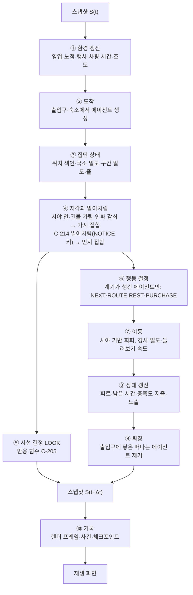
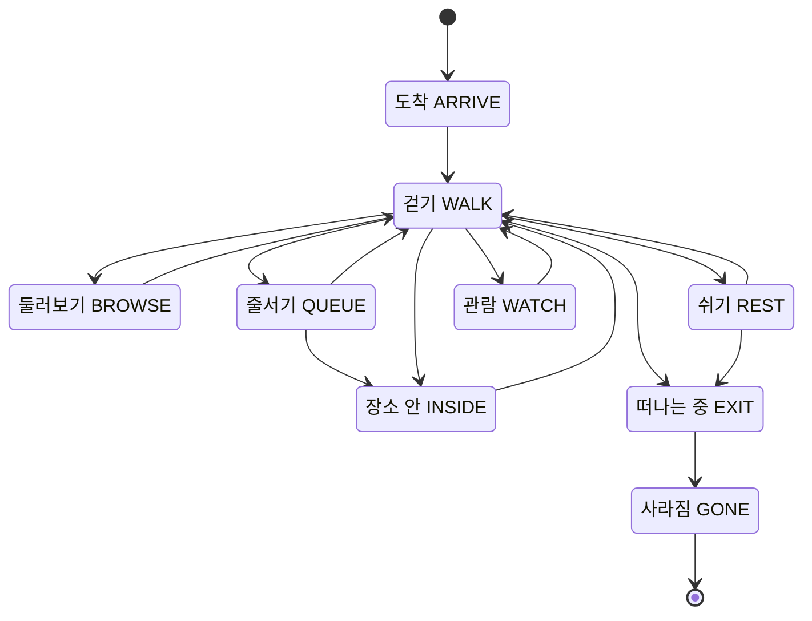
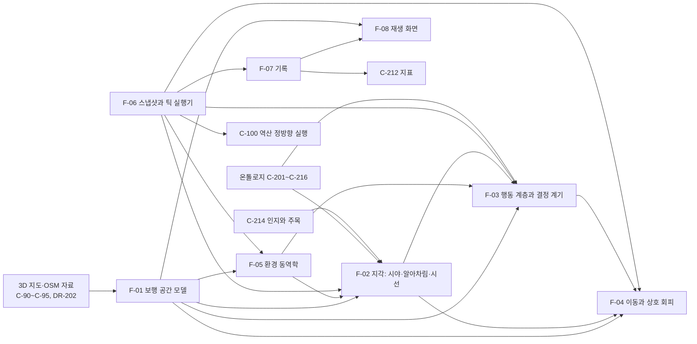

# 명동 에이전트 프레임 시뮬레이션과 재생 — 구조 설계 초안

2026-10-31 사용자 요청: 온톨로지를 바탕으로 에이전트들이 이동하며 상호작용하는 과정을 프레임마다 계산한다. 에이전트는 명동 지도 위의 위치를 갖고, 각자 다른 시야 범위에 따라 시선을 옮기며 이동한다. 환경과 온톨로지가 상호작용해 에이전트가 프레임마다 바뀌고, 그 스냅샷을 이어 붙여 시뮬레이션을 재생한다.

이 문서는 AGENT.md의 Phase 1~3 작업 문서다. 확정된 페르소나 반응 온톨로지([C-201~C-216](01_concept_map.md#페르소나-반응-온톨로지--c-201c-216), [DR-200](decisions.md#dr-200--페르소나-반응-온톨로지의-구조-확정)~[DR-211](decisions.md#dr-211--반응-온톨로지의-self-결정-모음), 설계안 [01a](01a_persona_ontology.md) v0.5)를 시간과 공간 위에서 실행하는 층을 정의한다. 반응 함수(C-205)와 결정 맥락은 그대로 쓰고 위치·시야·이동·기록·재생을 더한다. 확정된 결정을 바꿔야 하는 곳은 §3.10에 모았고, 해당 질문의 답이 번복 절차(구 DR 항목에 취소선 + 새 DR)를 겸한다.

2026-10-31 사용자가 질문 Q-F1~Q-F5를 추천안대로 확정했고([DR-220](decisions.md#dr-220--틱-시뮬레이션의-시간-해상도와-규모)~[DR-224](decisions.md#dr-224--실행-모드)), 같은 날 이 흐름 전체를 Rust 엔진으로 만들라고 지시했다([DR-225](decisions.md#dr-225--엔진-구현-언어와-범위)). 가번호는 아래처럼 개념 Map 번호로 바뀐다. 이 문서는 C-220~C-228의 단위 카탈로그 정본이고, [개념 Map](01_concept_map.md)에는 관계도와 대응표를 둔다. 구현은 [02d Rust 엔진 구현체 Map](02d_rust_engine.md)을 따른다.

| 가번호 | 개념 단위 | 가번호 | 개념 단위 |
|---|---|---|---|
| F-01 보행 공간 모델 | C-220 | F-05 환경 동역학 | C-224 |
| F-02 지각: 시야·알아차림·시선 | C-221 | F-06 스냅샷과 틱 실행기 | C-225 |
| F-03 행동 계층과 결정 계기 | C-222 | F-07 기록 | C-226 |
| F-04 이동과 상호 회피 | C-223 | F-08 재생 화면 | C-227 |
| (신규) 실행 흐름과 결과 plot | C-228 | | |

각 단위의 완료 판정 기준 ①~⑦은 테스트 접점 E2nn-1~E2nn-7과 번호대로 1:1 대응한다(예: C-221 ④ ↔ E221-4). 테스트 이름과 위치는 02d §5의 추적표에 있다.

## 0. 요약

- 시뮬레이션은 **스냅샷의 사슬**이다. 스냅샷 S(t)는 세계 전체 상태(환경 상태, 모든 에이전트의 위치·방향·시선·활동·내부 상태·인지 집합, 집단 상태)다. 하나의 순수 함수 `step`이 S(t)에서 S(t+Δt)를 만들고, 재생은 저장된 스냅샷을 순서대로 그리는 것이다.
- 한 틱 안의 순서는 고정한다: 환경 갱신 → 도착 → 집단 상태 → 지각·알아차림 → 시선 결정·행동 결정 → 이동 → 상태 갱신 → 퇴장 → 기록. 모든 단계는 S(t)와 같은 틱의 앞 단계 결과만 읽는다(확정된 동시 갱신 S-R14를 모든 기전으로 확장).
- 확정된 온톨로지는 이미 **고려 집합**(아는 곳 + 지나가며 알아차린 곳)과 **알아차림 확률**(시계성·광고 자극도·주목 성향·밀도, C-214)을 갖고 있다. 프레임 시뮬레이션은 이 알아차림을 시야의 기하와 시선으로 실현한다. 보이는 것만 알아차릴 수 있고, 시선 가까이 있을수록 잘 알아차린다. 시야 범위가 다르면 발견하는 가게가 달라지고, 행선지 대안도 달라진다.
- **시선 이동도 같은 반응 함수로 정한다.** 여섯 번째 결정 맥락 LOOK의 대안은 앞길 보기·발밑 보기·알아차린 대상 보기다. 관심(A-*)과 광고의 지각된 끌림은 시선을 끌고, 발밑 위험(D-FALL·D-STEP)·혼잡(D-CROWD)·과한 자극(D-SENSE)은 시선을 길로 돌린다. 그래서 계단 앞의 노인은 가게를 덜 보고, 덜 본 가게에는 덜 들어간다. 이 결과는 규칙이 아니라 같은 함수에서 나온다.
- 시야 범위는 사람마다 다르다. 사람 특성(나이의 연속 기본값, 시력 단서, 주목 성향, 친숙도), 상태(피로·서두름·동반), 환경(야간 조도·인파)이 시야 거리와 각도를 바꾼다. 나이는 기본값 함수의 입력일 뿐이다(S-R11).
- 이동은 경로 그래프(어디로 갈지)와 2차원 보행 공간(어떻게 걸을지)을 함께 쓴다(추천안, [Q-F3](#q-f3--공간-표현과-이동-방식)). 각 에이전트는 자기 시야 안의 사람·벽을 피해 방향과 속도를 고르고, 혼잡은 위치에서 저절로 생긴다.
- 기록은 1초 간격 렌더 프레임(위치·방향·시선·활동)과 사건 기록(결정·알아차림·구매·도착·퇴장·환경 변화), 10분마다의 전체 상태 체크포인트다. 체크포인트에서 다시 돌리면 같은 스냅샷이 비트 단위로 다시 나온다.
- 재생은 명동 3D 지도 자료를 읽는 별도 재생 화면이다(추천안, [Q-F4](#q-f4--재생-화면)). 에이전트 표지, 시야 부채꼴, 시선 선, 가게 영업·노점·행사·줄, 시간 막대, 선택한 에이전트의 결정 설명을 보여준다.
- 확정된 결정 중 바꿔야 하는 것은 셋이다(§3.10): 60초 단계(S-R15) → 0.5초 틱, 수요 배율을 인물 가중치로(S-R23) → 몸의 수로, 경로 판단의 실제 밀도(C-210) → 본 밀도. 앞의 둘은 [Q-F1](#q-f1--재생-범위규모시간-해상도), 셋째는 [Q-F2](#q-f2--시야가-알아차림과-판단에-주는-역할)에서 묻는다. 반응 함수(C-205)는 바꾸지 않는다.
- 질문 5개(재생 범위와 규모, 시야의 역할, 공간 표현, 재생 화면, 실행 모드)는 2026-10-31 추천안대로 확정됐다(DR-220~DR-224). 엔진은 Rust로 만들고 결과는 plot 보고서로 낸다(DR-225, C-228).

## 1. 용어 — 프레임, 틱, 스냅샷

사용자가 말한 "frame"은 아래의 틱과 렌더 프레임을 뜻한다. 프로젝트에는 이미 10분 "프레임"([DR-08](decisions.md#dr-08--시뮬레이션-프레임-간격))이 있어, 이 문서는 섞이지 않게 '틱'과 '렌더 프레임'이라고 쓴다.

| 용어 | 뜻 | 값(추천) |
|---|---|---|
| 틱 | 시뮬레이션의 한 걸음 Δt. 지각·알아차림·시선·이동이 매 틱 갱신된다 | 0.5초([Q-F1](#q-f1--재생-범위규모시간-해상도)) |
| 스냅샷 | 틱 경계의 세계 전체 상태 | 메모리에는 매 틱, 파일에는 10분마다 체크포인트 |
| 렌더 프레임 | 재생을 위해 저장하는 스냅샷의 요약(위치·방향·시선·활동·표시용 상태) | 1초마다(2틱) |
| 사건 | 정확한 틱에 일어난 이산 변화(결정, 알아차림, 구매, 도착, 퇴장, 환경 변화) | 전부 기록 |
| 10분 프레임 | DR-08의 집계 간격. 지표(C-212)를 이 간격으로 낸다 | 그대로 |
| 하루·월 | 방문지 선택과 상점 반응의 척도(01a §3.9) | 그대로 |

## 2. 명동 지도 자료로 할 수 있는 것

[DR-202](decisions.md#dr-202--공간시설-자료와-경사-계산)는 사용자가 제공한 OSM 자료(`data/myeongdong-3d-map/source/`)를 보행망·상점·계단·출구·벤치·숙소의 기본 자료로 확정했다(남산 쪽 확장은 범위·라이선스를 다시 확인받은 뒤). 아래 개수는 그 OSM 원본을 행정동 경계와 겹쳐 센 값이다.

| 자료 | 내용 | 시뮬레이션에서의 쓰임 | 한계 |
|---|---|---|---|
| 건물 709개(`map_data.json`) | 발자국·높이·바닥 고도 | 몸의 장애물, 시야 가림, 가게 앞 지점 | 높이 461개는 추정(DR-97). 가림은 2차원 발자국으로만 쓰므로 영향이 작다 |
| 도로 347개(`source/myeongdong_data.json`) | 중심선·유형·폭 | 경로 그래프와 보행 공간 | 폭은 유형별 일괄값이다(보행자 도로 8m, 보도 3.5m, 생활도로 6.5m, 간선 26m 등) → 가정. 차도와 보도가 나뉘어 있지 않다 |
| 계단 21개(경계 안 10개) | `highway=steps` | D-STEP·D-CLIMB·D-FALL 구간, 발밑 보기 | 단 수·단 높이가 없다 |
| 지하철 출입구 20개(경계 안 18개), 버스 정류장 26개(16개), 숙소 36곳(33곳) | OSM | 내국인 도착 출입구, 관광객 출발 지점([DR-208](decisions.md#dr-208--외국인-관광객-집단): 숙소·도착 역·관광버스 정차지) | 노선·출구 번호와 관광버스 정차지는 별도 자료 |
| 음식점·카페·주점 939곳(경계 안 827곳), 상점 374곳(255곳), 공연장 22곳(18곳) | OSM 노드 | 장소 인스턴스(A-<업종>)와 알아차림·시선 대상 | 층 정보는 1,313곳 중 63곳뿐(01a §1.3). 시계성·광고 자극도·가격·처리 용량은 가정 표(DR-202 ③) |
| 벤치 13개(경계 안 12개) | `amenity=bench` | 휴식 시설(#4) | 경계 안 12개 중 9개에 좌석 수 태그가 있어 합계 29석, 나머지 3개는 미기재다. OSM 등록 기준이며 현장 전수나 실제 좌석 수가 아니다([조사 보고서](06_myeongdong_variable_research.md)) |
| 횡단보도 60개, 신호 24개 | 노드 | 길 건너기와 대기 | 신호 주기가 없다 |
| 지면 고도 원본·스무딩·확장 격자 | 30m | 경사(구간 양 끝 고도 차, 원본·스무딩 둘 다, DR-202 ④), 표시 높이(확장 격자) | 길의 경사가 아니라 지형 고도에서 계산한다 |
| 상권 유동인구 10분 상대 프로필([05](05_myeongdong_traffic.md)) | 2025년 상대 강도: 14~17시 1.87, 11~14시 1.83, 17~21시 1.27, 06~11시 1.00 | 재생 시간대 선택, C-212 비교 | 내국인 재실 추정이며 도착률·인/㎡가 아니다([DR-141](decisions.md#dr-141--10분-시간-프로필과-보정의-한계)) |

페르소나 원문의 서술 필드 11개를 단순 문자열로 탐지한 결과다. 다른 뜻을 포함하는 상한치다.

| 단서 | 명동 원본 514명 | 증강 6.5만 명 |
|---|---:|---:|
| 시력·안경·노안·돋보기 | 2.7% | 4.3% |
| 눈 질환(백내장·녹내장·황반) | 0.0% | 0.0% |
| 구경·두리번·눈길·시선 | 30.5% | 19.9% |
| 간판·쇼윈도·진열 | 8.4% | 4.1% |
| 길치·처음 가는 길 | 0.2% | 0.3% |

함의: 시야의 **범위**는 원문 근거가 드물어 기본값·상태·환경이 주로 정한다. 시선의 **배분**(어디를 보는가)은 관심과 주목 성향(01a §3.3, '구경·새 가게 찾기' 단서) 근거가 풍부하다. 시야 범위의 차이를 원문으로 정당화할 수 있는 인물은 소수라는 점을 결과 해석에 남긴다.

## 3. 구조

### 3.1 한 틱의 흐름

규칙:

1. 각 단계는 S(t)와 **같은 틱의 앞 단계 결과**만 읽는다. 같은 틱 안의 파생값은 위 순서(DAG)로 계산하고, 틱 사이의 되먹임(위치(t) → 결정(t) → 위치(t+Δt))만 허용한다. 01a §7.4의 1번 규칙과 같다.
2. 한 단계 안에서는 모든 에이전트를 동시에 처리한 것처럼 계산한다. 이동은 이웃의 t 위치를 읽고 t+Δt 위치를 읽지 않는다. 그래서 처리 순서와 병렬 분할이 결과를 바꾸지 않는다.
3. ④는 이전 틱에 정한 시선(t)으로 보고, ⑤는 다음 시선(t+Δt)을 정한다. 지금 본 것이 다음에 볼 곳을 정한다. ⑦은 시선(t)을 읽는다(그 틱 동안 어디를 보고 걸었는가).
4. 난수는 02b §6의 키 `(scenario_seed, mechanism_id, stable_entity_id, step, event_slot, draw_index)`에서만 얻고 `step`은 틱 번호다(S-R7). 메커니즘 ID는 확정된 VISIT·NEXT·ROUTE·REST·PURCHASE·STORE·NOTICE에 LOOK·SPAWN을 더한다.
5. 방문지 선택(VISIT)은 하루 단위라 틱 안에서 하지 않는다. 실행 전에 도착 목록을 만들고 ②가 그 목록을 실현한다(§3.7).

### 3.2 스냅샷 — 세계 상태의 정의

| 묶음 | 내용 | 갱신 단계 | 렌더 프레임에 저장 |
|---|---|---|---|
| 시계 | 틱 번호 k, 시각(KST), Δt | 매 틱 | ○ |
| 실행 정보 | 시나리오·온톨로지 정의·공간 모델 버전 해시, 시드, 코드 버전 | 실행 시작 | 실행 manifest에 한 번 |
| 환경 상태 | 장소별 영업 여부, 진행 중 행사, 노점 유무·수, 보행 링크별 차량 통행 여부, 조도, 노면 | ① | 바뀔 때 사건으로 |
| 에이전트 몸 | 위치 (x, y, z), 진행 방향, 속도, 몸 반지름(동반 인원 반영) | ⑦ | 위치·방향 ○ |
| 에이전트 지각 | 시선 방향, 시선 대상, 실효 시야(거리·각), 인지 집합(C-206·C-214), 관찰 값(본 틱·본 값, Q-F2 A일 때) | ④⑤ | 시선 방향·대상·실효 시야 ○. 인지 집합·관찰 값은 체크포인트에만 |
| 에이전트 행동 | 활동 상태, 의도(목표 장소·목적·마감), 경로 계획과 진행, 처리할 결정 계기 | ⑥ | 활동 상태 ○ |
| 에이전트 내부 상태 | C-206의 피로·남은 시간·충족도·지출 누계·동반·장비 | ⑧ | 표시용 요약(피로·충족) ○ |
| 집단 상태 | 공간 색인, 국소 밀도, 구간 밀도, 장소별 줄(순서), 장소 안 인원 | ③ | 줄 길이·장소 안 인원 ○ |

스냅샷은 "전부"이고 렌더 프레임은 "그리는 데 필요한 것"이다. 렌더 프레임만으로는 다시 돌릴 수 없고 체크포인트로 다시 돌린다.

### 3.3 에이전트의 세 층과 활동 상태

보행자 모형의 표준 구조인 전략·전술·운동의 세 층으로 나눈다(Hoogendoorn & Bovy 2004, S-F2). 확정된 결정 맥락이 전략·전술 층에, 이동 모델이 운동 층에 대응한다.

| 층 | 무엇을 정하나 | 언제 | 결정 맥락 | 단위 |
|---|---|---|---|---|
| 전략 | 오늘 명동에 올지·언제·어디로 들어올지(경쟁 상권 포함), 다음 행선지, 떠나기 | 하루 시작, 활동 종료, 알아차림 | VISIT, NEXT | C-209, F-03 |
| 전술 | 경로, 쉬기, 구매, 시선 | 분기점, 상태 임계, 장소 도착, 시선 유지 시간 종료 | ROUTE, REST, PURCHASE, LOOK | F-03, F-02 |
| 운동 | 이번 틱의 방향·속도, 회피, 줄 서기 | 매 틱 | 없음(반응 함수가 정한 계획을 따르는 물리) | F-04 |

- 장소 안·쉬기·관람의 머무는 시간은 고른 대안의 추가 시간(01a §3.5)이다. 시간이 끝나면 NEXT 계기가 생긴다.
- 줄서기에서 걷기로 가는 전이는 줄이 길어 포기한 경우다.
- 둘러보기는 걷기 중 LOOK이 가게를 오래 볼 때의 감속 상태이고, 가게 앞에서 멈출 수 있다.

결정 계기(S-F3):

| 계기 | 결정 맥락 | 예 |
|---|---|---|
| 활동 종료 | NEXT | 가게에서 나옴 |
| 분기점 도착 | ROUTE | 교차로 |
| 새로 알아차린 장소(문턱 이상) | NEXT 재평가 | 노점을 알아차림 → 고려 집합에 들어옴 |
| 관찰 값의 변화 | ROUTE·NEXT | 목표 가게의 줄이 길어짐, 영업 종료를 봄, 앞길 혼잡 |
| 상태 임계 | REST | 피로가 편안 상한 근처 |
| 환경 사건 | NEXT·ROUTE | 행사 시작, 비 |
| 마감 | NEXT(떠나기) | 가용 시간 창 끝 |
| 장소 도착 | PURCHASE | 가게 안 |
| 시선 유지 시간 종료, 충돌 위험 | LOOK | 1~2초마다, 주변 시야에 마주 오는 사람 |

재평가에는 항상 "현재 계획 유지"가 대안으로 들어가고 바꾸는 쪽에 전환 비용이 붙는다. 같은 계기는 최소 간격 안에 다시 결정을 일으키지 않는다. 확률적 선택을 매 틱 다시 뽑으면 목표 사이를 오가는 떨림이 생기기 때문이다.

### 3.4 지각 — 시야, 알아차림, 시선

#### (1) 사람 쪽: 지각 능력

새로 더하는 항목(C-202·C-213 프로필에 추가)과, 이미 확정된 항목 중 지각에 쓰는 것이다.

| 항목 | 뜻 | 단위 | 기본값 근거 | 상태·환경 조정 |
|---|---|---|---|---|
| 초점 시야 거리 (신규) | 간판·가게·노점을 알아보는 거리 | m | 나이의 연속 기본값, 시력 단서(현재형) | 야간 조도·인파 밀도가 높으면 짧아진다 |
| 초점 시야각 (신규) | 시선 중심의 주의 폭 | 도 | 유효 시야(UFOV)는 나이에 따라 좁아진다(Ball 외 1988) | 피로·서두름이 크면 좁아진다 |
| 주변 시야각·거리 (신규) | 사람과 장애물을 감지하는 넓고 짧은 범위. 회피와 약한 알아차림에 쓴다 | 도, m | 이동 모델 기본값(Moussaïd 외 2011: ±75°, 10m) | 인파가 많으면 거리가 짧아진다 |
| 고개 회전 한계 (신규) | 진행 방향에 대한 시선 각의 상한 | 도 | 가정 | 걷는 중이 멈춘 때보다 작다 |
| 시선 최소 유지 시간 (신규) | 한 대상을 보는 최소 시간 | 초 | 가정 | — |
| 주목 성향 (확정, 01a §3.3) | 알아차림과 둘러보기의 정도 | 0~1 | '구경·새 가게 찾기' 같은 원문 단서 | 둘러보기 중 증가 |
| 친숙도 (확정, D-WAY 능력) | 길찾기·언어 부담을 감당하는 능력. 도착 때 아는 장소의 수에도 쓴다 | D-WAY 단위 | 내국인: 명동 단서·거주 구, 외국인: 한국어 능력·방문 횟수 | — |
| D-SENSE 민감도 (확정) | 광고·소음 자극을 싫어하는 정도 | w | 조용함 선호 단서 | — |

새 항목의 값은 S-R5의 근거 우선순위와 S-R22의 라벨(`structured`·`text`·`assumption`)을 따르고, 수치는 [DR-203](decisions.md#dr-203--반응-모델-수치의-출처와-재현-기준)의 원칙으로 정한다.

#### (2) 환경 쪽: 시계성·광고 자극도와 가림

| 속성 | 클래스 | 뜻 | 상태 |
|---|---|---|---|
| `visibility` | 상점·음식점·노점·행사 | 상점 시계성 0~1(1층 여부·모서리·주 보행로 면함 등 대리 지표, #16) | 확정(01a §3.4, 가정 표) |
| `ad_intensity` | 보행 구간 | 구간 광고 자극도(#16). 알아차림·지각된 끌림·D-SENSE의 세 경로(S-R25) | 확정 |
| `view_anchor` | 장소 | 길에서 보이는 지점(가게 앞) | 신규 |
| `occludes` | 건물 | 시선을 막는다 | 신규 |
| 동적 현저성 | 행사·줄·인파 | 진행 중인 행사와 긴 줄은 더 눈에 띈다 | 신규(파생) |

#### (3) 가시 집합 — 기하

에이전트 i가 틱 t에 볼 수 있는 대상은 두 집합의 합이다. 가시성은 결정적이다(S-F6).

- 초점: 거리 ≤ 실효 초점 거리, 시선 방향과의 각 ≤ 초점 시야각/2, 건물에 가리지 않음.
- 주변: 거리 ≤ 주변 거리, 진행 방향과의 각 ≤ 주변 시야각/2, 가리지 않음.

실효 초점 거리 = 기본 거리 × 조도 계수 × 인파 감쇠(국소 밀도가 클수록 짧음). 인파의 가림은 사람마다 광선을 쏘지 않고 이 감쇠로 근사한다(S-F11).

#### (4) 알아차림 — C-214를 틱 단위로

확정된 C-214는 "구간을 지날 때 보이는 상점마다 알아차림 확률 p = f(시계성, 구간 광고 자극도, 주목 성향, 구간 밀도)를 난수 키로 판정"한다. 프레임 시뮬레이션은 같은 f를 쓰되 '보이는'을 시야로 바꾼다(Q-F2 A·B일 때, S-F19).

- 아직 인지 집합에 없는 대상이 가시 집합 안에 있으면, 그 틱의 알아차림 확률 = 1 − exp(−h·Δt·g)이다. h는 p에서 환산한 기준 위험률, g는 시선 가중(초점 안에서 크고 주변에서 작다)이다.
- h는 "시선이 중립인 보통 통과 한 번"의 알아차림 확률이 C-214의 p와 같아지도록 정한다. 그래서 60초 모형과 프레임 모형의 기대 알아차림이 같고, C-214의 단조성(시계성·광고 자극도가 오르면 확률이 내려가지 않음)이 유지된다.
- 시야 밖이거나 가린 대상은 알아차릴 수 없다. 알아차림은 NOTICE 키로 뽑고 사건으로 기록한다(C-214 ④).
- 알아차린 장소는 인지 집합에 들어가 고려 집합(S-R26)이 된다. 행선지 대안은 고려 집합 안에서만 생긴다(C-214 ①).

#### (5) 관찰 값과 믿는 세계 (Q-F2 A일 때)

- 관찰 값 = {대상 → 마지막으로 본 틱, 본 값(영업 여부, 줄 길이, 앞길의 국소 밀도)}. 신선도 기한이 지나면 사전 기대(시간대 기본값)로 돌아간다(S-F16). 인지 집합 자체는 확정 규칙대로 방문 동안 유지한다.
- 도착할 때 아는 것: 방문 목적의 목표 장소(C-209), 친숙도에 비례한 주요 장소(시계성 상위, C-214 ⑤의 '이미 아는 장소'), 그리고 길 그래프 전체(지도 앱을 가정).
- C-204는 이 믿는 세계로 상황을 만든다. 경로의 혼잡과 줄의 대기는 본 값(신선할 때) 또는 사전 기대다. 도착해 보니 다르면(닫힘, 긴 줄) '관찰 값의 변화' 계기가 생긴다.

#### (6) 시선 결정 LOOK — 같은 반응 함수

LOOK은 여섯 번째 결정 맥락이다. S-R13대로 맥락은 대안과 노출만 정하고 함수는 C-205 그대로다(S-F4).

| 대안 | 이득(제공) | 부담(노출) |
|---|---|---|
| 앞길 보기 | 없음(기준) | 앞 몇 초 경로의 D-CROWD·D-SAFE·D-STEP·D-FALL 요구를 '주의한' 값으로 |
| 발밑 보기 | 없음 | D-STEP·D-FALL은 더 작게(발밑을 보면 위험이 준다), D-CROWD·D-SAFE는 '주의하지 않은' 값으로 |
| 알아차린 대상 e 보기 | Σ 관심 a_k·(1−충족도_k)·제공_k(e)·새로움(e). 제공에는 광고의 지각된 끌림(S-R25 ②)이 들어 있다 | 경로의 요구 전부를 '주의하지 않은' 값으로(배율 1+μ), 그리고 e의 광고 자극(D-SENSE, S-R25 ③) |

- 대상은 인지 집합에 있고 지금 보이는 것만이다. 알아차리지 못한 대상을 '골라서' 볼 수는 없다. 알아차림(④)이 먼저이고 시선 선택(⑤)이 뒤다.
- 고개 회전 한계 밖의 대상은 대안에서 빠진다(01a 연결 규칙 4의 허용·차단).
- 보이는 대상이 많으면 시계성 × 관심 상위 K개만 넣는다(기본 K = 8, SELF).
- 새로움은 처음 보는 대상이 1이고 이미 오래 본 대상은 작다. 같은 가게만 계속 보지 않는다.
- 고른 시선은 최소 유지 시간 동안 유지한다. 그 사이 주변 시야에 충돌 위험이 생기면 예외로 앞길 보기로 바뀐다.
- 그래서 계단·급한 내리막 앞에서 낙상 민감도가 큰 인물은 발밑을 보고, 혼잡한 곳에서는 앞길을 보고, 조용함을 선호하는 인물은 광고가 강한 정면을 피하고, 한산하고 관심 대상이 있으면 대상을 본다. 시선이 향한 쪽에서 다음 알아차림이 잘 일어나므로 '어디를 보느냐'가 '무엇을 발견하느냐'를 바꾼다.

#### (7) 시야가 사람마다 다른 이유

| 요인 | 바뀌는 것 | 근거 종류 |
|---|---|---|
| 사람 특성 | 초점 시야 거리·각의 기본값(나이의 연속 함수), 시력 단서, 주목 성향, 친숙도 | `structured`·`text`·`assumption` |
| 상태 | 피로·서두름 → 각이 좁아짐, 동반 아동 → 주변으로 주의가 나뉨 | 개인 상태 |
| 환경 | 야간 조도 → 거리 감소(S-F13), 인파 → 거리 감소 | 환경 상태 |
| 활동 | 둘러보기 → 넓고 느림, 줄서기·쉬기 → 넓음 | 활동 상태 |

#### (8) 시선이 걸음에 주는 영향

시선이 길을 떠나 있으면(대상 보기, 둘러보기) 주변 시야의 회피 범위가 줄고 희망 속도가 낮아진다. 마주 오는 사람을 늦게 피하고 걸음이 느려진다. 수치는 DR-203의 원칙으로 정한다.

### 3.5 이동과 상호작용

- 두 수준: ROUTE 결정은 경로 그래프 위에서 경로 후보 k개(S-R6) 중 하나를 고르고, 운동 층은 그 경로의 다음 지점을 향해 2차원 보행 공간 안에서 걷는다(Q-F3 A).
- 운동 모델(S-F5): 주변 시야(±각, 거리) 안의 방향 후보를 훑어, 첫 충돌까지의 거리를 고려할 때 목표 지점에 가장 가까워지는 방향을 고른다(Moussaïd 외 2011). 속도는 min(희망 속도, (첫 충돌까지 거리 − 여유)/τ)로 제한해 겹치지 않게 한다(Tordeux 외 2016). 희망 속도 = 기준 속도 × 경사 조정(01a §3.6의 7단계) × 둘러보기 계수 × 피로 계수. 이렇게 나온 밀도-속도 관계를 Weidmann(1993)과 대조한다.
- 상호작용의 종류:
  1. 회피·감속: t의 이웃 위치를 읽는다.
  2. 줄: 처리 용량이 있는 장소 앞에서 선착순 줄을 만들고 처리 속도대로 줄어든다(01a §3.10의 4).
  3. 본 혼잡·줄 → 결정: 본 국소 밀도와 줄 길이가 D-CROWD·D-TIME 노출이 된다(Q-F2 A).
  4. 동반: 동반 인원은 한 몸의 속성이다(S-F8).
  5. (선택) 쏠림: 사람이 몰린 곳·긴 줄을 보면 끌리는 효과. 새 기전이라 [Q-F2](#q-f2--시야가-알아차림과-판단에-주는-역할)의 열린 질문이다.
- 01a 연결 규칙 6(인물 사이의 영향은 집단 상태를 거친다)을 지킨다. 모든 상호작용은 S(t)의 위치·줄(집단 상태)을 읽을 뿐 다른 에이전트의 결정을 직접 읽지 않는다. 외국인 유입이 내국인의 움직임을 바꾸는 효과도 이 경로로만 생긴다.

### 3.6 환경 동역학

- 시나리오 = 01a §7.5의 변수 16개 값 + 하루 유형 + 날짜(일몰 계산) + 날씨 시간표 + 노점·행사·시계성·광고의 가정 표. 상점의 인건비(#14)와 월 단위 반응(C-211)은 하루 재생 밖이고, 그 결과(영업 상점·가격·영업시간)가 그날의 시나리오로 들어온다.
- 틱마다 일정을 평가한다: 영업시간(#6), 행사 일정(#8), 차량 통행 시간(#1), 노점 운영 시간(#3), 조도(일몰·일출과 가로등 가정, S-F13), 노면.
- 상태가 바뀌는 틱에 환경 사건을 하나 낸다. 그 변화를 본 에이전트와 영향을 받는 에이전트(장소 안, 그 구간 위)에게 계기가 생긴다.
- 차량 통행 시간에는 그 링크의 보행 다각형이 차로 몫만큼 줄고 D-SAFE 요구가 생긴다(01a §3.4). 차량 자체는 움직이지 않는다.
- 시간 구간은 [시작, 끝) 반열린 구간이다([DR-17](decisions.md#dr-17--프레임과-시간-규약-및-결정성)).

### 3.7 도착, 퇴장, 규모

- C-209가 인물마다 하루의 방문지 선택(명동의 시간 슬롯 × 수단, 경쟁 상권, 오늘 안 감)을 미리 낸다. 명동을 고른 인물에 대해 ②가 슬롯 안의 도착 틱을 키 난수로 정해 몸을 만든다. 출발 지점은 내국인은 지하철 출입구·버스 정류장·경계를 지나는 보행 링크, 외국인 관광객은 숙소·도착 역·관광버스 정차지다(DR-208).
- 지하철 도착은 배차 간격(#9)마다 열차 단위로 묶여 출입구에 나타난다(S-F14). 그래서 배차 간격이 유입의 시간 구조로도 보인다.
- 외국인 관광객 합성 집단(C-213)은 공공 통계 조사 뒤에 생긴다. 그 전에는 DR-208의 대안대로 시간대·구간별 외생 인원을 '배경 보행자'(결정 없이 출발 지점과 주요 장소 사이를 걷는 몸)로 실현한다(S-F18). 혼잡에는 들어가지만 지표의 개인 결정에는 들어가지 않는다.
- 몸과 인물(Q-F1 A일 때): 1몸 = 1사람이다. 인물 i가 슬롯 s에 만드는 기대 몸 수 = P_i(슬롯 s에 명동 방문) × 대표 비율 × 방문 수요 배율(#10, 관광객은 #11). 실제 몸 수는 키 난수로 정수화한다. 필요한 몸이 인물 수보다 많으면 인물을 복제한다. 복제 몸의 ID는 `synthetic_id`와 복제 번호이고 난수 키가 독립이다. 배율은 개인의 선택 확률을 바꾸지 않고 몸의 수만 바꾼다. 확정된 S-R23("배율은 인물 가중치")의 뜻(개인 확률 불변, 인원·밀도·대기만 비례)은 지키고 구현만 바꾼다.
- 대표 비율(1인물이 대표하는 실제 인원)은 근거가 없다. 재생에서는 목표 동시 인원으로 정하고([Q-F1](#q-f1--재생-범위규모시간-해상도)), 혼잡의 절대값은 시나리오 사이의 상대 비교로만 읽는다.
- 떠나기를 고른 에이전트는 출구로 걸어가 사라지고, 생성·소멸은 모두 사건으로 기록된다(C-206 ⑥).

### 3.8 기록과 재생

| 기록 | 내용 | 단위 | 용도 |
|---|---|---|---|
| 렌더 프레임 | 1초마다 에이전트별 위치(x, z)·방향·시선 방향·시선 대상·실효 시야·활동·표시용 상태 | 10분 묶음 파일(고정 길이 수치 배열 + JSON 머리말) | 재생 |
| 사건 | 결정(맥락, 계기, 대안별 확률, 선택, 기여 항 상위 3개 표 — DR-205), 알아차림, 구매, 도착·퇴장, 환경 변화 | Parquet | 상세 창, 지표(Y-23 등), 역산 trace |
| LOOK 상세 | 시선 결정의 대안별 확률·기여 항 | 추적 대상 에이전트만(기본 무작위 50명 + 지정 인물) | 시선 설명 |
| 체크포인트 | 스냅샷 전체 | 10분마다(DR-08 프레임에 맞춤) | 시각 이동, 재실행 |
| 에이전트 표 | 인물 요약, 지각 능력, 근거 참조 | 실행당 1개 | 상세 창 |
| manifest | 버전·해시·실행 설정·묶음별 해시 | 실행당 1개 | 재현성 |

- 렌더 프레임 한 줄은 약 12바이트다(좌표는 5cm 양자화). 동시 2,000명 × 1초 × 3시간이면 압축 전 약 260MB, 10분 묶음 하나는 약 14MB다. 하루 13시간이면 최대 약 1.1GB다(동시 인원이 내내 2,000명일 때의 상한).
- 시선 대상이 렌더 프레임에 있으므로 시선 전환은 1초 해상도로 재생된다. 최소 유지 시간을 1초 이상으로 두면 전환을 놓치지 않는다.
- 재생 화면은 렌더 프레임 사이를 보간해 매끄럽게 그린다. 큰 이진 파일은 `file://`로 읽을 수 없어 로컬 정적 서버로 연다(S-F17).
- 같은 체크포인트에서 다시 돌리면 이후 묶음 파일이 바이트 단위로 같다. 체크포인트에서 시나리오 값 하나를 바꿔 다시 돌리면 그 시점부터 갈라지는 반사실 재생이 된다(역산 엔진과 같은 계약).

### 3.9 온톨로지 단위와의 관계

| 확정 단위 | 프레임 시뮬레이션에서 | 변경 |
|---|---|---|
| C-201 공통 차원 | 그대로. 시야는 차원이 아니라 무엇을 알아차리고 관찰하는지 바꾸는 층이다 | 없음 |
| C-202 내국인 프로필·C-213 관광객 프로필 | 신규 지각 능력(§3.4(1))을 더한다. 주목 성향·친숙도·D-SENSE 민감도는 확정 항목을 쓴다 | 필드 추가 |
| C-203 환경 클래스 | 확정된 `visibility`·`ad_intensity`를 쓰고, `view_anchor`·`occludes`와 노점·행사의 위치를 더한다 | 속성 추가 |
| C-204 상황 구성 | LOOK 맥락을 더한다. Q-F2 A면 혼잡·줄·영업 여부를 관찰 값으로 읽는다. 공간 인스턴스 생성은 F-01이 맡는다 | 맥락 추가, 입력 변경(Q-F2) |
| C-205 반응 함수 | 그대로. LOOK에도 같은 함수를 쓴다 | 없음 |
| C-206 개인 상태와 시간 | 위치·방향·속도·시선·관찰 값·활동 상태를 더한다. 60초 단계를 틱으로 바꾼다 | S-R15 번복(Q-F1) |
| C-207 등록 | 지각·알아차림·시선·이동·도착·퇴장 규칙을 읽기·쓰기·지연과 함께 등록한다 | 규칙 추가 |
| C-208 검증 | 프레임 불변식을 더한다(벽 통과 없음, 순간이동 없음, 시야 밖 알아차림 없음, 재실행 동일, 알아차림 교정 보존) | 테스트 추가 |
| C-209 방문 | 도착을 틱·출발 지점·열차 묶음으로 실현하고, 배율을 몸의 수로 구현한다 | S-R23 구현 번복(Q-F1) |
| C-210 집단 | 연속 위치로 매 틱 국소 밀도·구간 밀도·줄을 계산한다. Q-F2 A면 경로 판단에는 본 밀도를 쓴다 | 시간 해상도, 입력(Q-F2) |
| C-211 상점 | 월 단위라 하루 재생 밖이다 | 없음 |
| C-212 지표 | 렌더 프레임과 사건에서 10분 프레임으로 집계한다. Y-23(인지율·유인율)은 알아차림 사건에서 바로 나온다 | 입력 출처 |
| C-214 인지와 주목 | 알아차림 함수 f는 그대로 쓰고, '보이는'을 시야로, 구간 통과 판정을 틱 위험률로 바꾼다(통과 한 번의 기대 확률 보존) | 판정 단위(Q-F2) |
| C-215 소득·C-216 경쟁 상권 | 방문지 선택과 구매에서 그대로 쓴다. 경쟁 상권은 재생에서 '오지 않음·떠남'으로만 보인다 | 없음 |

### 3.10 확정된 결정과의 관계 — 그대로 쓰는 것과 바꿔야 하는 것

| 결정 | 내용 | 프레임 시뮬레이션에서 |
|---|---|---|
| [DR-201](decisions.md#dr-201--반응-온톨로지의-범위와-단계) 범위·단계 | 변수 16개, 3단계 | 위치가 있으면 개인 반응과 혼잡이 같은 루프에서 돈다. 단계는 '상호작용 끄기'(S-F15)로 같은 엔진 안에서 나눠 검증한다 |
| [DR-202](decisions.md#dr-202--공간시설-자료와-경사-계산) 공간·경사 | 제공 OSM, 남쪽 확장(승인 후), 가정 표, 경사 = 구간 양 끝 고도 차 | F-01의 입력과 경사 계산(S-F10) |
| [DR-203](decisions.md#dr-203--반응-모델-수치의-출처와-재현-기준) 수치 | 문헌·공공 통계·가정 라벨 | 지각(시야 거리·각, 시선 가중, 인파 감쇠, 배율 μ)과 이동(기준 속도, 회피 계수)의 수치에도 같은 원칙 |
| DR-204 추출 | LLM 제안 → 규칙 사전 | 시력 단서 사전 항목이 추가된다 |
| [DR-205](decisions.md#dr-205--반응-출력-형태) 출력 | 확률 + 키로 고정한 선택 하나 + 기여 항 표 | 궤적의 전제이고 사건 기록의 형식이다 |
| DR-206 저장 | YAML·Parquet·NumPy | 렌더 프레임은 고정 길이 수치 배열(S-F7) |
| DR-207 상점 | 월 단위 | 하루 재생 밖 |
| [DR-208](decisions.md#dr-208--외국인-관광객-집단) 관광객 | 합성 집단, 숙소·역·관광버스에서 출발, 늦어지면 외생 인원 | 출발 지점(F-01), 배경 보행자(S-F18) |
| DR-209·DR-210 | 소득, 경쟁 상권 | 그대로 |
| [DR-211](decisions.md#dr-211--반응-온톨로지의-self-결정-모음)의 **S-R15** | 내부 60초 단계 | **번복 제안**: 0.5초 틱. 60초면 보행자가 약 78m를 건너뛰어 연속 이동·회피·시선이 성립하지 않는다(Q-F1) |
| DR-211의 **S-R23** | 배율은 인물 가중치 | **구현 번복 제안**: 1몸 = 1사람, 배율은 몸의 수. 가중치를 가진 몸끼리는 물리적으로 비켜 갈 수 없다. 뜻(개인 확률 불변)은 유지한다(Q-F1) |
| C-210의 경로 판단 입력 | 구간의 실제 밀도 | **변경 제안**: 본 밀도(오래되면 사전 기대). 보이지 않는 혼잡을 아는 전지적 판단과 동시 회피의 진동을 막는다(Q-F2) |
| C-214의 판정 단위 | 구간 통과마다 | **세분화 제안**: 시야 안 틱 위험률, 통과 한 번의 기대 확률 보존(Q-F2) |

### 3.11 예시 — 같은 골목의 두 사람, 12초

> 아래 배치·값·확률은 **설명용 가정**이다. 보정되지 않았다.

상황(가상): 15:20, 완만한 내리막 골목. 앞 8m에 계단 4단, 오른쪽 12m에 노점(A-FOOD, 시계성 높음), 왼쪽에 화장품 가게(광고 자극 강함).

| 시각 | 갑: 75세, "가파른 길은 힘겨워함", 음식 관심 높음 | 을: 34세, 쇼핑 관심·주목 성향 높음, 시간 여유 |
|---|---|---|
| 0.0초 | LOOK → 발밑. 계단의 D-STEP·D-FALL 부담이 감당 구간이라 발밑 보기의 효용이 가장 크다. 노점은 초점 시야 밖이라 알아차림 위험률이 낮다 | 화장품 가게가 시야 안이고 광고가 강해 이번 틱에 알아차림 → 고려 집합에 들어옴 |
| 0.5초 | 계단을 내려가며 감속(경사·계단 조정) | LOOK → 화장품 가게(지각된 끌림). 발견 계기 → NEXT: 들르기 0.55 / 계속 0.45 → 키로 '들르기' |
| 4.0초 | 계단 끝, 시선 유지 시간 끝 → LOOK → 앞길. 노점이 초점 시야에 들어와 알아차림 → LOOK → 노점 → NEXT: 노점 들르기 0.62 → '들르기' | 가게 쪽으로 방향을 틀며 마주 오는 사람을 시야 기반 회피로 비켜 간다 |
| 4.5~11초 | 노점 쪽으로 가며 앞 인파(국소 밀도↑) 때문에 감속, 시선은 앞길 | 장소 안. 지도에는 가게 앞 인원 수 +1 |
| 11초 | 노점 줄(3명) 끝에 선다 → 줄서기 | — |

갑은 노점을 늦게 알아차렸고 을은 계단에서도 주변을 봤다. 둘의 차이는 나이 규칙이 아니라 D-STEP·D-FALL 능력 구간과 관심·주목 성향의 차이가 같은 LOOK 함수와 알아차림 함수를 지나며 생겼다. 계단이 없었다면 갑도 0초에 노점을 알아차렸을 가능성이 크다. 같은 자리에 조용함을 선호하는 인물이 있었다면 화장품 가게의 강한 광고 쪽을 피해 봤을 것이다(S-R25 ③).

## 4. Phase 1 — 개념 단위

### F-01 보행 공간 모델

- 목적: 에이전트가 명동 지도 위의 위치를 가지려면 어디를 걸을 수 있는지, 무엇이 몸과 시선을 막는지, 가게·벤치·출입구·숙소가 어디 있는지가 하나의 좌표계로 정의되어야 한다. 이것이 없으면 이동·지각·경로 대안을 만들 수 없다.
- 책임 범위: 하는 것 — 3D 지도의 건물·도로와 OSM 원본에서 (a) 경로 그래프(교차점·장소 앞·출발 지점 노드, 길이·유효 폭·경사·유형·차량 혼재 여부를 가진 보행 링크), (b) 2차원 보행 다각형(도로 폭으로 만든 통로에서 건물 발자국을 뺀 것), (c) 몸과 시선을 막는 장애물·가림 기하, (d) 장소 인스턴스(C-203 클래스 지정)와 길에서 보이는 앞 지점, (e) 출발·퇴장 지점(지하철 출입구, 버스 정류장, 숙소, 경계를 지나는 보행 링크), (f) 공간 색인과 정적 가시성 표를 만든다. 경사는 DR-202 ④대로 구간 양 끝 고도 차 ÷ 길이를 원본·스무딩 격자로 함께 기록하고, 표시 높이는 3D 지도의 확장 격자로 계산한다. 모든 가정값(유형별 폭, 보도 폭, 노점 위치)에 출처 라벨을 붙인다. 하지 않는 것 — 경로 선택(F-03), 비용 계산(C-205), 실측 폭이나 층 정보 추정, 차량 흐름, 3D 지도 파일 수정.
- 입력/출력: `map_data.json`, `source/myeongdong_data.json`, `source/osm_raw.json`, 원본·스무딩 고도, 행정동 경계, 가정 표 → 버전·해시가 붙은 공간 모델(그래프, 보행 다각형, 가림 기하, 장소·출발 지점 목록, 가시성 표).
- 의존 관계: 선행 C-90~C-95·DR-97~DR-99(3D 지도 자료), DR-202, C-10~C-12(고도), C-203(클래스); 후행 F-02, F-03, F-04, F-05, F-08, C-204.
- 분류: ASK — 공간 표현([Q-F3](#q-f3--공간-표현과-이동-방식)). 자료와 가정의 큰 틀은 확정(DR-202). SELF — 좌표계와 경사(S-F10), 정적 가시성 표(S-F11), 시뮬레이션 범위(S-F12).
- 미해결 질문: 간선도로(26m)에서 보행자가 쓰는 보도 폭, 생활도로·이면도로(6.5m)의 보행 폭, 위층 가게를 길에서 보이는 대상으로 볼지(층 정보 63곳뿐), 노점 배치, 터널 구간 39개의 제외, 남쪽 확장 OSM(승인 후)의 합류.
- 완료 판정 기준: ① 모든 보행 링크가 길이·유효 폭(출처 라벨)·경사(원본·스무딩)·유형을 갖는다. ② 출발 지점과 장소 앞 지점이 모두 그래프에서 도달 가능하거나, 끊긴 것이 사유와 함께 보고된다. ③ 보행 다각형은 건물 발자국과 겹치지 않는다. ④ 경계 안 장소 노드는 하나의 클래스 인스턴스로 지정되거나 제외 사유와 함께 목록에 남는다. ⑤ 같은 입력은 같은 공간 모델 해시를 낸다. ⑥ 좌표가 3D 지도 뷰어와 일치한다(겹침 오차 0.5m 이하). ⑦ 계단 링크는 D-STEP 요구를 낼 속성을 갖는다.
- 테스트 접점: 합성 소형 지도 → 그래프·다각형 단위 테스트, 실제 자료 통합 테스트(연결 요소 수, 출발 지점 도달성, 겹침 검사), 해시 결정성, 뷰어 겹침 확인.
- 리스크 / 불확실성: 폭이 유형별 일괄값이라 혼잡의 절대값이 가정에 좌우된다. 간선도로에 보도 자료가 없다. OSM 장소 위치는 출입문이 아니다. 위층 가게가 많아 '길에서 보인다'는 가정이 과대할 수 있다. 정적 가시성 표의 크기.

### F-02 지각 — 시야, 알아차림, 시선

- 목적: 에이전트마다 다른 시야로 시선을 옮기며 움직이게 하고, 확정된 알아차림(C-214)을 '구간을 지날 때'가 아니라 '실제로 시야에 들어왔을 때'로 계산해야 시야 차이가 발견과 행동의 차이가 된다.
- 책임 범위: 하는 것 — 실효 시야(지각 능력 × 상태·환경 조정), 기하 가시 집합(거리·각·건물 가림·인파 감쇠), C-214 알아차림의 틱 환산과 시선 가중(NOTICE 키), 인지 집합 갱신(C-214 규칙)과 관찰 값 기록(Q-F2 A), LOOK 상황 구성과 C-205 호출, 시선 유지·전환, 지각 사건(알아차림·관찰 값 변화) 발생. 하지 않는 것 — 알아차림 함수 f 자체의 정의(C-214), 행선지·구매 결정(F-03), 1초 미만의 안구 운동, 화면 그리기(F-08), 소리·냄새의 지각(행사 음향은 C-203·C-214의 D-SENSE 노출로 다룬다).
- 입력/출력: S(t)(위치·방향·시선·환경 상태), 집단 상태(국소 밀도·줄), 공간 모델(가림·가시성 표), 지각 능력, C-214의 f → 가시 집합, 알아차림 사건, 갱신된 인지 집합·관찰 값, 다음 시선(방향·대상).
- 의존 관계: 선행 F-01, F-05, C-202·C-213(지각 능력·주목 성향·친숙도), C-203(시계성·광고 자극도), C-214(알아차림 함수·고려 집합), C-205; 후행 F-03, F-04(시선이 길을 떠나면 회피 범위가 준다), F-07, C-212(Y-23·Y-24).
- 분류: ASK — 시야의 역할([Q-F2](#q-f2--시야가-알아차림과-판단에-주는-역할)). 지각 수치는 DR-203의 원칙(값은 Phase 5). SELF — LOOK 맥락(S-F4), 결정적 가시성(S-F6), 가시성 표와 인파 감쇠(S-F11), 관찰 값 규칙(S-F16), 알아차림 환산(S-F19).
- 미해결 질문: 초점 거리·각의 나이 기본값과 근거, 시선 가중 함수, 인파 감쇠 계수, 조도 효과, 시력 단서 사전 항목, 쏠림 효과 포함 여부.
- 완료 판정 기준: ① 시야 밖이거나 가린 대상은 가시 집합에 없고 알아차릴 수 없다. ② 같은 위치·시선·인파에서 시야가 넓고 긴 에이전트의 가시 집합은 좁고 짧은 에이전트의 것을 포함한다. ③ 시계성·광고 자극도가 오르거나 시선이 대상 쪽일수록 알아차림 확률이 내려가지 않는다(C-214 ② 유지). ④ 시선이 중립인 보통 통과 한 번의 알아차림 확률이 C-214의 구간 확률과 허용 오차 안에서 같다(교정 보존). ⑤ 시선은 고개 회전 한계를 넘지 않고 최소 유지 시간 전에는 바뀌지 않는다(충돌 위험 예외). ⑥ 관심이 클수록 그 대상을 볼 확률이, 앞길의 발밑 요구가 클수록 발밑을 볼 확률이 작아지지 않는다. ⑦ 관찰 값은 본 틱을 갖고 그 뒤의 참값을 담지 않으며, 같은 S(t)와 키는 처리 순서와 무관하게 같은 시선·알아차림·관찰 값을 낸다.
- 테스트 접점: 가림 배치를 아는 합성 지도 단위 테스트, 포함 관계 속성 테스트, 단조성 속성 테스트(C-205와 같은 방식), 중립 시선 통과를 여러 번 돌린 교정 보존 통합 테스트, 유지 시간·회전 한계 경계 테스트, 결정성 테스트.
- 리스크 / 불확실성: 계산량(에이전트 × 보이는 대상 × 가림 판정). 지각 수치의 근거 부족과 원문 근거의 희소성(§2). '시선'이 안구가 아니라 주의라는 단순화. 대상이 많은 거리(경계 안 음식점만 827곳)에서 상위 K개 제한에 결과가 민감할 수 있다.

### F-03 행동 계층과 결정 계기

- 목적: 반응 함수는 이산 선택을 내고 이동은 연속이다. 언제 누가 결정하고, 결정 사이에 어떤 계획과 활동 상태를 따르는지가 정해져야 매 틱의 움직임이 온톨로지 결정과 이어진다.
- 책임 범위: 하는 것 — 활동 상태 기계와 허용 전이(§3.3), 의도(목표 장소·목적·마감)와 경로 계획, 결정 계기 판정, 계기가 있을 때만 C-204(고려 집합과 믿는 세계의 상황) → C-205 호출, 선택을 계획(목표·경로·속도 조절·머무는 시간)으로 번역, 현재 계획 유지 대안과 전환 비용으로 떨림 방지, 결정 기록. 하지 않는 것 — 효용 계산(C-205), 몸의 이동(F-04), 지각(F-02), 하루 단위 방문지 선택(C-209).
- 입력/출력: S(t)(행동·내부 상태·인지 집합·관찰 값), 지각 사건, 환경 사건 → 갱신된 활동·의도·계획(t+Δt), 결정 기록.
- 의존 관계: 선행 F-01(경로 후보), F-02, F-05, C-204, C-205, C-206, C-214; 후행 F-04, F-07, C-212.
- 분류: SELF — 세 층(S-F2), 계기·떨림 방지(S-F3), 동반(S-F8), 장소 안 표시(S-F9). 머무는 시간 수치는 DR-203의 원칙.
- 미해결 질문: 장소 안 머무는 시간의 근거, 알아차림 계기의 문턱과 최소 간격.
- 완료 판정 기준: ① 모든 결정에 계기(종류·틱)가 남는다. ② 계기가 없는 틱에는 결정하지 않는다. ③ 활동 전이는 허용 표에 있는 것만 일어난다. ④ 행선지 대안은 고려 집합 안에서만 생기고(C-214 ①), Q-F2 A면 결정은 그 틱의 관찰 값만 읽는다. ⑤ 같은 S(t)와 키는 에이전트 처리 순서와 무관하게 같은 결정을 낸다. ⑥ 떠나기를 고른 에이전트는 출구에 닿아 사라지거나, 막힘이 감지되어 보고된다. ⑦ 같은 계기가 최소 간격 안에 반복 결정을 일으키지 않는다.
- 테스트 접점: 전이 표 테스트, 합성 사건 → 결정 1회 단위 테스트, 고려 집합 포함 테스트, 처리 순서 섞기 테스트, 막힘 감지 테스트, 결정 기록 스키마 테스트.
- 리스크 / 불확실성: 혼잡하거나 가게가 빽빽한 곳에서 계기가 폭증할 수 있다. 목표 사이의 진동. 머무는 시간 근거 부족.

### F-04 이동과 상호 회피

- 목적: 계획을 따라 몸이 지도 위에서 움직이고, 서로 비켜 가고, 인파 속에서 느려지고, 줄을 서야 혼잡과 대기가 위치에서 생기고 재생에서 보인다.
- 책임 범위: 하는 것 — 이동 중인 에이전트마다 희망 방향(경로의 다음 지점)과 희망 속도(기준 속도 × 경사 조정 × 둘러보기 × 피로), 주변 시야 안의 사람·벽을 고려한 방향 선택과 겹침 없는 속도 제한, 보행 다각형 안으로의 제한, 장소 앞 줄의 형성과 진행, 위치·방향·속도 갱신, 이동량·오르내림·혼잡·자극 노출의 누적(C-206 입력), 도착 사건. 배경 보행자(S-F18)도 같은 운동 층으로 움직인다. 하지 않는 것 — 경로·목표 선택(F-03), 결정용 밀도 집계(C-210), 군중 압력 수준의 물리 접촉, 차량.
- 입력/출력: S(t)(위치·속도·계획·시선), 공간 모델 → 위치·방향·속도(t+Δt), 노출 증분, 도착 사건.
- 의존 관계: 선행 F-01, F-02(시선이 길을 떠난 정도), F-03, 01a §3.6의 7단계(속도 조절); 후행 C-206, C-210, F-07.
- 분류: ASK — 공간 표현([Q-F3](#q-f3--공간-표현과-이동-방식)). SELF — 운동 모델(S-F5).
- 미해결 질문: 기준 속도의 근거(DR-203), 줄의 모양(직선 또는 가게 앞 무리).
- 완료 판정 기준: ① 장소 안 상태가 아닌 에이전트의 위치는 항상 보행 다각형 안이다. ② 한 틱의 이동 거리는 최대 속도 × Δt 이하다. ③ 두 에이전트 사이 거리는 몸 반지름 합에서 허용 오차를 뺀 값 이상이다. ④ 처리 순서와 무관하게 같은 결과를 낸다. ⑤ 같은 에이전트는 오르막에서 평지보다 느리다. ⑥ 일자 통로 시험의 밀도-속도 관계가 Weidmann(1993)의 허용 범위 안이다. ⑦ 줄은 음수가 되지 않고 선착순을 지킨다.
- 테스트 접점: 마주 오는 두 에이전트, 병목 통과, 일자 통로 밀도-속도 통합 테스트, 벽 통과 검사, 경사 단조 테스트, 줄 보존 테스트, 순서 섞기 테스트.
- 리스크 / 불확실성: 병목 교착, Δt에 따른 안정성, 계산량(에이전트 × 이웃 수), 가정 폭에 따른 과밀.

### F-05 환경 동역학

- 목적: 하루 동안 가게가 열고 닫고, 노점이 서고, 행사가 시작되고, 차량 통행 시간이 바뀌고, 해가 지는 것이 스냅샷에 들어가고 재평가를 일으켜야 온톨로지의 유효 시간을 가진 인스턴스가 움직이는 세계가 된다.
- 책임 범위: 하는 것 — 시나리오(§3.6)를 읽어 틱마다 동적 환경 상태(영업, 진행 중 행사, 노점, 링크별 차량 통행, 조도, 노면)를 계산하고 바뀌는 틱에 환경 사건을 낸다. 차량 통행 시간의 보행 폭 축소를 F-04에 넘긴다. 하지 않는 것 — 상점의 월 반응(C-211), 에이전트 반응, 실제 날씨 예보.
- 입력/출력: 시나리오 + 공간 모델의 인스턴스 + 시계 → 환경 상태(t), 환경 사건.
- 의존 관계: 선행 F-01, C-203; 후행 F-02, F-03, F-04, F-07.
- 분류: SELF(일정 평가는 기계적이다, 조도 S-F13). 노점·행사·날씨의 가정값은 DR-202 ③·DR-203의 원칙.
- 미해결 질문: 노점 운영 시각과 위치, 행사 장소, 가로등 가정.
- 완료 판정 기준: ① 환경 상태(t)는 시나리오와 t만의 함수다. ② 상태가 바뀌는 틱마다 사건이 정확히 하나 난다. ③ 시간 구간은 [시작, 끝) 반열린 구간이다. ④ 유효 범위 밖의 시나리오 값은 거부된다(C-203). ⑤ 스냅샷에 시나리오 해시가 남는다.
- 테스트 접점: 일정 경계 테스트, 사건 개수 테스트, 범위 검사, 같은 t를 두 번 계산하는 순수성 테스트.
- 리스크 / 불확실성: 가정 표의 현실성.

### F-06 스냅샷과 틱 실행기

- 목적: "스냅샷이 이어지며 재생된다"를 만족하려면 세계 상태의 정의 하나와, 그것을 다음 틱으로 넘기는 함수 하나가 있어야 한다. 그래야 모든 프레임이 재현되고, 단계 순서가 흔들리지 않고, 어느 시점에서든 다시 돌릴 수 있다.
- 책임 범위: 하는 것 — 스냅샷 스키마(§3.2), `step(S(t), 시나리오, 정의 버전, 시드) → S(t+Δt)`와 고정 단계 순서(§3.1), 동시 갱신, 난수 키(step = 틱), 도착·퇴장 적용과 보존 검사, 체크포인트 저장·복원, 실행 모드(재생용·지표용) 설정, 상호작용 끄기 설정, 실행 manifest. 하지 않는 것 — 각 기전의 내용(F-02~F-05, C-205 등에 위임), 파일 형식(F-07), 그리기(F-08).
- 입력/출력: 초기 상태(빈 세계 + 도착 목록), 시나리오, 정의·공간 모델 버전, 시드, Δt, 기간 → 스냅샷의 흐름(F-07로), 실행 manifest.
- 의존 관계: 선행 모든 F 단위와 C-204~C-206·C-209·C-210·C-214의 실행 규칙; 후행 F-07, 역산 엔진 C-100의 정방향 실행.
- 분류: ASK — 틱·기간·규모와 S-R15 번복([Q-F1](#q-f1--재생-범위규모시간-해상도)), 실행 모드([Q-F5](#q-f5--실행-모드와-역산-엔진)). SELF — 순수 함수·고정 순서·동시 갱신(S-F1), 난수 키(S-F6), 상호작용 끄기(S-F15).
- 미해결 질문: 지표용 실행에서 Δt를 키워도 되는가(Q-F5).
- 완료 판정 기준: ① 같은 S(t)와 입력은 같은 S(t+Δt)를 낸다(해시 동일). ② 에이전트 처리 순서와 병렬 분할을 바꿔도 결과가 같다. ③ 틱 k의 체크포인트에서 다시 돌린 결과가 끊김 없는 실행과 비트 단위로 같다. ④ 각 단계는 S(t)와 같은 틱의 앞 단계 결과만 읽는다(C-207 등록부로 검사). ⑤ 활동 인원(t+Δt) = 활동 인원(t) + 도착 − 퇴장. ⑥ manifest에 정의·공간 모델·시나리오 해시, 시드, Δt, 코드 버전이 남는다.
- 테스트 접점: 순수성 테스트, 순서 섞기·분할 테스트, 체크포인트 재개 테스트, 보존 테스트, 일부러 S(t+Δt)를 읽는 가짜 규칙의 검출 테스트.
- 리스크 / 불확실성: 단계 사이의 숨은 의존, 메모리(매 틱 전체 복사를 피하는 이중 버퍼), 실행 시간.

### F-07 기록

- 목적: 선택한 시간대를 브라우저에서 재생하고, 에이전트 하나를 따라가며 이유를 보고, 지표로 집계하려면 스냅샷을 이 PC의 메모리 안에서 작게 나눠 저장해야 한다.
- 책임 범위: 하는 것 — 렌더 프레임 10분 묶음, 사건 기록(결정·알아차림·구매·도착·퇴장·환경 변화), LOOK 상세(추적 대상만), 10분 체크포인트, 에이전트 표, manifest와 묶음별 해시, C-212 집계 입력(§3.8). 하지 않는 것 — 지표 정의(C-212), 그리기(F-08), 원본 인물 자료 복제(ID로 참조만).
- 입력/출력: F-06의 스냅샷 흐름 → 실행 폴더(manifest, 렌더 프레임 묶음, 사건, 체크포인트, 에이전트 표).
- 의존 관계: 선행 F-06; 후행 F-08, C-212, C-208.
- 분류: SELF(형식 S-F7). 크기와 간격은 [Q-F1](#q-f1--재생-범위규모시간-해상도).
- 미해결 질문: 없음(형식은 구현체 Map에서 확정한다).
- 완료 판정 기준: ① 렌더 프레임에서 복원한 위치가 시뮬레이션 위치와 양자화 오차(명시값) 안에서 같다. ② 기록 중 최대 메모리가 예산(3GB, memguard) 안이다. ③ 10분 묶음은 하나씩 독립적으로 읽힌다. ④ 모든 사건이 에이전트 ID·틱과 연결된다. ⑤ manifest 해시로 파일 변경을 감지한다. ⑥ 시뮬레이션 1시간당 저장 크기가 Q-F1의 예산 안이다.
- 테스트 접점: 쓰기 → 읽기 왕복 테스트, 메모리 측정, 묶음 독립 읽기, 해시 변경 감지, 크기 측정.
- 리스크 / 불확실성: 저장 크기, 알아차림·결정 사건 수의 폭증.

### F-08 재생 화면

- 목적: 사용자가 원하는 결과물 자체다. 에이전트가 명동 지도 위에서 움직이고 시야 부채꼴이 돌아가는 모습을 재생하고, 왜 그렇게 움직였는지 확인할 수 있어야 한다.
- 책임 범위: 하는 것 — 3D 지도 자료와 실행 폴더 읽기, 시간 막대(재생·정지·배속·이동, 시각 표시), 렌더 프레임 사이 보간, 에이전트 표지(색 기준 선택, 내·외국인 구분 가능), 시야 부채꼴과 시선 선, 알아차림 순간 표시, 환경 층(영업 중 가게, 노점, 행사, 줄, 차량 통행 구간), 에이전트 상세(인물 요약, 지각 능력, 현재 상태, 고려 집합, 최근 결정의 대안별 확률과 기여 항 상위 3개), 선택적 밀도 열지도(Y-01). 인터넷 없이 동작([DR-151](decisions.md#dr-151--로컬-지도-렌더링과-보기-상태)), 밝은·어두운 테마([DR-93](decisions.md#dr-93--3d-색상의-화면-테마-대응)). 하지 않는 것 — 시뮬레이션 계산, 시나리오 편집(v1), 3D 지도 파일 수정.
- 입력/출력: `map_data.json` + 실행 폴더 → 화면.
- 의존 관계: 선행 F-01(같은 좌표), F-07, 3D 지도의 Three.js 0.146.0(DR-151).
- 분류: ASK — 화면 형태와 기본 표시([Q-F4](#q-f4--재생-화면)). SELF — 로컬 정적 서버(S-F17).
- 미해결 질문: 에이전트 색의 기본 기준, 전체 부채꼴 표시 여부(Q-F4).
- 완료 판정 기준: ① 목표 인원(Q-F1)으로 이 Mac에서 초당 30프레임 이상 재생한다. ② 임의 시각으로 이동하면 3초 안에 그 시각을 보여준다. ③ 에이전트 표지가 보행 공간 위에 있다. ④ 상세 창의 결정·알아차림 내용이 사건 기록과 같다. ⑤ 인터넷 없이 열린다. ⑥ 좁은 화면과 두 테마에서 조작할 수 있다.
- 테스트 접점: 합성 실행으로 성능 측정, 이동 시간 측정, 겹침 스크린샷, 상세-사건 대조, 오프라인 확인. 브라우저 E2E.
- 리스크 / 불확실성: 부채꼴 수천 개의 그리기 비용, 큰 묶음 파일 읽기 시간, Codex 3D 지도 세션과의 파일 충돌.

### F-09 → C-228 실행 흐름과 결과 plot (신규, DR-225)

- 목적: 사용자가 한 번의 실행으로 입력에서 결과 그림까지 얻으려면, 런타임의 단계(정의·프로필·공간 모델 읽기 → 방문 결정 → 틱 실행 → 기록 → 요약)를 순서대로 묶고 결과를 그림으로 내는 단위가 필요하다.
- 책임 범위: 하는 것 — 실행 명령(입력 경로·시나리오·프리셋), 입력 계약 검사(스키마·정의 버전·해시), 단계 실행과 실행 폴더 구성, plot용 요약 집계(시계열·지도 열지도·막대), SVG plot과 HTML 보고서, 페르소나 하나의 온톨로지 지도 그림(정의 YAML + 프로필 근거). 하지 않는 것 — 프로필 추출과 공간·장소 자료 준비(Python, [DR-214](decisions.md#dr-214--반응-온톨로지의-pythonrust-분담)), 정본 지표 계산(Python 후처리, Rust는 plot용 요약만), 재생 화면(C-227).
- 입력/출력: `ontology/v1/` 정의 YAML, Python이 만든 Parquet(프로필·노드·간선·건물·장소·출입구·접근 시간·경쟁 상권·배경 인원), 시나리오 → 실행 폴더(기록 + `plots/*.svg` + `report.html` + manifest).
- 의존 관계: 선행 C-220~C-226, C-205, C-209; 후행 Python 지표 후처리(C-212), 사용자.
- 분류: ASK → 확정(DR-225 ④: SVG와 HTML 보고서). 그림 종류와 배치는 SELF(02d).
- 미해결 질문: 없음.
- 완료 판정 기준: ① 한 명령으로 입력 검사부터 보고서까지 끝나고, 실패하면 어느 단계에서 왜 멈췄는지 알린다. ② 입력 계약 위반(필수 열 누락, 정의 버전 불일치)은 시뮬레이션 전에 거부된다. ③ 같은 입력·시나리오·시드는 바이트가 같은 plot 파일을 낸다. ④ 보고서에 실행 설정·입력 해시·가정 라벨('상점 자료 대기', '가정 기반')이 표시된다. ⑤ plot과 보고서는 인터넷 없이 열린다. ⑥ 페르소나 하나의 온톨로지 지도가 근거 → 특성 → 차원의 사슬을 보여준다.
- 테스트 접점: E228-1 단계 실패 보고(통합), E228-2 계약 위반 거부(단위), E228-3 plot 바이트 재현(통합), E228-4 보고서 내용 검사(단위), E228-5 외부 자원 참조 없음(단위), E228-6 온톨로지 지도 사슬(단위).
- 리스크 / 불확실성: Python 산출물이 아직 없어 실제 명동 자료 실행은 02c 구현에 달려 있다. 그 전에는 계약 형식의 합성 고정 자료로 검증한다.

### 구현 순서 초안 (Phase 4에서 확정)

> 2026-10-31 갱신: 구현 순서의 정본은 [03a](03a_rust_engine_build_order.md)다. DR-214로 공간 자료 준비(아래 1의 F-01 일부)와 프로필 추출은 Python(02c)이 맡고, Rust는 연속 공간 형상부터 맡는다.

1. **수직 슬라이스(위험 먼저)**: F-01(실제 지도 → 그래프·보행 다각형) + F-06 뼈대 + F-04 이동(회피 포함) + F-07 + F-08 최소판. 온톨로지 없이 무작위 목표로 걷는 합성 에이전트로 "명동 지도 위를 걷는 재생"을 먼저 본다. 여기서 계산 시간·저장 크기·재생 성능을 재서 Q-F1의 값을 검증한다.
2. F-02 지각(가시 집합·가림·알아차림·관찰 값)과 LOOK. C-205가 생기기 전에는 단순 효용으로 대신하고 생기면 바꾼다. 시야 부채꼴과 알아차림 재생.
3. 온톨로지 1단계(C-201 → C-203 → C-205 → C-202 → C-204 → C-206·C-214, 개념 Map의 구현 순서 초안)와 F-03 연결. 상호작용 끄기(S-F15)로 개인 반응부터 검증.
4. F-05 환경 동역학, C-209 도착(열차 묶음·숙소 출발), C-210 틱 집단 상태, 배경 보행자, C-212 집계.
5. C-208 검증과 프레임 불변식, 실제 인물(514명 → 6.5만 명 중 방문자, 관광객 집단) 적용.

## 5. Phase 2 — SELF 결정

사용자 관점의 결과를 바꾸지 않는 내부 결정이다. 뒤집을 수 있게 근거를 남긴다.

| ID | 결정 | 근거 | 기각한 대안 |
|---|---|---|---|
| S-F1 | 스냅샷은 세계 전체 상태이고 `step`은 순수 함수다. 단계 순서를 고정하고 각 단계는 S(t)와 같은 틱의 앞 단계 결과만 읽는다 | 재생·재개·역산의 재현성. S-R14와 02b §2의 동시 갱신 계약을 모든 기전으로 넓힌다 | 에이전트별 순차 갱신(처리 순서 의존), 비동기 사건 큐만 쓰기(재생 시각 정렬이 어렵다) |
| S-F2 | 에이전트 제어를 전략·전술·운동 세 층으로 나눈다 | 보행자 모형의 표준 구조(Hoogendoorn & Bovy 2004). 결정 맥락과 이동 모델이 깔끔하게 대응한다 | 매 틱 모든 결정 다시 하기(떨림·계산량) |
| S-F3 | 전략·전술 결정은 계기가 있을 때만 한다. 현재 계획 유지를 대안으로 넣고 전환 비용을 주며, 같은 계기의 최소 간격과 알아차림 계기의 문턱을 둔다 | 01a §3.9의 재평가 시점과 같다. 확률 선택을 매 틱 다시 뽑으면 떨린다 | 매 틱 재결정, 고정 주기 재결정 |
| S-F4 | 시선은 여섯 번째 결정 맥락 LOOK이고 C-205를 그대로 쓴다(§3.4(6)). 대상은 알아차렸고 지금 보이는 것 중 ~~시계성 × 관심~~ 시계성 ÷ 거리(환경 쪽 값, 개인 선호로 미리 거르지 않는다 — S-R6) 상위 K = 8 (2026-10-31 갱신) | S-R13(맥락은 대안과 노출만 정한다)을 지키며 관심·광고 끌림과 안전·자극 부담 사이의 시선 배분이 같은 함수에서 나온다 | 별도 시선 규칙(온톨로지 밖의 규칙), 무작위 시선 |
| S-F5 | 운동 층은 시야 기반 방향 선택(Moussaïd 외 2011) + 겹침 없는 속도 제한(Tordeux 외 2016)이고, 밀도-속도 관계를 Weidmann(1993)으로 확인한다 | 회피 자체가 각 에이전트의 시야를 쓴다. 1차 모형이라 0.5초 틱에서도 안정적이다(구현은 Rust, DR-225) | 사회적 힘 모형(Helbing & Molnár 1995, 작은 Δt 필요), ORCA(van den Berg 외 2011, 에이전트마다 선형계획과 외부 C++ 의존), 칸 자동자(움직임이 각진다) |
| S-F6 | 난수는 02b §6 키를 쓰고 step = 틱 번호다. 메커니즘 ID에 LOOK·SPAWN을 더한다. 기하 가시성(보이는가)은 결정적이고, 알아차림은 C-214의 확률(NOTICE 키), 선택은 C-205다 | S-R7과 같다. 확정된 알아차림의 무작위성은 유지하고 기하에는 무작위성을 넣지 않아 원인을 가를 수 있다 | 가시성에도 탐지 확률 |
| S-F7 | 기록은 1초 렌더 프레임(10분 묶음, 고정 길이 수치 배열 + JSON 머리말), 사건·결정·대안·10분 집계 Parquet(DR-214의 Python 후처리 계약), LOOK 상세는 추적 대상만, 10분 체크포인트(json.gz), manifest다 | 브라우저가 라이브러리 없이 바로 읽고 Python은 NumPy로 읽는다. 10분 묶음은 DR-08 프레임과 맞춘다. 모든 시선 결정의 상세를 남기면 사건 수가 수천만 개가 된다 | 매 틱 전체 스냅샷 저장(크기), 사건만 저장하고 재생 때 재계산(재생 화면이 계산해야 함), Arrow JS 의존 |
| S-F8 | 동반 인원은 한 몸의 속성이다(몸 반지름 증가, 속도는 가장 느린 구성원). 별도 에이전트가 아니다 | 01a의 '동반·장비는 상태'와 같다. 동반자는 페르소나가 아니어서 결정 주체가 없다 | 동반자마다 몸 만들기 |
| S-F9 | 장소 안의 에이전트는 보행 공간에서 빠지고 장소 앞 지점에 인원 수로 표시된다 | 건물 내부 자료가 없다 | 건물 안 이동 |
| S-F10 | 좌표는 3D 지도의 지역 미터 좌표(기준점 위도 37.563·경도 126.98525, x 동쪽, z 남쪽, y 위)를 그대로 쓴다. 경사는 DR-202 ④(구간 양 끝 고도 차, 원본·스무딩 함께), 표시 높이는 확장 격자 | 재생 화면과 바로 겹치고 확정된 경사 규칙과 같다 | 새 좌표계(변환 필요), 셀 경사(잡음) |
| S-F11 | ~~건물은 움직이지 않으므로 1m 보행 칸마다 보이는 장소 목록(정적 가시성 표)을 미리 계산하고, 매 틱에는 각도·거리·인파 감쇠만 계산한다.~~ 0.5m 격자의 건물 칸으로 매 틱 시선 광선을 진행해 가림을 판정한다(30m 이내 최대 60칸, Rust에서 충분히 빠르다. 2026-10-31 갱신). 인파의 가림은 국소 밀도에 따른 시야 거리 감쇠로 근사한다 | 정적 표는 칸 수 × 장소 수만큼 메모리가 들고, 노점처럼 시간에 따라 바뀌는 대상을 다루기 어렵다 | 정적 가시성 표(v0.2안), 가림 무시 |
| S-F12 | 시뮬레이션 범위는 명동 행정동 경계(C-10)다. 확장 지형은 표시만 한다. 출발·퇴장 지점은 경계 안 지하철 출입구 18개·버스 정류장 16개·숙소 33곳과 경계를 지나는 보행 링크다 | 01a §3.11과 DR-208의 출발 지점과 같다 | 3D 지도 사각형 전체 |
| S-F13 | 조도는 날짜의 일몰·일출 계산과 가로등 가정으로 정하고, 야간에는 초점 시야 거리가 줄어든다 | 시간대에 따라 시야를 바꾸는 가장 큰 외생 요인이다. 일몰 계산은 표준 천문식이다 | 조도 무시 |
| S-F14 | 지하철 도착은 배차 간격(#9)마다 열차 단위로 묶여 출입구에 나타난다 | 배차 간격이 유입의 시간 구조로도 보인다 | 균등 도착 |
| S-F15 | 검증용으로 '상호작용 끄기'(회피 없음, 외생 혼잡)를 같은 엔진의 설정으로 둔다 | DR-201의 1단계(개인 반응, 혼잡은 외생)를 같은 엔진에서 따로 검증한다 | 별도 엔진 |
| S-F16 | 관찰 값(혼잡·줄·영업 여부)은 본 틱과 함께 남기고, 신선도 기한이 지나면 시간대 사전 기대로 돌아간다. 인지 집합은 확정 규칙대로 방문 동안 유지한다 | 오래된 관찰을 사실처럼 쓰지 않는다 | 망각 곡선(근거 없는 수치 추가), 관찰 값 영구 유지 |
| S-F17 | 재생 화면은 로컬 정적 서버(예: `python3 -m http.server`)로 연다 | 큰 이진 묶음은 `file://`에서 읽을 수 없다. 3D 지도도 정적 서버로 검증했다 | 데이터를 스크립트에 넣기(용량 수배) |
| S-F18 | 관광객 합성 집단(C-213) 전에는 DR-208의 외생 인원을 결정 없이 걷는 배경 보행자로 실현한다. 혼잡에는 들어가고 개인 지표에는 들어가지 않는다 | DR-208이 정한 대안을 물리적 몸으로 옮긴 것이다. 위치 기반 혼잡에는 몸이 필요하다 | 외생 밀도를 숫자로만 더하기(회피·시야 가림에 나타나지 않음) |
| S-F19 | (Q-F2 A·B일 때) C-214의 구간 통과 확률 p를 틱 위험률로 환산하고 시선 가중을 곱한다. 시선이 중립인 보통 통과 한 번의 기대 확률이 p가 되도록 맞춘다 | 확정된 알아차림 함수와 그 교정·단조성을 바꾸지 않고 시야를 넣는다 | 틱마다 p를 그대로 판정(통과 시간이 길수록 과대), 새 알아차림 함수 |

## 6. Phase 3 — 질문 (한 번에 답할 수 있게 묶음)

> **확정(2026-10-31)**: 사용자가 다섯 질문 모두 추천안대로 확정했다. Q-F1 → [DR-220](decisions.md#dr-220--틱-시뮬레이션의-시간-해상도와-규모)(A + C), Q-F2 → [DR-221](decisions.md#dr-221--시야가-알아차림과-관찰을-정한다)(A, 열린 질문은 바꾸지 않음), Q-F3 → [DR-222](decisions.md#dr-222--공간-표현과-이동-방식)(A), Q-F4 → [DR-223](decisions.md#dr-223--재생-화면)(A), Q-F5 → [DR-224](decisions.md#dr-224--실행-모드)(A). SELF 결정 S-F1~S-F19는 02d의 구현 SELF와 함께 DR-226으로 확정한다.

추천안대로 정해도 되면 "알아서 해"라고 답하면 된다. 답은 DR로 기록하고, 확정된 결정을 바꾸는 항목은 DR-211·C-210·C-214에 취소선과 새 DR로 남긴다.

### Q-F1 — 재생 범위·규모·시간 해상도

- 배경: 틱이 짧고, 사람이 많고, 기간이 길수록 움직임은 자연스럽지만 계산 시간과 파일 크기가 커진다. 이 PC는 메모리 3GB 상한(memguard)으로 돌린다. 확정된 S-R15(60초 단계)와 S-R23(배율은 인물 가중치)는 그대로 둘 수 없다. 60초면 보행자가 약 78m를 건너뛰어 연속 이동·회피·시선이 성립하지 않고, 가중치를 가진 몸끼리는 물리적으로 비켜 갈 수 없다. 그래서 아래 A~D는 모두 0.5초 틱, 1초 기록, 1몸 = 1사람(§3.7)을 전제한다. 이 질문의 답이 두 항목의 번복을 겸한다. 실제 방문 규모(인물 1명이 대표하는 인원)는 근거가 없고, 상권 자료로는 2025년 14~17시가 상대 강도 1.87로 가장 붐빈다.
- 선택지 (계산 시간은 추정이다. 첫 수직 슬라이스에서 재서 다시 보고한다):
  - A. **최고 구간 3시간(14:00~17:00), 동시 최대 약 2,000명**. 계산 약 10~30분, 기록 최대 약 260MB(압축 전). 장점: 시야·회피·혼잡의 상호작용이 충분히 보이고 한 번 돌리는 비용이 작다. 단점: 하루 전체(아침·야간)의 흐름은 안 보인다.
  - B. **영업 시간 전체(10:00~23:00), 같은 규모**. 계산 약 1~2시간, 기록 최대 약 1.1GB. 장점: 영업시간(#6)·야간 체류(Y-10)·조도 변화가 보인다. 단점: 반복 실행이 무겁다.
  - C. **작은 확인용: 1시간, 300명**. 몇 분, 수십 MB. 장점: 가장 빨리 동작을 확인한다. 단점: 혼잡 효과가 약하다.
  - D. **실제 규모(1몸 = 실제 1명)**. 장점: 혼잡의 절대값을 해석할 수 있다. 단점: 실제 방문 규모 자료가 먼저 필요하고, 동시 인원이 수만 명이면 이 PC에서 재생이 어렵다.
- 추천: **A로 시작하고 C를 개발 확인용으로 함께 쓴다.** S-R15는 0.5초 틱으로, S-R23은 "배율은 몸의 수"로 번복한다. 근거: 사용자가 보려는 상호작용이 보이는 가장 작은 규모이고 실패해도 비용이 작다. 혼잡의 절대값은 가정이므로 시나리오 사이의 상대 비교로만 읽는다.
- 열린 질문: 따로 보고 싶은 시간대(예: 노점이 서는 저녁)나 더 큰 동시 인원이 있는가.

### Q-F2 — 시야가 알아차림과 판단에 주는 역할

- 배경: 확정된 C-214는 행선지를 고려 집합(아는 곳 + 지나가며 알아차린 곳) 안에서만 고르게 하고, 구간을 지날 때 보이는 상점마다 알아차림 확률 f(시계성, 광고 자극도, 주목 성향, 밀도)를 판정한다. C-210은 경로 판단에 구간의 실제 밀도를 쓴다. 프레임 시뮬레이션에서는 에이전트마다 위치·시야·시선이 있으므로, 시야를 이 두 곳에 얼마나 넣을지 정해야 한다.
- 선택지:
  - A. **시야가 알아차림과 관찰을 둘 다 정한다**: 알아차림은 시야 안(가리지 않음)에서만, 시선 가까이일수록 높게 일어난다(통과 한 번의 기대 확률은 C-214 값을 보존, S-F19). 혼잡·줄·영업 여부는 본 값(오래되면 사전 기대)으로 판단한다. 장점: 시야 차이가 발견과 회피 모두에서 행동 차이가 된다. 보이지 않던 모퉁이 너머의 혼잡에 들어갔다가 돌아서는 현실적인 움직임이 나오고, 모두가 같은 실제 밀도를 보고 동시에 피하는 진동이 없다. 단점: C-210의 입력 정의(실제 밀도 → 본 밀도)를 바꾸는 번복이고, 관찰 값 상태와 검증이 더 필요하다.
  - B. **시야는 알아차림만 정한다**: 알아차림은 A와 같고, 혼잡·줄은 C-210대로 실제 값을 쓴다. 장점: 확정 결정의 변경이 가장 작다. 단점: 보이지 않는 혼잡까지 아는 판단이 남고, 동시 회피의 진동이 생길 수 있다.
  - C. **시야는 표시용**: 알아차림은 C-214대로 구간 단위로 판정하고 시선은 그림으로만 돌아간다. 장점: 변경이 없다. 단점: 시야 범위가 결과에 영향이 없어 요청의 '시야에 따라'가 그림에만 남는다.
- 추천: **A**. 근거: '시야에 따라 시선을 옮기며', '환경과 온톨로지가 상호작용'을 모형 안의 실제 경로로 만든다. 반응 함수와 알아차림 함수는 그대로라 추가 비용은 관찰 값과 상황 구성에 한정된다.
- 열린 질문: ① 사람이 몰린 곳이나 긴 줄을 보면 끌리는 쏠림 효과를 넣을지(새 기전이라 범위 추가). ② Y-23(인지율·유인율)에 가게별 '시선을 받은 시간'을 더할지(범위 추가). ③ 시야를 바꾸는 요인(§3.4(7))에서 빼거나 더할 것이 있는지.

### Q-F3 — 공간 표현과 이동 방식

- 배경: 에이전트가 선 위를 움직이는지, 길 폭 안에서 자유롭게 움직이는지가 재생 모습, 회피와 혼잡의 사실성, 계산량을 정한다. 뒤집으면 이동·지각·공간 모델을 다시 만들어야 한다.
- 선택지:
  - A. **경로 그래프 + 2차원 보행 공간**: 어디로 갈지는 그래프, 어떻게 걸을지는 길 폭 안의 연속 좌표에서 시야 기반 회피로 정한다. 장점: 움직임이 자연스럽고 혼잡·병목이 위치에서 생긴다. 보행자 시뮬레이터의 표준 구성이다. 단점: 보행 다각형 생성과 회피 계산의 비용.
  - B. **그래프만(1차원)**: 링크 위의 위치와 표시용 옆 오프셋. 혼잡은 링크 밀도로 계산한다. 장점: 가장 가볍고 C-210 그대로다. 단점: 개미 줄처럼 보이고 회피·병목이 보이지 않는다.
  - C. **격자 칸(0.4~0.5m) 자동자**. 장점: 단순하고 빠르다. 단점: 움직임이 각지고 칸 크기가 결과를 바꾼다.
- 추천: **A**. 근거: '명동 지도 위의 위치'와 '이동하며 상호작용'이 재생에서 그대로 보인다. 계산량은 정적 가시성 표와 공간 색인으로 줄인다(S-F11).
- 열린 질문: 간선도로(26m) 처리 — 제안은 양쪽 보도의 가정 폭만 걷고 횡단보도에서만 건너는 것이다. 명동 안 생활도로·이면도로(6.5m)는 보행자가 폭 전체를 쓰는 것으로 둔다.

### Q-F4 — 재생 화면

- 배경: 재생 화면은 사용자가 직접 보는 결과물이다. 지금 명동 3D 지도는 Codex 세션이 건물 텍스처 작업 중이다(DR-152·153).
- 선택지:
  - A. **3D 지도 자료를 읽는 별도 재생 화면(3D와 위에서 내려다보기 전환)**: 같은 Three.js와 자료를 읽기만 하므로 텍스처 작업과 충돌하지 않는다. 장점: 지형·건물 사이의 움직임과, 위에서 본 밀도·시야를 함께 본다. 단점: 3D 화면 두 개를 유지한다(나중에 합칠 수 있다).
  - B. **기존 3D 지도에 재생 기능을 합친다**. 장점: 화면이 하나다. 단점: 진행 중인 텍스처 작업과 같은 파일을 고친다.
  - C. **2D 평면 재생(캔버스)**. 장점: 가볍고 시야 부채꼴·밀도가 잘 보인다. 단점: 지형·건물 높이가 안 보인다.
- 기본 표시 제안: 에이전트 색은 활동 상태(내·외국인은 모양으로 구분), 시야 부채꼴은 선택한 에이전트(확대하면 주변 에이전트도), 알아차림 순간은 짧은 표시, 상세 창에 결정 설명과 고려 집합.
- 추천: **A**. 근거: 충돌 없이 바로 만들 수 있고, 텍스처 작업이 끝난 뒤 합칠 수 있다.
- 열린 질문: 에이전트 색의 기본 기준(활동·연령대·피로·내외국인)과, 모든 에이전트의 시야 부채꼴을 한꺼번에 보고 싶은지.

### Q-F5 — 실행 모드와 역산 엔진

- 배경: 확정된 설계는 내부 60초 단계였다(S-R15). Q-F1대로 0.5초 틱으로 바꾸면 같은 하루의 계산량이 크게 는다. 역산 엔진(02b)은 정방향 실행을 여러 번 돌리므로 영향을 받는다.
- 선택지:
  - A. **엔진 하나, Δt와 기록 수준만 설정**: 역산은 기록 없이, 필요하면 인원·기간을 줄여 같은 엔진을 돌린다. 장점: 의미가 하나이고 검증도 한 번이다. 단점: 역산 1회 평가가 몇 분씩 걸릴 수 있다.
  - B. **두 정밀도**: 재생용 미시(0.5초 틱) + 지표·역산용 거시(60초, 구간 단위, 확정된 원안). 장점: 역산이 빠르다. 단점: 두 모형의 결과가 갈릴 수 있어 상호 검증이 필요하고 구현이 두 배다.
  - C. **미시 결과로 학습한 대리 모형으로 역산**. 장점: 매우 빠르다. 단점: 02b의 '최종 후보는 원래 모델로 재실행'과 대리 오차 관리가 필요하다.
- 추천: **A로 시작**한다. 첫 측정에서 역산 1회 평가가 02b의 예산을 넘으면 B를 다시 묻는다. 운동 층을 교체 가능한 단위로 만들어 B로 가더라도 결정·지각은 재사용한다. 근거: 지금 목표는 재생이고, 의미가 하나인 엔진이 검증과 설명이 쉽다.
- 열린 질문: 역산을 실제로 돌릴 시점이 가까운가(가깝다면 B를 일찍 검토한다).

## 7. 병렬 작업과의 계약

- **온톨로지(C-201~C-216, DR-200~DR-211)**: 반응 함수·결정 맥락·알아차림 함수·프로필을 그대로 쓴다. 바꿔야 하는 확정 항목은 §3.10에 모았고, Q-F1·Q-F2의 답을 받기 전에는 개념 Map·decisions·01a를 고치지 않는다. 01a에 이 문서를 가리키는 절을 넣으려 했다가 v0.4 작업과 겹쳐 되돌렸다. 편입할 때 함께 넣는다. 온톨로지의 구현체 Map(C-206의 시간 단계, C-210의 입력)을 쓰기 전에 Q-F1·Q-F2를 정하는 것이 좋다.
- **3D 지도(C-90~C-95, DR-90~DR-99, DR-150~)**: 이 설계는 `data/myeongdong-3d-map/`의 `map_data.json`, `source/*`, `vendor/three.min.js`를 읽기만 한다. 좌표계(S-F10)와 지형 표현 규칙([DR-150](decisions.md#dr-150--지도-데이터의-지형-격자-표현))을 따른다. 입력 파일의 해시를 공간 모델에 기록하므로, 텍스처 작업이 자료 형식을 바꾸면 F-01의 입력 검사가 알린다.
- **역산 엔진(C-100~C-105, 02b)**: F-06이 정방향 실행기다. 사건 기록이 02b §5의 trace 계약(정의 버전 해시, 난수 키, 인물·상황 ID, 대안별 확률, 설명 항)을 담는다. 실행 모드는 Q-F5로 정한다.
- **증강·유동인구(C-130~C-133, C-140~C-142)**: 인물 입력은 01a §7.1 계약 그대로다. 유동인구 10분 상대 프로필은 재생 시간대 선택의 근거와 C-212 비교에만 쓰고 도착률로 쓰지 않는다([DR-141](decisions.md#dr-141--10분-시간-프로필과-보정의-한계), [05](05_myeongdong_traffic.md)). 연령 보조 가중치는 도착 몸 수에 곱하지 않는다(01a §7.6 운용 규칙).
- **서울 활동 엔진(C-04~C-08)**: 직접 연결은 없다(DR-201).

## 8. 참고 문헌

01a §8의 문헌(Lawton, Warren, Gibson, ICF, Tobler, Weidmann, Fruin, McFadden, Hauser & Wernerfelt)에 더해:

- Hoogendoorn, S. P., & Bovy, P. H. L. (2004). Pedestrian route-choice and activity scheduling theory and models. *Transportation Research Part B*, 38(2), 169–190. — 전략·전술·운동의 세 층.
- Moussaïd, M., Helbing, D., & Theraulaz, G. (2011). How simple rules determine pedestrian behavior and crowd disasters. *PNAS*, 108(17), 6884–6888. — 시야 안의 방향 탐색으로 걷는 보행 모형.
- Tordeux, A., Chraibi, M., & Seyfried, A. (2016). Collision-free speed model for pedestrian dynamics. In *Traffic and Granular Flow '15*. Springer. — 겹침 없는 1차 속도 모형.
- Helbing, D., & Molnár, P. (1995). Social force model for pedestrian dynamics. *Physical Review E*, 51(5), 4282. — 기각한 대안.
- van den Berg, J., Guy, S. J., Lin, M., & Manocha, D. (2011). Reciprocal n-body collision avoidance. In *Robotics Research*. Springer. — 기각한 대안(ORCA).
- Turner, A., & Penn, A. (2002). Encoding natural movement as an agent-based system: an investigation into human pedestrian behaviour in the built environment. *Environment and Planning B*, 29(4), 473–490. — 시야(가시성)로 움직이는 보행 에이전트.
- Ball, K., Beard, B. L., Roenker, D. L., Miller, R. L., & Griggs, D. S. (1988). Age and visual search: expanding the useful field of view. *Journal of the Optical Society of America A*, 5(12), 2210–2219. — 나이에 따른 유효 시야.
- Itti, L., & Koch, C. (2001). Computational modelling of visual attention. *Nature Reviews Neuroscience*, 2(3), 194–203. — 현저성 기반 주의.

## Changelog

- 2026-10-31: OSM 원본의 벤치 태그와 행정동 경계를 다시 대조해 좌석 수 일부가 기재되어 있음을 정정했다. 전체 시설이나 실제 좌석 수로 간주하지 않는다.

- 2026-10-31: v0.3(confirmed). 사용자가 Q-F1~Q-F5를 추천안대로 확정해 DR-220~DR-224로 기록하고, Rust 엔진 지시(DR-225)와 Python·Rust 분담(DR-214·DR-215)에 맞춰 가번호 F-01~F-08을 C-220~C-227로 바꾸고 새 단위 C-228(실행 흐름과 결과 plot)을 추가했다. S-F4(LOOK 대상 상한을 개인 선호가 아닌 시계성 ÷ 거리로), S-F5·S-F7(Rust 구현과 Parquet 기록 계약), S-F11(정적 가시성 표 → 매 틱 격자 광선)을 갱신했다. 구현 순서의 정본은 03a로 옮겼다.
- 2026-10-31: v0.2. 작성 중 다른 세션이 온톨로지를 v0.4·v0.5(confirmed)로 올리고 Q-R1~Q-R10을 확정해(DR-200~DR-211, 개념 단위 C-201~C-216) 이 문서를 거기에 맞췄다. 가번호 R-nn을 C-2nn으로 바꿨다. 지각(F-02)을 새로 정의하지 않고 확정된 고려 집합·알아차림(C-214, S-R25·S-R26)을 시야와 시선으로 실현하는 단위로 다시 썼다(S-F19 추가). 친숙도·주목 성향·D-SENSE·D-WAY와 변수 16개, 관광객 출발 지점(DR-208)과 배경 보행자(S-F18), 경사 규칙(DR-202 ④)을 반영했다. 확정된 S-R15·S-R23과 C-210의 입력을 바꿔야 하는 곳을 §3.10에 모아 Q-F1·Q-F2의 번복 제안으로 옮겼다. v0.1의 Q-F6(온톨로지 질문 확정)은 이미 확정되어 지웠고, SELF 번호를 다시 매겼다(v0.1의 S-F10 '1몸 = 1사람'은 확정 결정을 바꾸므로 Q-F1로 옮겼다). 01a에 넣었던 §7.7은 v0.4 작업 문단 사이에 끼어 되돌렸다.
- 2026-10-31: 최초 작성(v0.1, draft). 사용자 요청("온톨로지 기반으로 각 agent가 이동하며 상호작용하는걸 frame마다 시뮬레이션")에 따라 01a v0.3.1, 3D 지도 자료(건물 709·도로 347·OSM 원본), 상권 유동인구 프로필, 페르소나 원문의 시야·탐색 단서 분포를 확인하고 구조, 개념 단위 F-01~F-08, SELF 결정, 질문 Q-F1~Q-F6을 기록했다.
