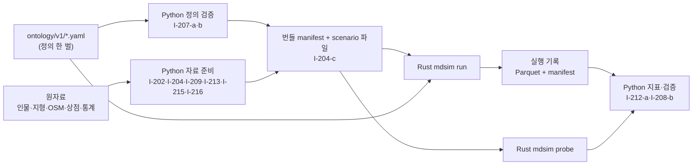

# 페르소나 반응 온톨로지 — 구현체 Map, Python 쪽 (C-201~C-216)

[개념 Map C-201~C-216](01_concept_map.md#페르소나-반응-온톨로지--c-201c-216)을 코드로 옮기는 단위 가운데 **Python이 맡는 부분**을 정한다. Python은 정의 파일 검증, 프로필 추출, LLM 사전 후보, 지형·보행망·장소·상점 자료 준비, 관광·소득·경쟁 상권 생성, 시나리오 번들, 지표 후처리, 검증 보고, 역산 어댑터를 맡는다([DR-214](decisions.md#dr-214--반응-온톨로지의-pythonrust-분담)). 런타임(반응 함수, 틱 진행, 혼잡, 방문 실현, 알아차림, 상점 반응, 스냅샷, plot)은 Rust 엔진 `mdsim`(폴더 `sim/`)이 맡고 [02d](02d_rust_engine.md)에 있다. 두 언어는 §2의 파일 계약으로만 만나며, 정의 파일 `ontology/v1/`은 한 벌을 함께 읽는다([DR-215](decisions.md#dr-215--온톨로지-정의-한-벌-공유와-rust-코드-위치)).

차원·클래스·결정 맥락·지표의 의미와 근거는 설계 부속서 [01a](01a_persona_ontology.md)에, 틱 시뮬레이션(시야·이동·재생)은 [01b](01b_frame_simulation.md)에 있다. 이 문서는 경로·시그니처·스키마·로직·오류·엣지케이스·자원·테스트·완료 정의를 정한다. 경로는 **구현 예정 위치**이고 코드는 아직 없다. 구현 중 이 문서와 어긋나는 결정이 필요하면 코드보다 이 문서를 먼저 고친다. §2의 계약은 02d와 함께 고친다(§2.9).

상태: confirmed(2026-10-31 사용자가 U-1~U-5·U-7~U-12·U-14~U-16을 추천안대로 승인, [DR-233](decisions.md#dr-233--반응-온톨로지-구현체-map의-사용자-확인-항목-확정)). 구현 순서는 [03b](03b_reaction_python_build_order.md)이고 확정 뒤에도 남은 확인은 §6.1 끝에 적었다. 남쪽 OSM([DR-202](decisions.md#dr-202--공간시설-자료와-경사-계산) ②), 경쟁 상권 통계([DR-210](decisions.md#dr-210--경쟁-상권의-범위와-표현)), 활동 엔진의 규칙 파일과 구 인접표는 아직 없고 관광·소득 통계는 일부만 있다([DR-228](decisions.md#dr-228--소득예산관광객-지출의-통계-채택)). 없는 동안의 동작은 §1.9에 정했다. 상점 자료는 2026-10-31에 도착했고 [DR-226](decisions.md#dr-226--상점-자료-수령과-입력-방식)대로 받는다(대응표 `column_map.yaml`은 확정, §6.1 U-10~U-12). 소득·예산은 사용자 지시로 통계 우선이다([DR-227](decisions.md#dr-227--방문객-예산은-실제-통계에-의거한다), U-13).

## 1. 공통 규약

### 1.1 구현 단위 목록과 추적

| 단위 | 개념 단위 | 위치 | 한 줄 요약 |
|---|---|---|---|
| [I-201-a](#i-201-a--차원-정의) | C-201 | `ontology/v1/dimensions.yaml`, `ontology/v1/interests.yaml`, `reaction/ontology/dimensions.py` | 차원·관심 차원 정의 적재·검증 |
| [I-203-a](#i-203-a--환경-클래스-정의) | C-203 | `ontology/v1/classes.yaml`, `reaction/ontology/classes.py` | 환경 클래스 적재·상속·역할 검증 |
| [I-203-b](#i-203-b--식-문법과-평가기) | C-203 | `reaction/ontology/expr.py` | 요구·제공·파생 식의 구문 분석과 참조 평가 |
| [I-207-a](#i-207-a--정의-일괄-적재무결성버전) | C-207 | `reaction/ontology/load.py`, `reaction/params.py`, `ontology/v1/contexts.yaml`, `ontology/v1/parameters.yaml` | 정의 일괄 적재, 금지 간선·참조 검사, 정의 해시 |
| [I-207-b](#i-207-b--실행-규칙-등록부와-모형-구성) | C-207 | `reaction/ontology/registry.py`, `ontology/v1/mechanisms.yaml`, `ontology/v1/configurations.yaml` | 실행 규칙 등록부, 같은 단계 순환 검사, 모형 구성의 u/x |
| [I-207-c](#i-207-c--역산-어댑터-구현-보류) | C-207 | `reaction/adapter.py` | 역산 엔진 어댑터(계약만, 구현 보류) |
| [I-207-d](#i-207-d--계약-스키마번들실행-기록적합성-벡터) | C-207 | `reaction/contract/*.py`, `ontology/v1/conformance/`, `tests/fixtures/contract_bundle/` | §2 계약의 스키마 검사, 번들 쓰기, 실행 기록 읽기, 적합성 벡터 |
| [I-215-a](#i-215-a--추정-소득예산가격-민감도) | C-215 | `reaction/persona/income.py`, `ontology/v1/income.yaml` | 추정 소득, 예산, 가격 민감도 |
| [I-202-a](#i-202-a--근거-추출) | C-202 | `reaction/persona/evidence.py`, `ontology/v1/lexicon.yaml` | 문장 분리, 모달리티, 근거 사전 일치 |
| [I-202-b](#i-202-b--기본값과-프로필-조립) | C-202 | `reaction/persona/defaults.py`, `reaction/persona/profile.py` | 기본값 함수, 근거 반영, 지각 능력, 프로필 조립 |
| [I-202-c](#i-202-c--일괄-처리와-프로필-파일) | C-202 | `reaction/persona/build.py` | 인물 일괄 처리와 프로필·속성·근거 파일 |
| [I-202-d](#i-202-d--llm-사전-후보) | C-202 | `data/reaction-lexicon/<sample_id>/`(일회성 작업, 패키지 코드 없음) | LLM 표본 사전 후보(이 세션의 Haiku 하위 에이전트, DR-217) |
| [I-209-a](#i-209-a--가용-시간-창과-기본-이동-시간) | C-209 | `reaction/persona/access.py` | 가용 시간 창, 출발지, 기본 이동 시간 표 |
| [I-213-a](#i-213-a--외국인-관광객-집단과-배경-보행자) | C-213 | `reaction/persona/tourists.py`, `ontology/v1/tourists.yaml` | 관광객 프로필, 통계 전의 배경 보행자 |
| [I-216-a](#i-216-a--경쟁-상권) | C-216 | `reaction/env/competitors.py`, `ontology/v1/competitors.yaml` | 경쟁 상권 8곳과 접근 시간 |
| [I-204-a](#i-204-a--지형과-보행망) | C-204 | `reaction/geo.py`, `reaction/env/terrain.py`, `reaction/env/network.py` | 지역 좌표, 고도, 보행망 노드·간선, 경사 |
| [I-204-b](#i-204-b--장소상점출입구건물) | C-204·C-203·C-211·C-214 | `reaction/env/places.py`, `reaction/env/stores.py`, `reaction/env/portals.py`, `reaction/env/buildings.py`, `ontology/v1/store_columns.yaml` | 장소 인스턴스, 사용자 상점 자료 계약, 출입구, 건물 가림 |
| [I-204-c](#i-204-c--시나리오-번들) | C-204 | `reaction/env/scenario.py`, `ontology/v1/presets.yaml` | 변수 16개를 파일 값과 시나리오 파일로 나눠 번들 작성 |
| [I-212-a](#i-212-a--지표-후처리) | C-212 | `reaction/metrics/indicators.py`, `ontology/v1/indicators.yaml` | 실행 기록 → 지표 Y-01~Y-27 |
| [I-208-a](#i-208-a--정의프로필-속성-검사) | C-208 | `reaction/verify/properties.py` | 정의·식·프로필의 속성 검사 |
| [I-208-b](#i-208-b--검증-실행기와-보고서) | C-208 | `reaction/verify/{expectations,probe,textcheck,review,report}.py`, `ontology/v1/expectations.yaml` | 기대 방향 표, 홀드아웃, 원문 일관성, 표본 검수, 교차 검사, 보고서 |
| [I-200-a](#i-200-a--명령행) | 공통 | `reaction/cli.py`, `reaction/{errors,ids,rng,io}.py` | 명령행, 오류·ID·난수·입출력 공통 도구 |

### 1.2 개념 단위의 언어 분담

| 개념 단위 | Python (이 문서) | Rust ([02d](02d_rust_engine.md)) |
|---|---|---|
| C-201 공통 차원 | 정의·검증(I-201-a) | 정의 읽기, 집계 규칙과 비용 실행 |
| C-202 내국인 프로필 | 전부(I-202-a~d) | `profiles.parquet` 읽기 |
| C-203 환경 클래스 | 정의·상속·역할 검증, 식 참조 평가(I-203-a·b) | 식을 런타임 값으로 평가 |
| C-204 상황 구성 | 공간·장소 인스턴스, 시나리오 번들(I-204-a~c) | 상황과 대안 생성(VISIT·NEXT·ROUTE·REST·PURCHASE, 01b의 LOOK) |
| C-205 반응 함수 | 없음 | 전부 |
| C-206 개인 상태와 시간 | 없음 | 전부(0.5초 틱, 10분 집계) |
| C-207 저장·버전·등록 | 적재·무결성·등록부·정의 해시·계약(I-207-a·b·d), 역산 어댑터(I-207-c, 보류) | 시작할 때 정의 해시 대조 |
| C-208 검증 체계 | 검증 실행기·보고서(I-208-a·b) | 반응·틱 속성 테스트 |
| C-209 방문 | 가용 시간 창·출발지·기본 이동 시간(I-209-a) | 방문 결정, 몸 수, 도착 실현 |
| C-210 집단 상호작용 | 없음 | 전부(본 값 포함) |
| C-211 상점 반응 | 상점 자료와 재무 값 준비(I-204-b) | 월 반응 |
| C-212 지표 | 지표 정의와 정본 계산(I-212-a) | `metrics_10min`과 plot용 요약 |
| C-213 외국인 관광객 | 관광객 프로필, 배경 인원(I-213-a) | 몸 실현 |
| C-214 인지와 주목 | 장소 시계성·인지도 값(I-204-b) | 알아차림, 고려 집합 |
| C-215 소득과 예산 | 전부(I-215-a) | 없음(예산·민감도는 프로필로 받음) |
| C-216 경쟁 상권 | 경쟁 상권 표와 접근 시간(I-216-a) | 방문 결정의 외부 대안 |

### 1.3 실행 환경과 기술 선택

- 언어: Python 3.13.1(`/Library/Frameworks/Python.framework/Versions/3.13/bin/python3`). 활동 엔진·역산 설계와 같다.
- 라이브러리는 이 PC에 **이미 설치된** 버전만 쓴다(S-I2). NumPy 2.4.6(벡터 연산), PyArrow 24.0.0(Parquet), PyYAML 6.0.3(`yaml.safe_load`만), NetworkX 3.6.1(보행망 연결 성분 검사), Pillow 12.2.0(GeoTIFF 읽기, S-I3). 나머지는 표준 라이브러리(`json`, `hashlib`, `dataclasses`, `typing`, `math`, `re`, `csv`, `bisect`, `pathlib`, `argparse`, `tempfile`, `subprocess`, `shutil`, `unittest`).
- 쓰지 않는 것: rasterio·shapely(시스템 파이썬에 없다. 점-다각형 포함, 선분 투영, 폴리라인 길이는 `reaction/geo.py`에 직접 둔다), pandas(메모리·결정성), SciPy(필요 없음), pytest·hypothesis(설치되어 있지 않음).
- LLM: 근거 사전 후보(I-202-d)는 이 대화 세션의 하위 에이전트(모델 Haiku)가 표본 문장을 읽어 만든다([DR-217](decisions.md#dr-217--근거-사전-후보는-이-세션의-haiku-하위-에이전트가-만든다)). `anthropic` SDK와 API 키는 쓰지 않으며, Python 파이프라인은 어떤 단계에서도 LLM을 부르지 않는다.
- 활동 엔진 재사용: 근거 추출(I-202-a)은 활동 엔진의 `engine/rules.py`(`load_rules`), `engine/text.py`(`split_sentences`, `split_clauses`, `mask_text`), `engine/cues/timecues.py`(`extract_time_cues`, `inherit_context`), `engine/cues/modality.py`(`classify_modality`)를 import한다([02_impl_map](02_impl_map.md#i-04-a--규칙-로더와-텍스트-도구) I-04-a~I-04-c). 기본 이동 시간(I-209-a)은 `rules/v1/geo/district_adjacency.csv`(I-06-a)를 읽는다. 가용 시간 창은 DR-19에서 유도한 `availability.windows`(§1.10 보충 표)를 쓴다(S-I29). 규칙 파일이 없으면 `ModelNotReady`다(§1.9).
- Rust 엔진 호출: I-208-b는 환경 변수 `CBU_MDSIM`(실행 파일 경로, 예: `sim/target/release/mdsim`)이 있을 때만 `subprocess.run`으로 부른다. 없으면 엔진이 필요한 테스트는 건너뛰고 건너뛴 사실을 보고서에 남긴다.
- 실행: 프로젝트 루트에서 `python3 -m reaction.cli <명령>`(I-200-a). 테스트: `python3 -m unittest discover -s tests -p 'test_i2*.py' -t . -v`. 느린 테스트는 `CBU_SLOW=1`일 때만, 엔진 교차 테스트는 `CBU_MDSIM`이 있을 때만 돈다.

### 1.4 파일 배치

```
reaction/
  __init__.py  errors.py  ids.py  rng.py  params.py  io.py  geo.py  cli.py  adapter.py
  ontology/  __init__.py dimensions.py classes.py expr.py lexicon.py load.py registry.py
  persona/   __init__.py evidence.py defaults.py profile.py build.py income.py access.py tourists.py
  env/       __init__.py terrain.py network.py places.py stores.py portals.py buildings.py competitors.py scenario.py
  contract/  __init__.py schemas.py bundle.py runread.py conformance.py
  metrics/   __init__.py indicators.py
  verify/    __init__.py properties.py expectations.py probe.py textcheck.py review.py report.py
ontology/v1/                       # 정의(TBox). 사람이 읽고 고치는 정본, Python·Rust가 함께 읽는다
  dimensions.yaml interests.yaml classes.yaml contexts.yaml parameters.yaml lexicon.yaml
  mechanisms.yaml configurations.yaml indicators.yaml expectations.yaml presets.yaml
  competitors.yaml tourists.yaml income.yaml store_columns.yaml
  conformance/                     # 적합성 벡터(I-207-d가 생성, 정의 해시 대상 아님)
data/reaction-lexicon/<sample_id>/      # I-202-d: 표본·에이전트 출력·검사 결과·후보 표
tests/test_i2??_*.py  tests/reaction_fixtures.py  tests/fixtures/reaction/  tests/fixtures/contract_bundle/
data/reaction-inputs/
  profiles/<population>/           # I-202-c: profiles.parquet profile_attrs.parquet evidence.parquet build.json
  tourists/                        # I-213-a: profiles.parquet profile_attrs.parquet background_flows.parquet build.json
  space/<space_id>/                # I-204-a·b: nodes edges buildings places portals areas .parquet, space.json
  access/                          # I-209-a·I-216-a: access.parquet competitors.parquet build.json
data/reaction-bundles/<bundle_id>/ # I-204-c: manifest.json, scenarios/*.yaml, 시나리오가 바꾼 파일
data/reaction-post/<run_id>/       # I-212-a: indicators.parquet indicators.json
data/reaction-reports/<report_id>/ # I-208-b: report.json report.md 와 표
```

Rust의 실행 폴더 위치는 02d가 정한다. Python은 실행 폴더 경로를 인자로 받아 읽기만 한다.

### 1.5 표기, 단위, ID

- 단위: 거리 m, 좌표 m(§2.4의 지역 좌표), 고도 m(EGM2008), 경사 %(진행 방향 오르막 +), 단 높이 cm, 밀도 인/㎡, 금액 원(정수), 시각은 하루 기준 분(정수 0~1440, 반열린 구간 [시작, 끝), [DR-17](decisions.md#dr-17--프레임과-시간-규약-및-결정성)), 기간은 분, 효용 util(S-I6).
- 하루 유형: `weekday`, `weekend`, `event_day`(02d와 같음).
- ID는 ASCII 문자열이고 정규식 `^[A-Za-z0-9:_.#\-]{1,96}$`을 지킨다(`reaction.ids.check_id`). `#`은 Rust의 몸 ID(`<persona_id>#<복제 번호>`)에만 쓴다. 접두로 종류를 나눈다.

| 종류 | 형식 | 예 |
|---|---|---|
| 내국인 | `P:<synthetic_id>`(증강) 또는 `P:<uuid>`(명동 514명) | `P:d60eabf5-4b9e-5f4a-9e6b-297274538bea` |
| 관광객 | `T:<6자리 번호>` | `T:000123` |
| OSM 장소 | `O:n<id>`, `O:w<id>`, `O:r<id>` | `O:n4433221100` |
| 사용자 상점 | `S:<store_id>`. store_id가 ID 문자 집합 밖이면 `S:h<SHA-256(store_id) 앞 16자>`이고 원래 값은 `store_ref` 열에 둔다 | `S:h1f0c…` |
| 노점·추가 벤치·행사 | `L:<4자리>`, `R:<4자리>`, `V:<4자리>` | `L:0007` |
| 노드 | OSM 노드 `N:<id>`, 출입구 분할점 `N:p<4자리>`, 경계 분할점 `N:b<4자리>` | `N:p0003` |
| 간선 | `E:w<OSM way id>:<순번>` | `E:w37400957:2` |
| 출입구 | `Q:n<id>`(역 출입구·버스 정류장 노드), `Q:w<id>`·`Q:n<id>`(숙소), `Q:b<4자리>`(경계) | `Q:n2210098765` |
| 건물 | `B:w<id>`, `B:r<id>`(3D 지도의 `way/…`·`relation/…`) | `B:w404947436` |
| 출발지 | 서울 구 `G:<시군구 5자리 코드>` | `G:11140` |
| 경쟁 상권 | `C:<slug>` | `C:namdaemun` |
| 영역 | `A:<slug>` | `A:boundary` |

### 1.6 결정성 규약

1. 난수는 `reaction.rng.keyed_uniform`만 쓴다(S-I9). 정의는 §2.7 (1)이고 [02b §6](02b_inverse_algorithm.md#6-난수와-시나리오의-고정)과 같다. Python `random`, `numpy.random`, `hash()`는 쓰지 않는다. Python 쪽 메커니즘 ID는 `PY.TOURIST`(관광객 합성), `PY.COMPANION`(동반 확률의 근거 추첨이 필요할 때), `PY.STALL`(노점 배치), `PY.REVIEW`(검수 표본), `PY.LLM_SAMPLE`(I-202-d 표본)이다.
2. 사전·집합은 정렬한 키로 순회한다. 정렬은 코드포인트 순이다.
3. Parquet는 `pyarrow.parquet.write_table(table, path, compression="zstd", compression_level=3, row_group_size=50_000, use_dictionary=True)`로 쓰고, 행 순서를 각 표의 키 순으로 고정하며, 실행 시각을 내용에 넣지 않는다. JSON은 `json.dumps(obj, sort_keys=True, ensure_ascii=False, separators=(",", ":"))`, YAML 출력은 `yaml.safe_dump(obj, sort_keys=True, allow_unicode=True)`다.
4. 정의 해시 `ontology_sha256`은 §2.7 (3)이다.
5. 모든 산출 폴더는 `.tmp-<이름>/`에 쓰고 검사가 끝난 뒤 이름을 바꾼다. 같은 이름이 있으면 `RunError`다(덮어쓰지 않는다). 실패하면 임시 폴더를 지운다.

### 1.7 오류 정책

모든 예외는 `reaction.errors.ReactionError(code: str, message: str, context: dict[str, str | int | float])`의 하위 클래스다. 명령행은 아래 종료 코드로 끝나고 표준 오류에 `code`, `message`, `context`를 JSON 한 줄로 쓴다.

| 예외 | 발생 | 처리 | 종료 코드 |
|---|---|---|---|
| `InputError` | 자료 파일 누락, 필수 열·타입 불일치, 대응표에 없는 업종 | 즉시 중단, 파일·열·값을 메시지에 | 2 |
| `OntologyError` | 정의 파일 누락·형식 오류, 금지 간선, 끊긴 참조, u/x 중복, 매개변수 라벨 누락, 식 구문 오류 | 즉시 중단, 파일·키를 메시지에 | 3 |
| `InvariantError` | 산출 불변식 위반(편안 상한 ≥ 한계, 확률 합 ≠ 1, NaN·Inf, 경계 밖 출입구) | 산출 실패, 임시 폴더 삭제 | 4 |
| `RunError` | 설정 오류, 이미 있는 산출 폴더, 경로 문제 | 즉시 중단, 기존 산출물 보존 | 5 |
| `ModelNotReady` | 요청한 단계의 선행 자료가 없음(규칙 파일, 구 인접표 등) | 즉시 중단, 없는 자료 목록을 메시지에 | 6 |
| `ContractError` | §2 계약 위반(번들·실행 기록의 스키마, 해시 불일치, 모르는 schema_version) | 즉시 중단, 파일·열을 메시지에 | 7 |
| `EngineCallError` | `mdsim` 호출 실패(실행 파일 없음, 0이 아닌 종료, 시간 초과) | 그 검사를 실패로 기록하고 보고서는 계속 | 8 |

활동 엔진의 오류 코드(2~5)와 같은 뜻이며 6~8만 새로 쓴다(S-I12).

### 1.8 자원과 실행 규칙

- 단일 프로세스. 인물 처리는 5,000명 청크(`CHUNK_PERSONS = 5000`).
- 6.5만 명 규모의 처리(`--limit` 없음), 서울 전원 측정(E207-5), 실행 기록이 100MB를 넘는 지표 계산은 반드시 `/Users/aiden/memguard/bin/memguard run --label "CBU_Hack:reaction:<명령>" --mem-gb 3 -- python3 -m reaction.cli …`로 감싼다. 시작 전에 `memguard status`로 디스크 여유 12GiB 이상을 확인한다. `--limit` 개발 실행과 단위 테스트는 감싸지 않는다.
- 목표치(구현 후 측정, 넘으면 실패가 아니라 `perf` 경고로 남기고 Phase 6에 최적화 todo를 만든다): 프로필 6.5만 명 10분·1.5GiB 이내, 공간 모델 60초·1GiB 이내, 번들 30초 이내(프로필을 다시 쓰지 않을 때), 지표 계산 실행 기록 1GB당 3분·2.5GiB 이내.
- 실행 기록은 열을 골라 읽는다(`pq.read_table(path, columns=[…])`). 사건 표는 행 그룹 단위로 읽어 집계한다.

### 1.9 입력 자료 계약

| 자료 | 경로 | 상태 | 쓰는 단위 |
|---|---|---|---|
| 증강 내국인 | `data/myeongdong-augmented/personas.parquet`(65,000행, 원본 26열 + `synthetic_id`, `donor_uuid`, `parent_uuid`, `variation_index`, `parent_match_type`, `parent_evidence_json`, `parent_evidence_role`) | 있음 | I-202-c |
| 명동 원본 | `data/myeongdong-personas/myeongdong.parquet`(514행, 26열) | 있음 | I-202-c(검증용) |
| 서울 전원 | `data/nemotron-personas-korea/`의 서울 행(185,228명, C-02 산출) | 있음 | E207-5 측정만 |
| 원본 지형 | `data/myeongdong-terrain/terrain_gedtm30_v1.2.tif`(57×57, 유효 1,462칸, nodata 3.4028234663852886e+38) + `metadata.json` | 있음 | I-204-a |
| 스무딩 지형 | `data/myeongdong-terrain/final/terrain_smoothed.tif` + `final/metadata.json` | 있음 | I-204-a(기록용) |
| 확장 지형 | `data/myeongdong-3d-map/terrain_extended.tif`(57×57 전부 유효, 경계 안은 스무딩 확정값과 같음) + `terrain_metadata.json` | 있음 | I-204-a(원본 범위 밖 노드) |
| 행정동 경계 | `data/myeongdong-terrain/boundary.geojson` | 있음 | I-204-a·b |
| OSM | `data/myeongdong-3d-map/source/osm_raw.json`(ODbL, 범위 위도 37.5595~37.5665·경도 126.981~126.9895, BOM 있음 → `utf-8-sig`) | 있음 | I-204-a·b |
| 3D 지도 건물 | `data/myeongdong-3d-map/map_data.json`의 `buildings`(709개, 지역 좌표 발자국·높이) | 있음 | I-204-b |
| OSM 확장(남쪽·북서·북쪽) | `data/myeongdong-osm-south/osm_raw.json`(이름은 03b의 P-1에서 일반화) | 범위 확정(U-12, [DR-233](decisions.md#dr-233--반응-온톨로지-구현체-map의-사용자-확인-항목-확정)). 내려받기는 출처·크기를 알리고 허락을 받은 뒤 | I-204-a |
| 상점 자료 | `data/myeongdong-stores/myeongdong_1f_filled_step5.csv`(건물 단위 행 1,502 × 21열, UTF-8 BOM, SHA-256 `fce4aedd…66da`) + `column_map.yaml` | 있음(2026-10-31, [DR-226](decisions.md#dr-226--상점-자료-수령과-입력-방식)). `column_map.yaml`은 초안이고 사용자 확인 대기(U-10·U-11) | I-204-b |
| 활동 엔진 규칙 | `rules/v1/text.json`·`time.json`·`modality.json`(I-04-a `scripts/install_rules.py`의 산출) | 대기 | I-202-a |
| 구 인접표 | `rules/v1/geo/district_adjacency.csv`(I-06-a) | 대기 | I-209-a, I-216-a |
| 명동 유동인구 | `data/myeongdong-traffic/time_profile_10min.parquet`, `traffic_reference.json` | 있음 | I-212-a(E212-6 비교) |
| 관광 통계 | `data/reaction-stats/tourists/foreign_visitors_2025.json` | 있음(하루 지출·권역별 분포·입국자, [DR-228](decisions.md#dr-228--소득예산관광객-지출의-통계-채택)). 분포 표의 국적·목적 분류 대응은 대기(DR-208 후속) | I-213-a |
| 소득 통계 | `data/reaction-stats/income/`(`wage_2025.json`, `household_2025.json`, `domestic_trip_spend_2025.json`, `domestic_trip_household_2025.json`, `myeongdong_card_sales_2025.json`), 원본은 `raw/` | 있음(근로소득·방문 예산, 2026-10-31, [DR-228](decisions.md#dr-228--소득예산관광객-지출의-통계-채택)·[DR-230](decisions.md#dr-230--방문-예산의-통계-채택)). 소득 없는 인물의 개인 단위 소득 통계는 없어 가정 유지([DR-231](decisions.md#dr-231--소득-구조방문-예산관광객-지출-기준의-확정)) | I-215-a |
| 경쟁 상권 매력 | `data/reaction-stats/competitors/` | 대기(DR-210) | I-216-a |

- 상점·관광·소득·경쟁 상권 자료가 없으면 `ontology/v1`의 가정 값으로 만들고, 산출 폴더의 `build.json`과 번들 manifest의 `pending_inputs`에 남긴다.
- 관광 통계가 오기 전에는 관광객 프로필을 만들지 않고 배경 보행자 표만 만든다([DR-225](decisions.md#dr-225--엔진-구현-언어와-범위) ⑤, DR-208의 대안).
- 활동 엔진 규칙 파일이 없으면 I-202-a는 `ModelNotReady`다. 대신할 자료가 없다. 구 인접표만 없을 때는 `--access-mode uniform`(모든 구에서 같은 기본 이동 시간, `assumption`)으로 개발·시연할 수 있고 그 사실을 `build.json`에 남긴다(S-I14). 테스트는 `tests/reaction_fixtures.py`의 4개 구 장난감 인접표와 최소 규칙 파일을 쓴다.
- 남쪽 OSM이 없으면 제공 범위만으로 공간 모델을 만들고 `space.json`의 `pending_inputs`에 남긴다.

### 1.10 매개변수 규약과 기본값

`ontology/v1/parameters.yaml`은 `version`과 `parameters:` 아래 키 → `{value, unit, label, source, owner}`의 사전이다(02d가 읽는 형식). `label`은 `measured`·`calibrated`·`assumed` 중 하나([S-R22](01a_persona_ontology.md#5-phase-2--self-결정)), `owner`는 식을 정하는 Map(`02c` 또는 `02d`)이다. `reaction.params.Params.load(path)`가 읽고 다섯 필드 중 하나라도 없거나 `label`·`owner`가 목록 밖이면 `OntologyError`다. Python은 모든 키의 형식을, `owner: 02c` 키의 의미를 검사한다. `owner: 02d` 키는 02d §2.4가 이름·식·초기값을 정하고 이 표에는 다시 적지 않는다(아래 표는 02c 소유 키다). 값이 표(구간 선형 보간 매듭)이면 `[[나이, 값], …]`, 범주 사전이면 `{범주: 값}`이다. 역산 엔진에는 모두 계수 θ로 넘어간다. `measured` 값 중 "원문 대조"라고 적은 것은 문헌 원문과 대조하는 todo를 Phase 6에 둔다([DR-203](decisions.md#dr-203--반응-모델-수치의-출처와-재현-기준)).

| 키 | 값 | 단위 | 라벨 | owner | 출처·메모 |
|---|---|---|---|---|---|
| `choice.tau` | 0.5 | util | assumed | 02c | 인물별 τ의 기본값(I-202-b) |
| `utility.goal_value` | shopping 1.5, food 1.5, culture 1.5, faith 2.0, work 3.0, meet 2.5, tour 2.0, other 1.0 | util | assumed | 02c | 목적 유형별 가치(I-202-b가 `purposes.value`에 씀) |
| `anchors.climb_pct` | flat 0, gentle 5, ramp 8.33, steep 12, very_steep 15 | % | assumed | 02c | 언어 기준점. 경사로 1:12와 보행로 1:20 관례를 참고 |
| `capacity.climb.comfort_pct` | [[19,8.0],[30,8.0],[60,6.2],[75,5.3],[90,4.4]] | % | assumed | 02c | 나이 매듭, 구간 선형 보간(§2.7 (4)) |
| `capacity.climb.limit_pct` | [[19,18],[30,18],[60,13.5],[75,11.25],[90,9.0]] | % | assumed | 02c | |
| `capacity.fall.comfort` | [[19,0.30],[40,0.30],[70,0.21],[90,0.15]] | 1 | assumed | 02c | |
| `capacity.fall.limit` | [[19,0.70],[40,0.70],[70,0.52],[90,0.40]] | 1 | assumed | 02c | |
| `capacity.walk.comfort_m` | [[19,2500],[40,2500],[70,2050],[90,1750]] | m | assumed | 02c | |
| `capacity.walk.limit_m` | [[19,6000],[40,6000],[70,4800],[90,4000]] | m | assumed | 02c | |
| `capacity.step.comfort_cm` | [[19,18],[60,18],[80,16],[90,15]] | cm | assumed | 02c | 걸어서 |
| `capacity.step.limit_cm` | [[19,30],[60,30],[80,25],[90,22.5]] | cm | assumed | 02c | |
| `capacity.crowd` | comfort 0.7, limit 2.0 | 인/㎡ | assumed | 02c | Fruin 서비스 수준 참고 |
| `capacity.sense` | comfort 0.4, limit 0.9 | 1 | assumed | 02c | |
| `capacity.way` | domestic [0.6,1.0], domestic_familiar [0.8,1.0], tourist_korean [0.6,1.0], tourist [0.2,0.6] | 1 | assumed | 02c | [편안 상한, 한계] |
| `capacity.safe` | comfort 0.3, limit 0.8 | 1 | assumed | 02c | |
| `capacity.uncertainty` | structured 0.10, text 0.05, statistics 0.10, assumption 0.25 | 1 | assumed | 02c | 근거 라벨별 상대 표준편차(`cap_*_uncertainty`) |
| `defaults.sensitivity` | 1.0 | 1 | assumed | 02c | 모든 비용 차원 |
| `defaults.interest` | 0.2 | 1 | assumed | 02c | 모든 A-* |
| `defaults.disposition` | overexertion 0.5, punctuality 0.5, exploration 0.5, attention 0.5 | 1 | assumed | 02c | |
| `perception.focal_range_m` | [[19,25],[60,25],[75,20],[90,15]] | m | assumed | 02c | 간판을 알아보는 거리(01b §3.4(1)) |
| `perception.focal_angle_deg` | [[19,60],[60,50],[75,40],[90,30]] | 도 | assumed | 02c | 전체 각. 나이에 따라 좁아지는 방향은 Ball 외 1988(UFOV) |
| `perception.peripheral_angle_deg` | 150 | 도 | measured | 02c | Moussaïd 외 2011의 ±75°(원문 대조) |
| `perception.peripheral_range_m` | 10 | m | measured | 02c | Moussaïd 외 2011(원문 대조) |
| `perception.head_turn_deg` | 90 | 도 | assumed | 02c | 진행 방향에서 시선까지의 최대 각 |
| `perception.min_dwell_s` | 1.0 | 초 | assumed | 02c | 01b §3.8의 1초 렌더와 맞춤 |
| `perception.vision_cue_scale` | 0.8 | 1 | assumed | 02c | 현재형 시력 저하 단서 → 초점 거리 배율 |
| `walk.v0_mps` | 1.34 | m/s | measured | 02c | Weidmann 1993 자유 보행 속도(원문 대조). I-202-b가 기준 속도에 씀 |
| `walk.age_factor` | [[19,1.0],[60,1.0],[75,0.85],[90,0.75]] | 1 | assumed | 02c | 기준 속도 = v0 × 나이 배율 |
| `crowd.congested_density` | 1.08 | 인/㎡ | measured | 02c | Y-02의 기준 밀도. 02d `crowd.los_thresholds`(Fruin 1971)의 D/E 경계와 같은 값 |
| `crowd.carriage_share` | residential 0.5, service 0.5, living_street 0.5 | 1 | assumed | 02c | 차량 통행 시간에 잃는 보행 면적 비율(간선 열 `carriage_share`) |
| `indicators.night_start_min` | 1200 | 분 | assumed | 02c | Y-10의 기준 시각 20:00 |
| `segment.full_width_m` | pedestrian 8.0, footway 3.0, steps 2.5, path 2.0, corridor 3.0, residential 6.5, service 4.0, living_street 6.0 | m | assumed | 02c | `walk_mode=full`의 폭. OSM `width` 태그가 있으면 그 값 |
| `segment.lane_width_m` | 3.25 | m | assumed | 02c | 간선도로 차로 폭 |
| `segment.default_lanes` | primary 6, secondary 4, tertiary 2, primary_link 1, secondary_link 1, tertiary_link 1 | 차로 | assumed | 02c | OSM `lanes`가 없을 때 |
| `segment.sidewalk_width_m` | primary 4.0, secondary 3.0, tertiary 2.5, primary_link 2.0, secondary_link 2.0, tertiary_link 2.0 | m | assumed | 02c | 한쪽 보도 폭(DR-222) |
| `segment.walk_mode` | full: pedestrian, footway, steps, path, corridor, residential, service, living_street; sidewalks: primary, secondary, tertiary, *_link; none: 그 밖 | — | assumed | 02c | DR-222 |
| `segment.vehicle_mixed_types` | residential, service, living_street | — | assumed | 02c | 차량과 폭을 나눠 쓰는 유형(DR-222) |
| `segment.vehicle_hours_default` | [[360, 1440]] | 분 | assumed | 02c | 차량 혼재 간선의 기본 차량 통행 시간 06:00~24:00 |
| `segment.ped_zone_name_pattern` | `^명동(\d+[가-힣]?)?길$` | — | assumed | 02c | 변수 #1의 대상 거리(이름이 '명동…길'인 차량 혼재 간선). 사용자 확인 항목(§6) |
| `segment.ad_intensity` | pedestrian 0.6, primary 0.5, secondary 0.5, residential 0.4, footway 0.3, 그 밖 0.2 | 1 | assumed | 02c | DR-202 ③ |
| `segment.way_difficulty` | pedestrian 0.2, primary 0.3, secondary 0.3, footway 0.4, steps 0.4, residential 0.5, service 0.5, corridor 0.7, 그 밖 0.4, 지하(layer < 0) +0.2 | 1 | assumed | 02c | |
| `segment.safe_demand` | residential 0.4, service 0.4, living_street 0.3, primary 0.2, secondary 0.2, tertiary 0.2, 그 밖 0 | 1 | assumed | 02c | 차량 통행 중일 때의 D-SAFE 요구 |
| `segment.riser_cm` | 15 | cm | assumed | 02c | 계단 단 높이 |
| `segment.level_height_m` | 4.5 | m | assumed | 02c | 지하 한 층 높이(지하 계단의 오르내림) |
| `fall.ref_down_pct` | 20 | % | assumed | 02c | 내리막 낙상 위험 = 내리막 % ÷ 20 × 노면 배율(식은 §3 I-203-a) |
| `fall.surface_factor` | dry 1.0, wet 1.6, ice 3.0 | 1 | assumed | 02c | |
| `fall.stairs_down_base` | 0.35 | 1 | assumed | 02c | 계단 내려가기의 기본 위험 |
| `vertical.elevator_wait_min` | 1.5 | 분 | assumed | 02c | 수직 이동 설비의 D-TIME |
| `way.no_foreign_label` | 0.5 | 1 | assumed | 02c | 외국어 표기가 없는 장소의 D-WAY 요구 |
| `visibility.proxy` | floor_0_1 1.0, floor_minus1 0.4, floor_2plus 0.3, floor_unknown 0.6, ped_edge_bonus 0.1 | 1 | assumed | 02c | 상점 자료가 없을 때의 시계성(상한 1) |
| `place.fame` | brand 1.0, other 0.2 | 1 | assumed | 02c | OSM `brand` 태그가 있으면 brand |
| `access.hop_minutes` | 0: 10, 1: 20, 2: 30, 3: 40 | 분 | assumed | 02c | [DR-13](decisions.md#dr-13--장소-해석과-지리-상수) ⑤, 3홉 이상은 40 |
| `access.mode_factor` | subway 1.0, bus 1.2, taxi 0.8 | 1 | assumed | 02c | 수단별 기본 이동 시간 = 홉 분 × 배율 |
| `access.walk_minutes_hop0` | 25 | 분 | assumed | 02c | 같은 구(0홉)에서만 도보 대안 |
| `access.uniform_minutes` | 30 | 분 | assumed | 02c | S-I14 개발 모드 |
| `access.headway_base_min` | subway 6.0 | 분 | assumed | 02c | 지하철 출입구의 기준 배차(`portals.headway_min`). 변수 #9는 시나리오의 `headway_multiplier` |
| `access.fare_krw` | subway 1550, bus 1500, taxi_base 4800, taxi_per_km 1000, km_per_hop 4 | 원 | assumed | 02c | |
| `stall` | base_count 40, footprint_m2 3.0, open_min 960, close_min 1380, price_krw 5000, offer souvenir_share 0.25 | 개·㎡·분·원 | assumed | 02c | 변수 #3의 기준 배치(I-204-c). 사용자 확인 항목(§6) |
| `bench` | seats_per_bench 3, added_spacing_m 30 | 석·m | assumed | 02c | 변수 #4의 추가 벤치 배치 |
| `event` | anchor_place_name 명동예술극장, start_min 900, end_min 1020, capacity 300, sense 0.6 | 분·인·1 | assumed | 02c | 변수 #8의 행사 위치(그 장소의 앵커)·시간. 사용자 확인 항목(§6) |
| `income.*` | `ontology/v1/income.yaml` | — | assumed | 02c | I-215-a |

보충 표(언어 기준점과 공간·접근 가정값):

| 키 | 값 | 단위 | 라벨 | owner | 출처·메모 |
|---|---|---|---|---|---|
| `anchors.fall` | low 0.2, moderate 0.4, high 0.7 | 1 | assumed | 02c | D-FALL 언어 기준점 |
| `anchors.step_cm` | low 10, normal 18, high 25 | cm | assumed | 02c | D-STEP |
| `anchors.walk_m` | short 500, moderate 2000, long 5000 | m | assumed | 02c | D-WALK |
| `anchors.time_min` | short 10, moderate 30, long 90 | 분 | assumed | 02c | D-TIME |
| `anchors.money_krw` | cheap 10000, moderate 30000, expensive 100000 | 원 | assumed | 02c | D-MONEY |
| `anchors.way` | easy 0.2, moderate 0.5, hard 0.8 | 1 | assumed | 02c | D-WAY |
| `anchors.sense` | calm 0.2, lively 0.5, loud 0.8 | 1 | assumed | 02c | D-SENSE |
| `anchors.crowd` | quiet 0.3, busy 1.0, packed 2.0 | 인/㎡ | assumed | 02c | D-CROWD |
| `anchors.safe` | low 0.2, moderate 0.5, high 0.8 | 1 | assumed | 02c | D-SAFE |
| `anchors.store_ratio` | comfortable 0.6, tight 0.8, loss 1.0 | 1 | assumed | 02c | D-COST·D-DEMAND |
| `anchors.interest` | low 0.1, some 0.4, high 0.8 | 1 | assumed | 02c | A-* |
| `segment.min_effective_area_m2` | 1.0 | ㎡ | assumed | 02c | 유효 면적 하한(0 나눗셈 방지) |
| `segment.grade_baseline_m` | 20 | m | assumed | 02c | 짧은 간선 경사의 창(S-I22) |
| `segment.safe_demand_crossing` | signalized 0.1, unsignalized 0.3 | 1 | assumed | 02c | 횡단 간선·노드의 D-SAFE 요구 |
| `competitor.price_ref_krw` | 30000 | 원 | assumed | 02c | 경쟁 상권 가격 수준 1.0의 1회 지출 |
| `availability.windows` | day_worker: weekday [[1110,1320]], weekend [[600,1350]], event_day [[600,1350]]; unemployed_under_65: weekday [[600,1320]], weekend·event_day [[600,1350]]; unemployed_65_plus: weekday [[540,1200]], weekend·event_day [[600,1350]]; shift_worker: weekday [[960,1260]], weekend·event_day [[600,1350]]; military_active: weekday [], weekend·event_day [[600,1350]] | 분 | assumed | 02c | DR-19 시간표의 중앙값에서 유도(S-I29). 주간 근무 09:00 시작 + 8시간 + 점심 1시간 + 이동 30분 → 18:30부터, 취침 23:15 − 1시간 → 22:00까지. 무직 65세 미만 기상 07:30 + 2.5시간 → 10:00. 65세 이상 기상 05:45 → 09:00, 취침 21:45 → 20:00. 교대 근무 수면 07:00~15:15 → 16:00~21:00. 주말 기상 08:00 + 2시간 → 10:00, 취침 23:45 → 22:30 |
| `availability.work_window` | [[540, 1080]] | 분 | assumed | 02c | 목적에 work가 있는 인물의 평일 창 |

- 02d 소유 키(02d §2.4의 react.*, notice.*, look.*, perception.crowd_kappa·night_factor·night_light, observe.*, loco.*, crowd.local_radius_m·los_thresholds·prior_density, state.*, purchase.*, route.*, rest.*, visit.*, bg.*, next.*, explore.*, shop.*)는 02d가 이름·값·출처를 정하고 Python은 형식만 검사한다. Python 지표는 `crowd.los_thresholds`를 읽는다. 02c 소유 키의 값을 바꿀 때는 이 표를 먼저 고친다.
- D-HEAT는 v1 정의 파일에 넣지 않는다(S-I18).

## 2. Python ↔ Rust 파일 계약

이 절이 두 언어 사이 계약의 정본이다([DR-214](decisions.md#dr-214--반응-온톨로지의-pythonrust-분담)). 02d는 이 절을 따르고 Rust 쪽 구현만 적는다. 2026-10-31 02d의 구현(`sim/crates/mdsim-core`)과 대조해, 같은 뜻인 이름·형식은 02d 쪽을 따랐고 Python에 필요한 것만 덧붙였다(S-I34). 반응 함수 안의 식(φ, softmax, 효용, Tobler 보정, 알아차림 틱 환산)은 02d §1.5가 정하고, 그 계수는 `parameters.yaml`에 있다.

### 2.1 흐름과 소유



- 정의 검증은 Python 한 곳에서만 한다(S-I15). Rust는 시작할 때 정의 해시(§2.7 (3))를 직접 계산해 번들 manifest의 `ontology_sha256`과 다르면 실행하지 않고, 실행에 필요한 형식만 확인한다.
- 정적 변수(#2·#3·#4·#5·#6·#12·#13·#15·#16)는 Python이 파일 값에 반영하고, 동적 변수(#1·#7·#8·#9·#10·#11·#14)는 시나리오 파일로 넘긴다(S-I31).
- 나이·성별·국적·소득은 Rust 입력(`profiles.parquet`)에 넣지 않는다(S-I17). 나이·성별·국적 → 행동의 금지 간선(01a §3.1 규칙 3, C-205 ②, C-213 ③)을 입력 구조로 막는다. 연령대·내외국인별 지표와 그림은 `profile_attrs.parquet`를 `persona_id`로 조인한다.

### 2.2 번들과 manifest

번들 폴더 `data/reaction-bundles/<bundle_id>/`에는 `manifest.json`, 시나리오 파일들(`scenarios/<day_type>_r<반복>.yaml`), 그리고 시나리오가 바꾼 표만 있다. 바뀌지 않은 표는 기준 입력 폴더(`data/reaction-inputs/…`)의 파일을 경로로 가리킨다(S-I16).

```json
{
  "schema_version": 1,
  "bundle_id": "3f9c0a7d1b2e4c55",
  "ontology_sha256": "<64 hex>",
  "ontology_validation": {"status": "passed", "validator": "reaction.ontology.load:1", "dimensions_version": "1.0.0", "checks": 41},
  "space_id": "<16 hex>",
  "files": {
    "profiles":         [{"path": "data/reaction-inputs/profiles/augmented/profiles.parquet", "sha256": "<64 hex>", "rows": 65000}],
    "nodes":            [{"path": "…", "sha256": "…", "rows": 0}],
    "edges":            [{"…": "…"}],
    "buildings":        [{"…": "…"}],
    "places":           [{"…": "…"}],
    "portals":          [{"…": "…"}],
    "access":           [{"…": "…"}],
    "competitors":      [{"…": "…"}],
    "background_flows": [{"…": "…"}],
    "areas":            [{"…": "…"}],
    "profile_attrs":    [{"…": "…"}],
    "evidence":         [{"…": "…"}]
  },
  "scenarios": [{"day_type": "weekday", "rep": 0, "seed": 9599481731617930288, "path": "data/reaction-bundles/3f9c0a7d1b2e4c55/scenarios/weekday_r0.yaml", "sha256": "<64 hex>"}],
  "pending_inputs": ["stores:DR-212", "tourist_stats:DR-208"],
  "assumption_flags": ["store_attributes_assumed", "tourists_as_background"],
  "producer": {"package": "reaction", "version": "0.1.0", "python": "3.13.1", "pyarrow": "24.0.0"}
}
```

| 필드 | 규칙 |
|---|---|
| `files` 역할 | Rust 필수: `profiles`(파일 1개 이상, 같은 스키마를 이어 붙인다), `nodes`·`edges`·`buildings`·`places`·`portals`·`access`·`competitors`(각 정확히 1개). Rust 선택: `background_flows`(0~1개), `profile_attrs`(plot 조인용). Python 전용: `areas`, `evidence`(Python은 항상 쓴다) |
| `path` | 저장소 루트 기준 POSIX 상대 경로 |
| `sha256` | 파일 바이트의 SHA-256 소문자 16진 |
| `scenarios` | 하루 유형 × 반복마다 한 파일. `seed`는 §2.7 (2)의 `seed_r(base_seed, rep)` |
| `bundle_id` | `{"ontology_sha256", "files": 역할 → sha256 목록(역할 이름순, 목록은 적힌 순), "scenario_sha256": 시나리오 sha256 목록(적힌 순)}`의 정규 JSON(§1.6 3)의 SHA-256 앞 16자. 같은 입력이면 같은 ID다 |
| `space_id` | 공간 모델 폴더의 `space.json`에 있는 값(I-204-a). 시나리오가 장소를 더해도 간선·노드 ID는 같다(S-I20) |
| `pending_inputs` | `<자료>:<DR>` 형식. 가정 값으로 대신한 입력 |

Rust는 `mdsim run --defs ontology/v1 --bundle <번들 폴더> --scenario <시나리오 파일> --out <실행 폴더>`로 반복마다 따로 실행된다(02d §0).

### 2.3 정의 파일과 식 문법

`ontology/v1/` 바로 아래 파일 중 Rust가 읽는 것은 `dimensions.yaml`(키 `dimensions`), `interests.yaml`(키 `interests`), `classes.yaml`(키 `classes`), `contexts.yaml`(키 `contexts`), `parameters.yaml`(키 `parameters`)이다. 나머지(`lexicon`, `mechanisms`, `configurations`, `indicators`, `expectations`, `presets`, `competitors`, `tourists`, `income`, `store_columns`)와 위 파일 안의 다른 키·필드(`store_dimensions`, `inputs`, `actors`, `variables`, `press_tags`, `roles`, `runtime_vars` 설명, `owner` 등)는 Python만 읽는다. Rust는 모르는 키·필드를 무시한다.

클래스의 `press`(차원 → 식), `offers`(관심 차원 → 식), `derived`(`[{name, expr}]`) 값은 아래 문법의 식 문자열이다(S-I19). 02d §2.1의 문법에 `$` 매개변수 참조만 더했다.

```text
expr    := term (("+" | "-") term)*
term    := unary (("*" | "/") unary)*
unary   := "-" unary | primary
primary := NUMBER | NAME | PARAM | call | "(" expr ")"
call    := FUNC "(" expr ("," expr)* ")"
FUNC    := "min" | "max" | "abs" | "clamp" | "pick"
NUMBER  := [0-9]+ ("." [0-9]+)?
NAME    := [a-z_][a-z0-9_]*
PARAM   := "$" [a-z_][a-z0-9_]* ("." [a-z0-9_]+)*
```

| 요소 | 뜻 |
|---|---|
| `NAME` | 인스턴스 속성(상속 뒤), 앞서 선언된 derived 이름, 또는 런타임 변수 `vehicle_active`·`stall_active`·`event_active`·`open`·`light`·`ad_multiplier`(02d가 값을 준다). 방향이 있는 속성(`grade_pct`)은 **진행 방향 값**으로 넣는다(b→a로 지나면 부호를 바꾼 값). 범주 속성은 `values` 안의 인덱스(0부터), 불리언은 0/1이다 |
| `PARAM` | `parameters.yaml`의 스칼라 값. 사전의 하위 값은 점으로 잇는다(`$fall.surface_factor.wet`) |
| `min(a, b, …)`, `max(a, b, …)` | 인자 2개 이상 |
| `abs(a)` | 절댓값 |
| `clamp(x, lo, hi)` | `min(max(x, lo), hi)`. `lo > hi`이면 오류 |
| `pick(i, v0, v1, …)` | `i`가 정수 값(오차 1e-9 이내)이고 0 ≤ i < 후보 수일 때 `v_i`. 범위 밖이면 오류 |

- 수는 IEEE-754 배정밀도다. 왼쪽에서 오른쪽으로 평가하고 단락 평가는 없다. 일정형 속성은 식에 쓸 수 없다(런타임 변수로 바뀐다).
- 오류(0으로 나누기, 결과가 NaN·Inf, 모르는 이름, `pick` 범위 밖, 사전 매개변수를 스칼라로 씀)는 Python 검증에서 찾을 수 있으면 `OntologyError`, 실행 중이면 Rust가 실패로 끝낸다.
- 식 길이 ≤ 400자, 괄호·호출 중첩 ≤ 16.
- D-CROWD 노출(본 밀도)과 간선의 유효 면적은 식이 아니라 Rust가 집단 상태와 기하로 계산한다(02d I-210-r·I-220-r). 유효 면적 = 보행 면적(`full`: length_m × width_m, `sidewalks`: length_m × 2 × sidewalk_width_m) × (1 − vehicle_active × carriage_share) − 그 간선에 열린 노점의 footprint_m2 합이고, 하한은 `segment.min_effective_area_m2`다. Python 지표(Y-01·Y-03)는 이 값(`edge_effective_area_m2`)을 쓴다.
- 런타임 변수의 뜻: `vehicle_active` = is_crossing이거나, vehicle_mixed이고 시각이 `segment.vehicle_hours_default` 안이면서 '`ped_zone`이고 시각이 시나리오 `pedestrian_only` 안'이 아닐 때 1. `open` = 장소가 영업 중(open_min ≤ 시각 < close_min이고 그날이 `day_types`에 있음). `event_active` = 시나리오 `events`의 행사가 진행 중. `stall_active` = 노점이 영업 중. `light`·`ad_multiplier`는 02d가 정한다.

### 2.4 입력 표의 스키마 (Python → Rust)

좌표는 3D 지도의 지역 미터 좌표다(01b S-F10). 기준점 위도 37.563·경도 126.98525, `x`는 동쪽, `z`는 남쪽, 높이는 `elev_m`. 변환식은 §2.7 (5)이고 `scripts/build_myeongdong_3d_map.py`의 `to_local`과 같다. 모든 표는 키 열 순으로 정렬해 쓴다. ID는 문자열이고 §1.5의 형식이다. 클래스 속성 값은 장소·간선 표의 **같은 이름 열**에서 읽는다(표에 없는 속성은 클래스 `default`). 읽는 쪽은 모르는 열을 무시한다.

**(1) `profiles.parquet`** — 키 `persona_id`. 내국인과 관광객이 같은 형식이다.

| 열 | 형식 | 제약 |
|---|---|---|
| `persona_id` | string | 유일, `P:`·`T:` |
| `group` | string | `domestic` 또는 `tourist`. Rust는 몸 수 배율(#10·#11)에만 쓴다 |
| `origin_id` | string | `G:<코드>`(구) 또는 `Q:<출입구>`(명동 안 숙소) |
| `cap_<d>_comfort`, `cap_<d>_limit` | float64 | d ∈ climb, fall, step, walk, money, way, sense, crowd, safe. 0 ≤ comfort < limit |
| `cap_<d>_uncertainty` | float64 | ≥ 0. 상대 표준편차 |
| `cap_<d>_label` | string | `structured`·`text`·`statistics`·`assumption` |
| `sens_<d>` | float64 | ≥ 0. d ∈ climb, fall, step, walk, time, money, way, sense, crowd, safe |
| `interest_<k>` | float64 | ≥ 0. k ∈ food, beauty, fashion, souvenir, culture, faith, nature |
| `risk`, `punctuality`, `exploration`, `attention` | float64 | [0, 1]. 성향(무리 감수, 시간 엄수, 탐색, 주목) |
| `tau` | float64 | > 0 |
| `base_speed_mps` | float64 | > 0 |
| `child_prob`, `stroller_prob`, `luggage_prob` | float64 | [0, 1]. 방문마다 Rust가 SPAWN 키로 뽑는다 |
| `focal_range_m`, `focal_angle_deg`, `peripheral_range_m`, `peripheral_angle_deg`, `head_turn_deg`, `min_dwell_s` | float64 | > 0. 각은 전체 각(도) |
| `purposes` | list<struct<purpose: string, interest: string, value: float64, target_place_id: string?>> | 1개 이상. `purpose` ∈ shopping, food, culture, faith, work, meet, tour, other. `interest`는 A-* ID 또는 빈 문자열 |
| `availability` | list<struct<day_type: string, start_min: int32, end_min: int32>> | 하루 유형(`weekday`·`weekend`·`event_day`)별 0개 이상, 시작 순, 겹치지 않음, 0 ≤ start < end ≤ 1440 |
| `evidence` | list<struct<target: string, field: string, start: int32, end: int32, rule_id: string, label: string>> | 적용된 근거만(설명·온톨로지 지도 그림용). 전체 근거는 `evidence.parquet` |
| `profile_version` | string | 프로필 규칙 버전(I-202-c `build.json`과 같음) |

**(2) `nodes.parquet`** — 키 `node_id`.

| 열 | 형식 | 제약 |
|---|---|---|
| `node_id` | string | `N:` |
| `x`, `z` | float64 | 지역 좌표 m |
| `elev_m` | float64 | S-I22의 고도 |
| `elev_source` | string | `orig`·`extended`·`layer` |
| `layer` | int8 | 0 지상, −1 지하 1층 … (OSM `layer`) |
| `kind` | string | `junction`(차수 ≠ 2 또는 끝점), `crossing`(OSM 횡단 노드와 횡단 간선의 끝), `portal` |
| `signal` | bool | `highway=traffic_signals` 또는 `crossing=traffic_signals` |
| `cross_safe_demand` | float64 | [0, 1]. 횡단 노드의 D-SAFE 요구, 아니면 0 |
| `inside_boundary` | bool | 행정동 경계 안 |

**(3) `edges.parquet`** — 키 `edge_id`. 보행 가능한 간선만 담는다(`walk_mode=none`은 빼고 수를 `space.json`에 남긴다).

| 열 | 형식 | 제약 |
|---|---|---|
| `edge_id` | string | `E:w<way>:<순번>` |
| `a`, `b` | string | 노드 ID. `a ≠ b` |
| `class` | string | `walk_segment` 또는 `steps` |
| `polyline` | list<struct<x: float64, z: float64>> | 2점 이상, 첫 점 = a, 끝 점 = b |
| `length_m` | float64 | > 0, 평면 폴리라인 길이 |
| `road_type` | string | OSM `highway` 값 |
| `name` | string? | OSM 이름 |
| `osm_way_id` | int64 | |
| `layer` | int8 | |
| `width_m` | float64 | > 0. `full`이면 보행 폭, `sidewalks`면 도로 전체 폭 |
| `label_width` | string | 폭의 근거(`osm` 또는 `assumption`) |
| `walk_mode` | string | `full`·`sidewalks` |
| `sidewalk_width_m` | float64 | `sidewalks`면 > 0, `full`이면 0 |
| `vehicle_mixed` | bool | 차량과 폭을 나눠 쓰는 간선 |
| `ped_zone` | bool | 변수 #1의 대상 간선 |
| `is_crossing` | bool | 횡단 간선(OSM `footway=crossing`). 런타임 변수 `vehicle_active`가 항상 1 |
| `carriage_share` | float64 | [0, 1). 차량 통행 중 잃는 보행 면적 비율 |
| `grade_pct` | float64 | a→b 진행 기준. 쓰는 값(S-I22) |
| `grade_pct_orig` | float64? | 원본 격자 경사. 원본 범위 밖이면 null |
| `grade_pct_smooth` | float64 | 확장(스무딩) 격자 경사 |
| `grade_source` | string | `orig`·`smooth`·`steps`·`flat_underground` |
| `grade_baseline_m` | float64 | 경사를 잰 길이(짧은 간선은 20m 창) |
| `is_steps` | bool | |
| `riser_cm` | float64 | 계단이면 > 0, 아니면 0 |
| `steps_count` | int32 | 계단이면 ≥ 1, 아니면 0 |
| `conveying` | bool | 에스컬레이터(OSM `conveying`) |
| `surface` | string | `dry`·`wet`·`ice`. v1은 모두 `dry`(날씨 시나리오 없음) |
| `ad_intensity`, `way_difficulty`, `safe_demand` | float64 | [0, 1] |
| `component` | int32 | 연결 성분 번호(0 = 가장 큰 성분) |
| `inside_boundary` | bool | 중점이 경계 안 |
| `assumed` | list<string> | 가정 표에서 온 열 이름 |

**(4) `buildings.parquet`** — 키 `building_id`. 열: `building_id` string, `footprint` list<struct<x, z>>(3점 이상, 닫지 않은 고리), `height_m` float64(> 0), `base_m` float64(바닥 고도), `min_height_m` float64(≥ 0), `name` string?, `source_ids` list<string>.

**(5) `places.parquet`** — 키 `place_id`. 상점·음식점·노점·행사·휴식 시설·성당·전망·숙박을 `class`로 나눠 한 표에 둔다. 장소는 노드가 아니라 간선 위 위치로 붙는다(S-I20).

| 열 | 형식 | 제약 |
|---|---|---|
| `place_id` | string | `O:`·`S:`·`L:`·`R:`·`V:` |
| `class` | string | `classes.yaml`의 잎 클래스 ID |
| `category` | string | I-204-b 업종 어휘 |
| `name` | string? | |
| `x`, `z` | float64 | 장소 점 |
| `edge_id` | string | 붙은 보행 간선 |
| `offset_m` | float64 | 간선 a에서 폴리라인을 따라 잰 거리, [0, length_m] |
| `anchor_x`, `anchor_z` | float64 | 간선 위 투영점(길에서 보이는 앞 지점) |
| `side` | string | a→b 진행 기준 `left`·`right`(장소 점이 놓인 쪽) |
| `layer` | int8 | |
| `floor` | int16? | 층(지하 −1) |
| `offer_food`, `offer_beauty`, `offer_fashion`, `offer_souvenir`, `offer_culture`, `offer_faith`, `offer_nature` | float64 | [0, 1]. 장소의 업종별 제공 강도(클래스 offers 식이 읽는다) |
| `price_level_krw` | float64? | 판매 장소만 |
| `discount_pct` | float64 | [0, 90] |
| `open_min`, `close_min` | int32 | 0 ≤ open < close ≤ 2880(자정 넘김은 1440 이상) |
| `day_types` | list<string> | 존재·영업하는 하루 유형 |
| `visibility`, `fame` | float64 | [0, 1] |
| `foreign_label` | bool | 외국어 이름·표기 여부 |
| `service_rate_per_min` | float64? | 줄을 만드는 장소만 > 0 |
| `capacity` | int32? | 동시 수용 |
| `seats` | int32? | 휴식 시설 |
| `footprint_m2` | float64? | 노점의 보행 면적 점유 |
| `sense` | float64? | 행사의 D-SENSE |
| `rent_krw_month`, `staff_count`, `wage_krw_month`, `revenue_krw_month` | float64? | 상점 행위자(C-211). 상점 자료가 없으면 null(Rust가 `shop.*` 가정값을 쓴다) |
| `source` | string | `osm`·`user`·`scenario` |
| `label` | string | 대표 근거 라벨 |
| `assumed` | list<string> | 가정 표에서 온 열 이름 |
| `store_ref` | string? | 사용자 상점의 원래 store_id |

**(6) `portals.parquet`** — 키 `portal_id`. 열: `portal_id` string, `kind` string(`subway`·`bus`·`hotel`·`boundary`·`tour_bus`), `node_id` string(그 출입구 노드), `x`, `z` float64, `name` string?, `headway_min` float64(지하철 출입구의 기준 배차, 그 밖 0), `groups` list<string>(`domestic`·`tourist`).

**(7) `access.parquet`** — 키 (`origin_id`, `destination`, `mode`). 열: `origin_id` string, `destination` string(`myeongdong` 또는 `C:<slug>`), `mode` string(`subway`·`bus`·`taxi`·`walk`), `base_min` float64(배차 대기·출구 보행을 뺀 기본 이동 시간), `fare_krw` float64, `hops` int32?(`uniform`이면 null), `access_mode` string(`adjacency`·`uniform`), `label` string. 대기와 출구 보행은 Rust가 더하고 `decisions`에 세 항을 따로 남긴다.

**(8) `competitors.parquet`** — 키 `id`. 열: `id` string(`C:<slug>`), `name` string, `district_code` string, `interest_<k>` float64(k ∈ food … nature, [0, 1], 그 상권이 주는 업종별 매력), `price_level` float64(명동 = 1.0), `crowd_level` float64(인/㎡), `label` string, `source` string.

**(9) `background_flows.parquet`** — 키 (`hour`, `portal_kind`). 열: `hour` int32(0~23), `portal_kind` string, `count` float64(유입 배율 1일 때 그 시간의 몸 수), `label` string. 관광 통계로 관광객 프로필을 만들면 번들에서 빠진다.

**(10) `areas.parquet`**(Python 전용) — 키 `area_id`. 열: `area_id` string(`A:boundary`, 사용자가 주면 `A:trade_area`, OSM 평면 광장 `A:plaza:w<id>`), `polygon` list<struct<x, z>>, `source` string.

**(11) `profile_attrs.parquet`**(Rust 선택 입력) — 키 `persona_id`. 열: `persona_id`, `group`, `age` int16, `age_band` string(`10대`·`20대`…`60대이상`, 05 자료와 같은 구분), `sex` string, `nationality` string(내국인 `KR`), `income_krw` int64(월 소득, 관광객은 여행 예산의 월 환산), `income_label` string, `income_quantile` float64, `district` string?(원문 `서울-양천구`에서 `서울-`을 뗀 이름), `first_visit` bool?(관광객), `source_ref` string(원본 uuid 또는 통계 표 ID).

**(12) `evidence.parquet`**(Python 전용) — 키 (`persona_id`, `seq`). 열: `persona_id`, `seq` int32, `target` string(예: `cap_limit.climb`), `value` float64?, `rule_id` string, `field` string?, `start`·`end` int32?(필드 원문 코드포인트 범위), `text` string?, `modality` string?, `kind` string(`grade`·`condition`·`habit`·`structured`·`assumption`), `label` string, `applied` bool, `conflict_with` string?(충돌한 구조화 필드 이름).

**(13) 시나리오 파일**(02d §2.2 형식, 동적 변수만):

```yaml
id: discount_high_weekday_r0
schema_version: 1            # Python 덧붙임(Rust는 무시)
date: 2026-11-02             # 일몰 계산
day_type: weekday            # weekday | weekend | event_day
window: {start: "14:00", end: "17:00"}    # DR-220 ② 기본
dt_s: 0.5
render_every_ticks: 2
seed: 9599481731617930288    # seed_r(base_seed, rep)
target_peak_concurrency: 2000
representation_ratio: null   # 비교 실행에서는 기준 실행 manifest의 값을 넘겨 쓴다
pedestrian_only: []          # #1 [{start: "12:00", end: "16:00"}]
rent_support_pct: 0          # #7
events: []                   # #8 [{place_id: "V:0001", start: "15:00", end: "17:00"}] (event_day에만)
headway_multiplier: 1.0      # #9
demand_multiplier: 1.0       # #10
foreign_inflow_multiplier: 1.0   # #11
labor_cost_index: 1.0        # #14
interactions: true           # S-F15
trace_bodies: 50
configuration: static_stores # Python 덧붙임: static_stores | policy_experiment | store_adaptation
months: 0                    # Python 덧붙임: 월 고리(C-211) 달 수, 0이면 하루 실행
event_days_per_month: 0      # Python 덧붙임: #8의 월 횟수(월 고리용)
static_applied: {preset: null, v02_width_delta_m: 0.0, v03_stall_scale: 1.0, v04_added_benches: 0,
                 v05_discount_pct: null, v06_hours_extension_h: 0, v12_income_multiplier: 1.0,
                 v13_competitor_access_scale: 1.0, v15_price_scale: 1.0, v16_visibility_level: base}   # 기록용
```

### 2.5 단일 결정 질의 (`mdsim probe`)

검증(I-208-b)은 결정 하나의 대안별 확률을 반복 실행의 잡음 없이 얻으려고 `mdsim probe`를 부른다(02d I-PROBE). 입력은 프로필(번들 + `persona_id`, 또는 `profiles.parquet` 한 행과 같은 키의 JSON), 상태 JSON(피로, 지출, 충족도, 남은 시간, 동반), 상황 JSON(맥락과 대안 목록)이다. 대안마다 `action`, `target`, `exposures`[{`class`, `attrs`, `amount`, `dir`}], `offers`[{`class`, `attrs`, `amount`}], `purpose`, `achieve`, `dt_min`, `cost_krw`를 준다. `--defs <폴더>`로 다른 정의 폴더(홀드아웃 검사용 사본)를 줄 수 있다.

- 노출 `amount`의 뜻은 차원 집계 규칙을 따른다. `max`는 amount > 0인 노출 중 최댓값, `sum`은 Σ(요구 × amount), `time_weighted_mean`은 Σ(요구 × amount) ÷ Σ amount(amount = 노출 초)다.
- 출력: 대안별 `prob`, `utility`, 항별 기여(`decision_alts`와 같은 열), 가능하면 차원별 부담 위치 `x_<dim>`, 정의 해시. 확률은 난수 없이 정확한 값이다.

### 2.6 실행 기록 (Rust → Python)

실행 폴더 하나는 (시나리오 파일 하나 = 하루 유형 하나 × 반복 하나)의 결과다. Python은 아래 열만 읽고, 없으면 `ContractError`다. ID 열은 문자열이고 없으면 null이다.

| 파일 | 열(Python이 읽는 것) |
|---|---|
| `manifest.json` | `run_id`, `bundle_id`, `ontology_sha256`, `dimensions_version`(dimensions.yaml의 `version`), `seed`, `day_type`, `window`, `dt_s`, `representation_ratio`, `interactions`, `configuration`, `months`, `status`(`complete`·`failed`), 파일별 `sha256`, 선택: `unsupported_actions`(정의에는 있으나 엔진이 아직 만들지 않는 행동, 보고서에 표시) |
| `agents.parquet` | `body_id`, `persona_id`(배경 보행자 null), `replicate`, `group`(`domestic`·`tourist`·`background`), `arrival_tick`, `departure_tick`(끝까지 남으면 −1), `portal_in`, `portal_out`, `mode`, `spent_krw`, `sense_over_s`(D-SENSE가 편안 상한을 넘은 초), `way_over`(D-WAY가 편안 상한을 넘은 적이 있으면 true) |
| `events.parquet` | `tick`, `t_s`, `body_id`, `kind`, `place_id`, `value`, `info` |
| `decisions.parquet` | `decision_id`, `tick`, `body_id`, `persona_id`, `context`, `trigger`, `n_alts`, `chosen`, `rng_key`(§2.7 (1)의 정규 JSON, 난수를 안 쓰면 null), `top1_term`·`top1`·`top2_term`·`top2`·`top3_term`·`top3`, `base_min`·`wait_min`·`exit_walk_min`(VISIT만). VISIT은 인물마다 1행이고 몸은 기대 몸 수로 실현된다 |
| `decision_alts.parquet` | `decision_id`, `alt`, `action`, `target`, `prob`, `utility`, `purpose`, `interest`, `cost`, `time`, `money`, `cost_<dim>`, `base_min`·`wait_min`·`exit_walk_min`(VISIT 대안만, Y-11) |
| `metrics_10min.parquet` | `frame_start_min`, `metric`, `key`, `value` |
| `store_months.parquet`(월 고리일 때) | `month`, `place_id`, `action`, `revenue_krw`, `cost_burden`, `demand_gap`, `open`, `price_level_krw`, `open_min`, `close_min`, `service_rate_per_min`, `category` |

사건 `kind`(02d의 소문자 이름)와 Python이 쓰는 뜻: `spawn`·`despawn`(info = 출입구 ID), `enter`·`exit`(place_id, exit의 value = 머문 초), `queue_join`·`queue_leave`(value = 기다린 초, info = `served`·`abandoned`), `purchase`(value = 금액, info = 업종(장소 category). Python은 info를 읽지 않고 업종을 place_id로 붙인다), `notice`(place_id, info = `focal`·`peripheral`), `rest_start`·`rest_end`(value = 쉰 초), `env`(info = 바뀐 환경). 그 밖의 kind(`abandon` 경로 포기, `watch` 행사 보기, `jam_release` 교착 풀기 등)는 Rust 진단용(02d §2.3)이고 Python은 무시한다(`read_run`은 열·형식만 검사). `metrics_10min`에서 Python이 읽는 metric: `edge_density_mean`·`edge_speed_mean`·`edge_effective_area_m2`·`edge_pass_count`(key = edge_id), `place_queue_len_mean`·`place_queue_len_max`·`place_inside_mean`(key = place_id). `decision_alts`의 항 부호와 합(utility = purpose + interest − cost − time − money + 그 밖의 항)은 02d가 정한다. 렌더 프레임, 체크포인트, LOOK 상세, plot은 Rust만 쓴다.

### 2.7 공유 수식

두 언어가 같은 결과를 내야 하는 식이다. Python 참조 구현은 `reaction/rng.py`, `reaction/ontology/expr.py`, `reaction/contract/conformance.py`에 있고, 적합성 벡터(§2.8)가 두 구현을 묶는다(S-I25). 반응 함수의 식은 02d §1.5다.

1. **키드 난수**([02b §6](02b_inverse_algorithm.md#6-난수와-시나리오의-고정), S-R7, S-I9, 02d §1.4): `key = [scenario_seed, mechanism_id, entity_id, step, event_slot, draw_index]`(0 ≤ scenario_seed < 2^64, 문자열, 문자열, 0 이상 정수, 0 이상 정수, 0 이상 정수). `s = json.dumps(key, ensure_ascii=False, separators=(",", ":"))`, `h = sha256(s.encode("utf-8")).digest()`, `u = (int.from_bytes(h[:8], "big") >> 11) / 2**53`. ID는 ASCII(§1.5)라 이스케이프 차이가 없다. 다른 해시 함수로 바꾸려면 S-R7과 02b §6을 함께 바꾸는 DR이 필요하다.
2. **반복 시드**: `seed_r(base_seed, r) = int.from_bytes(sha256(f"{base_seed}:{r}".encode("utf-8")).digest()[:8], "big")`, r = 0, 1, ….
3. **정의 해시** `ontology_sha256`(02d `defs_sha256`과 같음): `ontology/v1/` 바로 아래의 `*.yaml` 파일 이름을 바이트 순으로 정렬하고 파일 바이트를 그 순서로 이어 SHA-256 16진으로 만든다. 하위 폴더(`conformance/`)는 들어가지 않는다.
4. **나이 매듭 보간** `interp_knots(age, knots)`: 매듭을 나이 오름차순으로 두고, `age ≤ 첫 나이`면 첫 값, `age ≥ 끝 나이`면 끝 값, 그 사이는 양옆 매듭의 선형 보간이다.
5. **지역 좌표**: `x = (lon − 126.98525) × 111320 × cos(radians(37.563))`, `z = −(lat − 37.563) × 111132`.
6. **식 평가**: §2.3의 문법과 뜻.
7. **파일 해시**: 파일 바이트의 SHA-256 소문자 16진.

### 2.8 적합성 벡터와 고정 번들

- `ontology/v1/conformance/`: `keyed_uniform.json`(키 64개 이상: seed 0과 2^64−1, step 0과 큰 값, draw 1000, 96자 ID 포함), `rep_seed.json`, `knots.json`, `to_local.json`, `expressions.json`(classes.yaml의 모든 식마다 입력 3세트 이상과 기대값, 오류 사례 10개 이상과 기대 오류 종류), `ontology_sha256.json`(`tests/fixtures/ontology_tiny/`의 기대 해시). 형식은 `{"cases": [{"input": …, "expected": …}]}`이고 실수 비교 허용오차는 상대 1e-12다. `python3 -m reaction.cli conformance`가 만들며, 다시 만들어도 바이트가 같아야 한다.
- `tests/fixtures/contract_bundle/`: 노드 8, 간선 10(계단 1, 간선도로 1, 지하 1), 건물 2, 장소 6(상점·음식점·노점·벤치·행사·숙박), 출입구 2, 프로필 3, 출발지 2의 접근 시간, 경쟁 상권 8, 시나리오 파일로 된 작은 번들이다. `python3 -m reaction.cli fixture-bundle`가 결정적으로 만들고 두 언어의 테스트가 같은 파일을 읽는다(02d의 `mdsim fixture`는 그 전까지 쓰는 합성 자료다).
- `tests/fixtures/contract_run/`: 손으로 만든 작은 실행 기록 두 벌(반복 2, 몸 6, 사건 60여 개, 결정 12개)이다. Rust의 실제 실행 기록이 나오기 전 I-212-a·I-208-b 테스트가 쓴다. 기대 지표 값은 손으로 계산해 `expected_indicators.json`에 둔다.

### 2.9 계약 변경 규칙

- 번들 manifest의 `schema_version`이 번들 안 입력 표와 시나리오를, 실행 manifest가 실행 기록 표를 덮는다. 선택 열을 더하는 것은 버전을 올리지 않는다. 열 이름·형식·뜻을 바꾸거나 필수 열을 빼면 버전을 올리고, 02c §2와 02d를 함께 고치고, decisions.md에 DR을 남기고, 고정 번들·벡터를 다시 만든다.
- 읽는 쪽은 모르는 열·필드를 무시하고, 필수 열이 없거나 형식이 다르면 거부한다(Python `ContractError`, Rust는 02d §1.7의 종료 코드).
- 02d 구현이 이 절과 다르면 이 절을 따르고 02d를 고친다. 2026-10-31 기준 02d에 반영을 요청한 차이: 문자열 ID, `$` 매개변수 참조, `pick` 범위 밖 오류, D-TIME·D-MONEY의 선형 처리, 장소의 간선 위치(앵커 노드 없음), 속성 = 같은 이름 열 규칙, `origins.parquet` 선택 입력, `rng_key`·metric 이름·`store_months.parquet`·manifest 필드·decision_alts의 VISIT 접근 시간 세 항, 시나리오의 Python 덧붙임 필드, probe의 `--defs`.

## 3. 구현 단위

각 단위의 테스트 이름은 `tests/test_i2<단위>_*.py` 안의 `unittest` 메서드다. G/W/T는 Given/When/Then이다. 개념 Map 테스트 접점(E-nnn-m)과 1:1인 테스트는 이름 앞에 그 번호를 붙인다. 모든 단위의 DoD에는 "해당 테스트 green, `python3 -m reaction.cli validate` 통과, 산출물 결정성(두 번 만들면 바이트가 같음)"이 공통으로 들어간다.

### I-201-a — 차원 정의

- 추적: [C-201](01_concept_map.md#c-201--공통-차원-r-01) ①~⑤, E201-1~E201-5. 관련 결정 DR-201, DR-203, DR-211(S-R2·S-R3).
- 위치: `ontology/v1/dimensions.yaml`(사람 비용 차원 `dimensions`, 상점 행위자 차원 `store_dimensions`), `ontology/v1/interests.yaml`(이득 차원 `interests`), `reaction/ontology/dimensions.py`.
- 기술: PyYAML `safe_load`, `dataclasses(frozen=True)`.
- 스키마(02d가 읽는 필드는 `id`, `aggregate`, `limit`, `cost`, `label`이고 나머지는 Python 검증용이다):

```yaml
# dimensions.yaml
version: "1.0.0"
dimensions:
  - id: D-CLIMB                # ^D-[A-Z]+$
    name: 오르막 부하
    unit: "%"
    aggregate: max             # max | sum | time_weighted_mean
    limit: soft                # soft | hard | hard_for_wheels
    cost_curve: phi            # phi | linear. linear(D-TIME·D-MONEY)은 φ 항이 없고 선형 항과 경성 한계만 있다
    cost: {exponent: 2.0, overflow_slope: 4.0, overflow_penalty: 1.0}   # 02d §1.5의 γ·β·P
    label: assumed             # cost 계수의 근거 라벨
    counts: 진행 방향 오르막 경사와 계단 오르기     # 무엇을 세는가. 차원마다 유일
    counts_tags: [uphill_grade, stairs_up]         # 이 차원만 쓸 수 있는 노출 태그. 태그는 전체에서 유일
    profile_column: climb      # profiles.parquet 열 접미어
    anchors_param: anchors.climb_pct     # parameters.yaml의 사전(언어 기준점)
    stage: "1"
    examples: {person: "가파른 등산길은 힘겨워함 → 한계 = steep", environment: "오르막 12% 구간 → 요구 12"}
    sources: [{label: assumed, ref: "parameters: anchors.climb_pct"}]
store_dimensions:              # 상점 행위자(C-211). Rust는 이 키를 읽지 않는다
  - {id: D-COST, …}
# interests.yaml
version: "1.0.0"
interests:
  - {id: A-FOOD, name: 음식, unit: "1", aggregate: sum, counts: 음식 업종의 제공, counts_tags: [offer_food],
     profile_column: food, anchors_param: anchors.interest, stage: "1", examples: {…}, sources: [{…}]}
```

- v1 내용(01a §3.2와 §3.12를 옮긴 것):

| id | 파일·키 | aggregate | limit | cost_curve | cost (γ, β, P) | profile_column | counts_tags | stage |
|---|---|---|---|---|---|---|---|---|
| D-CLIMB | dimensions | max | soft | phi | 2.0, 4.0, 1.0 | climb | uphill_grade, stairs_up | 1 |
| D-FALL | dimensions | max | soft | phi | 2.0, 4.0, 1.0 | fall | downhill_grade, stairs_down | 1 |
| D-STEP | dimensions | max | hard_for_wheels | phi | 2.0, 4.0, 1.0 | step | step_height | 1 |
| D-WALK | dimensions | sum | soft | phi | 2.0, 4.0, 1.0 | walk | walk_length | 1 |
| D-TIME | dimensions | sum | hard | linear | 1.0, 0.0, 0.0 | time | extra_time, queue_wait, transit_wait, facility_wait, travel_access | 1 |
| D-MONEY | dimensions | sum | hard | linear | 1.0, 0.0, 0.0 | money | price, fare | 1 |
| D-WAY | dimensions | max | soft | phi | 2.0, 4.0, 1.0 | way | wayfinding, sign_language | 1 |
| D-SENSE | dimensions | time_weighted_mean | soft | phi | 2.0, 4.0, 1.0 | sense | ad_stimulus, event_noise | 1 |
| D-CROWD | dimensions | time_weighted_mean | soft | phi | 2.0, 4.0, 1.0 | crowd | density | 1 |
| D-SAFE | dimensions | max | soft | phi | 2.0, 4.0, 1.0 | safe | vehicle_mixing | 2 |
| D-COST | store_dimensions | max | soft | phi | 2.0, 4.0, 1.0 | — | cost_burden | 3 |
| D-DEMAND | store_dimensions | max | soft | phi | 2.0, 4.0, 1.0 | — | demand_gap | 3 |
| A-FOOD, A-BEAUTY, A-FASHION, A-SOUVENIR, A-CULTURE, A-FAITH, A-NATURE | interests | sum(충족도만큼 감소, S-R21) | — | — | — | food, beauty, fashion, souvenir, culture, faith, nature | offer_<k> | 1 |

  cost 계수의 label은 모두 `assumed`이다. 차원별 비용 곡선 계수만 예외로 `dimensions.yaml`에 둔다(S-I5). D-HEAT는 v1 파일에 넣지 않는다(S-I18). `anchors_param`은 `anchors.climb_pct`, `anchors.fall`, `anchors.step_cm`, `anchors.walk_m`, `anchors.time_min`, `anchors.money_krw`, `anchors.way`, `anchors.sense`, `anchors.crowd`, `anchors.safe`, `anchors.store_ratio`, `anchors.interest`이고 값은 §1.10에 있다.

- 시그니처:

```python
@dataclass(frozen=True)
class Source: label: str; ref: str
@dataclass(frozen=True)
class Dimension:
    id: str; name: str; actor: str; kind: str      # actor: person | store, kind: cost | benefit
    unit: str; aggregate: str; limit: str | None; cost_curve: str | None
    cost: tuple[float, float, float] | None; label: str | None
    counts: str; counts_tags: tuple[str, ...]; profile_column: str | None
    anchors_param: str; stage: str; example_person: str; example_environment: str
    sources: tuple[Source, ...]
@dataclass(frozen=True)
class DimensionSet:
    version: str
    dims: Mapping[str, Dimension]                      # id 순, 사람 비용·상점·이득을 모두 담는다
    def select(self, actor: str = "person", kind: str | None = None) -> tuple[Dimension, ...]
    def tag_owner(self, tag: str) -> str               # 태그 → 차원 id, 없으면 KeyError
def load_dimensions(dim_path: Path, int_path: Path, params: Params) -> DimensionSet
```

- 로직:
  1. 두 파일을 `safe_load`. `dimensions.yaml`의 최상위 키는 `version`, `dimensions`, `store_dimensions`, `interests.yaml`은 `version`, `interests`여야 한다(`DIM_SCHEMA`). 두 파일의 `version`이 같아야 한다(`DIM_VERSION`).
  2. 항목마다 필수 필드가 모두 있고 모르는 필드가 없는지 확인한다(`DIM_MISSING_FIELD`, `DIM_UNKNOWN_FIELD`). 비용 차원 필수: 위 스키마의 `id`~`sources`. 이득 차원 필수: `id`, `name`, `unit`, `aggregate`, `counts`, `counts_tags`, `profile_column`, `anchors_param`, `stage`, `examples`, `sources`.
  3. 열거 값 검사(`aggregate`, `limit`, `cost_curve`, `stage`). 이득 차원은 `aggregate = sum`. `cost_curve = linear`이면 `limit = hard`이고 cost가 (1.0, 0.0, 0.0)이어야 한다. `cost`의 세 값은 exponent ≥ 1, slope ≥ 0, penalty ≥ 0(`DIM_BAD_ENUM`, `DIM_COST`).
  4. 사람 비용 차원 집합이 02d의 열거형과 같은지 확인한다: 정확히 D-CLIMB, D-FALL, D-STEP, D-WALK, D-TIME, D-MONEY, D-WAY, D-SENSE, D-CROWD, D-SAFE. 이득 차원은 정확히 A-FOOD … A-NATURE 7개(`DIM_SET`). 새 차원은 코드 변경이 필요한 ASK 수준이다(01a §3.8, 02d §2.1).
  5. `id`, `counts`, `profile_column`이 각각 유일한지, 모든 `counts_tags`가 전체에서 유일한지 확인한다(`DIM_DUPLICATE`, `DIM_TAG_DUPLICATE`).
  6. `anchors_param`이 `params`에 있고 수 값 사전이며 그 단위가 차원 단위와 같은지 확인한다(`DIM_ANCHOR`).
  7. `sources`가 1개 이상이고 모든 `label`이 `measured`·`calibrated`·`assumed` 중 하나인지 확인한다(`DIM_SOURCE_LABEL`).
  8. 사람 비용 차원의 `profile_column`은 §2.4 (1)의 `cap_<d>_*`(D-TIME 제외)·`sens_<d>` 열과, 이득 차원은 `interest_<k>` 열과 일치해야 한다(`DIM_PROFILE_COLUMN`).
- 오류: 모두 `OntologyError(code, message, {"file": …, "id": …, "field": …})`.
- 엣지케이스: 빈 목록 → `DIM_SCHEMA`. 같은 태그를 한 차원이 두 번 적음 → `DIM_TAG_DUPLICATE`.
- 자원: 제약 없음(수 ms).
- 테스트 명세:

| 테스트 | Given | When | Then |
|---|---|---|---|
| `test_e201_1_missing_field_fails` | `aggregate`가 빠진 D-CLIMB 픽스처 | `load_dimensions` | `OntologyError` `DIM_MISSING_FIELD`, context에 `D-CLIMB`·`aggregate` |
| `test_e201_2_both_sides_have_examples` | v1 정의 전체 | `load_ontology` | 모든 차원의 `examples` 두 문자열이 비어 있지 않고, 사람 비용·이득 차원마다 클래스 하나 이상이 그 차원에 `press` 또는 `offers`를 정의하며(D-CROWD는 competitor), 사람 비용 차원(D-TIME 제외)은 `cap_<d>_comfort` 열이 스키마에 있다 |
| `test_e201_3_double_count_rejected` | walk_segment의 `press_tags`에서 D-SENSE 태그를 `queue_wait`로 바꾼 픽스처 | `load_ontology` | `OntologyError` `CLASS_TAG_MISMATCH`(태그 주인이 D-TIME). 또 v1의 `counts`·태그가 모두 유일 |
| `test_e201_4_unlabeled_number_rejected` | (a) `anchors.climb_pct`에 `label`이 없는 parameters, (b) D-FALL에 `label`이 없는 dimensions | `load_ontology` | (a) `PARAM_FIELD`, (b) `DIM_MISSING_FIELD` |
| `test_e201_5_run_records_dimension_version` (교차) | `tests/fixtures/contract_run/`(그리고 `CBU_MDSIM`이 있으면 고정 번들의 실제 실행) | `read_run` | 실행 manifest의 `dimensions_version`이 `DimensionSet.version`, 번들 manifest의 `ontology_validation.dimensions_version`과 같다 |

- DoD: 위 5개 green, v1 `dimensions.yaml`·`interests.yaml` 작성, I-207-a의 교차 검사(차원별 효과 존재) 포함.

### I-203-a — 환경 클래스 정의

- 추적: [C-203](01_concept_map.md#c-203--환경-변수-온톨로지-r-03) ①~⑥, E203-1~E203-6. 관련 결정 DR-201, DR-203, DR-207, DR-212, DR-211(S-R4·S-R16·S-R29·S-R30).
- 위치: `ontology/v1/classes.yaml`, `reaction/ontology/classes.py`.
- 스키마(02d가 읽는 필드: `id`, `name`, `parent`, `attributes`의 `type`·`range`·`values`·`role`·`default`, `press`, `offers`, `derived`, `affords`, `blocks`. 나머지는 Python 검증용):

```yaml
version: "1.0.0"
classes:                         # 환경 요소 클래스
  - id: walk_segment
    name: 보행 구간
    parent: null
    abstract: false
    attributes:
      grade_pct: {type: continuous, unit: "%", range: [-60, 60], role: u, directional: true}
      surface:   {type: categorical, values: [dry, wet, ice], role: w}
    press:      {D-CLIMB: "max(grade_pct, 0)"}
    press_tags: {D-CLIMB: uphill_grade}
    offers: {}                   # {A-*: 식}
    derived: []                  # [{name, expr, unit}] 선언 순서대로 계산
    awareness: false             # true면 C-214 알아차림 대상
    affords: [PROCEED, PACE, DETOUR]
    blocks: []
inputs:                          # 시나리오 입력(환경 요소가 아니므로 효과 규칙 ② 면제). Rust는 읽지 않는다
  - id: scenario
    attributes: {…}
actors:                          # 상점 행위자(C-211). Rust는 읽지 않는다(02d I-211-r이 코드로 계산)
  - id: store_actor
    attributes: {…}
    press: {…}
    press_tags: {…}
variables:                       # 명동 변수 16개의 선언(C-203 ⑥)
  v01: {target: scenario.pedestrian_only, timing: dynamic}
```

  속성 `type`은 `continuous`·`integer`(`unit`, `range` 필수), `categorical`(`values` 필수, 식에서는 인덱스), `categorical_set`(`values` 필수, 식에 쓸 수 없음), `boolean`, `schedule`(식에 쓸 수 없음). `role`은 기본 역할(u·w·x), 모형 구성마다 다르면 `roles: {static_stores, policy_experiment, store_adaptation}`도 둔다. 이름 `min`, `max`, `abs`, `clamp`, `pick`, 런타임 변수 이름(§2.3), 금지 이름(I-207-a)은 속성 이름으로 쓸 수 없다.

- v1 클래스(식은 §2.3 문법):

| 클래스 | 부모 | 속성(형식, 단위, 범위, 역할) | press(태그) / offers | affords |
|---|---|---|---|---|
| `walk_segment` | — | `grade_pct`(연속 %, [−60, 60], u, 방향), `length_m`(연속 m, [0.1, 3000], w), `width_m`(연속 m, [0.5, 80], u #2), `walk_mode`(범주 full·sidewalks, w), `sidewalk_width_m`(연속 m, [0, 15], u #2), `road_type`(범주, OSM highway 값 13종, w), `vehicle_mixed`·`ped_zone`·`is_crossing`(불리언, w), `carriage_share`(연속 1, [0, 0.95], w), `ad_intensity`(연속 1, [0, 1], u #16), `way_difficulty`·`safe_demand`(연속 1, [0, 1], w), `surface`(범주 dry·wet·ice, w), `layer`(정수, [−5, 5], w) | D-CLIMB `max(grade_pct, 0)`(uphill_grade); D-FALL `clamp(max(-grade_pct, 0) / $fall.ref_down_pct * pick(surface, $fall.surface_factor.dry, $fall.surface_factor.wet, $fall.surface_factor.ice), 0, 1)`(downhill_grade); D-WALK `length_m`(walk_length); D-SAFE `vehicle_active * safe_demand`(vehicle_mixing); D-SENSE `ad_intensity`(ad_stimulus); D-WAY `way_difficulty`(wayfinding) | PROCEED, PACE, DETOUR |
| `steps` | walk_segment | `riser_cm`(연속 cm, [1, 40], w), `steps_count`(정수, [1, 500], w), `conveying`(불리언, w) | D-STEP `riser_cm * (1 - conveying)`(step_height); D-CLIMB `max(grade_pct, 0) * (1 - conveying)`(stairs_up); D-FALL `clamp(($fall.stairs_down_base * min(max(-grade_pct, 0), 1) + max(-grade_pct, 0) / $fall.ref_down_pct * pick(surface, $fall.surface_factor.dry, $fall.surface_factor.wet, $fall.surface_factor.ice)) * (1 - conveying), 0, 1)`(stairs_down) | (상속) |
| `vertical_facility` | — | `kind`(범주 elevator·escalator, w), `wait_min`(연속 분, [0, 30], u) | D-TIME `wait_min`(facility_wait) | SWITCH_MODE |
| `rest_facility` | — | `seats`(정수 석, [0, 500], u #4), `kind`(범주 bench·plaza, w) | 없음 | REST_SEAT |
| `place` | — (abstract) | `category`(범주, I-204-b 어휘, w), `open_min`·`close_min`(정수 분, [0, 2880], role u, roles: static_stores u · policy_experiment u · store_adaptation x, #6), `day_types`(범주 집합, w), `visibility`(연속 1, [0, 1], u #16), `fame`(연속 1, [0, 1], w), `foreign_label`(불리언, w), `floor`(정수, [−5, 100], w), `layer`(정수, [−5, 5], w), `offer_food`·`offer_beauty`·`offer_fashion`·`offer_souvenir`·`offer_culture`·`offer_faith`·`offer_nature`(연속 1, [0, 1], w) | D-WAY `(1 - foreign_label) * $way.no_foreign_label`(sign_language). offers A-FOOD `offer_food`, A-BEAUTY `offer_beauty`, A-FASHION `offer_fashion`, A-SOUVENIR `offer_souvenir`, A-CULTURE `offer_culture`, A-FAITH `offer_faith`, A-NATURE `offer_nature`. awareness true | GO_TO |
| `store` | place | `price_level_krw`(연속 원, [0, 10000000], role u, roles: static_stores u · policy_experiment u · store_adaptation x, #15), `discount_pct`(연속 %, [0, 90], u #5), `service_rate_per_min`(연속 인/분, [0, 100], role w, roles: static_stores w · policy_experiment x · store_adaptation x), `capacity`(정수 인, [0, 100000], w) | D-MONEY `price_level_krw * (1 - discount_pct / 100)`(price) | GO_TO, BUY |
| `cafe` | store | — | (상속) | GO_TO, BUY, REST_PAID |
| `stall` | store | `footprint_m2`(연속 ㎡, [0.5, 20], w) | (상속) | GO_TO, BUY |
| `event` | place | `capacity`(정수 인, [0, 100000], w), `sense`(연속 1, [0, 1], w) | D-SENSE `sense * event_active`(event_noise). offers는 place의 일곱 식에 `* event_active`를 붙인 것 | GO_TO, WATCH |
| `landmark` | place | — | (상속) | GO_TO |
| `lodging` | place | — | (상속) | LEAVE |
| `transit_access` | — | `headway_min`(연속 분, [1, 60], w), `fare_krw`(연속 원, [0, 100000], w), `base_min`(연속 분, [0, 300], w) | D-TIME `base_min + headway_min / 2`(transit_wait); D-MONEY `fare_krw`(fare) | VISIT_NOW |
| `competitor` | — | `access_min`(연속 분, [0, 300], w #13), `price_level`(연속 1, [0.1, 10], w), `crowd_level`(연속 인/㎡, [0, 6], w), `interest_food`…`interest_nature`(연속 1, [0, 1], w) | D-TIME `access_min`(travel_access); D-MONEY `price_level * $competitor.price_ref_krw`(price); D-CROWD `crowd_level`(density). offers A-FOOD `interest_food` … A-NATURE `interest_nature` | GO_ELSEWHERE |

  transit_access와 competitor의 식은 방문 결정(02d I-209-r)이 코드로 같은 값을 계산하므로 정의·검증·역할 선언용이다. D-CROWD 노출(본 밀도)과 간선 유효 면적은 식이 아니라 Rust가 계산한다(§2.3).

  입력(`inputs`): `scenario` — `pedestrian_only`(일정, u #1), `stall_count`(정수, [0, 1000], u #3), `event_days_per_month`(정수, [0, 31], u #8), `headway_multiplier`(연속 1, [0.1, 10], u #9), `demand_multiplier`(연속 1, [0, 10], w #10), `foreign_inflow_multiplier`(연속 1, [0, 10], w #11), `income_multiplier`(연속 1, [0.1, 10], w #12), `day_type`(범주, w).

  행위자(`actors`): `store_actor` — `rent_krw_month`(연속 원, [0, 1e10], w), `rent_support_pct`(연속 %, [0, 100], u #7), `labor_cost_index`(연속 1, [0.1, 10], u #14, [DR-207](decisions.md#dr-207--상점-반응의-범위와-결정-주체)), `staff_count`(연속 인, [0, 1000], x), `wage_krw_month`(연속 원, [0, 1e8], w), `revenue_krw_month`·`customers_month`·`breakeven_customers`(연속, x); press D-COST `(rent_krw_month * (1 - rent_support_pct / 100) + labor_cost_index * staff_count * wage_krw_month) / max(revenue_krw_month, 1)`(cost_burden), D-DEMAND `breakeven_customers / max(customers_month, 1)`(demand_gap). 02d I-211-r이 같은 식을 코드로 계산하고, 상점 자료에 재무 값이 없으면 `shop.*` 가정값을 쓴다(S-I7).

  변수 선언(`variables`): v01 `scenario.pedestrian_only`(동적), v02 `walk_segment.width_m`·`walk_segment.sidewalk_width_m`(정적), v03 `scenario.stall_count`(정적), v04 `rest_facility.seats`(정적), v05 `store.discount_pct`(정적), v06 `place.open_min`·`place.close_min`(정적), v07 `store_actor.rent_support_pct`(동적), v08 `scenario.event_days_per_month`(동적), v09 `scenario.headway_multiplier`(동적), v10 `scenario.demand_multiplier`(동적), v11 `scenario.foreign_inflow_multiplier`(동적), v12 `scenario.income_multiplier`(정적, 프로필에 반영), v13 `competitor.access_min`(정적), v14 `store_actor.labor_cost_index`(동적), v15 `store.price_level_krw`(정적), v16 `place.visibility`·`walk_segment.ad_intensity`(정적).

- 시그니처:

```python
@dataclass(frozen=True)
class AttributeSpec: name: str; type: str; unit: str; range: tuple[float, float] | None
                     values: tuple[str, ...] | None; role: str; roles: Mapping[str, str]; directional: bool
                     default: object | None
@dataclass(frozen=True)
class ExprSpec: key: str; expr: Expr; tag: str | None; unit: str | None
@dataclass(frozen=True)
class ClassSpec: id: str; name: str; parent: str | None; abstract: bool; section: str   # classes | inputs | actors
                 attributes: Mapping[str, AttributeSpec]; press: Mapping[str, ExprSpec]
                 offers: Mapping[str, ExprSpec]; derived: tuple[ExprSpec, ...]
                 awareness: bool; affords: tuple[str, ...]; blocks: tuple[str, ...]
RUNTIME_VARS = ("vehicle_active", "stall_active", "event_active", "open", "light", "ad_multiplier")   # 02d와 같음
class ClassSet:
    version: str
    def resolve(self, class_id: str) -> ClassSpec                       # 상속을 펼친 보기
    def role(self, class_id: str, attr: str, configuration: str) -> str
    def validate_instance(self, class_id: str, attrs: Mapping[str, object]) -> None
    def press_values(self, class_id: str, attrs: Mapping[str, object], runtime: Mapping[str, float],
                     params: Params) -> dict[str, float]                 # 참조 평가(I-203-b)
    def offer_values(self, class_id: str, attrs, runtime, params) -> dict[str, float]
def load_classes(path: Path, dims: DimensionSet, params: Params, contexts: ContextSet) -> ClassSet
```

- 로직:
  1. 세 구역(`classes`, `inputs`, `actors`)과 `variables`를 읽는다. ID 유일(`CLASS_DUPLICATE`), 부모가 같은 구역에 있고 순환이 없어야 한다(`CLASS_PARENT`, `CLASS_CYCLE`).
  2. 상속 펼치기(02d I-CORE-a와 같은 규칙): 부모부터 내려오며 `attributes`·`press`·`press_tags`·`offers`는 키 단위로 자식이 덮고, `derived`는 이름 단위로 덮으며, `affords`·`blocks`는 자식이 정의하면 덮는다. `awareness`는 부모가 true면 true.
  3. 속성 검사(C-203 ①): `continuous`·`integer`는 `unit`과 `range`(lo ≤ hi), 범주형은 `values`가 있어야 한다(`ATTR_SPEC`). 모든 속성에 `role`이 있고(`ATTR_ROLE_MISSING`, C-203 ⑥), 값은 u·w·x이며 `roles`가 있으면 세 구성이 모두 있어야 한다. `default`가 있으면 범위 안이어야 한다.
  4. 식 검사: 모든 식을 I-203-b `parse`로 읽고, 이름이 펼친 속성(일정·범주 집합 제외) ∪ 앞서 선언된 derived ∪ `RUNTIME_VARS` 안에 있고(`EXPR_NAME`), `$` 매개변수가 있고 스칼라인지(`EXPR_PARAM`) 확인한다. `press` 키는 그 구역에 맞는 차원(classes는 사람 비용 차원, actors는 상점 차원)이어야 하고(`REF_DIM`), `press_tags`의 키 집합이 `press`와 같고 태그가 그 차원의 `counts_tags`에 있어야 한다(`CLASS_TAG_MISMATCH`, C-201 ③). `offers` 키는 이득 차원이어야 한다.
  5. 효과 검사(C-203 ②): `classes` 구역의 비추상 클래스는 펼친 뒤 `press`·`offers`·`derived`·`awareness`·`affords`·`blocks` 중 하나 이상이 비어 있지 않아야 한다(`CLASS_NO_EFFECT`).
  6. `affords`·`blocks`의 행동은 `contexts.yaml`의 어떤 맥락에 있어야 한다(`REF_ACTION`).
  7. 변수 선언(C-203 ⑥): `variables`에 v01~v16이 모두 있고, 각 `target`의 속성이 있으며, 역할이 01a §7.5와 같은지 확인한다(v10~v13은 w, 나머지는 u 또는 구성별 u/x)(`VAR_DECL`).
  8. `validate_instance`: 펼친 속성마다 값의 형식과 범위를 확인한다. 범위 밖이나 범주 밖이면 `InputError("ATTR_RANGE", …)`(C-203 ⑤). 값이 없고 `default`도 없으면 `InputError("ATTR_MISSING")`.
- 오류: 정의 문제는 `OntologyError`, 인스턴스 값 문제는 `InputError`.
- 엣지케이스: 자식이 부모 속성의 범위를 좁히는 것은 허용, 넓히는 것은 `ATTR_SPEC`. 방향 속성(`directional: true`)은 continuous만 가능.
- 자원: 제약 없음.
- 테스트 명세:

| 테스트 | Given | When | Then |
|---|---|---|---|
| `test_e203_1_attribute_spec_required` | `length_m`의 `unit`이 빠진 픽스처, `range`가 빠진 픽스처 | `load_classes` | 둘 다 `OntologyError` `ATTR_SPEC` |
| `test_e203_2_class_without_effect_rejected` | press·offers·derived·awareness·affords·blocks가 모두 빈 비추상 클래스 | `load_classes` | `CLASS_NO_EFFECT` |
| `test_e203_3_inheritance` | v1 정의 | `resolve("steps")`, `resolve("cafe")` | steps는 `length_m`·`surface`와 D-WALK·D-SAFE·D-SENSE·D-WAY를 walk_segment에서 물려받고 D-CLIMB·D-FALL·D-STEP은 자기 것이다. cafe의 D-MONEY·D-WAY와 offers 일곱 개는 store·place 것과 같은 식이다 |
| `test_e203_4_same_values_same_press_and_monotone` | v1 정의, 격자 입력 | `press_values` 반복 호출 | 같은 입력은 비트가 같은 결과. walk_segment D-CLIMB는 grade 0~60에서 비감소, store D-MONEY는 가격에 비감소·할인에 비증가, walk_segment D-SENSE는 ad_intensity에 비감소, D-FALL은 내리막에 비감소이고 surface 인덱스 dry < wet < ice 순으로 비감소 |
| `test_e203_5_out_of_range_reported` | `grade_pct = 75`, `surface = "mud"`인 walk_segment 값 | `validate_instance` | `InputError` `ATTR_RANGE` 두 번(각각) |
| `test_e203_6_roles_and_sixteen_variables` | 역할이 빠진 속성 픽스처, v07 선언을 지운 픽스처, v1 | `load_classes` | 앞 둘은 `ATTR_ROLE_MISSING`·`VAR_DECL`, v1은 v01~v16이 모두 선언되고 역할이 01a §7.5와 같다 |

- DoD: 위 6개 green, v1 `classes.yaml` 작성(위 표 그대로), `ClassSet.press_values`가 conformance `expressions.json`과 일치.

### I-203-b — 식 문법과 평가기

- 추적: C-203 ③④(식의 계산 동일성), §2.3·§2.7 (6). E203-4의 기반, 적합성 벡터의 기준.
- 위치: `reaction/ontology/expr.py`.
- 시그니처:

```python
@dataclass(frozen=True)
class Expr:
    source: str
    ast: tuple                              # ("num", v) ("name", s) ("param", key) ("neg", e) ("bin", op, l, r) ("call", fn, args)
    names: frozenset[str]; params: frozenset[str]; funcs: frozenset[str]
RESERVED = frozenset({"min", "max", "abs", "clamp", "pick"})
def parse(source: str) -> Expr                                           # OntologyError EXPR_SYNTAX / EXPR_LIMIT
def evaluate(expr: Expr, env: Mapping[str, float | int | bool], params: Params) -> float
class EvalError(InvariantError): ...                                     # code EVAL_*
```

- 로직(파싱): 토큰 정규식 `\s+|(\d+(?:\.\d+)?)|(\$[a-z_][a-z0-9_]*(?:\.[a-z0-9_]+)*)|([a-z_][a-z0-9_]*)|(\*|/|\+|-|\(|\)|,)`로 앞에서부터 자른다. 다른 문자가 나오면 `EXPR_SYNTAX`(위치 포함). 재귀 하강으로 §2.3 문법을 읽는다. 함수 이름은 `RESERVED`만, 인자 수는 `min`·`max` ≥ 2, `abs` 1, `clamp` 3, `pick` ≥ 2. 길이 > 400 또는 중첩 > 16이면 `EXPR_LIMIT`.
- 로직(평가): 후위 순회. `name`은 `env`에서 찾는다(없으면 `EVAL_NAME`). 범주 속성은 호출하는 쪽(`ClassSet.press_values`)이 `values` 안 인덱스로 바꿔 넣고, 불리언은 0.0/1.0으로 넣는다. `param`은 `params.scalar(key)`로 읽는다(점 경로는 사전의 하위 값, 사전 자체면 `EVAL_TYPE`). 나눗셈 분모가 0.0이면 `EVAL_DIV0`. 모든 중간값과 결과가 유한해야 한다(`EVAL_NONFINITE`). `pick`의 첫 인자는 `abs(i − round(i)) ≤ 1e-9`이고 범위 안이어야 한다(`EVAL_PICK`). `clamp`의 lo > hi면 `EVAL_CLAMP`.
- 엣지케이스: `--x`는 x, `1.`·`.5`·`1e3`은 구문 오류, 공백만 있는 식은 구문 오류, 한글 이름은 구문 오류.
- 자원: 식당 µs 단위. 제약 없음.
- 테스트 명세:

| 테스트 | Given | When | Then |
|---|---|---|---|
| `test_parse_eval_table` | 표 20행(사칙 연산 우선순위, 단항 −, 각 함수, `$` 매개변수와 점 경로, 범주 인덱스와 pick, derived 참조) | `evaluate(parse(s), env, params)` | 기대값과 상대 오차 1e-12 이내 |
| `test_syntax_errors` | `1.`, `.5`, `1e3`, `max(1)`, `clamp(1,2)`, `lookup(a, $b)`, `foo(1,2)`, `경사`, `(1+2`, 401자 식 | `parse` | 각각 `EXPR_SYNTAX` 또는 `EXPR_LIMIT` |
| `test_eval_errors` | 0으로 나누기, 모르는 이름, `pick(2, 1, 2)`, 사전 매개변수를 스칼라로 씀, clamp lo > hi | `evaluate` | 각각 `EVAL_DIV0`·`EVAL_NAME`·`EVAL_PICK`·`EVAL_TYPE`·`EVAL_CLAMP` |
| `test_no_short_circuit` | `pick(0, 1, 1/0)` | `evaluate` | `EVAL_DIV0`(모든 인자를 평가) |

- DoD: 위 4개 green, `expressions.json` 벡터 생성에 쓰임.

### I-207-a — 정의 일괄 적재·무결성·버전

- 추적: [C-207](01_concept_map.md#c-207--저장버전실행-규칙-등록-r-07) ①~⑤, E207-1~E207-5. 관련 결정 DR-206, DR-214, DR-215, DR-211(S-R9·S-R22).
- 위치: `reaction/ontology/load.py`, `reaction/params.py`, `ontology/v1/contexts.yaml`, `ontology/v1/parameters.yaml`.
- `contexts.yaml`(02d가 읽는 필드: `id`, `actions`, `always`):

```yaml
version: "1.0.0"
contexts:
  - {id: VISIT,    actor: person, mechanism: VISIT,    actions: [VISIT_NOW, GO_ELSEWHERE, VISIT_LATER, SKIP], always: [SKIP]}
  - {id: NEXT,     actor: person, mechanism: NEXT,     actions: [GO_TO, WATCH, EXPLORE, LEAVE], always: [LEAVE]}
  - {id: ROUTE,    actor: person, mechanism: ROUTE,    actions: [PROCEED, DETOUR, PACE, SWITCH_MODE, DEFER, ABANDON, RETARGET], always: [PROCEED, PACE, DEFER, ABANDON]}
  - {id: REST,     actor: person, mechanism: REST,     actions: [REST_SEAT, REST_PAID, CONTINUE, LEAVE], always: [CONTINUE, LEAVE]}
  - {id: PURCHASE, actor: person, mechanism: PURCHASE, actions: [BUY, NO_BUY], always: [NO_BUY]}
  - {id: LOOK,     actor: person, mechanism: LOOK,     actions: [PATH, FOOTING, LOOK_AT], always: [PATH]}
  - {id: STORE,    actor: store,  mechanism: STORE,    actions: [KEEP, PRICE_UP, PRICE_DOWN, HOURS_UP, HOURS_DOWN, STAFF_UP, STAFF_DOWN, SWITCH_CATEGORY, CLOSE], always: [KEEP]}
```

  LOOK의 행동 이름(앞길·발밑·대상 보기)과 NEXT의 WATCH·EXPLORE는 01b와 02d가 정한 것이다. EXPLORE(아직 모르는 장소를 알아차릴 기회를 얻으려 둘러보며 걷기)는 02d S-E25로 더해졌고 사용자 확인 항목 U-9다(§6.1).
- `parameters.yaml` 형식: `version`과 `parameters:` 아래 키 → `{value, unit, label, source, owner}`(§1.10).
- 금지 이름(S-R9, C-207 ①): `FORBIDDEN_PERSON_ATTRS = {"age", "sex", "gender", "nationality", "income", "occupation", "education", "district", "group", "persona", "marital_status", "family_type"}`. 이 이름은 (a) 클래스·입력·행위자 속성 이름, (b) 모든 식의 이름, (c) 런타임 규칙(I-207-b `phase: runtime`·`monthly`)의 `reads`에 나올 수 없다. 근거 사전(I-202-a)의 효과 대상은 차원 능력·민감도·관심·성향·지각·동반·가용 시간 템플릿만이고 행동이나 환경 속성일 수 없다.
- 시그니처:

```python
class Params:
    @classmethod
    def load(cls, path: Path) -> "Params"
    def scalar(self, key: str) -> float; def mapping(self, key: str) -> dict
    def knots(self, key: str) -> list[tuple[float, float]]; def table(self, key: str) -> list[list[float]]
    def text(self, key: str) -> str; def entry(self, key: str) -> ParamEntry      # value, unit, label, source, owner
@dataclass(frozen=True)
class Ontology:
    root: Path; sha256: str; params: Params; dims: DimensionSet; contexts: ContextSet; classes: ClassSet
    registry: Registry; lexicon: Lexicon; indicators: IndicatorSet; expectations: ExpectationSet
    presets: PresetSet; competitors: CompetitorSet; tourists: TouristSpec; income: IncomeSpec
    store_columns: StoreColumnSpec
    @property
    def dimensions_version(self) -> str
def ontology_sha256(root: Path) -> str                                    # §2.7 (3)
def load_ontology(root: Path = Path("ontology/v1"), required: frozenset[str] = DEFINITION_FILES) -> Ontology   # DEFINITION_FILES = 15개 파일 이름(확장자 없이). 구현 중에는 아직 만들지 않은 파일을 뺀 집합을 넘긴다(S-I42)
def explain_persona(persona_id: str, profiles_dir: Path, ontology: Ontology) -> list[dict]
```

- 로직(`load_ontology`):
  1. `sha = ontology_sha256(root)`. 필수 파일(`dimensions`, `interests`, `classes`, `contexts`, `parameters`, `lexicon`, `mechanisms`, `configurations`, `indicators`, `expectations`, `presets`, `competitors`, `tourists`, `income`, `store_columns`의 `.yaml`), 이 가운데 `required`(기본 15개 전부)에 든 파일이 하나라도 없으면 `OntologyError("ONT_FILE_MISSING")`다. 구현 순서 중에는 단위마다 `required`를 넓혀 가고([03b](03b_reaction_python_build_order.md), S-I42) 마지막 todo에서 기본값으로 돌린다. 이름 해시는 `required`와 상관없이 `root` 바로 아래 `*.yaml` 전부로 만든다.
  2. `Params.load` → `load_dimensions` → `load_contexts`(각 맥락의 `always ⊆ actions`, 02d가 요구하는 VISIT·NEXT·ROUTE·REST·PURCHASE·LOOK이 있는지) → `load_classes` → `load_registry`(I-207-b) → `load_lexicon`(I-202-a) → `load_indicators`(I-212-a) → `load_expectations`(I-208-b) → `load_presets`(I-204-c) → `load_competitors`(I-216-a) → `load_tourists`(I-213-a) → `load_income`(I-215-a) → `load_store_columns`(I-204-b). 각 로더가 자기 파일의 형식을 검사한다.
  3. 교차 검사: 금지 이름(`FORBIDDEN_NAME`), 모든 참조(부모, 차원, 태그, 행동, 규칙의 읽기·쓰기 키, 지표가 쓰는 사건 종류·metric, 기대 방향 표의 변수·지표, 프리셋의 변수, 근거 사전의 대상)가 해석되는지(`REF_*`), 사람 비용·이득 차원마다 효과가 하나 이상 있는지(`DIM_NO_EFFECT`), 02d가 요구하는 매개변수 키(02d §2.4 목록, `owner: 02d`)가 모두 있는지(`PARAM_REQUIRED`).
  4. `Ontology`를 돌려준다. 같은 프로세스에서 같은 `root`·`sha`면 캐시한다.
- 로직(`explain_persona`, C-207 ④): `evidence.parquet`에서 그 인물의 행을 `seq` 순으로 읽고, 각 행을 `{field, start, end, text, rule_id, lexicon 항목의 pattern·kind, target, 차원 id, value, label, applied, conflict_with}`로 펼친다. `target`의 차원은 `cap_limit.climb` → `D-CLIMB`처럼 `profile_column`으로 찾는다. 명령 `python3 -m reaction.cli explain --persona P:… --profiles <dir>`이 JSON으로 출력한다.
- 오류: 정의 문제는 `OntologyError`, 근거 파일이 없으면 `InputError`.
- 엣지케이스: `ontology/v1/`의 `*.yaml`이 아닌 파일과 하위 폴더는 해시와 적재에서 무시한다.
- 자원: 적재 1초 이내.
- 테스트 명세:

| 테스트 | Given | When | Then |
|---|---|---|---|
| `test_e207_1_forbidden_edges_rejected` | (a) walk_segment에 속성 `age`, (b) store D-MONEY 식에 `income`, (c) 근거 사전 효과 대상 `action.DETOUR`, (d) 런타임 규칙 `reads`에 `persona_raw.age` | `load_ontology` | 각각 `FORBIDDEN_NAME` 또는 `REF_TARGET` |
| `test_e207_2_broken_reference_rejected` | 없는 부모, 없는 차원 press, 없는 행동 affords, 없는 지표를 쓰는 기대 방향 | `load_ontology` | 각각 `CLASS_PARENT`·`REF_DIM`·`REF_ACTION`·`REF_INDICATOR` |
| `test_e207_3_runs_carry_ontology_hash` (교차) | 고정 번들과 `contract_run`(그리고 `CBU_MDSIM`이 있으면 실제 실행) | `verify_bundle`, `read_run` | 번들 manifest·실행 manifest의 `ontology_sha256` = `ontology_sha256(root)` |
| `test_e207_4_evidence_chain_query` | 픽스처 인물 1명(원문 "가파른 등산길은 힘겨워하며")으로 만든 프로필 폴더 | `explain_persona` | 첫 행이 field `sports_persona`, 원문 범위의 텍스트, 규칙 `LX-CLIMB-STEEP-HARD`, 대상 `cap_limit.climb`, 차원 `D-CLIMB`, 값 12.0을 갖는다 |
| `test_e207_5_seoul_profiles_under_3gb` (느린 테스트, `CBU_SLOW=1`, memguard 안에서) | 서울 전원 185,228명 | `profiles --population seoul` | 최대 상주 메모리(`resource.getrusage(RUSAGE_SELF).ru_maxrss`, macOS는 바이트) ≤ 3 GiB, 행 수 = 185,228 |
| `test_ontology_sha256_vector` | `tests/fixtures/ontology_tiny/` | `ontology_sha256` | `conformance/ontology_sha256.json`의 기대값(02d `defs_sha256`과 같은 값) |

- DoD: 위 6개 green, v1 `contexts.yaml`·`parameters.yaml` 작성(§1.10과 02d §2.4의 키).

### I-207-b — 실행 규칙 등록부와 모형 구성

- 추적: C-207 ⑥⑦, E207-6·E207-7(C-100의 E100-1·E100-3과 같은 형식). 관련 결정 DR-207, DR-211(S-R14·S-R29·S-R30), DR-220, DR-221.
- 위치: `reaction/ontology/registry.py`, `ontology/v1/mechanisms.yaml`, `ontology/v1/configurations.yaml`(둘 다 Python만 읽는다).
- `mechanisms.yaml` 항목:

```yaml
version: "1.0.0"
rules:
  - id: R.NOTICE
    phase: runtime           # data(Python 준비) | runtime(틱) | monthly(월 고리)
    owner: 02d               # 02c | 02d
    rng_mechanism: NOTICE    # 02b §6 mechanism_id, 난수를 쓰지 않으면 null
    reads: [profile.attention, place.visibility, edge.ad_intensity, state.view_set, state.rho_seen]
    writes: [state.known_places]
    lag: 0                   # 0 = 같은 단위 안(DAG 순서), 1 = 다음 단위
    unit: tick               # build | day | tick | month
    evidence_kind: assumed   # 계수의 근거 종류 measured | calibrated | assumed
    stage: "1"
```

  키 이름공간: `persona_raw.<열>`(원본 26열, data 규칙만), `profile.<열>`, `profile_attrs.<열>`(data 규칙만), `place.<속성>`, `edge.<속성>`, `node.<속성>`, `portal.<열>`, `scenario.<필드>`, `env.<변수>`, `state.<변수>`, `crowd.<변수>`, `store.<변수>`, `run.<기록 표>`, `indicator.<Y-nn>`.

- v1 규칙(데이터 규칙은 이 문서가, 런타임·월 규칙은 02d가 정본이며 아래는 처음 넣는 내용이다):

| id | phase | owner | reads | writes | lag | unit |
|---|---|---|---|---|---|---|
| D.INCOME | data | 02c | persona_raw.occupation, persona_raw.age, persona_raw.education_level, persona_raw.sex | profile_attrs.income_krw | 0 | build |
| D.BUDGET | data | 02c | profile_attrs.income_krw, scenario.income_multiplier | profile.cap_money_comfort, profile.cap_money_limit, profile.sens_money | 0 | build |
| D.DEFAULTS | data | 02c | persona_raw.age, persona_raw.family_type, persona_raw.district | profile.cap_*, profile.sens_*, profile.interest_*, profile.risk, profile.punctuality, profile.exploration, profile.attention, profile.tau, profile.base_speed_mps, profile.focal_*, profile.peripheral_*, profile.head_turn_deg, profile.min_dwell_s, profile.child_prob, profile.stroller_prob, profile.luggage_prob | 0 | build |
| D.EVIDENCE | data | 02c | persona_raw.(Tier A·B 필드와 *_list) | profile.cap_*, profile.sens_*, profile.interest_*, profile.risk, profile.punctuality, profile.exploration, profile.attention, profile.focal_range_m, profile.child_prob, profile.stroller_prob, profile.evidence | 0 | build |
| D.PURPOSES | data | 02c | persona_raw.parent_evidence_json, persona_raw.parent_match_type, profile.interest_* | profile.purposes | 0 | build |
| D.AVAILABILITY | data | 02c | persona_raw.occupation, persona_raw.age, persona_raw.military_status | profile.availability | 0 | build |
| D.ACCESS | data | 02c | persona_raw.district | profile.origin_id, run.access | 0 | build |
| D.SPACE | data | 02c | env.osm, env.terrain, env.boundary, env.buildings | edge.*, node.*, portal.* | 0 | build |
| D.PLACES | data | 02c | env.osm, env.stores, edge.* | place.* | 0 | build |
| D.SCENARIO | data | 02c | scenario.* | place.*, edge.*, profile.cap_money_*, profile.sens_money, run.access | 0 | build |
| R.VISIT | runtime | 02d | profile.*, place.*, run.access, portal.headway_min, scenario.headway_multiplier | state.arrivals | 0 | day |
| R.ENV | runtime | 02d | place.open_min, place.close_min, scenario.pedestrian_only, scenario.events | env.open, env.vehicle_active, env.event_active, env.stall_active | 0 | tick |
| R.SPAWN | runtime | 02d | state.arrivals, scenario.demand_multiplier, scenario.foreign_inflow_multiplier | state.bodies | 0 | tick |
| R.CROWD | runtime | 02d | state.positions, edge.*, env.vehicle_active, env.stall_active, place.footprint_m2 | crowd.rho, crowd.queues, crowd.effective_area | 0 | tick |
| R.PERCEIVE | runtime | 02d | state.positions, state.gaze, crowd.rho, profile.focal_*, profile.peripheral_* | state.view_set, state.rho_seen, state.queue_seen | 0 | tick |
| R.NOTICE | runtime | 02d | state.view_set, state.gaze, place.visibility, edge.ad_intensity, profile.attention, state.rho_seen | state.known_places | 0 | tick |
| R.LOOK | runtime | 02d | state.view_set, state.known_places, profile.*, edge.* | state.gaze | 1 | tick |
| R.DECIDE | runtime | 02d | state.known_places, state.fatigue, state.spent, state.satiation, state.positions, profile.*, place.*, edge.*, state.rho_seen, state.queue_seen | state.plan | 0 | tick |
| R.MOVE | runtime | 02d | state.plan, state.positions, state.gaze, edge.grade_pct | state.positions | 1 | tick |
| R.STATE | runtime | 02d | state.plan, state.positions | state.fatigue, state.spent, state.satiation | 1 | tick |
| R.DESPAWN | runtime | 02d | state.positions, state.plan | state.bodies | 1 | tick |
| M.STORE | monthly | 02d | run.events, store.*, scenario.rent_support_pct, scenario.labor_cost_index, scenario.configuration | place.price_level_krw, place.open_min, place.close_min, place.service_rate_per_min, store.staff_count, place.category | 1 | month |

- `configurations.yaml`:

```yaml
version: "1.0.0"
default: static_stores
configurations:
  static_stores:     {store_actor: false, store_actions: []}
  policy_experiment: {store_actor: true,  store_actions: [KEEP, STAFF_UP, STAFF_DOWN, SWITCH_CATEGORY, CLOSE]}
  store_adaptation:  {store_actor: true,  store_actions: [KEEP, PRICE_UP, PRICE_DOWN, HOURS_UP, HOURS_DOWN, STAFF_UP, STAFF_DOWN, SWITCH_CATEGORY, CLOSE]}
action_writes:       # 상점 행동이 바꾸는 속성
  PRICE_UP: [store.price_level_krw]
  PRICE_DOWN: [store.price_level_krw]
  HOURS_UP: [place.open_min, place.close_min]
  HOURS_DOWN: [place.open_min, place.close_min]
  STAFF_UP: [store.service_rate_per_min, store_actor.staff_count]
  STAFF_DOWN: [store.service_rate_per_min, store_actor.staff_count]
  SWITCH_CATEGORY: [place.category, place.offer_food, place.offer_beauty, place.offer_fashion, place.offer_souvenir, place.offer_culture, place.offer_faith, place.offer_nature]
  CLOSE: [place.day_types]
  KEEP: []
```

- 시그니처:

```python
@dataclass(frozen=True)
class Rule: id: str; phase: str; owner: str; rng_mechanism: str | None; reads: tuple[str, ...]
            writes: tuple[str, ...]; lag: int; unit: str; evidence_kind: str; stage: str
class Registry:
    rules: Mapping[str, Rule]
    def topo_order(self, unit: str) -> list[str]                      # lag 0 규칙의 위상 순서(id 순으로 동점 해소)
    def role(self, configuration: str, class_attr: str) -> str        # u | w | x
def load_registry(mech_path: Path, conf_path: Path, classes: ClassSet, keyspace: KeySpace) -> Registry
```

- 로직:
  1. 규칙마다 필드 10개(`id`~`stage`)가 모두 있어야 한다(`RULE_DECL`, C-207 ⑥). `lag` ∈ {0, 1}, `unit` ∈ {build, day, tick, month}, `phase` ∈ {data, runtime, monthly}, `writes`는 1개 이상.
  2. 키 해석: `reads`·`writes`의 키가 이름공간 안에서 실재하는지(`profile.<열>`은 §2.4 (1)의 열, `place.`·`edge.`는 클래스 속성 또는 §2.4 열, `scenario.`는 §2.4 (13)의 필드, 끝이 `*`이면 접두 일치)(`REF_KEY`). runtime·monthly 규칙은 `persona_raw.*`·`profile_attrs.*`를 읽을 수 없다(`FORBIDDEN_NAME`).
  3. 같은 단위 순환 검사: 단위별로 lag 0 규칙만 모아 "r1이 쓰는 키를 r2가 읽으면 r1 → r2" 간선을 만들고(접두 `*`는 접두 일치), 순환이 있으면 순환 경로를 담아 `RULE_CYCLE`(C-207 ⑥, C-210 ⑥).
  4. 역할 검사(C-207 ⑦, S-R29): 모든 실행 값(클래스·입력·행위자 속성)에 ID(`클래스.속성`), 형식, 단위, 구성별 역할이 있다. 구성마다 `store_actions`의 `action_writes`가 쓰는 속성의 그 구성 역할이 x여야 한다. u인 속성을 상점 행동이 쓰면 `ROLE_UX_CONFLICT`(예: policy_experiment에 PRICE_UP).
- 오류: 모두 `OntologyError`.
- 엣지케이스: 자기 자신을 읽고 쓰는 lag 0 규칙은 순환이다.
- 자원: 제약 없음.
- 테스트 명세:

| 테스트 | Given | When | Then |
|---|---|---|---|
| `test_e207_6_rule_declarations_and_cycles` | (a) `unit`이 빠진 규칙, (b) R.CROWD가 `state.plan`을 읽도록 바꿔 R.DECIDE(lag 0)와 순환을 만든 픽스처, (c) v1 | `load_registry` | (a) `RULE_DECL`, (b) `RULE_CYCLE`과 순환 경로, (c) 통과하고 tick 단위 위상 순서가 R.ENV → R.SPAWN → R.CROWD → R.PERCEIVE → R.NOTICE → R.DECIDE를 지킨다 |
| `test_e207_7_ids_roles_and_ux_exclusive` | (a) 역할이 빠진 속성, (b) policy_experiment `store_actions`에 PRICE_UP을 넣은 픽스처, (c) v1 | `load_registry` | (a) `ATTR_ROLE_MISSING`, (b) `ROLE_UX_CONFLICT`, (c) 세 구성 모두 모든 실행 값의 역할이 u·w·x 중 하나이고 price_level_krw는 static_stores·policy_experiment에서 u, store_adaptation에서 x다 |

- DoD: 위 2개 green, v1 `mechanisms.yaml`·`configurations.yaml` 작성.

### I-207-c — 역산 어댑터 (구현 보류)

- 추적: C-207의 후행 C-100, 01a §7.4. 관련 결정 [DR-225](decisions.md#dr-225--엔진-구현-언어와-범위) ①(역산은 일단 구현하지 않음), DR-214(역산 어댑터는 Python).
- 상태: **계약만 적고 구현하지 않는다.** 구현 순서 Map에는 "보류" todo로만 둔다. 역산을 다시 시작할 때 이 절을 상세화하고 사용자 확인을 받는다.
- 위치(예정): `reaction/adapter.py`.
- 예정 계약: [02b §14](02b_inverse_algorithm.md#14-구현에-쓰는-공통-타입과-직렬화-계약)의 `ModelAdapter`를 구현한다. `manifest()`는 `Ontology`에서 변수(역할 u·w·x, `classes.yaml` `variables`), 규칙(`mechanisms.yaml`), 관측(`indicators.yaml`)을 모아 만든다. `NativeRunner`는 제어값 u를 시나리오 명세로 바꿔 번들을 만들고(I-204-c) 반복마다 `mdsim run`을 부른 뒤 실행 기록을 읽어(I-207-d) 지표를 계산한다(I-212-a). ε는 §2.7 (1)의 키로 Rust 안에서 생긴다. 역산 세션이 DR-107에서 고정한 01a v0.2 계약은 v0.7과 DR-214·DR-215·DR-220·DR-221 기준으로 다시 맞춰야 한다(01a §7.4 8번).
- 테스트·DoD: 지금은 없다.

### I-207-d — 계약 스키마·번들·실행 기록·적합성 벡터

- 추적: §2 전체, C-207 ③(정의 해시 기록), E207-3·E201-5의 교차 검사 도구. 관련 결정 DR-214, DR-215.
- 위치: `reaction/contract/schemas.py`, `reaction/contract/bundle.py`, `reaction/contract/runread.py`, `reaction/contract/conformance.py`, `ontology/v1/conformance/`, `tests/fixtures/contract_bundle/`, `tests/fixtures/contract_run/`.
- 시그니처:

```python
INPUT_SCHEMAS: Mapping[str, pa.Schema]          # §2.4 (1)~(12), 역할 이름 → 스키마
RUN_SCHEMAS: Mapping[str, pa.Schema]            # §2.6의 Parquet 표
def validate_table(role: str, table: pa.Table) -> None                     # ContractError
def file_sha256(path: Path) -> str
def compute_bundle_id(ontology_sha: str, files: Mapping[str, list[str]], scenario_shas: list[str]) -> str
def write_bundle(scenarios: list["ScenarioFile"], files: Mapping[str, list[Path]], out_root: Path,
                 ontology: Ontology, pending: list[str], flags: list[str]) -> Path   # manifest 경로
def verify_bundle(manifest_path: Path, ontology: Ontology | None = None) -> "BundleInfo"
@dataclass(frozen=True)
class RunRecord:
    run_dir: Path; manifest: dict
    def table(self, name: str, columns: list[str] | None = None) -> pa.Table
    def iter_batches(self, name: str, columns: list[str], batch_rows: int = 200_000) -> Iterator[pa.RecordBatch]
def read_run(run_dir: Path, bundle_manifest: Path | None = None, verify_hashes: bool = True) -> RunRecord
def read_runs(run_dirs: list[Path], bundle_manifest: Path) -> list[RunRecord]   # 반복 묶음, seed·day_type 검사
def generate_vectors(out_dir: Path, ontology: Ontology) -> list[Path]
def check_vectors(out_dir: Path, ontology: Ontology) -> None                 # 다시 만들어 바이트 비교
def make_fixture_bundle(out_dir: Path) -> Path
```

- 로직(`validate_table`): 필수 열과 Arrow 형식을 스키마와 대조하고(`CONTRACT_COLUMN`, `CONTRACT_TYPE`), 키 유일(`CONTRACT_KEY`), 키 순 정렬(`CONTRACT_ORDER`), 값 제약(§2.4의 제약 열: 범위, 열거, comfort < limit, 폴리라인 첫·끝 점, availability 정렬·비겹침, ID 형식)을 벡터 연산으로 확인한다(`CONTRACT_VALUE`, 위반 행 최대 5개를 context에).
- 로직(`write_bundle`):
  1. 역할마다 파일을 읽어 `validate_table`(대용량 프로필은 `iter_batches`), `file_sha256`, 행 수를 구한다.
  2. 시나리오 파일마다 §2.4 (13) 형식으로 `yaml.safe_dump(sort_keys=True, allow_unicode=True)` 해서 `.tmp-bundle/scenarios/<day_type>_r<rep>.yaml`에 쓰고 해시를 구한다.
  3. `bundle_id = compute_bundle_id(…)`. `out_root/<bundle_id>/manifest.json`이 이미 있고 내용이 같으면 그 경로를 돌려준다(같은 입력 → 같은 번들). 내용이 다르면 `RunError("BUNDLE_COLLISION")`.
  4. 시나리오가 바꾼 표는 `.tmp-bundle/`에 이미 써 두었으므로 manifest의 경로를 번들 폴더 기준으로 고치고, `manifest.json`을 쓴 뒤 `.tmp-bundle` → `<bundle_id>`로 이름을 바꾼다.
- 로직(`verify_bundle`): manifest 형식, `schema_version == 1`, 역할 필수·개수 규칙, 각 파일의 존재·해시·행 수, `ontology_sha256 == ontology_sha256(root)`, 시나리오 파일 해시와 `seed == seed_r(base_seed, rep)`를 확인한다. 어긋나면 `ContractError`.
- 로직(`read_run`): 실행 manifest의 `status == "complete"`(아니면 `ContractError("RUN_NOT_COMPLETE")`), `bundle_manifest`가 주어지면 `bundle_id`·`ontology_sha256` 일치, `verify_hashes`면 각 파일 해시를 확인한다. 표는 처음 요청할 때 열을 골라 읽고 열·형식만 검사한다. `read_runs`는 같은 번들·같은 하루 유형의 실행들을 seed 순(반복 순)으로 묶고, seed가 번들 manifest의 `scenarios`와 맞는지 확인한다.
- 로직(`generate_vectors`): §2.8의 파일을 정해진 입력 목록으로 만든다. `expressions.json`은 `classes.yaml`의 모든 식마다 입력 3세트(속성 범위의 하한·중앙·상한, 범주는 첫·끝 인덱스, 런타임 변수 0과 1)와 `ClassSet.press_values`·`offer_values` 결과를 담는다. JSON은 §1.6 3의 정규 형식이다.
- 오류: 계약 위반 `ContractError`, 이미 있는 다른 번들 `RunError`.
- 엣지케이스: 프로필 파일이 둘(내국인·관광객)이면 두 파일의 `persona_id`가 겹치면 `CONTRACT_KEY`. 빈 표(예: 배경 보행자 0행)는 허용하되 스키마는 맞아야 한다. 해시 계산은 1MiB 블록 단위로 읽는다.
- 자원: 6.5만 명 프로필 검사 10초·500MiB 이내. 실행 기록 해시 1GB당 5초 안팎.
- 테스트 명세:

| 테스트 | Given | When | Then |
|---|---|---|---|
| `test_schema_validators` | 표마다 필수 열 하나를 지운 것, 형식을 바꾼 것, 키를 중복한 것, 정렬을 뒤집은 것, comfort ≥ limit인 프로필, 숫자 ID | `validate_table` | 각각 `CONTRACT_COLUMN`·`CONTRACT_TYPE`·`CONTRACT_KEY`·`CONTRACT_ORDER`·`CONTRACT_VALUE`·`CONTRACT_TYPE` |
| `test_bundle_id_is_content_address` | 같은 입력 두 번, 한 파일의 한 바이트를 바꾼 입력 | `write_bundle` | 앞의 둘은 같은 ID·같은 경로, 바꾼 것은 다른 ID |
| `test_verify_bundle_detects_tampering` | 번들 뒤 places.parquet 바이트 수정, ontology 파일 수정, 시나리오 seed 수정 | `verify_bundle` | 각각 `ContractError` |
| `test_read_run_fixture` | `tests/fixtures/contract_run/`의 두 실행 | `read_runs` + 표 읽기 | 모든 표가 읽히고 행 수가 manifest와 같다. `status: failed`로 바꾸면 `RUN_NOT_COMPLETE` |
| `test_vectors_regenerate_identically` | v1 정의 | `check_vectors` | 바이트가 같다 |
| `test_keyed_uniform_known_values` | 키 `[0,"VISIT","P:d60eabf5-4b9e-5f4a-9e6b-297274538bea",0,0,0]`, `[20261031,"NOTICE","P:abc#1",1234,7,0]`, `[18446744073709551615,"PY.TOURIST","T:000123",0,3,2]` | `keyed_uniform` | 0.8840986844213997, 0.2690967652350067, 0.8020344030445702(정확히 같음). `seed_r(20261031, 0)` = 9599481731617930288, `seed_r(20261031, 1)` = 8923839971560613668 |
| `test_fixture_bundle_is_valid` | — | `make_fixture_bundle` 두 번 | 바이트가 같고 `verify_bundle` 통과 |

- DoD: 위 7개 green, `ontology/v1/conformance/`와 두 고정 폴더 작성, 02d가 같은 벡터·고정 번들을 읽는다는 사실을 02d와 대조.

### I-215-a — 추정 소득·예산·가격 민감도

- 추적: [C-215](01_concept_map.md#c-215--소득과-예산-r-15) ①~⑤, E215-1~E215-5. 관련 결정 [DR-209](decisions.md#dr-209--방문객-평균-소득의-뜻과-소득-추정), DR-211(S-R28).
- 위치: `reaction/persona/income.py`, `ontology/v1/income.yaml`.
- `income.yaml`(v1.2, [DR-227](decisions.md#dr-227--방문객-예산은-실제-통계에-의거한다)·[DR-228](decisions.md#dr-228--소득예산관광객-지출의-통계-채택)·[DR-230](decisions.md#dr-230--방문-예산의-통계-채택): 근로소득과 방문 예산은 공식 통계(S02·S10a·S11, `data/reaction-stats/`), 소득 없는 인물의 소득 대리값과 무직 구분 규칙만 `assumption`. 근거와 남은 것은 [07](07_budget_statistics_research.md). 구조는 사용자가 승인했다([DR-231](decisions.md#dr-231--소득-구조방문-예산관광객-지출-기준의-확정), U-14~U-16), 남은 확인은 U-13):

```yaml
version: "1.2.0"
status: statistics               # 근로소득 계층·방문 예산은 statistics. 소득 없는 인물의 소득 대리값과 무직 구분 규칙만 assumption. label은 `*_label`이 정본(DR-227, DR-228, DR-230)
sources:
  S02: {title: "2025년 고용형태별근로실태조사 보고서", publisher: "고용노동부", period: "2025-06", extract: "data/reaction-stats/income/wage_2025.json"}
  S10a: {title: "2025년 4분기 가계동향조사 결과 통계표(시트 1.5 소득 5분위별 가계수지)", publisher: "국가데이터처", period: "2025-4Q", extract: "data/reaction-stats/income/household_2025.json"}
  S11: {title: "2025년 국민여행조사 보고서 -통계편- 표 4-6 1회 평균 국내여행 지출액", publisher: "문화체육관광부·한국문화관광연구원", period: "2025", extract: "data/reaction-stats/income/domestic_trip_spend_2025.json"}
occupation_classes:              # 위에서부터 처음 맞는 규칙(re.search, 플래그 없음)
  - {class: unemployed,   pattern: "^무직$"}
  - {class: student,      pattern: "학생"}
  - {class: soldier,      pattern: "군인|장교|부사관|병사"}
  - {class: manager,      pattern: "관리자|임원|대표|사장|원장|국장|지점장|공장장"}
  - {class: professional, pattern: "전문가|연구원|의사|약사|간호사|변호사|회계사|세무사|교수|교사|강사|엔지니어|개발자|디자이너|건축가|기자|컨설턴트|분석가|프로그래머|설계"}
  - {class: clerical,     pattern: "사무원|사무 보조|비서|상담원|안내원|접수원|행정"}
  - {class: sales,        pattern: "판매원|영업원|영업|상인|점원|매장|중개"}
  - {class: service,      pattern: "조리사|요리사|미용|이용사|돌봄|요양|간병|경비원|청소원|서비스|바리스타|종업원|배달원|주방"}
  - {class: craft,        pattern: "기능원|정비원|수리원|설치원|용접|목수|전기공|배관|도장|제빵|제과"}
  - {class: machine,      pattern: "운전|기사|조작원|기계|운송"}
  - {class: elementary,   pattern: "단순|노무|하역|택배|포장원|검침"}
  - {class: agriculture,  pattern: "농|어업|축산|임업|원예"}
  - {class: other_employed, pattern: ".*"}
earner:                          # 근로소득 = base_month_krw[class] × age_profile[class][구간(나이)] × sex_ratio[class][성별] × education_factor
  class_to_survey: {manager: 관리자, professional: 전문가 및 관련 종사자, clerical: 사무 종사자, sales: 판매 종사자, service: 서비스 종사자,
                    agriculture: 농림어업 숙련 종사자, craft: 기능원 및 관련 기능 종사자, machine: 장치·기계조작 및 조립 종사자, elementary: 단순노무 종사자}
  base_month_krw:                # S02 통계표 6 '직종별 임금 및 근로시간' 전체근로자(정규직+비정규직) 월 임금총액(천원 × 1000). other_employed는 직종을 모를 때의 전체근로자 평균
                                 # (soldier는 조사 대상이 아니라 assumption)
    {manager: 12545000,
                   professional: 4761000,
                   clerical: 4516000,
                   sales: 3108000,
                   service: 1877000,
                   craft: 3488000,
                   machine: 4019000,
                   elementary: 2095000,
                   agriculture: 2546000,
                   other_employed: 3834000,
                   soldier: 2600000}
  base_label: {soldier: assumption}   # 그 밖은 statistics
  age_bands: [[0, 19], [20, 24], [25, 29], [30, 34], [35, 39], [40, 44], [45, 49], [50, 54], [55, 59], [60, 200]]   # 나이 구간(이상, 이하), 표의 열 순서와 같다
  age_profile:                   # S02 임금구조 '직종 및 연령별 월 임금총액'(상용근로자 5인 이상) ÷ 그 직종의 전 연령 값. 관리자 19세 이하·20~24는 표본 없음 → 25~29 값으로 채움
    manager:       [0.345, 0.345, 0.345, 0.914, 0.799, 0.900, 0.948, 0.994, 1.040, 1.071]
    professional:  [0.515, 0.574, 0.722, 0.881, 1.082, 1.172, 1.205, 1.152, 1.109, 0.865]
    clerical:      [0.506, 0.551, 0.683, 0.813, 0.968, 1.074, 1.134, 1.184, 1.211, 1.060]
    sales:         [0.186, 0.452, 0.761, 0.885, 1.016, 1.174, 1.158, 1.154, 1.037, 0.831]
    service:       [0.746, 0.851, 1.155, 1.424, 1.441, 1.353, 1.210, 1.083, 0.970, 0.754]
    craft:         [0.615, 0.706, 0.860, 0.954, 1.047, 1.132, 1.127, 1.130, 1.077, 0.777]
    machine:       [0.688, 0.745, 0.859, 0.951, 1.050, 1.126, 1.137, 1.122, 1.101, 0.744]
    elementary:    [0.376, 0.735, 0.990, 1.128, 1.177, 1.203, 1.166, 1.109, 1.057, 0.839]
    agriculture:   [0.714, 0.762, 0.874, 0.952, 1.037, 1.129, 1.217, 1.266, 1.070, 0.876]
    other_employed: [0.367, 0.589, 0.774, 0.919, 1.079, 1.173, 1.203, 1.166, 1.072, 0.744]
    soldier:       [0.367, 0.589, 0.774, 0.919, 1.079, 1.173, 1.203, 1.166, 1.072, 0.744]
  sex_ratio:                     # S02 통계표 12(상용근로자 5인 이상) 직종 안 남성·여성 월 임금총액 ÷ 그 직종 전체. other_employed·soldier는 상용근로자 전체의 비
    manager:       {male: 1.021, female: 0.864}
    professional:  {male: 1.186, female: 0.769}
    clerical:      {male: 1.163, female: 0.827}
    sales:         {male: 1.180, female: 0.720}
    service:       {male: 1.450, female: 0.874}
    craft:         {male: 1.034, female: 0.674}
    machine:       {male: 1.027, female: 0.816}
    elementary:    {male: 1.120, female: 0.880}
    agriculture:   {male: 1.031, female: 0.796}
    other_employed: {male: 1.156, female: 0.778}
    soldier:       {male: 1.156, female: 0.778}
education_factor: {"*": 1.00}    # 직종·연령 안의 학력 효과 통계가 없어 적용하지 않는다(U-14 확정, DR-231). 참고(적용 안 함): 전체근로자 월 임금총액 중졸 이하 2,016 · 고졸 2,850 · 전문대졸 3,792 · 대졸 4,669 · 대학원졸 6,686천원은 직종·연령 구성이 섞인 주변 값이라 곱하면 이중 반영이다
non_earner_income_krw: {student: 600000, homemaker: 900000, other_under_65: 900000, other_65_plus: 1200000}   # 소득 없는 인물의 소득 대리값(가격 민감도·분위·Y-20용이고 방문 예산에는 쓰지 않는다). assumption: 개인 단위 통계를 못 찾았다(U-15 확정, DR-231: 가정 유지 승인)
non_earner_income_label: assumption
non_earner_rules:                # 소득 없는 인물의 구분(위에서부터 처음 맞는 것). 클래스 unemployed·student에 적용한다
  - {group: student,   when: "class == student 또는 나이 <= 24"}
  - {group: homemaker, when: "성별 == 여자 그리고 25 <= 나이 <= 64"}
  - {group: other,     when: "그 밖"}   # assumption: 원자료에 학생·주부 항목이 없어 '무직' 한 덩어리를 나이·성별로 나눈 규칙(U-15 확정, DR-231: 가정 유지 승인)
budget:                          # 한 번 방문의 지출 예산(원). S11 국민여행조사 2025 통계편 표 4-6 '1회 평균 국내여행 지출액'(여행 경험자, 천원 × 1000)
  comfort_ref_krw: 69000         # 국내 당일여행 1회 평균 → comfort(소득이 ref_income_krw일 때)
  limit_ref_krw: 221000          # 국내 숙박여행 1회 평균 → limit. '넘기 싫은 큰 지출'을 숙박여행 1회 지출로 읽은 해석(U-15 확정, DR-231)
  income_exponent: {comfort: 0.122, limit: 0.121}   # 가구소득 닫힌 5구간(100~600만 원) 중앙값의 로그-로그 기울기. 1회 지출은 소득에 둔감하다
  floor_krw: {comfort: 53000, limit: 154000}         # 가구소득 100만 원 미만 구간의 평균
  non_earner:                    # 소득 없는 인물은 소득을 거치지 않고 표 4-6 직업 열의 평균을 쓴다
    student:   {comfort: 68000, limit: 184000}       # 학생
    homemaker: {comfort: 64000, limit: 218000}       # 전업주부
    other:     {comfort: 60000, limit: 229000}       # 기타(무직·은퇴 등)
budget_label: {comfort_ref_krw: statistics, limit_ref_krw: statistics, income_exponent: statistics, floor_krw: statistics, non_earner: statistics}
price_sensitivity: {ref_income_krw: 3834000, exponent: 0.558, min: 0.5, max: 2.0}   # ref_income_krw = S02 전체근로자 평균. exponent = S10a 2025년 4분기 소득 5분위의 1인당 재량 소비(음식·숙박+오락·문화+의류·신발+기타 상품·서비스)의 1인당 소득 탄력성. min·max는 assumption
price_sensitivity_label: {ref_income_krw: statistics, exponent: statistics, min: assumption, max: assumption}
```

- 시그니처:

```python
@dataclass(frozen=True)
class IncomeEstimate: income_krw: int; occupation_class: str; label: str; rule: str; budget_group: str | None   # 소득 없는 인물이면 student·homemaker·other, 아니면 None
def classify_occupation(occupation: str, spec: IncomeSpec) -> str
def estimate_income(row: Mapping[str, object], spec: IncomeSpec) -> IncomeEstimate
def budget_from_income(income_krw: float, spec: IncomeSpec, budget_group: str | None = None) -> tuple[float, float, float]   # (comfort, limit, sens_money)
def quantiles(incomes: np.ndarray) -> np.ndarray                         # 평균 순위 / n, [0, 1]
```

- 로직:
  1. `classify_occupation`: `occupation_classes`를 순서대로 `re.search`. 첫 일치의 `class`.
  2. `estimate_income`: 클래스가 `unemployed`·`student`이면 `non_earner_rules`를 위에서부터 적용해 `budget_group`(student·homemaker·other)을 정하고 `income = non_earner_income_krw[student | homemaker | other_under_65 | other_65_plus]`(other는 나이 65 미만·이상으로 나눈다)이다(규칙 `non_earner:<group>`, `label = non_earner_income_label`). 그 밖은 `earner.base_month_krw[class] × earner.age_profile[class][i] × earner.sex_ratio[class][성별 또는 1.0] × education_factor[교육 또는 "*"]`를 1,000원 단위로 반올림한 정수(규칙 `table`)다. i는 `earner.age_bands`에서 나이가 속한 구간의 번호이고(19세 이하는 0, 60세 이상은 9) 성별이 `남자`·`여자`가 아니면 비를 1.0으로 한다. `label`은 `earner.base_label[class]`가 있으면 그 값, 없으면 `statistics`.
  3. `budget_from_income(I, group)`: `group`이 있으면 `(comfort, limit) = budget.non_earner[group]`(소득을 거치지 않는다). 없으면 `comfort = max(floor_krw.comfort, comfort_ref_krw × (I / ref_income_krw) ** income_exponent.comfort)`, `limit = max(floor_krw.limit, limit_ref_krw × (I / ref_income_krw) ** income_exponent.limit)`. 둘 다 `sens_money = clamp((ref_income_krw / I) ** exponent, min, max)`. I ≤ 0이면 `InvariantError("INCOME_NONPOSITIVE")`.
  4. 소득 시나리오(#12, S-R28): I-204-c가 `I × income_multiplier`로 `budget_from_income`을 다시 부른다. 곱셈이라 분위 순서가 그대로다. 통계가 보여 주는 성질이라 근로소득 인물의 comfort·limit은 지수가 0.12라 배율의 12%만 따라가고(소득 +10% → 방문 예산 +1.2%), 소득 없는 인물의 comfort·limit은 변하지 않으며, 소득 수준의 효과는 주로 `sens_money`(지수 0.558)로 나타난다.
  5. `quantiles`: 같은 값은 평균 순위, `(rank − 0.5) / n`.
- 오류: 직업 문자열이 비면 `InputError("OCCUPATION_EMPTY")`. 규칙 파일 오류는 `OntologyError`.
- 엣지케이스: 나이 19·20·24·25·59·60·99의 구간 경계, 성별 값이 표에 없으면 비 1.0, 교육 값이 표에 없으면 `"*"`, 무직 24·25세와 64·65세 경계(`non_earner_rules`는 24세 이하 student, 여성 25~64세 homemaker). 직종이 `soldier`면 `label = assumption`. 소득이 매우 낮으면(예: 30만 원) `floor_krw`가 걸린다.
- 자원: 6.5만 명 1초 이내(정규식 13개 × 1,464종은 직업 문자열별 캐시).
- 테스트 명세:

| 테스트 | Given | When | Then |
|---|---|---|---|
| `test_e215_1_income_and_label_for_all` | 증강 6.5만 명(느린 테스트) 또는 고정 200명 | `profiles` 빌드 | `profile_attrs`의 모든 행에 `income_krw > 0`과 `income_label` |
| `test_e215_2_matches_statistics` | `data/reaction-stats/income/wage_2025.json` + 증강 6.5만 명(느린 테스트) 또는 고정 200명 | `estimate_income`을 모든 인물에 적용 | 군인·소득 없는 인물을 뺀 직업 계층(9개)마다 평균 소득이 `base_month_krw`의 ±25% 안이다(인물의 연령·성별 구성이 근로자와 달라 오차가 생긴다). 구현 뒤 측정해 기준을 조이거나 풀고 07 §6에 기록한다 |
| `test_e215_3_scenario_keeps_quantile_order` | 무작위 소득 1,000개(키드 난수) | 배율 0.9·1.1을 곱함 | 분위 순위가 같다 |
| `test_e215_4_budget_and_sensitivity_monotone` | 소득 격자 10만~2,000만 원 | `budget_from_income`(group 없음) | comfort·limit 비감소, sens_money 비증가, limit ≥ 2 × comfort, comfort ≥ 53,000, limit ≥ 154,000, 소득 3,834,000에서 정확히 69,000·221,000·1.0 |
| `test_e215_5_non_earner_rules` | 무직 남 24세·여 30세·남 40세·여 64세·남 65세와 직업 "대학생"(가상) 1명 | `estimate_income` + `budget_from_income(…, budget_group)` | group이 student·homemaker·other·homemaker·other·student, 소득 대리값 600,000·900,000·900,000·900,000·1,200,000·600,000, comfort/limit이 68,000/184,000·64,000/218,000·60,000/229,000·64,000/218,000·60,000/229,000·68,000/184,000과 같다. 규칙 이름이 `non_earner:*`, label `assumption` |
| `test_e215_6_yaml_matches_extract` | `income.yaml`과 `wage_2025.json` | 직종 9개의 `base_month_krw`와 `age_profile`·`sex_ratio`를 JSON에서 다시 계산해 대조 | 모두 같다(`base_month_krw`는 천원 × 1000, 비는 소수 셋째 자리 반올림). `soldier`의 `base_month_krw`만 JSON에 없다 |
| `test_e215_7_known_cells` | 사무 종사자 · 남성 · 40~44세, 서비스 종사자 · 여성 · 60세 이상 | `estimate_income` | 4,516,000 × 1.074 × 1.163 = 5,641,000, 1,877,000 × 0.754 × 0.874 = 1,237,000(1,000원 반올림) |
| `test_e215_8_budget_matches_extract` | `income.yaml`, `domestic_trip_spend_2025.json`, `household_2025.json` | `budget`·`price_sensitivity` 값을 JSON에서 다시 계산해 대조 | comfort_ref·limit_ref는 표 4-6 전체 행의 당일·숙박(천원 × 1000), 소득 지수는 가구소득 100~600만 원 5구간의 로그-로그 기울기(소수 셋째 자리), floor는 100만 원 미만 구간, non_earner는 직업 열(학생·전업주부·기타), 민감도 지수는 5분위 1인당 재량 소비의 탄력성과 같다 |

- DoD: 위 8개 green, v1.2 `income.yaml` 작성(위 블록 그대로, 숫자는 `wage_2025.json`·`domestic_trip_spend_2025.json`·`household_2025.json`에서 계산).

### I-202-a — 근거 추출

- 추적: [C-202](01_concept_map.md#c-202--내국인-특성-프로필-r-02) ②~⑥, E202-3·E202-4·E202-5·E202-6. 관련 결정 [DR-204](decisions.md#dr-204--원문-특성-추출-방식), [DR-15](decisions.md#dr-15--시간-신호-해석과-추출-방식), DR-211(S-R5).
- 위치: `reaction/persona/evidence.py`, `reaction/ontology/lexicon.py`, `ontology/v1/lexicon.yaml`.
- 재사용: `engine.rules.load_rules`, `engine.text.split_sentences`·`split_clauses`·`mask_text`(길이 불변), `engine.cues.timecues.extract_time_cues`·`inherit_context`, `engine.cues.modality.classify_modality`(I-04-a~c). 활동 엔진 규칙(`rules/v1/text.json`, `time.json`, `modality.json`)이 없으면 `ModelNotReady`.
- 필드 묶음: Tier A = `hobbies_and_interests`, `sports_persona`, `arts_persona`, `family_persona`. Tier B = `professional_persona`, `career_goals_and_ambitions`, `culinary_persona`, `cultural_background`, `persona`, `skills_and_expertise`, `travel_persona`(능력 근거는 장소와 무관하므로 DR-12의 서울 밖 판정을 하지 않는다, S-I24). 목록 = `skills_and_expertise_list`, `hobbies_and_interests_list`. `self` = Tier A·B에서 `family_persona`를 뺀 것. `all` = Tier A·B 전부.
- `lexicon.yaml` 스키마:

```yaml
version: "1.0.0"
entries:
  - id: LX-CLIMB-STEEP-HARD
    kind: grade                    # grade(등급 표현) | condition(현재 상태) | habit(현재형 습관)
    fields: self                   # self | all | A | B | list | 필드 이름 목록
    list_ok: false                 # *_list 항목에도 적용
    modality: [PRESENT_HABIT]      # 받는 모달리티. Tier A의 UNKNOWN은 PRESENT_HABIT으로 보고 confidence × 0.7
    pattern: "(가파른|경사가 (?:심한|급한)|급경사|비탈)[^.!?]{0,25}?(힘겨|힘들|버거|숨이 차|숨차|어려워|피하|무리)"
    exclude_clause: null           # 이 정규식이 같은 절에 있으면 버린다(가족·타인 문맥)
    effects:
      - {target: cap_limit.climb,   op: set_anchor, value: steep}
      - {target: cap_comfort.climb, op: set_anchor, value: gentle}
    confidence: 0.8
    source: seed                   # seed | llm_reviewed | llm_candidate(사람 검토 전 LLM 후보, DR-232)
conflicts:
  - {id: CF-INFANT-FAMILY,   rule: LX-INFANT,     field: family_type, pattern: "^(혼자 거주|혼자 거주 \\(배우자 별거\\)|배우자와 거주|비친족 동거|형제자매와 동거 \\(가구주\\))$"}
  - {id: CF-GRANDCHILD-AGE,  rule: LX-GRANDCHILD, field: age, max: 44}
  - {id: CF-SHIFT-UNEMPLOYED, rule: LX-SHIFT,     field: occupation, pattern: "^무직$"}
  - {id: CF-WORK-UNEMPLOYED, rule: PURPOSE-WORK,  field: occupation, pattern: "^무직$"}
```

  효과 `target`은 `cap_comfort.<d>`, `cap_limit.<d>`, `sens.<d>`, `interest.<k>`, `disp.<overexertion|punctuality|exploration|attention>`, `percep.<focal_range_m|focal_angle_deg>`, `companion.<child|stroller|luggage>`, `avail.template`만 된다(I-207-a 금지 규칙). `op`는 `set_anchor`(값 = 차원 `anchors_param`의 범주 이름), `set`(수 또는 `$` 매개변수), `scale`(수 또는 `$` 매개변수), `add`(수).

- v1 시드 항목(정규식은 Python `re`, 플래그 없음):

| id | kind | fields | modality | pattern | effects |
|---|---|---|---|---|---|
| LX-CLIMB-STEEP-HARD | grade | self | P | 위 예시 | limit.climb ← steep, comfort.climb ← gentle |
| LX-CLIMB-GENTLE-OK | grade | self | P | `완만한[^.!?]{0,15}?(언덕|오르막|경사|길)[^.!?]{0,15}?(오르|걷|다니|산책)` | comfort.climb ← gentle |
| LX-CLIMB-STEEP-OK | grade | self | P | `(가파른|험한|급경사)[^.!?]{0,20}?(거뜬|문제없|즐겨|좋아|오르내리)` | comfort.climb ← ramp, limit.climb ← very_steep |
| LX-CLIMB-HIKING | habit | self, list | P | `등산|산행|트레킹|암벽|클라이밍` | comfort.climb × 1.15, limit.climb × 1.15 |
| LX-WALK-HABIT | habit | self, list | P | `산책|걷기|둘레길|만보|걸어서|도보 여행` | comfort.walk × 1.2, limit.walk × 1.15 |
| LX-WALK-LIMITED | grade | self | P | `(오래|많이|먼 거리를?|장시간)[^.!?]{0,10}?(걷|걸)[^.!?]{0,15}?(힘들|힘겨|무리|어려|버거)` | comfort.walk ← short, limit.walk ← moderate |
| LX-FALL-CONDITION | condition | self | P | `무릎|관절|허리 (?:통증|디스크)|골다공증|낙상|지팡이|보행 보조|넘어질` (exclude_clause `어머니|아버지|부모|할머니|할아버지|남편|아내|배우자|아이|자녀|손주|환자|고객`) | comfort.fall × 0.8, limit.fall × 0.8, sens.fall × 1.3, comfort.climb × 0.85 |
| LX-CROWD-AVERSE | habit | self | P | `(북적이는|붐비는|인파|사람(?:이)? 많은)[^.!?]{0,30}?(대신|피해|피하|싫|피곤|부담|지치)|(한적한|조용한|여유로운|호젓한) ?(곳|장소|공간|카페|길|동네)` | sens.crowd × 1.5 |
| LX-CROWD-SEEKER | habit | self | P | `(북적이는|활기찬|붐비는|사람 많은)[^.!?]{0,20}?(거리|시장|명동|번화가)[^.!?]{0,20}?(구경|즐기|좋아|누비)` | sens.crowd × 0.7 |
| LX-SENSE-QUIET | habit | self | P | `(조용한|고요한|차분한|잔잔한)[^.!?]{0,15}?(분위기|공간|음악|곳|시간)[^.!?]{0,10}?(좋아|즐기|선호|찾)|(소음|시끄러운|큰 소리)[^.!?]{0,15}?(싫|피|민감|힘들|괴로)` | sens.sense × 1.5 |
| LX-FOOD | habit | all, list | P | `맛집|미식|먹거리|길거리 음식|노점|디저트|카페 투어|식도락|노포` | interest.food + 0.3 |
| LX-BEAUTY | habit | all, list | P | `화장품|스킨케어|뷰티|피부 관리|네일|헤어 ?(?:관리|스타일)|코스메틱` | interest.beauty + 0.3 |
| LX-FASHION | habit | all, list | P | `패션|의류|옷 ?(?:구경|쇼핑|고르)|편집숍|신발|가방|액세서리|빈티지` | interest.fashion + 0.3 |
| LX-SHOPPING | habit | all, list | P | `쇼핑|아이쇼핑` | interest.fashion + 0.15, interest.souvenir + 0.1 |
| LX-SOUVENIR | habit | all, list | P | `기념품|소품|문구|캐릭터 ?상품|굿즈|잡화` | interest.souvenir + 0.3 |
| LX-CULTURE | habit | all, list | P | `공연|연극|뮤지컬|전시|미술관|박물관|영화관|갤러리|고궁|역사 유적` | interest.culture + 0.3 |
| LX-FAITH | habit | all, list | P | `성당|미사|교회|예배|사찰|법회` | interest.faith + 0.4 |
| LX-NATURE | habit | all, list | P | `공원|숲|산책로|한강|정원|꽃구경|단풍|벚꽃` | interest.nature + 0.2 |
| LX-ATTENTION | habit | self | P | `구경|두리번|눈길|시선을 빼앗|쇼윈도|진열|간판|새로운 (?:가게|매장|곳)` | disp.attention + 0.2, disp.exploration + 0.1 |
| LX-EXPLORE | habit | self | P | `골목|숨은 (?:맛집|가게|명소)|새로운 곳|탐방|발견하` | disp.exploration + 0.2 |
| LX-NO-OVEREXERT | habit | self | P, N | `무리하지 않|무리한 (?:운동|일정)보다|몸에 무리` | disp.overexertion − 0.2 |
| LX-OVEREXERT | habit | self | P | `고집스러|악착같|끝까지 해내|강행|한계에 도전` | disp.overexertion + 0.2 |
| LX-PUNCTUAL | habit | self | P | `정해진 시간|시간 약속|칼같이|규칙적인 (?:생활|일과)|일정표` | disp.punctuality + 0.2, sens.time × 1.2 |
| LX-FRUGAL | habit | all | P | `가계부|절약|아껴|가성비|알뜰|저렴한|할인 (?:행사|쿠폰)` | sens.money × 1.3 |
| LX-SPLURGE | habit | all | P | `아낌없이|명품|고급 (?:레스토랑|브랜드|호텔)|플렉스|사치` | sens.money × 0.8 |
| LX-VISION | condition | self | P | `시력이 (?:나쁘|약하|떨어|안 좋)|노안|돋보기|눈이 침침|백내장|녹내장` | percep.focal_range_m × `$perception.vision_cue_scale` |
| LX-WAY-LOST | habit | self | P | `길치|길을 (?:잘 )?(?:잃|헤매)|방향 감각이 (?:없|부족)` | comfort.way × 0.7, limit.way × 0.85 |
| LX-WAY-MYEONGDONG | habit | self | P | `명동` | comfort.way ← 0.8 |
| LX-GRANDCHILD | habit | family_persona | P | `(손주|손자|손녀)[^.!?]{0,20}?(돌보|봐 ?주|데리고|함께)` | companion.child ← 0.3 |
| LX-INFANT | habit | family_persona | P | `유모차|영유아|갓난|아기를? (?:키우|돌보)|어린 (?:아이|자녀)` | companion.stroller ← 0.4, companion.child ← 0.3 |
| LX-SHIFT | habit | professional_persona, persona, cultural_background, career_goals_and_ambitions | P | `교대 ?근무|야간 ?근무|밤샘 근무|3교대|2교대|야간조` | avail.template ← shift_worker |

  표의 P = `PRESENT_HABIT`, N = `NEGATION`. `limit.climb ← steep`은 `{target: cap_limit.climb, op: set_anchor, value: steep}`, `× 1.15`는 `scale`, `+ 0.3`은 `add`, `← 0.8`은 `set`이다.

  시드 항목의 `confidence`는 모두 0.8(위 예시)이고 `exclude_clause`는 LX-FALL-CONDITION에만 있다. 표의 `self, list`는 `fields: self`와 `list_ok: true`, `all, list`는 `fields: all`과 `list_ok: true`다. `avail.template ← shift_worker`는 `{op: set, value: shift_worker}`이다(set 값이 템플릿 이름인 유일한 대상).

- v1 후보 항목([DR-232](decisions.md#dr-232--근거-사전-후보-252개를-v1-사전에-모두-넣는다), S-I41): `data/reaction-lexicon/lx-20261031-a/candidates.yaml`의 252개를 `source: llm_candidate`로 시드 뒤에 붙인다(생성: 같은 폴더의 `scripts/merge_to_v1.py`, Map 표를 읽는다). 스키마 필드(`id`~`confidence`)만 옮기고 검토용 필드(`support_cues`, `hits_persons`, `example`, `note`, `seed_overlap`, `flipped`)는 후보 파일에 남긴다. 옮길 때 다음을 바꾼다.
  - 능력 하락 후보(`cap_*`, scale < 1)의 `exclude_clause` = LX-FALL-CONDITION의 것. 남(환자·가족)의 건강 상태를 자기 능력으로 잡지 않는다.
  - 동반 후보(`companion.*`)의 `fields` = Tier A·B에서 `professional_persona`·`skills_and_expertise`·`career_goals_and_ambitions`를 뺀 목록. 직업 속 아이들과 희망을 동반으로 잡지 않는다.
  - 충돌(id `CF-H-<후보 id에서 LX-H- 뒤>`): `avail.template` 후보마다 `{field: occupation, pattern: "^무직$"}`(CF-SHIFT-UNEMPLOYED와 같음), `companion.stroller` 후보마다 CF-INFANT-FAMILY의 family_type 패턴, 패턴의 사람 낱말이 손주·손자·손녀뿐인 `companion.child` 후보마다 `{field: age, max: 44}`. 첫 표본에서 8개다.
  - 효과는 인물마다 대상당 하나만 쓴다(I-202-b `assemble_profile` 1단계).

- 시그니처:

```python
@dataclass(frozen=True)
class EvidenceHit:
    rule_id: str; kind: str; field: str; start: int; end: int; text: str
    modality: str; confidence: float; effects: tuple[Effect, ...]
    source: str          # 사전 항목의 source(seed | llm_reviewed | llm_candidate). I-202-b가 후보 효과를 대상당 하나로 줄일 때 쓴다(S-I41)
def load_lexicon(path: Path, dims: DimensionSet, params: Params) -> Lexicon
def extract_evidence(row: Mapping[str, object], rules: "RuleSet", lexicon: Lexicon) -> list[EvidenceHit]
def detect_conflicts(row: Mapping[str, object], hits: list[EvidenceHit], lexicon: Lexicon) -> dict[str, str]   # rule_id → 충돌 필드
```

- 로직(`extract_evidence`):
  1. 필드 순서(Tier A 나열 순 → Tier B 나열 순 → 목록)로 돈다. 값이 None·빈 문자열이면 건너뛴다.
  2. 텍스트 필드: `split_sentences(text, rules)`의 문장마다 `ctx = None`으로 시작해 `split_clauses`의 절마다 `masked = mask_text(clause.text, rules)`, `cues = extract_time_cues(masked, rules)`, `(cues, ctx) = inherit_context(ctx, cues)`, `mod = classify_modality(masked, tier, cues, rules)`.
  3. 그 필드에 적용되는 항목마다 `entry.regex.finditer(masked)`. 일치마다: `exclude_clause`가 같은 절에서 일치하면 버린다. `mod`가 `entry.modality`에 있으면 받는다. Tier A이고 `mod == "UNKNOWN"`이면 `PRESENT_HABIT`으로 보고 `confidence × 0.7`. 받으면 절 시작 오프셋을 더한 필드 기준 `start`, `end`와 원문 `text = field_text[start:end]`로 `EvidenceHit`를 만든다(`source` = 항목의 `source`).
  4. 목록 필드: `parse_list_field(value)` 항목마다 `list_ok: true` 항목만 적용하고 `modality = "LIST"`로 받는다. `start`·`end`는 원래 문자열 안 항목 범위(못 찾으면 −1).
  5. 같은 (rule_id, field, start)는 한 번만. 정렬 키는 (필드 순서, start, rule_id).
- 로직(`detect_conflicts`): `conflicts`마다 `rule`이 맞은 히트가 있고 그 인물의 `field` 값이 `pattern`에 맞거나(`age`면 `age ≤ max`) 하면 `{rule_id: field}`. `PURPOSE-WORK`는 I-202-b의 목적 생성 단계가 부른다.
- 오류: 규칙 파일 없음 → `ModelNotReady("ENGINE_RULES_MISSING")`, 정규식 컴파일 실패 → `OntologyError("LEXICON_REGEX")`, 효과 대상 위반 → `OntologyError("REF_TARGET")`.
- 엣지케이스: 한 절에서 같은 항목이 두 번 맞으면 두 히트(다른 start). 마스킹된 이름 안의 일치는 마스킹 문자 때문에 생기지 않는다. 문장 부호가 없는 긴 필드도 `split_sentences`가 처리한다(I-04-a).
- 자원: 정규식 283개(시드 31 + 후보 252). 후보 252개를 6.5만 명 전체 문서에 `finditer`로 한 번씩 돌린 실측은 36초다. 절마다 돌리면 호출 수가 늘어 수 분이 걸릴 수 있다. 프로필 목표(§1.8 10분)를 넘으면 마스킹한 필드 전체에 한 번 돌리고 일치 위치로 절을 찾는다(마스킹은 길이 불변).
- 테스트 명세:

| 테스트 | Given | When | Then |
|---|---|---|---|
| `test_e202_3_modality_golden_sentences` | sports_persona 문장: 현재 "주말마다 등산을 합니다", 과거 "젊은 시절에는 매주 등산을 했었습니다", 희망 "언젠가 지리산 종주를 해 보고 싶습니다", 부정 "등산은 하지 않습니다" | `extract_evidence` | LX-CLIMB-HIKING 히트는 첫 문장에만 있다 |
| `test_e202_4_field_context` | family_persona "북적이는 집안을 떠나 조용한 곳을 찾아" vs hobbies_and_interests의 같은 문장 | `extract_evidence` | LX-CROWD-AVERSE는 hobbies에서만 맞는다 |
| `test_e202_5_grade_beats_habit` | sports_persona "완만한 언덕은 오르내리지만 가파른 등산길은 힘겨워합니다", 나이 30·80 두 인물 | `extract_evidence` + I-202-b `assemble_profile` | 시드 히트 3개(GENTLE-OK, STEEP-HARD, HIKING)가 있고, 같은 대상의 후보(`llm_candidate`) 히트 효과는 `applied=false`다. 두 인물 모두 `cap_comfort_climb = 5.0`, `cap_limit_climb = 12.0`(HIKING 배율 미적용), label `text` |
| `test_e202_6_conflicts_reported` | (a) family_type "혼자 거주" + "유모차를 끌고", (b) 나이 30 + "손주를 돌보며", (c) 무직 + "교대 근무" | `detect_conflicts` | (a) `LX-INFANT → family_type`, (b) `LX-GRANDCHILD → age`, (c) `LX-SHIFT → occupation`. 근거 파일의 해당 행 `conflict_with`가 채워진다 |
| `test_list_items_used_as_habit` | hobbies_and_interests_list `['고궁 및 역사 유적지 탐방', '나훈아 음악 감상']` | `extract_evidence` | LX-CULTURE 히트 1개, modality `LIST`, start·end가 항목 범위 |
| `test_lexicon_targets_restricted` | 효과 대상 `action.BUY`, `edge.ad_intensity`인 항목 | `load_lexicon` | `OntologyError` `REF_TARGET` |
| `test_lexicon_v1_file` | `ontology/v1/lexicon.yaml` | `load_lexicon` | 항목 283개(seed 31, llm_candidate 252), id 유일, 모든 정규식 컴파일, 효과 대상·연산이 허용 범위, 충돌 12개(시드 4 + 후보 8)가 모두 있는 규칙(또는 I-202-b의 `PURPOSE-WORK`)을 가리킨다 |

- DoD: 위 7개 green, v1 `lexicon.yaml`(시드 31개 + 후보 252개 + 충돌 12개, [DR-232](decisions.md#dr-232--근거-사전-후보-252개를-v1-사전에-모두-넣는다)) 작성. 표본 200명 정밀도·재현율은 I-208-b `review`가 잰다(C-202 테스트 접점의 주석).

### I-202-b — 기본값과 프로필 조립

- 추적: C-202 ①②⑤⑥⑦, E202-5(조립 부분)·E202-7의 기반. 관련 결정 DR-203, DR-204, DR-211(S-R5·S-R11·S-R18), [DR-221](decisions.md#dr-221--시야가-알아차림과-관찰을-정한다)(지각 능력).
- 위치: `reaction/persona/defaults.py`, `reaction/persona/profile.py`.
- 시그니처:

```python
@dataclass(frozen=True)
class Value: value: float; label: str; rule: str; kind: str        # kind: grade | condition | habit | structured | assumption
def structured_defaults(row: Mapping[str, object], params: Params, income: IncomeEstimate,
                        familiar: bool) -> dict[str, Value]           # 대상 → 기본값
def build_purposes(row: Mapping[str, object], interests: Mapping[str, float], params: Params,
                   place_names: Mapping[str, str] | None, lexicon: Lexicon) -> tuple[list[dict], list[dict]]   # (purposes, evidence rows)
def assemble_profile(row, hits: list[EvidenceHit], defaults: dict[str, Value], conflicts: dict[str, str],
                     params: Params, dims: DimensionSet) -> tuple[dict, list[dict]]    # (profiles 한 행, evidence 행들)
```

- 기본값(`structured_defaults`, 나이 = `age`, label `structured`는 나이·구조화 필드에서 나온 값, `assumption`은 상수):

| 대상 | 값 | label |
|---|---|---|
| climb·fall·walk·step의 comfort·limit | `interp_knots(age, capacity.<d>.*)` | structured |
| crowd·sense·safe의 comfort·limit | `capacity.<d>` 상수 | assumption |
| way의 comfort·limit | `familiar`면 `capacity.way.domestic_familiar`, 아니면 `domestic`. `familiar` = 거주 구가 중구이거나 구 인접표에서 중구까지 1홉 | structured |
| money의 comfort·limit, sens_money | I-215-a `budget_from_income(income, budget_group)` | 소득 label(`assumption`/`statistics`), 예산 label은 `income.yaml`의 `budget_label`(`statistics`) |
| sens_<d>(money 제외) | `defaults.sensitivity` | assumption |
| interest_<k> | `defaults.interest` | assumption |
| risk·punctuality·exploration·attention | `defaults.disposition`의 overexertion·punctuality·exploration·attention | assumption |
| tau | `choice.tau` | assumption |
| base_speed_mps | `walk.v0_mps × interp_knots(age, walk.age_factor)` | structured |
| focal_range_m·focal_angle_deg | `interp_knots(age, perception.*)` | structured |
| peripheral_angle_deg·peripheral_range_m·head_turn_deg·min_dwell_s | 상수 | assumption |
| child_prob | `family_type`에 "자녀" 또는 "손자녀"가 있고 나이 ≤ 55면 0.25, 아니면 0 | structured |
| stroller_prob, luggage_prob | 0(내국인) | assumption |
| avail.template | 아래 S-R18 규칙 | structured |

  가용 시간 창 템플릿(S-R18, [DR-19](decisions.md#dr-19--기본-일과-템플릿)를 그대로 쓰되 창의 값은 §1.10 보충 표 `availability.windows`): `military_status == "현역"` → `military_active`; `occupation`이 `^무직$`이면 나이 ≥ 65 → `unemployed_65_plus`, 아니면 `unemployed_under_65`; 그 밖은 `day_worker`(`avail.template ← shift_worker` 효과를 가진 히트 — LX-SHIFT 또는 그 후보([DR-232](decisions.md#dr-232--근거-사전-후보-252개를-v1-사전에-모두-넣는다)) — 가 있고 그 규칙에 충돌이 없으면 `shift_worker`). 목적에 `work`가 있으면 평일 창에 `availability.work_window`를 더한다.

- 로직(`assemble_profile`, 근거 반영, S-R5·S-I23):
  1. 히트의 효과를 대상별로 모은다. 각 효과의 우선순위: grade 3 > condition·habit 2 > structured 1 > assumption 0. 충돌(`conflicts`)이 있는 규칙의 효과는 적용하지 않고 근거 행에 `applied=false`, `conflict_with`로 남긴다(C-202 ⑥). 이어서 `source: llm_candidate` 항목의 효과를 대상마다 하나로 줄인다(S-I41): 그 대상에 시드(`seed`·`llm_reviewed`) 효과가 있으면 후보 효과는 모두 `applied=false`, 없으면 크기가 가장 큰 후보 효과 하나만 남기고 나머지는 `applied=false`다(크기: scale은 |ln v|, add는 |v|, set은 cap 최솟값·나머지 최댓값; 같으면 우선순위가 높은 kind, 그다음 rule_id 순).
  2. 대상마다 히트 효과 중 가장 높은 우선순위의 것만 쓴다. 그보다 낮은 히트 효과는 `applied=false`로 남긴다(C-202 ⑤).
  3. 적용 순서: (a) `set`·`set_anchor`가 있으면 기준값을 그 값으로 바꾼다. 여러 개면 `cap_*` 대상은 최솟값, 나머지는 최댓값. 없으면 기본값이 기준값이다. (b) `scale` 인자의 곱을 [0.25, 4.0]으로 자른 뒤 곱한다. (c) `add`의 합을 더한다. (d) 대상 범위로 자른다: interest·disp·companion [0, 1], sens [0.1, 5], cap·percep ≥ 0.
  4. 차원마다 `comfort < limit`를 맞춘다. 위반이면 `comfort = 0.8 × limit`로 낮추고 근거 행 `rule = "ADJ-COMFORT-CLIP"`을 더한다.
  5. `cap_<d>_label` = 그 차원의 comfort·limit을 정한 값 중 가장 높은 우선순위의 label(grade·condition·habit이면 `text`). `cap_<d>_uncertainty = capacity.uncertainty[label]`.
  6. `build_purposes`(아래)로 목적을 만든다.
  7. §2.4 (1)의 열 순서대로 한 행 사전을 만든다. 근거 사전 대상은 열로 옮긴다(`disp.overexertion` → `risk`, `disp.punctuality` → `punctuality`, `disp.exploration` → `exploration`, `disp.attention` → `attention`, `companion.child` → `child_prob`, `companion.stroller` → `stroller_prob`, `companion.luggage` → `luggage_prob`). 적용된 근거는 `evidence` 열(target, field, start, end, rule_id, label)에 넣는다. `profile_version` = `build.json`의 버전.
- 로직(`build_purposes`): 
  1. 증강 인물의 `parent_evidence_json`(JSON 목록 `{field, token, start, end, …}`)의 각 항목을 필드로 목적에 대응한다: `culinary_persona` → food, `travel_persona` → tour, `arts_persona` → culture, `hobbies_and_interests`·`hobbies_and_interests_list` → 그 토큰이 맞는 시드 항목의 관심 차원(beauty·fashion·souvenir → shopping, food → food, culture → culture, faith → faith, nature → tour), `professional_persona`·`skills_and_expertise` → work, 그 밖 → other. `parent_match_type == "business_only"`이면 work 후보로 본다. work 후보인데 `CF-WORK-UNEMPLOYED`가 맞으면 버리고 근거 행에 `conflict_with = occupation`(01a §7.1 ④).
  2. 관심 상위: `interest_<k> ≥ 0.4`인 차원마다 목적(beauty·fashion·souvenir → shopping, food → food, culture → culture, faith → faith, nature → tour)을 더한다.
  3. 같은 목적은 하나로 합치고 `value = utility.goal_value[purpose]`, `interest` = 그 목적을 만든 관심 차원(여럿이면 관심 값이 가장 큰 것, 없으면 빈 문자열). 가치 내림차순·목적 이름 순으로 최대 3개. 하나도 없으면 `{purpose: other, interest: "", value: utility.goal_value.other}`.
  4. `target_place_id`: `place_names`(장소 이름 → place_id, I-204-b 산출, 없으면 None)가 있고 근거 토큰이 장소 이름과 NFKC 정규화 후 같으면 그 ID, 아니면 null.
- 오류: 필수 원본 열이 없으면 `InputError("PERSONA_COLUMN")`, 나이가 19~120 밖이면 `InputError("AGE_RANGE")`.
- 엣지케이스: 효과가 없는 인물은 기본값만(라벨 structured·assumption). 근거가 같은 대상에 grade 두 개면 최솟값. `parent_evidence_json`이 빈 목록·잘못된 JSON이면 관심 기반 목적만 만들고 근거 행 `rule = "PARENT-EVIDENCE-INVALID"`.
- 자원: 인물당 0.2ms 안팎.
- 테스트 명세:

| 테스트 | Given | When | Then |
|---|---|---|---|
| `test_defaults_follow_age_knots` | 나이 19·45·75·95 인물, 히트 없음 | `assemble_profile` | climb comfort = 8.0·7.3·5.3·4.4(보간), label `structured`, `comfort < limit` |
| `test_precedence_and_ops` | 같은 대상에 grade set 5와 habit scale 1.15, 다른 대상에 habit scale 두 개(1.2, 0.8) | `assemble_profile` | 첫 대상 5.0, 둘째 대상 기본값 × 0.96, 낮은 우선순위 효과는 `applied=false` |
| `test_candidate_one_per_target` | 대상 sens.crowd에 후보 히트 둘(scale 1.15, 1.3), 대상 cap_comfort.climb에 시드 habit scale 1.15와 후보 scale 0.8 | `assemble_profile` | sens.crowd = 기본값 × 1.3(1.15 효과는 `applied=false`), cap_comfort.climb = 기본값 × 1.15(후보 효과는 `applied=false`) |
| `test_comfort_clipped_below_limit` | comfort를 limit보다 크게 만드는 효과 조합 | `assemble_profile` | comfort = 0.8 × limit, 근거 행 `ADJ-COMFORT-CLIP` |
| `test_perception_and_vision_cue` | 나이 80, LX-VISION 히트 | `assemble_profile` | `focal_range_m = interp(80) × 0.8`, `peripheral_angle_deg = 150` |
| `test_purposes_from_parent_and_interest` | parent 근거 culinary + business_only, 무직 인물, interest_beauty 0.5 | `build_purposes` | 목적 food·shopping, work 없음, 근거 행에 `conflict_with = occupation` |
| `test_availability_templates` | 무직 64·65세, 현역, 교대 근무 히트 직장인, 일반 직장인 | 조립 | 각 템플릿의 창(§1.10 보충 표)과 같다 |

- DoD: 위 7개 green.

### I-202-c — 일괄 처리와 프로필 파일

- 추적: C-202 ①②⑦, C-207 ⑤, E202-1·E202-2·E202-7·E207-5. 관련 결정 DR-204, DR-206, DR-211(S-R22), S-I13.
- 위치: `reaction/persona/build.py`.
- 명령: `python3 -m reaction.cli profiles --population augmented|myeongdong514|seoul --out data/reaction-inputs/profiles/<population> [--limit N] [--access-mode adjacency|uniform] [--places <space_dir>/places.parquet]`.
- 입력: `augmented` = `data/myeongdong-augmented/personas.parquet`(persona_id `P:<synthetic_id>`), `myeongdong514` = `data/myeongdong-personas/myeongdong.parquet`(`P:<uuid>`), `seoul` = `data/nemotron-personas-korea/seoul.parquet`(`P:<uuid>`, E207-5 측정용).
- 로직:
  1. `ontology = load_ontology()`, `rules = load_rules("v1")`(없으면 `ModelNotReady`), 구 인접표(없고 `--access-mode adjacency`면 `ModelNotReady`).
  2. 빌드 키 = SHA-256(정규 JSON `{input_sha256, ontology_sha256, rules_sha256(engine.rules.compute_rule_set_sha256), adjacency_sha256 또는 "uniform", places_sha256 또는 null, code_version, limit}`). `--out`이 있고 그 `build.json`의 빌드 키가 같으면 다시 만들지 않고 끝낸다(S-I13). 다르면 `RunError("PROFILE_DIR_EXISTS")`.
  3. `pq.ParquetFile(path).iter_batches(batch_size=5000, columns=필요한 열)`로 청크를 읽는다. 인물마다 `estimate_income` → `extract_evidence` → `detect_conflicts` → `structured_defaults` → `assemble_profile` → I-209-a `origin_and_availability`.
  4. 청크마다 세 표(profiles, profile_attrs, evidence)의 Arrow 배열을 만들어 `pq.ParquetWriter`로 `.tmp-<population>/`에 이어 쓴다(행 그룹 = 청크). 6.5만 명은 끝에 persona_id 순으로 다시 정렬해 쓰고, 서울 전원은 원본이 uuid 순이 아니면 청크 정렬 + 최종 병합 정렬(외부 정렬: 청크 파일을 열어 heapq 병합)한다.
  5. 끝에 `income_quantile`을 채운다(내국인 전체 기준, I-215-a `quantiles`). profile_attrs를 다시 쓴다.
  6. 검사: I-207-d `validate_table`(profiles, profile_attrs, evidence), 입력 UUID 집합과 출력 persona_id 집합의 일치(C-202 ①), 모든 값의 label(C-202 ②), 필수 필드(C-202 ⑦: money comfort·limit, way comfort, attention, availability(목록, 비어도 됨), purposes ≥ 1, origin_id). 실패하면 `InvariantError`, 임시 폴더 삭제.
  7. `build.json`: `{profile_version: "1", build_key, inputs: {path: sha256}, ontology_sha256, rules_sha256, access_mode, population, rows, label_shares: {대상: {label: 비율}}, hits_by_rule, conflicts_by_rule, pending_inputs, perf: {seconds, peak_rss_bytes}}`. 이름 바꾸기로 확정한다.
- 오류: §1.7. 서울 전원은 memguard 없이 돌리면 `RunError("NEEDS_MEMGUARD")`(환경 변수 `MEMGUARD_LABEL`이 없으면).
- 엣지케이스: `--limit N`은 persona_id 정렬 기준 앞 N명(결정적). 빈 입력 → `InputError`. 같은 synthetic_id 중복 → `InputError("PERSONA_DUPLICATE")`.
- 자원: §1.8 목표치. 메모리는 청크 크기에 비례하고 서울 전원 3GiB 이내(E207-5).
- 테스트 명세:

| 테스트 | Given | When | Then |
|---|---|---|---|
| `test_e202_1_every_input_has_profile` | 고정 200명(증강 표본) | `profiles` | 입력 UUID 집합 = 출력 persona_id 집합(접두 제거), 누락 0 |
| `test_e202_2_every_value_labeled` | 같은 빌드 | 열 검사 | 모든 `cap_*_label` 비지 않음, evidence의 `label` 비지 않음, `build.json.label_shares` 합 = 1 |
| `test_e202_7_required_fields_for_all` | 같은 빌드 | 열 검사 | 모든 행에 money comfort·limit, way comfort, attention, purposes ≥ 1, availability 목록, origin_id |
| `test_build_is_deterministic_and_cached` | 같은 입력 두 번 | `profiles` | 세 파일 바이트가 같고, 두 번째는 빌드 키가 같아 즉시 끝난다 |
| `test_e207_5_seoul_profiles_under_3gb` | (I-207-a 표와 같은 테스트를 이 단위가 실행한다) | | |

- DoD: 위 테스트 green, 6.5만 명 실제 빌드(memguard) 1회와 `build.json` 확인.

### I-202-d — LLM 사전 후보

- 추적: C-202 미해결 질문(근거 사전의 초기 항목), [DR-204](decisions.md#dr-204--원문-특성-추출-방식)(혼합 추출), [DR-217](decisions.md#dr-217--근거-사전-후보는-이-세션의-haiku-하위-에이전트가-만든다)(이 세션의 Haiku 하위 에이전트).
- 방식: 이 대화 세션이 하위 에이전트(모델 Haiku)에게 문장 표본을 나눠 맡긴다. `anthropic` SDK·API 키·별도 비용 확인은 쓰지 않는다. 표본 추출과 검사는 세션 작업 폴더의 일회성 스크립트로 하고, Python 패키지 코드(`reaction/`)는 만들지 않는다.
- 산출: `data/reaction-lexicon/<sample_id>/` — `sample.jsonl`(표본 문장), `batches/<묶음>_<n>.json`(에이전트에 준 문장), `raw/<묶음>_<n>.json`(에이전트 출력 원본), `checked.jsonl`(검사 결과), `candidates.yaml`(사전 항목 초안), `candidates.md`(검토 표), `README.md`(절차와 입력 해시), `scripts/`(일회성 스크립트와 지시문 사본). 첫 표본은 `sample_id = lx-20261031-a`.
- 단계:
  1. 문장 추출: 증강 6.5만 명의 Tier A·B 필드(I-202-a)를 `(?<=[.!?])\s+`로 나눈다(활동 엔진 문장 분리기가 생기기 전의 근사). 문장마다 (persona_id, field, start, end, text, 연령대)를 남긴다.
  2. 차원 묶음과 키워드(문장에 하나라도 있으면 그 묶음의 후보):
     - G1 오르막·보행·낙상: 언덕, 오르막, 내리막, 경사, 비탈, 가파, 계단, 등산, 산행, 둘레길, 산책, 걷, 걸어, 숨이 차, 숨차, 무릎, 관절, 허리, 지팡이, 다리
     - G2 혼잡·감각: 북적, 붐비, 인파, 사람이 많, 사람 많, 한적, 조용, 고요, 소음, 시끄, 번잡
     - G3 돈: 가계부, 절약, 아껴, 아끼, 가성비, 할인, 저렴, 명품, 고급, 사치, 플렉스, 비싼
     - G4 길찾기·주목·탐색: 길치, 길을, 헤매, 지도, 구경, 두리번, 쇼윈도, 간판, 진열, 골목, 숨은, 탐방, 발견
     - G5 관심 업종: 맛집, 음식, 먹거리, 디저트, 카페, 화장품, 뷰티, 피부, 옷, 패션, 쇼핑, 기념품, 소품, 공연, 전시, 박물관, 미술관, 성당, 교회, 공원, 숲
     - G6 동반·근무·시력: 손주, 손자, 손녀, 유모차, 아기, 어린 자녀, 교대, 야간, 밤샘, 시력, 안경, 노안, 돋보기, 눈이 침침
  3. 표본: 묶음마다 후보 문장을 정렬 키 SHA-256(`persona_id:field:start`) 오름차순으로 훑으며, 한 인물은 묶음당 1문장, 연령대 6구간(19~29세, 30대, 40대, 50대, 60대, 70세 이상)마다 20문장까지 담아 120문장을 고른다. 모자란 구간은 남은 후보를 정렬 키 순으로 채운다. 같은 입력이면 같은 표본이다.
  4. 맡기기: 묶음마다 60문장씩 둘로 나눠 Haiku 하위 에이전트 12개에 동시에 맡긴다. 지시문은 차원·대상 목록, 출력 형식, 시드 규칙의 예, 판단 규칙(원문 그대로의 구절만, 과거·희망·부정·가정은 `modality_guess`로 표시, 가족·고객 등 다른 사람에 대한 서술은 제외, 일반화 정규식은 Python `re` 플래그 없음)을 담는다. 출력은 `{"batch", "cues": [{"sid", "span_text", "target", "dimension", "direction", "strength", "kind", "modality_guess", "pattern", "note"}]}`이다.
  5. 검사(결정적 스크립트): `span_text`가 그 문장의 부분 문자열이 아니면 단서를 버린다. `pattern`이 컴파일되지 않거나 자기 문장에 맞지 않으면 패턴만 버리고 단서는 남긴다. 남은 패턴을 6.5만 명의 전체 문장에 돌려 적중 인물 수와 예시 5개(정렬 키 순)를 붙이고, 적중 인물이 전체의 20%를 넘으면 `broad`, 시드 31개 규칙이 같은 문장을 잡으면 `overlaps_seed`로 표시한다.
  6. 정리: 같은 (target, dimension, direction)의 후보를 묶어 사전 항목 초안(id, kind, fields, modality, pattern, effects)을 만든다. 효과 크기는 시드와 같은 단계를 쓴다(set_anchor, scale 0.7·0.8·1.15·1.2·1.3·1.5, add ±0.1·0.2·0.3). 항목마다 적중 인물 수, 예시, 근거 단서 수를 `candidates.md` 표에 둔다. 표에 올리기 전에 규칙으로 거른다(S-I40): 모달리티는 `PRESENT_HABIT`·`UNKNOWN`만, 적중 인물 15명 이상·전체의 20% 이하이고, 오분류 규칙(가족·집안 문맥의 혼잡·소음, 집밥·배달 → 음식점 관심, 음악 감상·독서·방송 → 공연·전시 관심, 안경·돋보기 → 시야, '사치' → 금전, 함께 삶 → 외출 동반, 숙소·여행지 취향 → 혼잡·감각, 회피 표지 없는 '빡빡한 일정' → 시간, 가파른 길을 오름 → 오르막 능력 하락)에 걸리면 뺀다. '빡빡한 일정을 피함'·'자신만의 속도'를 시간 민감도 증가로 잡은 단서는 감소로 뒤집는다(01a: 민감도 = 같은 부담을 얼마나 싫어하는가). 같은 패턴은 합치고 대상·방향마다 근거 단서가 많은 순으로 12개까지 둔다. 세기(weak·moderate·strong) → 크기: 능력 scale 1.15·1.2·1.3 / 0.8·0.8·0.7, 민감도 scale 1.15·1.3·1.5 / 0.8·0.8·0.7, add ±0.1·0.2·0.3, 동반 set은 시드 값(child 0.3, stroller 0.4, luggage 0.3), 시력은 `$perception.vision_cue_scale`. 걸러진 단서는 `checked.jsonl`에 남는다. 초안 파일은 `candidates.yaml`(`status: pending_review`, 항목마다 `source: llm_candidate`)이다.
  7. 검토: 사용자가 승인한 항목만 I-202-a 시드 표에 `source: llm_reviewed`로 넣는다(Map 먼저). 자동 반영은 없다. 첫 표본은 사용자가 252개 전부를 검토 없이 승인했다([DR-232](decisions.md#dr-232--근거-사전-후보-252개를-v1-사전에-모두-넣는다)) — `source: llm_candidate`로 I-202-a의 v1 후보 항목이 됐다.
- 오류: 에이전트 출력이 JSON이 아니거나 형식이 다르면 그 묶음을 한 번 다시 맡기고, 그래도 실패하면 빠진 묶음으로 `candidates.md`에 적는다.
- 결정성: 표본은 해시 순이라 다시 뽑아도 같다. 에이전트 출력은 결정적이지 않으므로 원본을 보관하고, 시드에 들어가는 것은 사람이 확인한 정규식뿐이다.
- 완료 정의: 12개 묶음의 출력 보관, 남은 단서는 모두 원문 부분 문자열(범위 대조 100%), 모든 후보 패턴이 컴파일되고 적중 수·예시가 있음, `candidates.md`를 사용자에게 보임.

### I-209-a — 가용 시간 창과 기본 이동 시간

- 추적: [C-209](01_concept_map.md#c-209--방문-생성방문지-선택과-접근-r-09)의 자료 부분(가용 시간 창, 출발지, 기본 이동 시간), C-216 ③의 자료. 관련 결정 [DR-13](decisions.md#dr-13--장소-해석과-지리-상수), DR-19, DR-211(S-R18·S-R19), S-I14.
- 위치: `reaction/persona/access.py`.
- 상수: `SEOUL_DISTRICT_CODES` = 종로구 11110, 중구 11140, 용산구 11170, 성동구 11200, 광진구 11215, 동대문구 11230, 중랑구 11260, 성북구 11290, 강북구 11305, 도봉구 11320, 노원구 11350, 은평구 11380, 서대문구 11410, 마포구 11440, 양천구 11470, 강서구 11500, 구로구 11530, 금천구 11545, 영등포구 11560, 동작구 11590, 관악구 11620, 서초구 11650, 강남구 11680, 송파구 11710, 강동구 11740(행정표준코드 시군구).
- 시그니처:

```python
def origin_id(district_field: str) -> str                               # "서울-양천구" → "G:11470"
def availability(template: str, extra_work: bool, params: Params) -> list[dict]   # [{day_type, start_min, end_min}]
def load_adjacency(path: Path) -> dict[str, set[str]]                    # 코드 → 인접 코드
def hops(adj: dict[str, set[str]], a: str, b: str) -> int                # BFS, 연결 없으면 99
def build_access(origins: list[str], destinations: Mapping[str, str], mode: str, adj: dict | None,
                 params: Params) -> pa.Table                               # §2.4 (7)
```

- 로직:
  1. `origin_id`: `"서울-"` 접두를 떼고 `SEOUL_DISTRICT_CODES`에서 찾는다. 없으면 `InputError("DISTRICT_UNKNOWN")`.
  2. `availability`: `params.mapping("availability.windows")[template]`의 `weekday`·`weekend`·`event_day` 목록을 펼친다. `extra_work`면 평일에 `availability.work_window`를 더하고 겹치면 합친다. 시작 순으로 정렬한다.
  3. `build_access`: 목적지는 `{"myeongdong": "11140"}` + 경쟁 상권(I-216-a, `C:<slug>` → 구 코드). 출발지마다, 목적지마다:
     - `adjacency` 모드: `h = hops(adj, origin, dest)`, `base = access.hop_minutes[min(h, 3)]`. 수단 subway·bus·taxi는 `base × access.mode_factor[mode]`, 요금은 subway·bus 고정, taxi = `taxi_base + taxi_per_km × km_per_hop × max(h, 1)`. `h == 0`이면 walk(`access.walk_minutes_hop0`, 요금 0)를 더한다. `hops` 열 = h, `label = assumption`.
     - `uniform` 모드: 모든 출발지·목적지에 subway·bus·taxi `access.uniform_minutes × mode_factor`, walk 없음, `hops` null.
     - 관광객 숙소 출발지(`Q:…`, 명동 안): 목적지 myeongdong은 walk 0분 한 행, 경쟁 상권은 중구(11140)에서의 값과 같다.
  4. 정렬 키 (origin_id, destination, mode)로 정렬해 표를 만든다.
- 오류: 인접표 열이 다르면 `InputError("ADJACENCY_COLUMNS")`. 인접 관계가 대칭이 아니면 `InputError("ADJACENCY_ASYMMETRIC")`.
- 엣지케이스: 같은 구(h = 0), 연결 없는 구(99 → 3홉 이상 값), 인접표가 자기 자신을 포함하면 무시.
- 자원: 출발지 26 × 목적지 9 × 수단 ≤ 4 = 1,000행 이하.
- 테스트 명세:

| 테스트 | Given | When | Then |
|---|---|---|---|
| `test_origin_id_all_districts` | 25개 구 문자열 | `origin_id` | 25개 코드, "부산-중구" → `DISTRICT_UNKNOWN` |
| `test_access_table_adjacency` | 4개 구 장난감 인접표(픽스처) | `build_access` | 홉별 분이 hop_minutes × 배율, 0홉만 walk, 키 유일·정렬 |
| `test_access_uniform_mode` | 인접표 없음 | `build_access(mode="uniform")` | 모든 행 30분 × 배율, `access_mode = uniform` |
| `test_windows_from_template` | 각 템플릿 | `availability` | §1.10 보충 표와 같고 work 창이 합쳐진다 |

- DoD: 위 4개 green, `access` 명령이 `data/reaction-inputs/access/`에 `access.parquet`·`competitors.parquet`·`build.json`을 쓴다(I-216-a와 함께).

### I-213-a — 외국인 관광객 집단과 배경 보행자

- 추적: [C-213](01_concept_map.md#c-213--외국인-관광객-집단-r-13) ①~⑤, E213-1~E213-5. 관련 결정 [DR-208](decisions.md#dr-208--외국인-관광객-집단), DR-225 ⑤, DR-211(S-R27), 01b S-F18.
- 위치: `reaction/persona/tourists.py`, `ontology/v1/tourists.yaml`.
- `tourists.yaml`:

```yaml
version: "1.0.0"
status: assumed                # assumed(통계 전: 배경 보행자만) | statistics(프로필 생성)
population: {size: 0}          # statistics일 때 만들 관광객 수
tables:                        # statistics일 때 채운다. 모두 {범주: 비율}이고 합 = 1
  nationality: {}
  age_band: {}                 # 20대 … 60대이상
  purpose: {}                  # shopping, food, tour, culture
  stay_days: {}                # "1", "2-3", "4-7", "8+"
  korean_ability: {}           # none, basic, good
  first_visit: {}              # "true", "false"
  lodging: {}                  # inside(명동 안 숙소), 그 밖은 구 코드
daily_spend_basis: discretionary   # discretionary(쇼핑+식음료+의료·미용+문화·오락) | excl_airfare(항공·선박료 제외 전체). 기본값은 U-16 확정(DR-231)
daily_spend_krw:                # 서울 체류 1일당 평균(원, 100원 단위 반올림), statistics. 키는 서울관광 실태조사(외국인)의 10개 권역(DR-208: 통계가 주는 분류)
  discretionary: {일본: 181400, 중국: 281000, 대만: 186900, 홍콩: 283900, 기타아시아_무슬림: 148300, 기타아시아_비무슬림: 182600, 미주: 141900, 구주: 123800, 대양주: 213400, 중동_아프리카: 268700}
  excl_airfare:  {일본: 277800, 중국: 352800, 대만: 282000, 홍콩: 395600, 기타아시아_무슬림: 238000, 기타아시아_비무슬림: 301400, 미주: 288600, 구주: 241600, 대양주: 360100, 중동_아프리카: 457100}
myeongdong_spend_share: 0.3    # assumption: 명동에서 쓰는 몫의 통계를 못 찾았다(U-16 확정, DR-231: 가정 유지 승인)
interest_by_purpose: {shopping: {beauty: 0.7, fashion: 0.6, souvenir: 0.5}, food: {food: 0.8}, tour: {culture: 0.5, nature: 0.3}, culture: {culture: 0.8}}
luggage_p: 0.15
child_p: 0.10
windows: {weekday: [[600, 1320]], weekend: [[600, 1320]], event_day: [[600, 1320]]}
background:                    # status: assumed일 때의 배경 보행자(DR-208 대안, DR-225 ⑤)
  count_per_hour: {14: 600, 15: 600, 16: 650}     # 시(0~23) → 유입 배율 1의 몸 수
  portal_shares: {hotel: 0.55, subway: 0.45}
  label: assumption
```

- 시그니처:

```python
def build_background(spec: TouristSpec, portals: pa.Table) -> pa.Table            # §2.4 (9)
def build_tourists(spec: TouristSpec, params: Params, portals: pa.Table, seed: int) -> tuple[pa.Table, pa.Table]   # (profiles, profile_attrs)
```

- 로직:
  1. `status == "assumed"`: `build_background`만 한다. `count_per_hour`의 시마다 `portal_shares`로 나눠 (`hour`, `portal_kind`, `count = count_per_hour × share`) 행을 만든다. 출입구 종류가 portals에 없으면 그 몫을 남은 종류에 비례 배분한다. 산출 폴더 `data/reaction-inputs/tourists/`에 `background_flows.parquet`와 `build.json`(`pending_inputs: ["tourist_stats:DR-208"]`)만 쓴다.
  2. `status == "statistics"`: i = 0 … size−1마다 `T:{i:06d}`를 만들고 `keyed_uniform([seed, "PY.TOURIST", id, 0, slot, k])`(slot = 표 순서 번호, k = 0)로 각 표에서 범주를 뽑는다(누적 비율 역함수, 범주 이름 순). 나이 = 연령대 하한 + floor(u × 10)(60대이상은 60~79). 능력·지각·기준 속도는 내국인과 같은 나이 매듭(I-202-b), D-WAY는 `korean_ability`가 good이면 `capacity.way.tourist_korean`, 아니면 `tourist`. 관심 = `defaults.interest` + `interest_by_purpose[purpose]`(최대 1). 예산 = `daily_spend_krw[daily_spend_basis][권역] × myeongdong_spend_share`를 limit, 그 0.4배를 comfort로(권역 = 국적 분류, 값의 label은 `daily_spend_krw`가 `statistics`, 몫이 `assumption`), `sens_money`는 I-215-a 식에 `income = daily_spend × 30`을 넣어 만든다. 숙소 inside면 `origin_id`는 숙박 출입구(I-204-b) 중 키 난수로 하나, 아니면 구 코드. `luggage_prob = luggage_p`, `child_prob = child_p`. 목적 = 뽑은 purpose 하나. 가용 시간 창 = `windows`. 모든 값의 label은 `statistics`(표에서 뽑은 값) 또는 `assumption`(상수).
  3. profile_attrs: nationality, age, age_band, first_visit, income_krw = `daily_spend × 30`(여행 예산의 월 환산, Y-20의 관광객 쪽 값), income_label.
- 오류: 표 비율 합이 1에서 1e-9 넘게 벗어나면 `OntologyError("TOURIST_TABLE_SUM")`. statistics인데 표가 비면 `OntologyError("TOURIST_TABLE_EMPTY")`.
- 엣지케이스: size 0 + statistics → 빈 표(스키마는 맞음). 국적은 profile_attrs에만 있고 profiles에는 없다(S-I17).
- 자원: 10만 명 30초 이내.
- 테스트 명세:

| 테스트 | Given | When | Then |
|---|---|---|---|
| `test_e213_1_fields_and_labels` | 픽스처 통계 표(size 500) | `build_tourists` | profiles 스키마가 내국인과 같고 모든 cap label이 `statistics` 또는 `assumption` |
| `test_e213_2_distribution_matches_tables` | 같은 픽스처, size 20,000 | `build_tourists` | 국적·연령대·체류 일수 비율이 표와 절대 오차 0.01 이내. 실제 통계가 없으면 실제 자료 검사는 `skipTest("DR-208 통계 대기")` |
| `test_e213_3_no_nationality_in_runtime_input` | 빌드 결과 | 열 검사 | profiles에 `nationality`·`age`·`sex`·`income_krw` 열이 없다(S-I17). Rust 쪽 정적 검사는 02d의 E205-2 확장 |
| `test_e213_6_daily_spend_matches_extract` | `tourists.yaml`과 `data/reaction-stats/tourists/foreign_visitors_2025.json` | 권역 10개의 `daily_spend_krw`를 JSON의 `derived`에서 100원 단위로 반올림해 대조 | 두 기준 모두 같다 |
| `test_e213_5_start_point_and_window` | 같은 빌드 | 검사 | 모든 관광객에 `origin_id`와 `availability`가 있고 inside 관광객의 origin은 숙박 출입구 |
| `test_background_flows` | status assumed, 출입구에 hotel·subway만 | `build_background` | 시각 3개 × 종류 2개 = 6행, 합 = 1,850 |

  E213-4(배율 불변성)는 Rust가 정한 몸 수 실현의 성질이라 02d에 둔다.

- DoD: 위 6개 green(E213-2 실제 자료 부분은 분포 표 확정 전 건너뜀), v1 `tourists.yaml` 작성. 분포 표(국적 비중·연령·동행·체류·여행 유형·명동 방문율)의 자료는 `data/reaction-stats/tourists/foreign_visitors_2025.json`에 있고, 서울관광 실태조사의 방문 목적 분류(여가·친지 방문·목적성·사업·교육)가 이 spec의 `purpose`(shopping·food·tour·culture)와 달라 대응을 정한 뒤 채운다(DR-208 후속).

### I-216-a — 경쟁 상권

- 추적: [C-216](01_concept_map.md#c-216--경쟁-상권-r-16) ③④, E216-3·E216-4(E216-1·E216-2는 방문 결정의 성질이라 02d). 관련 결정 [DR-210](decisions.md#dr-210--경쟁-상권의-범위와-표현), DR-211(S-R24).
- 위치: `reaction/env/competitors.py`, `ontology/v1/competitors.yaml`.
- `competitors.yaml`(통계 전 가정 값, DR-210):

| competitor_id | name | district_code | food | beauty | fashion | souvenir | culture | faith | nature | price_level | crowd_level |
|---|---|---|---|---|---|---|---|---|---|---|---|
| C:namdaemun | 남대문 | 11140 | 0.6 | 0.2 | 0.5 | 0.6 | 0.1 | 0.0 | 0.0 | 0.7 | 1.0 |
| C:dongdaemun | 동대문 | 11140 | 0.5 | 0.2 | 0.8 | 0.3 | 0.4 | 0.0 | 0.0 | 0.8 | 0.9 |
| C:insadong | 인사동 | 11110 | 0.6 | 0.1 | 0.2 | 0.8 | 0.7 | 0.1 | 0.0 | 1.0 | 0.8 |
| C:hongdae | 홍대 | 11440 | 0.8 | 0.4 | 0.6 | 0.3 | 0.6 | 0.0 | 0.0 | 0.9 | 1.1 |
| C:gangnam | 강남역 | 11680 | 0.7 | 0.6 | 0.6 | 0.2 | 0.3 | 0.0 | 0.0 | 1.2 | 1.0 |
| C:seongsu | 성수 | 11200 | 0.7 | 0.3 | 0.7 | 0.4 | 0.5 | 0.0 | 0.1 | 1.1 | 0.9 |
| C:itaewon | 이태원 | 11170 | 0.8 | 0.2 | 0.4 | 0.3 | 0.4 | 0.2 | 0.0 | 1.1 | 0.8 |
| C:jamsil | 잠실 | 11710 | 0.6 | 0.5 | 0.6 | 0.3 | 0.5 | 0.0 | 0.4 | 1.1 | 1.0 |

  모든 값의 label은 `assumption`, source는 `"가정(DR-210 통계 전)"`. 통계가 오면 같은 형식으로 바꾸고 label을 `statistics`로 한다. 표의 food … nature 값은 `competitors.parquet`의 `interest_<k>` 열이 되고 ID 열 이름은 `id`다(§2.4 (8)).
- 시그니처: `def load_competitors(path: Path) -> CompetitorSet`, `def competitors_table(spec: CompetitorSet) -> pa.Table`(§2.4 (8)), `def destinations(spec) -> dict[str, str]`(I-209-a에 넘김).
- 로직: 8개 ID가 DR-210의 목록과 같은지(`COMPETITOR_SET`), 값 범위([0, 1], price_level > 0, crowd_level ≥ 0), label·source가 있는지 확인하고 표를 만든다. 접근 시간 행은 I-209-a `build_access`가 만든다.
- 오류: `OntologyError`. 엣지케이스: 경쟁 상권을 더하면(#13의 '상권 추가') `competitors.yaml`에 행을 더하고 DR을 남긴다.
- 테스트 명세:

| 테스트 | Given | When | Then |
|---|---|---|---|
| `test_e216_3_access_defined_for_every_origin` | 내국인 출발지 25 + 숙소 출발지, `access` 빌드 | 검사 | 모든 출발지 × 경쟁 상권 8곳 × (subway, bus, taxi)의 행이 있다 |
| `test_e216_4_every_attribute_labeled` | v1 | `competitors_table` | 모든 행의 `label`·`source`가 비지 않음 |
| `test_competitor_set_fixed` | 7개만 있는 픽스처 | `load_competitors` | `COMPETITOR_SET` |

- DoD: 위 3개 green.

### I-204-a — 지형과 보행망

- 추적: [C-204](01_concept_map.md#c-204--상황-구성-r-04) ⑤와 공간 인스턴스 부분, E204-5. 01b F-01의 자료 부분. 관련 결정 [DR-202](decisions.md#dr-202--공간시설-자료와-경사-계산) ①②④, [DR-222](decisions.md#dr-222--공간-표현과-이동-방식), 01b S-F10·S-F12.
- 위치: `reaction/geo.py`(좌표·기하), `reaction/env/terrain.py`(고도), `reaction/env/network.py`(보행망).
- 명령: `python3 -m reaction.cli space --out data/reaction-inputs/space` → `space/<space_id>/`에 `nodes.parquet`, `edges.parquet`, `areas.parquet`(이 단위), `places.parquet`, `portals.parquet`, `buildings.parquet`(I-204-b), `store_sources.parquet`(I-204-b, Python 전용 출처 표), `space.json`.
- 시그니처:

```python
# reaction/geo.py
def to_local(lon: float, lat: float) -> tuple[float, float]                    # §2.7 (5)
def polyline_length(pts: Sequence[tuple[float, float]]) -> float
def project_point(pt, pts) -> tuple[float, float, float, float, str]           # (거리, offset_m, x, z, side)
def point_in_polygon(pt, rings: Sequence[Sequence[tuple[float, float]]]) -> bool   # 짝-홀 규칙, 구멍 포함
def segment_intersections(pts, rings) -> list[tuple[float, float, float]]       # (offset_m, x, z)
# reaction/env/terrain.py
@dataclass(frozen=True)
class Grid: values: np.ndarray; valid: np.ndarray; x0: float; y0: float; dx: float; dy: float
def read_geotiff(path: Path, nodata: float) -> Grid                            # Pillow 'F' 모드
def bilinear(grid: Grid, lon: float, lat: float) -> float | None                # 네 이웃이 모두 유효할 때만
# reaction/env/network.py
def build_network(osm_path: Path, raw: Grid, ext: Grid, boundary, params: Params,
                  portal_points: list["PortalPoint"]) -> tuple[pa.Table, pa.Table, pa.Table, dict]   # nodes, edges, areas, 통계
```

- 로직:
  1. OSM 읽기(`utf-8-sig`). 노드 사전 `id → (lat, lon, tags)`. `highway` 태그가 있는 way 중 보행 대상: `segment.walk_mode`가 full 또는 sidewalks인 유형, `area != "yes"`, `foot ∉ {"no", "private"}`, `access ∉ {"no", "private"}`(단 `foot == "yes"`면 허용). `area == "yes"`인 pedestrian·footway는 간선에서 빼고 외곽 고리를 `areas`에 `A:plaza:w<id>`로 넣는다. 그 밖 유형(busway 등)은 수만 센다.
  2. 분할점: 둘 이상의 보행 way가 공유하는 노드, way 끝점, `highway=crossing`·`footway=crossing`·`highway=traffic_signals` 노드, 출입구 투영점(I-204-b가 준 `portal_points`: 보행 간선 위에 없는 출입구는 같은 층의 가장 가까운 간선으로 30m 안에서 투영해 새 노드 `N:p<4자리>`), 경계 교차점(간선이 행정동 경계를 지나는 점마다 새 노드 `N:b<4자리>`, 출입구 종류 boundary). 새 노드 번호는 (way id, 경로 위 거리) 순으로 매긴다.
  3. 간선: way마다 분할점 사이를 잘라 `E:w<way>:<순번>`(way 안 0부터)로 만든다. `class`는 `highway=steps`면 `steps`, 아니면 `walk_segment`다. 폴리라인은 원래 노드 좌표(`to_local`)와 새 분할점을 순서대로 담는다. `length_m = polyline_length`, 0.1m 미만이면 버리고 양 끝 노드를 합친다(먼저 나온 노드 ID 유지).
  4. 층: way의 `layer`(정수, 없으면 0; `tunnel=yes`면서 `layer`가 없으면 −1). 노드의 층은 그 노드를 쓰는 간선 층의 최댓값(지상과 지하를 잇는 계단 위쪽 끝은 지상), 지하 간선만 쓰는 노드는 최솟값.
  5. 고도(S-I22): 지상 노드는 `bilinear(raw)`(원본 범위 안이면 `elev_source = orig`), 없으면 `bilinear(ext)`(`extended`). 지하 노드(층 < 0)는 같은 위치 지상 고도 − `segment.level_height_m × |층|`(`layer`). 셀 중심 좌표는 `lon = x0 + (col + 0.5)·dx`, `lat = y0 − (row + 0.5)·dy`(메타데이터의 변환).
  6. 경사: 간선 길이 ≥ `segment.grade_baseline_m`(20m)이면 `(elev_b − elev_a) / length × 100`. 짧으면 원래 way 폴리라인에서 간선 중점의 거리 s를 기준으로 [s − 10, s + 10](way 길이로 자름) 두 점의 고도 차 ÷ 그 거리(a→b 방향 부호)로 잰다. `grade_pct_orig`(두 끝이 모두 원본 범위 안일 때), `grade_pct_smooth`(확장 격자), `grade_baseline_m`을 남긴다. `grade_pct` = orig가 있으면 orig, 없으면 smooth.
  7. 계단(`highway=steps`): 오르내림 높이 = 두 끝 층이 다르면 `level_height_m × |층 차|`, 같으면 `|elev_b − elev_a|`(0.5m 미만이면 0.5m). 방향은 `incline` 태그(up = way 방향 오르막, down = 내리막)가 있으면 그것, 없으면 고도 차 부호(0이면 +). `riser_cm = segment.riser_cm`, `steps_count = max(1, round(높이 × 100 / riser_cm))`, `grade_pct = ±높이 / length × 100`(`grade_source = steps`), `conveying = (conveying 태그 ∈ {yes, forward, backward, reversible})`.
  8. 지하 일반 간선(두 끝 층 < 0, 계단 아님): `grade_pct = 0`, `grade_source = flat_underground`.
  9. 폭과 보행 방식(DR-222): `walk_mode = segment.walk_mode[road_type]`. full이면 `width_m` = OSM `width` 태그(숫자로 읽히면, m) 또는 `segment.full_width_m[type]`, `sidewalk_width_m = 0`. sidewalks면 `lanes` = OSM `lanes` 태그(정수, `;`로 여러 값이면 합) 또는 `segment.default_lanes[type]`, `width_m = lanes × segment.lane_width_m + 2 × segment.sidewalk_width_m[type]`, `sidewalk_width_m = segment.sidewalk_width_m[type]`. 가정 값을 쓴 열 이름을 `assumed`에 넣고, `label_width`는 OSM `width` 태그를 썼으면 `osm`, 아니면 `assumption`이다.
  10. 그 밖 속성: `vehicle_mixed = road_type ∈ segment.vehicle_mixed_types`, `ped_zone = vehicle_mixed and re.fullmatch(segment.ped_zone_name_pattern, name)`, `carriage_share = crowd.carriage_share[type]`(vehicle_mixed일 때, 아니면 0), `is_crossing = (footway == "crossing")`, `safe_demand` = vehicle_mixed면 `segment.safe_demand[type]`, is_crossing이면 `segment.safe_demand_crossing[signalized|unsignalized]`(양 끝 노드 중 하나가 신호면 signalized), 그 밖 0. `ad_intensity = segment.ad_intensity[type 또는 "*"]`, `way_difficulty = segment.way_difficulty[type 또는 "*"] + (층 < 0이면 0.2)`(최대 1). `surface = "dry"`(v1은 날씨 시나리오 없음). `inside_boundary` = 폴리라인 중점이 경계 안.
  11. 노드 속성: `kind` = portal(출입구 노드) > crossing(횡단 노드 또는 is_crossing 간선의 끝) > junction. `signal` = `highway=traffic_signals` 또는 `crossing=traffic_signals`. `cross_safe_demand` = crossing이면 `segment.safe_demand_crossing[signalized|unsignalized]`, 아니면 0. 간선도로(`sidewalks`)의 차도는 보행 공간이 아니고 횡단 구역에서만 건넌다(DR-222). 차량 혼재 생활도로의 차로 횡단은 간선의 `vehicle_active × safe_demand`로 D-SAFE를 받는다(02d S-E27). `inside_boundary` = 점이 경계 안(경계 분할점은 참).
  12. 연결 성분: NetworkX 무방향 그래프의 연결 성분을 크기 내림차순으로 번호 매겨 간선 열 `component`(0 = 가장 큰 성분)에 넣는다.
  13. `space_id` = SHA-256(정규 JSON `{osm, raw_terrain, ext_terrain, boundary, map_data, stores(있으면), params(segment.*, fall.*, crowd.carriage_share, visibility.*, place.*), code_version}`의 해시들) 앞 16자. 남쪽 OSM이 있으면 두 OSM을 합쳐(노드·way ID 중복은 같은 것으로 본다) 같은 절차를 밟고 해시에 넣는다.
  14. `space.json`: `space_id`, 입력 경로와 sha256, 개수(유형별 간선, 제외한 way와 사유, 평면 광장, 노드 종류, 성분 수와 크기), 경사 통계(orig·smooth의 결측 비율, 평균 절대 차, 최대 |grade|, |grade| > 30%인 간선 목록), 고도 자료의 해상도 한계 문구("GEDTM30 약 30m 격자, 2006~2015년 원천, 짧은 간선은 20m 창으로 잰 경사"), `pending_inputs`(남쪽 OSM 없으면 `osm_south:DR-202`), 가정 표 키 목록.
- 오류: 입력 파일 없음 `InputError`. GeoTIFF가 단일 밴드 float32가 아니거나 크기·변환이 메타데이터와 다르면 `InputError("TERRAIN_FORMAT")`. 결과 표가 §2.4 스키마와 맞지 않으면 `InvariantError`.
- 엣지케이스: 자기 자신으로 돌아오는 way(고리)는 첫 노드에서 한 번 더 자른다. 한 노드에 같은 way가 두 번 지나면 두 번 자른다. 원본 범위 경계의 노드는 네 이웃 중 하나라도 무효면 orig null. 경계 밖 간선도 남기고 `inside_boundary`로 구분한다(범위 판단은 Rust, S-F12).
- 자원: OSM 3MB, 간선 수천 개. 60초·1GiB 이내.
- 테스트 명세:

| 테스트 | Given | When | Then |
|---|---|---|---|
| `test_to_local_matches_3d_map` | `map_data.json`의 건물 하나와 그 OSM 노드 | `to_local` | 좌표 차 < 0.01m |
| `test_split_at_shared_nodes` | 십자 교차 두 way 픽스처 | `build_network` | 간선 4개, 교차 노드 차수 4, 순번 규칙 |
| `test_bilinear_and_fallback` | 3×3 격자(가운데 하나 무효) 픽스처 | `bilinear` | 유효 칸 사이 선형 보간 값, 무효 이웃이 있으면 None → ext 사용·`elev_source = extended` |
| `test_short_edge_uses_20m_window` | 경사가 일정한 50m way를 5m 간선으로 자른 픽스처 | `build_network` | 모든 짧은 간선의 grade가 way 경사와 같고 `grade_baseline_m = 20` |
| `test_steps_and_underground` | 지상 → 지하 계단(층 0 → −1, incline down), 지하 통로 | `build_network` | 계단 `steps_count = round(450 / 15) = 30`, 내려가는 방향 음수 경사, 지하 통로 grade 0 `flat_underground` |
| `test_walk_mode_and_width` | primary(lanes 3), residential(이름 '명동8길'), footway(width 1.5) | `build_network` | primary `sidewalks`, width 3×3.25+2×4 = 17.75, residential `full` 6.5 `ped_zone = true`, footway `full` 1.5(가정 아님) |
| `test_e204_5_real_myeongdong_slopes_recorded` | 실제 명동 자료 | `space` | 모든 간선에 `grade_pct_smooth`와 `grade_source`가 있고, `grade_pct_orig`가 null인 간선은 한쪽 끝이라도 원본 범위 밖이며, `space.json`에 원자료 경로·sha256·해상도 한계 문구·경사 통계가 있다 |
| `test_space_deterministic` | 실제 자료 두 번 | `space` | 모든 파일 바이트와 `space_id`가 같다 |

- DoD: 위 8개 green, 실제 공간 모델 1벌 생성과 `space.json` 확인.

### I-204-b — 장소·상점·출입구·건물

- 추적: C-204(인스턴스), C-203(장소 클래스 지정), C-211(상점 자료), C-214(시계성·인지도), C-209 ⑥의 자료(E209-6). 관련 결정 DR-202 ①③, [DR-212](decisions.md#dr-212--상점-자료는-사용자가-제공), DR-208, 01b S-F12.
- 위치: `reaction/env/places.py`, `reaction/env/stores.py`, `reaction/env/portals.py`, `reaction/env/buildings.py`, `ontology/v1/store_columns.yaml`.
- 업종 어휘와 기본값(`store_columns.yaml`의 `categories`, 모두 `assumption`):

| category | OSM 태그 | class | offer_dim | strength | price_krw | service_rate | capacity | open–close |
|---|---|---|---|---|---|---|---|---|
| restaurant | amenity=restaurant | store | A-FOOD | 0.8 | 15000 | 0.5 | 40 | 660–1320 |
| cafe | amenity=cafe, shop=coffee | cafe | A-FOOD | 0.6 | 7000 | 1.0 | 30 | 480–1320 |
| fast_food | amenity=fast_food·food_court·ice_cream | store | A-FOOD | 0.5 | 9000 | 1.5 | 40 | 600–1380 |
| bar | amenity=bar·pub | store | A-FOOD | 0.4 | 20000 | 0.5 | 30 | 1080–1560 |
| bakery | shop=bakery·confectionery·chocolate | store | A-FOOD | 0.5 | 6000 | 1.5 | 10 | 540–1320 |
| convenience | shop=convenience·supermarket | store | A-FOOD | 0.2 | 5000 | 2.0 | 15 | 0–1440 |
| clothes | shop=clothes·shoes·bag·fashion_accessories·jewelry·watches·sports | store | A-FASHION | 0.8 | 50000 | 0.5 | 30 | 630–1320 |
| department_store | shop=department_store·mall | store | A-FASHION | 0.9 | 80000 | 2.0 | 500 | 630–1230 |
| cosmetics | shop=cosmetics·perfumery | store | A-BEAUTY | 0.9 | 30000 | 1.0 | 30 | 600–1320 |
| beauty_service | shop=beauty·hairdresser·massage | store | A-BEAUTY | 0.6 | 40000 | 0.1 | 5 | 600–1260 |
| souvenir | shop=gift·variety_store·stationery·toys·books·music·florist | store | A-SOUVENIR | 0.7 | 15000 | 1.0 | 20 | 600–1320 |
| electronics | shop=electronics | store | A-SOUVENIR | 0.3 | 50000 | 0.5 | 20 | 630–1260 |
| culture_venue | amenity=theatre·cinema·arts_centre, tourism=museum·gallery | store | A-CULTURE | 0.8 | 20000 | 2.0 | 200 | 600–1320 |
| attraction | tourism=attraction·artwork | landmark | A-CULTURE | 0.5 | — | — | — | 0–1440 |
| viewpoint | tourism=viewpoint | landmark | A-NATURE | 0.5 | — | — | — | 0–1440 |
| worship | amenity=place_of_worship, shop=religion | landmark | A-FAITH | 0.8 | — | — | — | 360–1260 |
| park | leisure=park, leisure=garden(이름 있을 때) | landmark | A-NATURE | 0.5 | — | — | — | 0–1440 |
| lodging | tourism=hotel·guest_house·hostel | lodging | — | 0 | — | — | — | 0–1440 |
| bench | amenity=bench | rest_facility | — | 0 | — | — | seats 3 | 0–1440 |

  그 밖(pharmacy, bank, doctors, dentist, hospital, police, school, parking·parking_entrance, toilets, waste_basket, recycling, bicycle_rental, bureau_de_change, locksmith, copyshop, hardware, travel_agency 등)은 장소로 만들지 않고 태그별 수를 `space.json`에 남긴다. 이름 없는 `leisure=garden`도 같다.

- 사용자 상점 자료 계약(`store_columns.yaml`의 `user_store`, S-I11, DR-212):

| 정본 열 | 형식 | 필수 | 없을 때 |
|---|---|---|---|
| `store_id` | string | 예 | — |
| `name` | string | 예 | — |
| `category` | string(사용자 값) | 예 | — (`column_map.yaml`의 `category_map`으로 위 어휘에 대응, 대응이 없으면 `InputError("STORE_CATEGORY")`) |
| 위치 `lat`·`lon` 또는 `x`·`z` | float64 | 둘 중 하나 | — |
| `floor` | int | 아니오 | null(시계성 대리 지표의 '미상') |
| `price_level_krw` | float | 아니오 | 업종 기본값 |
| `opening_hours` 또는 `open_min`·`close_min` | string(`HH:MM-HH:MM`) 또는 int | 아니오 | 업종 기본값 |
| `service_rate_per_min`, `capacity` | float, int | 아니오 | 업종 기본값 |
| `visibility` | float [0, 1] | 아니오 | 대리 지표(`floor`, `corner`, `faces_main_street`가 있으면 사용) |
| `corner`, `faces_main_street` | bool | 아니오 | false(대리 지표 가산 없음) |
| `foreign_label` | bool | 아니오 | 이름에 라틴·가나·한자 문자가 있으면 true |
| `discount_pct` | float | 아니오 | 0 |
| `rent_krw_month`, `staff_count`, `wage_krw_month`, `revenue_krw_month` | float | 아니오 | null(Rust가 기준 달 매출 비율로 채움, S-I7) |

  자료가 오면 `data/myeongdong-stores/column_map.yaml`(`{file, columns: {정본 열: 사용자 열}, category_map: {사용자 값: category}, coverage: complete | partial}`)을 만들어 사용자 확인을 받는다. 시계성 대리 지표에 `corner`면 +0.1, `faces_main_street`면 +0.1(상한 1)을 더한다.

  **건물 단위 행 자료 `layout: building_rows`**([DR-226](decisions.md#dr-226--상점-자료-수령과-입력-방식), S-I35~S-I39) — 2026-10-31에 받은 `myeongdong_1f_filled_step5.csv`는 한 행이 상점이 아니라 **건물**이다(1,502행 × 21열, UTF-8 BOM이라 `utf-8-sig`로 읽는다). `column_map.yaml`의 `layout`이 `building_rows`이면 `import_user_stores`가 건물 행을 아래 순서로 상점 레코드로 먼저 펼친다. `layout: store_rows`는 위 표대로 한 행이 한 상점이고 `category_map`을 쓴다. 대응표 초안(`data/myeongdong-stores/column_map.yaml`)의 키는 `version`, `status`, `file`, `sha256`, `encoding`, `layout`, `coverage`, `floor_policy`(`all`·`ground_only`), `columns`(정본 이름 → CSV 열, 13개), `sub_map`(소분류 → category 또는 `drop`, 84개), `poc_policy`(`method`: `distribution`·`mode`·`fixed`, `min_ground_items`: 20, `seed`: 0), `poc_map`(PoC카테고리 → category 또는 `drop`, 13개)다.

  1. **1층**: `1층_가게수` = n. n > 0이면 `1층_업종(PoC카테고리)`·`1층_업종_대분류`·`1층_업종_중분류`·`1층_업종_소분류`·`1층_상호`를 `;`로 나눈 길이가 모두 n이어야 한다(아니면 `InputError("STORE_LIST_LENGTH")`). k번째 항목이 `floor = 1`, `floor_token = "1F"`인 상점이다. n = 0이면 없다.
  2. **층 미상**: `층미상_업종`('없음'이거나 빈 칸이면 없음)을 아래 4의 규칙으로 나눈다. 항목 형식은 `카테고리(상호)`이고 `floor = null`, `floor_token = "UF"`다.
  3. **기타 층**: `기타층_업종`('없음'이거나 빈 칸이면 없음)을 같은 방식으로 나눈다. 항목 형식은 `<층>:카테고리(상호)`이고 층은 `B<n>`(지하 n층, `floor = −n`) 또는 `<n>층`(`floor = n`, n ≥ 2)이다. `floor_token`은 `B<n>`·`F<n>`이다. 층 접두가 없으면 `InputError("STORE_ENTRY_FORMAT")`.
  4. **분할 규칙**: 괄호 깊이를 세면서 깊이가 0인 `;`에서만 나누고 각 조각의 앞뒤 공백을 지운다. `(`는 깊이 +1, `)`는 −1이며 0 아래로는 내려가지 않는다(상호에 `;`가 든 항목 4개와 `(주)아이러브서울투어주)`처럼 괄호 짝이 맞지 않는 항목이 실제로 있다). 각 조각은 정규식 `^(?:(B\d+|\d+층):)?([^()]+)\((.*)\)$`(점이 줄바꿈도 맞춤)에 맞아야 하고 아니면 `InputError("STORE_ENTRY_FORMAT")`다.
  5. **개수 검사**: 한 행의 1층 + 층 미상 + 기타 층 항목 수가 `전체_가게수`와 다르면 `InputError("STORE_COUNT")`. 실제 자료는 1,502행 모두 맞고 상점은 4,434개다(1층 789, 층 미상 1,800, 기타 층 1,845 — 그중 지하 54).
  6. **store_id**: `R<행 번호 4자리>-<floor_token>-<항목 순번>`(행 번호는 머리글 다음 행이 1, 순번은 그 행에서 1층 → 층 미상 → 기타 층 순으로 펼친 항목의 0부터 번호이고 2자리 이상으로 0을 채운다. 예 `R0007-1F-00`, `R0123-F3-31`, `R0044-B1-12`, `R0558-UF-02`). `건물관리번호`는 같은 번호가 80묶음에 걸쳐 중복이고(25자리 1,154행 중 고유 1,057, '미확인' 348행) 키로 쓰지 않는다. 파일이 바뀌면 `column_map.yaml`의 `sha256`이 달라져 입력 번들 해시가 바뀐다(S-I16). `place_id = S:<store_id>`, `store_ref = <store_id>`.
  7. **위치**: 건물 행의 `위도`·`경도`를 §2.7 (5)의 지역 좌표로 바꾼 점 하나를 그 행의 모든 상점이 공유한다. 상점별 좌표가 자료에 없고 건물 안 위치를 만들어 낼 근거가 없어 흩뜨리지 않는다(S-I36). 3D 지도 건물 발자국과 대조하면(`OSM건물ID`가 3D 지도 건물에 있는 738행) 점이 자기 발자국 안에 있는 행이 731개이고 발자국 중심까지 거리의 중앙값이 2.2 m다.
  8. **건물 연결과 출처 표**: `OSM건물ID`가 `way/<id>`·`relation/<id>`이고 3D 지도 건물에 있으면 `building_ref = B:w<id>`·`B:r<id>`, 아니면 null이다('미확인' 163행). `places.parquet`에는 열을 더하지 않고(02d 계약 변경 없음) Python 전용 `store_sources.parquet`에만 남긴다. 키 `place_id`, 열 `store_ref` string, `row_no` int32, `floor_token` string, `floor` int16?, `poc`·`large`·`mid` string, `sub` string?, `category` string(drop 포함 전)·`category_basis` string(`sub`·`poc_fixed`·`poc_draw`), `building_mgmt_no` string?, `building_ref` string?, `dong` string?(법정동), `road_address` string?, `file_sha256` string.
  9. **업종**: 1층 항목은 `sub_map[소분류]`로 정하고(`category_basis = sub`), 소분류가 `sub_map`에 없으면 `poc_map[PoC]`(`poc_fixed`)로 정한다(실제 자료에서는 `sub_map`에 없는 1층 소분류가 모두 `poc_map`에서 `drop`이다). 소분류가 없는 층 미상·기타 층 항목은 `poc_policy.method`로 정한다 — `distribution`이고 같은 PoC카테고리의 1층 항목이 `min_ground_items`개 이상이면 그 1층 항목들의 category 분포(`drop` 포함, category 이름 순 누적)에서 `keyed_uniform([seed, "PY.STORE.POC", store_id, 0, 0, 0])`로 뽑는다(`poc_draw`). 1층 항목이 그보다 적은 PoC는 `poc_map`(`poc_fixed`)이다. `mode`는 1층 최빈 category, `fixed`는 항상 `poc_map`이다. 어느 경로로도 못 정하면 `InputError("STORE_CATEGORY")`. 결과가 `drop`이면 장소로 만들지 않고 `space.json`의 `dropped_user_stores`에 (층 구분, 소분류 또는 PoC)별 수를 남긴다. `poc_*`로 정한 업종은 장소의 `assumed`에 `category`를 넣는다(장소 `label`은 그대로 `user`이고 근거는 `store_sources`의 `category_basis`).
  10. **층 정책**: `floor_policy: all`이면 모든 층의 상점을 장소로 만들고, `ground_only`이면 `floor == 1`만 만든다(나머지는 `dropped_user_stores`에 `floor_policy`로 센다). 시계성은 `visibility.proxy`(1층 1.0, 층 미상 0.6, 2층 이상 0.3, 지하 0.4)가 정한다.
  11. **그 밖의 열**: 상호에 라틴 문자·가나·한자가 있으면 `foreign_label = true`(1층 상호 789개 중 20개). 가격·영업시간·처리 용량은 자료에 없어 업종 기본값(`assumed`)이고 재무 열은 null이다(S-I7). 위치·업종·층·상호만 사용자 자료 값이다.
  12. **실제 자료의 실측**(경계 안 = `data/myeongdong-terrain/boundary.geojson`): 건물 1,473곳(전체 1,502곳), 상점 4,384개(1층 784, 층 미상 1,773, 기타 층 1,827). 어휘에 대응하는 장소는 1층 627개(제외 157개), 층 미상·기타 층은 분포 배정의 기댓값으로 약 878개(층 미상)·약 564개(2층 이상)·약 30개(지하)이고, 합계 약 2,100개다. 숙박(lodging)은 221개(1층 21, 층 미상 137, 2층 이상 61, 지하 2)다.

- 시그니처:

```python
def osm_places(osm_path: Path, spec: StoreColumnSpec) -> list[RawPlace]
def import_user_stores(store_dir: Path, spec: StoreColumnSpec) -> list[RawPlace]          # DR-212
def merge_places(osm: list[RawPlace], user: list[RawPlace], coverage: str) -> list[RawPlace]
def attach_places(places: list[RawPlace], edges: pa.Table, params: Params) -> pa.Table     # §2.4 (5)
def portal_points(osm_path: Path, places: list[RawPlace], boundary) -> list[PortalPoint]
def build_portals(points: list[PortalPoint], nodes: pa.Table) -> pa.Table                  # §2.4 (6)
def build_buildings(map_data_path: Path) -> pa.Table                                      # §2.4 (4)
```

- 로직:
  1. `osm_places`: 태그가 위 표에 맞는 노드·way(관계는 외곽 way의 꼭짓점 평균)를 모은다. way의 점은 외곽 꼭짓점 평균(닫는 점 제외). `place_id = O:n<id>`/`O:w<id>`. `name` = `name:ko` > `name`. `floor` = `level` 태그의 첫 정수(`"0;1"` → 0), 없으면 null. `fame` = `brand`·`brand:wikidata` 태그가 있으면 `place.fame.brand`, 아니면 `other`. `foreign_label` = `name:en`·`name:ja`·`name:zh` 중 하나라도 있으면 true. 영업시간은 `opening_hours`가 `^(Mo-Su )?(\d{2}):(\d{2})-(\d{2}):(\d{2})$`이면 그 값(끝이 시작보다 이르면 +1440), 아니면 업종 기본값(`assumed`에 `open_min`·`close_min`).
  2. `import_user_stores`: 사용자 자료를 `column_map.yaml`로 정본 열에 옮기고 형식·범위를 검사한다(`InputError`). ID는 §1.5 규칙(`S:` 또는 `S:h<16자>`, 원래 값은 `store_ref`).
  3. `merge_places`: 사용자 상점마다 같은 업종 묶음(음식 계열·패션·뷰티·기념품·문화)의 OSM 장소 중 25m 안이면서 이름을 NFKC 정규화·소문자화·공백 제거·끝의 '점' 제거 후 같은 것이 있으면 그 OSM 장소를 지우고 사용자 상점을 넣는다(S-I28). ~~`coverage == complete`면 남은 store·cafe 클래스 OSM 장소를 모두 지운다.~~ `coverage == complete`면 사용자 자료가 덮는 업종(restaurant·cafe·fast_food·bar·bakery·convenience·clothes·cosmetics·beauty_service·souvenir·electronics·lodging)의 남은 OSM 장소만 지운다(S-I39, [DR-226](decisions.md#dr-226--상점-자료-수령과-입력-방식)). 상점 자료가 없으면 OSM 장소만 쓰고 `pending_inputs`에 `stores:DR-212`.
  4. `attach_places`: 장소 점을 같은 층의 보행 간선 중 가장 가까운 것에 투영한다(지하 층 표시 장소는 지하 간선이 40m 안에 없으면 지상). 60m 안에 간선이 없으면 버리고 수를 센다. `offset_m`, `anchor_x`·`anchor_z`, `side`(a→b 진행 기준 외적 부호, 0이면 `left`). 시계성은 사용자 값 > 대리 지표(`visibility.proxy`: 층 0·1 1.0, −1 0.4, 2 이상 0.3, 미상 0.6, 붙은 간선이 pedestrian이면 +0.1, 상한 1). 업종 기본값을 채우고(제공은 업종 표의 offer_dim에 해당하는 `offer_<k>` 열에 strength, 나머지 여섯 열에 0) 쓴 열을 `assumed`에 넣는다. `day_types` = 전부(`weekday`, `weekend`, `event_day`). `label` = `user`(사용자 상점) 또는 `osm`(그 밖), `source`도 같다.
  5. `portal_points`(S-F12, DR-208): `railway=subway_entrance` 노드(kind subway, groups [domestic, tourist]), `highway=bus_stop` 노드(bus, [domestic]), 숙박 장소(hotel, [tourist])의 점, 그리고 I-204-a의 경계 분할점(boundary, [domestic, tourist]). 경계 밖 점은 출입구로 만들지 않는다. ID는 §1.5.
  6. `build_portals`: 출입구 점마다 I-204-a가 만든 노드 ID를 붙이고, `headway_min`은 지하철이면 `access.headway_base_min.subway`, 그 밖 0으로 둔다. 출입구 노드가 경계 안이 아니면 `InvariantError("PORTAL_OUTSIDE")`(C-209 ⑥).
  7. `build_buildings`: `map_data.json`의 `buildings`를 그대로 옮긴다(`id` `way/123` → `B:w123`, `relation/…` → `B:r…`, `height` → `height_m`, `base` → `base_m`, `minHeight` → `min_height_m`, 발자국은 이미 지역 좌표). 3점 미만 발자국은 `InvariantError`.
- 오류: §1.7. 엣지케이스: 같은 점에 장소 여럿(층이 다른 상가)은 모두 남긴다. 이름이 없는 상점은 이름 null로 남긴다(병합 대상 아님). 숙박 장소는 장소(lodging)이면서 출입구다.
- 자원: 장소 1,500개 안팎, 수 초.
- 테스트 명세:

| 테스트 | Given | When | Then |
|---|---|---|---|
| `test_category_mapping` | 표의 태그마다 하나씩인 픽스처 | `osm_places` | class·category·offer_dim·기본값이 표와 같고 제외 태그는 장소가 없다 |
| `test_user_store_contract` | 사용자 상점 CSV 픽스처(필수 열만, 선택 열 일부) + column_map | `import_user_stores` | 빠진 선택 열은 기본값·`assumed`, 범위 밖 값은 `InputError`, 비 ASCII store_id는 `S:h…` |
| `test_user_store_building_rows` | 건물 행 픽스처 5행(1층 목록 3개, 층 미상 항목의 상호에 `;`, `(주)…주)` 짝 없는 괄호, `B1:`·`3층:` 항목, '없음') + `column_map` | `import_user_stores` | 항목 수·`floor`·`floor_token`·`store_id`가 손계산과 같다. 목록 길이 불일치는 `STORE_LIST_LENGTH`, 총수 불일치는 `STORE_COUNT`, 형식 위반은 `STORE_ENTRY_FORMAT` |
| `test_user_store_real_csv` | 실제 `data/myeongdong-stores/`(`sha256` 일치 확인) | `import_user_stores` | 행 1,502, 상점 4,434(1층 789, 층 미상 1,800, 기타 층 1,845), `store_id` 중복 없음, 모든 행에서 `전체_가게수`와 일치, 경계 안 1층 장소 627·제외 157, 1층 소분류 중 `sub_map`에 없는 것은 모두 `poc_map`에서 `drop` |
| `test_user_store_category_draw` | 층 미상 `상점` 항목 1,000개(키드 난수) + 1층 분포 | PoC 분포 배정 | 같은 입력이면 같은 결과, category 비율이 1층 분포와 절대 오차 0.05 이내, 1층 항목 20개 미만 PoC는 `poc_map` 고정 |
| `test_coverage_complete_keeps_other_categories` | OSM 극장·백화점·식당(다른 이름) + 사용자 식당 | `merge_places(…, "complete")` | OSM 식당은 지워지고 극장·백화점은 남는다 |
| `test_merge_by_name_and_distance` | OSM '올리브영 명동본점'과 사용자 '올리브영 명동본점' 20m, 다른 이름 10m | `merge_places` | 앞의 것만 교체, `coverage: complete`면 자료가 덮는 업종의 남은 OSM 상점 제거(S-I39) |
| `test_attach_offset_side` | 간선 하나와 양쪽 장소 | `attach_places` | offset·anchor·side가 손계산과 같다 |
| `test_e209_6_portals_inside_boundary` | 실제 명동 자료 | `space` | 모든 출입구 노드 `inside_boundary = true`, 종류별 수(지하철·버스·숙박·경계)를 `space.json`에 남긴다 |
| `test_buildings_from_3d_map` | 실제 `map_data.json` | `build_buildings` | 709행, ID 형식, 높이 > 0 |

- DoD: 위 10개 green, 실제 공간 모델의 장소·출입구·건물 생성.

### I-204-c — 시나리오 번들

- 추적: C-204 ④(시나리오만으로 상황을 만들 수 있음의 자료 쪽), 변수 16개의 정적·동적 반영(01a §7.5), §2.2·§2.4 (13). 관련 결정 DR-201, DR-207, DR-209, DR-220, S-I16.
- 위치: `reaction/env/scenario.py`, `ontology/v1/presets.yaml`.
- `presets.yaml`(실험 값은 시나리오 프리셋으로만 저장, S-R16):

| 변수 | 프리셋(기준 표시 *) | 적용 |
|---|---|---|
| v01 보행자 전용 시간 | h0* `[]`, h4 `[{start: "12:00", end: "16:00"}]`, h8 `[{start: "12:00", end: "20:00"}]` | 동적: 시나리오 `pedestrian_only` |
| v02 보행 폭 | base* 0.0, plus05 0.5, plus1 1.0 | 정적: 대상 간선(경계 안 `ped_zone` 또는 pedestrian)의 full은 `width_m`, sidewalks는 `sidewalk_width_m`에 더함 |
| v03 노점 수 | s80 0.8, s100* 1.0, s120 1.2 | 정적: 노점 수 = round(`stall.base_count` × 배율) |
| v04 벤치 | b0* 0, b10 10, b20 20 | 정적: 추가 벤치 수 |
| v05 할인율 | d0* 0, d10 10, d20 20 | 정적: store 클래스 장소의 `discount_pct` |
| v06 영업시간 | base* 0, plus1 1, plus2 2 | 정적: store 클래스 장소의 `close_min += 60 × h`(최대 2880) |
| v07 임대료 지원율 | r0* 0, r10 10, r20 20 | 동적: `rent_support_pct` |
| v08 행사 횟수 | e0* 0, e2 2, e4 4 | 동적: `event_days_per_month`, event_day 시나리오의 `events`. 1 이상이면 행사 장소를 places에 넣는다 |
| v09 배차 간격 | h80 0.8, h100* 1.0, h120 1.2 | 동적: `headway_multiplier` |
| v10 방문 수요 | d80 0.8, d100* 1.0, d120 1.2 | 동적: `demand_multiplier` |
| v11 외국인 유입 | f50 0.5, f100* 1.0, f150 1.5 | 동적: `foreign_inflow_multiplier` |
| v12 방문객 소득 | i90 0.9, i100* 1.0, i110 1.1 | 정적: 프로필의 money comfort·limit·sens를 `budget_from_income(I × 배율, budget_group)`로 다시 씀(소득 없는 인물의 comfort·limit은 불변, 근로소득 인물은 배율의 0.12승) |
| v13 경쟁 상권 거리 | a80 0.8, a100* 1.0, a120 1.2 | 정적: access의 경쟁 상권 행 `base_min × 배율` |
| v14 인건비 | l90 0.9, l100* 1.0, l110 1.1 | 동적: `labor_cost_index` |
| v15 가격 | p90 0.9, p100* 1.0, p110 1.1 | 정적: store 클래스 장소의 `price_level_krw × 배율` |
| v16 시계성·광고 | low −0.2, base* 0.0, high +0.2 | 정적: store 클래스 장소 `visibility`와 경계 안 간선 `ad_intensity`에 더하고 [0, 1]로 자름 |

- 시나리오 명세 입력(`scenario_spec.yaml`, 사람이 쓰는 파일):

```yaml
name: discount_high
date: "2026-11-02"
day_types: [weekday]
window: {start_min: 840, end_min: 1020}
dt_s: 0.5
base_seed: 20261031
reps: 5
configuration: static_stores
months: 0
target_concurrent: 2000
baseline_run: null            # 실행 폴더를 주면 그 manifest의 representation_ratio를 넘겨 쓴다
interactions: true
presets: {v05: d20}           # 적지 않은 변수는 기준(*) 프리셋
values: {}                    # 프리셋 대신 값을 직접 줄 때(형식은 프리셋 값과 같음)
weather: []
inputs:
  profiles: [data/reaction-inputs/profiles/augmented]
  tourists: data/reaction-inputs/tourists
  space: data/reaction-inputs/space/<space_id>
  access: data/reaction-inputs/access
```

- 시그니처:

```python
@dataclass(frozen=True)
class ScenarioSpec: name: str; date: str; day_types: tuple[str, ...]; window: tuple[int, int]; dt_s: float
                    base_seed: int; reps: int; configuration: str; months: int; target_concurrent: int | None
                    representation_ratio: float | None; interactions: bool; variables: Mapping[str, object]
                    weather: tuple; inputs: Mapping[str, object]
def load_spec(path: Path, ontology: Ontology) -> ScenarioSpec
def build_bundle(spec: ScenarioSpec, ontology: Ontology, out_root: Path) -> Path    # manifest 경로
def place_stalls(edges: pa.Table, count: int, params: Params) -> list[dict]
def place_benches(edges: pa.Table, count: int, params: Params) -> list[dict]
def event_place(places: pa.Table, params: Params) -> dict
def days_in_month(date: str, event_days: int) -> dict[str, int]
```

- 로직:
  1. `load_spec`: 프리셋 이름을 값으로 바꾸고(모르는 이름 `RunError("PRESET_UNKNOWN")`), 날짜 형식, 창(0 ≤ start < end ≤ 1440), `dt_s > 0`, `reps ≥ 1`, 구성이 `configurations.yaml`에 있는지 확인한다. `baseline_run`이 있으면 I-207-d `read_run`으로 그 `representation_ratio`를 읽는다.
  2. 입력 폴더의 `build.json`·`space.json`을 읽어 기준 파일 목록을 만든다.
  3. 정적 변수가 기준과 다른 표만 `.tmp-bundle/`에 새로 쓴다: edges(v02, v16), places(v03 노점, v04 벤치, v05, v06, v08 행사, v15, v16), profiles(v12), access(v13). 바뀌지 않은 표는 기준 경로를 그대로 쓴다.
  4. `place_stalls`(기준 배치는 v03 배율 1에서도 쓴다): 경계 안 `ped_zone` 간선을 `edge_id` 순으로 이어 총길이 L을 구하고, 노점 k(1…N)를 거리 `k × L / (N + 1)`에 둔다(난수 없음). `L:{k:04d}`, class stall, k가 4의 배수면 `offer_souvenir` 0.6, 아니면 `offer_food` 0.6(나머지 제공 열 0), `footprint_m2`, `open_min`·`close_min`, `price_level_krw`는 `stall` 매개변수, `side`는 k가 홀수면 left. 노점이 차지하는 보행 면적은 Rust가 런타임 변수 `stall_active`와 `footprint_m2`로 기하에서 뺀다(02d I-210-r).
  5. `place_benches`: 같은 대상 간선에 `bench.added_spacing_m` 간격(첫 위치 15m)으로 `R:{k:04d}` rest_facility(`seats = bench.seats_per_bench`)를 count개 둔다. 자리가 모자라면 `RunError("BENCH_SPACE")`.
  6. `event_place`(v08 ≥ 1): `event.anchor_place_name`("명동예술극장")과 이름이 같은 장소의 앵커에 `V:0001`(class event, `day_types: [event_day]`, 시각·수용·`sense`, `offer_culture` 0.8)을 둔다. event_day 시나리오의 `events`에 `{place_id: V:0001, start, end}`를 넣는다. 장소가 없으면 `InputError("EVENT_ANCHOR")`.
  7. `days_in_month`(I-212-a의 월 환산에도 쓴다): 날짜가 속한 달의 월~금 수 W, 토·일 수 E. `event_day = v08`(E보다 크면 `RunError`), `weekend = E − event_day`, `weekday = W`. 시나리오에는 `event_days_per_month = v08`만 쓴다.
  8. 하루 유형 × 반복마다 시나리오 파일을 §2.4 (13) 형식으로 만들고(`seed = seed_r(base_seed, rep)`, 창은 `HH:MM`, event_day면 `events`에 행사 장소와 시각, `static_applied`에 정적 변수 값과 프리셋 이름), I-207-d `write_bundle`로 확정한다. `pending_inputs`는 입력 폴더들의 것을 합치고, `assumption_flags`에 `store_attributes_assumed`(상점 자료 없음), `tourists_as_background`(관광 통계 없음), `access_uniform`(균일 접근)을 해당할 때 넣는다.
- 오류: §1.7. 엣지케이스: 모든 변수가 기준이면 시나리오 파일만 새 파일이다. 같은 명세는 같은 bundle_id(재사용). `interactions: false`는 그대로 넘긴다(S-F15).
- 자원: 프로필을 다시 쓰지 않으면 30초 이내, v12로 다시 쓰면 6.5만 명 1분 이내.
- 테스트 명세:

| 테스트 | Given | When | Then |
|---|---|---|---|
| `test_presets_complete` | v1 `presets.yaml` | `load_presets` | v01~v16마다 기준 프리셋 하나와 01a §7.5의 실험 값 |
| `test_static_vs_dynamic_split` | v05 d20 + v10 d120 명세, 고정 공간 | `build_bundle` | places만 새 파일(할인 20), profiles·edges는 기준 경로, 시나리오 파일의 `demand_multiplier = 1.2`, `static_applied.v05_discount_pct = 20` |
| `test_income_scenario_rewrites_budgets` | v12 i110 | `build_bundle` | 모든 행 money limit이 `budget_from_income(I × 1.1, budget_group)`(근로소득 인물은 약 +1.2%, 소득 없는 인물은 불변), 분위 순서 그대로 |
| `test_stalls_and_benches_deterministic` | 대상 간선 3개, 노점 40, 벤치 10 | `place_stalls`, `place_benches` | 위치가 손계산과 같고 두 번 실행 결과가 같다 |
| `test_days_in_month` | 2026-11, v08 = 2 | `days_in_month` | weekday 21, weekend 7, event_day 2 |
| `test_minimal_space_bundle` | 실제 공간 자료 대신 고정 번들의 최소 공간과 시나리오 명세 | `build_bundle` | 유효한 번들이 생긴다(Rust가 이 번들만으로 상황을 만드는지는 02d의 E204-4) |

- DoD: 위 6개 green, 기준 시나리오 번들 1개 생성.

### I-212-a — 지표 후처리

- 추적: [C-212](01_concept_map.md#c-212--지표-r-12) ①~⑥, E212-1~E212-6. 관련 결정 DR-201(Y-20~Y-27 채택), DR-203(기준 밀도·서비스 수준의 출처), DR-211(S-R17·S-R20), DR-220 ④.
- 위치: `reaction/metrics/indicators.py`, `ontology/v1/indicators.yaml`.
- 명령: `python3 -m reaction.cli indicators --runs <실행 폴더>… --bundle <manifest.json> --out data/reaction-post`(같은 하루 유형의 반복 실행들).
- `indicators.yaml` 항목:

```yaml
- id: Y-01
  name: 거리별 혼잡도
  unit: 인/㎡
  stage: "2"
  requires: {interactions: true}          # 또는 {months_min: 1, store_actor: true}, 없으면 {}
  level: rep_mean                         # exact(한 결정 확률의 기댓값) | rep_mean(반복 평균과 표준오차)
  population: crowd                       # domestic | tourist | all(내·외국인 인물) | crowd(배경 보행자 포함)
  calc: edge_density_frame                # 아래 계산 종류
  keys: [edge_id, frame_start_min]
  args: {}
  variables: [v01, v02, v03, v08, v10, v11]
```

- 계산 종류와 v1 지표(키의 `rep` 평균은 rep_mean, 집계 단위는 §2.6 표):

| Y | calc | 정의 | level | 단계 조건 |
|---|---|---|---|---|
| Y-01 | `edge_density_frame` | 간선 × 10분 프레임의 `edge_density_mean`, 그리고 `1 / 밀도`(㎡/인)를 02d `crowd.los_thresholds`(인/㎡)와 비교한 등급 A~F | rep_mean | interactions |
| Y-02 | `congested_edge_minutes` | 밀도 ≥ `crowd.congested_density`인 (간선, 프레임) 수 × 10분, 간선별·전체 | rep_mean | interactions |
| Y-03 | `space_per_person` | 간선 × 프레임의 `edge_effective_area_m2 / (밀도 × edge_effective_area_m2)` = 1/밀도. 밀도 0인 칸은 제외하고 그 수를 note에 | rep_mean | interactions |
| Y-04 | `edge_speed_frame` | 간선 × 프레임 `edge_speed_mean` | rep_mean | interactions |
| Y-05 | `place_to_place_time` | 몸마다 `exit`(또는 `spawn`) 다음의 첫 `enter`까지 걸린 분의 평균 | rep_mean | — |
| Y-06 | `edge_pass_count` | 간선별 `edge_pass_count`(metrics_10min)의 합 | rep_mean | — |
| Y-07 | `dwell_time` | 몸별 (`departure_tick`, −1이면 창 끝) − `arrival_tick`을 분으로 바꾼 평균, 장소별 `exit` value / 60의 평균 | rep_mean | — |
| Y-08 | `visit_by_age_band` | 연령대별 (a) 방문율 = Σ VISIT의 명동 대안 확률 ÷ 연령대 인원(exact), (b) 체류 평균, (c) 도착 시간대 분포 | exact + rep_mean | — |
| Y-09 | `arrivals_by_hour` | 시간대별 도착 몸 수(agents `arrival_tick`, 인물 몸만) | rep_mean | — |
| Y-10 | `night_presence` | `indicators.night_start_min` 이후 체류(arrival~departure 겹침)한 몸 수와 몸-분. 창 끝 ≤ 기준 시각이면 미지원 | rep_mean | 창이 기준 시각을 넘음 |
| Y-11 | `access_time` | VISIT 결정마다 VISIT_NOW 대안의 (base + wait + exit) 분을 그 대안 확률로 가중한 기대값의 인물 평균 | exact | — |
| Y-12 | `place_visits` | 장소별 `enter` 수 | rep_mean | — |
| Y-13 | `purchase_rate` | PURCHASE 결정마다 BUY 대안 확률의 합, 그 평균(결정 수 가중) | exact(결정별) + rep_mean | — |
| Y-14 | `spending` | `purchase` value의 몸당 합(평균·분위 10/50/90), 장소별·업종별 합 | rep_mean | — |
| Y-15 | `queue_wait` | 장소별 `queue_leave` value / 60의 평균·최대, `abandoned` 비율 | rep_mean | interactions |
| Y-16 | `event_arrival_concentration` | event_day에서 [행사 시작 − 60, 행사 끝)에 도착한 몸의 비율 | rep_mean | v08 ≥ 1, event_day |
| Y-17 | `event_spillover` | 행사 장소에 `enter`한 몸 중 행사 끝 뒤 60분 안에 store 클래스 장소에 `enter`한 비율 | rep_mean | v08 ≥ 1 |
| Y-18 | `store_survival` | 월별 영업 유지 상점 비율(`store_months`의 action이 CLOSE가 아님) | rep_mean | months ≥ 1, store_actor |
| Y-19 | `price_category_mix` | 월별 평균 `price_level_krw`(영업 상점), 업종 비율 | rep_mean | months ≥ 1, store_actor |
| Y-20 | `visitor_mean_income` | Σᵢ pᵢ(명동) × 소득ᵢ ÷ Σᵢ pᵢ(명동), 내·외국인 따로(소득은 profile_attrs) | exact | — |
| Y-21 | `visitor_composition` | 시간대별 도착 몸의 내·외국인 비율, 연령대·소득 5분위 구성 | rep_mean | — |
| Y-22 | `market_share` | Σ p(명동) ÷ Σ (p(명동) + Σ p(경쟁 상권)), 내·외국인 따로 | exact | — |
| Y-23 | `awareness_rate` | 상점별 인지율 = 그 상점이 붙은 간선의 `edge_pass_count` 합 대비 그 상점을 `notice`한 몸 수(통과 횟수 기준), 유인율 = `notice`한 몸 중 뒤에 `enter`한 비율 | rep_mean | — |
| Y-24 | `overstimulation` | agents의 `sense_over_s > 0`인 몸 수와 `sense_over_s / 60`의 합, 연령대별 | rep_mean | — |
| Y-25 | `store_cost_structure` | 월별 인건비·임대료 비중, 영업시간, 처리 용량(`store_months`) | rep_mean | months ≥ 1, store_actor |
| Y-26 | `revenue_by_category` | `purchase` value의 장소·업종·내외국인별 하루 합. 월 값 = 하루 유형별 합 × `days_in_month`(I-204-c, S-R17) | rep_mean | — |
| Y-27 | `wayfinding_burden` | agents의 `way_over = true`인 몸 수, 관광객·첫 방문 구분 | rep_mean | — |

- 반복 통계(S-R20, S-I26): rep_mean은 반복마다 값을 낸 뒤 평균과 표준오차 `sd / √R`(R ≥ 2, 표본 표준편차)를 낸다. R = 1이면 `se`는 null이고 note `single_rep`. exact는 반복 0의 값을 쓰고, 다른 반복의 값이 1e-12 넘게 다르면 `InvariantError("EXACT_DIFFERS_BY_REP")`.
- 인원 구분: 인물 지표(domestic·tourist·all)는 `agents.group`과 `profile_attrs`로 거르고 배경 보행자를 뺀다. 혼잡 지표(crowd)는 Rust의 `metrics_10min`을 그대로 쓴다(배경 포함).
- 단계 조건(C-212 ④): 실행 manifest의 `interactions`, `months`, `configuration`과 `requires`를 비교해 맞지 않으면 그 지표의 모든 행을 `status = unsupported`, `value = null`로 낸다.
- 05 비교(C-212 ⑥, 01a §7.6): `traffic_comparison.parquet`에 (a) 창 안 10분 슬롯마다 내국인 몸의 체류 초(agents의 arrival~departure와 슬롯의 겹침, 시뮬레이션 범위 = 행정동 경계)를 창 평균 1로 나눈 상대 형태와 `time_profile_10min.parquet`(기간 `2025_all`) `relative_intensity`를 같은 슬롯에서 창 평균 1로 다시 나눈 값, (b) 재실 사람-초의 연령대 비율(20대 이상)과 `traffic_reference.json`의 2025 연령 비율(20대 이상으로 다시 정규화)을 쓴다. `indicators.json`에 L1 거리 두 개와 공간 불일치 문구("05는 명동(명동거리) 상권 D/3120028, 시뮬레이션은 행정동 경계 `A:boundary`")를 남긴다.
- 출력: `data/reaction-post/<run_id>/indicators.parquet`(열 `indicator_id`, `version`, `day_type`, `month`, `group`, `key_kind`, `key`, `value`, `se`, `reps`, `status`, `unit`, `note`; 정렬 키 앞 6열) + `indicators.json`(`run_id`, `bundle_id`, `ontology_sha256`, `indicators_version`, 미지원 목록, 05 비교 요약).
- 시그니처:

```python
def load_indicators(path: Path, events_kinds: set[str], metrics: set[str]) -> IndicatorSet
def compute_indicators(runs: list[RunRecord], bundle: BundleInfo, ontology: Ontology) -> tuple[pa.Table, dict]
def compare_traffic(runs: list[RunRecord], bundle: BundleInfo, traffic_dir: Path) -> tuple[pa.Table, dict]
```

- 로직: 지표마다 `calc` 함수(위 표 이름과 같은 이름)를 부른다. 사건 표는 `iter_batches(columns=[…])`로 kind별로 걸러 반복·키별 누적을 사전으로 모은다. 결과는 키 순으로 정렬해 쓴다. 산출 폴더는 §1.6 5대로 원자적으로 확정한다.
- 오류: 실행 기록이 계약과 다르면 `ContractError`, 정의 오류는 `OntologyError`, 불변식(확률 합 ≠ 1 ± 1e-9인 VISIT 결정 등)은 `InvariantError`.
- 엣지케이스: 사건이 0개인 지표는 값 0이 아니라 정의상 0인 경우(수)만 0이고 비율·평균은 null + note `no_events`. 창 끝까지 남은 몸은 체류를 창 끝으로 자른다(note). 관광객이 없으면(배경 보행자만) tourist 인원 지표는 `unsupported`.
- 자원: §1.8. 사건 1천만 행 기준 3분·2.5GiB 이내.
- 테스트 명세:

| 테스트 | Given | When | Then |
|---|---|---|---|
| `test_e212_1_definition_fields` | `unit`이 빠진 지표 픽스처, v1 | `load_indicators` | 픽스처는 `OntologyError` `IND_FIELD`, v1은 27개 모두 필드가 있다 |
| `test_e212_2_hand_computed_fixture` | `tests/fixtures/contract_run/`와 손계산 `expected_indicators.json` | `compute_indicators` 두 번 | 모든 값이 기대와 상대 오차 1e-9 이내, 두 결과 바이트가 같다 |
| `test_e212_3_reps_and_se` | 반복 2인 고정 실행 기록 | `compute_indicators` | rep_mean 지표마다 `reps = 2`, `se`가 손계산과 같다. 반복 1로 자르면 `se` null·`single_rep` |
| `test_e212_4_unsupported_when_stage_missing` | `interactions: false`, `months: 0`인 manifest | `compute_indicators` | Y-01~Y-04·Y-15·Y-18·Y-19·Y-25가 `unsupported` |
| `test_e212_5_every_variable_mapped` | v1 | `load_indicators` | v01~v16이 모두 하나 이상의 지표 `variables`에 있다 |
| `test_e212_6_traffic_definition_alignment` | 고정 실행 기록 + 실제 05 자료 | `compare_traffic` | 슬롯이 10분 단위로 05와 같은 경계(`start_minute`)이고, 연령대 이름이 05와 같으며, 공간 불일치 문구가 있다 |

- DoD: 위 6개 green, v1 `indicators.yaml` 작성.

### I-208-a — 정의·프로필 속성 검사

- 추적: [C-208](01_concept_map.md#c-208--검증-체계-r-08) ①의 Python 몫(E208-1의 일부). 관련 결정 DR-211(S-R10).
- 위치: `reaction/verify/properties.py`.
- 시그니처: `def run_property_suite(ontology: Ontology, profiles_dirs: list[Path] = (), space_dir: Path | None = None) -> list[CheckResult]`, `CheckResult = {id, ok, detail}`.
- 검사 목록:

| id | 내용 |
|---|---|
| P-EXPR-MONO | 모든 클래스의 press 식이 01a의 기대 방향대로 단조인지 격자 검사(E203-4와 같은 함수) |
| P-EXPR-FINITE | 모든 식이 속성 범위의 격자(속성당 5점, 조합 최대 10,000)에서 유한값 |
| P-TAG-UNIQUE | counts·태그 유일(E201-3과 같은 함수) |
| P-PROFILE-ORDER | 모든 프로필의 comfort < limit, 값 범위, label 존재 |
| P-PROFILE-NO-FORBIDDEN | profiles 열에 금지 이름 없음(S-I17) |
| P-INCOME-MONO | 예산·민감도의 소득 단조성(E215-4와 같은 함수) |
| P-AVAIL-VALID | availability 정렬·비겹침·범위 |
| P-SPACE-GRAPH | 간선 끝 노드 실재, 폴리라인 첫·끝 = 노드 좌표(1e-6m), 길이 = 폴리라인 길이(1e-6 상대) |
| P-PORTAL-INSIDE | 출입구 노드가 경계 안(E209-6과 같은 함수) |

- 로직: 주어진 입력이 없으면 해당 검사는 `ok = None`(건너뜀)으로 남긴다. 실패 상세는 처음 5건.
- 테스트 명세: `test_property_suite_v1_passes`(v1 정의와 고정 번들 → 모두 ok), `test_property_suite_detects_violation`(comfort ≥ limit 프로필 픽스처 → P-PROFILE-ORDER 실패).
- DoD: 위 2개 green.

### I-208-b — 검증 실행기와 보고서

- 추적: C-208 ①~⑤, E208-1~E208-5, 교차 검사(E201-5·E207-3·E209-6). 관련 결정 [DR-203](decisions.md#dr-203--반응-모델-수치의-출처와-재현-기준)(기대 방향 표는 Claude 초안·사용자 승인), DR-211(S-R10), DR-220 ②(개발 확인용 1시간·300명 설정).
- 위치: `reaction/verify/expectations.py`, `probe.py`, `textcheck.py`, `review.py`, `report.py`, `ontology/v1/expectations.yaml`, `tests/fixtures/reaction/holdout/`.
- 명령: `python3 -m reaction.cli verify --suite properties|directions|golden|holdout|textcheck|cross|all --out data/reaction-reports [--profiles …] [--space …] [--access …]`, `review-sample`, `review-score`.
- `expectations.yaml`(아래 방향은 **Claude 초안이고 사용자 승인 전**이다, DR-203):

```yaml
version: "1.0.0"
approved: false                 # 사용자 승인 후 true
suite_config: {window: [840, 900], target_concurrent: 300, reps: 5, reps_retry: 20, base_seed: 20261031, months_stage3: 2}
directions:                     # low → high 프리셋으로 바꿨을 때 지표의 기대 방향: up | down | undetermined
  - {var: v01, low: h0, high: h8, indicator: Y-05, group: all, expect: down}
```

| 변수(low → high) | 지표와 기대 방향 |
|---|---|
| v01 h0 → h8 | Y-05 down, Y-07 up, Y-01 undetermined |
| v02 base → plus1 | Y-04 up, Y-02 down, Y-06 undetermined |
| v03 s80 → s120 | Y-03 down, Y-07 up, Y-14(노점 업종 합) up |
| v04 b0 → b20 | Y-07 up, Y-08(65세 이상 체류) up |
| v05 d0 → d20 | Y-12 up, Y-13 up, Y-14 undetermined |
| v06 base → plus2 | Y-09(창 끝 1시간 도착) up, Y-10 up(창이 기준 시각을 넘을 때) |
| v07 r0 → r20 | Y-18 up, Y-19 undetermined |
| v08 e0 → e4 | Y-16 up, Y-17 up |
| v09 h80 → h120 | Y-11 up, Y-09 down |
| v10 d80 → d120 | Y-01 up, Y-15 up, Y-14(전체 합) up |
| v11 f50 → f150 | Y-21(외국인 비율) up, Y-01 up, Y-26 up, Y-27 up, Y-08 undetermined |
| v12 i90 → i110 | Y-20 up, Y-14 up, Y-13 up |
| v13 a80 → a120 | Y-22 up, Y-09 up, Y-21 undetermined |
| v14 l90 → l110 | Y-25(인건비 비중) up, Y-18 down, Y-15 up, Y-19 undetermined |
| v15 p90 → p110 | Y-13 down, Y-12 down, Y-22 down, Y-14 undetermined, Y-26 undetermined |
| v16 low → high | Y-23 up, Y-12 up, Y-24 up, Y-07 undetermined |

  골든 시나리오(probe, 정확한 확률):

| id | 상황 | 기대 |
|---|---|---|
| GS-1 | ROUTE: 오르막 15% 100m(PROCEED) 대 평지 우회 +4분(DETOUR). 나이 30·60·75·90의 기본값 인물 | P(DETOUR)가 나이 순으로 비감소 |
| GS-2 | PURCHASE: 같은 상점 할인 0% 대 20% | P(BUY) 비감소 |
| GS-3 | ROUTE: 광고 자극도 0.9 구간 대 0.2 우회 +1분. sens_sense 1.0 대 1.5 | 민감한 인물의 P(우회)가 크거나 같다 |
| GS-4 | VISIT: 배차 4분 대 8분 | P(VISIT_NOW 합) 비증가 |

- 시그니처:

```python
def run_directions(spec: ExpectationSet, ontology: Ontology, inputs: InputDirs, mdsim: Path) -> list[DirectionResult]
def run_golden(spec: ExpectationSet, bundle: Path, mdsim: Path) -> list[CheckResult]
def run_probe(bundle: Path, situations: list[dict], mdsim: Path, defs_dir: Path | None = None) -> list[dict]
def run_holdout(overlay_dir: Path, inputs: InputDirs, mdsim: Path) -> list[CheckResult]
def text_consistency(profiles_dir: Path, bundle: Path, mdsim: Path, threshold: float) -> CheckResult
def cross_checks(bundle: Path, run_dir: Path, ontology: Ontology) -> list[CheckResult]
def write_report(results: list, out_dir: Path, context: dict) -> Path
```

- 로직:
  1. `run_directions`(E208-2, E2E): 행마다 low·high 시나리오 명세를 만들어(다른 변수는 기준 프리셋, `suite_config`의 창·인원·반복, 3단계 변수는 `months_stage3`와 구성 `store_adaptation`) I-204-c로 번들 두 개를 만들고 반복마다 시나리오 파일로 `mdsim run`을 부른 뒤(두 번들의 반복 r은 같은 seed_r) I-212-a로 지표를 계산한다. exact 지표는 차이의 부호가 기대와 같으면 통과(|차이| ≤ 1e-12면 실패). rep_mean 지표는 반복별 쌍 차이 d_r의 평균 d̄와 표준오차로 t = d̄ / se를 구해 기대 방향으로 t ≥ 2면 통과, 반대 방향으로 t ≥ 2면 실패, 그 사이면 `reps_retry`로 다시 돌리고 그래도 사이면 실패(`inconclusive`). `undetermined`는 결과만 남기고 합격 판정에서 뺀다. 합격 = 판정 대상 전부 통과(C-208 ②).
  2. `run_golden`: 표의 상황을 §2.5 JSON으로 만들어 `run_probe`에 넣고 기대를 확인한다.
  3. `run_holdout`(E208-3): `tests/fixtures/reaction/holdout/`의 두 클래스 선언 — `covered_arcade`(walk_segment 자식, D-FALL 식에서 노면 배율을 뺌), `handrail_steps`(steps 자식, `stairs_down_base`에 0.6을 곱함) — 을 v1 사본에 덧붙인 임시 정의 폴더를 만들고 I-207-a로 검증한 뒤, 그 폴더로 번들을 만들어 `mdsim probe --defs <임시 폴더>`를 부른다. 기대: 젖은 노면 내리막 8%에서 P(arcade 경로) > P(같은 조건의 일반 경로), 내려가는 계단에서 P(handrail 계단) > P(일반 계단)을 낙상 민감도 1.3인 인물에서 확인한다. 코드 변경 없이 선언만 더했음을 확인하려고 실행 전후 `reaction/`과 `sim/`의 파일 해시가 같은지 기록한다.
  4. `text_consistency`(E208-4): 등급 표현(kind grade) 효과가 적용된 인물마다, 그 근거를 뺀 같은 인물(나이·소득·다른 근거 같음 = 같은 나이의 기본값 인물)을 만든다. 그 차원에 맞는 probe(D-CLIMB면 GS-1의 오르막 12%, D-WALK면 보행 2km 대 0.5km+택시)를 두 프로필로 돌려, 근거가 능력을 낮췄으면 회피 확률이 커졌는지, 높였으면 작아졌는지 본다. 일치 비율 ≥ `threshold`(기본 0.95, 사용자 확인 항목 §6)면 통과.
  5. `cross_checks`: E201-5(차원 버전), E207-3(정의 해시), E209-6(모든 `spawn`·`despawn`의 출입구와 agents의 `portal_in`·`portal_out`이 portals에 있고 그 노드가 경계 안), VISIT 결정의 대안 확률 합 = 1, Y-26 하루 합과 `store_months.revenue_krw`(월 고리일 때, 하루 유형별 일수로 환산)의 일치(상대 1e-9).
  6. `run_properties`(E208-1): I-208-a 결과와, 환경 변수 `CBU_SIM_DIR`과 `cargo`가 있으면 `cargo test --workspace --manifest-path $CBU_SIM_DIR/Cargo.toml`의 종료 코드·요약을 모은다. 없으면 Rust 몫을 `skipped`로 남긴다.
  7. `write_report`(E208-5): `report.json`과 `report.md`. 필수 항목 = 정의 해시와 차원 버전, 난수 규약 문구("02b §6 키드 SHA-256"), 반복 수, 데이터 해시(번들 ID, 프로필 빌드 키, 공간 ID, 실행 ID), 기대 방향 표의 승인 여부, 단계·가정 표시(`pending_inputs`, `assumption_flags`), 건너뛴 검사와 이유.
  8. 표본 검수(C-202·C-208): `review-sample`은 프로필 폴더에서 연령대별 층화로 200명(`PY.REVIEW` 키 순)을 뽑아 `review_sheet.csv`(인물, 필드, 범위, 원문, 규칙, 대상, 값, 적용 여부, 검토자 열 `correct`·`missed_cue`)를 쓴다. `review-score`는 검토자가 채운 파일로 kind별·근거 사전 출처(`seed`·`llm_candidate`, 규칙 id로 사전에서 찾음)별 정밀도(맞은 적용 / 적용)와 재현율(맞은 적용 / (맞은 적용 + 놓친 단서))을 보고서에 넣는다. 사람 검토가 필요한 수동 단계다. 정밀도가 낮은 후보 항목은 이 결과로 빼거나 고친다([DR-232](decisions.md#dr-232--근거-사전-후보-252개를-v1-사전에-모두-넣는다), 새 DR로 기록).
- 오류: `mdsim` 실패는 `EngineCallError`로 그 검사만 실패 처리하고 보고서는 끝까지 쓴다. 기대 방향 표가 `approved: false`면 보고서 맨 위에 "기대 방향 표 미승인"을 쓴다(검사는 돌린다).
- 엣지케이스: `CBU_MDSIM`이 없으면 directions·golden·holdout·textcheck·cross는 건너뛰고 properties만 돈다. 같은 시나리오 번들은 bundle_id로 재사용한다.
- 자원: directions는 개발 설정(1시간·300명)으로 변수 16 × 2 × 반복 5 = 160회 실행. 1회 시간은 02d 측정에 따른다. memguard로 감싼다.
- 테스트 명세:

| 테스트 | Given | When | Then |
|---|---|---|---|
| `test_e208_1_property_suites_run` | v1과 고정 번들 | `verify --suite properties` | Python 검사가 모두 ok, Rust 몫은 ok 또는 이유가 있는 skipped |
| `test_e208_2_direction_table` (E2E, `CBU_MDSIM` 필요) | v1, 기준 입력 | `verify --suite directions` | 판정 대상 칸 100% 통과. 표가 승인되지 않았으면 그 사실이 보고서에 있다 |
| `test_e208_3_holdout_classes` (`CBU_MDSIM` 필요) | 두 홀드아웃 선언 | `verify --suite holdout` | 둘 다 기대 방향, 코드 파일 해시 불변 |
| `test_e208_4_text_vs_default` (`CBU_MDSIM` 필요) | 고정 200명 프로필 | `verify --suite textcheck` | 일치 비율 ≥ 기준치 |
| `test_e208_5_report_required_fields` | 가짜 결과 목록 | `write_report` | §로직 7의 필수 항목이 모두 있고, 하나를 지운 결과로는 `InvariantError("REPORT_FIELD")` |
| `test_cross_checks_on_fixture` | 고정 번들과 `contract_run` | `cross_checks` | 모두 ok. 출입구가 아닌 `spawn`을 넣으면 E209-6 실패 |

- DoD: 위 6개 green(엔진이 필요한 3개는 `CBU_MDSIM`이 생긴 뒤), v1 `expectations.yaml`과 홀드아웃 픽스처 작성, 기대 방향 표는 사용자가 승인했다([DR-233](decisions.md#dr-233--반응-온톨로지-구현체-map의-사용자-확인-항목-확정), U-8).

### I-200-a — 명령행

- 추적: 모든 단위의 실행 진입점. 관련 결정 S-I12.
- 위치: `reaction/cli.py`, `reaction/errors.py`, `reaction/ids.py`, `reaction/rng.py`, `reaction/io.py`.
- 명령(`argparse` 하위 명령):

| 명령 | 단위 | 주요 인자 | 산출 |
|---|---|---|---|
| `validate` | I-207-a·b | `--root ontology/v1` | 표준 출력에 `ontology_sha256`, 종료 0 또는 3 |
| `conformance` | I-207-d | `--check` | `ontology/v1/conformance/` |
| `fixture-bundle` | I-207-d | `--out tests/fixtures/contract_bundle` | 고정 번들 |
| `space` | I-204-a·b | `--out`, `--stores <dir>`(선택), `--osm-south <path>`(선택) | `space/<space_id>/` |
| `profiles` | I-202-c | `--population`, `--out`, `--limit`, `--access-mode`, `--places` | 프로필 폴더 |
| `tourists` | I-213-a | `--out`, `--space` | 관광객 폴더 |
| `access` | I-209-a·I-216-a | `--out`, `--access-mode`, `--space` | 접근 폴더 |
| `bundle` | I-204-c | `--spec`, `--out data/reaction-bundles` | 번들 manifest 경로 |
| `indicators` | I-212-a | `--runs`, `--bundle`, `--out` | 지표 폴더 |
| `verify` | I-208-a·b | `--suite`, `--out`, 입력 폴더들 | 보고서 폴더 |
| `review-sample`, `review-score` | I-208-b | `--profiles`/`--sheet`, `--out` | 검수 시트, 점수 |
| `explain` | I-207-a | `--persona`, `--profiles` | 근거 사슬 JSON |

- 공통 도구: `errors.py`(§1.7 예외와 종료 코드 사상), `ids.py`(`check_id`, 접두 생성), `rng.py`(`keyed_uniform`, `seed_r`, §2.7), `io.py`(정규 JSON·YAML 쓰기, Parquet 쓰기 옵션, 원자적 폴더 확정, `file_sha256`).
- 로직: 하위 명령마다 해당 단위의 함수를 부르고, `ReactionError`를 잡아 종료 코드와 JSON 한 줄 오류를 낸다. 다른 예외는 종료 1과 추적을 표준 오류에 쓴다. 6.5만 명 이상 처리 명령은 환경 변수 `MEMGUARD_LABEL`이 없으면 경고를 쓰고 계속한다(서울 전원만 거부, I-202-c).
- 테스트 명세: `test_cli_exit_codes`(각 예외 종류를 일으키는 가짜 명령 → 종료 코드 2~8), `test_cli_validate_v1`(종료 0, 해시 출력).
- DoD: 위 2개 green.

## 4. SELF 결정 기록

사용자 관점의 결과를 바꾸지 않는 내부 결정이다. S-I1~S-I14는 [DR-213](decisions.md#dr-213--반응-온톨로지-구현-세부-결정self-모음), S-I15~S-I34는 [DR-216](decisions.md#dr-216--python-쪽-구현과-파일-계약의-세부-결정self-모음)에 기록했다. 바꿀 때는 해당 DR에 취소선을 긋고 새 DR을 추가한다.

| ID | 결정 | 근거 | 기각한 대안 |
|---|---|---|---|
| S-I1 | Python 패키지는 `reaction/`, 정의는 `ontology/v1/*.yaml` | 활동 엔진 `engine/`과 분리하고 정의는 사람이 읽고 고치는 YAML로 둔다(DR-206). Python 쪽에만 적용(DR-214) | `engine/` 아래 하위 패키지(두 작업 결합), JSON 정의(주석 불가) |
| S-I2 | 이미 설치된 라이브러리만 쓴다(Python 쪽) | 설치 없이 재현된다. Python 3.13.1, NumPy 2.4.6, PyArrow 24.0.0, PyYAML 6.0.3, NetworkX 3.6.1, Pillow 12.2.0 | pandas·shapely·rasterio(설치 필요, 결정성 관리 부담) |
| S-I3 | GeoTIFF는 Pillow의 `F` 모드로 읽고 변환은 메타데이터 값을 쓴다 | 57×57 단일 밴드 float32라 충분하다 | rasterio(없음), TIFF 직접 해석 |
| S-I4 | 보행망은 OSM way를 공유 노드·끝점·횡단 노드·출입구 투영점·경계 교차점에서 자른다 | 간선 끝이 의사결정 지점(교차로·횡단·출입구·경계)과 일치한다. DR-213의 '교차 노드에서 분할'에 횡단·출입구·경계를 더한 것 | 일정 길이 분할(결정 지점과 무관) |
| S-I5 | 수치 계수는 `parameters.yaml`에 `{value, unit, label, source, owner}`로 둔다. 예외: 차원별 비용 곡선 계수(exponent·overflow_slope·overflow_penalty)는 `dimensions.yaml`의 차원 항목에 `label`과 함께 둔다(02d 구현과 합의, DR-216) | 출처 라벨(S-R22)과 소유 Map을 한 곳에서 본다. `owner`는 식을 정하는 Map(02c/02d). 비용 곡선 계수는 차원 정의와 함께 읽는 02d 구현과 맞춘다 | 계수를 코드·클래스 파일에 흩어 두기 |
| S-I6 | 효용 척도는 util이고 평상시 30분 = 1 util | 시간·돈·부담을 한 척도로 비교한다 | 원 단위 화폐 척도(시간 가치 가정 필요) |
| S-I7 | 상점 반응은 기준 달 대비 비율이다. 재무 값이 없으면 비용을 기준 달 매출의 비율로 둔다 | 상점 재무 자료가 없어도(DR-212 전) 방향 비교가 된다(DR-207) | 절대 재무 값 가정 |
| ~~S-I8~~ | ~~하루 진행 창 06:00~24:00~~ → 런타임 실행 시간대는 [DR-220](decisions.md#dr-220--틱-시뮬레이션의-시간-해상도와-규모) ②(Rust, DR-214) | | |
| S-I9 | 난수는 02b §6의 키드 SHA-256(§2.7 (1)) | 역산과 같은 규약이고 공통 난수 비교가 된다(S-R7) | 전역 난수 생성기, 언어별 다른 해시 |
| S-I10 | ~~LLM 사전 후보는 층화 300명·구조화 출력·원문 범위 대조·사람 검토 뒤 반영~~ → 이 세션의 Haiku 하위 에이전트가 차원 묶음별 문장 표본을 읽고, 원문 범위 대조·전체 적중 검사·사람 검토 뒤 반영([DR-217](decisions.md#dr-217--근거-사전-후보는-이-세션의-haiku-하위-에이전트가-만든다)) | 지어낸 단서를 막고 별도 설치·비용 없이 한 번에 끝낸다 | 자동 반영, 전원 LLM 추출, API 스크립트(DR-204 원안) |
| S-I11 | 상점 자료는 정본 열 + `column_map.yaml` 대응으로 받는다 | 사용자 자료의 열 이름을 미리 알 수 없다(DR-212) | 사용자 열 이름을 코드에 고정 |
| S-I12 | 오류 계층과 종료 코드 2~8 | 활동 엔진(2~5)과 같은 뜻을 유지하고 6~8을 더한다 | 단일 예외 |
| S-I13 | 프로필은 빌드 키(입력·정의·규칙·인접표·코드 버전의 해시)가 같으면 다시 만들지 않는다 | 6.5만 명 재계산을 피한다 | 매번 재계산, 시각 기반 캐시 |
| S-I14 | 구 인접표가 없으면 `--access-mode uniform`(30분) 개발 모드만 허용하고 기록한다 | 대체 자료가 없고 개발·시연은 막지 않는다 | 임의 인접표 생성 |
| S-I15 | 정의 검증은 Python 한 곳에서만 하고 번들 manifest가 그 결과와 정의 해시를 보증한다. Rust는 해시만 대조한다 | 검증 규칙이 두 언어로 갈라지지 않는다(DR-215) | 두 언어가 각각 검증 |
| S-I16 | 입력은 번들(manifest + 파일 경로·해시)로 넘기고 bundle_id는 내용 해시다. 바뀐 파일만 새로 쓴다 | 같은 입력 → 같은 번들, 6.5만 명 프로필 중복 저장을 피한다 | 시나리오마다 전체 복사 |
| S-I17 | 나이·성별·국적·소득은 런타임 입력(`profiles.parquet`)에 넣지 않고 `profile_attrs.parquet`에 둔다 | 금지 간선(01a §3.1 규칙 3)을 입력 구조로 막는다 | 넣고 코드 검토로만 막기 |
| S-I18 | D-HEAT는 v1 정의 파일에 넣지 않는다 | 16개 변수 중 온열을 쓰는 것이 없고 날씨 시나리오가 없다(C-201 미해결 질문) | 지금 포함(근거 없는 계수 추가) |
| S-I19 | 요구·제공·파생 식은 §2.3의 좁은 문법(사칙, 단항 −, min·max·abs·clamp·pick, `$` 매개변수, 범주 = 인덱스)이다. 02d 문법에 `$` 참조만 더했다 | 두 언어가 같은 결과를 내고 코드 수정 없이 새 클래스를 선언할 수 있다(C-208 ③) | 이름 붙은 Python 함수 등록(언어별 구현 필요), 범용 식 언어 |
| S-I20 | 장소는 노드가 아니라 (간선, offset)으로 붙인다. 출입구만 노드다 | 노점·벤치·행사를 더하는 시나리오에서도 간선·노드 ID가 같아 지표 키가 시나리오 사이에 맞는다 | 장소마다 간선 분할(시나리오마다 간선 ID가 바뀜) |
| S-I21 | 지하 통로(층 < 0)를 보행망에 넣고 경사 0으로 두며 지하 계단의 높이는 층 높이 4.5m다 | DR-202 ①(제공 OSM을 보행망으로 그대로 씀). 지표 고도로는 지하 경사를 알 수 없다 | 지하 통로 제외(OSM 범위 축소), 지표 경사 적용(틀린 경사) |
| S-I22 | 노드 고도는 원본 격자 쌍선형 보간(네 이웃 유효)이고 아니면 확장 격자다. `grade_pct`는 원본 우선, 20m 미만 간선은 원래 way 위 20m 창으로 잰다 | DR-202 ④와 01a §7.2(원본 우선), 30m 격자에서 짧은 간선의 경사 잡음을 줄인다 | 최근접 셀(계단식 경사), 짧은 간선도 양 끝 차(잡음) |
| S-I23 | 근거 반영: 대상마다 가장 높은 우선순위(등급 > 상태·습관 > 구조화 > 가정)의 효과만 쓰고, set(능력은 최솟값·나머지는 최댓값) → scale(곱, [0.25, 4]) → add 순서로 적용한다 | S-R5와 C-202 ⑤를 결정적으로 구현한다. 능력은 보수적으로 잡는다 | 모든 효과 평균(우선순위 무시) |
| S-I24 | `travel_persona`는 서울 밖 판정 없이 능력 근거로 쓴다 | 능력은 장소와 무관하다. DR-12의 서울 밖 판정은 활동 위치용이다 | DR-12 판정 뒤 남은 문장만 사용 |
| S-I25 | Python은 공유 식(키드 난수, 반복 시드, 정의 해시, 매듭 보간, 지역 좌표, 식 평가)의 적합성 벡터만 만든다. 반응 식의 벡터는 02d가 만든다 | 반응 함수는 Rust 몫이다(DR-214). 공유 식은 두 언어가 모두 계산한다 | Python에 반응 함수 참조 구현(이중 구현) |
| S-I26 | 지표는 exact(한 결정 확률의 기댓값)와 rep_mean(반복 평균, 표준오차 sd/√R)으로 나누고 exact는 반복 사이 일치를 확인한다 | S-R20 구현. VISIT은 기대 몸 수로 실현되므로 확률로 정확히 계산한다 | 모든 지표를 실현 표본으로만 계산 |
| S-I27 | 예산 = 월 소득의 1.5%(편안)·5%(한계), 가격 민감도 = (300만 원 ÷ 소득)^0.5를 [0.5, 2]로 자른 값 | 소득에 단조(C-215 ④)이고 계수 셋으로 설명된다 | 소득 구간표(계단 효과) |
| S-I28 | 사용자 상점은 같은 업종 묶음·25m 안·정규화한 이름 일치로 OSM 장소를 대체하고, ~~`coverage: complete`면 남은 OSM 상점을 지운다~~ → 자료가 덮는 업종의 남은 OSM 장소만 지운다(S-I39) | 중복 장소를 막고 사용자 자료를 우선한다(DR-212) | 좌표만으로 병합(이웃 상점 오병합), 항상 둘 다 유지(중복) |
| S-I29 | 가용 시간 창은 DR-19 템플릿 시간표에서 유도한 창(`availability.windows`)을 쓰고, 템플릿은 구조화 필드와 교대 근무 근거로 고른다 | 활동 엔진의 템플릿 선택은 단서 추출 전체(I-04-f)가 필요하다. 창 값은 DR-19의 기상·근무·취침 중앙값에서 나온다 | 활동 엔진 I-05-b 호출(의존 증가), 새 템플릿 |
| S-I30 | 노점·추가 벤치는 대상 간선 위 등간격으로 둔다(난수 없음) | 배치 우연이 변수 효과에 섞이지 않는다 | 무작위 배치 |
| S-I31 | 정적 변수(#2·#3·#4·#5·#6·#12·#13·#15·#16)는 Python이 파일 값에, 동적 변수(#1·#7·#8·#9·#10·#11·#14)는 시나리오 파일에 둔다 | 시간에 따라 바뀌거나 월 고리·몸 수에 쓰이는 것만 런타임이 읽는다(02d와 합의) | 모두 시나리오 파일(Rust가 자료 준비 규칙을 다시 구현) |
| S-I32 | Python 산출 폴더는 `.tmp-` 임시 폴더에 쓰고 검사 뒤 이름을 바꾸며 같은 이름은 덮어쓰지 않는다 | 반쯤 쓴 산출물을 남기지 않는다(활동 엔진과 같은 규칙) | 제자리 쓰기 |
| S-I33 | Rust 실행 기록에서 Python이 읽는 표는 §2.6이다. 반복은 실행 폴더를 따로 두고, VISIT은 인물마다 결정 1행과 대안별 확률·접근 시간으로, 노출·체류는 agents의 몸별 요약(arrival·departure, sense_over_s, way_over)으로 받는다 | 지표 Y-08·Y-11·Y-20·Y-22를 정확한 확률로, Y-24·Y-27·05 비교를 몸 단위로 계산한다. 02d가 이미 쓰는 형식이다 | 몸 × 10분 노출·재실 표(02c 초안, 02d 형식과 중복) |
| S-I34 | 02d가 먼저 구현한 계약의 이름·형식(정의 파일 이름과 키, 열 이름, 시나리오·실행 기록 형식)이 02c 초안과 뜻이 같으면 02d 쪽을 따르고, Python에 필요한 것만 덧붙여 02d에 반영을 요청한다 | 이미 있는 Rust 코드의 변경을 줄이고 계약을 빨리 맞춘다. 02d 세션이 요청을 모두 받았다(2026-10-31) | 02c 초안 형식을 그대로 강제 |
| S-I35 | 건물 한 행에 `;` 목록이 든 상점 자료는 `layout: building_rows`로 펼치고 항목은 괄호 깊이 0의 `;`에서 나눈다. store_id는 행 번호 기반이다 | 받은 자료의 구조다. `건물관리번호`는 같은 번호가 80묶음에 중복이고, 상호에 `;`와 짝 없는 괄호가 든 항목이 있어 단순 분할은 한 행(코리아나호텔)에서 상점 수가 4개 틀어진다 | 건물관리번호를 키로 사용, 단순 `;` 분할 |
| S-I36 | 한 건물의 상점은 건물 점 하나를 공유하고 흩뜨리지 않는다 | 상점별 좌표가 자료에 없고 건물 안 위치·출입구 방향을 알 근거가 없다. 건물 점은 발자국 안에 있다(738행 중 731행, 중심까지 중앙값 2.2 m) | 발자국 안 난수 분산(없는 정보를 만듦) |
| S-I37 | 업종은 소분류 → PoC카테고리 순으로 어휘에 대응하고, 어휘 밖(약국·의원·안경·담배·주류·식료품·업무·교육·여가·수리·노래방 등)은 장소로 만들지 않고 수를 남긴다 | I-204-b의 '그 밖은 장소로 만들지 않는다'와 같은 규칙이다 | 어휘 확장(계수 근거 없음), 제외 항목을 기타 업종으로 포함 |
| S-I38 | 소분류가 없는 층 미상·기타 층 항목의 업종은 같은 PoC카테고리의 1층 항목 분포(제외 포함)에서 키드 난수로 뽑는다. 1층 항목이 20개 미만인 PoC는 `poc_map` 고정값이다 | 최빈 업종으로 일괄 배정하면 분포가 쏠린다(`상점` 전부가 의류). 분포 배정은 업종별 기대 개수를 1층과 같은 비율로 보존한다. 방식(`distribution`·`mode`·`fixed`)은 `column_map.yaml`에서 바꾼다(U-11) | 최빈 업종 일괄, 층 미상·기타 층 전부 제외 |
| S-I39 | `coverage: complete`는 자료가 덮는 업종(restaurant·cafe·fast_food·bar·bakery·convenience·clothes·cosmetics·beauty_service·souvenir·electronics·lodging)의 남은 OSM 장소만 지운다. **S-I28의 complete 규칙을 대체한다** | 자료에 극장·백화점·랜드마크가 없다(문화·공연 3건은 노래방·복권·오락장). store 클래스를 통째로 지우면 OSM의 culture_venue·department_store가 사라진다 | S-I28 그대로 |
| S-I40 | 근거 사전 후보는 사람이 보기 전에 규칙으로 거르고 방향을 교정하며, 효과 크기는 세기별로 시드 단계에 대응한다(I-202-d 6단계) | 사용자 지시("일단 데이터 완성에 주력해 완성도보다")로 단서 961개를 하나씩 보지 않고 사전 초안을 만든다. 걸러진 단서는 `checked.jsonl`에 남아 되돌리기 쉽고, 사전 반영은 여전히 사용자 승인(7단계)이다 | 단서 전부를 표로 올려 사람이 검토, 세기별 연속 값(시드에 없는 단계) |
| S-I41 | 후보 항목을 사전에 넣을 때: 후보 효과는 인물마다 대상당 하나(같은 대상에 시드 효과가 있으면 쓰지 않음), 능력 하락 후보에 타인 문맥 제외 절, 동반 후보는 직업·기술·목표 필드 제외, 교대 근무·유모차·손주 후보에 시드와 같은 충돌, 시드 confidence 0.8 | 후보를 그대로 겹쳐 쓰면 한 문장이 비슷한 패턴 여럿에 맞아 효과가 곱해진다(6.5만 명 측정: 오르막·보행 편안 상한 p99 ×4.0(자름 상한), 음식 관심 합 p99 +5.2). 능력 하락 후보 일치의 일부는 남의 상태이고, 동반 후보 일치의 다수가 가족 필드 밖이다. 시드는 사람이 쓴 규칙이라 우선한다 | 문장마다 하나(같은 습관이 여러 필드에 반복돼 여전히 곱해짐), 그대로 겹쳐 쓰기, 후보를 가족 필드로만 제한(여행·취미의 동반 서술을 잃음) |
| S-I42 | 정의 일괄 적재는 `required` 파일 집합을 받아 구현 순서에 맞춰 단계별로 넓힌다(기본값은 15개 전부). 이름 해시는 `required`와 무관하게 `ontology/v1/`의 `*.yaml` 전부로 만든다 | 정의 파일 15개를 서로 다른 단위가 쓰므로 처음부터 15개를 요구하면 첫 단위부터 막힌다. 해시를 파일 전체로 만들어 두 언어의 값이 같다([03b](03b_reaction_python_build_order.md) S-B4, [DR-234](decisions.md#dr-234--반응-온톨로지-python-쪽-구현-순서의-결정)) | 빈 껍데기 파일 15개를 먼저 둠(내용 없는 파일이 해시와 계약에 섞임) |

## 5. 테스트 추적표

개념 Map의 테스트 접점과 이 문서·02d 테스트의 대응이다. "02d"는 Rust 쪽 정본 테스트이고 02d가 이름을 정한다. 교차 테스트는 Python이 Rust 실행 기록을 읽어 확인한다.

| 접점 | 맡는 쪽 | 테스트 |
|---|---|---|
| E201-1~E201-4 | Python | I-201-a `test_e201_1_missing_field_fails` ~ `test_e201_4_unlabeled_number_rejected` |
| E201-5 | Python(교차) | I-201-a `test_e201_5_run_records_dimension_version` |
| E202-1, E202-2, E202-7 | Python | I-202-c `test_e202_1_*`, `test_e202_2_*`, `test_e202_7_*` |
| E202-3~E202-6 | Python | I-202-a `test_e202_3_*` ~ `test_e202_6_*` |
| E203-1~E203-6 | Python | I-203-a `test_e203_1_*` ~ `test_e203_6_*` |
| E204-1~E204-4, E204-6 | Rust | 02d(Python은 E204-4용 최소 번들을 I-204-c `test_minimal_space_bundle`로 만든다) |
| E204-5 | Python | I-204-a `test_e204_5_real_myeongdong_slopes_recorded` |
| E205-1~E205-7 | Rust | 02d(E205-2는 금지 속성 정적 검사로 확장, S-I17) |
| E206-1~E206-6 | Rust | 02d |
| E207-1~E207-5 | Python | I-207-a `test_e207_1_*` ~ `test_e207_5_*`(E207-3은 교차, E207-5는 느린 테스트) |
| E207-6, E207-7 | Python | I-207-b `test_e207_6_*`, `test_e207_7_*` |
| E208-1~E208-5 | Python(E208-1의 Rust 몫 포함) | I-208-b `test_e208_1_*` ~ `test_e208_5_*` |
| E209-1~E209-5, E209-7 | Rust | 02d |
| E209-6 | Python(교차) | I-204-b `test_e209_6_portals_inside_boundary` + I-208-b `cross_checks`의 spawn·despawn 출입구 검사 |
| E210-1~E210-7 | Rust | 02d |
| E211-1~E211-6 | Rust | 02d(Python은 Y-26과 `store_months` 매출의 교차 검사를 더한다) |
| E212-1~E212-6 | Python | I-212-a `test_e212_1_*` ~ `test_e212_6_*` |
| E213-1, E213-2, E213-3, E213-5 | Python | I-213-a `test_e213_1_*`, `test_e213_2_*`, `test_e213_3_*`, `test_e213_5_*` |
| E213-4 | Rust | 02d |
| E214-1~E214-6 | Rust | 02d |
| E215-1~E215-5 | Python | I-215-a `test_e215_1_*` ~ `test_e215_5_*`(E215-2는 통계 전 건너뜀) |
| E216-1, E216-2 | Rust | 02d |
| E216-3, E216-4 | Python | I-216-a `test_e216_3_*`, `test_e216_4_*` |

## 6. 사용자 확인 항목과 남은 위험

### 6.1 사용자 확인 항목 (추천안)

구현체 Map을 쓰며 새로 생긴, 결과에 영향을 주는 값이다. "추천안대로"면 아래 기본값으로 확정한다.

| # | 항목 | 추천 기본값 | 영향 |
|---|---|---|---|
| U-1 ✔ | 변수 #1의 대상 거리와 시간 | **확정([DR-233](decisions.md#dr-233--반응-온톨로지-구현체-map의-사용자-확인-항목-확정), 사용자 승인 2026-10-31)** 이름이 '명동…길'인 차량 혼재 간선(약 37개 way). 기준은 0시간, 4시간 = 12:00~16:00, 8시간 = 12:00~20:00 | 보행자 전용 효과가 나타나는 장소와 기본 실행(14:00~17:00)과의 겹침 |
| U-2 ✔ | 변수 #2·#4·#16의 대상 간선 | **확정([DR-233](decisions.md#dr-233--반응-온톨로지-구현체-map의-사용자-확인-항목-확정), 사용자 승인 2026-10-31)** 경계 안 `ped_zone` 간선과 pedestrian 간선 | 폭·벤치 효과의 범위 |
| U-3 ✔ | 노점 기준 배치 | **확정([DR-233](decisions.md#dr-233--반응-온톨로지-구현체-map의-사용자-확인-항목-확정), 사용자 승인 2026-10-31)** 40개, 대상 간선 등간격, 16:00~23:00, 음식 3 : 기념품 1 | #3과 혼잡의 기준선. 기본 실행에서는 16:00부터 나타난다 |
| U-4 ✔ | 행사 위치·시간 | **확정([DR-233](decisions.md#dr-233--반응-온톨로지-구현체-map의-사용자-확인-항목-확정), 사용자 승인 2026-10-31)** 명동예술극장 앞, 15:00~17:00, 수용 300명, 행사일은 그 달의 주말에서 뺀다 | #8의 효과 |
| U-5 ✔ | 가용 시간 창 | **확정([DR-233](decisions.md#dr-233--반응-온톨로지-구현체-map의-사용자-확인-항목-확정), 사용자 승인 2026-10-31)** DR-19에서 유도한 §1.10 보충 표 값. 평일 낮(14~17시)에는 직장인이 오지 않는다 | 평일 기본 실행의 방문객 구성 |
| ~~U-6~~ | ~~무직 인물의 예산 대리값~~ | ~~65세 미만 월 90만 원, 65세 이상 120만 원 상당~~ → 사용자 지시("예산은 실제 통계에 의거", 2026-10-31)로 가정 값을 쓰지 않는다. [DR-227](decisions.md#dr-227--방문객-예산은-실제-통계에-의거한다)·U-13 | C-215 미해결 질문. 무직 37%의 구매 |
| U-7 ✔ | 원문 일관성 검사 기준치(E208-4) | **확정([DR-233](decisions.md#dr-233--반응-온톨로지-구현체-map의-사용자-확인-항목-확정), 사용자 승인 2026-10-31)** 0.95 | C-208 미해결 질문 |
| U-8 ✔ | 기대 방향 표(I-208-b 표) | **확정([DR-233](decisions.md#dr-233--반응-온톨로지-구현체-map의-사용자-확인-항목-확정), 사용자 승인 2026-10-31)** 표의 방향 그대로 승인 | DR-203의 확인 항목. 승인 전에는 보고서에 '미승인' 표시 |
| U-9 ✔ | NEXT 맥락의 EXPLORE(둘러보며 찾기) 대안 | **확정([DR-233](decisions.md#dr-233--반응-온톨로지-구현체-map의-사용자-확인-항목-확정), 사용자 승인 2026-10-31)** 개념 Map C-204·C-214와 01a §3.5의 문구를 고쳤다. 02d S-E25대로 추가. 제공 = 탐색 성향 × 아직 모르는 장소의 평균 제공 | 확정된 행동 어휘(01a §3.5)에 대안이 하나 늘고, C-214 ①의 '떠나기 제외'에 EXPLORE가 더해진다. 인지 집합이 빈 방문객이 도착하자마자 떠나지 않고 둘러보며 상점을 발견한다. 승인되면 개념 Map C-204·C-214 문구를 고친다 |
| U-10 ✔ | 상점 자료의 층 범위 | **확정([DR-233](decisions.md#dr-233--반응-온톨로지-구현체-map의-사용자-확인-항목-확정), 사용자 승인 2026-10-31)** 모든 층(`floor_policy: all`). 층 미상·기타 층도 장소로 만들고 시계성을 층 대리 지표(미상 0.6, 2층 이상 0.3, 지하 0.4)로 낮춘다. 경계 안 장소 약 2,100개(1층 627). `ground_only`면 627개 | 자료 이름은 '1f'이지만 층 미상 1,800·기타 층 1,845 항목이 있다. 숙박 221곳(관광객 출발지, DR-208) 중 1층 표시는 21곳뿐이라 `ground_only`면 관광객 숙소 출입구가 21곳으로 준다 |
| U-11 ✔ | 사용자 상점 자료와 OSM 장소의 관계, 업종 대응 | **확정([DR-233](decisions.md#dr-233--반응-온톨로지-구현체-map의-사용자-확인-항목-확정), 사용자 승인 2026-10-31)** `coverage: complete`(S-I39: 자료가 덮는 12개 업종의 OSM 장소만 지움), 층 미상·기타 층은 PoC 분포 배정(S-I38). `column_map.yaml`의 `sub_map` 84개·`poc_map` 13개와 제외 목록(약국·의원·안경·담배·주류·식료품·업무·교육·여가·수리·노래방 등) 승인 | DR-212 ④의 '자료에 없는 OSM 상점을 함께 쓸지'. 승인 전에는 `coverage: partial`로 둔다 |
| U-12 ✔ | OSM 추출 범위 | **확정(범위만, [DR-233](decisions.md#dr-233--반응-온톨로지-구현체-map의-사용자-확인-항목-확정)). 내려받기는 출처·크기를 알리고 허락을 받은 뒤(03b P-1)** 남쪽만이 아니라 북서·북쪽까지 넓힌다(내려받기 승인 필요, DR-202 ②). 현재 OSM 도로에서 60 m 밖인 경계 안 1층 상점 180개(근사 계산)는 북서 119·북 34·남 21·북동 6이다 | 넓히지 않으면 그 상점들은 간선에 붙지 못해 장소에서 빠진다(`attach_places`의 60 m 규칙). 남쪽 확장은 21개만 해결한다 |
| U-13 | 예산 통계 원자료 | **선택 확인(03b 조건부 작업 P-2)**: 이 세션의 질문(U-1~U-5·U-7~U-12)에는 U-13이 없었고, 다른 세션('온톨로지 기반 페르소나 그래프')에서 사용자가 U-13을 포함해 '추천안대로 확정'했다는 연락을 받았다. 어느 쪽이든 내려받기는 파일·출처·크기를 밝히고 따로 허락받는다. 2026-10-31 "전부 허락"으로 8개, 이어 "허락"으로 가계동향조사 통계표 xlsx 2개와 국민여행조사 2025 통계편 PDF(202MB, 텍스트 층 없음 → 쪽 그림을 읽어 옮김)를 받았다(`data/reaction-stats/README.md`). 노인실태조사는 사이트의 봇 차단 검증 때문에 받지 못했다(우회하지 않음, 필요하면 사용자가 직접 받아 `raw/05_kihasa_2023_elderly/`에 넣는다). **추가 허락**: ① 국민여행조사 2025 원자료(국내여행) ZIP — 1회 지출의 분포(분위수)를 알면 limit을 분위수로 정의할 수 있다. 파일은 관광지식정보시스템 데이터 다운로드에 있고 크기는 아직 모른다 ② 서울관광 실태조사 Raw Data xlsx(약 13MB, 선택) | 허락 전에는 limit이 숙박여행 1회 평균(U-15)이고, 명동 지출 몫은 `assumption`이다 |
| U-14 ✔ | 근로소득 추정 구조 | **확정([DR-231](decisions.md#dr-231--소득-구조방문-예산관광객-지출-기준의-확정), 사용자 승인 2026-10-31)** 직종 평균(전체근로자, S02) × 직종 안 연령 상대값 × 직종 안 성별 비. 학력 계수는 1.0(직종 안 학력 효과 통계가 없음). 예: 사무직 남성 40~44세 약 564만 원, 서비스직 여성 60세 이상 약 124만 원 | 직종·연령·성·학력의 주변 분포를 그대로 곱하면 직종 구성 효과가 겹쳐 분산이 부풀려진다. 학력을 적용하려면 직종 안 학력 통계(원자료)가 필요하다 |
| U-15 ✔ | 방문 예산의 통계 읽기 | **확정([DR-231](decisions.md#dr-231--소득-구조방문-예산관광객-지출-기준의-확정), 사용자 승인 2026-10-31)** comfort = 국내 당일여행 1회 평균 69,000원, limit = 국내 숙박여행 1회 평균 221,000원(둘 다 1차, 표 4-6). 소득에 따라 `(소득/3,834,000)^0.12`로 바뀌고(가구소득 100~600만 원 구간의 기울기), 소득 없는 인물은 직업 열 평균(학생 68,000/184,000, 전업주부 64,000/218,000, 기타 60,000/229,000)을 쓴다. 무직을 나이·성별로 나누는 규칙(24세 이하 학생, 여성 25~64세 전업주부, 그 밖 기타)과 소득 대리값(60·90·120만 원)은 `assumption`. 가격 민감도 지수는 0.558(5분위 1인당 재량 소비의 소득 탄력성) | '넘기 싫은 큰 지출'을 숙박여행 1회 지출로 읽는 것은 해석이다. 서울 거주자의 명동 방문은 일상생활권 안 외출이라 '여행' 정의와 다를 수 있다. 소득을 올리는 시나리오(#12)는 방문 예산을 거의 바꾸지 않고(소득 +10% → +1.2%) 가격 민감도로 나타난다 |
| U-16 ✔ | 관광객 하루 지출의 기준 | **확정([DR-231](decisions.md#dr-231--소득-구조방문-예산관광객-지출-기준의-확정), 사용자 승인 2026-10-31)** 서울 체류 1일당 재량 지출(쇼핑+식음료+의료·미용+문화·오락, 권역별 약 12만~28만 원)을 기본으로 하고 명동 몫 0.3은 `assumption`. 대안: 항공·선박료 제외 전체(약 24만~46만 원) | 서울 조사의 지출이 서울 안 지출인지 한국 전체 경비인지 정의가 없다. 권역은 서울관광 실태조사의 10개 분류를 따른다 |

확정 뒤에도 남은 확인(구현 중 해당 todo 직전에 받는다, [03b](03b_reaction_python_build_order.md)): OSM 확장 내려받기 허락(출처·크기를 알린 뒤, P-1), 통계 이용 조건과 남은 원자료(U-13, P-2), 관광객 분포 표의 국적·방문 목적 분류 대응(DR-208 후속), 경쟁 상권 통계 출처(DR-210), 구 인접표(활동 엔진 T-03·T-08, 사용자 승인 필요), 활동 엔진 T-04·T-05·T-19·T-20의 착수 지시(근거 추출의 선행). 근거 사전 후보는 사용자가 승인해 v1 사전에 넣기로 했다([DR-232](decisions.md#dr-232--근거-사전-후보-252개를-v1-사전에-모두-넣는다)). 역산 어댑터(I-207-c)는 DR-225 ①대로 구현하지 않는다.

### 6.2 남은 위험과 Phase 6으로 넘기는 것

- **활동 엔진 선행 의존**: 근거 추출(I-202-a)은 활동 엔진 I-04-a~I-04-c(규칙 로더·문장 분리·시간 단서·모달리티)와 `rules/v1`이 있어야 돈다. 아직 코드가 없다. 구현 순서 Map에서 이 세 단위를 프로필 빌드보다 앞에 둔다. 구 인접표(I-06-a)가 없으면 접근 시간은 균일 모드다.
- **Rust 엔진 의존**: E2E·교차 테스트(E201-5, E207-3, E208-2~E208-4, E209-6 교차)는 `mdsim`이 생긴 뒤에 돈다. 그 전에는 고정 번들·고정 실행 기록으로 계약을 검사한다. 계약이 어긋나면 §2.9대로 두 Map을 함께 고친다.
- **02d 반영 대기**: 문자열 ID, `$` 매개변수 참조, `pick` 범위 밖 오류, D-TIME·D-MONEY의 선형 처리, 간선 위 장소, 속성 = 같은 이름 열 규칙, `origins.parquet` 선택 입력, `rng_key`·metric 이름·`store_months.parquet`·manifest 필드·VISIT 대안의 접근 시간, 시나리오 덧붙임 필드, probe `--defs`. 02d 세션이 모두 받기로 했고(2026-10-31) 반영 전까지 고정 번들 교차 검사는 실패할 수 있다.
- **가정 값의 비중**: 상점의 위치·업종·층은 사용자 자료이고([DR-226](decisions.md#dr-226--상점-자료-수령과-입력-방식)) 가격·영업시간·처리 용량·재무는 가정이다. 관광·경쟁 상권·노점·행사 값이 대부분 가정이고, 소득과 방문 예산은 공식 통계로 채웠고([DR-228](decisions.md#dr-228--소득예산관광객-지출의-통계-채택)·[DR-230](decisions.md#dr-230--방문-예산의-통계-채택)) 소득 없는 인물의 소득 대리값·무직 구분 규칙·명동 지출 몫만 가정이다. 결과는 시나리오 사이 상대 비교로만 읽는다(DR-220 ④, DR-207).
- **지형 해상도**: 30m 격자라 짧은 간선 경사에 잡음이 있다(20m 창으로 줄임). 제공 OSM 범위에는 남산 쪽 급경사가 없다(남쪽 OSM 승인 대기).
- **근거 사전 재현율·정밀도**: 시드 31개 항목은 재현율이 낮을 수 있어 LLM 후보 252개로 보강했다([DR-232](decisions.md#dr-232--근거-사전-후보-252개를-v1-사전에-모두-넣는다)). 후보는 사람 검토 전이라 정밀도가 낮을 수 있다 — 표본 200명 검수(I-208-b)에서 출처별로 재고 거른다.
- **검증 실행량**: 기대 방향 표 검사는 개발 설정(1시간·300명)으로도 160회 실행이다. 1회 시간을 02d에서 잰 뒤 반복 수를 다시 정한다.
- **공유 파일 동시 편집**: `ontology/v1/`·`parameters.yaml`·decisions.md를 Rust 세션과 함께 고친다. 키 소유(`owner`)를 지키고 변경은 Map 먼저 고친다.

## Changelog

- 2026-10-31: 02d 세션의 대조 결과에 따라 §2.6 사건 표를 고쳤다 — `purchase`의 info는 업종(장소 category)이다(02d·엔진과 같음, S-I34. Python은 info를 읽지 않음). 그 밖의 kind(`abandon`·`watch`·`jam_release` 등)는 Rust 진단용이라 Python이 무시한다고 적었다. exit value, queue_leave의 `served`·`abandoned`, 행사의 enter·exit, 벤치의 rest_start·rest_end는 02c 그대로이고 엔진이 맞춘다. 테스트 수는 그대로다.
- 2026-10-31: DR-232 반영의 빠진 곳을 메웠다 — I-202-b `assemble_profile`이 S-I41(후보 효과 대상당 하나)에 쓸 수 있게 I-202-a `EvidenceHit`에 `source` 필드를 더하고(추출 3단계에서 항목의 source를 넣음), I-208-b 출처별 정밀도의 출처를 규칙 id로 찾는다고 적었다. 테스트 수·03b 배정은 그대로다.
- 2026-10-31: v1.0 confirmed. 사용자가 남은 확인 항목 U-1~U-5·U-7~U-12를 추천안대로 승인해([DR-233](decisions.md#dr-233--반응-온톨로지-구현체-map의-사용자-확인-항목-확정)) 상태를 confirmed로 올렸다. U-13(추가 통계 원자료)은 선택 확인으로 남긴다(다른 세션의 확정 연락이 있었으나 내려받기는 따로 허락받는다). 값은 바꾸지 않았다. U-8(기대 방향 표 승인)을 I-208-b DoD에, U-12(OSM 범위)를 §1.9 표에 반영하고, 구현 순서 Map [03b](03b_reaction_python_build_order.md)를 위해 I-207-a의 `load_ontology`에 `required` 인자를 더했다(S-I42). `data/myeongdong-stores/column_map.yaml`을 확정했다(`coverage: complete`).
- 2026-10-31: 사용자 선택("전부 넣어")으로 근거 사전 후보 252개를 v1 사전에 넣었다([DR-232](decisions.md#dr-232--근거-사전-후보-252개를-v1-사전에-모두-넣는다)). I-202-a에 `source: llm_candidate`, 시드 표기 변환·confidence, 후보 항목 반영 규칙(타인 문맥 제외 절, 동반 필드, 후보 충돌 8개), 자원 추정, 테스트 `test_lexicon_v1_file`을 더하고 `test_e202_5`를 고쳤다. I-202-b에 후보 효과의 대상당 하나 규칙, 교대 근무 템플릿 일반화, 테스트 `test_candidate_one_per_target`을 더했다. I-202-d 7단계, I-208-b 출처별 정밀도, 위험 항목을 고치고 S-I41을 더했다.
- 2026-10-31: v0.5. 사용자가 U-14(근로소득 구조)·U-15(방문 예산의 통계 읽기, 가정 항목은 유지)·U-16(관광객 하루 지출 기준, 명동 몫은 가정 유지)을 추천안대로 승인해([DR-231](decisions.md#dr-231--소득-구조방문-예산관광객-지출-기준의-확정)) 표시를 확정으로 바꾸고 `income.yaml`·`tourists.yaml` 주석을 맞췄다. 값은 바꾸지 않았다. 남은 확인은 U-1~U-5·U-7~U-13.
- 2026-10-31: I-202-d 첫 표본 `lx-20261031-a`를 끝냈다 — 단서 961개(범위 대조 100%), 규칙 통과 677개, 사전 항목 초안 252개(`candidates.yaml`·`candidates.md`). 6단계에 자동 선별·방향 교정 기준과 세기 → 효과 크기 대응을 적고 S-I40을 더했다. 7단계(사용자 승인 후 시드 표 반영)는 대기다.
- 2026-10-31: v0.4. 사용자 허락으로 가계동향조사 통계표 xlsx 2개와 국민여행조사 2025 통계편을 받아 읽고([DR-230](decisions.md#dr-230--방문-예산의-통계-채택)) I-215-a `income.yaml`을 v1.2로 바꿨다 — 방문 예산 comfort·limit을 국내 당일·숙박여행 1회 평균 지출(69,000·221,000원)과 가구소득 구간의 기울기(0.12)로, 소득 없는 인물을 직업 열 평균으로, 가격 민감도 지수를 5분위 1인당 재량 소비의 소득 탄력성 0.558로 정했다. 소득 대리값(무직)과 무직 구분 규칙만 `assumption`. 시그니처(`IncomeEstimate.budget_group`, `budget_from_income(…, budget_group)`)와 테스트 E215-4·E215-5를 바꾸고 E215-8을 더했다. U-13·U-15를 갱신했다.
- 2026-10-31: 02d 회신(DR-229, S-E27)에 따라 간선도로 교차로의 `cross_safe_demand` 추가를 되돌리고, 실행 manifest의 선택 필드 `unsupported_actions`를 적었다.
- 2026-10-31: v0.3. 사용자 허락으로 공식 통계 원자료 8개를 내려받아([README](../../data/reaction-stats/README.md)) I-215-a `income.yaml`을 v1.1로 바꿨다 — 근로소득 계층 기준값·직종 안 연령 상대값·성별 비를 고용노동부 2025년 고용형태별근로실태조사에서 가져오고 학력 계수는 1.0, 소득 없는 인물·방문 예산 비율은 `assumption`(U-15). I-213-a `daily_spend_krw`를 서울관광 실태조사(외국인) 권역별 통계로 채웠다([DR-228](decisions.md#dr-228--소득예산관광객-지출의-통계-채택)). 테스트 E215-2를 실제 통계 대조로 바꾸고 E215-6·E215-7·E213-6을 더했다. 사용자 확인 U-13을 갱신하고 U-14~U-16을 더했다.
- 2026-10-31: v0.2. 상점 자료(`myeongdong_1f_filled_step5.csv`) 수령에 따라 [DR-226](decisions.md#dr-226--상점-자료-수령과-입력-방식) I-204-b에 건물 단위 행(`layout: building_rows`) 입력 규칙과 테스트 4개, S-I35~S-I39(S-I28의 complete 규칙은 S-I39로 대체), 사용자 확인 U-10~U-12를 추가했다. 사용자 지시("예산은 실제 통계에 의거")로 U-6을 [DR-227](decisions.md#dr-227--방문객-예산은-실제-통계에-의거한다)로 대체하고 U-13을 더했다. `data/myeongdong-stores/`에 원본과 `column_map.yaml` 초안을 두었다. 코드는 없다.
- 2026-10-31: 02d 구현 회신을 받아 §2.3에 유효 면적과 런타임 변수의 뜻을 적고, 간선도로 교차로의 `cross_safe_demand`를 더했다.
- 2026-10-31: DR-217에 따라 I-202-d를 이 세션의 Haiku 하위 에이전트 방식으로 바꾸고 §1.1·§1.3·§1.4·S-I10·§6.1 문구를 맞췄다.
- 2026-10-31: v0.1 draft. DR-214(자료 준비·후처리 Python, 런타임 Rust)와 DR-215(정의 한 벌 공유)에 따라 Python 쪽 구현체 단위 23개, Python ↔ Rust 파일 계약(§2, 02d 세션과 합의한 입력 표·번들·probe·실행 기록), SELF 결정 S-I1~S-I33(S-I8은 DR-220으로 대체), 테스트 추적표, 사용자 확인 항목 U-1~U-8을 작성했다. 같은 날 02d 구현(`sim/`)과 대조해 같은 뜻인 이름·형식(정의 파일 이름과 키, 열 이름, 시나리오·실행 기록·probe 형식, 정의 해시)을 02d 쪽으로 맞추고, 02d에 필요한 변경을 요청해 받았다(S-I34). 사용자 확인 항목 U-9(EXPLORE)를 더했다. 코드는 없다.
