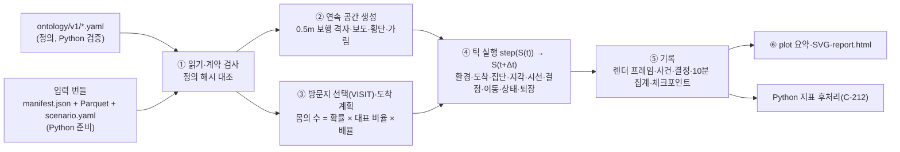

# Rust 런타임 구현체 Map (02d)

명동 에이전트 시뮬레이션의 런타임을 Rust로 구현하는 정본이다([DR-225](decisions.md#dr-225--엔진-구현-언어와-범위)). 분담은 [DR-214](decisions.md#dr-214--반응-온톨로지의-pythonrust-분담)를 따른다. Python([02c](02c_reaction_impl_map.md))은 정의 파일 검증, 프로필 추출, 공간·장소 자료 준비, 관광·소득·경쟁 상권 생성, 지표 후처리를 맡는다. Rust는 반응 함수, 틱 진행, 혼잡, 방문 실현, 알아차림, 상점 반응, 스냅샷, plot을 맡는다. 두 쪽 사이는 `ontology/v1/` YAML 한 벌([DR-215](decisions.md#dr-215--온톨로지-정의-한-벌-공유와-rust-코드-위치))과 Parquet 번들 계약이다. 계약의 정본은 02c §2이고, §2는 Rust가 읽는 쪽의 기대를 적는다. 둘이 다르면 02c §2를 따르고 이 문서를 고친다.

## 0. 개요



- 폴더는 `sim/`(Cargo 작업공간)이다. `engine/`은 활동 엔진의 Python 경로라 쓰지 않는다(DR-215).
- 실행: `mdsim run --defs ontology/v1 --bundle <번들 폴더> --scenario <scenario.yaml> --out runs/<이름>`.
  - Python 번들이 아직 없으므로 `mdsim fixture`가 계약 형식의 합성 번들과 최소 정의를 만들어 개발·테스트에 쓴다(S-E19).
  - Python이 계약 번들(`tests/fixtures/contract_bundle/`)과 적합성 벡터(`ontology/v1/conformance/`)를 만들면 Rust 테스트도 같은 파일을 읽는다.
- 역산(02b)은 구현하지 않는다. 정방향 실행이 02b §5의 trace 항목(정의 해시, 난수 키, 인물·상황 ID, 대안별 확률, 설명 항)을 기록에 남기는 것까지만 한다.

## 1. 공통 규약

### 1.1 작업공간과 기술

| 크레이트 | 내용 | 주요 의존성 |
|---|---|---|
| `sim/crates/mdsim-core` | 공통 타입, 정의 읽기, 식 평가, 키드 난수, 기하, 번들 읽기·기록 쓰기(Parquet), 오류 | serde 1.0.228, serde_json 1.0.149, serde_norway 0.9.42, parquet 60.1(arrow·snap), arrow-array 60.1, arrow-schema 60.1, sha2 0.10.9, flate2 1.1 |
| `sim/crates/mdsim-runtime` | 공간·환경·반응·상황·방문·지각·행동·이동·집단·상태·step·기록·상점·probe·plot 요약 | mdsim-core, rayon 1.12 |
| `sim/crates/mdsim-plot` | SVG 그림과 HTML 보고서 | mdsim-core |
| `sim/crates/mdsim-cli` | 실행 파일 `mdsim` | 위 셋 |

- Rust 1.95.0(Homebrew), edition 2021. `rand`·`clap`은 쓰지 않는다(키드 난수와 단순 인자 해석, S-E2).
- YAML은 `serde_yaml`이 보관 처리(deprecated)되어 같은 API의 유지보수 포크 `serde_norway`를 쓴다(S-E2).

### 1.2 좌표·단위·시간

- 좌표는 3D 지도의 지역 미터다. 기준점은 위도 37.563·경도 126.98525, x는 동쪽, z는 남쪽이다(S-F10).
- 단위는 m, s, m/s, 원, 인/㎡, 분이다.
- 시각은 시나리오 날짜 00:00 KST부터의 초 `t_s`다. 틱 k의 시각은 `t_s = window_start_s + k·Δt`, Δt = 0.5초다(DR-220).
- 10분 프레임 번호는 `floor(t_s / 600)`이고 [DR-17](decisions.md#dr-17--프레임과-시간-규약-및-결정성)의 반열린 구간을 따른다.

### 1.3 ID

- 계약 ID(문자열·정수)는 읽을 때 조밀한 `u32` 인덱스로 바꾸고 원래 ID를 함께 보관한다. 대상은 `NodeIx`·`EdgeIx`·`PlaceIx`·`PortalIx`·`ProfileIx`다.
- 몸 ID `BodyId(u32)`는 도착 계획을 (도착 틱, persona_id, 복제 번호) 순으로 정렬한 순번이다. 배경 보행자는 그 뒤에 (도착 틱, 배경 번호) 순으로 이어 붙인다(S-E4).

### 1.4 키드 난수 ([02b §6](02b_inverse_algorithm.md#6-난수와-시나리오의-고정))

```text
key   = [scenario_seed, mechanism_id, stable_entity_id, step, event_slot, draw_index]
bytes = canonical JSON(key): 공백 없는 배열, 정수는 십진 숫자, 문자열은 UTF-8 그대로(이스케이프는 JSON 필수 문자만)
u     = (SHA-256(bytes)의 앞 8바이트를 big-endian u64로 읽은 값 >> 11) / 2^53   ∈ [0, 1)
```

- `mechanism_id` 문자열은 VISIT, NEXT, ROUTE, REST, PURCHASE, STORE, NOTICE, LOOK, SPAWN, LATERAL, BACKGROUND, ARRIVAL다.
- `stable_entity_id`는 다음 중 하나다.
  - 몸: `"<persona_id>#<replicate>"`
  - 배경 보행자: `"bg#<번호>"`
  - 상점: `"place#<계약 place_id>"`
  - 인물 단위 결정(VISIT·SPAWN): `"<persona_id>"`
- `step`은 틱 번호, VISIT은 0, 상점 월 반응은 월 번호다. `event_slot`은 같은 틱 안 여러 판정을 가르는 번호(예: 알아차림은 계약 place_id)이고, `draw_index`는 규칙이 정한 번호다.
- 성능을 위해 같은 접두(`[seed,"MECH","entity",`)의 SHA-256 상태를 복제해 쓴다. 결과는 위 정의와 같아야 한다(적합성 벡터로 확인).

### 1.5 공용 수식 (적합성 벡터 대상)

| 이름 | 정의 |
|---|---|
| 부담 위치 | `x_d = (P_d − c_d) / max(l_d − c_d, 1e-9)` |
| 비용 곡선 φ | x ≤ 0 → 0. 0 < x < 1 → x^γ_d. x ≥ 1: 경성 차원(또는 그 순간 경성인 차원)은 불가, 연성 차원은 ~~`1 + β_d·(x − 1) + P_d·(1 − risk)`~~ `1 + k·(x − 1)`, `k = max(γ_d, β_d + P_d·(1 − risk))`(연속·볼록, S-E46). γ_d·β_d·P_d는 dimensions.yaml, risk는 무리 감수 성향 0~1 |
| 효용 | `U = purpose·achieve + Σ_k a_k·(1 − sat_k)·offer_k − Σ_d w_d·φ(x_d) − λ_t·Δt_min − λ_m·cost_krw` |
| 시간 가중 | `λ_t = time_weight·(1 + punctuality)·(1 + deadline_k·max(0, 1 − time_left_min / deadline_horizon_min))` |
| 돈 가중 | `λ_m = w_MONEY / max(c_MONEY, 1)` |
| softmax | 가능한 대안 i에 대해 `p_i = exp((U_i − U_max)/τ) / Σ_j exp((U_j − U_max)/τ)`, 불가 대안은 0 |
| 선택 | 대안 순서대로 누적 확률 c_i를 더해 처음으로 `u < c_i`인 i, 반올림으로 남으면 마지막 가능한 대안 |
| Tobler 보정 | `f(s) = min(f_max, exp(−k·|s + s0|) / exp(−k·s0))`, s = 경사(상승/거리, 오르막 +), k = 3.5, s0 = 0.05, f_max = 1.15 |
| 알아차림 통과 확률(C-214 f) | `p = 1 / (1 + exp(−(b0 + bv·visibility + ba·ad_intensity + bt·attention − bρ·density)))` |
| 알아차림 틱 확률 | `q = 1 − (1 − p)^(g·Δt / T_ref)`, g = 초점 1, 주변 w_p, 시야 밖 0 (DR-221 ①) |
| Weidmann 기준식(검증용) | `v(ρ) = v_free·(1 − exp(−γ·(1/ρ − 1/ρ_max)))`, v_free = 1.34 m/s, γ = 1.913 m⁻², ρ_max = 5.4 인/㎡ |

### 1.6 결정성

- 단계마다 몸별 계산을 rayon으로 병렬화하고 결과를 몸 순서대로 모은다. 합·최댓값 같은 집계는 몸 순서대로 순차 계산한다.
- `HashMap` 순회 순서가 결과에 닿지 않게 한다. 순서가 필요한 곳은 `BTreeMap` 또는 정렬된 `Vec`을 쓴다.
- 부동소수 연산 순서를 고정한다. 체크포인트는 f64를 왕복 정밀도 JSON(ryu)으로 저장한다.

### 1.7 오류와 종료 코드

```rust
pub enum SimError {
    Defs(String),                           // 종료 코드 2: 정의 해시 불일치, 실행에 필요한 키 누락, 식 오류
    Contract { file: String, msg: String }, // 종료 코드 3: 번들·시나리오 계약 위반(열·타입·범위·참조·해시·행 수)
    Invariant(String),                      // 종료 코드 4: 런타임 불변식 위반, 실행 기록 해시 불일치(verify)
    Io(String),                             // 종료 코드 1
    Run(String),                            // 종료 코드 5: 명령 사용·설정 오류(이미 있는 산출 폴더 등). 02c RunError와 같은 뜻
}
```

- CLI는 실패하면 표준 오류에 `{"code", "stage", "message"}` JSON 한 줄을 쓰고 위 코드로 끝난다. `stage`는 `args`·`load_defs`·`load_bundle`·`load_scenario`·`build_space`·`world`·`visit`·`simulate`·`resume`·`write_records`·`plots`·`probe`·`verify` 중 하나다(C-228 ①). `world`를 만든 뒤 실패하면 실행 폴더에 `status: failed`와 단계·메시지를 담은 manifest를 남긴다.

### 1.8 테스트 규약

- `cargo test --workspace`로 돈다. 완료 기준 테스트의 이름은 `e2nn_k_<요약>`이다(예: `e221_4_notice_pass_calibration`). 단위 테스트는 각 모듈의 `#[cfg(test)]`에 둔다.
- 오래 걸리는 통합 테스트는 `#[ignore]`로 표시하고 `cargo test -- --ignored`로 돈다.
- 실제 명동 번들 테스트는 번들이 있을 때만 돈다. 환경 변수 `MDSIM_BUNDLE`이 번들 폴더를 가리킬 때만 실행한다.

### 1.9 성능 예산

| 실행 | 예산 |
|---|---|
| 기본(14:00~17:00, 동시 약 2,000명) | 15분 이하, 최대 메모리 3GB 이하(memguard 기준) |
| 확인용(1시간, 300명) | 1분 이하 |
| `probe` 1회 | 1초 이하 |

## 2. Rust가 읽는 계약 (정본은 02c §2)

이 절은 02c §2를 Rust 쪽에서 구현한 내용이다. 둘이 다르면 02c §2를 따르고 이 절을 고친다(02c §2.9). 2026-10-31 02c §2 재작성(02d 형식 채택)에 맞춰 고쳤다.

### 2.1 정의 `ontology/v1/`

| 파일 | Rust가 쓰는 항목(모르는 키·필드는 무시) |
|---|---|
| `dimensions.yaml` | `version`, `dimensions`의 `id`, `aggregate`(sum·max·time_weighted_mean), `limit`(soft·hard·hard_for_wheels), `cost_curve`(phi·linear), `cost`{`exponent` γ, `overflow_slope` β, `overflow_penalty` P}. `store_dimensions`는 읽지 않는다 |
| `interests.yaml` | `interests`의 `id` |
| `classes.yaml` | `classes`의 `id`, `parent`, `attributes`{이름: `type`(continuous·integer·boolean·categorical·categorical_set·schedule), `range`, `values`, `role`, `default`, `directional`}, `press`{D-*: 식}, `offers`{A-*: 식}, `derived`[{name, expr}], `affords`, `blocks`. `inputs`·`actors`·`variables`·`press_tags`·`roles`는 읽지 않는다 |
| `contexts.yaml` | `contexts`의 `id`, `actions`, `always` |
| `parameters.yaml` | `parameters`의 키 → `{value, …}`. 사전 값은 점 경로로 펼친다(`fall.surface_factor.wet`). 숫자·숫자 목록·숫자 표(행 순서로 펼침)만 읽고 문자열 등은 건너뛴다 |

- 정의 해시는 폴더 바로 아래 `*.yaml`을 파일 이름 바이트 순으로 이어 붙인 바이트의 SHA-256이다(02c §2.7 (3)).
- 상속(02c I-203-a): `attributes`·`press`·`derived`·`offers`는 키 단위로 자식이 덮고, `affords`·`blocks`는 자식이 정의하면 통째로 덮는다.
- `cost_curve: linear`(D-TIME·D-MONEY)은 φ 항이 없다. 경성 한계 넘음만 판정하고 비용은 효용의 time·money 선형 항이 맡는다(02c B4).
- 방향 속성(`directional: true`, walk_segment.grade_pct)은 b→a로 지날 때 부호를 바꿔 넣는다.
- Rust의 차원·관심 차원은 열거형이다. 순서는 `D-CLIMB, D-FALL, D-STEP, D-WALK, D-TIME, D-MONEY, D-WAY, D-SENSE, D-CROWD, D-SAFE`와 `A-FOOD, A-BEAUTY, A-FASHION, A-SOUVENIR, A-CULTURE, A-FAITH, A-NATURE`다. 이 밖의 차원이 있거나 빠지면 거부한다(새 차원은 코드 변경, 01a §3.8).
- 결정 맥락은 정의를 따른다: NEXT의 EXPLORE·WATCH는 `contexts.yaml`의 NEXT `actions`에 있을 때만 대안으로 만든다. 정의에 있지만 엔진이 만들지 않는 행동은 실행 manifest의 `unsupported_actions`에 남긴다(§6).

식 문법(02c §2.3과 같음):

```text
expr    := term (("+" | "-") term)*
term    := unary (("*" | "/") unary)*
unary   := "-" unary | primary
primary := NUMBER | NAME | PARAM | call | "(" expr ")"
call    := FUNC "(" expr ("," expr)* ")"
FUNC    := "min" | "max" | "abs" | "clamp" | "pick"
NUMBER  := [0-9]+ ("." [0-9]+)?
NAME    := [a-z_][a-z0-9_]*          # 속성(상속 뒤), 앞서 선언된 derived, 런타임 변수
PARAM   := "$" [a-z_][a-z0-9_]* ("." [a-z0-9_]+)*
```

- 런타임 변수: `vehicle_active`(간선마다, §3 I-224-r), `stall_active`, `event_active`, `open`, `light`, `ad_multiplier`.
- 범주 속성은 `values` 안의 인덱스(0부터), 불리언은 0/1이다. 길이 ≤ 400자, 괄호·호출 중첩 ≤ 16. 단락 평가가 없고 중간값이 유한하지 않으면 오류다.
- 오류 문자열은 02c 오류 종류로 시작한다: `EXPR_SYNTAX`, `EXPR_LIMIT`, `EVAL_NAME`, `EVAL_DIV0`, `EVAL_PICK`, `EVAL_CLAMP`, `EVAL_NONFINITE`.

### 2.2 입력 번들

번들 폴더 = `manifest.json` + 시나리오 파일들(`scenarios/<day_type>_r<rep>.yaml`). 표 파일은 manifest의 경로(저장소 루트 기준 POSIX 상대 경로, CLI `--root`)로 찾는다. Rust는 정의 해시(종료 코드 2), 각 파일의 sha256과 `rows`, 역할별 파일 수(필수 profiles 1개 이상, nodes·edges·buildings·places·portals·access·competitors 정확히 1개, 선택 background_flows·profile_attrs 0~1개)를 대조한다. `areas`·`evidence`는 Python 전용이라 읽지 않는다. Rust 전용 선택 역할 `origins`(출발지 좌표)·`prior_crowd`(시간대 혼잡 사전 기대)도 있으면 읽는다.

| 표 | Rust가 읽는 열(02c §2.4) | 쓰임 |
|---|---|---|
| `nodes` | node_id, x, z, elev_m, kind(junction·crossing·portal), signal | 경로 그래프, 횡단 구역 |
| `edges` | edge_id, a, b, class(walk_segment·steps), polyline, length_m, road_type, width_m, label_width, walk_mode(full·sidewalks), sidewalk_width_m, vehicle_mixed, ped_zone, is_crossing, carriage_share, grade_pct(쓰는 값), grade_pct_orig(널 허용), grade_pct_smooth, is_steps, riser_cm, steps_count, conveying, layer, ad_intensity + 클래스 속성과 같은 이름의 열(surface·way_difficulty·safe_demand 등) | 보행 격자, 방향·차량 통행별 정적 요구 |
| `buildings` | building_id, footprint, height_m | 장애물·가림 |
| `places` | place_id, class, category, name(널), x, z, edge_id, offset_m, anchor_x, anchor_z, side, price_level_krw(널 → 0), discount_pct, open_min·close_min(0~2880), day_types, visibility, fame, foreign_label, service_rate_per_min(널 → 줄 없음), capacity(널 → 제한 없음), seats, footprint_m2, sense, rent_krw_month·staff_count·wage_krw_month·revenue_krw_month(널), source, label + offer_food…offer_nature 등 클래스 속성 열 | 장소 인스턴스. 종류(상점·명소·벤치·노점·행사·숙박)는 클래스의 affords와 footprint로 정한다 |
| `portals` | portal_id, kind, node_id, x, z, name, headway_min(지하철 기준 배차), groups(domestic·tourist, 없으면 둘 다) | 도착·퇴장 지점 |
| `profiles` | persona_id, group, origin_id, cap_<d>_comfort·limit·uncertainty·label(D-TIME 제외 9개 차원), sens_<d>(10개), interest_<k>, risk, punctuality, exploration, attention, tau, base_speed_mps, child_prob, stroller_prob, luggage_prob, focal_range_m, focal_angle_deg, peripheral_range_m, peripheral_angle_deg, head_turn_deg, min_dwell_s, purposes(list<struct{purpose, interest(A-* 또는 빈 문자열), value, target_place_id?}>), availability(list<struct{day_type, start_min, end_min}>), evidence(선택) | 개인 반응. 나이·성별·국적·소득 열이 있으면 거부한다 |
| `access` | origin_id, destination(myeongdong·C:…), mode, base_min, fare_krw | 방문지 선택의 접근 시간 |
| `competitors` | id, name, interest_<k>, price_level, crowd_level, label | 경쟁 상권 대안 |
| `background_flows`(선택) | hour, portal_kind, count | 배경 보행자(S-F18) |
| `profile_attrs`(선택) | persona_id, age, age_band, sex, nationality, income_krw | 그림의 집단 색·연령대만. 반응은 읽지 않는다 |

- D-TIME은 능력 열이 없다. 한계는 런타임이 정한다: VISIT은 그날 가장 긴 가용 창, 실행 중에는 남은 시간이다.
- 업종과 무관한 목적(만남·일, interest 빈 문자열)은 목적 장소에 들어가면 이룬 것으로 본다.
- 도보 도착의 출입구: 출발지가 숙소 출입구(`Q:…`)면 그 출입구, 출발지 좌표(origins)가 있으면 그 방향, 없으면 인물 ID의 고정 해시로 고른 경계 출입구(S-E26).

시나리오 파일(02c §2.4 (13), 동적 변수만):

```yaml
id: baseline_weekend_r0
schema_version: 1            # Python 덧붙임(기록만)
date: 2026-11-07             # 일몰 계산
day_type: weekend            # weekday | weekend | event_day
window: {start: "14:00", end: "17:00"}
dt_s: 0.5
render_every_ticks: 2
seed: 9599481731617930288    # seed_r(base_seed, rep). manifest scenarios 항목과 같아야 한다
target_peak_concurrency: 2000
representation_ratio: null   # 비교 실행에서는 기준 실행의 값을 넘긴다(S-E11)
pedestrian_only: [{start: "12:00", end: "20:00"}]   # #1 ped_zone 간선의 보행 전용 시간
rent_support_pct: 0          # #7
events: []                   # #8 [{place_id: "V:0001", start, end}]
headway_multiplier: 1.0      # #9
demand_multiplier: 1.0       # #10
foreign_inflow_multiplier: 1.0   # #11
labor_cost_index: 1.0        # #14
interactions: true           # S-F15
trace_bodies: 50             # LOOK 상세(S-E17)
configuration: static_stores # Python 덧붙임
months: 0
event_days_per_month: 0
static_applied: {…}          # 기록용
```

- `mdsim run --scenario <파일>`은 그 파일의 sha256이 번들 manifest `scenarios`에 있고 seed·day_type이 그 항목과 같을 때만 돈다.

### 2.3 실행 기록 (Rust → Python, 02c §2.6)

실행 폴더 하나 = 시나리오 파일 하나(하루 유형 × 반복). ID 열은 문자열이고 없으면 null이다.

| 파일 | 열 |
|---|---|
| `manifest.json` | schema_version(1), run_id, bundle_id, ontology_sha256, dimensions_version, engine{name, version}, scenario_id, scenario_sha256, seed, rep, day_type, window{start, end, start_min, end_min}, dt_s, render_every_ticks, representation_ratio, interactions, configuration, months, status(complete·failed), error, counts, files{표: path, sha256, rows}, frames{묶음: sha256}, unsupported_actions, pending_inputs, assumption_flags. 실행 시각은 넣지 않는다 |
| `agents.parquet` | body_id(`<persona_id>#<복제>`, 배경 `BG:<시작 분>:<출입구 종류>:<번호>`), persona_id, replicate, group(domestic·tourist·background), arrival_tick, departure_tick(남으면 −1), portal_in, portal_out, mode, spent_krw, sense_over_s, way_over, distance_m, visits, purchases, notices, max_fatigue, decisions |
| `events.parquet` | tick, t_s, body_id, kind, place_id, value, info. kind: spawn·despawn(info 출입구 ID), enter·exit(가게 안·행사 보기, exit의 value = enter부터 머문 초), queue_join·queue_leave(queue_leave의 value = 기다린 초, info served(enter와 같은 틱)·abandoned), purchase(value 금액, info 업종), notice(info focal·peripheral), rest_start·rest_end(벤치 쉬기, rest_start value 0, rest_end value = 쉰 초), env(info 바뀐 환경: open·close·ped_only_start·ped_only_end·vehicles_on·vehicles_off·dusk·dawn), abandon·watch·jam_release(Rust 덧붙임, jam_release의 value는 막힌 초, S-E56) |
| `decisions.parquet` | decision_id(VISIT `V:<persona_id>`, 실행 중 `D:<순번>`), tick(VISIT −1), body_id, persona_id, context, trigger, n_alts, chosen(VISIT −1), forced, rng_key(정규 JSON 키), top1_term·top1·top2_term·top2·top3_term·top3, base_min·wait_min·exit_walk_min(VISIT만, 명동 대안의 확률 가중 평균) |
| `decision_alts.parquet` | decision_id, alt, action, target, prob, utility, purpose, interest, cost, time, money, cost_<dim> 10개, base_min·wait_min·exit_walk_min(VISIT 대안만) |
| `metrics_10min.parquet` | frame_start_min(int32), metric, key, value. Python이 읽는 metric: edge_density_mean·edge_speed_mean·edge_effective_area_m2·edge_pass_count(key = edge_id), place_queue_len_mean·place_queue_len_max·place_inside_mean(key = place_id). 그 밖(active_bodies_mean 등)은 그림용 |
| `frames/frame_<HHMM>.bin` | 재생용 렌더 프레임(§3 I-226-r) |
| `checkpoints/ckpt_<HHMM>.json.gz` | 스냅샷 전체(10분 경계) |
| `parts/rows_<HHMM>.json.gz` | 10분 조각의 사건·결정 줄(이어 달리기와 나눠 쓰기용, Rust 전용) |
| `plots/p01~p13.svg`, `report.html` | C-228 |

- 항 이름(top_term, probe의 terms): `purpose`, `interest:A-…`, `cost:D-…`(효용에 대한 부호 있는 기여), `time`, `money`. utility = purpose + interest − cost − time − money(효용의 합과 같다).
- VISIT 대안의 action: 그 인물의 첫 슬롯은 `VISIT_NOW`, 뒤 슬롯은 `VISIT_LATER`, 경쟁 상권 `GO_ELSEWHERE`, `SKIP`. target: `<수단>@HH:MM`, `<C:…>:<수단>`.

### 2.4 Rust가 요구하는 `parameters.yaml` 키

키가 없으면 정의 적재 오류다. 아래 값은 합성 고정 자료의 값이다. `owner: 02d`로 `ontology/v1/parameters.yaml`에 들어간다(02c §1.10의 02d 소유 키, 파일이 생기면 02d가 넣는다).

| 키 | 고정 자료 값 | 쓰임 |
|---|---|---|
| react.time_weight, react.deadline_k, react.deadline_horizon_min, react.switch_cost, react.status_quo | 0.04, 1.0, 60, 0.3, 1.0 | 효용(1.5), 포기의 현상 유지 상수(S-E23) |
| notice.b0, notice.bv, notice.ba, notice.bt, notice.brho, notice.t_ref_s, notice.w_peripheral, notice.trigger_min_interval_s, notice.trigger_min_offer | −1.0, 2.5, 1.0, 1.5, 0.5, 8, 0.3, 20, 0.15 | 알아차림(C-214·C-221) |
| look.k_max, look.unattended_mult, look.footing_relief, look.lookahead_s, look.novelty_seen, look.interrupt_m | 8, 0.5, 0.5, 4, 0.3, 2.0 | 시선(S-F4) |
| perception.crowd_kappa, perception.night_factor, perception.night_light | 0.15, 0.6, 0.6 | 실효 시야 |
| observe.fresh_s, crowd.prior_density | 120, 0.15 | 관찰 값(S-F16) |
| loco.scan_dirs, loco.tau_s, loco.time_gap_s, loco.body_radius_m, loco.companion_radius_add_m, loco.lookahead_m, loco.browse_factor, loco.fatigue_factor, loco.steps_factor, loco.tobler_k, loco.tobler_s0, loco.tobler_fmax, loco.arrive_m, loco.queue_spacing_m, loco.wall_clearance_m, loco.lane_width_m, loco.core_strip_m | 21, 0.5, 1.0, 0.25, 0.15, 3.0, 0.55, 0.3, 0.6, 3.5, 0.05, 1.15, 1.0, 0.6, 0.2, 3.0, 1.2 | 이동(C-223) |
| crowd.local_radius_m, crowd.los_thresholds | 2.0, [0.31, 0.43, 0.72, 1.08, 2.17] | 집단(C-210), Fruin 1971. Python 지표도 읽는다 |
| state.climb_coef, state.steps_coef, state.recover_seated_per_min, state.recover_standing_per_min, state.rest_trigger | 1.0, 0.5, 0.08, 0.02, 0.8 | 피로(C-206) |
| purchase.band_mult, purchase.band_gain, purchase.dwell_no_buy_min, purchase.dwell_buy_min | [0.6, 1.0, 1.8], [0.6, 1.0, 1.3], 4, [10, 15, 25] | 구매 |
| route.k, route.penalty, route.pace_time, route.pace_exertion, route.replan_margin, route.crossing_wait_s, route.defer_min | 3, 1.6, 1.3, 0.7, 0.3, 30, 2 | 경로, 연기(S-E36) |
| rest.seat_min, rest.max_bench_m | 8, 80 | 휴식 |
| visit.slot_min, visit.theta_skip, visit.exit_walk_default_min, visit.expected_walk_m, visit.expected_spend_share, visit.stay_base_min, visit.stay_per_purpose_min, visit.stay_max_min, visit.mean_dwell_min, visit.myeongdong_way, visit.myeongdong_climb, visit.bus_wait_min, visit.taxi_wait_min | 10, 0.0, 3, 1500, 0.5, 40, 25, 180, 75, 0.4, 4.0, 6, 4 | 방문지 선택(C-209) |
| bg.stops_min, bg.stops_max, bg.dwell_min_s, bg.dwell_max_s, bg.speed_mps | 2, 5, 180, 600, 1.2 | 배경 보행자 |
| next.max_candidates | 25 | 행선지 후보 상한(S-E9) |
| explore.radius_min_m, explore.radius_max_m, explore.discovery_share | 40, 120, 0.5 | 둘러보기(S-E25, 02c U-9) |

선택 키(없으면 기본값): `segment.min_effective_area_m2`(1.0, 유효 면적 하한), `segment.vehicle_hours_default`([[360, 1440]]면 06~24시, 없으면 하루 종일). 클래스 식이 쓰는 02c 소유 키(`fall.ref_down_pct`, `fall.surface_factor.*`, `fall.stairs_down_base`, `way.no_foreign_label`, `competitor.price_ref_krw`)는 식 검사가 요구한다.

## 3. 구현체 단위

각 단위의 테스트 이름은 §5 추적표에 모았다. "완료 정의"는 해당 테스트 green, `cargo clippy` 경고 0, 문서 주석을 뜻한다.

### I-CORE-a 정의 읽기와 식 평가 (C-201·C-203의 Rust 읽기 쪽)

- 위치: `mdsim-core/src/defs.rs`, `mdsim-core/src/expr.rs`
- 시그니처:

```rust
pub const ND: usize = 10; pub const NI: usize = 7;
#[derive(Clone, Copy, PartialEq, Eq, Hash, Debug, Serialize, Deserialize)]
pub enum Dim { Climb, Fall, Step, Walk, Time, Money, Way, Sense, Crowd, Safe }
#[derive(Clone, Copy, PartialEq, Eq, Hash, Debug, Serialize, Deserialize)]
pub enum Interest { Food, Beauty, Fashion, Souvenir, Culture, Faith, Nature }
pub type DimVec = [f64; ND]; pub type IntVec = [f64; NI];
pub enum Aggregate { Sum, Max, TimeWeightedMean }
pub enum LimitKind { Soft, Hard, HardForWheels }
pub struct DimDef { pub dim: Dim, pub aggregate: Aggregate, pub limit: LimitKind, pub gamma: f64, pub beta: f64, pub penalty: f64 }
pub struct ClassDef { pub id: String, pub parent: Option<String>, pub attrs: Vec<AttrDef>, pub press: Vec<(Dim, Expr)>, pub offers: Vec<(Interest, Expr)>, pub derived: Vec<(String, Expr)>, pub affords: Vec<String>, pub blocks: Vec<String> }
pub struct Defs { pub dims: [DimDef; ND], pub classes: Vec<ClassDef>, pub class_ix: BTreeMap<String, usize>, pub contexts: BTreeMap<String, ContextDef>, pub params: Params, pub sha256: String }
impl Defs { pub fn load(dir: &Path) -> Result<Defs, SimError>; pub fn resolved(&self, class: &str) -> Result<ResolvedClass, SimError>; }
pub struct Expr(/* AST */); impl Expr { pub fn parse(src: &str) -> Result<Expr, String>; pub fn eval(&self, env: &dyn Fn(&str) -> Option<f64>) -> Result<f64, String>; pub fn idents(&self) -> Vec<String>; }
pub struct Params(BTreeMap<String, ParamValue>); impl Params { pub fn f(&self, key: &str) -> Result<f64, SimError>; pub fn v(&self, key: &str) -> Result<Vec<f64>, SimError>; }
```

- 로직:
  1. 파일 이름순으로 바이트를 이어 SHA-256을 낸다.
  2. 차원을 열거형에 대응시키고 누락·초과를 검사한다.
  3. 클래스는 `parent` 사슬을 따라 속성·식을 물려받는다. 하위가 같은 이름을 다시 정의하면 하위 것을 쓴다.
  4. 모든 식을 파싱하고, 식이 참조하는 이름이 속성·derived·런타임 변수 안에 있는지 확인한다.
  5. 2.4의 키가 모두 있는지 확인한다.
- 에러: 해시 불일치·누락 키·파싱 실패는 `SimError::Defs`다(메시지에 파일·클래스·식 포함).
- 엣지케이스:
  - `parent` 순환 → 오류.
  - 범위 밖 기본값 → 오류.
  - `pick` 인덱스가 범위 밖이면 마지막 값.
  - 빈 `press`는 허용한다(허용·차단만 있는 클래스).

### I-CORE-b 키드 난수·기하·번들 읽기 (공통)

- 위치: `mdsim-core/src/rng.rs`, `geom.rs`, `bundle.rs`, `out.rs`
- 시그니처:

```rust
pub struct KeyRng { seed: u64 }
impl KeyRng { pub fn u(&self, mech: &str, entity: &str, step: u64, slot: u64, draw: u32) -> f64; pub fn prefix(&self, mech: &str, entity: &str) -> KeyPrefix }
pub struct KeyPrefix(/* Sha256 상태 */); impl KeyPrefix { pub fn u(&self, step: u64, slot: u64, draw: u32) -> f64 }
pub fn poisson(lambda: f64, u: f64) -> u32;  // 역누적 분포, λ ≤ 50
#[derive(Clone, Copy)] pub struct V2 { pub x: f64, pub z: f64 }   // +,-,*, dot, cross, len, norm, rot
pub fn point_in_polygon(p: V2, poly: &[V2]) -> bool;
pub fn dist_point_segment(p: V2, a: V2, b: V2) -> (f64, f64 /*t*/);
pub struct Bundle { pub manifest: BundleManifest, pub nodes: Vec<NodeRow>, pub edges: Vec<EdgeRow>, pub buildings: Vec<BuildingRow>, pub places: Vec<PlaceRow>, pub portals: Vec<PortalRow>, pub profiles: Vec<Profile>, pub access: Vec<AccessRow>, pub origins: Vec<OriginRow>, pub competitors: Vec<CompetitorRow>, pub background: Vec<BgFlowRow>, pub prior_crowd: Option<Vec<f64>>, pub attrs: Option<Vec<ProfileAttrs>> }
impl Bundle { pub fn load(dir: &Path, defs: &Defs) -> Result<Bundle, SimError> }
pub struct Profile { pub persona_id: String, pub group: Group, pub origin: u32, pub comfort: DimVec, pub limit: DimVec, pub sens: DimVec, pub interest: IntVec, pub risk: f64, pub punctuality: f64, pub exploration: f64, pub attention: f64, pub tau: f64, pub base_speed: f64, pub child_prob: f64, pub stroller_prob: f64, pub luggage_prob: f64, pub perc: Perception, pub purposes: Vec<Purpose>, pub availability: Vec<Avail>, pub evidence: Vec<EvidenceRef> }
```

- 번들 읽기 로직:
  1. manifest를 읽고 각 파일의 sha256을 대조한다.
  2. Parquet를 arrow 레코드 배치로 읽어 열 이름으로 꺼낸다(열 순서 무관).
  3. 타입·범위·참조를 검사한다.
     - 간선 a·b와 장소 edge_id가 있어야 한다.
     - 출입구 node_id가 있어야 한다.
     - comfort ≤ limit이어야 한다.
     - 확률은 [0, 1] 안이어야 한다.
     - 시간은 0~1440분 안이어야 한다.
  4. 오류는 파일·열·행 번호와 함께 `Contract`로 낸다.
- `Profile`에는 나이·성별·국적·소득 필드가 없다(DR-214, C-205 ②). `group`은 몸 수 배율에만 쓴다.

### I-220-r 연속 공간 (C-220의 Rust 쪽)

- 위치: `mdsim-runtime/src/space.rs`, `route.rs`
- 데이터:

```rust
pub const WALK: u8 = 1; pub const SIDEWALK: u8 = 2; pub const CROSS: u8 = 4; pub const BUILDING: u8 = 8; pub const STALL: u8 = 16; pub const LANE: u8 = 32; pub const CORE: u8 = 64;
pub struct Space { pub origin: V2, pub cell: f64, pub w: usize, pub h: usize, pub flags: Vec<u8>, pub stall_of_cell: BTreeMap<u32, PlaceIx>, pub graph: Graph, pub place_grid: Grid, pub edge_static: Vec<EdgeStatic>, pub places: Vec<PlaceInst>, pub portals: Vec<PortalInst> }
pub struct EdgeStatic { pub len: f64, pub walk_w: f64, pub sidewalks: bool, pub vehicle_mixed: bool, pub demand_ab: DimVec, pub demand_ba: DimVec, pub grade_ab: f64, pub is_steps: bool, pub ad: f64, pub poly: Vec<V2>, pub cum: Vec<f64> }
pub struct PlaceInst { pub ix: PlaceIx, pub id: i64, pub class: usize, pub kind: PlaceKind /* Shop,Food,Bench,Stall,Event,Church,Park,Other */, pub pos: V2, pub anchor: V2, pub edge: EdgeIx, pub offer: IntVec, pub demand: DimVec, pub price: f64, pub discount: f64, pub open_min: f64, pub close_min: f64, pub visibility: f64, pub service_rate: f64, pub capacity: u32 }
impl Space {
  pub fn build(defs: &Defs, b: &Bundle, p: &Params) -> Result<Space, SimError>;
  pub fn walkable(&self, q: V2, env: &EnvState) -> bool;
  pub fn free_distance(&self, from: V2, dir: V2, max: f64, env: &EnvState) -> f64;
  pub fn line_of_sight(&self, a: V2, b: V2) -> bool;
  pub fn snap(&self, q: V2, max_r: f64, env: &EnvState) -> Option<V2>;
}
pub fn k_paths(g: &Graph, from: NodeIx, to: NodeIx, k: usize, penalty: f64) -> Vec<Path>;
```

- 격자 로직:
  1. 범위 = 모든 노드·간선·건물의 외접 사각형 + 20m, 칸 0.5m.
  2. `walk_mode = full`: 중심선 양쪽 walk_w/2 안의 칸에 WALK. 그중 중심선 loco.core_strip_m/2 안은 CORE.
  3. `walk_mode = sidewalks`: 중심선에서 ±(width/2 − sw/2) 떨어진 폭 sw의 두 띠에 WALK|SIDEWALK. 차도는 걷지 못한다.
  4. 차량 혼재(vehicle_mixed) 간선은 중심선 lane_width/2 안을 LANE으로 표시한다.
  5. `sidewalks` 간선에 닿는 crossing·junction 노드에 반지름 = 닿은 간선 폭의 최댓값/2인 원을 WALK|CROSS로 표시한다(DR-222 횡단).
  6. 건물 발자국 안의 칸에 BUILDING.
  7. 노점(class가 노점인 장소)의 반지름 1.0m 원은 STALL(그 노점 ix 기록).
- 걷기 가능 판정: `WALK && (!BUILDING || CORE) && !(LANE && vehicle_active) && !(STALL && 그 노점 운영 중)`.
- 가림 판정: `BUILDING && !CORE` 칸만 시선을 막는다. 선분을 DDA로 진행하고, 양 끝 칸은 제외한다.
- 정적 요구: 간선마다 클래스 식을 방향별로 평가한다. b→a는 `grade_pct`의 부호를 바꾼 속성으로 평가한다. 동적 변수(vehicle_active, ad_multiplier)를 쓰는 차원은 실행 중에 다시 평가한다.
- 경로 후보: 길이에 걸음 시간과 횡단 대기(신호 노드 route.crossing_wait_s)를 더한 가중치로 Dijkstra를 돌린다. 나온 경로의 간선 가중치를 route.penalty배로 올려 다시 찾기를 k번 반복하고, 같은 경로는 뺀다(S-E7).
- 에러:
  - 간선 폴리라인 점이 2개 미만이면 `Contract`.
  - 장소 앵커가 3m 안에서 걷기 가능 칸에 붙지 않으면 그 장소를 제외하고 manifest에 사유를 남긴다.
- 엣지케이스:
  - 길이 0인 간선 → 오류.
  - 고립 노드 → 허용(경로 없음은 결정 단계에서 처리).
  - 격자 밖 좌표 → 걷기 불가.
- 성능: 격자는 약 3,000×3,600칸(10MB 이하)이고 생성은 2초 이하다.

### I-224-r 환경 동역학 (C-224)

- 위치: `mdsim-runtime/src/env.rs`
- 시그니처:

```rust
pub struct EnvState { pub t_s: f64, pub open: Vec<bool>, pub stall_active: Vec<bool>, pub event_active: Vec<bool>, pub vehicle_active: bool, pub light: f64 }
pub fn env_at(scn: &Scenario, space: &Space, p: &Params, t_s: f64) -> EnvState;
pub fn env_changes(prev: &EnvState, next: &EnvState) -> Vec<EnvChange>;
pub fn sun_altitude_deg(date: (i32, u32, u32), t_s: f64, lat: f64, lon: f64) -> f64;
```

- 로직:
  - 영업: `open_min ≤ t < close_min`. close < open이면 자정을 넘는다.
  - 노점: 같은 규칙. 운영 중인 칸은 걷기 불가다.
  - 행사: scenario.events의 [start, end)이고, 장소의 class가 행사여야 한다.
  - 차량: 차량 혼재 링크는 pedestrian_only 구간 밖에서만 vehicle_active다.
  - 조도: 태양 고도 h(NOAA 근사식). h ≥ 0이면 1, −6 < h < 0이면 직선 보간, h ≤ −6이면 perception.night_light.
- 순수 함수다. 같은 t는 같은 상태를 낸다(E224-1).

### I-205-r 반응 함수 (C-205)

- 위치: `mdsim-runtime/src/react.rs`
- 시그니처:

```rust
pub struct Alt { pub action: Action, pub target: AltTarget, pub demand: DimVec, pub offer: IntVec, pub purpose: f64, pub achieve: f64, pub dt_min: f64, pub cost_krw: f64, pub blocked: bool }
pub struct Caps { pub comfort: DimVec, pub limit: DimVec, pub hard: [bool; ND] }
pub struct Person<'a> { pub sens: &'a DimVec, pub interest: &'a IntVec, pub risk: f64, pub punctuality: f64, pub tau: f64 }
pub struct Terms { pub purpose: f64, pub interest: f64, pub cost: DimVec, pub time: f64, pub money: f64 }
pub struct Reaction { pub probs: Vec<f64>, pub utils: Vec<f64>, pub feasible: Vec<bool>, pub terms: Vec<Terms>, pub chosen: usize, pub forced: bool, pub top3: Vec<(TermName, f64)> }
pub fn react(person: &Person, caps: &Caps, sat: &IntVec, time_left_min: f64, alts: &[Alt], dims: &[DimDef; ND], p: &ReactParams, u: f64) -> Reaction;
```

- 로직: 1.5의 식대로 계산한다(01a §3.6의 1~6단계와 9단계).
  - 가능한 대안이 없으면 경성 한계를 무시한 효용 최댓값 대안을 고르고 `forced = true`로 기록한다(떠나기가 마감을 넘는 경우 등).
  - 설명은 선택 대안과 차선(확률 2위) 사이의 항별 차이에서 절댓값 상위 3개다. 대안이 하나면 차선은 0으로 둔다.
- 이 파일은 `Profile`·`group`·나이·성별·국적·소득·클래스 이름·맥락 이름을 참조하지 않는다(E205-2 정적 검사).

### I-204-r 상황 구성 (C-204의 런타임 쪽)

- 위치: `mdsim-runtime/src/situation.rs`
- 공통: 대안의 요구는 노출 목록 `[(인스턴스 요구 DimVec, 양)]`을 차원의 집계 규칙으로 모아 만든다(S-R3).
  - Sum: Σ 양 × 값.
  - Max: 양 > 0인 노출 중 최댓값.
  - TimeWeightedMean: Σ 양 × 값 / Σ 양.
- 맥락별 대안:

| 맥락 | 대안 | 노출·제공 |
|---|---|---|
| VISIT | 슬롯 × 수단(명동), 경쟁 상권별 1개(그 출발지의 가장 빠른 수단), SKIP | §I-209-r |
| NEXT | GO_TO(고려 집합 안 영업 중이라고 믿는 장소 중 목적 장소 + 직선거리 가까운 next.max_candidates곳), LEAVE(가장 가까운 같은 수단 출입구), REST_SEAT(알고 있는 벤치가 rest.max_bench_m 안이면) | 최단 경로의 간선 노출(경사·계단·거리·본 혼잡·광고·차량), 장소의 offer, 대기 = 본 줄 ÷ 처리율, D-MONEY = 기대 지출 |
| ROUTE | PROCEED(경로 후보 1~k), PACE(1번 경로, 시간 ×pace_time, CLIMB·FALL ×pace_exertion), ABANDON(목적 가치 상실, 다시 NEXT) | 경로별 간선 노출 |
| REST | REST_SEAT, CONTINUE, LEAVE | 피로 회복은 상태 갱신에서, 시간·거리는 노출 |
| PURCHASE | NO_BUY, BUY_LOW·MID·HIGH(가격 × band_mult, 음식점은 BUY 하나) | D-MONEY = 금액(남은 예산이 경성 한계), offer × band_gain, Δt = 머무는 시간 |
| LOOK | PATH, FOOTING, LOOK_AT(e) (알아차렸고 지금 보이는 것 중 시계성 ÷ 거리 상위 look.k_max) | §I-221-r |

- 필수 대안(01a §3.5)은 항상 넣는다. PROCEED·PACE·ABANDON, LEAVE, NO_BUY, SKIP, PATH가 그것이다. 고려 집합 밖 장소는 NEXT 대안에 들어가지 않는다(C-214 ①).

### I-209-r 방문지 선택과 도착 계획 (C-209·C-216의 런타임 쪽)

- 위치: `mdsim-runtime/src/visit.rs`
- 시그니처:

```rust
pub struct VisitAltRecord { pub kind: VisitKind /* Myeongdong{slot, mode} | Competitor(ix) | Skip */, pub prob: f64, pub base_min: f64, pub wait_min: f64, pub exit_walk_min: f64 }
pub struct Arrival { pub body: BodyId, pub profile: ProfileIx, pub replicate: u16, pub tick: u64, pub portal: PortalIx, pub mode: Mode, pub deadline_tick: u64 }
pub fn visit_decisions(space: &Space, b: &Bundle, scn: &Scenario, p: &Params, rng: &KeyRng) -> Vec<(ProfileIx, Reaction, Vec<VisitAltRecord>)>;
pub fn representation_ratio(decisions: &[...], scn: &Scenario, p: &Params) -> f64;
pub fn plan_arrivals(...) -> Vec<Arrival>;
pub fn plan_background(...) -> Vec<BgPlan>;
```

- 로직:
  1. 그날 day_type의 가용 시간 창과 실행 창이 겹치는 10분 슬롯을 고른다.
  2. 명동 대안의 노출은 다음과 같다.
     - D-TIME = base_min + 대기 + 출구 보행. 대기 = 지하철 headway_min × #9 ÷ 2, 버스 visit.bus_wait_min, 택시 visit.taxi_wait_min, 도보 0. 출구 보행 = 첫 목적 장소까지 최단 경로 길이 ÷ 기준 속도(목적 장소가 없으면 visit.exit_walk_default_min).
     - D-MONEY = fare + 기대 지출(Σ_k interest_k × 그 업종 평균 가격 × expected_spend_share).
     - D-WALK = expected_walk_m, D-CROWD = 슬롯의 사전 혼잡, D-WAY = myeongdong_way, D-CLIMB = myeongdong_climb.
     - offer = 슬롯에 영업 중인 장소의 업종별 offer 평균.
     - purpose = Σ 목적 value(목적 장소가 그 슬롯에 영업하면 achieve 1, 아니면 0.5).
  3. 경쟁 상권 대안: D-TIME = base_min + 그 수단의 대기, D-MONEY = fare + 기대 지출 × price_level, D-CROWD = crowd_level, offer = interest_<k>. SKIP은 모든 값이 0이고 효용은 theta_skip이다.
  4. react로 정확한 확률을 낸다(키 VISIT, step 0).
  5. 대표 비율 r = 시나리오 값, 없으면 `target_peak_concurrency × 창 길이(분) ÷ mean_dwell_min ÷ Σ_i Σ_명동 P`(배율 1 기준, S-E11).
  6. 몸 수 = Poisson(P × r × 배율)이다. 배율은 내국인 #10, 관광객 #11이고, 키는 SPAWN·persona·step 0·slot = 슬롯 × 4 + 수단이다.
  7. 몸마다 도착 틱 = 슬롯 시작 + U(0, 600초)(키 ARRIVAL)로 정한다.
     - 지하철은 그 출입구 다음 열차 도착(오프셋 0, 간격 headway × #9)에 출구 보행 60~120초를 더한다(S-F14).
     - 출입구는 수단별 출입구 중 첫 목적 장소에 가장 가까운 곳이다. 도보는 출발지 방향과 각이 가장 작은 경계 출입구다.
  8. 마감 = min(도착 + 계획 체류, 가용 창 끝)이다. 계획 체류 = stay_base + stay_per_purpose × 목적 수이고, stay_max로 자른다.
  9. 배경 보행자: background_flows의 시간·출입구 종류별 count × #11만큼 만든다. 시간 안 균등 도착(키 BACKGROUND), 장소 2~5곳을 시계성 비례로 고르고 장소마다 180~600초 머문다.
- 기록: decisions.parquet에 VISIT 결정을 인물마다 1행 남긴다. base_min·wait_min·exit_walk_min을 함께 남긴다(C-209 ③).

### I-221-r 지각·알아차림·시선 (C-221·C-214)

- 위치: `mdsim-runtime/src/perception.rs`
- 실효 시야:
  - 초점 거리 = focal_range_m × 조도 계수(밤 night_factor) × exp(−crowd_kappa × 국소 밀도)
  - 초점 각 = focal_angle_deg × (1 − 0.3 × 피로)
  - 주변 거리 = peripheral_range_m × exp(−crowd_kappa × 국소 밀도)
- 가시 집합: 장소 격자에서 max(초점 거리, 주변 거리) 안의 장소를 찾는다. 그중 각도 조건(초점: 시선 방향 기준, 주변: 진행 방향 기준)을 만족하고 `line_of_sight(몸, 앵커)`가 참인 것만 남긴다.
- 알아차림: 인지 집합에 없는 보이는 장소마다 1.5의 q로 판정한다. 키는 NOTICE·몸·틱·slot = 계약 place_id다. ad_intensity는 그 장소 간선의 값, 밀도는 몸의 국소 밀도다. 알아차리면 인지 집합에 넣고 사건으로 남긴다.
- 관찰 값(Q-F2 A): 보이는 장소의 영업 여부·줄 길이를 남긴다. 몸이 있는 간선과 경로의 다음 간선의 밀도(초점 거리 안)를 틱과 함께 남긴다.
- LOOK(유지 시간이 끝났거나 충돌 위험일 때):
  - 대안: PATH, FOOTING, LOOK_AT(e).
  - 노출 = 앞 lookahead_s초 경로의 간선 요구.
    - PATH: 그대로.
    - FOOTING: STEP·FALL ×footing_relief, CROWD·SAFE ×(1+unattended_mult).
    - LOOK_AT: 전부 ×(1+unattended_mult), D-SENSE += 그 간선 광고.
  - LOOK_AT의 offer = 장소 offer × (처음 본 대상 1, 이미 본 대상 novelty_seen).
  - 고개 회전 한계 밖 대상은 blocked다.
  - 다음 시선 방향과 대상, 유지 시작 틱을 정한다.
- 결과는 몸별 출력 구조체로 내고, 순차 병합 단계에서 상태에 쓴다.

### I-222-r 행동 계층과 결정 계기 (C-222)

- 위치: `mdsim-runtime/src/behavior.rs`
- 활동: `Walk, Browse{place,until}, Queue{place}, Inside{place,until}, Rest{place,until,seated}, Watch{place,until}, Exit{portal}, Gone`.
- 계기 우선순위(한 틱에 몸마다 하나의 결정 맥락, S-E8):
  1. 활동 종료
  2. 목표 도착(장소 → 입장·줄, 출입구 → 퇴장)
  3. 마감 임박(남은 시간 < 출구까지 시간 + 2분 → LEAVE만 가능한 NEXT)
  4. 피로 임계(REST)
  5. 관찰 값 변화(목표 닫힘·줄 증가 → NEXT, 앞길 밀도 > 기대 + replan_margin → ROUTE)
  6. 새 알아차림(NEXT 재평가: notice.trigger_min_interval_s 간격, 장소 offer·관심 곱 ≥ trigger_min_offer)
  7. 없음
- 재평가 대안에는 현재 계획 유지가 들어가고, 바꾸는 쪽 효용에서 react.switch_cost를 뺀다.
- 결정 결과를 계획으로 번역한다. 목표, 경로(ROUTE 결과), 속도 계수(PACE), 머무는 시간(PURCHASE·REST)을 정하고 활동을 전이한다. 허용 전이는 01b §3.3 상태도다. 그 밖의 전이는 `Invariant`다.

### I-223-r 이동과 줄 (C-223)

- 위치: `mdsim-runtime/src/locomotion.rs`
- 로직(움직이는 몸):
  1. 목표점 = 경로 폴리라인에서 몸의 투영점보다 lookahead_m 앞의 점 + 옆 오프셋.
     - 전체 폭 간선은 키 LATERAL로 (u − 0.5) × (walk_w − 2·wall_clearance) × 0.8이다.
     - 보도 간선은 현재 쪽의 보도 중앙이고, 간선 끝 노드에서만 쪽을 바꾼다.
     - 경로 인덱스는 간선 끝 0.75m 안에서 다음 간선으로 넘긴다. 앞보기 점이 다음 간선으로 넘어가 그 위 목표점이 지금 간선의 진행 방향으로 몸보다 뒤에 놓이면 그 틱에 넘긴다(되돌아가지 않는다, S-E52).
  2. 희망 속도 = base_speed × Tobler(그 간선 경사) × (계단이면 steps_factor) × (둘러보기면 browse_factor) × (1 − fatigue_factor × 피로) × PACE 계수.
  3. 시야 기반 방향(Moussaïd 외 2011): 진행 방향 ±(주변 시야각/2)를 scan_dirs개로 나눈다. 방향마다 첫 충돌 거리 f(α)를 구한다. 이웃 몸(t 위치, 반지름 합)과 벽(free_distance)까지의 거리이고 상한은 주변 거리다. 틈이 `CONTACT_M`(0.02m) 아래로 맞닿거나 겹친 이웃은 뺀다(모든 방향의 f가 0이 되어 멈춰 버리므로 5단계가 맡는다, S-E44). `d(α)² = H² + f² − 2Hf·cos(α0 − α)`(H = 주변 거리, α0 = 목표 방향)가 가장 작은 방향을 고른다.
  4. 속도 = min(희망 속도, f(α*) / max(time_gap_s, Δt))(Tordeux 외 2016). f는 몸 가장자리가 이웃·벽에 닿기까지의 자유 거리다(이웃은 중심 거리 − 반지름 합, 벽은 free_distance − wall_clearance). 그래서 지름 `2r`을 다시 빼지 않는다. 희망 이동 `d` = 방향 α* × 속도 × Δt다. 새 위치가 걷기 불가면 속도를 반으로 줄이고, 그래도 불가면 제자리이고 속도는 0이다.
  5. 이웃 간격 예산(S-E43). 모든 몸의 희망 이동을 구한 뒤(틱 t의 위치와 이 희망 이동만 읽는다) 거리 위 몸 쌍마다 접근 성분이 틈을 넘지 않게 이동에서 접근 성분을 덜어 낸다. 이동 전체를 줄이지 않으므로 이웃을 따라 미끄러지는 이동은 남는다.
     - 쌍 (i, j): e = i에서 j로 향하는 단위 벡터, 틈 `g = max(0, |p_j − p_i| − (r_i + r_j))`, 접근 희망 `c_i = max(0, d_i·e)`, `c_j = max(0, −d_j·e)`. 틈을 두 몸에 나눠 준 몫은 `c_i + c_j ≥ g`이면 `b_ij = g·c_i / (c_i + c_j)`, 아니면 `b_ij = c_i + (g − c_i − c_j) / 2`다. 두 몫의 합은 언제나 g이다.
     - 몸 i의 최종 이동 d_i'는 모든 이웃 j에 대한 `d·e_ij ≤ b_ij`를 만족하는 이동 가운데 희망 d_i에 가장 가까운 것이다. 규칙을 `(e.x, e.z, b)` 순(몸 번호와 무관)으로 최대 6번 훑어 위반한 성분을 덜어 내고(`d −= (d·e − b)·e`), 남은 위반은 이동에 같은 배율을 곱해 없앤다. 깎인 이동의 도착 위치가 걷기 불가면 반으로 줄이고, 그래도 불가면 제자리다. 속도·이동 거리·방향·도착·막힘은 깎은 이동으로 다시 정한다.
     - 보장: 틱 시작에 겹침이 없으면 이동 방향과 무관하게 틱 끝에도 겹침이 없다. 새 중심 거리 ≥ 원래 거리 − (두 몸의 접근 성분 합) ≥ 원래 거리 − (b_ij + b_ji) = 반지름 합이기 때문이다. 한 몸의 접근 성분은 자기 몫을 넘지 않는다.
     - 이미 겹친 쌍은 g = 0으로 본다. 서로를 향한 접근은 막고, 멀어지거나 옆으로 비키는 이동은 허용한다. 중심이 같은 쌍(거리 < 1e-9)은 방향이 없어 뺀다(S-E44).
     - 옆걸음: 4틱(2초) 넘게 막혀 있고 남은 이동이 희망의 30% 미만이면, 가장 크게 막은 이웃을 반시계로 돌아 지나가는 옆걸음(희망 길이의 50%, 이웃 쪽 단위 벡터를 +90° 돌린 방향)을 희망에 더해 한 번 더 맞춘다. 마주 선 두 몸이 서로 반대쪽으로 비켜 지나가게 한다.
     - 이웃 색인은 이 단계 직전, 그 틱 결정이 끝난 활동으로 위치만 다시 만든다(방금 장소에서 나온 몸도 이웃에게 보인다).
  6. 목표점까지 arrive_m 안이면 도착 사건을 낸다.
  7. 교착 풀기(S-E56). 맞닿은 이웃(틈 0.3m 아래)이 있는 채로 20초 + (몸 번호 mod 10초) 넘게 막힌 몸은 8초 동안 이웃을 무시한다. 그동안 이웃 계산(3단계의 이웃, 5단계 예산)에서 빠지고 남에게도 보이지 않는다. 풀 때마다 사건 `jam_release`(value = 막힌 초)를 남기고, 풀어도 계속 막혀 있으면 5분마다 다시 푼다. 벽이나 길 문제로 혼자 막힌 몸(맞닿은 이웃 없음)은 풀지 않는다.
- 도착·퇴장 자리(S-E45): 출입구에 도착하는 몸과 장소 안(앵커)에서 거리로 나오는 몸은 이웃과 겹치지 않는 자리에서 걷기를 시작한다.
- 줄: 처리 용량이 찬 장소에서는 앵커에서 간선 방향으로 queue_spacing_m 간격의 칸에 선착순으로 선다. 처리율에 따라 앞에서부터 입장한다. 줄은 음수가 될 수 없고, 도착이 용량 이하면 늘지 않는다(E210-5).
- 상호작용 끄기(S-F15)면 이웃 몸을 충돌 계산에서 빼고(5단계 예산·7단계도 건너뛴다), 혼잡은 사전 기대 값을 쓴다.

### I-210-r 집단 상태 (C-210)

- 위치: `mdsim-runtime/src/collective.rs`
- 매 틱 t 위치로 2m 칸 공간 색인(정렬된 (칸, 몸) 배열)을 만든다. 국소 밀도 = local_radius_m 안의 몸 수(자신 포함) ÷ π·R²다. 간선 밀도 = 그 간선 위 몸 수 ÷ (len × 실효 폭)이고, 실효 폭은 노점·차로 몫을 뺀 값이다. 장소별 줄 길이와 안 인원도 여기서 센다.
- 결과는 다음 단계(같은 틱의 지각·결정·이동)가 읽고, 다음 틱에 다시 만든다. 쓰는 단계가 읽는 단계보다 앞서지 않는다(E210-1, E210-6).

### I-206-r 개인 상태 갱신 (C-206)

- 위치: `mdsim-runtime/src/state.rs`
- 피로 += 이번 틱 이동 거리 × (1 + climb_coef × max(경사, 0)/10 + (계단이면 steps_coef)) ÷ comfort[D-WALK]이다. 쉬기는 앉으면 recover_seated, 서면 recover_standing으로 분당 줄인다.
- 충족도_k += offer_k × band_gain × (1 − 충족도_k)이고, 지출을 더하고 남은 시간을 줄인다.
- 노출 누적: D-SENSE가 편안 상한을 넘은 시간, D-WAY 초과 여부, 시선 대상별 시간.
- 유효 능력:
  - CLIMB·WALK의 comfort·limit에 (1 − 0.5 × 피로)를 곱한다.
  - 유모차·캐리어가 있으면 STEP의 limit을 0으로 두고 경성으로 처리한다.
  - MONEY의 comfort·limit에서 지출을 뺀다.
  - TIME의 limit을 남은 분으로 두고 경성으로 처리한다.
- 상태는 이 모듈의 함수와 등록된 단계로만 바뀐다(E206-1). ~~등록된 쓰기 함수 밖에서 상태를 바꾸면 컴파일되지 않게 필드를 `pub(crate)`로 둔다.~~ 필드는 `pub`으로 두고(통합 시험·CLI 그림이 크레이트 밖에서 읽고, 시험은 상황을 꾸미려고 쓴다), 엔진 소스에서 몸의 상태 필드를 직접 쓰는 곳이 등록된 모듈(state.rs 갱신 함수, behavior.rs 결정 적용, step.rs 틱 단계)뿐인지 `e206_1_state_writes_registered`가 소스를 읽어 검사한다(S-E50).

### I-225-r 스냅샷과 틱 실행기 (C-225)

- 위치: `mdsim-runtime/src/step.rs`, `checkpoint.rs`
- 시그니처:

```rust
pub struct SimState { pub tick: u64, pub t_s: f64, pub bodies: Vec<Body>, pub next_arrival: usize, pub queues: Vec<PlaceQueue>, pub env: EnvState, pub coll: Collective, pub acc: SummaryAcc, pub decision_seq: u64 }
pub struct Sim<'a> { pub defs: &'a Defs, pub bundle: &'a Bundle, pub space: &'a Space, pub scn: &'a Scenario, pub arrivals: &'a [Arrival], pub bg: &'a [BgPlan], pub state: SimState }
impl<'a> Sim<'a> {
  pub fn new(...) -> Self;
  pub fn step(&mut self, out: &mut dyn Sink) -> Result<(), SimError>;
  pub fn run(&mut self, out: &mut dyn Sink) -> Result<(), SimError>;
  pub fn checkpoint(&self) -> Vec<u8>;
  pub fn restore(..., bytes: &[u8]) -> Result<Self, SimError>;
}
```

- 단계 순서(01b §3.1): ① env_at·env_changes → ② 도착 실현 → ③ 집단 상태 → ④ 지각·알아차림·관찰 → ⑤ LOOK → ⑥ 계기 판정·결정 → ⑦ 이동·줄 → ⑧ 상태 갱신 → ⑨ 퇴장 → tick += 1 → ⑩ 기록.
  - ④~⑦은 몸별 병렬 계산 후 순차 병합한다.
  - ⑦은 ③에서 만든 t 위치 색인만 읽는다.
- 보존 검사: 활동 인원(t+1) = 활동 인원(t) + 도착 − 퇴장. 어긋나면 `Invariant`.
- 체크포인트는 10분 경계에서 `SimState`를 json.gz로 저장한다. 복원 뒤 진행한 렌더 프레임 묶음이 끊김 없는 실행과 바이트 단위로 같아야 한다(E225-3).

### I-226-r 기록 (C-226)

- 위치: `mdsim-runtime/src/record.rs`, 파일 쓰기는 `mdsim-core/src/out.rs`
- 렌더 프레임 파일 형식:
  - 첫 줄 JSON 머리말 `{"format":"mdsim-frames-v1","tick_start","tick_end","dt_s","render_every","n_frames","record_bytes":14,"origin":[x,z],"pos_scale_m":0.05}` + `\n`.
  - 프레임마다 `u32 tick, u32 n` 다음에 n개의 14바이트 레코드가 온다: `u32 body, i16 x, i16 z, u8 heading, u8 gaze, u8 focal_range_m, u8 focal_angle_deg, u8 activity, u8 flags`(리틀엔디언).
- 사건·결정·대안·agents·10분 집계는 arrow 레코드 배치로 모아 Parquet(snappy)로 쓴다. 10분 묶음마다 비우고 이어 쓴다.
- LOOK 상세는 추적 대상 몸만 decision_alts에 남긴다. 추적 대상은 키 해시 순 상위 trace_bodies개다.
- manifest에 묶음별 sha256을 남긴다.

### I-211-r 상점 월 반응 (C-211, 마지막 순서)

- 위치: `mdsim-runtime/src/shops.rs`, CLI `mdsim run`(시나리오 `months ≥ 1`이면 월 고리).
- 언제: `months = 0`이면 지금의 하루 실행이다. `months ≥ 1`이면 월 고리로 돈다. 상점 행위자는 `configuration`이 `policy_experiment`·`store_adaptation`일 때만 결정한다(`static_stores`는 매출만 기록하고 행동은 모두 KEEP). 구성별 행동 집합은 02c I-207-b의 `configurations.yaml` 내용과 같다(Rust는 그 파일을 읽지 않고 같은 표를 코드에 둔다).
- 상점: 클래스 affords에 BUY가 있고 노점이 아닌 장소(store·cafe). 노점·행사·명소·벤치·숙박은 상점 행위자가 아니다(C-211 범위).
- 하루 유형과 일수(02c I-204-c와 같은 규칙): 시나리오 `date`가 속한 달의 월~금 수 W, 토·일 수 E. `event_day = event_days_per_month`(E보다 크면 설정 오류), `weekend = E − event_day`, `weekday = W`. 일수가 0인 하루 유형은 돌지 않는다.
- 하루 실행: 시나리오 파일을 본으로 `day_type`만 바꾸고, 시드는 `SHA-256("{seed}:{month}:{day_type}")`의 앞 8바이트(big-endian)다. 행사 일정(`events`)은 하루 유형이 event_day일 때만 쓴다. 장소 값은 그달의 상점 상태를 반영한 공간 사본이다. 하루마다 VISIT부터 다시 계산한다(장소 값이 바뀌므로).
- 매출·손님: 그날 `purchase` 사건의 장소별 금액 합과 건수, 줄 포기 수(`queue_leave` abandoned). 창 매출을 그 하루 유형의 하루 매출로 본다(창 밖 영업은 모형에 없다, S-E38). 월 매출 = Σ 하루 유형별 하루 매출 × 일수(E211-4, 02c Y-26 교차 검사).
- 재무(02c S-I7): 상점 자료의 `rent_krw_month`·`staff_count`·`wage_krw_month`가 있으면 그 값, 없으면 첫 달 매출 R0로 임대료 = `shop.rent_share` × R0, 인건비 = `shop.labor_share` × R0(인력 = `shop.staff_default`, 임금 = 인건비 ÷ 인력), 원가 = `shop.other_share` × 매출(변동비). 첫 달 매출이 `shop.min_revenue_krw`보다 작으면 그 값을 R0로 쓴다. 기준 객단가 T0 = R0 ÷ 첫 달 손님.
- 차원(02c actors.store_actor 식과 같음): D-COST = (임대료 × (1 − rent_support_pct/100) + labor_cost_index × 인력 × 임금) ÷ max(매출, 1). D-DEMAND = 손익분기 손님 ÷ max(손님, 1), 손익분기 손님 = (임대료 + 인건비) ÷ (T0 × (1 − other_share)). 편안·한계는 `shop.cost_comfort`·`shop.cost_limit`, `shop.demand_comfort`·`shop.demand_limit`, 비용 곡선은 사람 차원과 같은 φ(γ 2, β 4, P 1, 02c store_dimensions). 첫 달 기준에서 D-COST = rent_share + labor_share, D-DEMAND = 1이다.
- 대안과 다음 달 기대값(이번 달 값에서):
  - KEEP: 그대로.
  - PRICE_UP·PRICE_DOWN: 가격 × (1 ± `shop.price_step`), 손님 × (1 ± step)^(−`shop.price_elasticity`), 매출 = 객단가 비례.
  - HOURS_UP·HOURS_DOWN: 영업 길이 L ± `shop.hours_step_min`(하한 120분, 상한 1440분). 매출·손님 × (1 ± h/L × `shop.hours_revenue_elasticity`), 인건비 × (1 ± h/L).
  - STAFF_UP·STAFF_DOWN: 인력 ± 1(하한 1), 인건비 ± 임금, 처리 용량 × 새 인력 ÷ 인력. STAFF_UP은 줄 포기 손님 × 객단가 × `shop.staff_recover_share`만큼 매출이 는다고 보고, STAFF_DOWN은 매출 × `shop.staff_down_loss`를 잃는다고 본다.
  - SWITCH_CATEGORY: 그달 같은 클래스 상점 중 상점당 매출이 가장 높은 다른 업종으로. 기대 매출 = 그 업종 상점당 평균 × `shop.switch_efficiency`, 제공 강도는 그 업종 상점의 평균 제공. 행동 비용 `shop.switch_cost`.
  - CLOSE: 매출·비용 0, 행동 비용 `shop.close_cost`.
  - 효용 = `shop.profit_weight` × (기대 매출 × (1 − other_share) − 기대 고정비) ÷ R0 − φ(D-COST) − φ(D-DEMAND) − 행동 비용(가격·영업시간·인력 변경은 `shop.change_cost`). τ = `shop.tau`. 키드 난수 키 `[seed, "STORE", place_id, month, 0, 0]`. 같은 소프트맥스 규칙(C-205).
  - 결정에 쓰는 관찰(S-E42): 첫 달은 기준 달이라 모두 유지하고(근거는 남긴다), 그 뒤 달은 이번 달 값을 표본 크기만큼만 기준 쪽에서 옮긴 값(w = n ÷ (n + `shop.evidence_customers`), n = 실제로 시뮬레이션한 손님 수)을 지난 기억과 지수 평균(`shop.revenue_memory`)한다. 업종 전환의 기대 배율은 `shop.switch_max_ratio`로 자른다.
  - 정책 실험 구성은 PRICE_*·HOURS_*를 대안에서 뺀다(역할 u, C-211 ⑤). 폐업한 상점은 다음 달부터 대안이 없다(C-211 ③).
- 다음 달 반영: 가격(D-MONEY 요구도 다시 계산), 영업시간, 처리 용량, 업종(category·제공), 폐업(그 뒤 모든 하루 유형에서 열지 않음).
- 기록: `store_months.parquet`(02c §2.6 열 + customers_month, staff_count, revenue_day_weekday·weekend·event_day, days_weekday·weekend·event_day, prob, assumed). 폐업 뒤의 달도 action CLOSE·open false로 남긴다(Y-18). 상점 결정은 decisions·decision_alts에 context STORE, decision_id `S:<month>:<place_id>`로 남긴다. 월 고리의 하루 기록 표(agents·events·decisions·decision_alts·metrics_10min)에는 `month`·`day_type` 열을 더하고, 결정 ID 앞에 `m<month>:<day_type>:`를 붙인다. 렌더 프레임·체크포인트는 월 고리에서 쓰지 않는다(재생은 하루 실행으로). 재무가 가정값이면 manifest `assumption_flags`에 `store_finance_assumed`, `store_months.assumed = true`(C-211 ⑥).
- 그림: 마지막 달·시나리오 하루 유형의 하루 결과로 p01~p13을 그리고, p14 월별 상점 행동 비율(100% 누적 막대)을 더한다.
- 계수(`shop.*`, 02d 소유, 가정. 월 고리에서만 요구): rent_share 0.25, labor_share 0.30, other_share 0.45, staff_default 3, min_revenue_krw 300000, cost_comfort 0.6, cost_limit 1.0, demand_comfort 1.0, demand_limit 1.5, price_step 0.05, price_elasticity 1.2, hours_step_min 60, hours_revenue_elasticity 0.5, staff_recover_share 0.5, staff_down_loss 0.05, switch_efficiency 0.8, switch_max_ratio 1.5, switch_cost 2.5, close_cost 3.0, change_cost 1.75, profit_weight 10, revenue_memory 0.7, evidence_customers 30, tau 0.5. 고정 자료 3개월 기본 실행에서 달마다 상점의 약 70%가 유지하고 폐업은 없다. 인건비 지수 3이면 폐업이 생긴다. 상점 행위자의 비율 계수는 02c §1.10 초판의 `store_actor` 값을 옮긴 것이다.
- 테스트: `e211_1_three_month_records`(3개월 합성 월 고리, 상점마다 달마다 반응과 근거), `e211_2_support_and_labor_monotone`(지원율 ↑·인건비 지수 ↓면 폐업 확률 비증가), `e211_3_closed_excluded`, `e211_4_monthly_revenue_reproduces`(하루 매출 × 일수), `e211_5_policy_experiment_fixed`(가격·영업시간 불변), `e211_6_assumption_labels`.

### I-PROBE 결정 하나 평가 (02c 요청)

- 위치: `mdsim-runtime/src/probe.rs`, CLI `mdsim probe`
- 입력은 세 가지다.
  - 프로필: JSON(Profile 필드), 또는 `--bundle`과 `--persona`
  - 상태 JSON: 피로, 지출, 충족도, 남은 시간, 동반
  - 상황 JSON: 맥락과 대안 목록. 대안마다 행동, 노출 목록[{class, attrs, amount, dir}], 제공 목록[{class, attrs, amount}], purpose, achieve, dt_min, cost_krw
- 처리: 클래스 식으로 요구·제공을 계산하고 차원 규칙으로 모아 react를 부른다. 확률은 정확한 기댓값이라 난수 키를 쓰지 않는다. 선택은 u = 0.5로 둔다.
- 출력: decision_alts 형식 JSON(대안별 확률·효용·항별 기여·cost_<dim>)과 정의 해시.

### I-228-a plot 요약·그림·보고서 (C-228)

- 위치: `mdsim-runtime/src/summary.rs`(실행 중 누적), `mdsim-plot/src/{svg.rs,charts.rs,report.rs}`
- 그림(모두 SVG, 고정 팔레트, 한국어 제목·축):

| 파일 | 내용 | 자료 |
|---|---|---|
| p01_space.svg | 보행 격자·건물·장소(업종 색)·출입구 | Space |
| p02_concurrency.svg | 10분 도착 막대 + 동시 체류 선 | 요약 |
| p03_density_peak.svg | 동시 인원 최대 10분 프레임의 간선 밀도(Fruin 등급 색) | 요약 |
| p04_trajectories.svg | 몸 60개 궤적(연령대 색, 속성 없으면 집단 색) | 렌더 프레임 |
| p05_snapshots.svg | 가장 붐빈 칸 둘레 40m의 연속 렌더 프레임 4장. 몸, 시야 부채꼴, 시선 선, 알아차린 장소 | 렌더 프레임·사건 |
| p06_gaze_share.svg | 집단(연령대)별 앞길·발밑·장소 보기 시간 비율 | agents |
| p07_category.svg | 업종별 방문·구매·매출 | 사건 |
| p08_notice.svg | 장소별 알아차림 수·알아차린 뒤 방문 비율 상위 20 | 사건 |
| p09_dwell.svg | 연령대별 체류 시간 분포 | agents + 속성 |
| p10_speed_density.svg | 10분 간선별 평균 속도·밀도 산점과 Weidmann 기준선 | 요약 |
| p11_visit_choice.svg | 명동·경쟁 상권·안 감 확률 합, 방문객 소득(속성 있을 때) | VISIT |
| p12_ontology_map.svg | 페르소나 1명의 근거 → 특성 → 차원 지도 | 프로필 + 정의 |
| p13_decision.svg | 결정 하나의 대안별 확률과 기여 항 상위 3 | 결정 |

- `report.html`: 실행 설정, 입력·정의 해시, 몸 수·결정 수, 가정 라벨, 그림 13장(인라인 SVG)을 담는다. 외부 자원은 참조하지 않는다(E228-5).
- 같은 입력·시드는 바이트가 같은 그림을 낸다. 시각·경로 같은 실행 환경 값은 그림에 넣지 않는다(E228-3).

### I-228-b 실행 명령과 합성 고정 자료 (C-228)

- 위치: `mdsim-cli/src/main.rs`, `mdsim-runtime/src/fixture.rs`
- 명령:
  - `mdsim validate --defs D --bundle B`
  - `mdsim run --defs D --bundle B --scenario S --out O [--quick]`
  - `mdsim resume --run O --from HHMM`
  - `mdsim plot --run O [--attrs profile_attrs.parquet]`
  - `mdsim probe ...`
  - `mdsim fixture --out F`
- `--quick`은 창 1시간·목표 동시 인원 300명이다(DR-220 ②).
- `fixture`: 계약 형식의 합성 번들과 최소 정의(`F/ontology_v1/`, `F/bundle/`)를 만든다.
  - 공간: 가로 3블록 × 세로 3블록, 블록 60m, 내부 골목 8m, 동쪽 간선도로 26m(보도 3m, 횡단 노드 2개), 계단 간선 1개, 경사 10% 언덕 간선 2개.
  - 장소 40곳(업종 고르게, 벤치 4, 노점 6, 행사 1), 출입구 4곳(지하철 2, 경계 1, 숙소 1).
  - 프로필 400명: 능력·관심·지각 능력을 고르게 흩뜨리고, 목적과 가용 시간을 넣는다.
  - 경쟁 상권 2곳, 배경 인원 표, 시나리오 기본·빠른 실행.
  - 정의 파일은 2.1 형식이다. 실제 `ontology/v1/`이 생기면 그것으로 바꾼다.

## 4. SELF 결정 기록 (S-E)

| ID | 결정 | 근거 | 기각한 대안 |
|---|---|---|---|
| S-E1 | 작업공간 `sim/`에 크레이트 4개(core·runtime·plot·cli) | 컴파일 경계와 책임 분리, plot이 런타임 내부를 몰라도 된다 | 크레이트 하나(경계 흐림) |
| S-E2 | 의존성 고정: serde_norway(보관 처리된 serde_yaml의 같은 API 포크), parquet·arrow 60.1, rayon, sha2, flate2. rand·clap은 쓰지 않음 | 키드 난수가 rand를 대신하고, 인자 몇 개라 직접 해석이 충분하다 | serde_yaml(보관 처리), clap(컴파일 시간) |
| S-E3 | 키드 난수 = 02b §6(정규 JSON의 SHA-256, 상위 53비트), 접두 상태 복제로 가속 | 역산·Python과 같은 값을 내야 한다 | SplitMix64(빠르지만 02b와 다름) |
| S-E4 | 조밀 인덱스와 몸 ID = (도착 틱, persona_id, 복제) 정렬 순번 | 결정적 순서와 빠른 접근 | 해시맵 ID |
| S-E5 | 0.5m 격자와 칸 표지(WALK·SIDEWALK·CROSS·BUILDING·STALL·LANE·CORE), 중심선 1.2m는 건물과 겹쳐도 걷기 가능 | 걷기·가림 판정이 O(1)이고 노점·차로의 시간 변화가 표지로 끝난다. 제공 폭이 일괄값이라 건물과 겹쳐 길이 끊기는 것을 막는다 | 다각형 불리언 연산(구현·속도 부담) |
| S-E6 | 횡단은 보도 간선에 닿은 crossing·junction 노드의 원에서만 | DR-222 | 차도 어디서나 횡단 |
| S-E7 | 경로 후보 = 벌점 방식 k=3(쓴 간선 ×1.6) | 서로 다른 후보가 나오고 Yen보다 훨씬 싸다 | Yen의 k 최단 경로(비슷한 경로만 나옴, 비용 큼) |
| S-E8 | 한 틱에 몸마다 결정 맥락 하나(계기 우선순위) | 결정성·떨림 방지 | 한 틱 여러 결정 |
| S-E9 | NEXT 후보 = 목적 장소 + 직선거리 가까운 25곳(고려 집합 안) | 개인 선호가 아닌 공간 기준의 상한이라 S-R6을 지킨다 | 관심 점수 상위(선호로 미리 거름) |
| S-E10 | LOOK 후보 = 알아차렸고 보이는 것 중 시계성 ÷ 거리 상위 8 | 01b S-F4 갱신과 같다 | 관심 상위 |
| S-E11 | 대표 비율은 시나리오 값, 없으면 배율 1 기준 확률 합으로 계산해 기록 | 시나리오 비교에서 배율 효과가 정규화로 사라지지 않게 한다 | 시나리오마다 다시 계산 |
| S-E12 | 몸 수는 키드 균등값의 Poisson 역누적 | 결정적이고 기대값이 P × r × 배율 | 반올림(작은 확률이 사라짐) |
| S-E13 | 배경 보행자는 결정 없는 일정(장소 2~5곳, 시계성 비례) | S-F18, 국적 규칙을 쓰지 않는다 | 관광객 취향 규칙(금지 간선) |
| S-E14 | 옆 오프셋은 키 LATERAL로 몸·간선마다 고정 | 길 폭 안에 퍼지고 결정적 | 중심선 일렬 |
| S-E15 | 기록: Parquet(snappy) 표 + 14바이트 렌더 레코드 + json.gz 체크포인트(10분 경계) | Python 후처리 계약(DR-214), 브라우저가 바로 읽는 이진 | 사건 JSONL(형식 계약 밖) |
| S-E16 | plot은 그리기 크레이트 없이 SVG를 직접 쓴다 | 한국어 글꼴을 브라우저가 처리하고, 바이트 재현이 쉽고, 의존성이 없다 | plotters(글꼴 의존, 바이트 재현 어려움) |
| S-E17 | LOOK 상세는 추적 대상 50명만 | 모든 시선 결정을 남기면 수천만 행 | 전부 기록 |
| S-E18 | 차원·관심 차원은 열거형, 정의와 대조 | 새 차원은 ASK 수준의 코드 변경(01a §3.8), 새 클래스는 YAML만 | 문자열 차원(오타가 실행 중에 드러남) |
| S-E19 | `mdsim fixture`의 합성 번들로 개발·테스트, Python 고정 번들이 오면 함께 읽음 | Python 번들 전에도 모든 단위를 검증한다 | Python 번들을 기다림 |
| S-E20 | 몸별 단계는 rayon 병렬, 병합은 순차 | 속도와 결정성을 함께 얻는다 | 전부 순차(느림) |
| S-E21 | 기본 시나리오의 하루 유형은 주말, 날짜 2026-11-07(토) | 창 14~17시에 가용 인물이 많다. 시나리오 파일 값이라 바꿀 수 있다 | 평일 |
| S-E22 | 2초(4틱) 넘게 막힌 몸은 걷기 칸 위 너비 우선 탐색(반경 8m)으로 다음 경로 노드 쪽 3m 앞 경유점을 잡아 5초 동안 따라간다 | 건물 모서리·노점·줄에 끼어 영원히 서 있는 몸을 없앤다(교착 몸 27 → 4~8). 칸 순서가 고정이라 결정적이다 | 전역 재계획(비쌈), 순간 이동(물리 위반) |
| S-E23 | ROUTE의 ABANDON 효용 = NEXT의 차선 효용 − react.switch_cost − react.status_quo(1.0). 경로 대안에는 NEXT에서 고른 대안이 차선보다 낮았던 만큼(choice_margin)을 더한다 | 새 정보 없이 다시 뽑아 방금 고른 목적지를 버리는 일을 막는다(ROUTE 결정의 포기 20% → 5%). 상황이 나빠졌을 때만 포기가 이긴다 | 포기 효용 0(과다 포기), 포기 빼기(contexts의 필수 행동) |
| S-E24 | 벤치 대안의 남은 걷기 부담은 앉아 쉰 만큼 피로를 빼서 계산한다 | 쉬면 남은 길이 덜 힘들다는 것을 반응 함수 안에서 표현한다 | 휴식 고정 가치 |
| S-E25 | NEXT의 EXPLORE: 걸어서 40~120m 안의 처음 가는 교차점(차수 ≠ 2) 하나를 키 EXPLORE로 고르고, 제공 = 탐색 성향 × 0.5 × 갈 수 있는 장소의 평균 제공, 목적 가치 = 같은 비율 × 0.6 × 이루지 못한 업종 목적. 도착하면 NEXT를 다시 본다 | 인지 집합이 빈 방문객이 도착하자마자 떠나지 않고 둘러보며 장소를 알아차린다. 02c U-9(사용자 확인 항목)로 올라가 있고, contexts.yaml에서 빼면 대안을 만들지 않는다 | 모르는 장소를 바로 후보에 넣기(지각 우회) |
| S-E26 | 도보 도착 출입구: 숙소 출발지(`Q:`)는 그 출입구, 출발지 좌표가 있으면 그 방향, 없으면 인물 ID의 FNV-1a 해시로 고른 경계 출입구 | 02c 계약에 origins가 없다(B8). 시드와 무관하게 같은 인물은 같은 쪽에서 온다 | 무작위 추첨(반복마다 다른 방향) |
| S-E27 | 차량 혼재 간선(full 폭 생활도로)의 차로는 걷기를 막지 않는다. 차가 다니는 차로로 들어서는 방향은 이동 훑기에서 자유 거리를 0.5배로 보고, 옆 오프셋은 차로 밖 띠로 옮긴다. 차수 3 이상 교차점에서는 차로 표지가 없다. 차량 몫은 유효 면적(carriage_share)과 D-SAFE로만 들어간다. S-E5의 LANE은 "막음"에서 "차가 다니는 칸 표시"로 바뀐다 | 이면도로는 차 사이로 걷고 건넌다. 막으면 길 건너편 장소에 못 가 16시 보행 전용 전까지 속도가 0.4m/s로 떨어졌다(0.97로 회복). 간선도로(sidewalks)의 차도는 처음부터 걷기 칸이 아니라 DR-222와 무관하다 | 차로 막음(교착), 차로 무시(차량 효과 없음) |
| S-E28 | serde_json `float_roundtrip` 기능을 켠다 | 기본 소수 해석은 f64 왕복이 정확하지 않아 체크포인트에서 이어 달린 실행이 갈라졌다. 켜면 이어 달리기가 처음부터 돈 것과 바이트가 같다(e225_3) | 이진 체크포인트(형식 관리 부담) |
| S-E29 | `mdsim`의 기본 스레드 수 = min(코어 수, 8), `--threads`로 바꾼다 | 틱마다 여러 번 나눠 합쳐서 스레드가 많으면 깨우기 비용이 이득을 넘는다(기본 실행 18스레드 29초, 8스레드 19초, 1스레드 50초). 출력은 스레드 수와 무관하다 | rayon 기본(코어 수) |
| S-E30 | VISIT은 인물 4,096명씩 나눠 계산하고 기록한 뒤 항별 기여·대안 명세를 비운다. events·decisions·decision_alts는 VISIT 묶음과 10분 조각마다 행 그룹 하나로 나눠 쓴다. 10분 조각의 줄은 `parts/rows_<HHMM>.json.gz`에 둔다 | 6.5만 명 VISIT이 1.9GB → 0.65GB, 기본 실행 최대 메모리 2.1GB → 0.94GB. 조각이 있어 체크포인트에서 이어 달릴 수 있다 | 끝에 한꺼번에 쓰기(메모리 초과 위험) |
| S-E31 | 그림 규약: 범주 색 10개(검증 팔레트 8 + 2)와 넘치면 회색 "기타 n종", 색 배정(장소는 수 많은 순, 집단은 이름순, 부분은 처음 나온 순, 계열은 순서), p02는 두 축(눈금 맞춤, 범례에 축 표시), p13은 기여 항 최대 8개(런타임은 상위 3을 넘긴다), 축척 막대는 지도 아래, 그리기 보조 API 공개 | plot 하위 에이전트 구현을 검토해 채택. 결정적이고 외부 자원이 없다 | 두 그림으로 나눈 p02 |
| S-E32 | 기록 표기: 항 이름 ASCII(`purpose`·`interest:A-…`·`cost:D-…`·`time`·`money`, 그림에서만 한국어), 결정 ID `V:<persona_id>`·`D:<순번>`, 배경 몸 ID `BG:<시작 분>:<출입구 종류>:<번호>`, VISIT의 첫 슬롯 `VISIT_NOW`·뒤 슬롯 `VISIT_LATER`, 키드 난수 키를 `rng_key`로 남김 | Python이 그대로 읽고, ID 문자 집합(02c §1.5)을 지키며, 결정을 다시 계산할 수 있다 | 한국어 항 이름(인코딩·조인 불편) |
| S-E33 | 종료 코드 5(실행 설정 오류)를 더하고, 실패한 실행은 단계·메시지를 담은 `status: failed` manifest를 남긴다. 이미 있는 산출 폴더는 덮어쓰지 않는다 | C-228 ①, 02c RunError와 같은 뜻 | 덮어쓰기 |
| S-E34 | 정의의 맥락 행동 중 엔진이 만들지 않는 것은 manifest `unsupported_actions`에 남긴다(v1: ROUTE의 SWITCH_MODE·RETARGET, ~~REST의 REST_PAID~~(S-E53으로 지원), STORE 전체. S-E36 뒤) | 정의와 엔진의 차이를 숨기지 않는다 | 모르는 행동이 있으면 거부(실행 불가) |
| S-E35 | D-TIME 한계: VISIT은 그날 가장 긴 가용 창(분), 실행 중에는 남은 시간. 업종과 무관한 목적은 목적 장소에 들어가면 이룬 것 | 02c 프로필에 시간 능력 열이 없다 | 상수 한계 |
| S-E38 | 월 고리의 하루 매출 = 실행 창의 매출(창 밖 영업은 없는 것으로 본다), 상점 재무가 없으면 첫 달 매출 비율로 채우고 효용의 이익 항을 첫 달 매출로 나눈다 | 02c Y-26 교차 검사(하루 합 × 일수 = 월 매출)를 그대로 지키고, 창 길이와 무관한 상대 재무로 첫 달이 손익분기 근처에서 시작한다(S-I7) | 창 매출을 하루로 늘리는 배율(교차 검사가 배율을 알아야 함) |
| S-E39 | 월 고리의 하루 실행 시드 = SHA-256("{seed}:{month}:{day_type}") 앞 8바이트, 하루 기록 표에 month·day_type 열과 결정 ID 앞붙임 `m<달>:<하루 유형>:` | 같은 몸·결정 ID가 여러 하루에 나와도 키가 겹치지 않는다. 선택 열이라 계약 버전을 올리지 않는다(02c §2.9) | 하루마다 다른 실행 폴더(월 결정을 한 폴더에서 못 봄) |
| S-E40 | 월 고리는 렌더 프레임·체크포인트를 쓰지 않는다 | 9일 이상의 프레임은 수 GB이고 재생은 하루 실행으로 충분하다 | 모든 하루의 프레임 |
| S-E41 | 상점 결정의 대안 효과는 단순 기대값(가격 탄력, 영업시간 비례, 인력 ±1과 포기 손님, 업종 평균)으로 예측하고 같은 φ·소프트맥스로 고른다 | C-211은 방향 비교가 목적이고(리스크 항목), 상점 자료 전에는 정교한 수요 모형의 근거가 없다 | 대안마다 하루를 다시 돌려 평가(달마다 대안 수 × 하루 유형 수 배 비용) |
| S-E42 | 상점 결정의 안정화: 첫 달 = 기준 달(유지만), 관찰은 표본 크기 수축(w = n ÷ (n + 30))과 지수 평균(0.7), 업종 전환 기대 배율 상한 1.5, 행동 비용(변경 1.75·전환 2.5·폐업 3.0)과 이익 가중 10 | 합성 자료처럼 상점당 하루 손님이 몇 명뿐이면 한 달 매출이 표본 잡음이라, 그대로 반응하면 3개월에 상점의 73%가 폐업했다. 기준 달에 결정하면 기준을 정한 그 매출로 다시 판단하는 순환이 된다(S-I7). 고친 뒤 기본 실행은 유지 약 70%·폐업 0이고 비용 충격(인건비 3배)에는 폐업으로 반응한다(e211_3) | 실현 매출에 바로 반응(잡음 추종), 기대 구매액 사용(상점은 실현 매출만 본다) |
| S-E37 | 닫혀 있다고 본 행사 장소가 열린 것을 다시 보면 새로 알아차린 것처럼 NEXT 계기 후보에 넣는다(돋보임 기준은 알아차림과 같다). notice 사건의 info는 초점(focal)·주변(peripheral) | 행사 시작 전에 본 사람이 끝까지 닫힌 것으로 기억하는 문제를 없앤다. 다만 행사 보기는 여전히 드물다(효용의 D-SENSE·시간 비용, 보정 대상) | 열림을 늘 안다고 가정(지각 우회) |
| S-E36 | ROUTE 대안 어휘: 최단 경로 PROCEED, 그 밖 후보 DETOUR, 감속 PACE, 연기 DEFER(route.defer_min 2분 동안 그 자리에 서 있다가 ROUTE를 다시 본다. 효용 = 1번 경로에서 D-CROWD를 min(본 값, 사전 기대)로 바꾸고 시간 + 2분, 목적 가치 − react.status_quo), 포기 ABANDON. NEXT의 벤치 대안(REST_SEAT)은 정의의 NEXT 행동에 있을 때만 만든다(v1은 REST 맥락만) | C-204 ③(E204-3)이 연기를 필수로 요구한다(온톨로지 세션 지적). DETOUR 이름은 02c 검증 GS-1과 맞는다. 연기는 앞길이 기대보다 붐빌 때만 이기고(확인용 실행에서 경로 결정의 약 10%), 현상 유지 상수 없이는 23%로 지나쳤다 | 연기 생략(E204-3 미충족), 연기 효용에 현상 유지 상수 없음 |
| S-E43 | 이웃 간격 예산: 이동은 두 단계다. ① 몸마다 희망 이동 d를 구한다(시야 훑기 + Tordeux 속도, 변경 없음). ② 쌍마다 틈을 두 몸의 접근 희망에 나눠 준 몫(I-223-r 5)을 넘는 접근 성분만 이동에서 덜어 내고 나머지(이웃을 따라 미끄러지는 이동)는 남긴다. ~~쌍마다 이동 전체에 같은 배율 λ_ij = g ÷ (c_i + c_j)를 곱해 깎고 몸마다 최솟값을 쓴다~~ 4틱 넘게 막혀 거의 못 가는 몸에는 막은 이웃을 반시계로 도는 옆걸음을 더한다. 이웃 색인은 ② 직전에 그 틱 결정 뒤의 활동으로 위치만 다시 만든다. `time_gap_s` 1.0과 반지름 0.25는 그대로 | ①만 있으면 옆에서 다가오는 이웃을 못 봐 동시에 움직인 두 몸이 한 틱에 겹쳤고(합성 일자 통로 ρ=1: 2틱 만에 −0.38m, 20틱에 116쌍), 겹친 쌍은 서로를 막지 않아 군중이 서로를 통과했다. 밀도 0.25→2.5에서 속도가 1.29→1.21m/s로 그대로였다(Weidmann 1.34→0.45). 접근 성분만 덜어 낸 뒤에는 모든 밀도에서 겹침이 0이고(최소 틈 0) 속도가 1.29·1.21·0.99·0.67·0.42·0.27m/s로 내려간다(ρ = 0.25·0.5·1·1.5·2·2.5, Weidmann 1.34·1.30·1.06·0.81·0.61·0.45, 차이 0.05~0.19, 허용 ±0.4 안). 같은 160명은 폭 3·4·6m에서 0.80·0.99·1.12m/s로 넓을수록 빠르다(e210_2). 이동 전체를 깎는 첫 방식은 시험은 통과했으나 기본 3시간 실행에서 교착을 만들었다: 마주 서서 맞닿은 두 몸이 접근 성분 때문에 이동이 0이 되어 영영 못 비켰고, 이런 쌍과 교차로 뭉침이 번져 동시 인원이 175명에서 2,699명, 걷는 평균 속도가 0.03m/s, 실행이 363초(수정 전 20초)가 됐다 | 이웃 틈의 절반으로 모든 이동을 제한(같은 방향 흐름도 T = 2Δt = 1초로 묶여 ρ=1~1.5가 허용 범위 아래), 겹친 쌍 밀어내기(벽·제3자와 새 겹침, 순서 무관성 부담), Δt 축소(계산량 두 배), `time_gap_s` 조정(겹침은 그대로이고 T 0.5~1.0 모두 속도가 자유 보행 근처), 이동 전체 비례 축소(위 교착) |
| S-E44 | 맞닿거나 겹친 쌍: 3단계 이웃 계산에서 틈이 `CONTACT_M`(0.02m) 아래인 이웃은 뺀다. 그 쌍의 접근은 5단계가 막는다(틈 0으로 보아 서로를 향한 접근만 막고 멀어지거나 옆으로 비키는 이동은 허용). 중심이 같은 쌍(거리 < 1e-9)은 방향이 없어 뺀다. ~~3단계는 겹친 이웃(틈 < 0)만 뺀다~~ | 겹친 쌍을 "각자 목표로 가면 풀린다"며 무시하면 같은 방향으로 가는 쌍은 영영 풀리지 않고 겹침이 번졌다. 닿은 쌍(틈 +0.000)은 3단계 광선이 모든 방향에서 막혀 이동이 0이 되고 5단계의 미끄러짐이 일어나지 않았다(마주 선 쌍이 20분 넘게 멈춤). 닿은 이웃을 3단계에서 빼면 희망 이동이 이웃을 향해도 5단계가 접근 성분만 덜어 옆으로 미끄러진다. 중심이 같은 쌍을 만들지 않는 것은 S-E45가 맡는다 | 겹친 쌍 무시(위 현상), 닿은 쌍을 3단계에서 계속 봄(모든 방향 f = 0으로 정지), 겹침을 위치 보정으로 밀어내기 |
| S-E45 | 도착·퇴장 자리: 출입구에 도착한 몸은 반경 1.5m 안에서 후보 8개를 뽑는다(키 SPAWN: 도착은 step 0·slot 1·draw 4부터, 퇴장은 step 틱·slot 2). 첫 후보는 종래의 흩기 점이고, 걷기 가능하며 거리 위 몸(같은 틱에 방금 놓인 몸 포함)과의 틈이 0 이상인 첫 후보를 쓴다. 없으면 틈이 가장 큰 후보다. 장소 안(앵커)에서 거리로 나오는 몸도 앵커 둘레 반경 1.0m에서 같은 방식으로 고른다. 퇴장 판별은 몸이 장소 안 입장 때 놓인 앵커 자리에 있는 것(`pos == anchor`이고 장소 안 명단에 있음)으로 한다 | 같은 출입구에 몇 명이 연달아 도착하거나 같은 가게에서 나오면 한 점에 겹쳐 놓였고 앵커 근처 행인과도 겹쳤다. 첫 후보가 비어 있으면 종래와 결과가 같다(난수 그대로). 도착을 늦추면 몸 번호가 도착 계획 순서(S-E4)와 어긋난다 | 겹친 채 낳고 S-E43이 풀기를 기다림(깊게 겹친 시작은 한 틱에 풀리지 않는다), 도착을 늦춤 |
| S-E46 | φ의 한계 넘김을 값의 뜀 대신 기울기로 준다: x ≥ 1(연성)에서 `1 + k·(x − 1)`, `k = max(γ, β + P·(1 − risk))`. 곡선은 x = 1에서 연속이고 볼록하다(k ≥ γ = 감당 구간 끝의 기울기). 상점 차원(D-COST·D-DEMAND)도 같은 곡선이다. 기본 계수(2, 4, 1)에서 k는 4~5다 | 넘는 순간 P·(1 − risk)만큼 뛰면, 같은 차원을 다른 배율로 지닌 두 대안의 선호가 요구가 커지는 도중 뒤집혔다(발밑 보기 FOOTING이 D-FALL을 줄여 늦게 한계를 넘는 순간 확률이 떨어짐, e221_6). 볼록하면 φ'(x_큰) ≥ φ'(x_작은)이라 배율이 작은 쪽의 상대 비용이 줄지 않는다. 01a §3.6의 '한계 초과는 큰 비용, 무리 감수 성향이 크기를 조절'은 기울기로 지킨다 | 뜀 유지 + FOOTING만 따로 처리(ROUTE의 경사 다른 경로 등에서 같은 뒤집힘), 구간을 두고 벌점을 서서히 더함(계수 하나 추가) |
| S-E47 | 이미 알던 행사 장소가 닫힘에서 열림으로 바뀐 것을 보면(행사 시작) 환경 사건 계기(Trigger::EnvChange, 기록 이름 '환경 사건')로 NEXT를 다시 본다. 판별은 알아차림 목록 중 그 틱 전에 알던 행사 장소다(알던 장소가 그 목록에 드는 길은 S-E37뿐이다). 돋보임 문턱은 없고, 최소 간격은 마지막 NEXT 뒤 `notice.trigger_min_interval_s`이며, 지금 목표는 '현재 계획 유지' 대안으로 남는다. 떠나는 몸·연기 중인 몸은 제외 | 01b §3.3 계기 표('환경 사건 → NEXT')와 §3.6('그 변화를 본 에이전트에게 계기')을 따른다. S-E37처럼 새 알아차림으로 돌리면 관심이 낮은 사람은 문턱에 걸려 행사 시작을 보고도 재평가가 없었다(e206_4) | 새 알아차림과 같은 문턱(S-E37), 변화를 보지 않은 사람에게도 계기(지각 우회) |
| S-E48 | 배차 간격 배율(#9 `headway_multiplier`)은 명동 지하철 출입구의 배차에만 곱한다. 경쟁 상권의 지하철 대기는 기준 배차 6분 ÷ 2(배율 1)다 | #9는 명동의 교통 접근 변수다(01a §3.4 '교통 접근(#9)'). 경쟁 상권 접근은 #13이 맡는다. 경쟁 상권에도 곱하면 배차가 길어질 때 경쟁 상권이 더 불리해져 명동 확률이 오를 수 있었다(e209_4) | 모든 지하철 대기에 곱함 |
| S-E49 | 도착 시각은 슬롯과 가용 창이 겹치는 [슬롯 시작, min(슬롯 끝, 가용 창 끝)) 안에서 균등이다. 지하철은 그 시각 뒤 다음 열차 + 출구 보행 1~2분이고, 끝을 넘으면 끝 안에 닿는 마지막 열차, 그것도 슬롯 시작 앞이면 균등 시각 그대로다(키 ARRIVAL은 그대로) | 가용 창 끝이 10분 슬롯 가운데에 걸리면 도착이 창 밖으로 나갔다(e209_2). 몸 수(Poisson, DR-220 ③)를 바꾸지 않고 창 안에 둔다. 가용 창이 10분 눈금이면 균등 부분은 종래와 같다 | 창 밖 도착 버림(몸 수 과소), 끝으로 자름(끝 틱에 몰림) |
| S-E50 | E206-1(등록되지 않은 상태 쓰기의 거절)은 소스 검사로 지킨다. `Body`의 상태 필드는 `pub`이고, 시험이 `src/*.rs`를 읽어 등록 모듈(state.rs, behavior.rs, step.rs) 밖에서 몸(`b`·`body`·`bodies[…]`)의 상태 필드(활동·피로·충족도·지출·인지 집합·위치·마감·동반·생존·목표·경로)를 직접 쓰는 줄이 없는지 본다. state.rs의 등록 함수(`set_activity`·`add_aware` 등) 호출은 어디서나 된다 | `pub(crate)`면 크레이트 밖의 통합 시험(상황 꾸미기)과 mdsim-cli 그림(몸 필드 읽기)이 모두 막힌다. 시험 전용 setter를 기능 플래그로 열면 같은 쓰기가 다시 열린다. 완료 기준 ①은 엔진 안의 규칙을 말한다 | `pub(crate)` + 읽기 함수·시험용 setter(시험 파일 전면 수정, 다른 세션 소유 파일 포함), 시험을 크레이트 안으로 옮김 |
| S-E51 | 10분 집계 프레임(metrics_10min, `frame_ix`)은 시각 눈금 floor(t_s / 600)을 따른다: 첫 프레임은 창 시작이 든 10분 눈금이다(창이 14:05면 [14:00, 14:10)). 렌더 프레임 묶음·체크포인트·`parts/rows_<HHMM>`은 창 시작부터 1,200틱 단위 그대로다 | §1.2와 DR-17의 프레임 규약을 창이 10분 눈금에 맞지 않을 때도 지킨다(e206_5). 묶음은 저장·이어 달리기 단위라 시각 눈금일 필요가 없고, 실제 실행 창은 10분 눈금이라 둘이 같다 | 10분 눈금이 아닌 창 거부(02c 시나리오 계약에 없는 제약), 묶음도 시각 눈금(첫 묶음이 짧아짐) |
| S-E52 | 목표점 히스테리시스: 앞보기 점(s + lookahead_m)이 지금 간선 끝을 넘어 다음 간선 위 점(그 간선의 옆 오프셋)을 목표로 잡을 때, 그 점이 지금 간선의 진행 방향으로 몸보다 뒤에 있으면(진행 방향과의 내적 < 0) 그 틱에 경로 인덱스를 다음 간선으로 넘기고 다음 간선에 투영해 목표를 잡는다. 한 번 넘긴 인덱스는 돌아가지 않는다. 목표가 앞에 있는 보통 모퉁이는 종래대로(끝 0.75m 안에서 넘김) | 전체 폭 간선 끝에서 폭 26m 보도 간선으로 꺾을 때 다음 간선의 보도 중앙(옆 11.5m)이 몸 뒤에 놓여, 몸이 뒤로 가면 앞보기 점이 지금 간선으로 돌아오고 앞으로 가면 다시 넘어가 틱마다 0.5m를 오갔다(합성 자료 (207,66), 25분 넘게 출구에 못 감, 막힘 표시 없음, e222_6). 같은 왕복이 보통 모퉁이에서도 짧게 일어나, 걷는 몸의 진행 방향 뒤집힘(연속 두 틱 이동의 내적 < 0)이 빠른 실행 1시간에 49,551번이었다. 넘김 뒤에는 348번이고 걷기 몸-틱이 약 40% 줄어(89,781 → 54,730) 입장이 늘었다(62 → 77) | 끝 0.75m 판정만 유지(위 왕복), 앞보기 점이 넘으면 늘 넘김(모든 모퉁이에서 2m 남짓 일찍 꺾음), 진행 없음 감시로 경유점(원인을 남겨 둠) |
| S-E53 | 쉬기 대안을 정의의 행동대로 나눈다. REST_SEAT = REST_SEAT를 허용하는 아는 장소(벤치·휴식 시설) 중 `rest.max_bench_m` 안의 가장 가까운 곳(무료, 앉아 쉬기). REST_PAID = REST_PAID를 허용하고 열려 있다고 믿는 아는 장소(카페) 중 같은 거리 안의 가장 가까운 곳이다. 비용은 장소 가격 × `visit.expected_spend_share`, 머무름은 `rest.seat_min`이며 도착하면 카페 방문과 같이 줄 서기 → 입장 → PURCHASE다. REST_PAID를 허용하는 장소 안에서는 누구나 앉아 회복한다(`recover_seated_per_min`). manifest의 미지원 행동에서 REST_PAID를 뺀다(S-E34 갱신) | 카페는 정의상 REST_PAID만 허용하는데 엔진이 쉴 수 있는 장소를 하나로 합쳐 카페 휴식을 REST_SEAT로 기록했다(기본 실행 14~16시 REST_SEAT 9건 중 8건이 카페). 기록의 행동 이름이 클래스 허용과 어긋나고, manifest는 REST_PAID를 미지원이라 적었으며, 앉아 쉬려고 간 카페에서 서서 회복했다 | REST_SEAT 라벨 유지(정의와 기록 불일치), 카페를 쉬기 대안에서 뺌(정의의 REST_PAID 미구현으로 남음) |
| S-E54 | 벤치로 가던 몸이 NEXT를 다시 볼 때(알아차림·환경 사건) '현재 계획 유지' 대안은 그 벤치의 쉬기 대안과 같은 값(REST 맥락의 REST_SEAT와 같은 요구·목적·시간)이다. 행동 이름은 정의의 NEXT 행동에 REST_SEAT가 있으면 REST_SEAT, 없으면 GO_TO다(v1). 다른 대안은 종래대로 전환 비용을 진다 | 01b §3.3은 재평가에 '현재 계획 유지'를 늘 넣고 바꾸는 쪽에 전환 비용을 붙인다. 벤치 유지를 제공 0인 방문으로 값매기면 쉬기 가치가 빠져 첫 알아차림에 벤치를 버렸다(행사일 1시간 벤치 3건 중 2건) | 벤치 대안 없이 재평가(위 현상), 피로 중 알아차림 계기 막기(알아차림 반응 상실) |
| S-E55 | 사건 값을 02c §2.6에 맞춘다. 가게 안·행사 보기는 장소 방문이라 enter(가게: 줄에서 들어간 다음 틱의 PURCHASE 때, 행사: 보기 시작)와 exit(value = enter부터 머문 초)를 내고, 행사 보기는 Rust 덧붙임 watch도 그대로 낸다. 벤치 쉬기는 rest_start(value 0)·rest_end(value = 쉰 초)만 낸다(exit 없음). queue_leave는 줄에서 들어갈 때 info `served`(enter와 같은 틱), 포기할 때 info `abandoned`이고 value는 둘 다 기다린 초다. purchase의 info는 업종(장소 category, 02c 갱신과 같음) | Python의 Y-07(장소별 exit value)·Y-15(queue_leave value와 `abandoned` 비율)·Y-17(행사 장소 enter)이 이 값을 읽는데, exit value가 0이고 queue_leave는 포기 때만 info '포기'로 나왔으며 행사에는 enter가 없고 벤치는 enter 없이 exit를 냈다 | Python이 엔진 값에 맞춰 읽음(계약 정본은 02c), served를 줄 처리 단계(step.rs ⑧)에서 냄(그 틱에 정확하나 enter와 틱이 갈림) |
| S-E56 | 교착 풀기: 맞닿은 이웃(틈 0.3m 아래)이 있는 채로 20초 + (몸 번호 mod 10초) 넘게 막힌 몸(막힌 틱 수는 이동 단계가 센다)은 8초 동안 이웃을 무시한다. 이웃 색인에서 빠져 남에게 보이지 않고 자기 이동에도 예산이 없다. 풀 때마다 사건 `jam_release`(value = 막힌 초)를 남기고, 풀어도 계속 막혀 있으면 5분마다 다시 푼다. 벽이나 길 문제로 혼자 막힌 몸은 풀지 않는다. 몸 필드 `jam_until`(풀기가 끝나는 틱, 기본 0), 상호작용 끄기(S-F15)면 풀지 않는다 | 방향이 다른 몸이 맞닿아 뭉치면(교차로) 모두가 다른 몸에 막혀 아무도 못 움직이는 교착이 생긴다. 합성 기본 실행은 120분 무렵 교차로의 작은 뭉치에서 시작해 144분에 428명, 180분에 903명이 멈췄다. 보행 모의기(SUMO의 striping jam-time)처럼 오래 막힌 몸이 잠시 이웃을 무시하게 하면 같은 실행이 3시간 내내 안정이다(거리 위 225~406명, 걷는 평균 속도 0.81~0.95m/s, 멈춘 몸 1~13명, e223_3_no_gridlock_default). 겹침은 풀리는 동안만 허용되고 사건으로 남는다. 혼자 막힌 몸까지 풀면 지나가는 사람이 그 몸을 통과하고(시험 e223_3이 잡았다) 풀 때마다 반복하면 영구히 막힌 몸 3명이 사건 2,180건을 냈다 | 풀기 없음(위 교착), 막힌 몸을 빈 자리로 옮기기(눈에 띄는 순간 이동이고 가득 찬 뭉치 안쪽에는 빈 자리가 없음), 혼자 막힌 몸까지 풀기 |

## 5. 테스트 추적표 (완료 기준 ↔ 테스트)

Rust가 맡는 완료 기준만 적는다. 나머지(C-201~C-203의 정의 검증, C-202·C-213·C-215의 생성, C-207, C-208, C-212)는 02c가 맡는다.

| 완료 기준 | 테스트 | 계층 |
|---|---|---|
| E204-1·2·3·4·6 | `e204_1_same_query_same_situation`, `e204_2_exposure_form`, `e204_3_required_alts`, `e204_4_situation_from_json_only`(probe), `e204_6_contexts_and_exclusions`(쉬기 대안이 허용 행동대로 REST_SEAT·REST_PAID, S-E53) | 단위 |
| E205-1~7 | `e205_1_order_invariance`, `e205_2_static_no_person_names`, `e205_3_monotonicity_props`, `e205_3_phi_continuous_convex`(S-E46), `e205_4_hard_limit_zero`, `e205_5_explanation_sum`, `e205_6_single_alt`, `e205_7_probs_key_free` | 단위 |
| E206-1·3·4·5·6 | `e206_1_state_writes_registered`(소스 검사, S-E50), `e206_3_seated_vs_standing`, `e206_3_paid_rest_seated_inside`(S-E53), `e206_4_env_change_reeval`, `e206_4_event_start_reeval`(S-E47), `e206_5_frame_convention`, `e206_5_frame_convention_unaligned_window`(S-E51), `e206_6_spawn_despawn_logged` | 단위·통합 |
| E206-2 | `e206_2_repeat_route_avoidance` | 통합 |
| E209-1~7 | `e209_1_all_profiles_decided`, `e209_2_availability_bounds`, `e209_3_access_decomposition`, `e209_4_headway_monotone`, `e209_5_multiplier_bodies_only`, `e209_6_spawn_at_portals`, `e209_7_competitors_present` | 단위·통합 |
| E210-1·2·3·4·5·7 | `e210_1_order_invariance`, `e210_2_width_density`, `e210_3_stalls_area`, `e210_4_vehicle_hours`, `e210_5_queue_conservation`, `e210_7_unseen_crowd_prior` | 단위 |
| E211-1~6 | `e211_*` (마지막 순서) | 단위·통합 |
| E214-1~6 | `e214_1_next_within_consideration`, `e214_2_notice_monotone`, `e214_3_sense_monotone`, `e214_4_notice_keys_logged`, `e214_5_known_places`, `e214_6_out_of_view_and_calibration` | 단위 |
| E216-1·2 | `e216_1_competitors_present`, `e216_2_access_monotone` | 단위 |
| E220-1~7 (Rust 쪽) | `e220_1_edge_attrs_present`, `e220_2_portals_reachable`, `e220_3_no_walk_in_buildings`, `e220_4_places_classified_or_excluded`, `e220_5_space_deterministic`, `e220_6_coordinates_frame`, `e220_7_steps_press` | 단위·통합 |
| E221-1~7 | `e221_1_out_of_view_invisible`, `e221_2_wider_superset`, `e221_3_monotone_notice_gaze`, `e221_4_notice_pass_calibration`, `e221_5_head_turn_and_dwell`, `e221_6_look_monotone`, `e221_7_observation_no_future` | 단위 |
| E222-1~7 | `e222_1_trigger_logged`, `e222_2_no_trigger_no_decision`, `e222_3_allowed_transitions`, `e222_4_believed_world_only`, `e222_5_order_invariance`, `e222_6_leavers_exit`, `e222_6_spill_target_behind_advances`(S-E52), `e222_7_min_interval`, `e222_7_bench_plan_kept_value`(S-E54). `e222_3`은 행사 보기가 드물어 행사 앵커에 닿은 몸 하나로 Walk → Watch를 결정적으로 본다 | 단위·통합 |
| E223-1~7 | `e223_1_inside_walkable`, `e223_2_max_step`, `e223_3_min_separation`, `e223_4_order_invariance`, `e223_5_uphill_slower`, `e223_6_fundamental_diagram`, `e223_7_queue_fifo` | 단위·통합 |
| E223-3·4 (S-E43~45·56) | `e223_3_budget_keeps_gap`(무작위 배치·희망 이동에서 틈이 0 아래로 안 내려가고 접근 성분만 덜어 내 미끄러짐이 남음), `e223_3_overlapped_pair_no_approach`(겹친·닿은 쌍의 접근 차단, 틈 몫 나눔, 옆걸음), `e223_4_budget_order_invariance`(처리 순서·몸 번호·스레드 수 바꿈), `e223_3_spawn_spot_clear`(같은 출입구 연달아 도착), `e223_3_exit_spot_clear`(같은 가게에서 연달아 나옴), `e223_3_jam_release_touching_only`(맞닿은 이웃이 있는 몸만 풀고 5분마다 다시 풂), `e223_3_jam_release_hides_ghost`(이웃을 무시하는 몸은 색인에서 빠짐), `e223_3_no_gridlock_default`(기본 3시간 실행, ignore) | 단위·통합 |
| E224-1~5 | `e224_1_pure_env`, `e224_2_one_event_per_change`, `e224_3_half_open`, `e224_4_reject_out_of_range`, `e224_5_scenario_hash_in_snapshot` | 단위 |
| E225-1~6 | `e225_1_step_pure`, `e225_2_order_and_partition`, `e225_3_checkpoint_resume_bytes`, `e225_4_phase_reads`, `e225_5_conservation`, `e225_6_manifest_fields` | 단위·통합 |
| E226-1~6 | `e226_1_frame_roundtrip`, `e226_2_memory_budget`(ignore), `e226_3_chunk_independent`, `e226_4_events_linked`, `e226_4_event_values_follow_contract`(02c §2.6 사건 값, S-E55), `e226_5_manifest_hash_detects`, `e226_6_size_budget`(ignore) | 단위·통합 |
| E228-1~6 | `e228_1_stage_failure_report`, `e228_2_*`(코어 6개), `e228_3_rerun_byte_identical`, `e228_4_5_6_report_contents`(CLI), 그림 크레이트의 `e228_3_plots_byte_identical`·`e228_4_report_contents`·`e228_5_no_external_refs`·`e228_6_ontology_map_chain` | 단위·통합 |
| E225-3·E225-6·E226-5·E204-4(CLI) | `e225_3_resume_from_checkpoint_is_identical`, `e225_6_manifest_fields`, `e226_5_manifest_hash_detects_tampering`, `e204_4_probe_exact_and_deterministic` (`mdsim-cli/tests/e228_cli.rs`, 실제 실행 파일) | 통합 |
| 02c 적합성 | `rng::conformance_vectors_match_python`(키드 난수·seed_r), `scenario::reads_contract_example`, `expr::*`(02c 문법·오류 종류) | 단위 |

- E204-5, E210-6, E220 중 Python 준비 부분은 02c의 테스트다.
- E226-2와 E226-6은 기본 실행에서 측정하고 결과를 manifest에 남긴다.

## 6. 알려진 빈칸과 가정

- `ontology/v1/` 실제 파일, 02c 적합성 벡터 파일(`ontology/v1/conformance/`), Python 고정 번들(`tests/fixtures/contract_bundle/`)은 아직 없다. 합성 고정 자료(`mdsim fixture`)가 02c §2 형식과 v1 내용(Rust가 읽는 필드)을 흉내 낸다. 02d 소유 키(§2.4)는 `ontology/v1/parameters.yaml`이 생기면 owner 02d로 넣는다.
- 상점 월 반응(I-211-r)은 `months ≥ 1`에서 돈다(e211_1~6). 하루 실행(`months = 0`)에서는 상점 행위자가 없어 manifest `unsupported_actions`에 STORE가 남는다.
- 정의의 행동 중 SWITCH_MODE·RETARGET은 대안으로 만들지 않는다(S-E34). DETOUR·DEFER는 S-E36으로, REST_PAID는 S-E53으로 들어왔다.
- 행사 보기(WATCH)는 거의 고르지 않는다(변형 실행 1시간에 3번). 다시 본 열림은 계기가 되지만(S-E37), 행사의 D-SENSE(0.6)와 체류 15분의 시간 비용이 문화 제공보다 크다. 보정 대상으로 남긴다.
- 모든 계수는 가정이다(DR-203의 문헌 범위 확인은 02c가 맡는다). 상점 재무와 상점 단위 속성은 상점 자료(DR-212) 전까지 가정이다. 관광객은 배경 보행자거나 합성 프로필이다(S-F18).
- C-227 재생 화면은 이 범위 밖이다(DR-223). 렌더 프레임 형식만 갖춘다.
- 동시 인원 보정: 대표 비율(S-E11)은 목표 동시 인원 × 창 길이 ÷ `visit.mean_dwell_min`(75분)으로 목표 도착 수를 잡는다. 합성 자료에서는 도착 수가 계획대로(3시간 약 5,000명) 나오지만 실제 평균 체류가 약 30분이라 동시 인원은 최대 약 900명이다(목표 2,000). 실제 번들에서 체류를 재어 `visit.mean_dwell_min`을 맞추거나, 짧은 시험 실행으로 비율을 고치는 2단계 보정을 더할지 정해야 한다.
- 측정(합성 고정 자료, 8스레드, 혼잡 이동 수정 뒤): 확인용 1시간 392명 2.6~4.8초·58MB, 기본 3시간 5,064명(대표 비율 10.85) 23~34초(다른 작업과 겹치면 느려짐)·최대 메모리 약 660MB, 행사일 1시간 491명 2.6~5.2초, 6.5만 명 VISIT 0.19초·0.65GB. 기본 실행의 교착 풀기는 94명에게 170번이고 확인용·행사일 실행은 0번이다. 수정 전(같은 자료)은 1.6초·19.7초·1.8초였다.
- 혼잡 이동(S-E43~S-E45·S-E56): `time_gap_s`(1.0초)와 몸 반지름(0.25m)은 가정 그대로다. 합성 일자 통로의 밀도-속도는 Weidmann보다 0.05~0.19m/s 낮고(허용 ±0.4 안) 실제 관측이 생기면 보정한다. 교착 풀기가 도는 동안은 몸이 서로 겹치거나 지나갈 수 있고 `jam_release` 사건으로 남는다. 합성 기본 3시간 실행에서 풀기는 맞닿은 이웃 때문에 20~30초 넘게 막힌 몸에서만 일어난다.
- 벽이나 길 문제로 혼자 막힌 몸(걷기 불가 칸에 서 있거나 벽 여유 안에 끼어 모든 방향의 자유 거리가 0인 몸)은 이웃과 무관하게 영영 풀리지 않고 남는다(S-E22 경유점도 소용없는 경우). 교착 풀기는 이들을 풀지 않는다. 기본 3시간 실행의 끝에 남는 몸의 일부다. 원인 확인은 남아 있다.
- 방문 직후 떠남(보정 대상, 사용자 확인 필요): S-E52~S-E55 뒤 합성 기본 3시간 실행에서 내국인·관광객 몸 4,828명 중 28.4%가 도착 1분 안에 떠나고(첫 NEXT에서 LEAVE), 52.4%는 한 곳도 들어가지 않으며 평균 체류는 17.0분이다(빠른 실행 34.2%·10.2분). 그래서 최대 동시 인원이 612명이다(목표 2,000, `visit.mean_dwell_min` 75분 가정). 원인: NEXT의 LEAVE는 들어온 출입구 곁에서 효용 0(비용 없음)인데 GO_TO 대안의 시간 비용이 이동·줄 대기뿐 아니라 그 장소에 머무는 시간까지 D-TIME으로 진다(dt = 걷기 + 대기 + 머무름). 머무름은 방문 그 자체라, 같은 시간 비용을 VISIT은 접근 시간에만 매긴다. 고치는 방향(머무름을 시간 비용에서 빼고 남은 시간 한계로만 두기, 또는 도착 직후 떠나기에 현상 유지 상수)은 결과 전체를 바꾸므로 정하지 않았다.
- 쉬기(REST)는 지금 합성 실행에서 한 번도 열리지 않는다: 몸의 최대 피로는 중앙값 0.04·99분위 0.26으로 계기(`state.rest_trigger` 0.8)에 닿지 않는다(위 짧은 체류와 모퉁이 제자리걸음 제거의 결과). 행사 보기도 행사일 실행에 0번이다. S-E53·S-E54는 시험(e204_6·e206_3·e222_7)으로 확인했다.

## Changelog

- 2026-10-31(v1.2, 혼잡 이동): 시험이 가리킨 결함 e223_3·e223_6·e210_2(밀도가 올라도 속도가 그대로이고 몸이 서로를 통과)를 재현해 원인(동시에 움직인 몸이 한 틱에 겹침, 겹친 쌍을 서로 막지 않음, 출입구 도착 흩기가 겹쳐 낳음)을 확인하고 S-E43~S-E45를 더했다. 첫 방식(이동 전체를 같은 배율로 깎기)은 시험을 통과했으나 기본 3시간 실행에서 교착(동시 인원 175→2,699명, 평균 속도 0.03m/s)을 만들어, 접근 성분만 덜어 내 미끄러지게 바꾸고(S-E43·S-E44 수정) 오래 맞닿아 막힌 몸이 8초 이웃을 무시하는 교착 풀기(S-E56)와 사건 `jam_release`를 더했다. I-223-r 3·4·5·7단계(4단계는 f가 이미 접촉까지의 거리라 지름 2r을 다시 빼지 않는다고 고침), §2.3 사건 표, §5 시험 표, §6 빈칸을 고쳤다. 계수는 바꾸지 않았다.
- 2026-10-31(v1.2 추가): S-E52~S-E55(목표점 히스테리시스, REST_PAID 분리, 벤치 유지 대안, 사건 값 규약)를 결정으로 먼저 적고, 다른 세션의 혼잡 이동 수정(S-E43~S-E45·S-E56)이 끝난 뒤 코드에 넣었다. e222_6이 통과해 '엔진 확인 필요' 보류 시험이 없다. I-223-r 1단계(인덱스 넘김), §2.3 사건 값, S-E34(REST_PAID 지원), §5 시험 행, §6 행동 빈칸을 고쳤다. φ 시험 `e205_3_phi_continuous_convex`를 더했다.
- 2026-10-31(v1.2, 온톨로지 기반 에이전트 시뮬레이션 세션): 시험이 찾은 엔진 결함 중 혼잡 이동 밖의 7개를 고치며 S-E46~S-E51을 더했다(φ 연속·볼록, 행사 시작의 환경 사건 계기, #9 배율은 명동만, 도착 시각을 가용 창 안으로, E206-1 소스 검사, 10분 프레임 시각 눈금). §1.5 φ와 I-206-r의 E206-1 문구를 취소선으로 바꿨다. 혼잡 이동(S-E43~S-E45)은 다른 세션이 적었다.
- 2026-10-31(v1.1): 02c §2 재작성(02d 형식 채택)에 맞춰 §1.7·§2 전체를 고쳤다(문자열 ID, `$` 매개변수와 02c 식 문법·오류 종류, linear 차원, 방향 속성, 상속 규칙, 번들 manifest의 files·scenarios·rows, 시나리오 파일 위치와 대조, 프로필의 D-TIME·목적, 간선의 ped_zone·is_crossing·carriage_share, 장소의 day_types·널 열, 출입구 groups, 실행 기록 표·manifest 필드, metrics 이름). 구현 중 정한 S-E22~S-E42를 더했다(막힘 경유점, 포기 기준, EXPLORE, 도보 출입구, 부드러운 차로, float_roundtrip, 스레드, 나눠 쓰기, 그림 규약, 기록 표기, 종료 코드 5, 미지원 행동, 시간 한계, ROUTE의 DETOUR·DEFER와 NEXT의 벤치 대안 조건). 측정과 빈칸(§6)을 갱신했다.
- 2026-10-31: 최초 작성(v1.0, in-progress). DR-214·DR-215·DR-220~DR-225와 온톨로지 세션의 계약 조정(프로필에서 나이·성별·국적·소득 제외, 번들 manifest와 정의 해시 대조, access.base_min, probe 모드)에 맞춰 Rust 런타임의 작업공간, 공통 규약, 읽는 계약, 구현체 단위, SELF 결정 S-E1~S-E21, 테스트 추적표를 기록했다.
