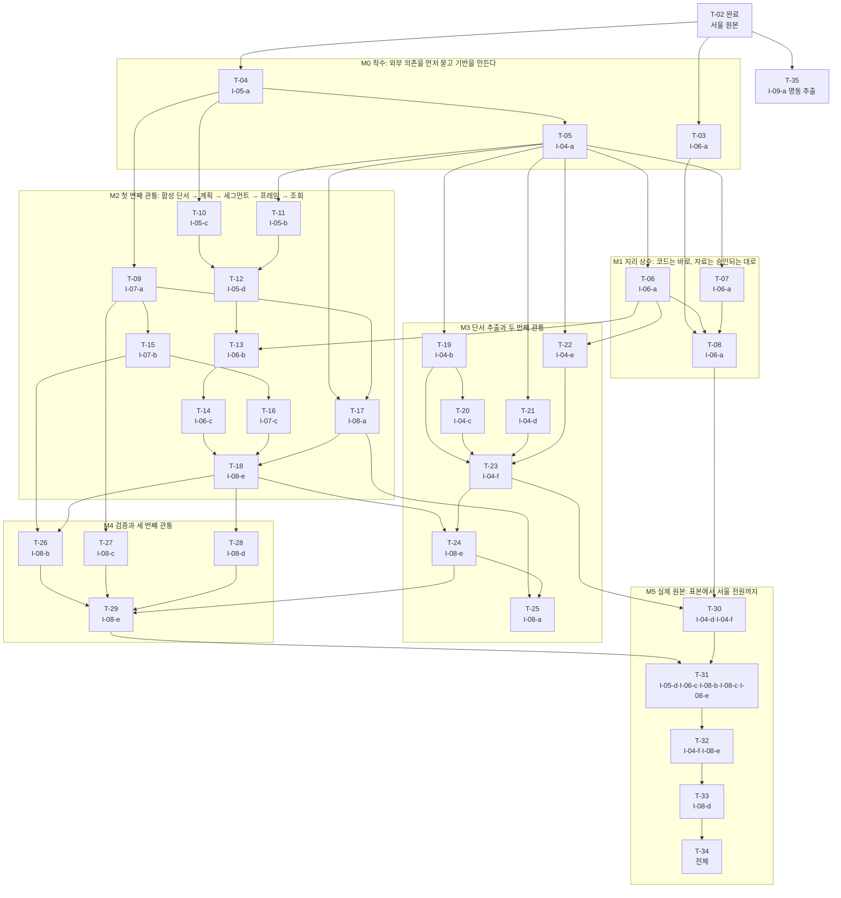

# 구현 순서

범위: T-01~T-02는 C-01~C-03(서울 원본 확보)의 구현 순서이고 완료됐다. T-03~T-34는 활동 엔진 C-04~C-08의 구현체([02_impl_map.md](02_impl_map.md)의 I-04-a~I-08-e 21개)를 구현하는 순서이며 **아직 하나도 시작하지 않았다**. 규칙 데이터의 정본은 [02a_rule_data.md](02a_rule_data.md)이다. 결정은 [DR-22](decisions.md#dr-22--활동-엔진-구현-순서와-진행-규칙)에 기록했다.

활동 엔진 T-03~T-34의 시작 조건: ① 사용자의 구현 시작 지시 ② 사용자가 02·02a를 확인해 상태를 draft에서 confirmed로 올림. 이 둘 전에는 활동 엔진 코드를 작성하지 않는다. 별도 요청으로 확정된 C-09 명동 추출(T-35)은 T-02에만 의존하며 아래 목록에서 활동 엔진보다 먼저 수행한다.

읽는 법: `- [ ] T-nn | 대상: 구현체 단위 | 선행: 먼저 끝나야 하는 todo | 제목` 아래에 완료 조건과 산출물(필요하면 주의)이 있다. 한 단위가 여러 todo로 나뉘면 단위의 테스트를 todo마다 이름으로 나눠 배정한다([O-03](#self-결정-기록)). 단위 링크는 [구현체 Map](02_impl_map.md)의 해당 절로 간다.

다른 작업의 구현 순서: 반응 온톨로지 Python 쪽은 [03b](03b_reaction_python_build_order.md)(T-200~T-219), Rust 런타임은 [03a](03a_rust_engine_build_order.md)(T-220~T-233)이다.

## 순서를 정한 근거

전역 지침(AGENT.md)의 Phase 6 원칙을 우선순위 순서로 적용했다. 아래 그림은 todo 사이의 선행 관계 전부다(검사기가 이 파일의 선행 목록과 대조한다).

### 1. 의존성

코드 의존은 구현체 Map의 시그니처에서 읽었다. 같은 단위가 여러 todo로 나뉘는 곳은 세 가지 이유 때문이다. ① I-08-a의 재생(replay)이 파이프라인을 부르고 파이프라인은 I-08-a의 실행 이름·메타데이터를 쓰는 순환(→ I-08-a ①, I-08-e ①②, I-08-a ②, I-08-e ③으로 풂). ② I-06-a가 코드, 스크립트, 사용자 승인이 필요한 자료로 이루어짐. ③ 실제 원본이 있어야 확인되는 DoD 항목(I-04-d, I-04-f, I-05-d, I-06-c)이 단서 추출 뒤에야 가능함.

### 2. 위험 우선(fail fast)

| 위험 | 왜 위험한가 | 어디서 다루나 |
|---|---|---|
| R1 지리 자료 | 공식 경계 자료를 내려받아야 하고(네트워크, 사용자 승인) 인접표가 없으면 이동 구간과 구 해석을 실제 데이터로 돌릴 수 없다 | T-03을 맨 앞에서 시작, T-08은 T-30 전에 |
| R2 결정성 | Parquet 쓰기가 같은 바이트를 내야 해시 재생이 성립한다 | T-09의 `test_write_deterministic`을 일찍 확인 |
| R3 계획 알고리즘 이식 | 프로토타입에서 가장 많이 고친 부분(조립, 이동 삽입)이고 불변식을 지켜야 한다 | T-10~T-14를 단서 추출보다 먼저, 합성 입력으로 |
| R4 규칙 이식 | 프로토타입의 정규식과 키워드를 JSON 규칙으로 옮기며 결과가 달라질 수 있다 | T-05의 규칙 해시 일치, T-19~T-23의 표 기대값 |
| R5 규모와 메모리 | 이 PC에서 메모리 부족으로 커널 패닉이 두 번 났다 | 20,000명 → 300명 → 1,500·3,000명 → 서울 전원 순으로 키우고(T-30~T-32) 전원은 `memguard` |
| R6 품질 합격선 | 규칙의 정확도는 사람이 라벨링해야 알 수 있다 | T-33, 선택 시범 검수([O-09](#self-결정-기록)) |

### 3. 수직 슬라이스(끝까지 관통하는 경로를 일찍)

| 관통 | 경로 | 완료 todo | 확인 |
|---|---|---|---|
| 1 | 합성 단서 파일 → 계획 → 세그먼트 → 프레임 → 조회 | T-18 | `test_cli_query`, `test_integration_c06_c07` |
| 2 | 합성 원본 Parquet → 단서 추출 → 계획 → 조회 | T-24 | `test_integration_c04_c05` |
| 3 | `run-all`로 검사까지 (합성 30명) | T-29 | `test_cli_run_all_small` |
| 4 | 실제 원본 앞 300·1,500·3,000명 | T-31 | `test_integration_real_slice`, CHK-01~CHK-09 |
| 5 | 서울 전원 185,228명 | T-32 | `cue_persons` 185,228행, 측정값 |

### 4. 테스트 가능한 단위

모든 todo는 [구현체 Map](02_impl_map.md)의 테스트 명세에서 이름으로 배정한 테스트가 green이 되는 것으로 끝난다. 테스트가 없는 todo(T-03, T-34)는 문서와 보고로 확인한다. 아래 커버리지 표를 검사기가 구현체 Map과 대조한다.

## 작업 규칙(활동 엔진 T-03~T-34)

1. 한 todo는 "구현 → 배정된 테스트 전부 green → 일반 테스트 전체 green(회귀) → 체크"의 순서로만 끝낸다. 테스트 없이 체크하지 않는다.
2. 명령(프로젝트 루트 `/Users/aiden/CBU_Hack`): 일반 테스트 `python3 -m unittest discover -s tests -t . -v`; 단위 하나 `python3 -m unittest tests.test_i_05_a -v`([O-04](#self-결정-기록)); 일부 테스트만 `-k test_이름`을 붙인다; 느린 테스트까지 `CBU_SLOW=1 python3 -m unittest discover -s tests -t . -v`.
3. 실제 원본이 필요한 테스트는 모두 느린 테스트이며 `CBU_SLOW=1`일 때만 돈다([O-05](#self-결정-기록)). 느린 테스트는 T-30, T-31, T-32, T-34에서 전체를 돌린다([O-06](#self-결정-기록)).
4. 이전 todo의 테스트가 깨지면 회귀로 보고 멈춘다. 원인을 고친 뒤 이어간다.
5. Map과 현실이 어긋나는 것을 발견하면 코드를 고치지 말고 멈추고 Map을 먼저 고친다. Map에 없는 결정이 필요하면 SELF 기준을 만족할 때만 정한 뒤 해당 단위 절과 DR에 적고, 아니면 사용자에게 묻는다. 코드와 Map이 어긋나면 갱신이 빠진 것이다.
6. `--limit`을 준 개발 실행은 그대로 돌린다. 서울 전원 실행(`--limit` 없음)은 반드시 `/Users/aiden/memguard/bin/memguard run --label "CBU_Hack:<단계>" --mem-gb 3 -- python3 -m engine.cli …`로 감싸고, 시작 전에 `memguard status`로 디스크 여유 12GiB 이상을 확인한다.
7. todo를 끝내면 체크박스를 표시하고 이 파일 changelog에 한 줄(날짜, todo, 결과)을 남긴다. 단위 절이나 02a를 고쳤다면 그 파일 changelog에도 적는다.
8. 원본 `data/nemotron-personas-korea/*`는 수정하지 않는다. 코드는 `engine/`, `scripts/`, `tests/`, `rules/` 아래에만 둔다.

## todo 목록

### 원본 확보(C-01~C-03) — 완료

- [x] T-01 | 대상: I-01-a, I-02-a, I-03-a | 선행: 없음
      완료 조건: `원본_고정_완전성`, `서울_부분집합_정확성`, `스키마_지역_ID` green.
      산출물: `scripts/download_seoul_personas.py`, `data/nemotron-personas-korea/seoul.parquet`, `metadata.json`.
- [x] T-02 | 대상: I-03-a | 선행: T-01
      완료 조건: `인계_검증` green.
      산출물: `data/nemotron-personas-korea/README.md` 및 완료된 Map.

### 독립 명동 추출(C-09)

- [x] T-35 | 대상: I-09-a | 선행: T-02 | 명동 관련 서울 원본 행 추출
      완료 조건: `명동_독립선택`, `명동_오탐과_상호`, `명동_원본보존`, `명동_인계` 모두 통과(E09-1~E09-4).
      산출물: `scripts/extract_myeongdong_personas.py`, `data/myeongdong-personas/`의 Parquet·CSV·근거·메타데이터·README.

### 독립 명동 지면 고도 작업

기존 활동 엔진 및 명동 페르소나 추출과 입력·출력이 다른 독립 트랙이다. 사용자로부터 자료 종류·범위·출처 선택을 받았고([DR-24](decisions.md#dr-24--명동-지형-자료의-종류와-범위), [DR-25](decisions.md#dr-25--고도행정동-경계-자료의-출처와-조건)), 이 트랙의 todo는 아래 순서대로만 수행한다. 선행 없는 T-36부터 시작한다.

- [x] T-36 | 대상: I-10-a | 선행: 없음
      완료 조건: `test_select_boundary_valid`, `test_select_boundary_rejects_invalid`, `test_validate_source_rejects_mismatch` green; 실제 고도 원본 Range·ETag와 명동 경계 식별 확인(E10-1~E10-3).
      산출물: `scripts/download_myeongdong_terrain.py`의 원본·경계 함수, `scripts/requirements-myeongdong-terrain.txt`, `tests/test_myeongdong_terrain.py`의 관련 테스트.
- [x] T-37 | 대상: I-11-a | 선행: T-36
      완료 조건: `test_crop_preserves_values_and_boundary`, `test_crop_rejects_invalid_coverage` green; 원본 값·경계·결측 계약 확인(E11-1~E11-4).
      산출물: 지면 격자 선택·GeoTIFF 기록 함수 및 관련 테스트.
- [x] T-38 | 대상: I-12-a | 선행: T-37
      완료 조건: `test_verify_raster_detects_corruption`, `test_output_exists_fails` green; 실제 원본→경계 선택→GeoTIFF→재독의 통합 및 E2E, 메타데이터·라이선스·해시·통계 독립 검증 모두 통과(E10-1~E10-3, E11-1~E11-4, E12-1~E12-4).
      산출물: `data/myeongdong-terrain/`의 GeoTIFF·경계 GeoJSON·metadata.json·README.md 및 실행 코드.

### 독립 명동 3D 시각화

- [x] T-90 | 대상: I-90-a | 선행: T-38
      완료 조건: `test_terrain_payload`, `test_projection_contract`, `test_3d_render_interaction` green(E90-1~E90-4).
      산출물: 대화 내 표시용 `myeongdong-terrain-3d.html` fragment. 원본 GeoTIFF와 기존 프로젝트 기능을 변경하지 않는다.

### 독립 명동 최종 스무딩 지형 작업

- [x] T-91 | 대상: I-91-a | 선행: T-38
      완료 조건: `test_constant_and_mask`, `test_peak_diffuses_without_invalid_leak`, `test_invalid_data_rejected`, `test_source_errors_and_existing_destination`, `test_final_source_verification` 모두 green(E91-1~E91-4).
      산출물: `scripts/finalize_myeongdong_terrain.py`, `tests/test_finalize_myeongdong_terrain.py`, `data/myeongdong-terrain/final/`의 GeoTIFF·메타데이터·README.
- [x] T-92 | 대상: I-92-a | 선행: T-91
      완료 조건: `test_final_visual_payload`, `test_surface_connectivity`, `test_final_3d_browser` 모두 green(E92-1~E92-4).
      산출물: 대화형 `myeongdong-terrain-final-3d.html` fragment. 원본과 기존 시각화는 보존한다.

### 독립 명동 건물·지형 3D 지도 작업

- [x] T-93 | 대상: I-93-a | 선행: T-91
      완료 조건: `test_blend_preserves_confirmed_cells`, `test_blend_rejects_bad_input`, `test_extend_real_source` green(E93-1~E93-4).
      산출물: `scripts/build_myeongdong_3d_map.py` 지형 확장, `data/myeongdong-3d-map/terrain_extended.tif`, `terrain_metadata.json`.
- [x] T-94 | 대상: I-94-a | 선행: T-93
      완료 조건: `test_coordinate_contract`, `test_relation_and_duplicate_repair`, `test_repair_rejects_inconsistent_source`, `test_ground_and_roads`, `test_map_real_data` green(E94-1~E94-4).
      산출물: 제공 원본 사본, 정렬된 `map_data.json`, `map_data.js` 및 변환·검증 코드.
- [x] T-95 | 대상: I-95-a | 선행: T-94
      완료 조건: `test_rendered_map`, `test_viewer_interaction`, `test_map_attribution_and_offline`, `test_mobile_view` green(E95-1~E95-4).
      산출물: 로컬 `index.html`·CSS·JS·벤더 라이선스·README와 대화형 3D 미리보기.

### 명동 실사 텍스처 작업

- [x] T-152 | 대상: I-152-a | 선행: T-95
      완료 조건: `test_bounds`, `test_satellite_real`, `test_bad_imagery` green(E152-1~4).
      산출물: 위성 원본 창·좌표 정렬 RGB 및 출처·해상도 메타데이터.
- [x] T-153 | 대상: I-153-a | 선행: T-95
      완료 조건: `test_photo_specs`, `test_invalid_photo_spec`, `test_photo_credits` green(E153-1~4).
      산출물: 사진 네 장, 건물·벽면 대응과 저작권·해시.
- [x] T-154 | 대상: I-154-a | 선행: T-152, T-153
      완료 조건: `test_roof_uv`, `test_facade_geometry`, `test_photo_map_browser`, `test_photo_map_provenance` green(E154-1~4).
      산출물: 위성 지붕·네 건물 실제 외벽을 결합한 로컬 지도와 README·대화 미리보기.

### M0 — 착수: 외부 의존을 먼저 묻고 기반을 만든다

가장 불확실한 외부 의존(지리 자료)의 선택과 승인 요청을 맨 앞에 두고([O-01](#self-결정-기록)), 모든 단위가 기대는 기반 둘을 만든다.

- [ ] T-03 | 대상: I-06-a | 선행: T-02 | 지리 자료 선정과 승인 요청
      완료 조건: ① 인접표와 장소 사전을 대조할 공식 자료 후보(출처, 파일 이름·형식·크기, 이용 조건)를 조사하고, 후보별 장단점과 추천 하나를 사용자에게 보여 선택과 내려받기 승인을 받는다(ASK, 응답은 DR로 기록). ② [I-06-a](02_impl_map.md#i-06-a--지리-상수-3종)의 '구축 절차' 3·4에 자료 형식, 인접 계산식, 커버리지 측정식을 구체적으로 먼저 적는다(계산을 스크립트로 하면 그 위치·시그니처·테스트도 이 절에 추가한다). 테스트는 없고 위 문서와 DR로 확인한다.
      산출물: `02_impl_map.md`의 I-06-a 보강, 자료 선택·승인 DR
      주의: 승인 응답을 기다리는 동안 T-04 이후를 진행해도 된다(이 todo에 기대는 것은 T-08뿐). 공식 자료를 얻을 수 없으면 멈추고 사용자에게 대안([DR-13](decisions.md#dr-13--장소-해석과-지리-상수) 변경)을 묻는다.
- [ ] T-04 | 대상: I-05-a | 선행: T-02 | 시간 눈금·키드 난수·스키마·오류 계층
      완료 조건: [I-05-a](02_impl_map.md#i-05-a--시간-눈금-키드-난수-스키마) 테스트 11개 전부 green(`test_rng_golden_vectors`는 02a의 정답 벡터와 정확히 일치). Map 먼저: 02의 '실행 환경과 기술 선택' 절에 [O-04](#self-결정-기록)(테스트 파일 이름)와 [O-05](#self-결정-기록)(느린 테스트 표지)를 적는다.
      산출물: `engine/__init__.py`, `engine/config.py`, `engine/timegrid.py`, `engine/rng.py`, `engine/schema.py`, `tests/__init__.py`, `tests/slow.py`, `tests/test_i_05_a.py`
- [ ] T-05 | 대상: I-04-a | 선행: T-04 | 규칙 로더와 텍스트 도구
      완료 조건: [I-04-a](02_impl_map.md#i-04-a--규칙-로더와-텍스트-도구) 테스트 10개 전부 green. `python3 scripts/install_rules.py`가 02a에서 `rules/v1`(JSON 6개, CSV 2개)을 설치하고 `rule_set_sha256`이 02a의 `8570b260…`(파일 8개 기준)과 일치한다.
      산출물: `engine/rules.py`, `engine/text.py`, `scripts/install_rules.py`, `rules/v1/**`(설치 결과), `tests/test_i_04_a.py`

### M1 — 지리 상수: 코드는 바로, 자료는 승인되는 대로

사전·지리 클래스(코드)는 장난감 지리로 바로 만들고, 공식 자료로 대조해 인접표를 만드는 일(T-08)은 승인이 나는 대로 한다. T-08은 실제 원본을 쓰는 T-30 전에만 끝나면 된다.

- [ ] T-06 | 대상: I-06-a | 선행: T-05 | 사전·지리 클래스(코드)
      완료 조건: [I-06-a](02_impl_map.md#i-06-a--지리-상수-3종) 테스트 중 10개 green: `test_gazetteer_loads_seed`, `test_gazetteer_longest_match`, `test_gazetteer_guard`, `test_gazetteer_trip_ctx`, `test_gazetteer_duplicate_token`, `test_gazetteer_bad_district`, `test_geo_toy_hops`, `test_geo_symmetric`, `test_geo_nonadjacent`, `test_geo_invariants_toy_violation`. Map 먼저: 장난감 지리 픽스처 `toy_geo()`(구 4개 A–B–C–D, 사슬 간선 3개)의 사양을 이 절의 테스트 명세 앞에 적는다.
      산출물: `engine/geo/__init__.py`, `engine/geo/gazetteer.py`, `engine/geo/adjacency.py`, `tests/fixtures.py`(처음 만듦), `tests/test_i_06_a.py`
- [ ] T-07 | 대상: I-06-a | 선행: T-05 | 장소 후보 추출 스크립트
      완료 조건: [I-06-a](02_impl_map.md#i-06-a--지리-상수-3종) 테스트 중 1개 green: `test_geo_candidates_script`(합성 입력에서 빈도순 CSV가 나오고 `…거리` 토큰이 없음).
      산출물: `scripts/geo_candidates.py`, `tests/test_i_06_a.py`(추가)
- [ ] T-08 | 대상: I-06-a | 선행: T-03, T-06, T-07 | 지리 자료 구축(사용자 승인 필요)
      완료 조건: T-03에서 승인된 자료로 ① `scripts/geo_candidates.py`를 서울 원본에 돌려 후보를 만들고 시드 사전(서울 177행·서울 밖 115행)을 공식 경계로 대조·보정해 `note`에 출처를 남기고 ② `rules/v1/geo/district_adjacency.csv`와 `district_adjacency.meta.json`을 만들며 ③ [I-06-a](02_impl_map.md#i-06-a--지리-상수-3종) 테스트 중 2개 green: `test_geo_invariants_real`, `test_gazetteer_coverage_corpus`(사전 적중 95% 이상) ④ 규칙 파일 해시 표를 다시 계산해 02a와 `rule_set_sha256`을 갱신한다.
      산출물: `rules/v1/geo/district_adjacency.csv`, `rules/v1/geo/district_adjacency.meta.json`, 보정한 `seoul_places.csv`·`outside_places.csv`, 02a 해시 표
      주의: 승인(T-03) 없이는 내려받지 않는다. 승인이 아직 없으면 이 todo를 건너뛰고 T-09부터 진행하되 T-30 전에는 끝낸다. 사전·인접표가 바뀌면 `rule_set_sha256`이 바뀌므로 그 뒤의 실행 결과는 새 해시로 다시 만든다.

### M2 — 첫 번째 관통: 합성 단서 → 계획 → 세그먼트 → 프레임 → 조회

단서 추출(C-04)이 없어도 `cues.parquet` 파일 계약으로 계획 이후를 끝까지 연결한다([O-02](#self-결정-기록)). 위험이 큰 결정성(T-09)과 계획·이동(T-10~T-14)을 먼저 확인한다.

- [ ] T-09 | 대상: I-07-a | 선행: T-04 | 세그먼트 저장소(결정성 먼저 확인)
      완료 조건: [I-07-a](02_impl_map.md#i-07-a--세그먼트-저장소) 테스트 8개 전부 green(`test_write_deterministic`: 같은 입력을 두 번 쓰면 파일 바이트가 같다). Map 먼저: 합성 구간 픽스처(하루를 겹침·공백 없이 덮고 구 값이 25개 안인 구간)의 사양을 이 절에 적는다.
      산출물: `engine/store/__init__.py`, `engine/store/segments.py`, `tests/test_i_07_a.py`
      주의: Parquet 바이트가 두 번 같지 않으면 멈추고 쓰기 옵션을 이 절에서 먼저 고친다. 이후 모든 해시 재생(I-08-a)의 전제다.
- [ ] T-10 | 대상: I-05-c | 선행: T-04 | 10분 슬롯 격자와 배치
      완료 조건: [I-05-c](02_impl_map.md#i-05-c--10분-슬롯-격자와-배치) 테스트 9개 전부 green.
      산출물: `engine/plan/__init__.py`, `engine/plan/grid.py`, `tests/test_i_05_c.py`
- [ ] T-11 | 대상: I-05-b | 선행: T-05 | 템플릿 선택·근거 분류·일별 앵커
      완료 조건: [I-05-b](02_impl_map.md#i-05-b--템플릿-선택-근거-분류-일별-앵커) 테스트 12개 전부 green(E05-2·E05-4). Map 먼저: 합성 단서 행(mention)과 합성 문맥 `P` 픽스처가 갖춰야 할 성질(템플릿 4종, 앵커 역할 4종, 빈도 종류 7종, 시각 등급 A~D, 대분류 14종, 장소 판정 5종이 각각 1명 이상)을 이 절에 적는다.
      산출물: `engine/plan/person.py`, `engine/plan/anchors.py`, `tests/test_i_05_b.py`
- [ ] T-12 | 대상: I-05-d | 선행: T-10, T-11 | 하루 활동 구간 조립
      완료 조건: [I-05-d](02_impl_map.md#i-05-d--하루-활동-구간-조립) 테스트 18개 전부 green(E05-1·E05-3·E05-5·E05-6). DoD 중 실제 원본 항목(앞 1,500명 × 7일 불변식 위반 0건, 인물 순서를 뒤집은 재생이 동일)은 단서 추출이 끝난 뒤 T-31에서 확인한다.
      산출물: `engine/plan/compose.py`, `tests/test_i_05_d.py`
- [ ] T-13 | 대상: I-06-b | 선행: T-06, T-12 | 위치 종류·구 해석·근무지
      완료 조건: [I-06-b](02_impl_map.md#i-06-b--위치-종류-구-해석-근무지) 테스트 14개 전부 green(`test_outside_never_assigned` 포함, E06-3~E06-5).
      산출물: `engine/place/__init__.py`, `engine/place/locate.py`, `tests/test_i_06_b.py`
- [ ] T-14 | 대상: I-06-c | 선행: T-13 | 이동 구간 삽입
      완료 조건: [I-06-c](02_impl_map.md#i-06-c--이동-구간-삽입) 테스트 중 13개 green(실제 단서가 필요한 `test_plan_person_day_invariants`만 T-31로 미룸). 장난감 지리에서 이동 길이 띠, 근무·시각 일정 보호, 취소, 중점 귀속을 확인한다(E06-2).
      산출물: `engine/place/moves.py`, `tests/test_i_06_c.py`
- [ ] T-15 | 대상: I-07-b | 선행: T-09 | 프레임 샘플러
      완료 조건: [I-07-b](02_impl_map.md#i-07-b--프레임-샘플러) 테스트 8개 전부 green(E07-1~E07-5). 합성 1,500명에서 144프레임 샘플링이 0.1초 미만.
      산출물: `engine/frames/__init__.py`, `engine/frames/sample.py`, `tests/test_i_07_b.py`
- [ ] T-16 | 대상: I-07-c | 선행: T-15 | 프레임 내보내기와 조회
      완료 조건: [I-07-c](02_impl_map.md#i-07-c--프레임-내보내기와-조회) 테스트 7개 전부 green.
      산출물: `engine/frames/export.py`, `tests/test_i_07_c.py`
- [ ] T-17 | 대상: I-08-a | 선행: T-05, T-09 | 실행 메타데이터와 해시
      완료 조건: [I-08-a](02_impl_map.md#i-08-a--실행-메타데이터와-재생) 테스트 중 4개 green: `test_run_id_format`, `test_run_meta_required_fields`, `test_result_hash_stable`, `test_result_hash_detects_change`(E08-2). 재생(replay) 둘은 파이프라인이 있어야 하므로 T-25에서 한다.
      산출물: `engine/verify/__init__.py`, `engine/verify/runmeta.py`(`replay_matches` 제외), `tests/test_i_08_a.py`
- [ ] T-18 | 대상: I-08-e | 선행: T-14, T-16, T-17 | 계획 단계 실행기와 명령행 ①(첫 번째 관통)
      완료 조건: [I-08-e](02_impl_map.md#i-08-e--단계-실행기와-명령행) 테스트 중 6개 green: `test_cli_requires_seed`, `test_cli_install_rules`, `test_cli_frames`, `test_cli_query`, `test_integration_c05_c06`, `test_integration_c06_c07`. 첫 번째 관통: 합성 단서 파일(`cues/`), 합성 원본·메타데이터, 테스트용 인접표로 `plan` → `frames` → `query`가 끝까지 동작한다. Map 먼저: 합성 단서 파일 작성기와 테스트용 인접표 픽스처의 사양을 이 절에 적는다(시그니처와 `--source`·`--source-meta`·`--rules-dir`는 이미 있음).
      산출물: `engine/pipeline.py`(`RunConfig`, `load_gazetteer`, `load_geo`, `plan_all`), `engine/cli.py`(`install-rules`, `plan`, `frames`, `query`), `tests/test_i_08_e.py`(부분)

### M3 — 단서 추출과 두 번째 관통

규칙 기반 단서 추출(C-04)을 만들어 합성 단서 파일 자리에 끼우고, 합성 원본 Parquet에서 조회까지 이어지는지 본다.

- [ ] T-19 | 대상: I-04-b | 선행: T-05 | 시간·요일·빈도·역할 단서 추출기
      완료 조건: [I-04-b](02_impl_map.md#i-04-b--시간요일빈도역할-단서-추출기) 표의 기대값 전부와 추가 테스트 2개 green: `test_inherit_day_and_daypart_not_freq`, `test_korean_clock_detect_only`(E04-2·E04-5).
      산출물: `engine/cues/__init__.py`, `engine/cues/timecues.py`, `tests/test_i_04_b.py`
- [ ] T-20 | 대상: I-04-c | 선행: T-19 | 모달리티 분류기
      완료 조건: [I-04-c](02_impl_map.md#i-04-c--모달리티-분류기) 15행 표와 추가 테스트 1개 green: `test_tier_a_unknown_never`(E04-3).
      산출물: `engine/cues/modality.py`, `tests/test_i_04_c.py`
- [ ] T-21 | 대상: I-04-d | 선행: T-05 | 활동 후보·15개 대분류·목록 항목 병합
      완료 조건: [I-04-d](02_impl_map.md#i-04-d--활동-후보-15개-대분류-목록-항목-병합) 표의 기대값 전부와 테스트 7개 green(E04-3·E04-6). 실제 원본이 필요한 `test_other_ratio_corpus`는 T-30에서 한다.
      산출물: `engine/cues/activities.py`, `tests/test_i_04_d.py`
- [ ] T-22 | 대상: I-04-e | 선행: T-05, T-06 | 장소 판정과 근무지 단서
      완료 조건: [I-04-e](02_impl_map.md#i-04-e--장소-판정과-근무지-단서) 17행 표와 추가 테스트 2개 green: `test_workplace_hint_employed_only`, `test_classify_longest_token_wins`(E04-4). 사전은 시드 CSV 기준이며 T-08이 끝난 뒤 보정본으로 다시 돌린다.
      산출물: `engine/cues/places.py`, `tests/test_i_04_e.py`
- [ ] T-23 | 대상: I-04-f | 선행: T-19, T-20, T-21, T-22 | 인물 단위 추출과 출력 파일
      완료 조건: [I-04-f](02_impl_map.md#i-04-f--인물-단위-추출과-출력-파일) 테스트 중 9개 green(`test_example_persona`는 실제 UUID `89eca80b…` 인물, E04-1·E04-2). 실제 원본이 필요한 `test_corpus_smoke_20k`는 T-30에서 한다. Map 먼저: 합성 원본 Parquet 픽스처(필수 열, 25개 구 키를 가진 `metadata.json`, 서술이 모두 빈 인물 포함)의 사양을 이 절에 적는다.
      산출물: `engine/cues/extract.py`, `tests/fixtures.py`(추가), `tests/test_i_04_f.py`
- [ ] T-24 | 대상: I-08-e | 선행: T-18, T-23 | 단서 단계 실행기 ②(두 번째 관통)
      완료 조건: [I-08-e](02_impl_map.md#i-08-e--단계-실행기와-명령행) 테스트 중 1개 green: `test_integration_c04_c05`. 두 번째 관통: 합성 원본 Parquet에서 `cues` → `plan` → `query`가 동작한다.
      산출물: `engine/pipeline.py`(`run_cues`), `engine/cli.py`(`cues`), `tests/test_i_08_e.py`(추가)
- [ ] T-25 | 대상: I-08-a | 선행: T-17, T-24 | 재생(replay)
      완료 조건: [I-08-a](02_impl_map.md#i-08-a--실행-메타데이터와-재생) 테스트 중 2개 green: `test_replay_matches`, `test_replay_rejects_changed_rules`(E08-6).
      산출물: `engine/verify/runmeta.py`(`replay_matches`), `tests/test_i_08_a.py`(추가)

### M4 — 검증과 세 번째 관통

전수 검사·지표·표본 검수와 `run-all`을 완성해 합성 30명이 끝까지 통과하게 한다.

- [ ] T-26 | 대상: I-08-b | 선행: T-15, T-18 | 전수 자동 검사
      완료 조건: [I-08-b](02_impl_map.md#i-08-b--전수-자동-검사) 테스트 15개 전부 green(E08-3). Map 먼저: 깨끗한 합성 실행 만들기와 위반 주입기 픽스처의 사양을 이 절에 적는다. DoD 중 앞 3,000명 × 7일 통과는 T-31에서 한다.
      산출물: `engine/verify/invariants.py`, `tests/test_i_08_b.py`
- [ ] T-27 | 대상: I-08-c | 선행: T-09 | 보고 지표 5종
      완료 조건: [I-08-c](02_impl_map.md#i-08-c--보고-지표-5종) 테스트 4개 전부 green(E08-5). DoD 중 앞 3,000명 실행은 T-31에서 한다.
      산출물: `engine/verify/metrics.py`, `tests/test_i_08_c.py`
- [ ] T-28 | 대상: I-08-d | 선행: T-18 | 표본 검수와 합격선 도구
      완료 조건: [I-08-d](02_impl_map.md#i-08-d--표본-검수와-합격선) 테스트 8개 전부 green(E08-4). DoD 중 200명 라벨링은 T-33에서 한다.
      산출물: `engine/verify/samplereview.py`, `tests/test_i_08_d.py`
- [ ] T-29 | 대상: I-08-e | 선행: T-24, T-26, T-27, T-28 | 검증 단계 실행기와 명령행 ③(세 번째 관통)
      완료 조건: [I-08-e](02_impl_map.md#i-08-e--단계-실행기와-명령행) 테스트 중 5개 green: `test_cli_run_all_small`, `test_cli_refuses_existing_run`, `test_cli_failed_run_not_published`, `test_cli_evaluate`, `test_cli_explain`. 세 번째 관통: 합성 30명이 `run-all`로 끝까지 가서 검사를 모두 통과하고 종료 코드 0이다.
      산출물: `engine/pipeline.py`(`verify_run`, `run_all`), `engine/cli.py`(`verify`, `evaluate`, `explain`, `run-all`), `tests/test_i_08_e.py`(추가)

### M5 — 실제 원본: 표본에서 서울 전원까지

실제 원본으로 규모를 키우며 확인하고([O-07](#self-결정-기록)), 사용자의 라벨링으로 품질을 판정한 뒤 마감한다.

- [ ] T-30 | 대상: I-04-d, I-04-f | 선행: T-08, T-23 | 실제 원본 20,000명 단서 추출
      완료 조건: 느린 테스트 2개 green: `test_other_ratio_corpus`, `test_corpus_smoke_20k`. 인물당 추출 시간(ms)을 기록해 프로토타입 1.1~2.4ms와 비교하고 크게 벗어나면 원인을 02에 적는다.
      산출물: `tests/test_i_04_d.py`·`tests/test_i_04_f.py`(느린 테스트 추가), 02의 '측정 기록'
      주의: T-08이 끝나 보정된 사전으로 돌린다.
- [ ] T-31 | 대상: I-05-d, I-06-c, I-08-b, I-08-c, I-08-e | 선행: T-29, T-30 | 실제 원본 소규모 통합(300 → 1,500 → 3,000명)
      완료 조건: ① `run-all --limit 300 --days 7`로 `test_integration_real_slice` green ② 앞 1,500명 × 7일: `test_plan_person_day_invariants` green, [I-05-d](02_impl_map.md#i-05-d--하루-활동-구간-조립) DoD(불변식 위반 0건, 인물 순서를 뒤집은 재생이 동일; [O-10](#self-결정-기록)에 따라 Map 먼저 느린 테스트 `test_plan_order_free_real`을 DoD에 적고 구현) ③ 앞 3,000명 × 7일: [I-06-c](02_impl_map.md#i-06-c--이동-구간-삽입) DoD(위반 0건), [I-08-b](02_impl_map.md#i-08-b--전수-자동-검사) DoD(CHK-01~CHK-09 전부 통과), [I-08-c](02_impl_map.md#i-08-c--보고-지표-5종) DoD(지표 5종이 `metrics.json`에 쓰임). Map에 있는 테스트 2개(`test_integration_real_slice`, `test_plan_person_day_invariants`)와 새 느린 테스트 1개가 green. 인물·일당 계획 시간, 세그먼트 행 수와 디스크 크기를 02의 '측정 기록'에 적는다([DR-18](decisions.md#dr-18--저장과-조회-방식) 측정).
      산출물: `tests/test_i_08_e.py`·`tests/test_i_06_c.py`·`tests/test_i_05_d.py`(느린 테스트 추가), 02의 '측정 기록'
- [ ] T-32 | 대상: I-04-f, I-08-e | 선행: T-31 | 서울 전원 실행(memguard)
      완료 조건: `/Users/aiden/memguard/bin/memguard run --label "CBU_Hack:run-all" --mem-gb 3 -- python3 -m engine.cli run-all --seed 20261030 --start 2026-11-02 --days 7`가 끝나 `data/runs/v1-s20261030-20261102-7d/`가 만들어지고 ① `cue_persons` 185,228행([I-04-f](02_impl_map.md#i-04-f--인물-단위-추출과-출력-파일) DoD, E04-1) ② CHK-01~CHK-09 전부 ok ③ [I-08-e](02_impl_map.md#i-08-e--단계-실행기와-명령행) DoD ④ 측정값(세그먼트 수·디스크 크기, `frames` 한 날짜의 크기·시간, 총 실행 시간)을 02의 '측정 기록'에 적는다([DR-18](decisions.md#dr-18--저장과-조회-방식) 측정). 보고에는 `thresholds.json`이 생기기 전까지 '품질 판정 미완'이라고 적는다.
      산출물: `data/runs/v1-s20261030-20261102-7d/`, 02의 '측정 기록'
      주의: 시드·시작일·일수는 Map 예시값이다. 결과 전체가 시드로 정해지므로 실행 전에 사용자에게 확인한다([O-08](#self-결정-기록)). 시작 전 `memguard status`로 디스크 여유 12GiB 이상을 확인한다.
- [ ] T-33 | 대상: I-08-d | 선행: T-32 | 표본 200명 검수와 합격선(사람이 하는 일)
      완료 조건: T-32의 `report/sample_review.md`와 `labels.template.json`으로 사용자가 200명을 라벨링해 `labels.json`을 만들고 `evaluate`로 `report/thresholds.json`을 만든다. 다섯 지표가 [DR-20](decisions.md#dr-20--품질-합격선과-보관)의 합격선을 넘으면 통과이고, 못 넘으면 규칙 버전을 올리는 DR을 추가해 해당 규칙을 고친 뒤 T-32부터 다시 한다. 라벨이 비어 있으면 '품질 판정 미완'으로 보고하고 합격이라고 말하지 않는다.
      산출물: `labels.json`, `report/thresholds.json`, 필요 시 규칙 버전 DR
      주의: 사용자의 시간이 필요하다. 선택([O-09](#self-결정-기록)): T-31의 3,000명 실행에서 20명만 먼저 검수해 규칙 결함을 일찍 찾는다.
- [ ] T-34 | 대상: I-04-a~I-08-e 전체 | 선행: T-33 | 마감
      완료 조건: 일반 테스트와 느린 테스트(`CBU_SLOW=1`) 전체 green, 모든 Map의 frontmatter 상태가 현실과 맞고(01·02·02a·03은 done, decisions는 confirmed), 이 파일의 체크박스와 changelog가 현실과 일치하며, 측정 기록이 02에 있다.
      산출물: 갱신된 Map 5개, 마감 보고

## 사용자가 함께해야 하는 지점

| todo | 무엇을 | 왜 | 어떻게 |
|---|---|---|---|
| T-03 | 지리 자료의 선택과 내려받기 승인 | 외부 자료와 이용 조건이 걸려 되돌리기 어렵다(ASK) | 후보 비교, 추천 하나, 파일 이름·출처·크기를 적어 묻는다 |
| T-08 | 승인 범위 안에서 내려받기 | 승인 없이 내려받지 않는다 | 승인된 파일만 받고 출처·날짜를 meta에 남긴다 |
| T-32 | 시드·시작일·일수 확인 | 결과 전체가 시드로 정해진다 | 기본 제안값 `20261030`·`2026-11-02`·7일을 보여 확인받는다 |
| T-33 | 표본 200명 라벨링 | 정확도는 사람만 판단할 수 있다 | `sample_review.md`와 `labels.template.json`을 주고 `labels.json`을 받는다 |
| T-34 | Map 상태를 done으로 올리는 확인 | 최종 확인 | 마감 보고 |

## 구현체 Map 보강 (Map 먼저)

Phase 6에서 구현체 Map의 빈칸을 찾았다. 아래는 해당 todo가 **코드보다 먼저** Map에 적어야 하는 것이다(AGENT.md: Map과 어긋나면 Map 먼저). I-08-e의 시그니처와 `METADATA_JSON`은 이번 작업에서 이미 보강했다([02 changelog](02_impl_map.md#changelog)).

| 빈칸 | 내용 | 닫는 todo |
|---|---|---|
| 느린 테스트 표지와 테스트 파일 이름 | 02가 '느린 테스트'라고만 하고 구분 방법과 파일 배치를 정하지 않았다 | T-04 ([O-04](#self-결정-기록), [O-05](#self-결정-기록)) |
| 지리 자료 구축 방법 | 구축 절차 3·4가 자료 형식과 계산식 없이 '공식 경계에서 계산'이라고만 한다 | T-03 |
| 테스트 픽스처 | 합성 인물·구간·단서 행·원본 Parquet·인접표·깨끗한 합성 실행의 생성 규칙이 없다 | 아래 표의 처음 필요한 todo ([O-11](#self-결정-기록)) |
| 이름 없는 DoD 확인 | I-05-d의 '인물 순서를 뒤집은 재생이 동일'에 테스트 이름이 없다 | T-31 ([O-10](#self-결정-기록)) |

### 테스트 픽스처 목록

처음 필요한 todo가 `tests/fixtures.py`에 만들고, 사양(필요한 성질)을 그 단위 절에 먼저 적는다. 성질은 구현체 Map의 Given과 Then에서 읽은 것이다.

| 픽스처 | 쓰는 테스트 | 갖춰야 할 성질 | 처음 필요한 todo |
|---|---|---|---|
| 장난감 지리 `toy_geo()` | I-06-a·b·c의 `test_geo_*`, `test_resolve_*`, `test_move_*` | 구 4개 A–B–C–D, 사슬 간선 3개, 홉 0~3이 모두 나옴 | T-06 |
| 합성 구간 | I-07-a·b·c | 하루를 겹침·공백 없이 덮고 모든 경계가 10의 배수, 구 값은 25개 안, 인물 수백~수천 명 | T-09 |
| 합성 단서 행과 문맥 `P` | I-05-b·d, I-06-b·c | 템플릿 4종, 앵커 역할 4종, 빈도 종류 7종, 시각 등급 A~D, 대분류 14종, 장소 판정 5종이 각각 1명 이상, 같은 시드면 같은 결과 | T-11 |
| 합성 원본 Parquet와 `metadata.json` | `run_cues`, CLI | 필수 열 전부, `metadata.json`에 구 25개 키, 서술이 모두 빈 인물 포함 | T-18(단서 파일), T-23(원본) |
| 테스트용 인접표 | CLI와 파이프라인 테스트 | 25개 구 이름 위의 가짜 그래프로 [I-06-a](02_impl_map.md#i-06-a--지리-상수-3종)의 불변식을 만족(연결, 차수 2~9, 알려진 인접·비인접 쌍) | T-18 |
| 깨끗한 합성 실행 | I-08-a·b·d | 파이프라인으로 만든 작은 실행(예: 30명 × 3일), 검사가 모두 ok | T-26 |
| 위반 주입기 | I-08-b | 실행 사본의 Parquet를 읽어 고쳐 쓰는 헬퍼, 원본 실행은 건드리지 않음 | T-26 |

## 커버리지

아래 표는 구현체 Map에서 뽑았고 검사기가 대조한다. 단위의 테스트는 정확히 한 todo에 배정되고, 개념 테스트(E04-1~E08-6)는 배정된 구현 테스트가 모두 green이 되는 가장 이른 시점이 완료다.

### 단위 → todo

| 단위 | todo(배정된 테스트 수) | 단위 전체 |
|---|---|---|
| [I-04-a](02_impl_map.md#i-04-a--규칙-로더와-텍스트-도구) | T-05(10) | 10개 |
| [I-04-b](02_impl_map.md#i-04-b--시간요일빈도역할-단서-추출기) | T-19(표 + 2) | 표 + 2개 |
| [I-04-c](02_impl_map.md#i-04-c--모달리티-분류기) | T-20(15행 표 + 1) | 15행 표 + 1개 |
| [I-04-d](02_impl_map.md#i-04-d--활동-후보-15개-대분류-목록-항목-병합) | T-21(7), T-30(1) | 8개 |
| [I-04-e](02_impl_map.md#i-04-e--장소-판정과-근무지-단서) | T-22(17행 표 + 2) | 17행 표 + 2개 |
| [I-04-f](02_impl_map.md#i-04-f--인물-단위-추출과-출력-파일) | T-23(9), T-30(1), T-32(DoD) | 10개 |
| [I-05-a](02_impl_map.md#i-05-a--시간-눈금-키드-난수-스키마) | T-04(11) | 11개 |
| [I-05-b](02_impl_map.md#i-05-b--템플릿-선택-근거-분류-일별-앵커) | T-11(12) | 12개 |
| [I-05-c](02_impl_map.md#i-05-c--10분-슬롯-격자와-배치) | T-10(9) | 9개 |
| [I-05-d](02_impl_map.md#i-05-d--하루-활동-구간-조립) | T-12(18), T-31(DoD) | 18개 |
| [I-06-a](02_impl_map.md#i-06-a--지리-상수-3종) | T-03(문서), T-06(10), T-07(1), T-08(2) | 13개 |
| [I-06-b](02_impl_map.md#i-06-b--위치-종류-구-해석-근무지) | T-13(14) | 14개 |
| [I-06-c](02_impl_map.md#i-06-c--이동-구간-삽입) | T-14(13), T-31(1) | 14개 |
| [I-07-a](02_impl_map.md#i-07-a--세그먼트-저장소) | T-09(8) | 8개 |
| [I-07-b](02_impl_map.md#i-07-b--프레임-샘플러) | T-15(8) | 8개 |
| [I-07-c](02_impl_map.md#i-07-c--프레임-내보내기와-조회) | T-16(7) | 7개 |
| [I-08-a](02_impl_map.md#i-08-a--실행-메타데이터와-재생) | T-17(4), T-25(2) | 6개 |
| [I-08-b](02_impl_map.md#i-08-b--전수-자동-검사) | T-26(15), T-31(DoD) | 15개 |
| [I-08-c](02_impl_map.md#i-08-c--보고-지표-5종) | T-27(4), T-31(DoD) | 4개 |
| [I-08-d](02_impl_map.md#i-08-d--표본-검수와-합격선) | T-28(8), T-33(DoD) | 8개 |
| [I-08-e](02_impl_map.md#i-08-e--단계-실행기와-명령행) | T-18(6), T-24(1), T-29(5), T-31(1), T-32(DoD) | 13개 |

### 개념 테스트 → todo

| 개념 테스트 | 구현 테스트가 green이 되는 todo | 완료 |
|---|---|---|
| E04-1 | T-23, T-32 | T-32 |
| E04-2 | T-19, T-23 | T-23 |
| E04-3 | T-20, T-21 | T-21 |
| E04-4 | T-06, T-08, T-21, T-22 | T-22 |
| E04-5 | T-19 | T-19 |
| E04-6 | T-21, T-30 | T-30 |
| E05-1 | T-04, T-10, T-12 | T-12 |
| E05-2 | T-11, T-12 | T-12 |
| E05-3 | T-12 | T-12 |
| E05-4 | T-11, T-12 | T-12 |
| E05-5 | T-12 | T-12 |
| E05-6 | T-04, T-12 | T-12 |
| E06-1 | T-14, T-26, T-31 | T-31 |
| E06-2 | T-14 | T-14 |
| E06-3 | T-13 | T-13 |
| E06-4 | T-13, T-22 | T-22 |
| E06-5 | T-06, T-07, T-08, T-13 | T-13 |
| E07-1 | T-15, T-16 | T-16 |
| E07-2 | T-15, T-16 | T-16 |
| E07-3 | T-09, T-15, T-16 | T-16 |
| E07-4 | T-15, T-16 | T-16 |
| E07-5 | T-15 | T-15 |
| E08-1 | T-12, T-13, T-26, T-29 | T-29 |
| E08-2 | T-17 | T-17 |
| E08-3 | T-26 | T-26 |
| E08-4 | T-28 | T-28 |
| E08-5 | T-27 | T-27 |
| E08-6 | T-25 | T-25 |

### 통합·E2E 테스트 → todo

| 경계 | 테스트 | todo |
|---|---|---|
| C-03→C-04 | `test_corpus_smoke_20k` | T-30 |
| C-04→C-05 | `test_integration_c04_c05` | T-24 |
| C-05→C-06 | `test_integration_c05_c06` | T-18 |
| C-06→C-07 | `test_integration_c06_c07` | T-18 |
| C-04~C-07→C-08 | `test_integration_real_slice` | T-31 |
| E2E(합성 30명 전체) | `test_cli_run_all_small` | T-29 |
| E2E(조회) | `test_cli_query` | T-18 |
| E2E(서울 전원) | `run-all` 서울 전원 | T-32 |

## SELF 결정 기록

AGENT.md의 SELF 기준(업계 표준이 있고, 외부 계약에 영향이 없고, 되돌리기 쉽고, 어떤 합리적 선택도 사용자 관점의 결과가 같다)을 만족하는 구현 순서의 결정이다. 바꾸려면 이 표와 해당 todo를 먼저 고친다([DR-22](decisions.md#dr-22--활동-엔진-구현-순서와-진행-규칙)).

| ID | 결정 | 이유 | 되돌리는 법 |
|---|---|---|---|
| O-01 | 지리 자료 트랙(T-03, T-06~T-08)을 맨 앞에서 시작한다 | 외부 의존과 사용자 승인이 가장 큰 불확실성이고 코드 todo와 독립이라 병행할 수 있다 | 순서를 바꾸면 되며 T-08만 T-30 전에 끝나면 된다 |
| O-02 | 첫 관통은 합성 단서 파일로 C-05→C-07을 먼저 만든다(C-04 이전) | C-04는 `cues.parquet` 파일 계약으로만 C-05와 이어지고, 위험이 큰 계획·이동·결정성을 먼저 확인할 수 있다 | C-04를 먼저 하려면 T-19~T-23을 T-09 앞으로 옮기고 합성 단서 픽스처를 쓰지 않는다 |
| O-03 | 단위를 여러 todo로 나누는 기준은 순환 의존, 외부 자료, 실제 원본이 필요한 DoD 셋뿐이다. 나누면 테스트 이름을 todo마다 배정해 합집합이 단위 전체와 같게 한다 | 단위마다 todo 하나로는 순서가 성립하지 않고, 더 잘게 나누면 확인 지점이 늘기만 한다 | 배정 표를 바꾸고 검사기로 확인 |
| O-04 | 테스트 파일은 단위마다 하나이고 이름은 `tests/test_<단위 ID의 '-'를 '_'로>.py`(예 `tests/test_i_05_a.py`) | 단위와 파일이 1:1이라 todo의 확인 명령이 모호하지 않다 | 파일을 합치거나 쪼개도 테스트 이름은 그대로 |
| O-05 | 실제 원본이 필요한 테스트는 `tests/slow.py`의 `slow_test`로 표시하고 `CBU_SLOW=1`일 때만 실행한다 | 평소 회귀는 빨라야 하고(합성 데이터), 실제 원본은 시간이 걸린다 | 환경 변수 이름만 바꾸면 된다 |
| O-06 | 모든 todo의 끝에 일반 테스트 전체를 돌리고, 느린 테스트는 T-30·T-31·T-32·T-34에서 전체를 돌린다 | 회귀 원칙을 지키면서 느린 실행을 아낀다 | 느린 테스트를 더 자주 돌려도 된다 |
| O-07 | 실제 원본 규모는 20,000명(C-04만) → 300명 → 1,500·3,000명 → 서울 전원으로 키우고 전원 실행은 `memguard`로 감싼다 | 이 PC에서 메모리·디스크 고갈로 커널 패닉이 두 번 났다 | 중간 단계를 건너뛰면 위험이 커진다 |
| O-08 | 첫 전원 실행의 인자는 Map 예시값(시드 `20261030`, 시작 `2026-11-02` 월요일, 7일)으로 제안하고 T-32 전에 사용자에게 확인한다 | 결과 전체가 시드로 정해지고 Map이 같은 값을 예시로 쓴다 | 사용자가 다른 값을 고르면 `run_id`만 달라진다 |
| O-09 | 시범 검수(선택): T-31의 3,000명 실행에서 20명만 먼저 검수한다 | 규칙 정확도는 가장 늦게 알게 되는 위험이라 일찍 단서를 얻는다 | 생략해도 T-33은 그대로 진행된다 |
| O-10 | I-05-d DoD의 '인물 순서를 뒤집은 재생이 동일'을 느린 테스트 `test_plan_order_free_real`로 만든다(앞 300명을 정방향·역방향으로 `plan_person_day`한 결과의 해시 비교) | DoD가 테스트 이름 없이 남으면 확인이 흐려진다 | 이름 없이 수동 확인으로 되돌릴 수 있다 |
| O-11 | 테스트 픽스처는 처음 필요한 todo가 `tests/fixtures.py`에 만들고, 필요한 성질을 그 단위 절에 먼저 적는다 | 한꺼번에 설계하면 쓰이지 않는 부분이 생기고, 단위 절에 두면 Given과 사양이 가까이 있다 | 사양을 별도 절로 모을 수 있다 |

## 명동 증강 구현 순서

C-130~133은 독립 트랙으로 아래 순서대로만 구현한다. 각 단계는 명시된 테스트가 green일 때만 체크한다. 이후 Map과 다르면 먼저 Map을 갱신한다.

- [x] T-130 | 대상: I-130-a | 선행: 없음
      완료 조건: `test_statistics_parsing`, `test_statistics_real_sources` 통과.
      산출물: 공식 통계 정규화 코드·자료.
- [x] T-131 | 대상: I-131-a | 선행: T-130
      완료 조건: `test_population_quotas_sparse`, `test_allocation_constraints`, `test_real_calibration` 통과.
      산출물: 65,000개 고유 출처 선택과 분포 진단.
- [x] T-134 | 대상: I-130-a, I-131-a | 선행: T-131, DR-136
      완료 조건: 추가 구별 원표 공개·비공개 셀 검사, `test_district_marriage` 및 새 결과 `test_real_calibration` 통과.
      산출물: 공개 구별 혼인 목표가 반영된 정규화 자료와 65,000개 중간 선택.
- [x] T-132 | 대상: I-132-a | 선행: T-131, C-09
      완료 조건: `test_evidence_unicode_and_business`, `test_assign_parent_slots`, `test_written_schema_and_evidence` 통과.
      산출물: 부모별 연결, 온톨로지 최소 계약을 만족하는 행.
- [x] T-133 | 대상: I-133-a | 선행: T-132, T-134
      완료 조건: `test_validation_rejects_corruption`, `test_e2e_small`, `test_full_dataset_validation` 통과.
      산출물: 재독 검증된 65,000행 Parquet, 진단 JSON, README.

## 온톨로지 기반 정방향·역산 구현 순서

이 절은 [C-100~C-105](01_concept_map.md#온톨로지-기반-정방향-기록과-목표-역산--c-100c-105)와 [I-100-a~I-105-a](02_impl_map.md#온톨로지-기반-정방향역산-구현체-map)의 Phase 6 Map이다. 현재 요청은 알고리즘 설계이므로 **아래 구현 todo는 모두 미착수**다. 다른 작업의 완료 표시와 기존 구현 순서를 변경하지 않는다.

의존성을 먼저 지키되 위험이 큰 모델/trace/난수 재현을 앞에 둔다. 한 번에 모든 정방향 엔진을 완성한 뒤 역산을 붙이는 방식 대신, 손계산 가능한 유한 제어 모델에서 입력→기록→목표→역산→재생을 먼저 관통한다. 이 E2E가 통과한 뒤 연속/큰 혼합 공간 탐색을 추가한다. 수치 성능은 그 뒤 실제 어댑터로 측정한다.

- [ ] T-100 | 대상: I-100-a, I-101-a | 선행: 없음
      완료 조건: `test_model_*`, `test_time_dependencies`, `test_semantic_edge_not_causal`, `test_only_control_ports_change`, `test_target_units_windows_tolerance`, `test_change_distance_semantics`, `test_action_domain_and_constraints`, `test_model_to_request` green. 저장 목표화 테스트는 T-102에서 완료한다.
      산출물: contracts/model/adapters/base/request/controls/scoring 및 대응 단위 테스트. 잘못된 단위·역할·순간 순환을 실제로 거절하는 검증 가능한 최소 계약.
- [ ] T-101 | 대상: I-103-a | 선행: T-100
      완료 조건: E103-1~4의 `test_journal_attempt_lifecycle`, `test_trace_reconstructs_states`, `test_incomplete_and_corruption`, `test_cache_context_identity` green. 독립 실행 재생 E103-5는 T-102에 배정한다.
      산출물: journal/artifacts/trace, 임시 파일 fixture, 입력·실패·부분 실행을 구별하는 장부.
- [ ] T-102 | 대상: I-102-a, I-103-a, I-101-a | 선행: T-101
      완료 조건: E102-1~5 전부, `test_recorded_run_replay`, `test_request_to_forward`, `test_forward_to_journal`, `test_saved_target_current_scenario` green. 같은 조건의 재생과 제어 변경 중 공통 난수 유지 확인.
      산출물: forward/noise/worker, 합성 q/피드백/native-trace 어댑터와 정방향→장부→목표화 슬라이스.
- [ ] T-103 | 대상: I-104-a | 선행: T-102
      완료 조건: `test_evaluator_constraints_and_mask`, `test_target_before_change_cost`, `test_zero_change_solution`, `test_interaction_not_pruned`, `test_partial_and_budget_accounting`, `test_history_to_inverse`, `test_inverse_evaluates_original` green.
      산출물: evaluator/archive, 고정 시나리오 평가·현재 목표 재채점·완전한 후보 순위.
- [ ] T-104 | 대상: I-104-b의 유한 열거 경로 | 선행: T-103
      완료 조건: `test_search_mixed_and_multiple_solutions`의 유한 분기, `test_no_feasible_vs_proven`의 유한 분기, `test_zero_baseline_search_shortcut` green. 독립적인 작은 전수 계산과 최소 D/무해 판정이 일치.
      산출물: search의 finite enumeration과 증명 범위/certificate. 휴리스틱 분기는 아직 완료로 표시하지 않는다.
- [ ] T-105 | 대상: I-105-a | 선행: T-104
      완료 조건: E105-1~5, `test_candidate_to_verification`, `test_verification_uses_frozen_contract`, 유한 격자판 `test_forward_record_target_inverse_replay`, `test_inverse_failure_reporting`의 유한/미준비 분기 green.
      산출물: verify/report/pipeline 및 첫 완전 E2E. 정방향 실행을 고정 목표로 가져와 충격 후 제어만 역산하고 원래 모델에서 재생 확인.
- [ ] T-106 | 대상: I-104-b의 DE 경로 | 선행: T-105
      완료 조건: `test_search_mixed_and_multiple_solutions`의 연속 분기, `test_no_feasible_vs_proven`의 연속 미발견 분기, `test_search_budget_resume`, 연속판 핵심 E2E green. 임계값/정수/범주에서도 직접 판정으로 목표 통과. 전역 최소는 요구하지 않는다.
      산출물: 2단계 DE, 고정 초기 population/restart, 동일 evaluator 콜백, A의 feasible을 보존하는 B.
- [ ] T-107 | 대상: I-100-a~I-105-a | 선행: T-106
      완료 조건: 새 엔진 경계별 통합/E2E 전부 green, 아직 실행하지 않은 예산/오류/native-trace의 조합 시나리오 통과. 테스트 커버리지에서 E100-1~E105-5의 누락 0. 이전에 통과한 테스트를 변경 근거 없이 재실행하지 않는다.
      산출물: 검증 결과와 호출/시간/기록 크기 측정, 남은 명동 어댑터 준비 항목.

### 테스트 추적과 실행 원칙

| 개념 완료 기준 / 테스트 | 구현 단위 | 완료 todo |
|---|---|---|
| E100-1~5 | I-100-a | T-100 |
| E101-1~4 | I-101-a | T-100 |
| E101-5 | I-101-a + I-103-a | T-102 |
| E102-1~5 | I-102-a | T-102 |
| E103-1~4 | I-103-a | T-101 |
| E103-5 | I-103-a + I-102-a | T-102 |
| E104-1~2 | I-104-a | T-103 |
| E104-3 | I-104-a/b | T-103, T-104 |
| E104-4 | I-104-a/b | T-103, T-104, T-106 |
| E104-5 | I-104-b | T-104, T-106 |
| E104-6 | I-104-a/b | T-103, T-106 |
| E105-1~5 | I-105-a | T-105 |
| 경계별 통합과 핵심/실패 E2E | 전체 | T-102~T-107의 명시 배정 |

테스트 파일은 `tests/test_inverse_model.py`, `test_inverse_request.py`, `test_inverse_journal.py`, `test_inverse_forward.py`, `test_inverse_evaluator.py`, `test_inverse_search.py`, `test_inverse_verify.py`, `test_inverse_integration.py`다. 테스트명은 구현체 Map의 이름을 그대로 쓴다. 예를 들어 T-100은 `python3 -m unittest tests.test_inverse_model tests.test_inverse_request`와 해당 경계 테스트를 실행한다. 프로젝트 tests가 package가 아니면 동일한 파일을 `unittest discover -s tests -p 'test_inverse_model.py'` 형태로 실행한다.

각 todo는 구현→해당 신규 테스트와 영향을 받은 경계 회귀→green 확인→체크 순서다. T-107은 누락된 통합 조합과 traceability를 마무리하는 단계이며 통과한 전체 테스트를 아무 이유 없이 반복하는 단계가 아니다. 오류/계약 불일치가 발견되면 Map부터 갱신한다. SELF가 아닌 목표/제어/도메인 변경은 다시 ASK로 분류한다.

### 실제 명동 연결의 선행 조건

실제 어댑터 구현 todo는 온톨로지의 최종 스키마·전이 코드·승인된 수치/입력값이 제공된 뒤 해당 I단위와 테스트를 **Map에 먼저** 추가한다. 현재 범용 설계의 완료를 기다리게 하는 조건이 아니라, 아직 존재하지 않는 실제 실행의 준비 조건이다.

- 초안 위치는 `docs/maps/01a_persona_ontology.md` v0.2와 후속 v0.3에서 확인했다(DR-107~108). Q-R1~Q-R7 및 함수/수치가 미확정이며, 확정된 코드가 native trace·안정 개체 ID·키드 난수 계약을 제공해야 한다.
- 실제 KPI·기간·허용오차·제어 범위/척도/가중치·시나리오·평가 예산은 InverseRequest에 명시한다.
- 실제 연결 뒤 합성 모델과 같은 테스트를 돌렸다는 이유만으로 통합 완료 처리하지 않는다. 명동 입력의 전이·목표화·역산·재생을 별도로 검증한다.

## 명동 유동인구 반영 순서

- [x] T-140 | 대상: I-140-a | 선행: 없음
      완료 조건: `test_csv_validation`, `test_2025_figures`, `test_source_dataset` green.
      산출물: 분기 원본·이미지 근거와 기간별 집계.
- [x] T-141 | 대상: I-141-a | 선행: T-140
      완료 조건: `test_ten_minute_boundaries`, `test_profile_reconciliation` green.
      산출물: 10분 상대 시간 프로필과 독립 주변분포.
- [x] T-142 | 대상: I-142-a | 선행: T-141, T-133
      완료 조건: `test_age_weights`, `test_full_delivery`, `test_ontology_boundary` green.
      산출물: 65,000 ID별 가중치, 전체 검증 보고서, 문서와 원본 증거.

## 명동 변수 근거 조사 순서 — T-240~T-242

세 항목은 상호 독립이다. 원자료 가용성이 불확실한 공간 조사와 관광객 수요 조사를 먼저 확인하고 상점 사례를 이어 작성한다. 마지막으로 10개 항목 전체의 출처·범위·시점·한계를 한 번 통합 검토한다. 자동 입력 갱신은 범위 밖이다([DR-240](decisions.md#dr-240--명동-변수-자료-조사의-경계)).

- [x] T-240 | 대상: I-240-a | 선행: 없음
      완료 조건: E240-1~E240-4 수동 검증 통과.
      산출물: [06 조사 보고서](06_myeongdong_variable_research.md)의 2·3·4·16.
- [x] T-241 | 대상: I-242-a | 선행: 없음
      완료 조건: E242-1~E242-4 수동 검증 통과.
      산출물: 06 조사 보고서의 9·11·12.
- [x] T-242 | 대상: I-241-a | 선행: 없음
      완료 조건: E241-1~E241-4 및 10개 항목 통합 검증 통과.
      산출물: 06 조사 보고서의 6·14·15 및 전체 표.

## 첨부 명동 UI 내재화 순서 (T-250~T-253)

- [x] T-250 | 대상: I-250-a | 선행: DR-241·242
      완료 조건: E250-assets, E250-build, E250-browser green
      산출물: `apps/myeongdong-ui/` 독립 앱과 설명
- [x] T-251 | 대상: I-251-a | 선행: T-250 파일 이식
      완료 조건: E251-browser green, preview 경계·미연결 표시 확인
      산출물: preview 모듈, 화면 상태
- [x] T-252 | 대상: I-252-a | 선행: T-250 파일 이식, C-226 Rust 계약
      완료 조건: E252-rust-fixture, E252-signed-angle, E252-empty-index, E252-malformed, E252-subarray green
      산출물: 프레임 해석기와 합성 Rust 산출물 테스트
- [x] T-253 | 대상: I-253-a | 선행: T-250 파일 이식, 기존 3D 지도
      완료 조건: E253-real, E253-errors green, 좌표·고도 한계 기록
      산출물: 좌표 감사 스크립트와 README

브라우저 E2E는 T-250~T-251의 모든 수정 뒤 한 번 실행한다. Rust 실행·실제 결과 재생은 후속 C-227 작업이며 이번 완료 조건이 아니다.

## 명동 5,044명 재생 순서 (T-260~T-264)

- [x] T-260 | 대상: I-263-a | 선행: T-253
      완료 조건: 외곽점 전수 오차·해시 검사 및 기존 감사 테스트 green
      산출물: 좌표 정합 검사·alignment.json
- [x] T-261 | 대상: I-260-a, I-261-a | 선행: T-260
      완료 조건: 5,044 고유 입력·기본값·공간 참조·Rust 번들 validate green
      산출물: 명동 도로·건물·프로필 입력 번들
- [x] T-262 | 대상: I-262-a | 선행: T-261
      완료 조건: 소규모 실제 런타임 테스트와 5,044명 전체 실행·기록 해시 green
      산출물: 실험 run과 10분 프레임
- [x] T-263 | 대상: I-264-a | 선행: T-260, T-262 첫 완성 조각
      완료 조건: 시각/조각/오류 테스트와 실 프레임 연결 green
      산출물: 상태·프레임 재생 및 Three.js 사람 표시
- [x] T-264 | 대상: I-264-a | 선행: T-262, T-263
      완료 조건: 320px·데스크톱 브라우저 실제 재생·조작·인원·가정 표시 검증 green
      산출물: 사용자에게 열려 있는 재생 화면과 실행 안내

## 실제 엔진 실행·조건·결과 연결 (T-270~T-273)

- [x] T-270 | 대상: I-271-a | 선행: T-262
      완료 조건: 조건 복사·해시·원본 보존·Rust validate green
      산출물: 격리된 조건 입력 생성
- [x] T-271 | 대상: I-270-a | 선행: T-270
      완료 조건: 요청 검증·중복·실패 및 소규모 실제 Rust 실행 green
      산출물: localhost 실행 API와 Vite 프록시
- [x] T-272 | 대상: I-272-a | 선행: T-271
      완료 조건: 원본 사건·지표·해시 대조 및 미매칭 처리 green
      산출물: 엔진 기록 요약 API
- [x] T-273 | 대상: I-273-a | 선행: T-271·272
      완료 조건: 실제 5,044명 조건 실행·결과 대조·타입/빌드/브라우저 E2E green
      산출물: 사용자에게 열린 실제 실행 UI
- [x] T-274 | 대상: I-273-a | 선행: T-273
      완료 조건: 당시 변경 묶음·계산 중 대기·복귀 취소·자동 재실행 E2E green (DR-286으로 대체됨)
      산출물: 과거 자동 재계산 구현 이력

## 원본 16개 변수·건물별 설정 (T-280~T-283)

- [x] T-280 | 대상: I-281-a | 선행: T-274
      완료 조건: 9개 변수·기준 가정·원본 보존·Rust validate green
      산출물: 조건별 입력 빌더
- [x] T-281 | 대상: I-282-a | 선행: T-280
      완료 조건: 개별 업종·가격·할인·의료·공간 범위·Rust 검사 green
      산출물: 건물별 입력·카탈로그
- [x] T-282 | 대상: I-280-a | 선행: T-280·281
      완료 조건: 연결된 9개만 표시·건물별 설정 green (실행 방식은 DR-286으로 대체됨)
      산출물: 조작 UI
- [x] T-283 | 대상: I-280-a·I-281-a·I-282-a | 선행: T-282
      완료 조건: 5,044명 실제 실행과 변수·건물별 기록/화면 대조, 320px·데스크톱 E2E green
      산출물: 사용자에게 열린 조작 화면

## 수동 실행 (T-286~T-287)

- [x] T-286 | 대상: I-286-a | 선행: T-283
      완료 조건: 자동 실행 제거, 초안 보호·중복 요청·옵션 비교 테스트 green
      산출물: 수동 실행 UI와 문서
- [x] T-287 | 대상: I-286-a | 선행: T-286
      완료 조건: 모의 API에서 값 변경 POST 0·버튼 클릭 POST 1·실행 중 편집 보존과 자동 재실행 없음, 브라우저 확인 green
      산출물: 검증된 사용자 실행 화면

## 가설 검증·시연 (T-290~T-293)

- [x] T-290 | 대상: I-290-a | 선행: T-286
      완료 조건: 고정 엔진·단일 조건·시드 및 오류 테스트 green
      산출물: 격리된 CLI 실험 실행기
- [x] T-291 | 대상: I-290-a·I-291-a | 선행: T-290
      완료 조건: 기준·후보 실제 5,044명 실행, 동일 기준 반복·사건/지표·해시 및 방향 대조 green
      산출물: 1차 가설 결과 전부
- [x] T-292 | 대상: I-291-a | 선행: T-291
      완료 조건: 유망 후보와 기준의 두 번째 시드 재검증, 선택·미선정 기록 green
      산출물: 검증 보고서·선정 사례
- [x] T-293 | 대상: I-292-a | 선행: T-292
      완료 조건: 시연 페이지와 실제 재생 링크, 320px·데스크톱·새 계산 없음 green
      산출물: 사용자가 바로 열어 보여줄 수 있는 시연 세트

## 실제 시연 영상 (T-294~T-296)

- [x] T-294 | 대상: I-293-a | 선행: T-293
      완료 조건: 실제 시연 화면·기준/변경 재생을 연속 캡처하고 화면·기록 일치 green
      산출물: 장면별 화면 프레임과 촬영 명세
- [x] T-295 | 대상: I-294-a | 선행: T-294
      완료 조건: 장면 컷·한글 자막·무음 H.264 인코딩 green
      산출물: 편집된 MP4
- [x] T-296 | 대상: I-294-a | 선행: T-295
      완료 조건: ffprobe·장면별 프레임·실험 수치·재생 검증 green
      산출물: 전달 가능한 완성 시연 영상

## 최종 소스 배포

- [x] T-300 | 대상: I-300-a | 선행: 없음
      완료 조건: 선정 경로·모든 데이터 제외·비밀 패턴 검사 green
      산출물: 정리된 소스, `.gitignore`, README
- [x] T-301 | 대상: I-301-a | 선행: T-300
      완료 조건: 로컬 데이터로 guard 경로별 health, UI 타입·테스트·빌드 및 Python→Rust 입력 검증 green
      산출물: 서버 경로 옵션, 실행 설명과 검증 결과
- [ ] T-302 | 대상: I-302-a | 선행: T-301
      완료 조건: 원격 ref·tree·commit 부모 확인 green
      산출물: GitHub 브랜치와 커밋
- [ ] T-303 | 대상: I-303-a | 선행: T-302
      완료 조건: README 전용 PR diff 및 병합 후 main README 확인 green
      산출물: main README와 PR

## 사례별 대조와 Manim 영상 (T-310~T-312)

- [ ] T-310 | 대상: I-310-a | 선행: T-293
      완료 조건: 네 사례의 기준·변경 8개 실제 기록과 움직이는 녹화 확인 green
      산출물: 프레임과 캡처 manifest
- [ ] T-311 | 대상: I-311-a | 선행: T-310
      완료 조건: Manim 네 장면 렌더·두 시드 수치·한글·척도 검증 green
      산출물: Manim 시각화 MP4와 소스
- [ ] T-312 | 대상: I-312-a | 선행: T-311
      완료 조건: 12개 컷·자막·무음·전체 재생·수치 검증 green
      산출물: 최종 MP4

## Changelog

- 2026-10-31: 사례별 기준·변경 대조와 Manim 시각화 영상 T-310~312 계획 추가.

- 2026-10-31: 최종 소스 업로드의 T-300~302 계획 추가.
- 2026-10-31: 사용자 후속 지시에 따라 데이터 제외, main README T-303 추가.
- 2026-10-31: T-300 데이터·자산·생성 파일 제외 및 비밀 패턴 검사 통과. T-301 로컬 데이터를 사용해 타입 검사·UI 16개 테스트·빌드, Python→Rust 입력 검증과 guard 경로별 health를 확인했다. 소켓 바인딩이 제한되어 health는 프로세스 내에서 검증했다.

- 2026-10-31: T-295~T-296 실제 브라우저 녹화 8개 장면을 한글 자막과 함께 편집했다. MP4 전체 디코딩, 55초·1280×720·24fps H.264·무음, 장면별 수치와 재생 화면의 움직임을 확인했다.
- 2026-10-31: T-294 브라우저 탭에서 기준·변경 3D 재생과 네 비교 및 마무리를 8개 장면·440프레임으로 캡처했다. 두 재생 장면이 실제로 움직이고 각 실행 ID·표시 수치가 기록과 일치함을 확인했다.
- 2026-10-31: T-293 4개 비교·2시드·전 후보 및 한계, 기준/변경 재생 링크를 구성했다. 밀레오레 대상 자동 선택과 실제 61회·154회 결과, 320px/데스크톱, JSON·실행 상태, 타입·16개 UI 테스트·빌드를 확인했다.
- 2026-10-31: T-292 별도 시드로 건물 업종·할인·소득·보행전용·광고를 재검증하고 조건·입력 역할·5,044명 입장 계획·엔진 해시를 대조했다. 네 사례를 추천했고 광고 인지의 반대 방향과 단일 시드 후보도 보고서에 남겼다.
- 2026-10-31: T-291 고정 Rust 바이너리의 기준·7개 단일 설정·동일 기준 반복을 5,044명으로 실행했다. 모든 쌍의 입력 역할·시드·출처·사건/10분 지표와 `mdsim verify`가 일치하고, 기준 반복의 인물·사건·지표·18개 프레임 해시가 동일했다.
- 2026-10-31: T-290 고정 바이너리 실험 실행기, 단일 설정 차이·0분모·기존 110% 소득 입력 출처·시드·Rust 번들 검증 테스트 통과.
- 2026-10-31: T-287 실제 엔진을 돌리지 않는 모의 API에서 전체·건물 설정 편집 뒤 POST 0회, 버튼 클릭 뒤 POST 1회와 값 일치, 진행 중 초안 편집·완료 후 유지 및 추가 POST 0회를 확인했다. 실제 화면에서도 변경한 값이 실행 전으로 표시됨을 확인했다.
- 2026-10-31: T-286 자동 실행·예약을 제거하고 수동 실행·진행 중 초안 보존·중복 잠금을 구현했다. 실제 프레임을 포함한 16개 UI 테스트, 타입 검사, 빌드 통과.
- 2026-10-31: 사용자 지시 DR-286에 따라 수동 실행·초안 보존 T-286~287 추가.
- 2026-10-31: T-282 연결된 9개만 표시, 건물 업종·개별 설정과 의료 미적용 항목 숨김, 80m 밖 시각 전용·모바일 패널 조작을 브라우저에서 확인했다. TypeScript 검사와 18개 UI 테스트·빌드 통과.
- 2026-10-31: T-283 `ui-c755c9369bc147d0b676154b4521dd28`에서 카페·의료시설 개별 설정과 보행 폭·노점·벤치·소득·가격·광고를 함께 적용했다. 실제 Rust 실행 5,044명 전원·18개 프레임, 입력 두 장소·가정·바이너리 해시·사건 및 10분 지표 합계·`mdsim verify`와 데스크톱·320px 화면이 일치했다.
- 2026-10-31: 사용자 후속 지시 DR-284로 T-282 표시 조건을 연결된 9개로 변경했다.
- 2026-10-31: T-281 1,252개 카탈로그·거리 제한, 두 건물 개별 지정과 의료 대리 정의, Rust validate 및 12명 실제 엔진 실행·요약 검증을 통과했다.
- 2026-10-31: T-280 9개 변수의 파일 값·가정·결정론·원본 해시 및 Rust validate 통과. 모든 변경값을 함께 넣은 12명 실제 Rust 실행도 완료했다.
- 2026-10-31: T-274 조건 선택 자동 실행, 실행 중 마지막 선택 대기, 같은 조건 복귀 시 대기 취소, 첫 실행 완료 후 대기 조건 자동 실행을 실제 5,044명 연속 실행으로 확인했다. 상태 파일 갱신 중 화면 조건도 유지됐다.
- 2026-10-31: T-273 브라우저에서 5,044명 실제 새 실행·조건 복원·매칭/미매칭 건물 결과와 320px 조작 확인. 새 실행 입력·엔진 바이너리·프레임 해시, 135개 대상 도로 보행 면적, 실제 구매의 할인 단가와 사건/지표 합계가 일치했다. 타입·UI 테스트·빌드 통과.
- 2026-10-31: 사용자 선택 DR-273에 따라 T-274 재생 중 조건 자동 재계산을 추가했다.
- 2026-10-31: T-271 재검증 완료. 현재 소스 빌드·개별 실행 파일 해시 기록 및 빌드 중 소스 변경 시 중단을 실제 12명 실행과 오류 테스트로 확인했다.
- 2026-10-31: 동시 엔진 수정에 따른 오래된 바이너리 위험을 발견해 DR-272를 추가하고 T-271을 재검증 대상으로 되돌렸다.
- 2026-10-31: T-272 엔진의 사건·10분 지표 합계와 161개 건물 연결을 대조하고 기록 변조·미완료 오류를 검증했다.
- 2026-10-31: T-271 12명 실제 엔진 실행·출력 검증, 실패·동시 요청 차단, 로컬 HTTP 정상·유효하지 않은 조건 400·외부 Origin 403 검사 통과.
- 2026-10-31: T-270 조건별 별도 입력 생성·원본 해시 보존·변경 번들의 Rust validate 및 잘못된 조건 거부 테스트 통과.
- 2026-10-31: T-263·T-264 완료. 실제 프레임·해시·시간 경계·요청 순서·입장 수 테스트, 타입 검사와 빌드 통과. 데스크톱과 320px에서 재생·정지·시간 이동·배속·종료 후 재시작을 확인했고 16:00 인원 467명을 원본 프레임, 누적 3,363명을 도착 기록과 대조했다. 실제 FPS는 측정하지 않았다.
- 2026-10-31: T-262 고정 도착 단위 테스트, 12명 실지도 소규모 실행·검증, 5,044개 고유 인물 전체 3시간 실행 및 18개 프레임·기록 해시 검증 통과.
- 2026-10-31: T-261 입력 테스트 5개와 Rust validate 통과. 고유 프로필 5,044개, 도로 노드 845개·간선 934개, 건물 709개, 대리 장소 161개, 출입구 22개.
- 2026-10-31: T-260 정합 테스트 6개 통과. 4,014 외곽점 p95 0.0832m·최대 0.1216m, 원본 해시 확인.
- 2026-10-31: 실제 명동 5,044명 직접 재생 T-260~T-264 추가.

- 2026-10-31: T-250~T-252 완료. 원본 자산 7개 해시 일치, frozen 오프라인 설치·typecheck·build 통과, Rust 합성 프레임 계약 테스트 5개 통과, 320px·데스크톱에서 GLB·선택·업종·시간·조건·예시 안내를 검증했다. 조건 패널은 원본대로 860px 이하에서 숨겨진다.
- 2026-10-31: T-253 실제 데이터 감사와 평면·고도 대조, 잘못된 GLB·부족한 공통 ID·변환/중복 ID 오류 테스트 5개 통과. 중심 비교 결과와 지형·외곽 한계를 README에 기록했다.
- 2026-10-31: DR-241·242에 따라 UI 이식·예시 경계·프레임 해석·좌표 감사 순서를 추가했다.

- 2026-10-31: 명동 변수 자료 조사 T-240~T-242와 수동 검증 순서를 추가했다.
- 2026-10-31: T-240~T-242의 항목·출처·범위·시점·계산을 검증해 완료했다. OSM 원본 교차와 지하철 시각 차이는 별도 계산했다.

- 2026-10-31: T-154 709개 지붕 정점 UV, 4개 사진·14개 벽면, 이미지 5개, 선택·회전·320px·대화 미리보기와 파일 해시 검사 통과. `file://`는 앱 보안 정책 차단으로 직접 자동 검증하지 못했다.

- 2026-10-31: T-153 사진 네 장의 원문·저작권·SHA, 지정 벽면의 방향, 영락교회 본당의 원본 영역 포함과 오류 처리 테스트 통과.

- 2026-10-31: T-152 원본 148×183창·10m·결측·25개 좌표의 독립 보간·해시·출처 및 오류 테스트 통과.

- 2026-10-31: 위성영상·실사 외벽 출처 확보와 3D 반영 T-152~154 추가.

- 2026-10-31: T-142 65,000개 기존 ID 전수 결합, 23기간 성인 연령 가중분포, 19세 657명 null, 3,312개 10분 슬롯·원본/결과 해시·온톨로지 경계 검사 통과.
- 2026-10-31: T-141 전 23기간의 144슬롯 경계·원 구간 합·상대 강도 및 주변분포 검증 테스트 2개 통과.
- 2026-10-31: T-140 22분기·상권 코드·주변합 검사 및 첨부 그래프의 2025 연령·시간대 값 대조 테스트 3개 통과.
- 2026-10-31: 명동 상권 유동인구의 10분 상대 프로필·인물 연령 가중치·온톨로지 연결 작업 계획 추가.

- 2026-10-31: 정방향 기록·목표 역산의 T-100~T-107과 테스트/단위 대응을 설계했다. 모든 신규 구현 todo는 미착수다.

- 2026-10-31: T-133 합성 E2E·오염 검출과 실제 65,000행 전수 재독·원본 26열 대조·514 부모/근거·통계 목표 대조·결과 해시 검증 통과. 같은 중간 선택의 두 번 출력 Parquet SHA-256이 일치한다.
- 2026-10-31: T-134 공개 구별 혼인 셀 659개와 비공개 41개를 구분하고 추가 정수계획·우선순위 테스트 및 실제 배분 검사를 통과했다. 서울 혼인 오차 188명, 구별 범주 오차 합 1,020명, 혼자거주 대리 결과 16,043명이다.
- 2026-10-31: T-132 부모 배정·다중 필드 한글 문자범위·상호 전용 근거·원본 필드 보존 테스트 3개 통과. 514명 전원의 근거 추출도 확인했다.
- 2026-10-31: T-131 합성 제약·희소 셀 테스트와 실제 65,000명 배분 검사 통과. 공식 인구 셀에서 7명을 같은 구·성의 인접 연령으로 이동하고, 혼인 목표 절대오차 합 188명·혼자거주 대리 목표 16,046명 대비 16,043명을 기록했다.
- 2026-10-31: T-130 공식 원표 파서 및 실표 합산 테스트 2개 통과, 850개 인구 셀과 28개 혼인 집단 정규화 완료.
- 2026-10-31: 명동 65,000명 증강의 통계·온톨로지 계약·구현 및 검증 계획 추가.

- 2026-10-31: 명동 지면 고도의 대화형 3D 시각화 작업 T-90 추가.
- 2026-10-31: 사용자 확정 강도의 최종 스무딩 격자와 연속 3D 표시 작업 T-91~T-92 추가.
- 2026-10-31: 사용자 선택에 따른 주변 지형 및 건물·도로 3D 지도 작업 T-93~T-95 추가.
- 2026-10-31: T-93 단위 테스트와 원본 고도·확정 1,462셀 보존·주변 1,787셀·독립 SciPy 3,249셀 전수 일치 검증 통과.
- 2026-10-31: T-94 좌표·원본 관계 복구·중복·합성 지면/도로 테스트 통과. 원본 건물 713항목→709개 객체의 ID·높이, 도로 347개, 지면 및 도로 끝점 11,426개의 독립 고도 대조(최대 오차 0.000583m)를 통과했다.
- 2026-10-31: T-94 관계 누락·중복 높이 불일치 시 실패 테스트 추가 통과.
- 2026-10-31: T-95 로컬 정적 서버·대화 미리보기에서 709건 건물·347도로·12,996 지형 삼각형 표시, 회전·확대·건물 선택·320px을 확인했다. Three.js로 709건의 지붕 면적과 높이, 로컬 의존성과 출처를 검증했다. 앱 브라우저의 `file://` 직접 열기는 URL 보안 정책 차단으로 자동 검증하지 못했다.
- 2026-10-31: T-91 합성 격자 단위 테스트 3개와 원본 불변·재독·해시·메타데이터 검사, SciPy 독립 계산 1,462셀 전수 일치(최대 차 0m) 통과.
- 2026-10-31: T-91 원본 CRS 누락과 기존 산출물 충돌의 실패·보존 테스트를 추가로 통과했다.
- 2026-10-31: T-92 최종 래스터 값·마스크 전수 대조, 1,594개 공유 모서리와 5,848개 삼각형 연결 검사, 브라우저 회전·확대·고도 툴팁·320px 검증 통과.
- 2026-10-31: T-90 전체 원본 셀·마스크·좌표계·유효 이웃 검증과 브라우저 표시·회전·확대·고도 조회·320px 검사 통과.
- 2026-10-31: 명동 지면 고도의 독립 구현 순서 T-36~T-38 및 테스트 대응 추가.
- 2026-10-31: T-36 단위 테스트 3개 및 실제 경계·원본 식별 검증 통과.
- 2026-10-31: T-37 합성 격자의 경계·고도 보존 및 범위·결측 오류 테스트 2개 통과.
- 2026-10-31: T-38 패키지 테스트 2개 통과. 실제 원본과 유효 1,462셀 값, Shapely의 독립 경계 교차, 파일 SHA-256, 고도 통계, 메타데이터·출처표시를 검증하고 GeoTIFF·경계·메타데이터·README를 확정했다.
- 2026-10-30: 최초 구현 순서 작성.
- 2026-10-31: 활동 엔진과 독립적인 명동 행 추출 T-35를 T-02 뒤와 T-03 앞에 추가.
- 2026-10-31: T-35 완료. 서울 원본 전수와 독립 기준을 대조하고 514행의 스키마·값·순서·CSV·근거·해시를 검증했다. 상호만 언급한 4행은 포함하고 광명동/인명 오탐 38행은 제외했다.
- 2026-10-30: 9개 원본 조각의 해시와 전체 1,000,000행, 서울 185,228행, 25개 구, 26개 컬럼, 행 내용과 UUID를 검증하고 인계 문서를 확인했다.
- 2026-10-30: 범위 안내 추가(C-01~C-03 한정, C-04~C-08 구현 순서는 작성 전). T-01~T-02 내용은 바꾸지 않았다.
- 2026-10-31: 범위 안내 갱신(활동 엔진 구현체 Map 작성됨, 구현 순서는 작성 전). T-01~T-02 내용은 바꾸지 않았다.
- 2026-10-31: 활동 엔진 C-04~C-08의 구현 순서 T-03~T-34를 작성했다(Phase 6). 순서 근거(의존성 그림, 위험 R1~R6, 관통 5개), 공통 작업 규칙, 사용자가 함께해야 하는 지점, 구현체 Map 보강 표와 픽스처 목록, 단위·개념 테스트 커버리지 표, SELF 결정 O-01~O-11([DR-22](decisions.md#dr-22--활동-엔진-구현-순서와-진행-규칙))을 넣었다. T-01~T-02는 바꾸지 않았다. 구현체 Map의 I-08-e 시그니처 등 빈칸 일부를 함께 보강했다. 상태 draft, T-03~T-34는 시작 전이다.
- 2026-10-31: 반응 온톨로지 Python 쪽 구현 순서 03b(T-200~T-219)를 추가하고 이 문서 앞머리에 위치 안내를 덧붙였다. 활동 엔진 todo는 바꾸지 않았다. 03b의 T-215(근거 추출)는 이 문서의 T-04·T-05·T-19·T-20이 먼저 있어야 한다.
