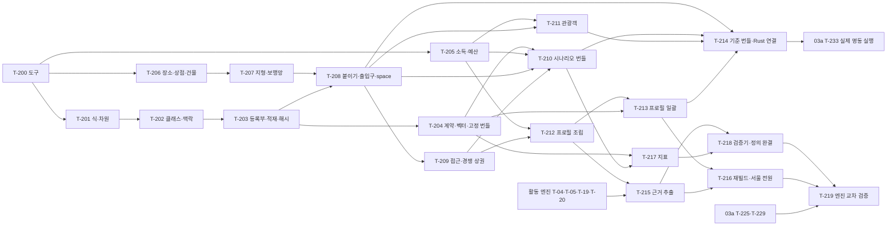

# 반응 온톨로지 Python 쪽 구현 순서 (03b)

[02c](02c_reaction_impl_map.md)의 구현 단위 22개 중 20개를 T-200~T-219로 작업 순서에 놓는다. 나머지 둘은 구현하지 않는다 — I-207-c(역산 어댑터)는 [DR-225](decisions.md#dr-225--엔진-구현-언어와-범위) ①대로 보류이고, I-202-d(LLM 사전 후보)는 일회성 작업([DR-217](decisions.md#dr-217--근거-사전-후보는-이-세션의-haiku-하위-에이전트가-만든다))이라 이 문서의 todo가 아니다. 자료가 오면 하는 조건부 작업은 P-1~P-6으로 따로 적는다. Rust 런타임의 순서는 [03a](03a_rust_engine_build_order.md)(T-220~T-233)이고 두 문서는 §슬라이스의 동기화 지점에서 만난다. 결정은 [DR-234](decisions.md#dr-234--반응-온톨로지-python-쪽-구현-순서의-결정)이다.

**시작 조건**: 사용자의 구현 시작 지시. 02c는 2026-10-31 사용자가 승인해 confirmed다([DR-233](decisions.md#dr-233--반응-온톨로지-구현체-map의-사용자-확인-항목-확정)). 이 문서의 todo 번호는 T-200~T-219로 03a(T-220~), 활동 엔진(T-03~T-34), 역산(T-100~T-107)과 겹치지 않는다.

## 순서를 정한 근거

원칙은 AGENT.md를 따른다. 의존성 순서를 먼저 지키고, 위험이 큰 것을 앞에 두고, 얇게라도 끝까지 관통하는 경로를 먼저 만들고, 각 todo가 끝날 때 반드시 검증되게 묶는다.

### 1. 의존성

코드 의존은 02c의 시그니처에서 읽었다. 같은 단위가 여러 todo로 나뉘는 곳은 이유가 있다. ① I-204-b는 둘이다. 보행망(I-204-a)이 출입구 투영점(`portal_points`)을 받아 간선을 나누고, 그 뒤에 장소를 간선에 붙이므로(`attach_places`) 원자료 쪽(T-206)과 붙이기 쪽(T-208)이 보행망(T-207)을 사이에 둔다. ② I-207-a(정의 적재)는 `Params`(T-201)·`load_contexts`(T-202)·`load_ontology`와 해시(T-203)·`explain`(T-216)·15개 일괄 적재(T-218)로 단계별이다. 분류·식·등록부가 서로 먼저 있어야 하고 어휘·지표·기대 방향 같은 파일은 뒤 단위가 쓰기 때문이다(S-I42). ③ I-202-c는 근거 없는 빌드(T-213)와 근거 포함 재빌드(T-216)로 나뉜다. 근거 추출이 활동 엔진 선행 단위에 막혀 있기 때문이다.

### 2. 위험 우선(fail fast)

| # | 위험 | 앞에 둔 이유와 대응 |
|---|---|---|
| R1 | Python ↔ Rust 계약 불일치(번들·실행 기록·정의 해시·난수·식 평가) | Rust 코드(`sim/`)가 이미 있어 어긋남이 가장 비싸다. T-200~T-204에서 코드가 적은 채로 두 언어를 대조한다 |
| R2 | 실제 공간 자료(OSM 범위, 경사, 60 m 붙이기, 상점 4,434개 펼치기) | 경계 안 1층 상점 180개가 현재 OSM 도로 밖이다. 자료 문제가 늦게 드러나지 않게 T-206~T-208에서 실제 자료를 먼저 돌린다 |
| R3 | 근거 추출이 활동 엔진 선행 단위(T-04·T-05·T-19·T-20, 코드 없음)에 막힘 | 프로필을 구조화 필드만으로 먼저 만든다(T-212~T-214). 근거 추출은 뒤(T-215)이고 프로필 값의 label이 `text`로 바뀌는 것이 차이다 |
| R4 | 규모·메모리(6.5만 명 10분·1.5GiB, 서울 전원 18.5만 명 3GiB) | T-213에서 6.5만 명으로 먼저 재고 T-216에서 서울 전원을 잰다. 목표 초과는 실패가 아니라 `perf` 경고와 조건부 작업 P-4다 |
| R5 | 자료 대기(구 인접표, 경쟁 상권 통계, OSM 확장, 관광객 분포 표의 분류 대응) | 가정 라벨과 균일 접근 모드(S-I14)로 먼저 관통하고 자료가 오면 P-1·P-6으로 바꾼다 |
| R6 | 엔진 결과가 필요한 검증(기대 방향 표, 홀드아웃, 원문 일관성) | 맨 끝(T-219). 그 전에는 고정 실행 기록으로 Python 몫을 검증한다 |

### 3. 수직 슬라이스와 동기화 지점

- **슬라이스 1 — 계약(T-200~T-204)**: 정의 → 적재·해시 → 고정 번들·적합성 벡터. 동기화 S1: 02d 세션과 벡터·고정 번들을 서로 읽어 대조한다(03a의 T-220 계약 적재와 `e228_2_contract_reject`).
- **슬라이스 2 — 실제 공간(T-205~T-210)**: 실제 명동의 보행망·장소·출입구 + 소득·예산 + 최소 번들. 동기화 S2: T-208 뒤 03a의 T-221(공간)에 실제 공간 모델을 먹여 본다.
- **슬라이스 3 — 사람(T-211~T-214)**: 관광객·접근 시간·프로필(구조화 필드)·실제 기준 번들. 동기화 S3: T-214가 03a의 T-233 선행 조건이다.
- **슬라이스 4 — 근거(T-215~T-216)**: 근거 추출로 프로필을 풍부하게 하고 서울 전원 규모를 잰다.
- **슬라이스 5 — 지표·검증(T-217~T-219)**: 고정 실행 기록으로 지표와 Python 검증기를 만들고, 03a의 T-225·T-229가 끝나면 엔진 교차 검증을 한다.

### 4. 테스트 가능한 단위

모든 todo는 02c의 테스트 이름을 그대로 완료 조건으로 쓴다(테스트 109개 전부가 아래 §커버리지에서 정확히 한 todo에 배정된다). 두 단위가 함께 쓰는 테스트(`e207_5`가 I-207-a와 I-202-c 표에 모두 있음)는 마지막에 만족되는 todo 하나에만 둔다. 파일 이름은 02c §1.4의 `tests/test_i2??_*.py` 규칙을 따라 `tests/test_i<3자리>_<소문자>.py`(예 `test_i203_b.py`)이고 실행은 `python3 -m unittest`다.

## 작업 규칙

- 각 todo는 구현 → 해당 테스트 전부 green → 영향을 받은 이전 경계의 회귀 green → 체크 순서다. 테스트가 없는 완료는 없다. 이전에 green이던 테스트가 깨지면 회귀로 보고 진행을 멈춘다.
- 구현 중 Map에 없는 결정이 필요하면 SELF 기준을 만족할 때만 결정하고 Map(02c)에 먼저 적는다. 아니면 멈추고 사용자에게 묻는다. 코드와 Map이 어긋나면 Map이 아니라 갱신이 누락된 것이므로 Map을 먼저 고친다.
- 두 언어가 만나는 todo(T-204·T-208·T-214·T-216·T-219)는 02d 세션과 대조한 결과를 todo 완료 기록에 남긴다. 계약이 어긋나면 02c §2와 02d를 함께 고치고 DR을 남기며 고정 번들·벡터를 다시 만든다(02c §2.9).
- 느린 테스트는 `CBU_SLOW=1`이고, 6.5만 명 이상 처리·서울 전원 측정·실행 기록 100MB 초과 지표 계산은 02c §1.8대로 `/Users/aiden/memguard/bin/memguard run --label "CBU_Hack:reaction:<명령>" --mem-gb 3 -- python3 -m reaction.cli …`로 감싸고 시작 전에 `memguard status`로 디스크 여유 12GiB 이상을 확인한다. 개발 실행(`--limit`)과 단위 테스트는 감싸지 않는다.
- 성능 목표(02c §1.8)는 구현 뒤 측정하며 넘으면 실패가 아니라 `perf` 경고로 남기고 P-4를 만든다.
- 외부 자료를 새로 받을 때(P-1 등)는 파일 이름·출처·크기를 사용자에게 알리고 허락을 받은 뒤에 받는다. 사이트의 봇 차단은 우회하지 않는다.
- 실제 자료로 만든 산출물(`data/reaction-inputs/`, `data/reaction-bundles/`)은 입력 파일의 SHA-256을 `build.json`에 남기고, 통계 대기 항목은 `pending_inputs`로 남긴다(02c §1.9).

## todo 목록

- [ ] T-200 | 대상: I-200-a(errors·ids·rng·io·cli 뼈대), I-204-a의 `to_local` | 선행: 없음 | 공통 도구와 명령행 뼈대
      완료 조건: `cli_exit_codes`, `keyed_uniform_known_values` green. 오류 계층(§1.7)·ID 검사(§1.5 정규식)·정규 JSON·YAML 쓰기·원자적 폴더 확정·`file_sha256`이 동작하고, `keyed_uniform`이 02b §6 기준값과 정확히 같으며 `reaction.geo.to_local`이 §2.7 (5)의 식과 같다.
      산출물: `reaction/__init__.py`, `reaction/{errors,ids,rng,io,geo}.py`(geo는 `to_local`만), `reaction/cli.py`(하위 명령 틀과 오류 처리), `tests/reaction_fixtures.py`, `tests/test_i200_a.py`, `tests/test_i207_d.py`(난수 부분)
      실행: `python3 -m unittest tests.test_i200_a tests.test_i207_d`
- [ ] T-201 | 대상: I-203-b, I-201-a(`load_dimensions`), I-207-a의 `Params` | 선행: T-200 | 식 문법, 매개변수, 차원
      완료 조건: `parse_eval_table`, `syntax_errors`, `eval_errors`, `no_short_circuit`, `e201_1_missing_field_fails` green. v1 `dimensions.yaml`·`interests.yaml`을 01a와 이 Map의 표 그대로, v1 `parameters.yaml`을 §1.10과 02d §2.4의 키 전부(`value`·`unit`·`label`·`source`·`owner`)로 작성한다. `interp_knots`(§2.7 (4))가 knots 벡터 기대값과 같다.
      산출물: `reaction/ontology/expr.py`, `reaction/params.py`(`Params`, `interp_knots`), `reaction/ontology/dimensions.py`, `ontology/v1/{dimensions,interests,parameters}.yaml`, `tests/test_i203_b.py`, `tests/test_i201_a.py`
      실행: `python3 -m unittest tests.test_i203_b tests.test_i201_a`
- [ ] T-202 | 대상: I-203-a, I-207-a의 `load_contexts` | 선행: T-201 | 환경 클래스와 결정 맥락
      완료 조건: `e203_1_attribute_spec_required`, `e203_2_class_without_effect_rejected`, `e203_3_inheritance`, `e203_4_same_values_same_press_and_monotone`, `e203_5_out_of_range_reported`, `e203_6_roles_and_sixteen_variables` green. v1 `classes.yaml`(이 Map의 표 그대로, 변수 v01~v16의 역할 포함)과 `contexts.yaml`(VISIT·NEXT·ROUTE·REST·PURCHASE·LOOK)을 작성하고, `ClassSet.press_values`가 반복 호출에서 같은 값을 낸다.
      산출물: `reaction/ontology/classes.py`, `reaction/ontology/load.py`(`load_contexts`), `ontology/v1/{classes,contexts}.yaml`, `tests/test_i203_a.py`
      실행: `python3 -m unittest tests.test_i203_a`
- [ ] T-203 | 대상: I-207-b, I-207-a의 `load_ontology`(단계별)·`ontology_sha256`, I-200-a의 `validate` | 선행: T-202 | 실행 규칙 등록부와 정의 적재·해시
      완료 조건: `e207_6_rule_declarations_and_cycles`, `e207_7_ids_roles_and_ux_exclusive`, `ontology_sha256_vector`, `cli_validate_v1` green. `load_ontology(root, required=…)`가 이 단계의 파일 7개(dimensions·interests·classes·contexts·parameters·mechanisms·configurations)를 적재하고, 02d §2.4가 요구하는 매개변수 키와 맥락·모든 참조가 해석되는지 확인한다. `python3 -m reaction.cli validate`가 `ontology_sha256`을 내고 종료 0. 이름 해시는 `required`와 상관없이 `ontology/v1/`의 `*.yaml` 전부로 만든다(S-I42).
      산출물: `reaction/ontology/registry.py`, `reaction/ontology/load.py`(`load_ontology`, `ontology_sha256`), `ontology/v1/{mechanisms,configurations}.yaml`, `tests/fixtures/ontology_tiny/`, `tests/test_i207_a.py`, `tests/test_i207_b.py`
      실행: `python3 -m unittest tests.test_i207_a tests.test_i207_b tests.test_i200_a`
- [ ] T-204 | 대상: I-207-d | 선행: T-203 | 계약 스키마·번들·실행 기록·적합성 벡터
      완료 조건: `schema_validators`, `bundle_id_is_content_address`, `verify_bundle_detects_tampering`, `read_run_fixture`, `vectors_regenerate_identically`, `fixture_bundle_is_valid`, `e201_5_run_records_dimension_version`, `e207_3_runs_carry_ontology_hash` green(교차 두 개는 고정 자료 부분). `ontology/v1/conformance/`와 고정 번들·고정 실행 폴더를 만들고, **02d 세션과 대조**한다 — Rust가 같은 벡터·고정 번들을 읽는 테스트가 green인지 확인하고(02c §2.9), `CBU_MDSIM`이 있으면 교차 부분(`e201_5`·`e207_3`의 실제 실행)도 돌린다. 어긋나면 이후 todo로 넘어가지 않고 두 Map을 함께 고친다.
      산출물: `reaction/contract/{schemas,bundle,runread,conformance}.py`, `ontology/v1/conformance/*.json`, `tests/fixtures/contract_bundle/`, `tests/fixtures/contract_run/`, `tests/test_i207_d.py`(전체), `python3 -m reaction.cli conformance`·`fixture-bundle`
      실행: `python3 -m unittest tests.test_i207_d tests.test_i201_a tests.test_i207_a`
- [ ] T-205 | 대상: I-215-a | 선행: T-200 | 추정 소득·예산·가격 민감도
      완료 조건: `e215_2_matches_statistics`, `e215_3_scenario_keeps_quantile_order`, `e215_4_budget_and_sensitivity_monotone`, `e215_5_non_earner_rules`, `e215_6_yaml_matches_extract`, `e215_7_known_cells`, `e215_8_budget_matches_extract` green(E215-1은 프로필이 필요해 T-213). v1.2 `income.yaml`을 이 Map의 블록 그대로 작성하고 숫자가 `data/reaction-stats/income/*.json`과 일치한다(E215-6·E215-8). 증강 6.5만 명 전체 적용(느린 테스트)은 `memguard` 밖에서 1초 이내(§1.8 목표).
      산출물: `reaction/persona/income.py`, `ontology/v1/income.yaml`, `tests/test_i215_a.py`
      실행: `python3 -m unittest tests.test_i215_a`
- [ ] T-206 | 대상: I-204-b(`osm_places`, `import_user_stores`, `merge_places`, `portal_points`, `build_buildings`) | 선행: T-200 | 장소 원자료·사용자 상점·건물
      완료 조건: `category_mapping`, `user_store_contract`, `user_store_building_rows`, `user_store_real_csv`, `user_store_category_draw`, `coverage_complete_keeps_other_categories`, `merge_by_name_and_distance`, `buildings_from_3d_map` green. `data/myeongdong-stores/column_map.yaml`(확정, `coverage: complete`)과 CSV의 SHA-256 `fce4aedd…66da` 일치를 확인하고, 경계 안 1층 장소 627·제외 157(E-real CSV 테스트)이 나온다. v1 `store_columns.yaml`(업종 어휘와 기본값)을 작성한다.
      산출물: `reaction/env/{places,stores,portals,buildings}.py`(`portals`는 `portal_points`만), `ontology/v1/store_columns.yaml`, `tests/test_i204_b.py`
      실행: `python3 -m unittest tests.test_i204_b`
- [ ] T-207 | 대상: I-204-a | 선행: T-206 | 지형과 보행망
      완료 조건: `to_local_matches_3d_map`, `split_at_shared_nodes`, `bilinear_and_fallback`, `short_edge_uses_20m_window`, `steps_and_underground`, `walk_mode_and_width` green. 실제 OSM·지형으로 `build_network`를 돌려 공간 모델 60초·1GiB 목표를 측정하고(초과는 실패가 아니라 `perf` 경고), 출입구 투영점(`portal_points`)에서 간선이 나뉘는지 확인한다. 이 단계에서 `space`의 결정성·실제 경사 기록은 아직 확인하지 않는다(T-208).
      산출물: `reaction/env/{terrain,network}.py`, `reaction/geo.py`(전체), `tests/test_i204_a.py`
      실행: `python3 -m unittest tests.test_i204_a`
- [ ] T-208 | 대상: I-204-b(`attach_places`, `build_portals`), `space` 명령 | 선행: T-207, T-203 | 장소 붙이기·출입구·`space` 명령
      완료 조건: `attach_offset_side`, `e209_6_portals_inside_boundary`, `e204_5_real_myeongdong_slopes_recorded`, `space_deterministic` green. 실제 공간 모델 1벌(`data/reaction-inputs/space/<space_id>/`)과 `space.json`(60 m 밖이라 버린 장소 수 `places_dropped_no_edge`, 제외한 상점 수 `dropped_user_stores`, 지하 통로 수, 경사 통계)을 사용자에게 보여 준다. **03a의 Rust 공간 적재(T-221)와 대조**한다.
      산출물: `reaction/env/places.py`(`attach_places`), `reaction/env/portals.py`(`build_portals`), `python3 -m reaction.cli space`, `tests/test_i204_a.py`·`tests/test_i204_b.py`(확장), `data/reaction-inputs/space/`
      실행: `python3 -m unittest tests.test_i204_a tests.test_i204_b`
- [ ] T-209 | 대상: I-209-a, I-216-a | 선행: T-208, T-203 | 접근 시간·가용 시간 창·경쟁 상권
      완료 조건: `origin_id_all_districts`, `access_table_adjacency`, `access_uniform_mode`, `windows_from_template`, `e216_3_access_defined_for_every_origin`, `e216_4_every_attribute_labeled`, `competitor_set_fixed` green. 구 인접표(활동 엔진 I-06-a)가 없으면 균일 접근 모드(S-I14)로 `access` 명령을 돌려 `access.parquet`·`competitors.parquet`을 만들고 `build.json`의 `pending_inputs`에 남긴다. v1 `competitors.yaml`(통계 전 가정 값, DR-210)을 작성한다.
      산출물: `reaction/persona/access.py`, `reaction/env/competitors.py`, `ontology/v1/competitors.yaml`, `python3 -m reaction.cli access`, `tests/test_i209_a.py`, `tests/test_i216_a.py`
      실행: `python3 -m unittest tests.test_i209_a tests.test_i216_a`
- [ ] T-210 | 대상: I-204-c | 선행: T-204, T-205, T-208, T-209 | 시나리오 번들(최소)
      완료 조건: `presets_complete`, `static_vs_dynamic_split`, `income_scenario_rewrites_budgets`, `stalls_and_benches_deterministic`, `days_in_month`, `minimal_space_bundle` green. v1 `presets.yaml`(변수 16개의 프리셋과 승인된 기준값 U-1~U-4)을 작성한다. 기준 시나리오 번들 1개의 생성(I-204-c의 DoD)은 프로필이 필요해 T-214에서 한다.
      산출물: `reaction/env/scenario.py`, `ontology/v1/presets.yaml`, `tests/test_i204_c.py`
      실행: `python3 -m unittest tests.test_i204_c`
- [ ] T-211 | 대상: I-213-a | 선행: T-205, T-208, T-203 | 외국인 관광객과 배경 보행자
      완료 조건: `e213_1_fields_and_labels`, `e213_2_distribution_matches_tables`, `e213_3_no_nationality_in_runtime_input`, `e213_6_daily_spend_matches_extract`, `e213_5_start_point_and_window`, `background_flows` green(`e213_2`의 실제 자료 부분은 분포 표의 분류 대응이 정해질 때까지 `skipTest`). v1 `tourists.yaml`을 이 Map의 블록 그대로 작성하고 숫자가 `data/reaction-stats/tourists/*.json`과 일치한다(E213-6).
      산출물: `reaction/persona/tourists.py`, `ontology/v1/tourists.yaml`, `python3 -m reaction.cli tourists`, `tests/test_i213_a.py`
      실행: `python3 -m unittest tests.test_i213_a`
- [ ] T-212 | 대상: I-202-b, I-202-a의 `EvidenceHit` 타입 | 선행: T-205, T-209, T-203 | 프로필 조립
      완료 조건: `defaults_follow_age_knots`, `precedence_and_ops`, `comfort_clipped_below_limit`, `perception_and_vision_cue`, `purposes_from_parent_and_interest`, `availability_templates`, `candidate_one_per_target` green. 근거 히트는 시험에서 손으로 만든 값을 넣는다(추출은 T-215). 후보 효과의 대상당 하나 규칙(`candidate_one_per_target`)도 여기서 확인한다. `EvidenceHit`(사전 항목의 출처 `source` — seed·llm_reviewed·llm_candidate — 를 담아 후보 효과를 대상당 하나로 줄일 때 쓴다, 02c I-202-a)·`Value` 타입만 `reaction/persona/evidence.py`에 먼저 둔다.
      산출물: `reaction/persona/{defaults,profile,evidence}.py`(evidence는 타입만), `tests/test_i202_b.py`
      실행: `python3 -m unittest tests.test_i202_b`
- [ ] T-213 | 대상: I-202-c, I-215-a의 E215-1 | 선행: T-212, T-209, T-204, T-205 | 프로필 일괄 처리(근거 없이)
      완료 조건: `e202_1_every_input_has_profile`, `e202_2_every_value_labeled`, `e202_7_required_fields_for_all`, `build_is_deterministic_and_cached`, `e215_1_income_and_label_for_all` green. 고정 200명과 증강 6.5만 명(느린 테스트, `memguard` 안)으로 `profiles`를 돌려 6.5만 명 10분·1.5GiB 목표를 측정한다. 모든 값의 label은 `structured`·`assumption`이다(근거 없음). `build.json`에 `pending_inputs`를 남긴다.
      산출물: `reaction/persona/build.py`, `python3 -m reaction.cli profiles`, `tests/test_i202_c.py`, `data/reaction-inputs/profiles/`
      실행: `python3 -m unittest tests.test_i202_c tests.test_i215_a`
- [ ] T-214 | 대상: I-204-c(기준 번들), I-207-d | 선행: T-208, T-210, T-211, T-213 | 실제 기준 번들과 Rust 연결
      완료 조건: `python3 -m reaction.cli bundle`로 기준 시나리오 번들 1개를 만들고 `verify_bundle`이 통과한다(번들 30초 이내 목표, 새 Map 테스트는 없고 이전 테스트 회귀 전부 green). `build.json`·manifest의 `pending_inputs`(통계 대기 항목)를 보고서로 남기고, **03a의 T-233 선행 조건(프로필·공간·장소)이 충족됐음을 02d 세션에 알려** `MDSIM_BUNDLE` 읽기를 대조한다.
      산출물: `data/reaction-bundles/<bundle_id>/`(번들 파일과 `bundle_report.md`)
      실행: `python3 -m reaction.cli bundle --spec <기준 시나리오> --out data/reaction-bundles` 뒤 `verify_bundle`
- [ ] T-215 | 대상: I-202-a | 선행: T-212, T-203, 활동 엔진 T-04·T-05·T-19·T-20 | 근거 추출
      완료 조건: `e202_3_modality_golden_sentences`, `e202_4_field_context`, `e202_5_grade_beats_habit`, `e202_6_conflicts_reported`, `list_items_used_as_habit`, `lexicon_targets_restricted`, `lexicon_v1_file` green. v1 `lexicon.yaml`(시드 31개 + 후보 252개 + 충돌 12개)은 DR-232 작업이 `data/reaction-lexicon/lx-20261031-a/scripts/merge_to_v1.py`로 이미 만들어 두었다. 이 todo는 `load_lexicon`이 그 파일을 적재해 `lexicon_v1_file`이 통과하는지 확인하고, Map과 어긋나면 Map을 먼저 고친 뒤 스크립트로 다시 만든다. 활동 엔진 I-04-a~I-04-c(`engine/` 규칙 로더·문장 분리·시간 단서·모달리티)가 먼저 있어야 한다.
      산출물: `reaction/persona/evidence.py`, `reaction/ontology/lexicon.py`, `tests/test_i202_a.py`
      실행: `python3 -m unittest tests.test_i202_a`
- [ ] T-216 | 대상: I-202-c(근거 포함), I-207-a의 `explain_persona` | 선행: T-213, T-215 | 근거 반영 재빌드·근거 사슬·서울 전원 측정
      완료 조건: `e207_4_evidence_chain_query`, `e207_5_seoul_profiles_under_3gb` green(`e207_5`는 느린 테스트, `CBU_SLOW=1`, `memguard`, 서울 전원 185,228명 3GiB 이하). 근거 반영 프로필로 T-214의 번들을 다시 만들어 `bundle_id`가 바뀌는 것을 확인하고 02d 세션에 알린다.
      산출물: `python3 -m reaction.cli explain`, 재빌드한 프로필·번들, `tests/test_i207_a.py`(확장)
      실행: `python3 -m unittest tests.test_i207_a tests.test_i202_c`
- [ ] T-217 | 대상: I-212-a | 선행: T-204, T-210 | 지표 후처리
      완료 조건: `e212_1_definition_fields`, `e212_2_hand_computed_fixture`, `e212_3_reps_and_se`, `e212_4_unsupported_when_stage_missing`, `e212_5_every_variable_mapped`, `e212_6_traffic_definition_alignment` green. v1 `indicators.yaml`(Y-01~Y-27)을 작성한다. 고정 실행 기록(`tests/fixtures/contract_run/`)과 실제 05 자료로 확인하며 Rust의 실제 실행 기록은 필요 없다.
      산출물: `reaction/metrics/indicators.py`, `ontology/v1/indicators.yaml`, `python3 -m reaction.cli indicators`, `tests/test_i212_a.py`
      실행: `python3 -m unittest tests.test_i212_a`
- [ ] T-218 | 대상: I-208-a, I-208-b, I-207-a·I-201-a의 전체 적재 검사 | 선행: T-215, T-217, T-210, T-211, T-209, T-206, T-205 | 검증기(Python 몫)와 정의 15개 일괄 적재
      완료 조건: `property_suite_v1_passes`, `property_suite_detects_violation`, `e208_1_property_suites_run`, `e208_5_report_required_fields`, `cross_checks_on_fixture`, `e201_2_both_sides_have_examples`, `e201_3_double_count_rejected`, `e201_4_unlabeled_number_rejected`, `e207_1_forbidden_edges_rejected`, `e207_2_broken_reference_rejected` green. v1 `expectations.yaml`(기대 방향 표, 사용자 승인됨 U-8)과 홀드아웃 픽스처를 작성하고 `load_ontology`를 기본값(15개 파일 전부 필수)으로 돌려 v1 전체가 적재된다.
      산출물: `reaction/verify/{properties,expectations,probe,textcheck,review,report}.py`, `ontology/v1/expectations.yaml`, `python3 -m reaction.cli verify`, `tests/test_i208_a.py`, `tests/test_i208_b.py`
      실행: `python3 -m unittest tests.test_i208_a tests.test_i208_b tests.test_i201_a tests.test_i207_a`
- [ ] T-219 | 대상: I-208-b의 엔진 몫 | 선행: T-218, T-216, 03a의 T-225(probe)·T-229(결정이 있는 전체 실행) | 엔진 교차 검증과 마무리
      완료 조건: `e208_2_direction_table`, `e208_3_holdout_classes`, `e208_4_text_vs_default` green(`CBU_MDSIM` 필요). 기대 방향 표의 판정 칸 100% 통과, 홀드아웃 두 건 통과, 원문 일관성 기준치(0.95) 이상. 검증 보고서 1건을 남기고 이전에 통과한 테스트 전체가 green이다.
      산출물: `CBU_MDSIM` 교차 실행 기록, `data/reaction-verify/<run_id>/report.md`
      실행: `python3 -m unittest tests.test_i208_b`

### 조건부·보류 작업

번호를 붙이지 않는다. 조건이 생기면 Map을 먼저 고치고 03b에 T-번호를 새로 받아 넣는다.

| 이름 | 조건 | 하는 일 |
|---|---|---|
| P-1 OSM 확장 반영 | 사용자가 출처·크기를 확인하고 내려받기를 허락([DR-202](decisions.md#dr-202--공간시설-자료와-경사-계산) ②, 범위는 U-12로 북서·북쪽까지 확정) | 02c I-204-a의 입력 이름 `osm-south`를 `osm-extra`로 일반화하는 Map 수정을 먼저 하고, 내려받은 OSM을 합쳐 T-207·T-208의 `space`를 다시 돌린다. 입력 해시가 바뀌므로 공간 ID가 바뀌고 `places_dropped_no_edge`가 줄어드는지(현재 경계 안 1층 상점 약 180개) 기록한다 |
| P-2 통계 보강 | 사용자가 U-13의 원자료(국민여행조사 원자료 ZIP, 서울관광 Raw Data xlsx)를 허락 | limit을 숙박여행 1회 평균 대신 지출 분포의 분위수로 정의할 수 있는지 검토하고 명동 지출 몫(0.3, 가정)을 통계로 바꾼다. 결과는 DR로 남기고 02c `income.yaml`·`tourists.yaml`을 고친다 |
| P-3 `measured` 값 원문 대조 | T-203 뒤 | `parameters.yaml`에서 `label: measured`이고 "원문 대조"로 적힌 값을 문헌 원문과 대조한다([DR-203](decisions.md#dr-203--반응-모델-수치의-출처와-재현-기준)) |
| P-4 성능 최적화 | `perf` 경고가 날 때 | 병목을 재고 02c §1.8 목표 안으로 줄인다(예: 프로필 캐시, 정규식 캐시, 번들 쓰기) |
| P-5 역산 어댑터(I-207-c) | [DR-225](decisions.md#dr-225--엔진-구현-언어와-범위) ①의 보류가 풀릴 때 | 구현하지 않는다. 풀리면 02c I-207-c를 상세화하고 사용자 확인을 받는다 |
| P-6 구 인접표·경쟁 상권 통계·관광객 분포 표 분류 대응 | 자료나 결정이 올 때 | 균일 접근 모드(S-I14)를 인접표로, 경쟁 상권 가정 값을 통계로, 관광객 분포 표를 `tourists.yaml`에 채우고 T-209·T-211의 건너뛴 테스트(`e213_2` 실제 자료 부분)를 켠다 |

## 사용자가 함께해야 하는 지점

| 시점 | 필요한 것 | 비고 |
|---|---|---|
| 시작 전 | 구현 시작 지시 | 이 문서의 시작 조건 |
| T-204 | 02d 세션과 계약 대조 | 어긋나면 두 Map을 함께 고친다 |
| T-208 전후 | OSM 확장 내려받기 허락(P-1) | 출처·크기를 알린 뒤. 허락이 늦어도 현재 OSM으로 T-207·T-208을 먼저 끝내고 P-1로 다시 돌린다 |
| T-208 | `space.json`의 버린 장소·제외 상점 수 확인 | 60 m 규칙 때문에 장소가 얼마나 빠졌는지 |
| T-211 | 관광객 분포 표의 국적·방문 목적 분류 대응 결정(DR-208 후속) | 없으면 `e213_2` 실제 자료 부분은 건너뜀 |
| T-215 전 | 활동 엔진 T-04·T-05·T-19·T-20 착수 지시(근거 사전 후보 252개는 사용자가 승인해 v1 사전에 넣기로 했다, [DR-232](decisions.md#dr-232--근거-사전-후보-252개를-v1-사전에-모두-넣는다)) | 이 네 todo는 [03_build_order](03_build_order.md)에 있고 아직 시작하지 않았다 |
| 공개 전 | 통계 원자료의 이용 조건 확인(U-13) | 공공누리 표기를 받은 파일에서 확인하지 못했다 |
| T-219 | 기대 방향 표 보고서의 승인 표시 | U-8은 승인됨([DR-233](decisions.md#dr-233--반응-온톨로지-구현체-map의-사용자-확인-항목-확정)) |

## 커버리지

### 단위 → todo

| 단위 | 테스트 수 | 대응 todo |
|---|---|---|
| I-200-a | 2 | T-200(도구·뼈대), T-203(`validate`) |
| I-201-a | 5 | T-201, T-218(전체 적재 검사), T-204(교차) |
| I-203-a | 6 | T-202 |
| I-203-b | 4 | T-201 |
| I-207-a | 6 | T-201(`Params`·`parameters.yaml`), T-202(`load_contexts`), T-203(`load_ontology`·해시), T-216(`explain`), T-218(15개 일괄 적재) |
| I-207-b | 2 | T-203 |
| I-207-c | 0 | 보류(P-5) |
| I-207-d | 7 | T-200(난수 기준값), T-204 |
| I-215-a | 8 | T-205, T-213(E215-1) |
| I-202-a | 7 | T-212(`EvidenceHit` 타입만), T-215 |
| I-202-b | 7 | T-212 |
| I-202-c | 4 | T-213(근거 없이), T-216(근거 포함·서울 전원) |
| I-202-d | 0 | 이 문서 밖(일회성, DR-217). 후보 252개는 사용자가 승인해 v1 사전에 넣기로 했다(DR-232) |
| I-209-a | 4 | T-209 |
| I-213-a | 6 | T-211 |
| I-216-a | 3 | T-209 |
| I-204-a | 8 | T-200(`to_local`), T-207, T-208(`space`) |
| I-204-b | 10 | T-206(원자료·상점), T-208(붙이기·출입구) |
| I-204-c | 6 | T-210, T-214(기준 번들) |
| I-212-a | 6 | T-217 |
| I-208-a | 2 | T-218 |
| I-208-b | 6 | T-218(Python 몫), T-219(엔진 몫) |

테스트는 02c의 표에서 이름을 뽑아 센 값이다. I-207-a의 `e207_5_seoul_profiles_under_3gb`는 I-202-c 표에도 있어 한 번만 센다(T-216). I-208-a·I-200-a의 테스트는 02c 본문에 이름이 문장으로 적혀 있다. 합계 109.

### todo → 완료 테스트 수

| todo | 테스트 수 | 단위 |
|---|---|---|
| T-200 | 2 | I-200-a, I-207-d |
| T-201 | 5 | I-201-a, I-203-b |
| T-202 | 6 | I-203-a |
| T-203 | 4 | I-200-a, I-207-a, I-207-b |
| T-204 | 8 | I-201-a, I-207-a, I-207-d |
| T-205 | 7 | I-215-a |
| T-206 | 8 | I-204-b |
| T-207 | 6 | I-204-a |
| T-208 | 4 | I-204-a, I-204-b |
| T-209 | 7 | I-209-a, I-216-a |
| T-210 | 6 | I-204-c |
| T-211 | 6 | I-213-a |
| T-212 | 7 | I-202-b |
| T-213 | 5 | I-202-c, I-215-a |
| T-214 | 0 | (통합 todo) |
| T-215 | 7 | I-202-a |
| T-216 | 2 | I-207-a |
| T-217 | 6 | I-212-a |
| T-218 | 10 | I-201-a, I-207-a, I-208-a, I-208-b |
| T-219 | 3 | I-208-b |

### 개념 완료 기준(E번호) → todo

02c의 테스트 이름에 E번호가 있는 것만 적는다. 이 번호는 개념 Map의 완료 판정 기준과 1:1이다.

| E번호 | 테스트 | 완료 todo |
|---|---|---|
| E201-1 | missing_field_fails | T-201 |
| E201-2 | both_sides_have_examples | T-218 |
| E201-3 | double_count_rejected | T-218 |
| E201-4 | unlabeled_number_rejected | T-218 |
| E201-5 | run_records_dimension_version | T-204 |
| E202-1 | every_input_has_profile | T-213 |
| E202-2 | every_value_labeled | T-213 |
| E202-3 | modality_golden_sentences | T-215 |
| E202-4 | field_context | T-215 |
| E202-5 | grade_beats_habit | T-215 |
| E202-6 | conflicts_reported | T-215 |
| E202-7 | required_fields_for_all | T-213 |
| E203-1 | attribute_spec_required | T-202 |
| E203-2 | class_without_effect_rejected | T-202 |
| E203-3 | inheritance | T-202 |
| E203-4 | same_values_same_press_and_monotone | T-202 |
| E203-5 | out_of_range_reported | T-202 |
| E203-6 | roles_and_sixteen_variables | T-202 |
| E204-5 | real_myeongdong_slopes_recorded | T-208 |
| E207-1 | forbidden_edges_rejected | T-218 |
| E207-2 | broken_reference_rejected | T-218 |
| E207-3 | runs_carry_ontology_hash | T-204 |
| E207-4 | evidence_chain_query | T-216 |
| E207-5 | seoul_profiles_under_3gb | T-216 |
| E207-6 | rule_declarations_and_cycles | T-203 |
| E207-7 | ids_roles_and_ux_exclusive | T-203 |
| E208-1 | property_suites_run | T-218 |
| E208-2 | direction_table | T-219 |
| E208-3 | holdout_classes | T-219 |
| E208-4 | text_vs_default | T-219 |
| E208-5 | report_required_fields | T-218 |
| E209-6 | portals_inside_boundary | T-208 |
| E212-1 | definition_fields | T-217 |
| E212-2 | hand_computed_fixture | T-217 |
| E212-3 | reps_and_se | T-217 |
| E212-4 | unsupported_when_stage_missing | T-217 |
| E212-5 | every_variable_mapped | T-217 |
| E212-6 | traffic_definition_alignment | T-217 |
| E213-1 | fields_and_labels | T-211 |
| E213-2 | distribution_matches_tables | T-211 |
| E213-3 | no_nationality_in_runtime_input | T-211 |
| E213-5 | start_point_and_window | T-211 |
| E213-6 | daily_spend_matches_extract | T-211 |
| E215-1 | income_and_label_for_all | T-213 |
| E215-2 | matches_statistics | T-205 |
| E215-3 | scenario_keeps_quantile_order | T-205 |
| E215-4 | budget_and_sensitivity_monotone | T-205 |
| E215-5 | non_earner_rules | T-205 |
| E215-6 | yaml_matches_extract | T-205 |
| E215-7 | known_cells | T-205 |
| E215-8 | budget_matches_extract | T-205 |
| E216-3 | access_defined_for_every_origin | T-209 |
| E216-4 | every_attribute_labeled | T-209 |

E212-6의 05 자료 비교와 E215-2·E213-6의 통계 일치는 T-205·T-211·T-217에서 고정 자료로 확인하고, 실제 Rust 실행 기록을 쓰는 비교는 T-219 이후의 보고서에서 한다. 교차 테스트(`e201_5`, `e207_3`)는 T-204에서 고정 자료로 완료하고, `CBU_MDSIM`이 생기면 같은 테스트를 실제 실행으로 다시 돌려 확인한다(새 배정이 아니라 회귀).

## SELF 결정 기록

| ID | 결정 | 근거 | 기각한 대안 |
|---|---|---|---|
| S-B1 | Python 쪽 todo 번호는 T-200~T-219, 조건부 작업은 번호 없는 P-n | 03a(T-220~), 활동 엔진, 역산과 겹치지 않는 빈 구간이다 | T-300대(02c의 I-2xx와 대응이 끊김) |
| S-B2 | 테스트마다 완료 todo 하나. 부분 분기는 앞 todo에서 확인해도 완료 표시는 마지막에 | 03a·역산 순서와 같은 방식. 완료 판정이 모호해지지 않는다 | 같은 테스트를 여러 todo에 중복 배정 |
| S-B3 | `to_local`은 T-200, `interp_knots`는 T-201에서 먼저 만든다 | 적합성 벡터(T-204)가 두 함수를 쓰는데 원래 단위(I-204-a, I-202-b)는 뒤에 있다. 앞당겨도 Map 테스트는 원래 단위의 todo에서 완료한다 | 벡터 생성을 T-207 뒤로 미룸(R1 대조가 늦어짐) |
| S-B4 | `load_ontology(root, required)`로 단계별 적재, 이름 해시는 `required`와 무관하게 `*.yaml` 전부(02c S-I42) | 15개 파일을 서로 다른 단위가 쓴다. 처음부터 15개를 요구하면 첫 단위부터 막힌다 | 빈 껍데기 파일 15개를 먼저 둠(내용 없는 파일이 해시에 섞임) |
| S-B5 | I-204-b를 T-206과 T-208로 나눈다 | 보행망(I-204-a)이 출입구 투영점을 받고 장소가 그 간선에 붙는 순환 의존 | 한 todo로 묶음(보행망 단위 테스트가 늦게 돈다) |
| S-B6 | 근거 없는 프로필(T-212~T-214)을 먼저 만들고 근거 추출(T-215)은 뒤 | 활동 엔진 선행 단위와 사전 승인이 막혀 있다. 먼저 번들·Rust 연결(S3)을 열 수 있다 | 근거 추출을 앞에 둠(Rust 연결이 활동 엔진에 묶임) |
| S-B7 | T-214(기준 번들)와 T-219(엔진 교차)는 새 Map 테스트가 없는 통합 todo | 03a의 T-231·T-233과 같은 방식이고 이전 테스트 회귀와 계약 대조가 완료 조건이다 | 통합 테스트를 새로 정의(02c의 테스트 목록이 늘어남) |
| S-B8 | `column_map.yaml`은 사용자 승인으로 `status: confirmed`, `coverage: complete`로 확정한다 | U-11 승인([DR-233](decisions.md#dr-233--반응-온톨로지-구현체-map의-사용자-확인-항목-확정)) | 초안 상태로 둠 |

## Changelog

- 2026-10-31: 병렬 세션(근거 사전)의 확인에 따라 T-212의 `EvidenceHit` 설명에 `source` 필드를 적었다(02c I-202-a가 더함). 테스트 배정은 바꾸지 않았다.
- 2026-10-31: 최초 작성(v1.0, draft). 02c(confirmed)의 구현 단위 20개를 T-200~T-219로 배치하고 테스트 109개를 정확히 한 todo씩 배정했다. 보류·일회성 단위 둘과 조건부 작업 P-1~P-6, 사용자가 함께할 지점, SELF 결정 S-B1~S-B8을 적었다([DR-234](decisions.md#dr-234--반응-온톨로지-python-쪽-구현-순서의-결정)).
